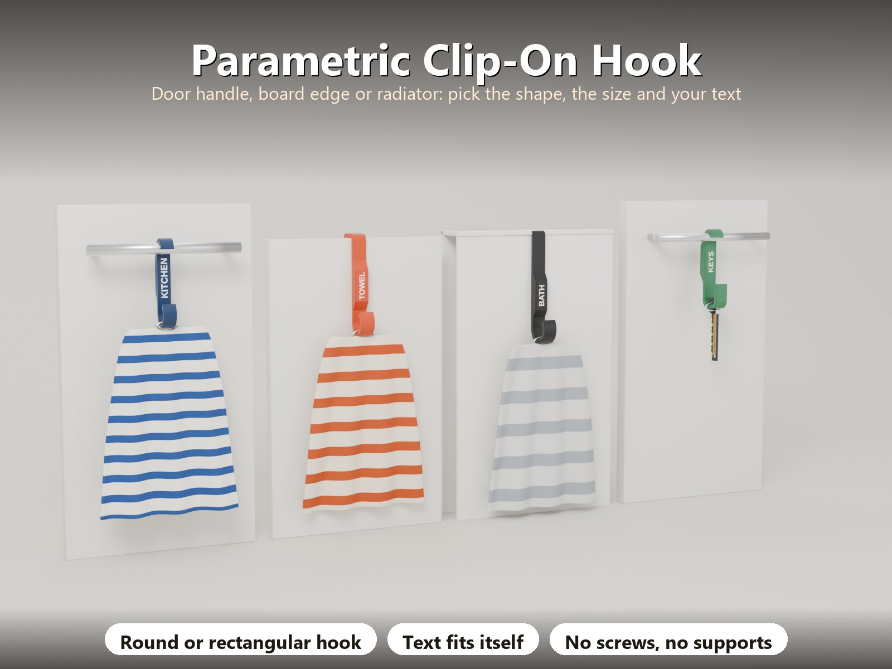
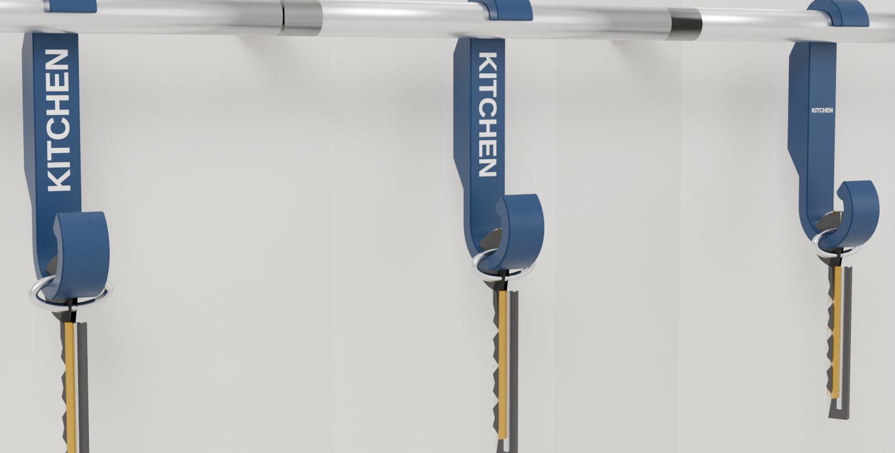
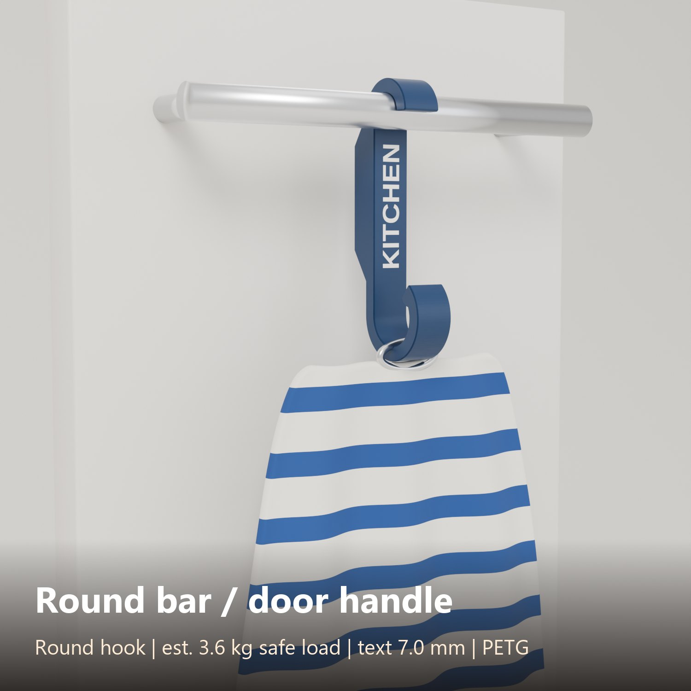
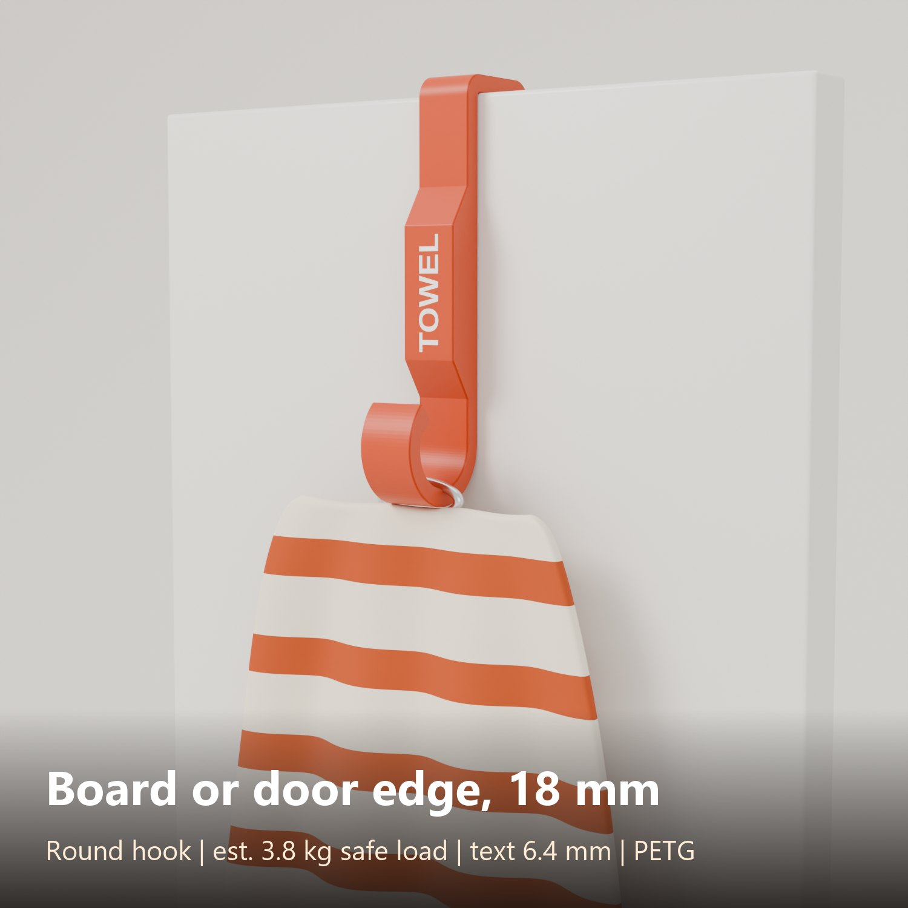
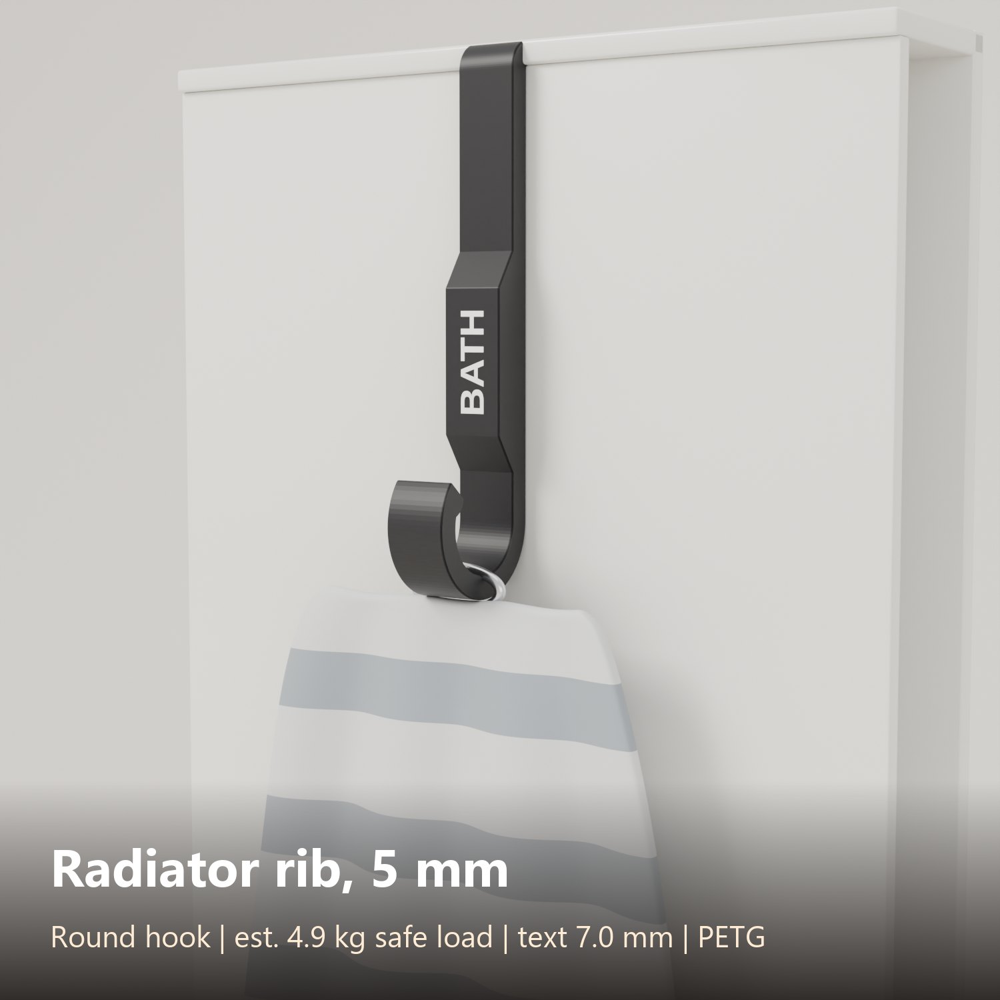
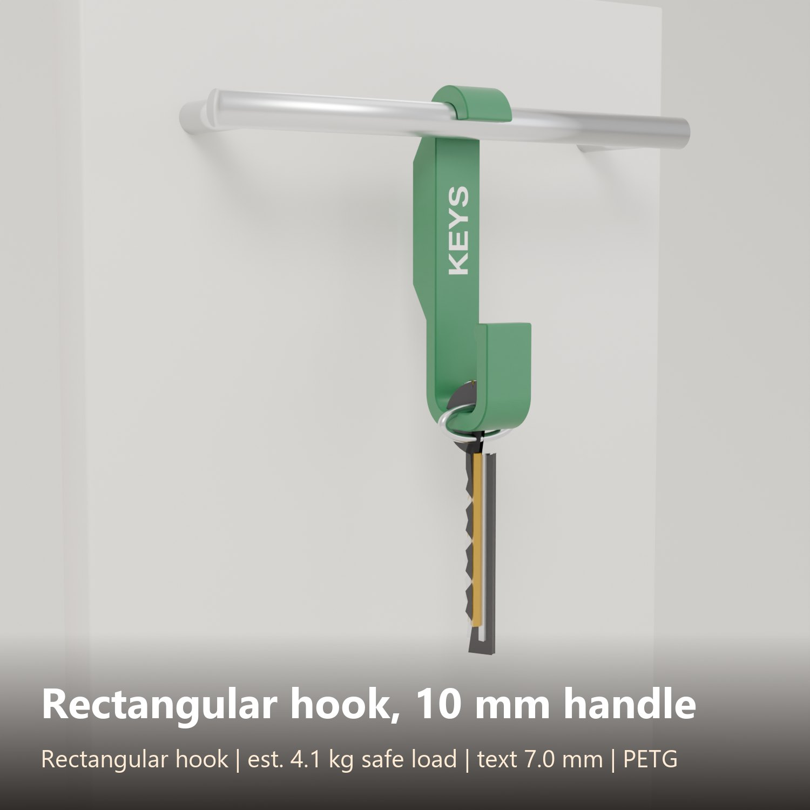

# Parametric Clip-On Hook – Door Handle, Board Edge, Radiator, Round or Rectangular, Free Text

[← All models](../../README.md)

🌐 **English** | [Deutsch](README.de.md)

A strong, tool-free hook that **hangs over a round bar, clips over the edge of a
board or door, or slides into a radiator rib**. You choose the shape of the mount
and the shape of the hook, both with their own sizes and radii, add your own
text, and the generator checks that the result is printable and strong enough
for the load you enter.

> **The model with all print profiles is available exclusively on MakerWorld:**
> 👉 [MakerWorld link: https://makerworld.com/en/models/3546167-hook-generator](https://makerworld.com/en/models/3546167-hook-generator#profileId-4056463)
>
> 

## Table of Contents

- [What you can build](#what-you-can-build)
- [Highlights](#highlights)
- [Parametric Options](#parametric-options)
- [Free text](#free-text)
- [Strength and safety](#strength-and-safety)
- [Print Recommendations](#print-recommendations)
- [Examples](#examples)
- [Tips](#tips)
- [Downloads](#downloads)
- [License](#license)

## What you can build

| Mount side (top) | Typical use |
|---|---|
| **Round bar** | Hang over a kitchen door handle or a towel rail (diameter from 6 mm). Optional press-on tip. |
| **Rectangle / plate edge** | U-clip over a cabinet door, shelf, board or flat handle. Presets for 16, 18 and 19 mm boards, or any thickness up to 60 mm. |
| **Radiator rib** | U-clip into a thin rib or gap. PLA is refused because it softens on a warm radiator. |

| Hook side (bottom) | Options |
|---|---|
| **Round cradle** | Inner diameter, how far the tip curls up (opening angle), tip lip |
| **Rectangular cradle** | Inner width and height, separate inner and outer corner radius, tip lip |

The hook sits on the same side as the mount (round bar) or on the opposite side
(board, rib), automatically or by choice.

## Highlights

- **Strong by design:** printed flat on its side, so every wall follows the
  curves with continuous perimeters. 5 mm walls and a 14 mm width carry about 3 kg
  in PETG (estimate).
- **Strength check built in:** you enter the load in kg. The generator calculates
  the weakest section (hook bend, mount bend, stem or clip leg). If the hook
  cannot carry the load, the **preview shows a red warning** (load, estimated
  maximum, weakest part) and **the export is blocked** until you change a
  parameter.
- **Fool-proof inputs:** wall at least 3 mm, safe radii, the hook mouth must stay
  wide enough, PLA on a radiator is refused, the part must fit the print bed.
  Out-of-range values are corrected with a console note.
- **Free text** on the stem, sized automatically (see below).
- **See the fit:** the preview shows a grey model of the bar, board or rib in the
  mount.
- **No supports.** Chamfered edges double as elephant-foot compensation.

## Parametric Options

| Group | Parameter | Description |
|---|---|---|
| Part | `part` | **Preview** (with the gripped object, display only), **Multi colour** or **Single colour** |
| Mount | `mount_preset`, `mount_type` | Quick start (round bar 10 to 16 mm, board 16 / 18 / 19 mm) or Custom; Round bar, Rectangle / plate edge, Radiator rib |
| Mount | `bar_d`, `slot_w` | Handle diameter, or thickness of the board, plate or rib |
| Mount | `tongue_len`, `tongue_t`, `slot_r_in`, `slot_r_out` | U-clip: leg length and thickness behind the board, inner and outer corner radius |
| Mount | `mount_tip_angle`, `fit_clear`, `handle_gap` | Press-on tip (0 to 20 degrees), clearance (0.3 mm), distance handle to door |
| Hook | `hook_type`, `hook_d`, `hook_w`, `hook_h` | Round or Rectangle, and their sizes |
| Hook | `hook_r_in`, `hook_r_out`, `hook_tip_angle`, `hook_lip`, `hook_side` | Corner radii, opening angle, tip bead, side of the hook |
| Strength | `material`, `load_kg` | PETG, PLA or ASA / ABS; the load the hook must carry |
| Strength | `wall`, `stem_w`, `stem_len`, `part_w`, `edge_chamfer` | Wall thickness, stem width and length, part width (= print height), chamfer |
| Text | `text_mode`, `text_face`, `text_side`, `text_line1`, `text_line2` | Off, raised or inlay; place; two lines |
| Text | `text_font`, `text_size_max`, `text_dir`, `text_depth`, `text_margin` | Font, largest size (shrinks to fit), reading direction, depth, margin |
| Colours | `col_body`, `col_accent` | Hook and text colour for the preview and the 2-colour export |

## Free text

One or two lines, raised or inlaid flush in a second colour. The size is set
automatically so the text always fits with a margin. Choose the place with
`text_face`:

- **Front wall:** the side of the stem that faces the room when the hook hangs
  (readable when hung).
- **Back wall:** the opposite side, against the door or board (hidden when
  mounted, for example for a name or a date).
- **Both walls:** front and back.
- **Side face:** the large flat face (simplest print). With `text_side` the text
  goes on the print side, the bed side or both. **Text on the bed side is always
  inlaid flush**, because raised text cannot be printed on the build plate.

`text_dir` sets the reading direction: **Reads upwards**, **Reads downwards** or
**Horizontal**.

## Strength and safety

The strength number is an **estimate** from beam formulas with a safety factor of
about 5. Print one hook, load it with the real weight and check it before you
rely on it. Do not use these hooks for anything that could hurt someone if it
falls (climbing, children's swings, lifting). Keep PETG hooks away from surfaces
hotter than about 60 °C, ASA about 80 °C.

## Print Recommendations

| Setting | Recommendation |
|---|---|
| Orientation | **Flat on its side** (the profile lies on the bed), no supports |
| Material | **PETG** or **ASA / ABS**. Radiator: PETG or ASA only, never PLA |
| Nozzle / layer | 0.4 mm nozzle, 0.2 mm layers |
| Walls | 4 or more |
| Infill | 25 % gyroid (the hook is mostly walls) |
| Colours | 2 for the text. Text on a wall puts the second colour on every layer, so a multi-colour print takes longer; text on the side face needs only a few layers of the second colour |

## Examples

| Variant | Mount | Hook | Text |
|---|---|---|---|
|  | Round bar 12 mm | Round, 20 mm | KITCHEN |
|  | Board 18 mm | Round, 22 mm, 16 mm wide | TOWEL |
|  | Radiator rib 5 mm, 45 mm leg | Round, 24 mm | BATH |
|  | Round bar 10 mm | Rectangular 20 x 26 mm, 5 mm radius | KEYS |

All four variants were verified on the real exported geometry and test-sliced for
the Bambu Lab P2S in PETG. The generator itself was checked with 84 cases
(including random parameter sets and cases that must be refused), no failures.

## Tips

- Measure the handle diameter, board thickness or rib with calipers. Keep
  `fit_clear` at 0.3 mm and raise it in 0.05 mm steps if your printer prints tight.
- For a handle with a rectangular section choose Rectangle / plate edge, set
  `slot_w` to the handle width and the inner radius to the handle's corner
  radius plus the clearance.
- A thinner leg fits narrow gaps behind a door (`tongue_t`), but the strength
  check lowers the allowed load: that is the physics, not a bug.

## Downloads

Print files are intentionally available exclusively on MakerWorld.

👉 MakerWorld link: https://makerworld.com/en/models/3546167-hook-generator#profileId-4056463

Profile: <https://makerworld.com/en/@BetaHydri>

## License

Documentation and images in this repository; model and print files are
distributed exclusively via MakerWorld. Documentation and images: © BetaHydri.
The model (including source code) and all print files are under the license
stated on MakerWorld. This repository deliberately contains no model, source
code or print files.
