# Parametric Label Holder Generator – Aufsteckclip, Klebeplatte, Papiertasche oder gedruckter Text

[← Alle Modelle im Überblick](../../README.de.md)

🌐 [English](README.md) | **Deutsch**

**Beschrifte alles, was flach ist.** Wähle eine Größe, wähle die Befestigung – ein Aufsteckclip über die Oberkante
einer Wand, eine Kleber- oder Klebebandplatte oder beides – und wähle, was das Etikett ist: eine Einschub-Papiertasche
(die auch eine gedruckte Kachel aufnimmt) oder Text, der direkt auf den Halter gedruckt wird. Ein Generator macht den
Halter für Schubladentrenner, Sortierboxen, Regale, Kisten, Pappkartons und alles andere mit einer flachen Wand. Alles
im MakerWorld-Customizer, ohne Stützen.

> **Das Modell mit allen Druckprofilen gibt es ausschließlich auf MakerWorld:**
> 👉 [MakerWorld-Link: https://makerworld.com/en/models/3444426-label-holder-generator](https://makerworld.com/en/models/3444426-label-holder-generator)
>
> 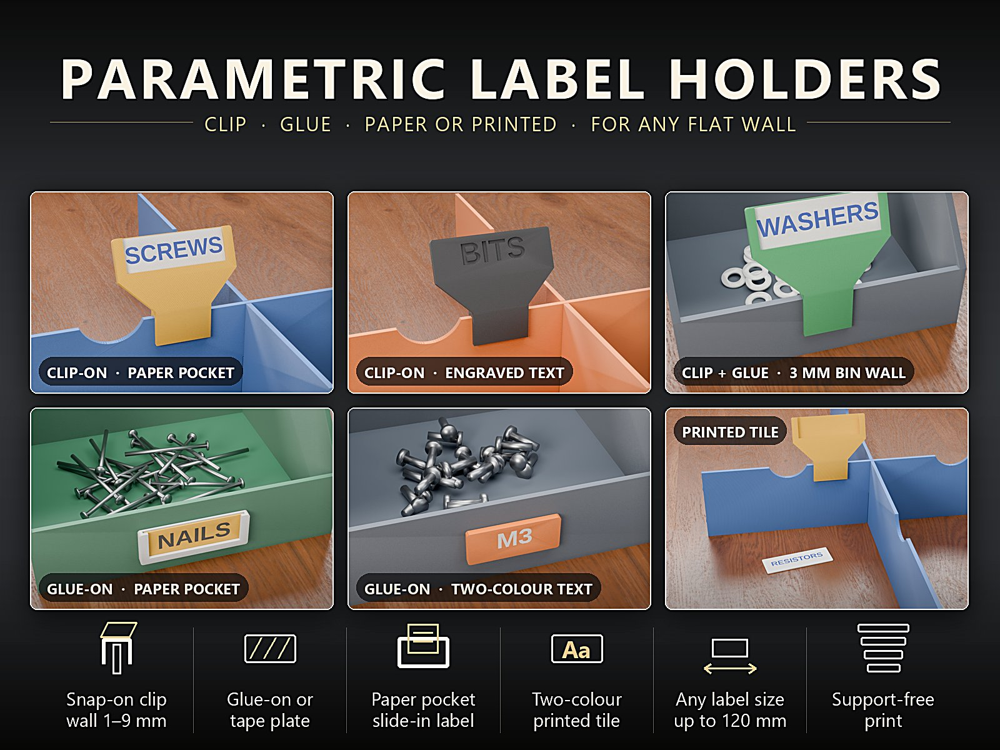

## Inhaltsverzeichnis

- [Das Problem](#das-problem)
- [Die Idee](#die-idee)
- [Highlights](#highlights)
- [Passt gut zu](#passt-gut-zu)
- [Parametrische Optionen](#parametrische-optionen)
- [Papier oder gedruckte Kachel – welche Größe?](#papier-oder-gedruckte-kachel--welche-größe)
- [Konstruktion](#konstruktion)
- [Varianten](#varianten)
- [Druckempfehlungen](#druckempfehlungen)
- [Was du sonst noch brauchst](#was-du-sonst-noch-brauchst)
- [Anwendungsfälle](#anwendungsfälle)
- [Fehlersuche / FAQ](#fehlersuche--faq)
- [Entwicklungsgeschichte](#entwicklungsgeschichte)
- [Downloads](#downloads)
- [Lizenz](#lizenz)

## Das Problem

Etiketten klingen banal, aber die üblichen Lösungen haben alle einen Haken:

- Klebeetiketten lösen sich, lassen sich nicht ändern und sehen auf einer gedruckten Box unordentlich aus.
- Fertige Etikettenhalter passen zu einer Wandstärke und einer Etikettengröße, oft auch nur zu einer Befestigung.
- Ein zu strammer Clip lässt die Wand reißen, ein zu lockerer fällt bei der ersten Berührung ab.
- Auf eine Platte gedruckter Text ist endgültig: Ändert sich der Inhalt, muss der ganze Halter neu gedruckt werden.
- Zweifarbiger Text bedeutet normalerweise viel Gefummel im Slicer.

## Die Idee

Ein einziges Modell erzeugt den passenden Halter. Du wählst, **wie er befestigt wird**:

- ein **Aufsteckclip**, der über die Oberkante einer Wand oder eines Trenners greift,
- eine **Kleber- oder Klebebandplatte** mit flacher Rückseite,
- oder **beides**: Der Clip rastet zuerst ein, danach wird der vordere Arm für festen Halt verklebt.

Und du wählst, **was das Etikett ist**: eine **Papiertasche**, in die du von oben einen Papierstreifen (oder eine
gedruckte Kachel) schiebst, oder **Text, der in den Halter graviert** wird. Der Clip wird aufrecht auf seinen beiden
Armen gedruckt, die Platten liegen flach – kein Teil braucht Stützen. Alle Maße sind in Millimetern, alle sind
Customizer-Parameter.

## Highlights

- 📎 **Drei Arten der Befestigung**
  - **Aufsteckclip:** greift über die Oberkante einer Wand oder eines Trenners von **1–9 mm**. Zwei Arme und eine
    Brücke, mit einer kleinen Haftnase, damit er auf einer 2-mm-Wand fest sitzt. Das Etikett neigt sich zu dir
    (`tilt`), damit es von oben gut lesbar ist.
  - **Kleber- oder Klebebandplatte:** eine flache Rückseite für doppelseitiges Klebeband oder Kleber, auf jeder
    flachen Fläche.
  - **Clip + Kleber:** rastet zuerst ein, danach wird der lange vordere Arm für festen Halt verklebt.
- 🏷️ **Zwei Arten von Etikett**
  - **Papiertasche:** Schiebe einen Papierstreifen (oder eine gedruckte Kachel) von oben ein und tausche ihn, sobald
    sich der Inhalt ändert.
  - **Gravierter Text:** Tippe deinen Text; er wird in den Halter graviert und automatisch passend skaliert.
- 🎨 **Zweifarbiger Text ohne Slicer-Tricks:** Die flachen Varianten gibt es mit einer fertigen Zweifarb-Datei –
  Grundkörper in Filament 1, Text in Filament 2.
- 🎨 **Halter + zweifarbiges Etikett in einem Export:** Wähle im Customizer *Halter + zweifarbiges Etikett*. Der Halter
  hat eine Farbe, das gedruckte Etikett zwei (Grundkörper und Text). Halter, Etikettengrund und Text kommen als
  getrennte Farbgruppen heraus, Halter und Etikett als getrennte Körper, sodass jedes Filament im Slicer zugewiesen
  werden kann.
- 📐 **Jede Etikettengröße:** sichtbares Etikett von 16 × 8 mm bis **120 × 60 mm**. Die Papiergröße ergibt sich aus
  deiner Etikettengröße (siehe [Papier oder gedruckte Kachel](#papier-oder-gedruckte-kachel--welche-größe)).
- 🖨️ **Keine Stützen:** Clips werden aufrecht auf ihren beiden Armen gedruckt, Klebeplatten flach auf der Rückseite,
  Kacheln flach mit der Vorderseite nach oben.
- 🔧 **Jedes Maß ist ein Parameter:** Wandstärke, Clip-Spiel, Haftnase, Hakentiefe, Clipbreite, Neigung, Taschenspalt,
  Rahmenüberlappung, Schrift und Texttiefe.

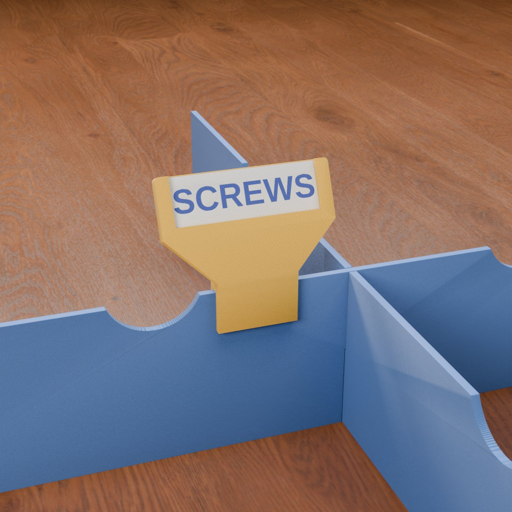

## Passt gut zu

Die Halter sind universell – sie passen auf jede flache Wand von 1 bis 9 mm –, aber sie wurden neben diesen Modellen
entworfen und passen zu deren Standard-Wandstärken:

- 🗂️ **[Parametric Drawer Divider System](https://makerworld.com/en/models/3437057-parametric-drawer-divider-system)**
  ([Dokumentation](../parametric-drawer-divider-system/README.de.md)): Der Standard-Trenner ist 2,0 mm dick, das ist
  der Standardwert `wall_t` des Clips. Stecke ein Etikett auf die flache Oberkante zwischen zwei Fingerkerben, abseits
  der Kreuzungen.
- 📦 **[Stackable Parametric Open-Front Storage Bin](https://makerworld.com/en/models/2867878-stackable-parametric-open-front-storage-bin)**:
  Die Box hat eine niedrige Vorderwand, genau dort gehört ein Etikett hin. Nutze den **Clip** auf der Oberkante der
  Vorderwand, **Clip + Kleber** für festen Halt oder die **Klebeplatte** auf der Vorderseite. Stapelbare Boxen haben
  3 mm Wand (`wall_t = 3`).
- 🧰 **[Parametric Stackable Drawer System](https://makerworld.com/en/models/3024548-parametric-stackable-drawer-system)**:
  Setze eine Klebeplatte auf die Schubladenfront, damit du immer weißt, was drin ist.

Etiketten sind flache Platten, deshalb gehören sie auf flache Wände – für runde Dosen oder gewölbte Gefäße sind sie
nicht gedacht.

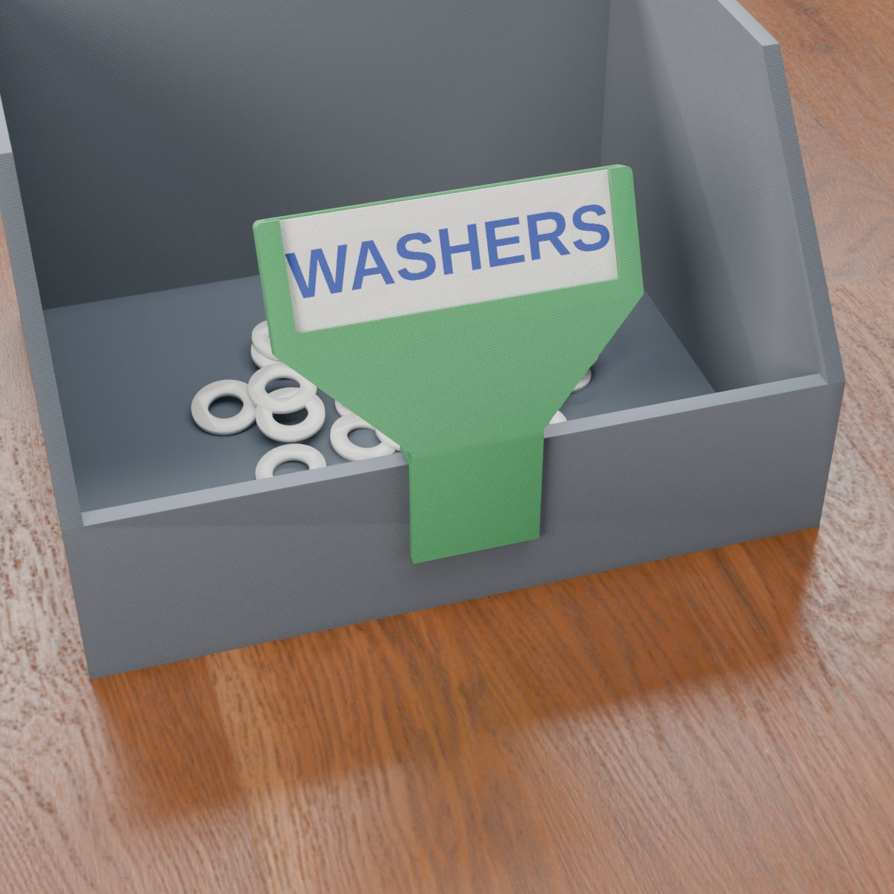

## Parametrische Optionen

Die Namen entsprechen den Customizer-Parametern des Modells.

### Teileauswahl

| Parameter | Bedeutung | Standard | Optionen |
|---|---|---|---|
| `part` | Was erzeugt wird | *Vorschau an Beispielwand* | *Vorschau an Beispielwand* (nur Anzeige, **nicht zum Drucken**), *Etikettenhalter*, *Gedruckte Etikettenkachel*, *Halter + Kachel – einfarbig*, *Halter + zweifarbiges Etikett – 3 Farben* (Halter, Etikettengrund und Text als getrennte Farbgruppen), *Nur zweifarbiges Etikett* |

### Etikett

| Parameter | Bedeutung | Standard | Bereich / Einheit |
|---|---|---|---|
| `label_type` | *Papiertasche* (Papierstreifen oder gedruckte Kachel einschieben) oder *Text in den Halter graviert* | Papiertasche | Auswahl |
| `label_w` | Sichtbare Etikettenbreite | 36 | 16–120 mm |
| `label_h` | Sichtbare Etikettenhöhe | 12 | 8–60 mm |
| `label_text` | Text auf dem Halter (Textmodus) oder auf der gedruckten Kachel | `SCREWS` | Text |
| `text_size` | Textgröße (0 = automatisch passend) | 0 | 0–40 mm, Schritt 0,5 |
| `text_font` | Schrift | `Liberation Sans:style=Bold` | Schriftname |
| `text_depth` | Gravurtiefe; auf einer Kachel auf Kachelstärke minus 0,4 mm begrenzt | 0,6 | 0,4–1,2 mm, Schritt 0,1 |

### Befestigung

| Parameter | Bedeutung | Standard | Bereich / Einheit |
|---|---|---|---|
| `mount` | *Aufsteckclip* (über die Oberkante einer Wand), *Kleber- oder Klebebandplatte* (flache Rückseite) oder *Clip + Kleber* (aufstecken, dann den langen vorderen Arm verkleben) | Aufsteckclip | Auswahl |
| `wall_t` | Dicke der Wand oder des Trenners, über die der Clip passt | 2,0 | 1–9 mm, Schritt 0,1 |
| `clip_fit` | Gesamtspiel im Clipschlitz; erhöhen, wenn der Clip zu stramm ist | 0,2 | 0,1–0,5 mm, Schritt 0,05 |
| `clip_grip` | Höhe der Haftnase am hinteren Arm (0 = aus; 0,2 rastet auf einer 2-mm-Wand fest ein) | 0,2 | 0–0,5 mm, Schritt 0,05 |
| `hook_depth` | Wie weit die Arme an der Wand hinunterreichen | 10 | 6–30 mm |
| `clip_w` | Breite des Clip-Hakens; nie breiter als die Etikettenplatte | 20 | 8–80 mm |
| `arm_t` | Dicke der Clip-Arme und der Brücke | 1,8 | 1,2–3 mm, Schritt 0,2 |
| `tilt` | Neigungswinkel des Etiketts zum Betrachter (nur Clip, 0 = aufrecht) | 25 | 0–40°, Schritt 5 |

### Tasche

| Parameter | Bedeutung | Standard | Bereich / Einheit |
|---|---|---|---|
| `pocket_t` | Spalt für das Papier oder die Kachel; ein Papierstreifen braucht etwa 0,4, die gedruckte Kachel passt ab 0,6 | 1,0 | 0,4–2 mm, Schritt 0,1 |
| `overlap` | Wie weit der vordere Rahmen den Papierrand überdeckt | 1,5 | 1–3 mm, Schritt 0,1 |

### Qualität

| Parameter | Bedeutung | Standard | Bereich / Einheit |
|---|---|---|---|
| `round_res` | Glätte der gerundeten Ecken | 48 | 24–96, Schritt 8 |

## Papier oder gedruckte Kachel – welche Größe?

Die Papiertasche nimmt einen Papierstreifen oder eine gedruckte Kachel auf. Schneide das Papier auf die Größe der
Kachel zu:

- **Papierbreite** = `label_w` + 3 mm
- **Papierhöhe** = `label_h` + 1,2 mm
- Standard (`label_w` 36, `label_h` 12): **39 × 13,2 mm**.

Ein Papierstreifen braucht einen Taschenspalt von etwa 0,4 mm; die gedruckte Kachel (`part` = *Gedruckte
Etikettenkachel*) passt ab einem Spalt von 0,6 mm. Der Standardwert `pocket_t` von 1,0 mm nimmt beides auf. Der
Streifen wird von einem vorderen Rahmen gehalten, der 1,5 mm seines Rands überdeckt (`overlap`); er kann nicht
herausfallen und bleibt lesbar.

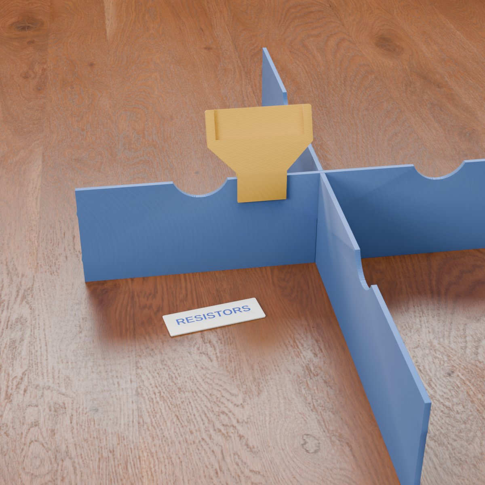

## Konstruktion

### OpenSCAD-Ansatz

Das Modell ist eine einzige parametrische OpenSCAD-Datei ohne zusätzliche Bibliotheken. Jede Druckpose entsteht aus
derselben Etikettenplatte: Der Clip ist die Platte plus ein Haken, der Klebehalter ist die Platte allein.

### Parametrische Logik

- **Plattengröße aus dem Etikett:** Die Tasche ist die Etikettenbreite plus die Rahmenüberlappung auf beiden Seiten
  plus etwas Spiel; die Platte fügt auf jeder Seite eine 1,6 mm starke Wand hinzu. Die Platte besteht aus einer
  1,2 mm starken Rückschicht, dem Taschenspalt und einem 1,2 mm starken vorderen Rahmen.
- **Clipschlitz aus der Wand:** Der Schlitz ist `wall_t` plus `clip_fit`; vorderer Arm, hinterer Arm und Brücke haben
  die Dicke `arm_t`.
- **Kachel aus der Tasche:** Die gedruckte Kachel ist 0,2 mm dünner als der Taschenspalt, damit sie hineingleitet.
- **Automatische Textgröße:** Bei `text_size` = 0 wird der Text auf die Etikettenhöhe skaliert und so verkleinert,
  dass er in die Etikettenbreite passt.
- **Clip + Kleber:** Die Arme sind länger (mindestens 16 mm oder 1,8 × `hook_depth`), damit es einen langen vorderen
  Arm zum Verkleben gibt.

### Besondere Algorithmen

- **45°-Hals:** Ist die Platte breiter als der Haken, sitzt sie auf einem 45°-Hals, es gibt also keinen flachen
  Überhang.
- **Keil unter der geneigten Platte:** Neigt sich das Etikett nach hinten, füllt ein Keil den Raum zwischen Brücke und
  Platte, sodass nichts in der Luft hängt.
- **Haftnase:** Eine 45°-Nase am hinteren Arm sorgt für den Halt beim Einrasten; ihre Höhe ist `clip_grip`.
- **Zweifarbige Teile:** Etikettengrund und Text sind getrennte Körper und Farbgruppen; auch der gravierte Halter-Text
  wird als eigene Farbgruppe exportiert.

### Druckoptimierungen

- Nirgends Stützen: Clip aufrecht auf zwei Armen, Klebeplatten flach auf der Rückseite, Kacheln flach mit der
  Vorderseite nach oben.
- Eine 0,4-mm-Fase an der Kante der ersten Schicht der Klebeplatten gegen den Elefantenfuß.
- Die Schlitzbrücke bleibt bis zu einer Wand von 9 mm druckbar.

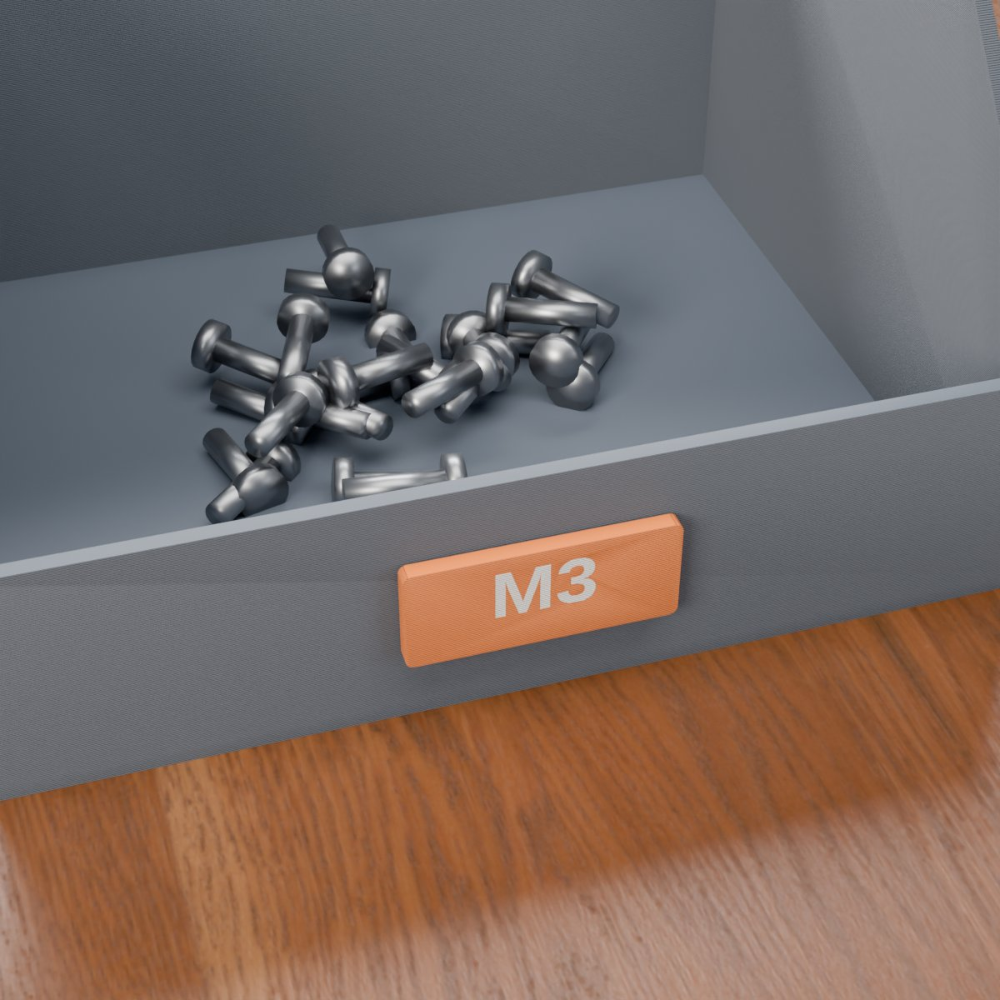

## Varianten

Das Modell kommt mit sechs fertigen Varianten, jeweils mit einem Bambu-Studio-Profil. Die flachen Varianten gibt es
zusätzlich als Zweifarb-Datei.

| Variante | Befestigung | Etikett |
|---|---|---|
| Clip + Taschen-Set | Aufsteckclip | Papiertasche + Kachel, `SCREWS` |
| Clip, gravierter Text | Aufsteckclip | gravierter Text, `BITS` |
| Clip + Kleber, Boxen-Set | Clip + Kleber, 3 mm Wand | Papiertasche + Kachel, 48 × 16 mm, `WASHERS` |
| Klebe-Taschen-Set | Klebeplatte | Papiertasche + Kachel, `NAILS` |
| Klebeplatte, gravierter Text | Klebeplatte | gravierter Text, 24 × 10 mm, `M3` (auch zweifarbig) |
| Gedruckte Kachel | jeder Taschenhalter | gedruckte Kachel, `RESISTORS` (auch zweifarbig) |

Für jede andere Größe, jeden anderen Text und jede andere Wandstärke nutzt du den Customizer.

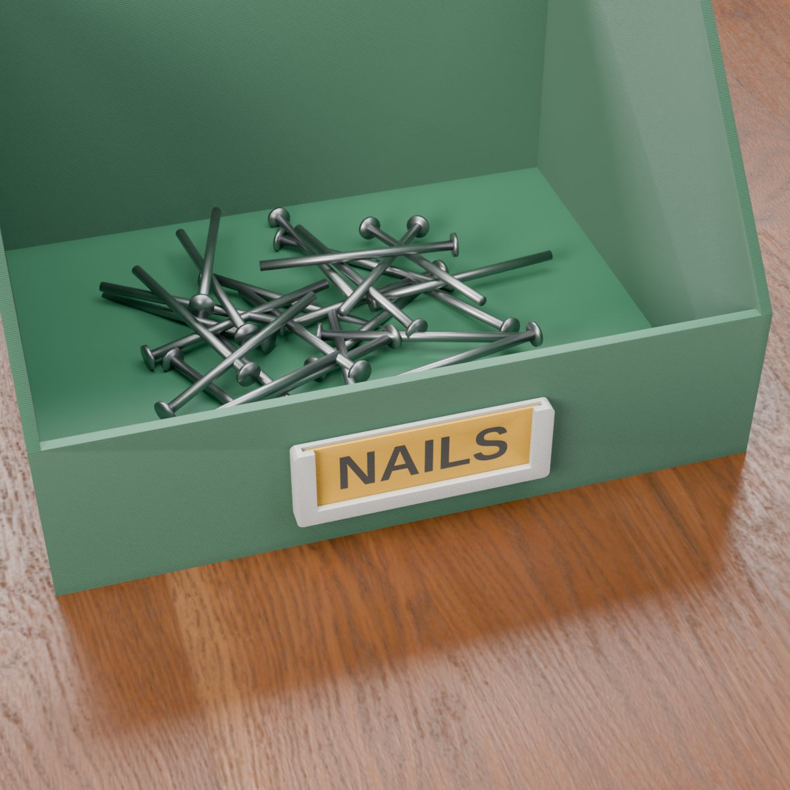

## Druckempfehlungen

| Halter | Ausrichtung | Stützen |
|--------|-------------|---------|
| Aufsteckclip (und Clip + Kleber) | aufrecht, auf den beiden Armen stehend | keine |
| Kleber- / Klebebandplatte | flach, Rückseite nach unten | keine |
| Gedruckte Kachel (für die Papiertasche) | flach, Vorderseite nach oben | keine |

| Einstellung | Empfehlung |
|---|---|
| Material | PLA für Etiketten, die an ihrem Platz bleiben; **PETG für Clips, die oft auf- und abgenommen werden** |
| Schichthöhe | 0,20 mm |
| Wände | 3 |
| Füllung | 15 % Gyroid |
| Brim | **5–8 mm** bei Clips (sie stehen auf ihren Armen) |
| Stützen | keine |

- **Welche Datei öffnen:** Die Profile sind einfarbig. Für **zweifarbigen Text** öffne die passende Zweifarb-Datei
  (Klebeplatte mit Text und gedruckte Kachel): Filament 1 ist das Etikett, Filament 2 der Text, kein manueller
  Farbwechsel nötig.
- **Warum PETG für Clips:** Die Arme federn bei jedem Aufstecken und Abziehen, und PETG biegt sich, statt zu brechen.
- **Clip zu stramm oder zu locker?** Setze `wall_t` auf die tatsächliche Dicke deiner Wand und passe `clip_fit` in
  0,05-mm-Schritten an. Drucke vorher ein kurzes Testteil.
- **Textfarbe:** Die fertigen Clip-Profile gravieren den Text einfarbig. Für eine zweite Farbe wähle im Customizer
  *Halter + zweifarbiges Etikett*. Bei einem Clip-Halter liegt der gravierte Text auf der geneigten Fläche, deshalb
  liefert eine **gedruckte Kachel** in der Tasche das sauberste zweifarbige Ergebnis.

**Montage**

1. **Clip:** Schiebe ihn über die Oberkante der Wand, bis die Brücke auf der Kante sitzt.
2. **Clip + Kleber:** Stecke ihn auf und verklebe dann den langen vorderen Arm mit der Wand.
3. **Klebeplatte:** Reinige die Fläche und klebe doppelseitiges Klebeband (oder einen Tropfen Kleber) auf die flache
   Rückseite.
4. **Papiertasche:** Schiebe den Papierstreifen oder die gedruckte Kachel von oben ein.

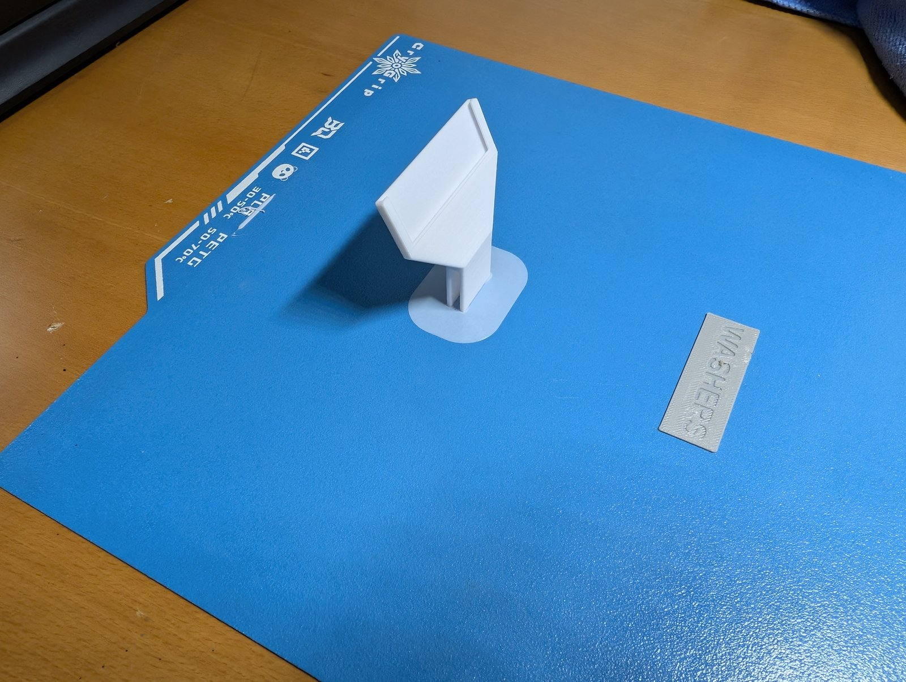

## Was du sonst noch brauchst

- **Aufsteckclip:** nichts – er klemmt über die Wand.
- **Klebeplatte oder Clip + Kleber:** doppelseitiges Montageband oder ein Tropfen Kleber, passend zum Wandmaterial.
- **Papieretikett:** ein auf Maß geschnittener Papierstreifen, oder drucke die Kachel.

## Anwendungsfälle

- **Schubladentrenner:** ein Clip auf der flachen Oberkante zwischen zwei Fingerkerben.
- **Sortierboxen:** Clip, Clip + Kleber oder Klebeplatte auf der niedrigen Vorderwand.
- **Schubladenfronten und Regale:** eine Klebeplatte, damit du immer weißt, was drin ist.
- **Pappkartons und Kisten:** Jede flache Wand von 1 bis 9 mm nimmt den Clip auf.
- **Werkstatt und Hobbyraum:** Schrauben, Bits, Unterlegscheiben, Nägel, Widerstände – ein Generator für alle
  Etiketten.
- **Wechselnder Inhalt:** Der Papierstreifen oder die gedruckte Kachel ist in Sekunden getauscht.

## Fehlersuche / FAQ

| Symptom | Ursache | Lösung |
|---|---|---|
| Der Clip ist zu stramm | Der Druck fällt etwas größer aus, oder `wall_t` ist zu klein eingestellt | `wall_t` auf die tatsächliche Wandstärke setzen, `clip_fit` in 0,05-mm-Schritten erhöhen |
| Der Clip ist zu locker | Der Druck fällt etwas kleiner aus | `clip_fit` senken oder `clip_grip` etwas erhöhen |
| Der Clip lässt sich schwer aufrecht drucken | Die Arme haben wenig Kontakt zum Bett | 5–8 mm Brim verwenden |
| Ein Arm ist gebrochen | PLA ist für oft auf- und abgenommene Clips spröde | PETG verwenden |
| Das Papier passt nicht in die Tasche | Papier auf die falsche Größe geschnitten | Auf `label_w` + 3 mm × `label_h` + 1,2 mm zuschneiden |
| Das Papier lässt sich nicht einschieben | Taschenspalt für das Papier zu klein | `pocket_t` auf 0,4 mm oder mehr erhöhen |
| Die gedruckte Kachel lässt sich nicht einschieben | Taschenspalt für die Kachel zu klein | `pocket_t` von 0,6 mm oder mehr verwenden |
| Der Text passt nicht | Etikett zu klein für den Text | `label_w` erhöhen, den Text kürzen oder kleineres `text_size` setzen |
| Der Clip passt nicht auf meine Wand | Wand dicker als 9 mm oder nicht flach | Die Klebeplatte verwenden |
| Der Halter bleibt auf einer runden Dose nicht | Etiketten sind flache Platten | Nur auf flachen Wänden verwenden |

## Entwicklungsgeschichte

Das Modell ist ein vollständig parametrischer Etikettenhalter-Generator für den FDM-Druck, im Oktober 2026 auf
MakerWorld veröffentlicht: Clip, Klebeplatte oder beides, Papiertasche oder gravierter Text, gedruckte Kachel und ein
Zweifarb-Export.

Jede im Customizer angebotene Option wurde auf Druckbarkeit und Funktion geprüft: Die Clips drucken aufrecht ohne
Stützen, der Schlitz passt zur gewählten Wandstärke, das Papier und die gedruckte Kachel gleiten in die Tasche, die
Zweifarb-Dateien trennen Etikett und Text sauber und die Klebeplatten liegen flach auf.

Die Renderings in diesem Repository sind Renderings der Modellgeometrie oder daraus abgeleitete Szenenbilder; Wände,
Boxen sowie Schrauben, Nägel und Unterlegscheiben sind Illustrationen zur Einordnung und kein Teil des Modells. Die
drei Fotos zeigen einen Testdruck.

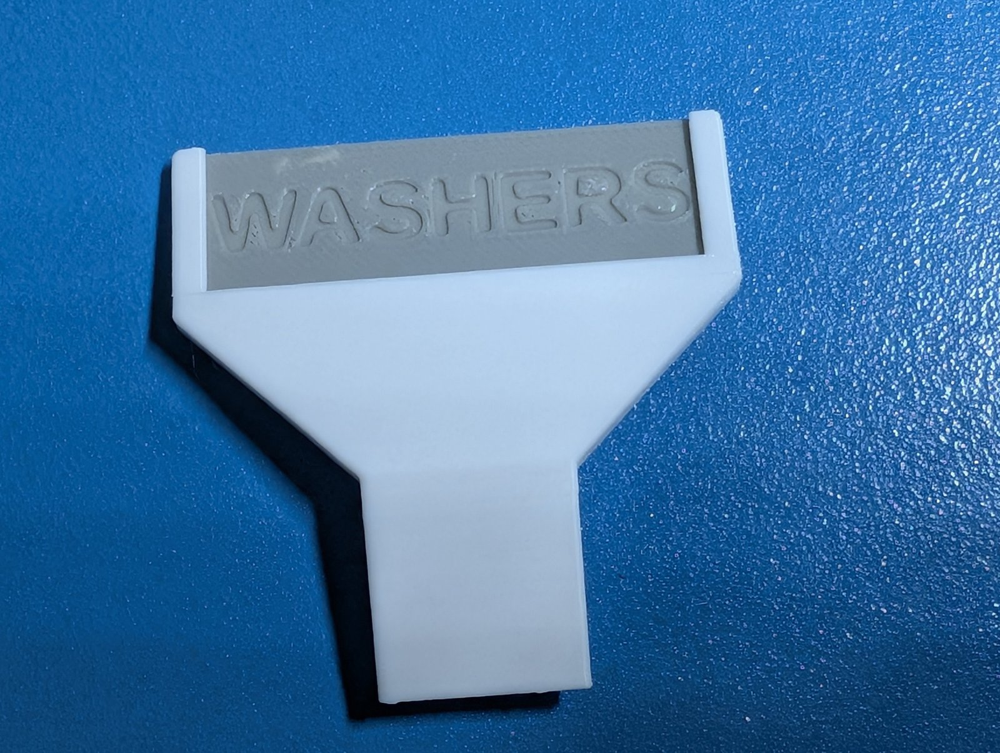

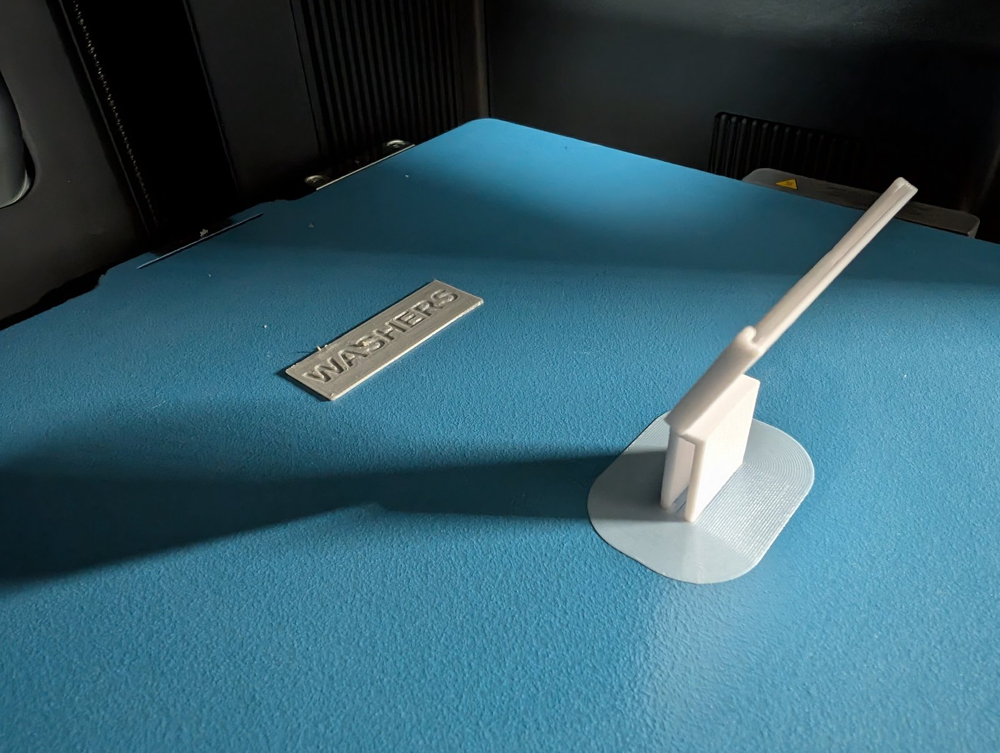

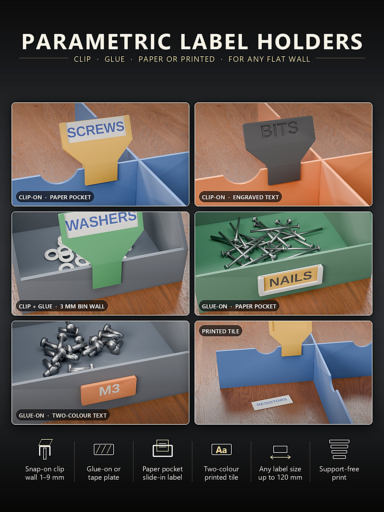

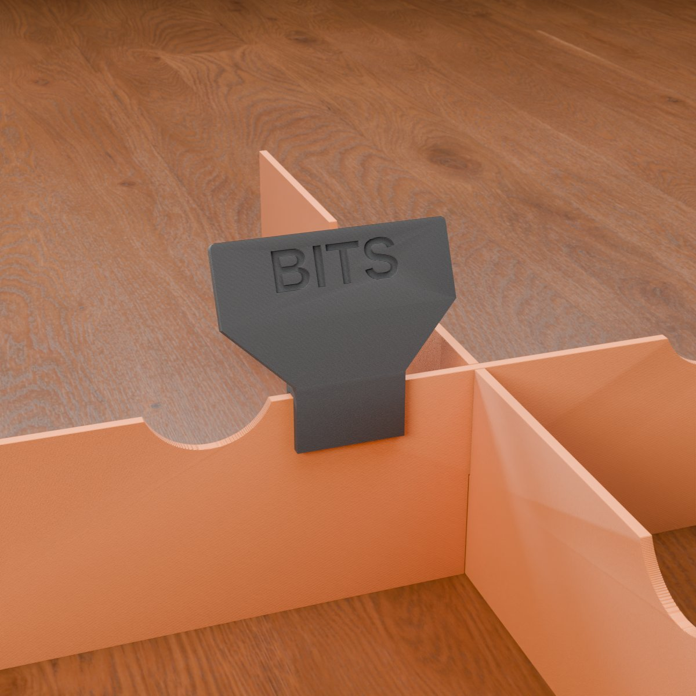

## Downloads

Druckdateien gibt es bewusst ausschließlich auf MakerWorld.

👉 MakerWorld-Link: <https://makerworld.com/en/models/3444426-label-holder-generator>

Profil: <https://makerworld.com/en/@BetaHydri>

## Lizenz

Dokumentation und Bilder in diesem Repository: © BetaHydri. Das Modell (einschließlich Quellcode) und alle
Druckdateien werden ausschließlich über MakerWorld unter der dort angegebenen Lizenz verbreitet (CC BY-NC-SA 4.0 –
nicht kommerziell, Namensnennung, Weitergabe unter gleichen Bedingungen). Dieses Repository enthält bewusst kein
Modell, keinen Quellcode und keine Druckdateien.

✅ Druckhinweise – entwickelt und getestet auf Bambu Lab (H2C · P2S · P1S) – läuft auf jedem FDM-Drucker.
