# Parametric Label Holder Generator – Snap-On Clip, Glue-On Plate, Paper Pocket or Printed Text

[← All models](../../README.md)

🌐 **English** | [Deutsch](README.de.md)

**Label anything flat.** Pick a size, pick how the holder mounts – a snap-on clip over the top edge of a wall, a
glue-on or tape plate, or both – and pick what the label is: a slide-in paper pocket (which also takes a printed
tile) or text printed right on the holder. One generator makes the holder for drawer dividers, storage bins, shelves,
crates, cardboard boxes and anything else with a flat wall. Everything in the MakerWorld Customizer, no supports.

> **The model with all print profiles is available exclusively on MakerWorld:**
> 👉 [MakerWorld link: https://makerworld.com/en/models/3444426-label-holder-generator](https://makerworld.com/en/models/3444426-label-holder-generator)
>
> 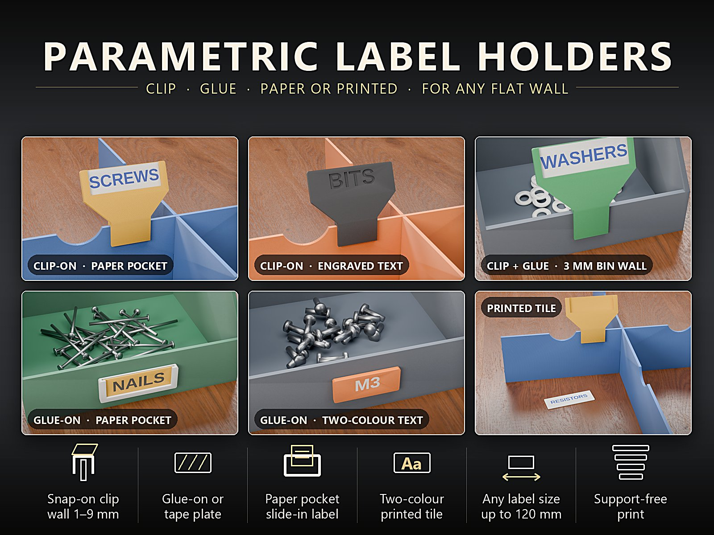

## Table of Contents

- [The Problem](#the-problem)
- [The Idea](#the-idea)
- [Highlights](#highlights)
- [Works Great With](#works-great-with)
- [Parametric Options](#parametric-options)
- [Paper or Printed Tile – Which Size?](#paper-or-printed-tile--which-size)
- [Design](#design)
- [Variants](#variants)
- [Print Recommendations](#print-recommendations)
- [What Else You Need](#what-else-you-need)
- [Use Cases](#use-cases)
- [Troubleshooting / FAQ](#troubleshooting--faq)
- [Development History](#development-history)
- [Downloads](#downloads)
- [License](#license)

## The Problem

Labels sound trivial, but the usual solutions all have a catch:

- Sticky labels peel off, cannot be changed and look scruffy on a printed bin.
- Ready-made label holders fit one wall thickness and one label size, and often only one way of mounting.
- A clip that is too tight cracks the wall, one that is too loose falls off at the first touch.
- Text printed on a plate is permanent: when the contents change, the whole holder has to be printed again.
- Two-colour text normally means a lot of fiddling in the slicer.

## The Idea

A single model produces the matching holder. You choose **how it mounts**:

- a **snap-on clip** that hooks over the top edge of a wall or divider,
- a **glue-on or tape plate** with a flat back,
- or **both**, so the clip snaps on first and the front arm is glued for a permanent hold.

And you choose **what the label is**: a **paper pocket** that takes a slip of paper from the top (or a printed tile),
or **text engraved** into the holder itself. The clip prints upright on its two arms, the plates print flat – so no
part needs supports. All dimensions are in millimetres and all of them are Customizer parameters.

## Highlights

- 📎 **Three ways to mount it**
  - **Snap-on clip:** hooks over the top edge of a wall or divider of **1–9 mm**. Two arms and a bridge, with a
    small grip bump so it holds firmly on a 2 mm wall. The label leans back towards you (`tilt`), so it is easy to
    read from above.
  - **Glue-on or tape plate:** a flat back for double-sided tape or glue, on any flat face.
  - **Clip + glue:** snaps on first, then the long front arm is glued for a permanent hold.
- 🏷️ **Two kinds of label**
  - **Paper pocket:** slide a paper slip (or a printed tile) in from the top, change it whenever the contents change.
  - **Engraved text:** type your text; it is engraved into the holder and sized automatically to fit.
- 🎨 **Two-colour text without slicer tricks:** the flat variants come with a ready two-colour file – base in
  filament 1, text in filament 2.
- 🎨 **Holder + two-colour label in one export:** choose *Holder + two-colour label* in the Customizer. The holder is
  one colour, the printed label is two (base and text). Holder, label base and text come out as separate colour
  groups, and holder and label as separate bodies, so every filament can be assigned in the slicer.
- 📐 **Any label size:** visible label from 16 × 8 mm up to **120 × 60 mm**. The paper size follows from your label
  size (see [Paper or Printed Tile](#paper-or-printed-tile--which-size)).
- 🖨️ **No supports:** clips print upright on their two arms, glue plates print flat on their back, tiles print flat
  face up.
- 🔧 **Every size is a parameter:** wall thickness, clip fit, grip bump, hook depth, clip width, tilt, pocket gap,
  frame overlap, font and text depth.

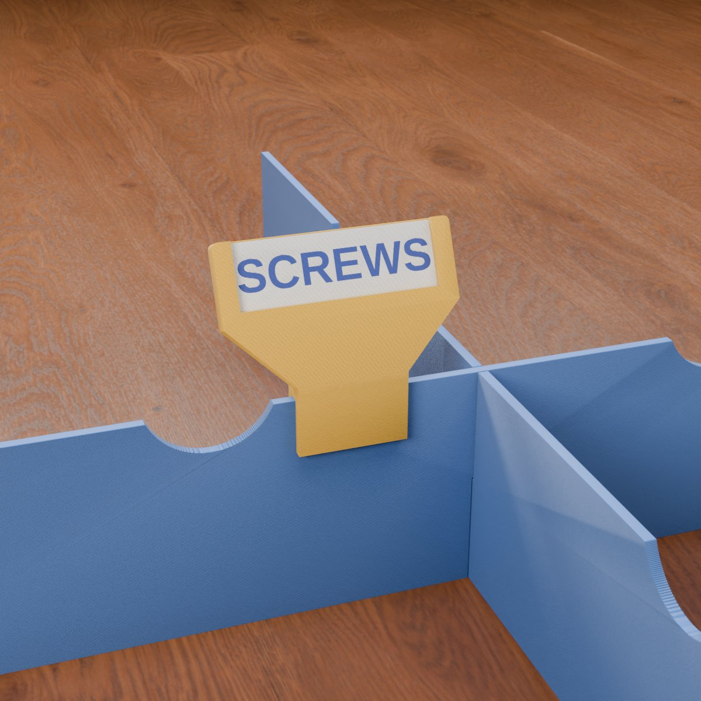

## Works Great With

The holders are universal – they fit any flat wall from 1 to 9 mm – but they were designed next to these models and
match their default wall thicknesses:

- 🗂️ **[Parametric Drawer Divider System](https://makerworld.com/en/models/3437057-parametric-drawer-divider-system)**
  ([documentation](../parametric-drawer-divider-system/README.md)): the default divider is 2.0 mm thick, which is the
  default `wall_t` of the clip. Clip a label on the flat top edge between two finger notches, away from the crossings.
- 📦 **[Stackable Parametric Open-Front Storage Bin](https://makerworld.com/en/models/2867878-stackable-parametric-open-front-storage-bin)**:
  the bin has a low front wall, which is exactly where a label belongs. Use the **clip** on the front wall top edge,
  **clip + glue** for a permanent fit, or the **glue-on plate** on the front face. Stackable bins use a 3 mm wall
  (`wall_t = 3`).
- 🧰 **[Parametric Stackable Drawer System](https://makerworld.com/en/models/3024548-parametric-stackable-drawer-system)**:
  put a glue-on plate on the drawer front so you always know what is inside.

Labels are flat plates, so they belong on flat walls – they are not meant for round jars or curved vessels.

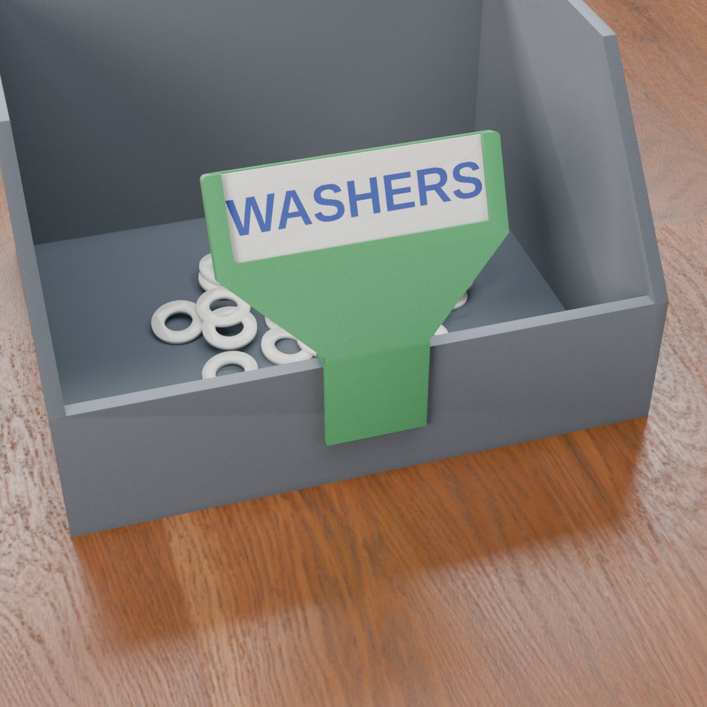

## Parametric Options

The names correspond to the model's Customizer parameters.

### Part Selection

| Parameter | Meaning | Default | Options |
|---|---|---|---|
| `part` | What to generate | *Preview on a sample wall* | *Preview on a sample wall* (display only, **not for print**), *Label holder*, *Printed label tile*, *Holder + tile – single colour*, *Holder + two-colour label – 3 colours* (holder, label base and text as separate colour groups), *Two-colour label only* |

### Label

| Parameter | Meaning | Default | Range / Unit |
|---|---|---|---|
| `label_type` | *Paper pocket* (slide in a paper slip or a printed tile) or *Text engraved on the holder* | Paper pocket | selection |
| `label_w` | Visible label width | 36 | 16–120 mm |
| `label_h` | Visible label height | 12 | 8–60 mm |
| `label_text` | Text on the holder (text mode) or on the printed tile | `SCREWS` | text |
| `text_size` | Text size (0 = automatic fit) | 0 | 0–40 mm, step 0.5 |
| `text_font` | Font | `Liberation Sans:style=Bold` | font name |
| `text_depth` | Engraving depth; on a tile it is limited to the tile thickness minus 0.4 mm | 0.6 | 0.4–1.2 mm, step 0.1 |

### Mounting

| Parameter | Meaning | Default | Range / Unit |
|---|---|---|---|
| `mount` | *Snap-on clip* (over the top edge of a wall), *Glue-on or tape plate* (flat back) or *Clip + glue* (snap on, then glue the long front arm) | Snap-on clip | selection |
| `wall_t` | Thickness of the wall or divider the clip fits over | 2.0 | 1–9 mm, step 0.1 |
| `clip_fit` | Total play in the clip slot; raise it if the clip is too tight | 0.2 | 0.1–0.5 mm, step 0.05 |
| `clip_grip` | Height of the grip bump on the back arm (0 = off; 0.2 gives a firm snap on a 2 mm wall) | 0.2 | 0–0.5 mm, step 0.05 |
| `hook_depth` | How far the arms reach down the wall | 10 | 6–30 mm |
| `clip_w` | Width of the clip hook; never wider than the label plate | 20 | 8–80 mm |
| `arm_t` | Thickness of the clip arms and the bridge | 1.8 | 1.2–3 mm, step 0.2 |
| `tilt` | Lean-back angle of the label towards the viewer (clip only, 0 = upright) | 25 | 0–40°, step 5 |

### Pocket

| Parameter | Meaning | Default | Range / Unit |
|---|---|---|---|
| `pocket_t` | Gap for the paper or the tile; a paper slip needs about 0.4, the printed tile fits a gap of 0.6 or more | 1.0 | 0.4–2 mm, step 0.1 |
| `overlap` | How far the front frame covers the edge of the paper | 1.5 | 1–3 mm, step 0.1 |

### Quality

| Parameter | Meaning | Default | Range / Unit |
|---|---|---|---|
| `round_res` | Smoothness of the rounded corners | 48 | 24–96, step 8 |

## Paper or Printed Tile – Which Size?

The paper pocket takes a paper slip or a printed tile. Cut the paper to the size of the tile:

- **Paper width** = `label_w` + 3 mm
- **Paper height** = `label_h` + 1.2 mm
- Defaults (`label_w` 36, `label_h` 12): **39 × 13.2 mm**.

A paper slip needs a pocket gap of about 0.4 mm; the printed tile (`part` = *Printed label tile*) fits a gap of 0.6 mm
or more. The default `pocket_t` of 1.0 mm takes both. The slip is held by a front frame that covers 1.5 mm of its
edge (`overlap`), so it cannot fall out and stays readable.

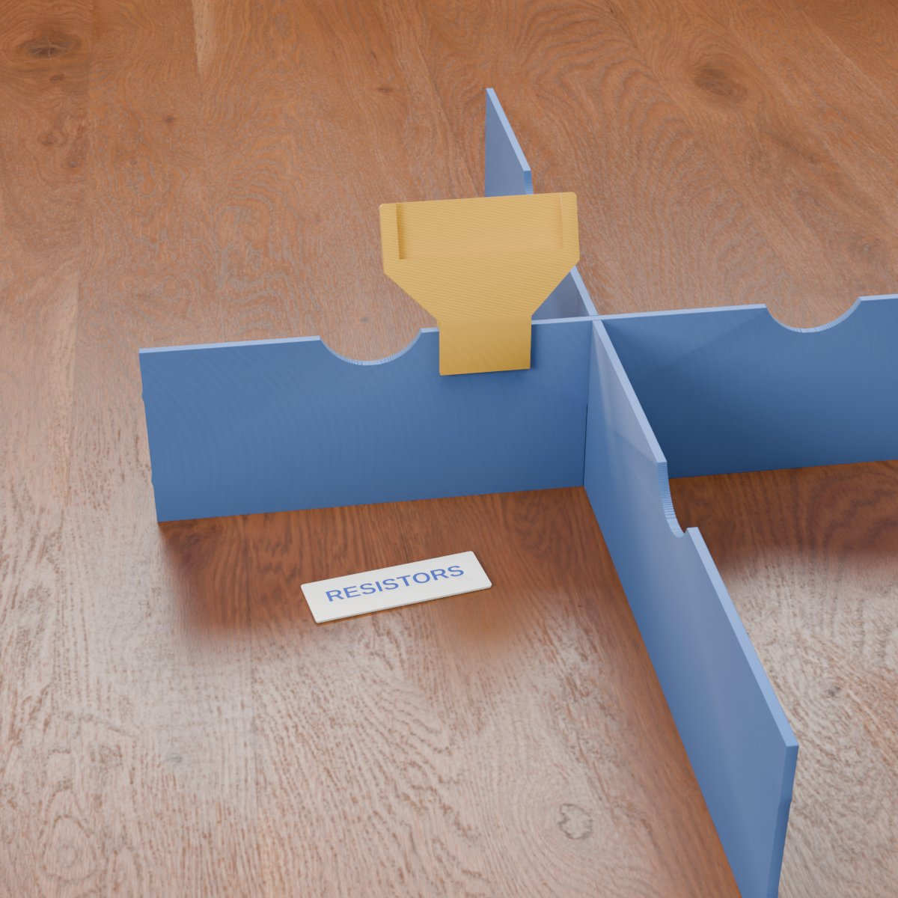

## Design

### OpenSCAD Approach

The model is a single parametric OpenSCAD file without extra libraries. Every print pose is built from the same label
plate: the clip is the plate plus a hook, the glue-on holder is the plate alone.

### Parametric Logic

- **Plate size from the label:** the cavity is the label width plus the frame overlap on both sides plus a little
  play; the plate adds a 1.6 mm wall on each side. The plate is built from a 1.2 mm back layer, the pocket gap and a
  1.2 mm front frame.
- **Clip slot from the wall:** the slot is `wall_t` plus `clip_fit`; the front arm, back arm and bridge all have the
  thickness `arm_t`.
- **Tile from the pocket:** the printed tile is 0.2 mm thinner than the pocket gap, so it slides in.
- **Automatic text size:** with `text_size` = 0 the text is sized to the label height and shrunk to fit the label
  width.
- **Clip + glue:** the arms are longer (at least 16 mm, or 1.8 × `hook_depth`), so there is a long front arm to glue.

### Special Algorithms

- **45° neck:** if the plate is wider than the hook, it sits on a 45° neck, so there is no flat overhang.
- **Wedge under the leaning plate:** when the label leans back, a wedge fills the space between the bridge and the
  plate, so nothing hangs in the air.
- **Grip bump:** a 45° bump on the back arm gives the snap hold; its height is `clip_grip`.
- **Two-colour parts:** label base and text are separate bodies and colour groups; the engraved holder text is
  exported as its own colour group as well.

### Print Optimisations

- No supports anywhere: clip upright on its two arms, glue plates flat on their back, tiles flat face up.
- A 0.4 mm chamfer on the first-layer edge of the glue plates against elephant's foot.
- The slot bridge stays printable up to a 9 mm wall.

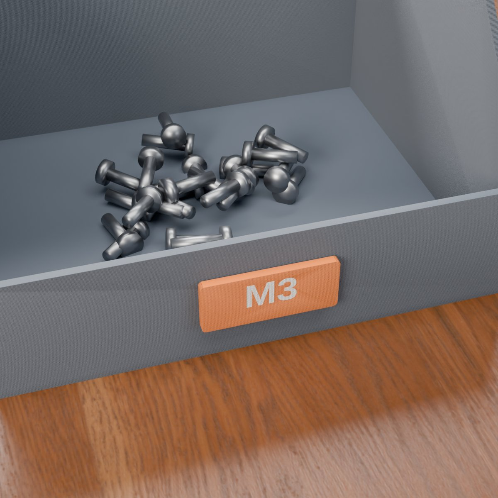

## Variants

The model comes with six ready-made variants, each with a Bambu Studio profile. The flat variants also come with a
two-colour file.

| Variant | Mount | Label |
|---|---|---|
| Clip + pocket set | snap-on clip | paper pocket + tile, `SCREWS` |
| Clip, engraved text | snap-on clip | engraved text, `BITS` |
| Clip + glue, bin set | clip + glue, 3 mm wall | paper pocket + tile, 48 × 16 mm, `WASHERS` |
| Glue-on pocket set | glue-on plate | paper pocket + tile, `NAILS` |
| Glue-on, engraved text | glue-on plate | engraved text, 24 × 10 mm, `M3` (also two-colour) |
| Printed tile | any pocket holder | printed tile, `RESISTORS` (also two-colour) |

For any other size, text or wall thickness use the Customizer.

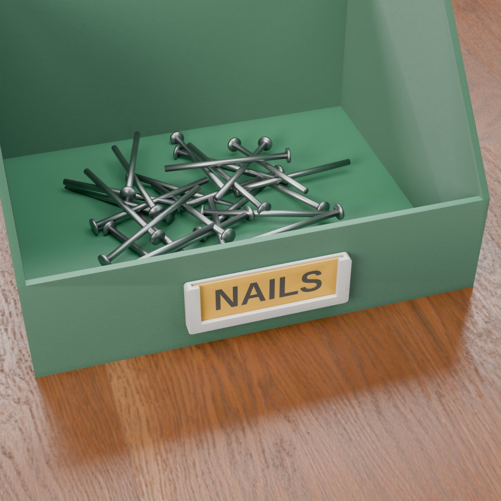

## Print Recommendations

| Holder | Orientation | Supports |
|--------|-------------|----------|
| Snap-on clip (and clip + glue) | upright, standing on the two arms | none |
| Glue-on / tape plate | flat, back face down | none |
| Printed tile (for the paper pocket) | flat, face up | none |

| Setting | Recommendation |
|---|---|
| Material | PLA for labels that stay in place; **PETG for clips that are taken on and off often** |
| Layer height | 0.20 mm |
| Walls | 3 |
| Infill | 15 % gyroid |
| Brim | **5–8 mm** for clips (they stand on their arms) |
| Supports | none |

- **Which file to open:** the profiles are single colour. For **two-colour text** open the matching two-colour file
  (glue-on text plate and printed tile): filament 1 is the label, filament 2 is the text, no manual colour change
  needed.
- **Why PETG for clips:** the arms flex every time the clip goes on or off, and PETG bends instead of cracking.
- **Clip too tight or too loose?** Set `wall_t` to the real thickness of your wall and adjust `clip_fit` in 0.05 mm
  steps. Print a short test piece first.
- **Text colour:** the ready-made clip profiles engrave the text in one colour. For a second colour choose *Holder +
  two-colour label* in the Customizer. On a clip holder engraved text sits on the leaning face, so a **printed tile**
  in the pocket gives the cleanest two-colour result.

**Assembly**

1. **Clip:** push it over the top edge of the wall until the bridge sits on the edge.
2. **Clip + glue:** snap it on, then glue the long front arm to the wall.
3. **Glue-on plate:** clean the surface and stick double-sided tape (or a drop of glue) on the flat back.
4. **Paper pocket:** slide the paper slip or the printed tile in from the top.

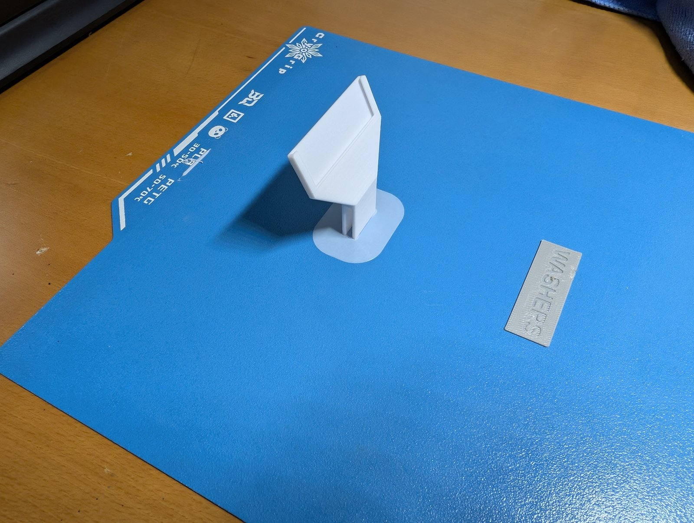

## What Else You Need

- **Snap-on clip:** nothing – it clips over the wall.
- **Glue-on plate or clip + glue:** double-sided mounting tape or a drop of glue, suitable for your wall material.
- **Paper label:** a paper slip cut to size, or print the tile.

## Use Cases

- **Drawer dividers:** a clip on the flat top edge between two finger notches.
- **Storage bins:** clip, clip + glue or glue-on plate on the low front wall.
- **Drawer fronts and shelves:** a glue-on plate, so you always know what is inside.
- **Cardboard boxes and crates:** any flat wall from 1 to 9 mm takes the clip.
- **Workshop and hobby room:** screws, bits, washers, nails, resistors – one generator for all labels.
- **Changing contents:** the paper slip or the printed tile can be swapped in seconds.

## Troubleshooting / FAQ

| Symptom | Cause | Fix |
|---|---|---|
| The clip is too tight | The print comes out slightly larger, or `wall_t` is set too small | Set `wall_t` to the real wall thickness, raise `clip_fit` in 0.05 mm steps |
| The clip is too loose | The print comes out slightly smaller | Lower `clip_fit`, or raise `clip_grip` a little |
| The clip is hard to print upright | The arms have little contact with the bed | Use a 5–8 mm brim |
| An arm cracked | PLA is brittle for clips that are taken on and off | Use PETG |
| The paper does not fit the pocket | Paper cut to the wrong size | Cut it to `label_w` + 3 mm × `label_h` + 1.2 mm |
| The paper does not slide in | Pocket gap too small for the paper | Raise `pocket_t` to 0.4 mm or more |
| The printed tile does not slide in | Pocket gap too small for the tile | Use a `pocket_t` of 0.6 mm or more |
| The text does not fit | Label too small for the text | Raise `label_w`, shorten the text or set a smaller `text_size` |
| The clip does not fit my wall | Wall thicker than 9 mm, or the wall is not flat | Use the glue-on plate |
| The holder does not stay on a curved jar | Labels are flat plates | Use flat walls only |

## Development History

The model is a fully parametric label holder generator for FDM printing, published on MakerWorld in October 2026:
clip, glue-on plate or both, paper pocket or engraved text, printed tile and a two-colour export.

Every option offered in the Customizer was checked for printability and function: the clips print upright without
supports, the slot fits the chosen wall thickness, the paper and the printed tile slide into the pocket, the
two-colour files separate label and text cleanly and the glue plates sit flat.

The renderings in this repository are renderings of the model geometry or scene images derived from it; walls,
boxes and the screws, nails and washers are illustrations for context, not parts of the model. The three photos show
a test print.

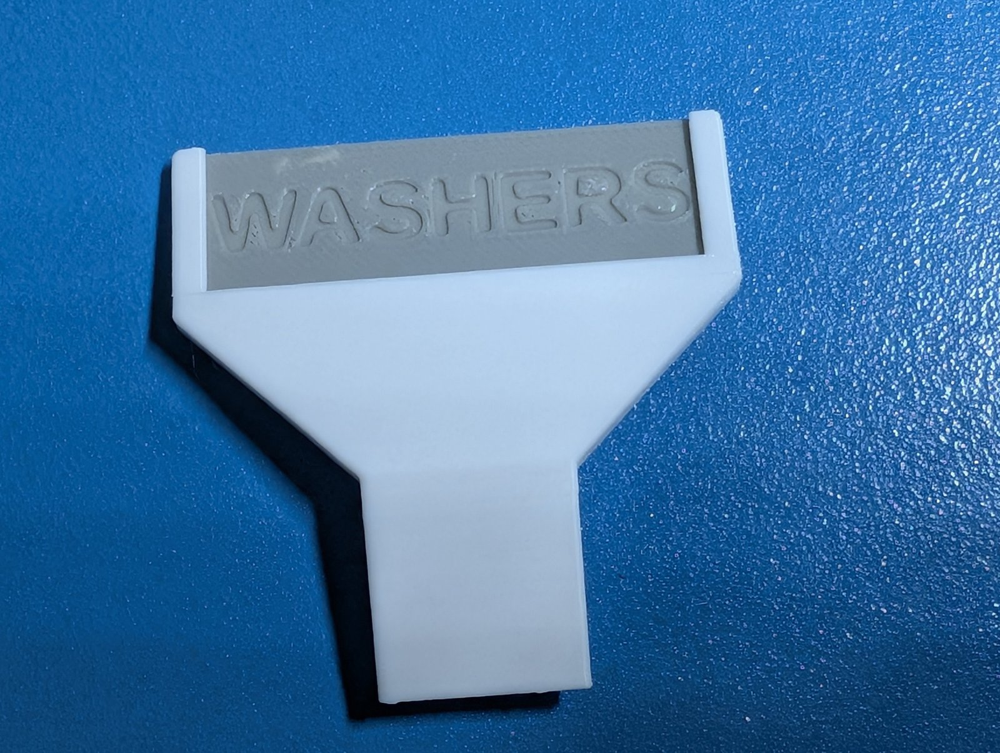

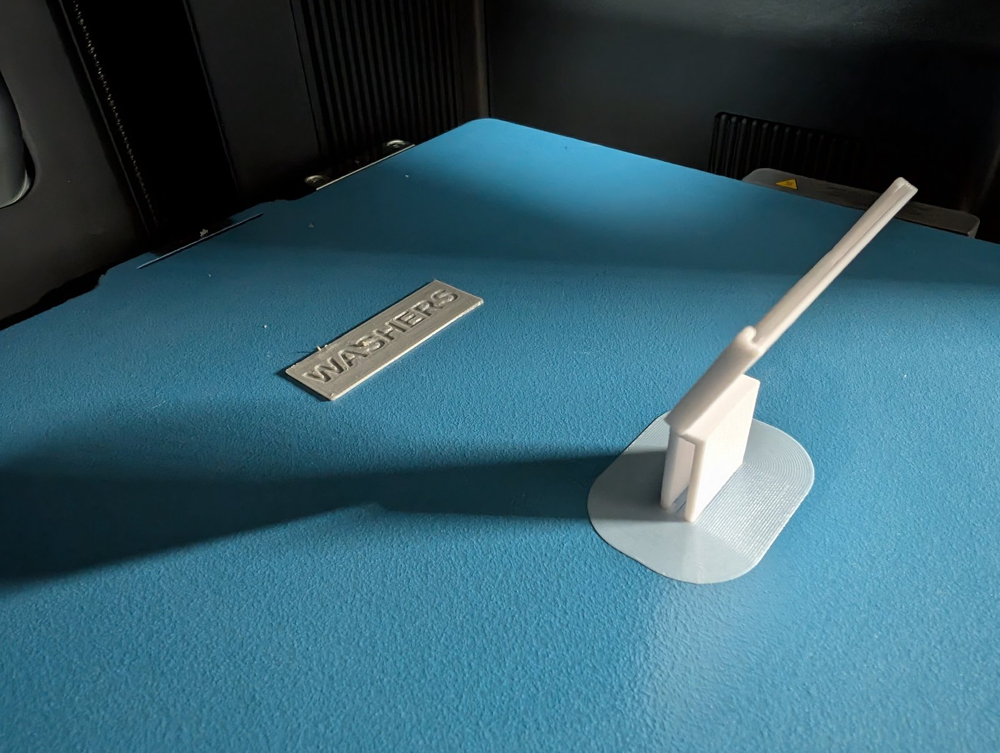

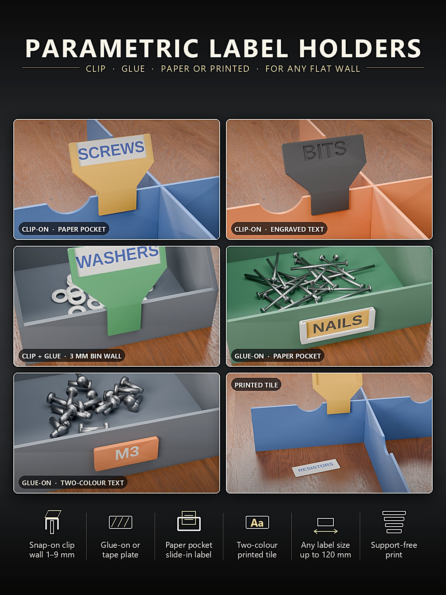

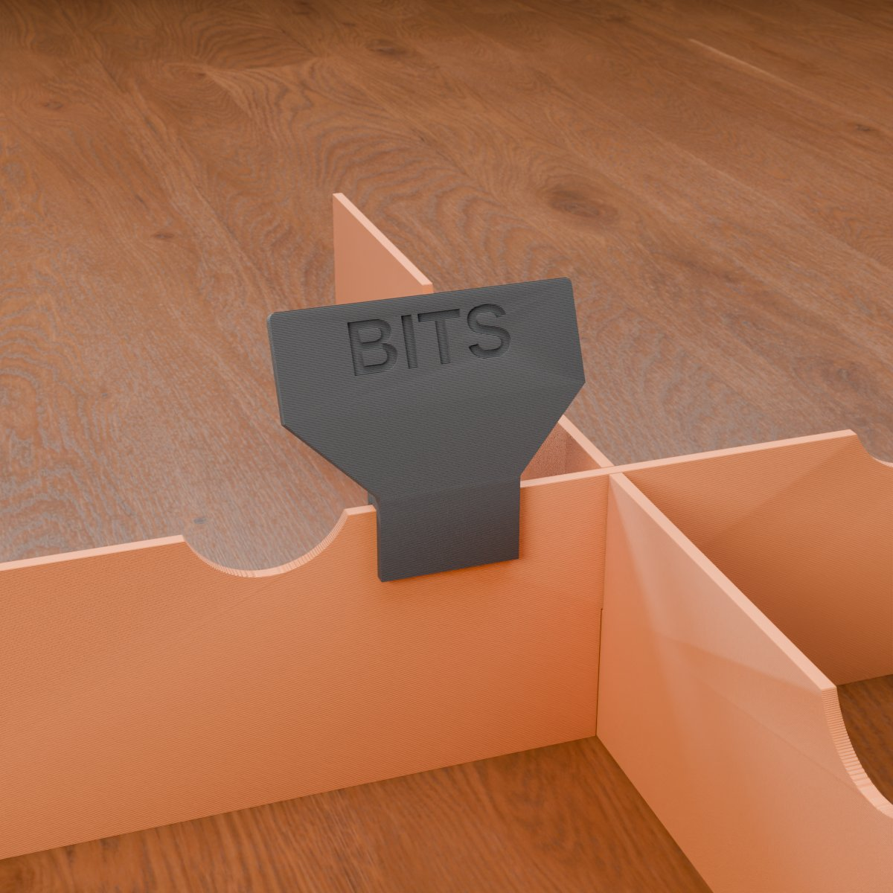

## Downloads

Print files are intentionally available exclusively on MakerWorld.

👉 MakerWorld link: <https://makerworld.com/en/models/3444426-label-holder-generator>

Profile: <https://makerworld.com/en/@BetaHydri>

## License

Documentation and images in this repository: © BetaHydri. The model (including source code) and all print files are
distributed exclusively via MakerWorld under the license stated there (CC BY-NC-SA 4.0 – non-commercial use,
attribution, share alike). This repository deliberately contains no model, source code or print files.

✅ Print notes – designed & tested on Bambu Lab (H2C · P2S · P1S) – works on any FDM printer.
