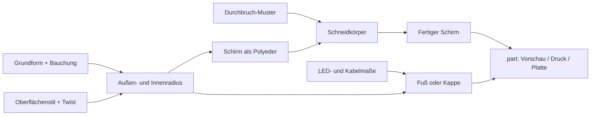

# Parametrischer Lampenschirm – Tischlampe & Hängelampe

[← Alle Modelle im Überblick](../../README.de.md)

🌐 [English](README.md) | **Deutsch**

Ein parametrischer Lampenschirm für runde LED-Pucks, der als Tischlampe
(LED strahlt nach oben) oder als Pendelleuchte (LED strahlt nach unten, Kabel
läuft oben heraus) gedruckt wird – aus einer einzigen OpenSCAD-Datei.

> **Das Modell mit allen Druckprofilen gibt es ausschließlich auf MakerWorld:**
> 👉 [MakerWorld-Link: https://makerworld.com/en/models/3062645-parametric-table-lamp-ceiling-lamp](https://makerworld.com/en/models/3062645-parametric-table-lamp-ceiling-lamp)
>
> 

Der **Parametrische Lampenschirm** besteht aus einem offenen Schirmrohr mit frei
einstellbarer Grundform (Höhe, Durchmesser oben und unten, Bauchung), sechs
Oberflächenstilen und fünf Durchbruch-Mustern. Dazu kommen ein Tischfuß, eine
Hängekappe und eine optionale Streuscheibe, die alle auf den LED-Puck abgestimmt
werden können. Entwickelt wurde er für das **Bambu Lab LED Lamp Kit 001
(MH001)**; Puck-, Kabel- und Steckermaße sind Parameter, sodass auch andere
runde LED-Module passen.

## Inhaltsverzeichnis

- [Das Problem](#das-problem)
- [Die Idee](#die-idee)
- [Highlights](#highlights)
- [Parametrische Optionen](#parametrische-optionen)
- [Konstruktion](#konstruktion)
- [Druckempfehlungen](#druckempfehlungen)
- [Anwendungsbeispiele](#anwendungsbeispiele)
- [Fehlersuche / FAQ](#fehlersuche--faq)
- [Entwicklungsgeschichte](#entwicklungsgeschichte)
- [Downloads](#downloads)
- [Lizenz](#lizenz)

## Das Problem

Ein gedruckter Lampenschirm muss mehrere Dinge gleichzeitig lösen, die sich
leicht widersprechen:

- **Er muss leuchten.** Eine massive Wand von 1,6 mm lässt kaum Licht durch.
  Entweder ist die Wand dünn und lichtdurchlässig, oder das Licht kommt durch
  echte Öffnungen.
- **Er muss zum Leuchtmittel passen.** Puck-Durchmesser, Höhe, Schraubenabstand
  und vor allem das Kabelende mit Stecker sind je Modul verschieden. Ein Loch,
  das nur für den Draht bemessen ist, lässt den Stecker nicht durch.
- **Er muss sich sauber drucken lassen.** Offene Muster in einer dünnen
  Wand zerlegen den Schirm schnell in lose Einzelteile, hohe freistehende Stege
  schwingen beim Druck, und Oberflächenwellen können Stege punktuell auf null
  verdünnen.
- **Er soll ein Tisch- und ein Hängelicht sein.** Beide Varianten brauchen
  unterschiedliche Halter, aber denselben Schirm.

## Die Idee

Der Schirm wird als ein einziger Polyeder aus Außen- und Innenfläche mit
Randringen erzeugt: ein offenes, wasserdichtes Rohr, das aufrecht und ohne
Stützen druckt. Die Wandstruktur (Wellen, Rillen, Facetten) verändert nur den
Radius über Winkel und Höhe; die Innenfläche folgt der Außenfläche, die
Wandstärke bleibt konstant. Durchbrüche werden anschließend als Schneidkörper
ausgespart, wobei Größe und Position so begrenzt sind, dass die Stege nie
verschwinden.

Fuß und Kappe zentrieren sich über eine Lippe, deren Radius aus dem kleinsten
Innenradius des Schirms in der Eingriffstiefe abgeleitet wird. Das Spiel
(`fit_play`) ist ein eigener Regler. Beide Halter nehmen denselben LED-Puck auf,
nur die Richtung unterscheidet sich.

## Highlights

- **Ein Modell, zwei Lampen:** Tischfuß (LED nach oben) oder Hängekappe (LED
  nach unten, Kabel mittig nach oben).
- **Parametrische Grundform:** Höhe, Ober- und Unterdurchmesser, Bauchung und
  deren Lage sowie Wandstärke.
- **Sechs Oberflächenstile:** `smooth`, `vertical_waves`, `twist_flutes`,
  `ripple`, `scallop`, `facets`.
- **Fünf Durchbruch-Muster:** `none`, `diamond`, `hex`, `mesh` (organisch,
  voronoi-artig) und `slots` mit Versteifungsringen.
- **Licht auf zwei Wegen:** dünne, lichtdurchlässige Wand oder echte
  Öffnungen, die Muster an Wand und Decke werfen.
- **Anpassbar an das Leuchtmittel:** Puck-Durchmesser und -Höhe, Schraubenabstand,
  Kabel- und Steckerdurchmesser (`plug_dia`).
- **Optionale Streuscheibe** mit konzentrischen oder radialen Rillen.
- **Stützenfrei:** Schirm steht aufrecht, Fuß, Kappe und Diffusor liegen flach.
- **Geprüfte Geometrie:** Alle 30 Kombinationen aus Oberflächenstil und
  Durchbruch-Muster ergaben bei der Prüfung genau einen wasserdichten Körper.
- **Zweifarbige Vorschau** (Schirm und Halter in verschiedenen Farben) mit rotem
  „NOT FOR PRINTING“-Banner sowie ein Plattenmodus mit Schirm und Halter für
  den Mehrfarbdruck.

## Parametrische Optionen

Die Namen entsprechen den Customizer-Parametern des Modells. Alle Maße in
Millimetern, Winkel in Grad.

### Teil (`part`)

| Wert | Bedeutung |
|---|---|
| `Vorschau Tischlampe` (Standard) | zusammengebaute Tischlampe mit LED, zweifarbig, nicht druckbar |
| `Vorschau Haengelampe` | zusammengebaute Hängelampe mit LED, zweifarbig, nicht druckbar |
| `DRUCK Schirm` | Lampenschirm, aufrecht, stützenfrei |
| `DRUCK Tischfuss` | Fuß mit LED-Halter (LED nach oben, offener Lichtdurchlass) |
| `DRUCK Haengekappe` | Kappe mit LED-Halter (LED nach unten, Kabel oben heraus) |
| `DRUCK Diffusor` | optionale dünne Streuscheibe |
| `DRUCK Tischlampe Platte` | Fuß und Schirm nebeneinander, zweifarbig |
| `DRUCK Haengelampe Platte` | Kappe und Schirm nebeneinander, zweifarbig |

### Schirm-Grundform

| Parameter | Bedeutung | Standard | Bereich / Einheit |
|---|---|---|---|
| `shade_height` | Gesamthöhe des Schirmkörpers | 150 | 60–320 mm |
| `base_diameter` | Außendurchmesser unten | 110 | 50–280 mm |
| `top_diameter` | Außendurchmesser oben (größer als unten = umgekehrt konisch) | 96 | 40–280 mm |
| `belly_bulge` | zusätzlicher Radius in der Mitte (0 = gerader Verlauf) | 8 | 0–60 mm |
| `belly_position` | Höhe der stärksten Bauchung, Anteil der Gesamthöhe | 0,45 | 0,10–0,90 |
| `wall_thickness` | Wandstärke | 1,2 | 0,8–5 mm |

### Wandstruktur und Durchbrüche

| Parameter | Bedeutung | Standard | Bereich / Einheit |
|---|---|---|---|
| `surface_style` | Oberflächenstil | `vertical_waves` | `smooth`, `vertical_waves`, `twist_flutes`, `ripple`, `scallop`, `facets` |
| `wave_amp` | Tiefe der Oberflächenstruktur (0 = glatte Wand) | 3,0 | 0–12 mm |
| `wave_count` | Anzahl der Wellen bzw. Rillen am Umfang | 22 | 4–80 |
| `surface_twist` | Verdrehung der Struktur über die Höhe | 0 | 0–720 Grad |
| `ripple_rows` | waagerechte Wellenreihen (nur `ripple`) | 7 | 1–30 |
| `facet_count` | Anzahl ebener Facetten (nur `facets`) | 9 | 3–24 |
| `opening_style` | Durchbruch-Muster | `hex` | `none`, `diamond`, `hex`, `mesh`, `slots` |
| `open_cell` | Zell- bzw. Lochabstand des Musters | 12 | 5–30 mm |
| `open_bar` | verbleibende Stegbreite zwischen den Öffnungen | 2,4 | 1,0–8 mm |
| `slot_count` | feste Anzahl senkrechter Stege (nur `slots`, 0 = automatisch) | 0 | 0–60 |
| `slot_rings` | waagerechte Versteifungsringe (nur `slots`) | 2 | 0–6 |
| `slot_ring_width` | Höhe je Versteifungsring (nur `slots`) | 4 | 2–10 mm |
| `open_margin` | geschlossener Rand oben und unten vor dem Muster | 10 | 3–40 mm |

`surface_twist` wirkt nur bei wellenbasierten Stilen und `wave_amp > 0`:

| `surface_style` | reagiert auf `surface_twist` | Hinweis |
|---|---|---|
| `smooth` | nein | keine Oberflächenstruktur |
| `vertical_waves` | ja | dreht die senkrechten Wellen zur Spirale |
| `twist_flutes` | ja | hat bereits eine eingebaute Halbdrehung, `surface_twist` kommt hinzu |
| `ripple` | ja | verdreht die senkrechte Wellenkomponente |
| `scallop` | ja | dreht die Muschelrillen |
| `facets` | nein | Facetten bleiben eben und senkrecht |

Die Durchbruch-Muster werden von `surface_twist` nicht verdreht.

### Passung und LED-Halter

| Parameter | Bedeutung | Standard | Bereich / Einheit |
|---|---|---|---|
| `lip_engage` | Eingriffstiefe der Zentrierlippe von Fuß bzw. Kappe in den Schirm | 8 | 4–20 mm |
| `fit_play` | Passungsspiel pro Seite zwischen Schirm und Lippe | 0,35 | 0,1–0,8 mm |
| `led_diameter` | Puck-Durchmesser (MH001 = 59) | 59 | 30–90 mm |
| `led_thickness` | Puck-Höhe (MH001 = 8) | 8 | 4–20 mm |
| `led_clearance` | Spiel um den Puck (gesamter Durchmesser) | 0,6 | 0–2 mm |
| `led_screws` | Schraubenlöcher für die BT3-Schrauben | `true` | an/aus |
| `led_screw_dia` | Durchmesser der Schraubenlöcher | 3,2 | 2–6 mm |
| `led_screw_span` | Abstand der beiden Schraubenlöcher (Mitte–Mitte) | 50 | 20–80 mm |
| `cable_dia` | Durchmesser des Kabelkanals | 5 | 3–10 mm |
| `plug_dia` | größter Durchmesser, der durchgeführt werden muss (Stecker, Zugentlastung) | 14 | 6–28 mm |
| `holder_floor` | Dicke des Halterbodens unter dem Puck | 3 | 2–8 mm |

### Tischfuß, Hängekappe, Diffusor

| Parameter | Bedeutung | Standard | Bereich / Einheit |
|---|---|---|---|
| `base_height` | Höhe des sichtbaren Fußrings | 12 | 6–40 mm |
| `base_flange` | Überstand des Flansches über die Schirm-Außenkante | 1,5 | 0–8 mm |
| `base_chamfer` | Fase an der unteren Außenkante des Fußes | 1,2 | 0–5 mm |
| `cap_thickness` | Dicke der Kappenplatte | 4 | 2,5–10 mm |
| `cap_overhang` | Überstand der Kappe über die Schirm-Außenkante | 2 | 0–10 mm |
| `cap_knot_dia` | Durchmesser der Knotenmulde auf der Kappenoberseite | 14 | 6–30 mm |
| `cap_knot_depth` | Tiefe der Knotenmulde | 6 | 2–15 mm |
| `diffuser_thickness` | Dicke der Streuscheibe | 1,2 | 0,8–3 mm |
| `diffuser_pattern` | Rillenmuster | `concentric` | `none`, `concentric`, `radial` |
| `diffuser_count` | Anzahl der Ringe bzw. Speichen | 16 | 4–60 |
| `diffuser_depth` | Tiefe der Rillen | 0,6 | 0,2–2 mm |

### Farben (nur Vorschau) und Qualität

| Parameter | Bedeutung | Standard | Bereich / Einheit |
|---|---|---|---|
| `color_shade` | Farbe des Schirms in der Vorschau | `#e3a179` | Farbwert |
| `color_holder` | Farbe von Fuß und Kappe | `#4b4b52` | Farbwert |
| `color_led` | Farbe des leuchtenden Pucks | `#ffe28a` | Farbwert |
| `show_led` | LED-Puck in der Vorschau zeigen | `true` | an/aus |
| `shade_res_a` | Winkelauflösung des Schirms | 160 | 48–360 |
| `shade_res_v` | Höhenauflösung des Schirms | 120 | 8–300 |
| `$fn` | Glattheit runder Teile (Fuß, Kappe, Löcher) | 96 | 48–200 |

## Konstruktion

### OpenSCAD-Ansatz

Das Modell ist reines OpenSCAD ohne externe Bibliotheken und läuft im
MakerWorld-Customizer. Der Schirm ist ein handgebauter Polyeder statt einer
Boolean-Konstruktion; nur die Durchbrüche, der LED-Halter und die Diffusor-Rillen
entstehen durch Subtraktion.

### Parametrische Logik

| Größe | Regel |
|---|---|
| Außenradius bei Höhenanteil `t` | Gerade zwischen Unter- und Oberradius plus `belly_bulge` mal einem Kosinus-Glockenfaktor, der bei `belly_position` sein Maximum hat und an den Enden null ist |
| Oberflächenstörung | wird auf den Radius addiert; blendet in den obersten und untersten 6 % der Höhe zu null aus, damit die Ränder rund und die Lippe passend bleiben |
| Innenradius | Außenradius minus `wall_thickness` (konstante Wand) |
| Lippenradius | kleinster Innenradius über die Eingriffstiefe minus `fit_play` |
| Fuß-Lichtweg | zentrale Bohrung ab Puck-Oberkante nach oben, Lippe als Ring mit 3 mm Wand |
| Hänge-Kabelweg | Mittelloch mit `max(cable_dia, plug_dia)`, Knotenmulde mit `max(cap_knot_dia, plug_dia + 2)` |

### Besondere Algorithmen

- **Eigener Profilverlauf je Stil:** `twist_flutes` erzeugt aufgesetzte, sich
  drehende Grate mit eingebauter Halbdrehung und unterscheidet sich damit sichtbar
  von `vertical_waves`; `scallop` ist negativ (Rillen), `ripple` überlagert
  senkrechte Wellen mit waagerechten Reihen, `facets` ersetzt die Wellen durch
  eine niedrige Winkelauflösung ebener Flächen.
- **Deterministischer Zufall für `mesh`:** Eine Hash-Funktion aus Zeile, Spalte
  und Seed verschiebt Winkel, Höhe, Größe und Drehung jedes sechseckigen Lochs.
  Die Lochgröße ist auf 0,62–0,95 mal Zellmaß abzüglich Steg begrenzt, sodass
  Stege nie wegfallen.
- **Dämpfung bei `slots`:** Unter senkrechten Schlitzen wird die
  Oberflächenstörung auf 40 % reduziert, damit tiefe Wellen keinen Steg auf null
  verdünnen und den Schirm zerteilen.
- **Versteifungsringe:** Die Schlitze werden als `slot_rings + 1` senkrechte
  Segmente geschnitten; die stehengebliebenen Wandbänder sind Ringe, die alle Stege
  verbinden und ein Schwingen der hohen Streben beim Druck verhindern.
- **Vollständiges Durchschneiden:** Die Schneidkörper sind länger als die Wand
  dick ist, damit die Öffnungen stets ganz durch die Wand gehen.

### Modularität

Schirm, Durchbrüche, LED-Mulde, Tischfuß, Hängekappe, Diffusor sowie die
Vorschau-Bausteine (LED-Puck, Warnbanner) sind getrennte Module. Die LED-Mulde
wird von Fuß und Kappe gemeinsam genutzt; die Kappe spiegelt sie nach unten und
führt die Kabelnut zur Mitte, der Fuß führt sie seitlich nach außen.

### Druckoptimierungen

- **Aufrecht und stützenfrei:** Der Schirm ist ein offenes Rohr; Fuß und
  Diffusor liegen flach. Die Hängekappe wird für den Druck umgedreht, sodass
  die glatte Platte auf dem Bett liegt und die LED-Mulde nach oben offen ist.
- **Fase am Fuß:** `base_chamfer` fasst die untere Außenkante an, was die
  Haftung auf dem Bett verbessert.
- **Offener Kabelweg am Fuß:** Die Nut an der Unterseite ist so breit wie der
  Stecker und nach außen offen, das Kabel wird eingelegt statt eingefädelt.
- **Manifold-geprüft:** Die Prüfung rechnet vorzeichenbehaftetes Volumen und
  zählt nicht-geschlossene Kanten (Soll: 0).

## Druckempfehlungen

Die mitgelieferten Profile sind für **Bambu Lab P1S** mit **Bambu PLA Basic**
erstellt (0,4-mm-Düse, 0,20 mm Layer, 2 Wände, Gyroid 15 %) und in Bambu Studio
testgeslict. Je Variante enthält die Platte zwei Objekte: Schirm und Tischfuß.

| Einstellung | Empfehlung |
|---|---|
| Material | weißes oder transluzentes PLA (5 V); PETG oder PA bei Netzspannung |
| Layerhöhe | 0,16–0,20 mm |
| Wände | 2–3 |
| Infill | Schirm: 0 % (die dünne Wand soll leuchten), Fuß und Kappe: 20–40 % |
| Supports | keine |
| Ausrichtung | Schirm aufrecht, Fuß und Diffusor flach, Kappe mit der Platte nach unten |

**Besondere Hinweise**

- **Leuchten:** Wandstärke 0,8–1,2 mm mit 2–3 Wänden und 0 % Infill macht die
  Wand lichtdurchlässig; für kräftigeres, opakeres Licht 1,6–2,0 mm.
- Optional lässt sich im Slicer der Spiral-Vase-Modus nutzen.
- **Platzbedarf:** Der Schirm-Footprint ist größer als `base_diameter`
  (zusätzlich `belly_bulge` und `wave_amp` je Seite). Die Kombi-Platte mit
  Standardwerten passt nicht auf ein 256-mm-Bett – deshalb lädt das Profil
  Schirm und Fuß als zwei getrennte Objekte.
- **Hohe Stege (`slots`):** `slot_rings` auf mindestens 2 lassen,
  `wall_thickness` erhöhen und die Außenwand langsam drucken.
- **Netzspannung (110/230 V):** PLA erweicht ab etwa 50–60 °C. Nur zertifizierte
  Module mit isoliertem Anschluss verwenden, Zugentlastung vorsehen und besser
  PETG oder PA drucken. Der Treiber bzw. Trafo gehört außerhalb des Schirms.

### Mitgelieferte Varianten

| Variante | `surface_style` | Weitere Einstellungen | Durchbrüche |
|---|---|---|---|
| `wellen` | `vertical_waves` | Standardwerte | `none` |
| `hex` | `smooth` | Standardwerte | `hex` |
| `twist` | `twist_flutes` | `surface_twist` = 90 | `none` |

## Anwendungsbeispiele

- **Nachttisch- oder Kommodenlicht:** Tischlampe mit `wellen`- oder `twist`-Schirm
  als weiches Ambientelicht mit dem Bambu-LED-Kit.
- **Schattenspiel an Wand und Decke:** Variante `hex` oder `mesh`, deren
  Öffnungen das Licht als Muster abbilden.
- **Pendelleuchte über dem Tisch:** Hängekappe mit Mittelloch, Kabel mit Stecker
  nach oben fädeln, Knoten in der Mulde als Zugentlastung.
- **Eigenes Leuchtmittel:** `led_diameter`, `led_thickness` und `plug_dia`
  auf ein anderes rundes Modul anpassen, etwa ein flaches COB-Modul mit
  externem Treiber.
- **Gehäusenahe Homelab-Spielerei:** Statusleuchte oder Akzentlicht neben dem
  Rack; mit niedriger `shade_height` und kleinem Durchmesser als kompakte Leuchte.
- **Formstudien:** `belly_bulge`, `belly_position` und `top_diameter` variieren
  und im Customizer sofort die Silhouette beurteilen.
- **Weicheres Licht:** Diffusor in den Schirm einsetzen, um den LED-Hotspot zu
  streuen.

## Fehlersuche / FAQ

| Symptom | Ursache | Fix |
|---|---|---|
| Lampe leuchtet kaum durch die Wand | Wand zu dick oder Infill aktiv | `wall_thickness` 0,8–1,2 mm, Schirm mit 0 % Infill, transluzentes PLA; alternativ `opening_style` ≠ `none` |
| Stecker passt nicht durch das Kappenloch | Mittelloch nur für den Draht bemessen | `plug_dia` auf den gemessenen Steckerdurchmesser setzen |
| Puck lässt sich nicht einsetzen oder sitzt locker | Puckmaße weichen ab | `led_diameter`, `led_thickness`, `led_clearance` anpassen |
| Schirm sitzt zu fest oder zu locker auf Fuß bzw. Kappe | Passungsspiel | `fit_play` erhöhen bzw. verringern (PLA etwa 0,35 mm) |
| Hohe Stege (`slots`) wackeln beim Druck | freistehende Streben ohne Verbindung | `slot_rings` ≥ 2, `wall_thickness` erhöhen, Außenwand langsamer drucken |
| `surface_twist` hat keine Wirkung | Stil `smooth` oder `facets`, oder `wave_amp` = 0 | wellenbasierten Stil wählen und `wave_amp` > 0 setzen |
| Muster ändert sich bei `slots` kaum | Oberflächenstörung wird dort auf 40 % gedämpft | gewollt: Stege müssen solide bleiben |
| Kombi-Platte „Nothing to be sliced“ | Schirm und Fuß nebeneinander überschreiten das Bett | Schirm und Fuß als getrennte Objekte laden |
| Nach dem Öffnen der Datei ist die Vorschau rot beschriftet | Vorschau-Modus | `part` auf einen `DRUCK`-Wert setzen |
| Netzspannungs-Modul wird warm, PLA verformt | PLA erweicht ab etwa 50–60 °C | PETG oder PA verwenden, nur zertifizierte Module |

## Entwicklungsgeschichte

Ziel war ein Lampenschirm-Generator für das Bambu LED Lamp Kit 001 (MH001:
Puck Ø 59 × 8 mm, 5 V, 3 W, warmweiß; Montage mit zwei BT3×12-Schrauben oder
Ø-40-mm-Klebeband). Die Bauchungs-Idee stammt aus einem früheren parametrischen
Schalenmodell; als Anregung dienten vier Lampen auf MakerWorld mit Voronoi-,
Wellen- und Ripple-Look.

Aus der Praxis kamen mehrere Korrekturen: Beim Tischfuß war der LED-Halter
zunächst von einer massiven Platte und einem vollen Lippenzylinder
abgedeckt – der Puck passte nicht hinein und das Licht war blockiert. Der Fuß
hat deshalb jetzt eine Ringlippe und eine offene Lichtbohrung. Der Stecker des
LED-Kabels ist größer als das Kabel, daher kam `plug_dia` hinzu. Der Stil
`twist_flutes` war anfangs byte-identisch mit `vertical_waves` und bekam ein
eigenes Profil; `ripple` zerteilte in Kombination mit `slots` die Wand in
acht lose Stücke, daher die Dämpfung. Bei einem Testdruck begannen hohe
freistehende Stege zu schwingen, was zu den Versteifungsringen führte. Eine
Matrix aus allen 30 Kombinationen aus Stil und Durchbruch bestätigte
anschließend je einen wasserdichten Körper.

Die Druckprofile (Schirm plus Fuß als zwei Objekte, P1S, PLA) entstanden am
4. August 2026.

## Downloads

Print files are intentionally available exclusively on MakerWorld.

👉 MakerWorld-Link: https://makerworld.com/en/models/3062645-parametric-table-lamp-ceiling-lamp

Profil: <https://makerworld.com/en/@BetaHydri>

## Lizenz

Dokumentation und Bilder in diesem Repository: © BetaHydri. Das Modell (inkl.
Quellcode) und alle Druckdateien werden ausschließlich über MakerWorld unter
der dort angegebenen Lizenz verteilt. Dieses Repository enthält bewusst keine
Modell-, Quellcode- oder Druckdateien.
