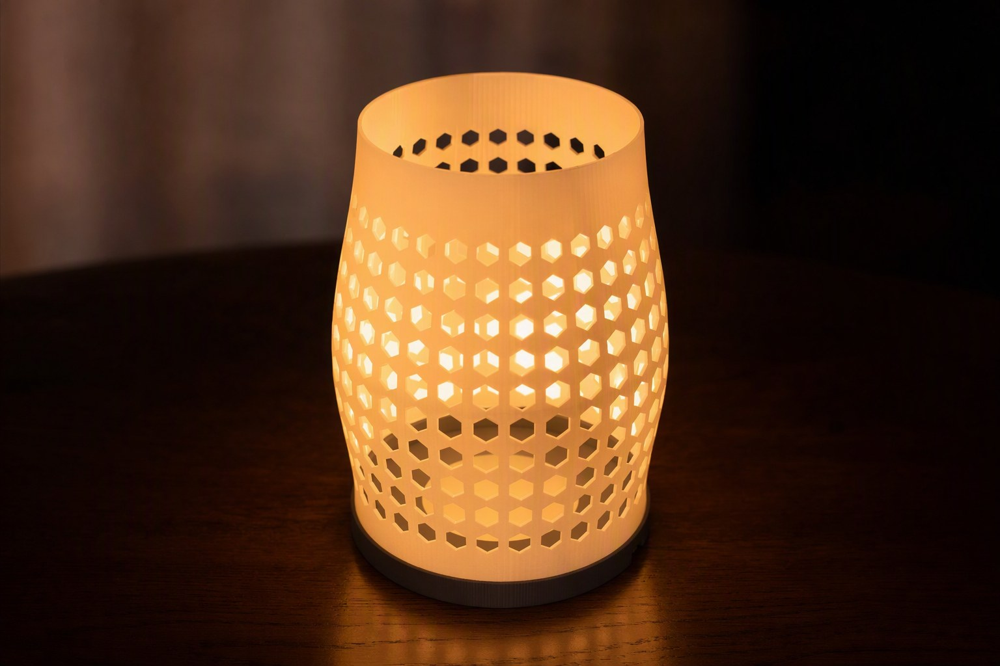
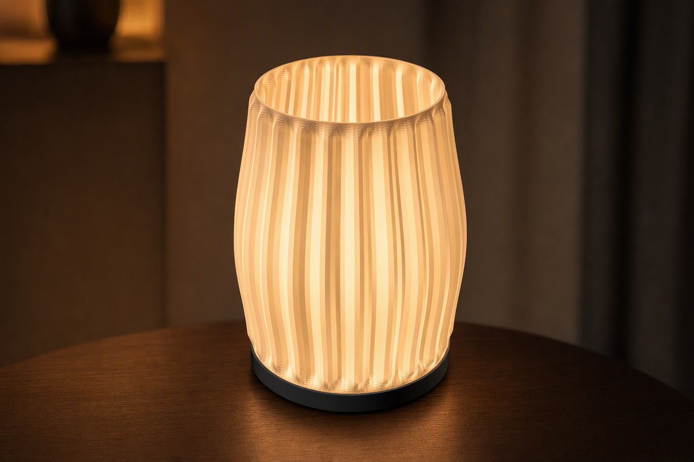
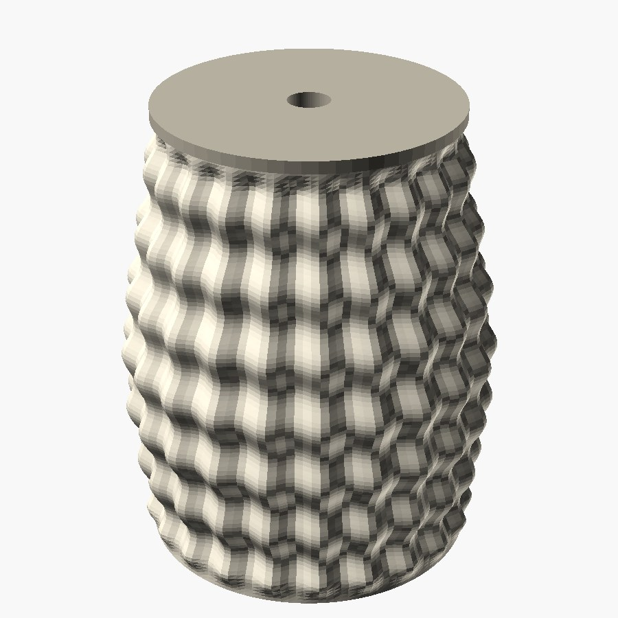
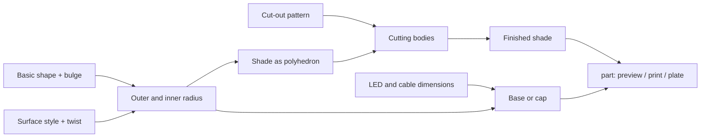
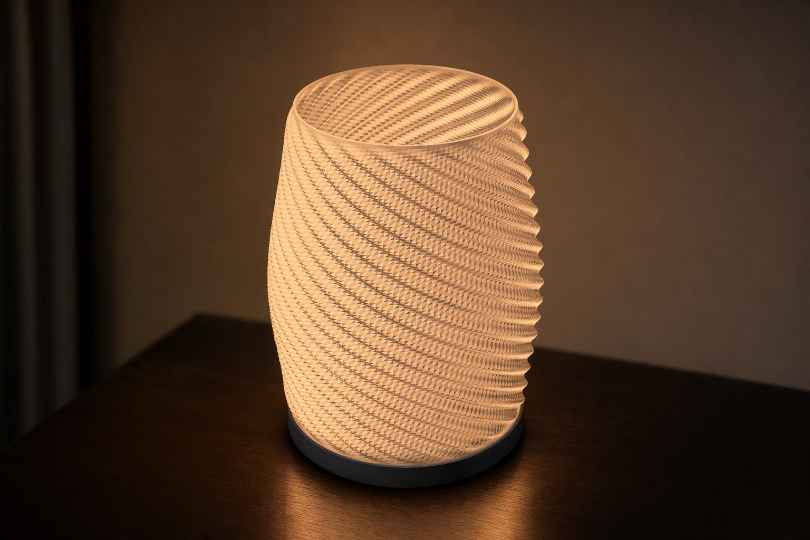

# Parametric Lampshade – Table Lamp & Pendant Lamp

[← All models](../../README.md)

🌐 **English** | [Deutsch](README.de.md)

A parametric lampshade for round LED pucks that can be printed as a table lamp
(LED shines upward) or as a pendant light (LED shines downward, cable exits at
the top) – from a single OpenSCAD file.

> **The model with all print profiles is available exclusively on MakerWorld:**
> 👉 [MakerWorld link: https://makerworld.com/en/models/3062645-parametric-table-lamp-ceiling-lamp](https://makerworld.com/en/models/3062645-parametric-table-lamp-ceiling-lamp)
>
> 

The **Parametric Lampshade** consists of an open shade tube with a freely
adjustable basic shape (height, top and bottom diameter, bulge), six surface
styles and five cut-out patterns. In addition there are a table base, a
hanging cap and an optional diffuser disc, all of which can be matched to the
LED puck. It was developed for the **Bambu Lab LED Lamp Kit 001 (MH001)**;
puck, cable and plug dimensions are parameters, so other round LED modules fit
as well.

## Table of Contents

- [The Problem](#the-problem)
- [The Idea](#the-idea)
- [Highlights](#highlights)
- [Parametric Options](#parametric-options)
- [Design](#design)
- [Print Recommendations](#print-recommendations)
- [Use Cases](#use-cases)
- [Troubleshooting / FAQ](#troubleshooting--faq)
- [Development History](#development-history)
- [Downloads](#downloads)
- [License](#license)

## The Problem

A printed lampshade has to solve several things at once that easily conflict
with each other:

- **It has to glow.** A solid 1.6 mm wall lets hardly any light through.
  Either the wall is thin and translucent, or the light comes through real
  openings.
- **It has to fit the light source.** Puck diameter, height, screw spacing and
  above all the cable end with its plug differ from module to module. A hole
  sized only for the wire does not let the plug through.
- **It has to print cleanly.** Open patterns in a thin wall quickly break the
  shade into loose pieces, tall free-standing bars wobble during printing, and
  surface waves can thin bars down to zero at certain points.
- **It should work as a table light and a hanging light.** Both variants need
  different holders but the same shade.

## The Idea

The shade is generated as a single polyhedron made of an outer and an inner
surface with edge rings: an open, watertight tube that prints upright and
without supports. The wall structure (waves, flutes, facets) only changes the
radius over angle and height; the inner surface follows the outer surface, so
the wall thickness stays constant. Cut-outs are subsequently subtracted as
cutting bodies, with size and position limited so that the bars never
disappear.

Base and cap center themselves via a lip whose radius is derived from the
smallest inner radius of the shade over the engagement depth. The clearance
(`fit_play`) is a separate control. Both holders take the same LED puck; only
the direction differs.

## Highlights

- **One model, two lamps:** table base (LED facing up) or hanging cap (LED
  facing down, cable centered at the top).
- **Parametric basic shape:** height, top and bottom diameter, bulge and its
  position, and wall thickness.
- **Six surface styles:** `smooth`, `vertical_waves`, `twist_flutes`,
  `ripple`, `scallop`, `facets`.
- **Five cut-out patterns:** `none`, `diamond`, `hex`, `mesh` (organic,
  Voronoi-like) and `slots` with stiffening rings.
- **Light in two ways:** a thin, translucent wall or real openings that cast
  patterns onto the wall and ceiling.
- **Adaptable to the light source:** puck diameter and height, screw spacing,
  cable and plug diameter (`plug_dia`).
- **Optional diffuser disc** with concentric or radial grooves.
- **Support-free:** the shade stands upright; base, cap and diffuser lie flat.
- **Verified geometry:** all 30 combinations of surface style and cut-out
  pattern produced exactly one watertight body during verification.
- **Two-color preview** (shade and holder in different colors) with a red
  "NOT FOR PRINTING" banner, plus a plate mode with shade and holder for
  multicolor printing.

## Parametric Options

The names correspond to the model's Customizer parameters. All dimensions are
in millimeters, angles in degrees.

### Part (`part`)

| Value | Meaning |
|---|---|
| `Vorschau Tischlampe` (default) | assembled table lamp with LED, two-color, not printable |
| `Vorschau Haengelampe` | assembled pendant lamp with LED, two-color, not printable |
| `DRUCK Schirm` | lampshade, upright, support-free |
| `DRUCK Tischfuss` | base with LED holder (LED facing up, open light path) |
| `DRUCK Haengekappe` | cap with LED holder (LED facing down, cable exits at the top) |
| `DRUCK Diffusor` | optional thin diffuser disc |
| `DRUCK Tischlampe Platte` | base and shade side by side, two-color |
| `DRUCK Haengelampe Platte` | cap and shade side by side, two-color |

### Shade Basic Shape

| Parameter | Meaning | Default | Range / Unit |
|---|---|---|---|
| `shade_height` | overall height of the shade body | 150 | 60–320 mm |
| `base_diameter` | outer diameter at the bottom | 110 | 50–280 mm |
| `top_diameter` | outer diameter at the top (larger than the bottom = inverted cone) | 96 | 40–280 mm |
| `belly_bulge` | additional radius in the middle (0 = straight profile) | 8 | 0–60 mm |
| `belly_position` | height of the strongest bulge, as a fraction of the overall height | 0.45 | 0.10–0.90 |
| `wall_thickness` | wall thickness | 1.2 | 0.8–5 mm |

### Wall Structure and Cut-outs

| Parameter | Meaning | Default | Range / Unit |
|---|---|---|---|
| `surface_style` | surface style | `vertical_waves` | `smooth`, `vertical_waves`, `twist_flutes`, `ripple`, `scallop`, `facets` |
| `wave_amp` | depth of the surface structure (0 = smooth wall) | 3.0 | 0–12 mm |
| `wave_count` | number of waves or flutes around the circumference | 22 | 4–80 |
| `surface_twist` | twist of the structure over the height | 0 | 0–720 degrees |
| `ripple_rows` | horizontal wave rows (`ripple` only) | 7 | 1–30 |
| `facet_count` | number of flat facets (`facets` only) | 9 | 3–24 |
| `opening_style` | cut-out pattern | `hex` | `none`, `diamond`, `hex`, `mesh`, `slots` |
| `open_cell` | cell or hole spacing of the pattern | 12 | 5–30 mm |
| `open_bar` | remaining bar width between the openings | 2.4 | 1.0–8 mm |
| `slot_count` | fixed number of vertical bars (`slots` only, 0 = automatic) | 0 | 0–60 |
| `slot_rings` | horizontal stiffening rings (`slots` only) | 2 | 0–6 |
| `slot_ring_width` | height of each stiffening ring (`slots` only) | 4 | 2–10 mm |
| `open_margin` | closed margin at the top and bottom before the pattern | 10 | 3–40 mm |

`surface_twist` only takes effect with wave-based styles and `wave_amp > 0`:

| `surface_style` | responds to `surface_twist` | Note |
|---|---|---|
| `smooth` | no | no surface structure |
| `vertical_waves` | yes | turns the vertical waves into a spiral |
| `twist_flutes` | yes | already has a built-in half turn; `surface_twist` is added on top |
| `ripple` | yes | twists the vertical wave component |
| `scallop` | yes | twists the scallop flutes |
| `facets` | no | facets stay flat and vertical |

The cut-out patterns are not twisted by `surface_twist`.

### Fit and LED Holder

| Parameter | Meaning | Default | Range / Unit |
|---|---|---|---|
| `lip_engage` | engagement depth of the centering lip of base or cap into the shade | 8 | 4–20 mm |
| `fit_play` | fit clearance per side between shade and lip | 0.35 | 0.1–0.8 mm |
| `led_diameter` | puck diameter (MH001 = 59) | 59 | 30–90 mm |
| `led_thickness` | puck height (MH001 = 8) | 8 | 4–20 mm |
| `led_clearance` | clearance around the puck (total diameter) | 0.6 | 0–2 mm |
| `led_screws` | screw holes for the BT3 screws | `true` | on/off |
| `led_screw_dia` | diameter of the screw holes | 3.2 | 2–6 mm |
| `led_screw_span` | distance between the two screw holes (center to center) | 50 | 20–80 mm |
| `cable_dia` | diameter of the cable channel | 5 | 3–10 mm |
| `plug_dia` | largest diameter that has to pass through (plug, strain relief) | 14 | 6–28 mm |
| `holder_floor` | thickness of the holder floor under the puck | 3 | 2–8 mm |

### Table Base, Hanging Cap, Diffuser

| Parameter | Meaning | Default | Range / Unit |
|---|---|---|---|
| `base_height` | height of the visible base ring | 12 | 6–40 mm |
| `base_flange` | overhang of the flange beyond the outer edge of the shade | 1.5 | 0–8 mm |
| `base_chamfer` | chamfer on the lower outer edge of the base | 1.2 | 0–5 mm |
| `cap_thickness` | thickness of the cap plate | 4 | 2.5–10 mm |
| `cap_overhang` | overhang of the cap beyond the outer edge of the shade | 2 | 0–10 mm |
| `cap_knot_dia` | diameter of the knot recess on top of the cap | 14 | 6–30 mm |
| `cap_knot_depth` | depth of the knot recess | 6 | 2–15 mm |
| `diffuser_thickness` | thickness of the diffuser disc | 1.2 | 0.8–3 mm |
| `diffuser_pattern` | groove pattern | `concentric` | `none`, `concentric`, `radial` |
| `diffuser_count` | number of rings or spokes | 16 | 4–60 |
| `diffuser_depth` | depth of the grooves | 0.6 | 0.2–2 mm |

### Colors (preview only) and Quality

| Parameter | Meaning | Default | Range / Unit |
|---|---|---|---|
| `color_shade` | color of the shade in the preview | `#e3a179` | color value |
| `color_holder` | color of base and cap | `#4b4b52` | color value |
| `color_led` | color of the glowing puck | `#ffe28a` | color value |
| `show_led` | show the LED puck in the preview | `true` | on/off |
| `shade_res_a` | angular resolution of the shade | 160 | 48–360 |
| `shade_res_v` | height resolution of the shade | 120 | 8–300 |
| `$fn` | smoothness of round parts (base, cap, holes) | 96 | 48–200 |

## Design

### OpenSCAD Approach

The model is pure OpenSCAD without external libraries and runs in the
MakerWorld Customizer. The shade is a hand-built polyhedron rather than a
Boolean construction; only the cut-outs, the LED holder and the diffuser
grooves are created by subtraction.

### Parametric Logic

| Quantity | Rule |
|---|---|
| Outer radius at height fraction `t` | straight line between bottom and top radius plus `belly_bulge` times a cosine bell factor that peaks at `belly_position` and is zero at the ends |
| Surface perturbation | added to the radius; fades to zero over the top and bottom 6 % of the height so that the edges stay round and the lip fits |
| Inner radius | outer radius minus `wall_thickness` (constant wall) |
| Lip radius | smallest inner radius over the engagement depth minus `fit_play` |
| Base light path | central bore from the top edge of the puck upward, lip as a ring with a 3 mm wall |
| Hanging cable path | center hole with `max(cable_dia, plug_dia)`, knot recess with `max(cap_knot_dia, plug_dia + 2)` |

### Special Algorithms

- **Dedicated profile curve per style:** `twist_flutes` generates raised,
  rotating ridges with a built-in half turn and thus differs visibly from
  `vertical_waves`; `scallop` is negative (flutes), `ripple` superimposes
  vertical waves with horizontal rows, and `facets` replaces the waves with a
  low angular resolution of flat faces.
- **Deterministic randomness for `mesh`:** A hash function of row, column and
  seed shifts the angle, height, size and rotation of each hexagonal hole. The
  hole size is limited to 0.62–0.95 times the cell size minus the bar, so bars
  never drop out.
- **Damping for `slots`:** Under vertical slots, the surface perturbation is
  reduced to 40 % so that deep waves cannot thin a bar down to zero and split
  the shade apart.
- **Stiffening rings:** The slots are cut as `slot_rings + 1` vertical
  segments; the wall bands left standing are rings that connect all bars and
  prevent the tall struts from wobbling during printing.
- **Complete cut-through:** The cutting bodies are longer than the wall is
  thick so that the openings always go all the way through the wall.

### Modularity

Shade, cut-outs, LED recess, table base, hanging cap, diffuser and the preview
building blocks (LED puck, warning banner) are separate modules. The LED
recess is shared by base and cap; the cap mirrors it downward and routes the
cable groove to the center, while the base routes it sideways to the outside.

### Print Optimizations

- **Upright and support-free:** The shade is an open tube; base and diffuser
  lie flat. The hanging cap is flipped for printing so that the smooth plate
  lies on the bed and the LED recess is open at the top.
- **Chamfer on the base:** `base_chamfer` bevels the lower outer edge, which
  improves bed adhesion.
- **Open cable path on the base:** The groove on the underside is as wide as
  the plug and open to the outside, so the cable is laid in instead of
  threaded through.
- **Manifold-checked:** The verification computes signed volume and counts
  non-closed edges (target: 0).

## Print Recommendations

The supplied profiles are created for the **Bambu Lab P1S** with **Bambu PLA
Basic** (0.4 mm nozzle, 0.20 mm layer, 2 walls, gyroid 15 %) and test-sliced
in Bambu Studio. For each variant, the plate contains two objects: shade and
table base.

| Setting | Recommendation |
|---|---|
| Material | white or translucent PLA (5 V); PETG or PA for mains voltage |
| Layer height | 0.16–0.20 mm |
| Walls | 2–3 |
| Infill | shade: 0 % (the thin wall is meant to glow), base and cap: 20–40 % |
| Supports | none |
| Orientation | shade upright, base and diffuser flat, cap with the plate facing down |

**Special notes**

- **Glow:** A wall thickness of 0.8–1.2 mm with 2–3 walls and 0 % infill makes
  the wall translucent; for stronger, more opaque light use 1.6–2.0 mm.
- Optionally, the slicer's spiral vase mode can be used.
- **Space requirements:** The footprint of the shade is larger than
  `base_diameter` (plus `belly_bulge` and `wave_amp` per side). The combined
  plate with default values does not fit on a 256 mm bed – that is why the
  profile loads shade and base as two separate objects.
- **Tall bars (`slots`):** Keep `slot_rings` at 2 or more, increase
  `wall_thickness` and print the outer wall slowly.
- **Mains voltage (110/230 V):** PLA softens from about 50–60 °C. Use only
  certified modules with insulated connections, provide strain relief and
  preferably print in PETG or PA. The driver or transformer belongs outside
  the shade.

### Included Variants

| Variant | `surface_style` | Other settings | Cut-outs |
|---|---|---|---|
| `wellen` | `vertical_waves` | default values | `none` |
| `hex` | `smooth` | default values | `hex` |
| `twist` | `twist_flutes` | `surface_twist` = 90 | `none` |

## Use Cases

- **Bedside or dresser light:** Table lamp with a `wellen` or `twist` shade as
  soft ambient light with the Bambu LED kit.
- **Shadow play on wall and ceiling:** Variant `hex` or `mesh`, whose openings
  project the light as a pattern.
- **Pendant light over the table:** Hanging cap with center hole; thread the
  cable with plug upward and use the knot in the recess as strain relief.
- **Your own light source:** Adjust `led_diameter`, `led_thickness` and
  `plug_dia` to another round module, for example a flat COB module with an
  external driver.
- **Homelab tinkering:** Status light or accent light next to the rack; with a
  low `shade_height` and a small diameter as a compact light.
- **Shape studies:** Vary `belly_bulge`, `belly_position` and `top_diameter`
  and judge the silhouette immediately in the Customizer.
- **Softer light:** Insert the diffuser into the shade to scatter the LED
  hotspot.

## Troubleshooting / FAQ

| Symptom | Cause | Fix |
|---|---|---|
| Lamp barely glows through the wall | wall too thick or infill active | `wall_thickness` 0.8–1.2 mm, shade with 0 % infill, translucent PLA; alternatively `opening_style` ≠ `none` |
| Plug does not fit through the cap hole | center hole sized only for the wire | set `plug_dia` to the measured plug diameter |
| Puck cannot be inserted or sits loosely | puck dimensions differ | adjust `led_diameter`, `led_thickness`, `led_clearance` |
| Shade sits too tight or too loose on base or cap | fit clearance | increase or decrease `fit_play` (PLA about 0.35 mm) |
| Tall bars (`slots`) wobble during printing | free-standing struts without connection | `slot_rings` ≥ 2, increase `wall_thickness`, print the outer wall more slowly |
| `surface_twist` has no effect | style `smooth` or `facets`, or `wave_amp` = 0 | choose a wave-based style and set `wave_amp` > 0 |
| Pattern barely changes with `slots` | surface perturbation is damped to 40 % there | intended: the bars must stay solid |
| Combined plate "Nothing to be sliced" | shade and base side by side exceed the bed | load shade and base as separate objects |
| After opening the file, the preview is labeled in red | preview mode | set `part` to a `DRUCK` value |
| Mains-voltage module gets warm, PLA deforms | PLA softens from about 50–60 °C | use PETG or PA, only certified modules |

## Development History

The goal was a lampshade generator for the Bambu LED Lamp Kit 001 (MH001:
puck Ø 59 × 8 mm, 5 V, 3 W, warm white; mounting with two BT3×12 screws or
Ø 40 mm adhesive tape). The bulge idea comes from an earlier parametric bowl
model; four lamps on MakerWorld with Voronoi, wave and ripple looks served as
inspiration.

Several corrections came from practice: On the table base, the LED holder was
initially covered by a solid plate and a full lip cylinder – the puck did not
fit in and the light was blocked. The base therefore now has a ring lip and an
open light bore. The plug of the LED cable is larger than the cable, hence
`plug_dia` was added. The `twist_flutes` style was initially byte-identical to
`vertical_waves` and got its own profile; `ripple` combined with `slots` split
the wall into eight loose pieces, hence the damping. In a test print, tall
free-standing bars began to wobble, which led to the stiffening rings. A
matrix of all 30 combinations of style and cut-out then confirmed one
watertight body each.

The print profiles (shade plus base as two objects, P1S, PLA) were created on
August 4, 2026.

## Downloads

Print files are intentionally available exclusively on MakerWorld.

👉 MakerWorld link: https://makerworld.com/en/models/3062645-parametric-table-lamp-ceiling-lamp

Profile: <https://makerworld.com/en/@BetaHydri>

## License

Documentation and images in this repository: © BetaHydri. The model (including
source code) and all print files are distributed exclusively via MakerWorld
under the license stated there. This repository intentionally contains no
model, source code or print files.
