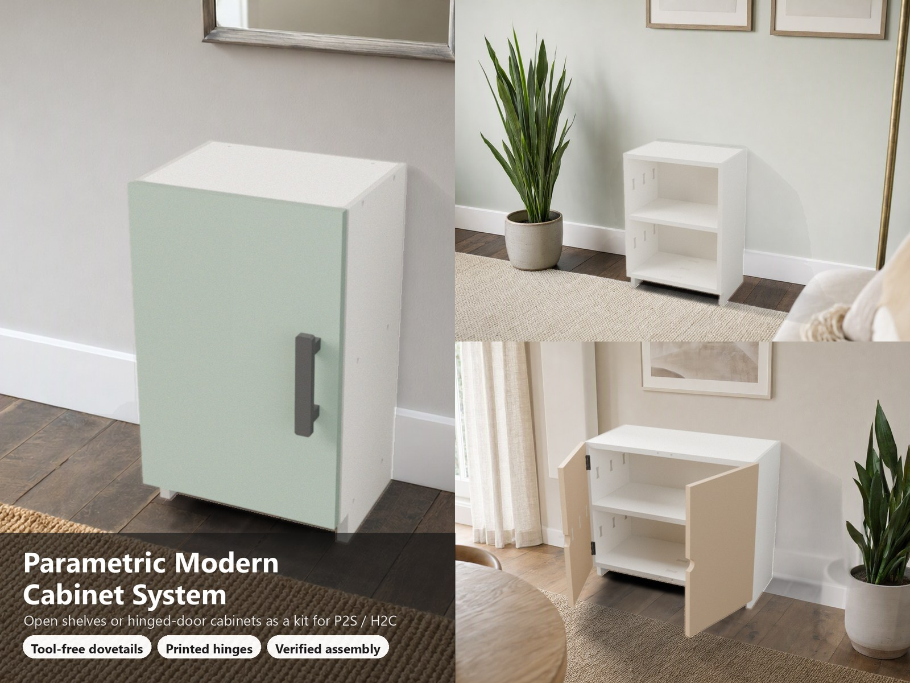
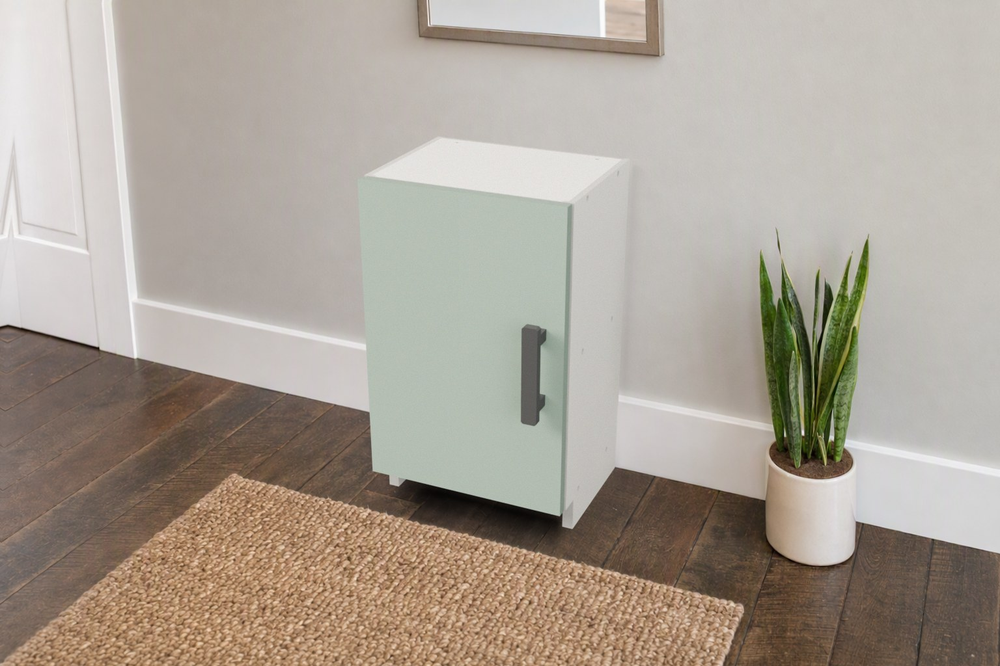
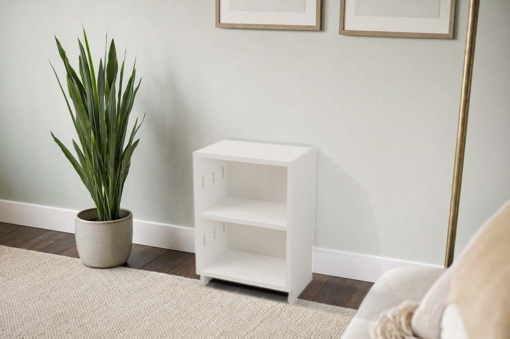
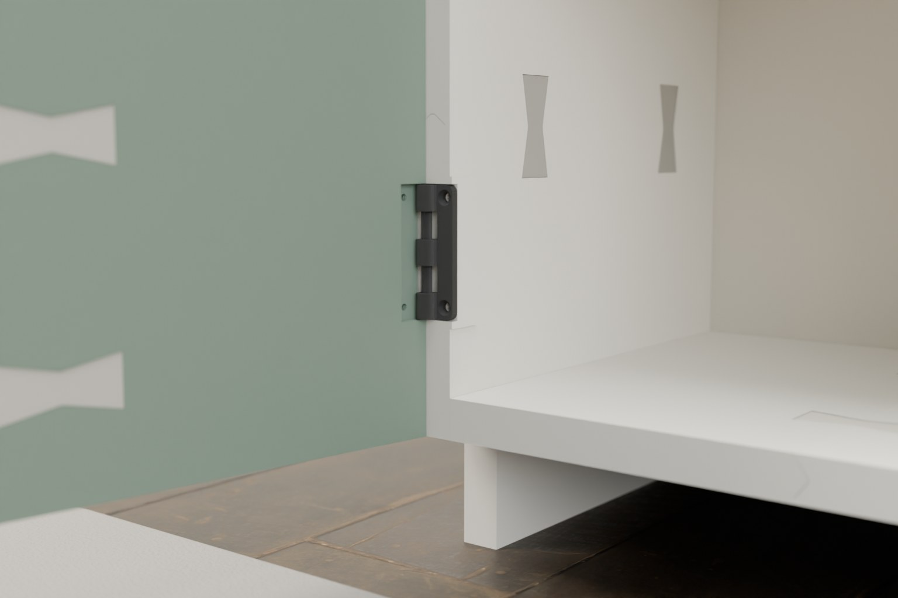
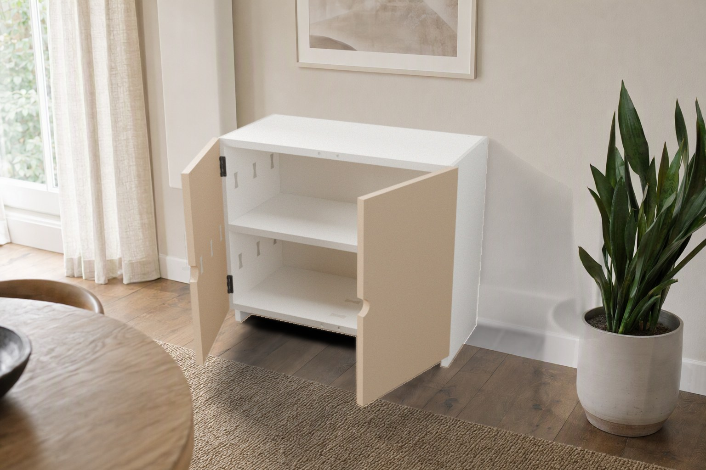

# Parametric Modern Cabinet System – Open Shelves and Door Cabinets as a Multi-Plate Kit

[← All models](../../README.md)

🌐 **English** | [Deutsch](README.de.md)

Parametric, modern, **3D-printable cabinets and shelving units** for Bambu Lab
printers: an open bookshelf, a cabinet with one door or a sideboard with two
doors. Every large panel is cut into bed-sized tiles and delivered as a **kit on
separate build plates** for the **P2S (256 mm)** and **H2C (330 × 320 mm)**.
Shelves slide into dovetail grooves, doors hang on **hidden, printed hinges**.

> **The model with all print profiles is available exclusively on MakerWorld:**
> 👉 [MakerWorld link: https://makerworld.com/en/models/3501978-parametric-modern-cabinet-system](https://makerworld.com/en/models/3501978-parametric-modern-cabinet-system)
>
> 

You set the size, the number of shelves, the door type and the handle in the
MakerWorld Customizer. The model calculates tiles, seams, joints, doors and
hinges to match, **packs every part onto build plates automatically** and
exports **one 3MF with one plate per print job**. Three tested kits are also
available as ready-made 3MF projects.

## Table of Contents

- [Highlights](#highlights)
- [Included Kits](#included-kits)
- [How It Goes Together](#how-it-goes-together)
- [Assembly Guides (PDF and Markdown)](#assembly-guides-pdf-and-markdown)
- [Parametric Options](#parametric-options)
- [Which Option Should I Choose?](#which-option-should-i-choose)
- [Hinges and Reinforced Screw Holes](#hinges-and-reinforced-screw-holes)
- [What Do I Need to Buy?](#what-do-i-need-to-buy)
- [Verification](#verification)
- [Print Recommendations](#print-recommendations)
- [Limits](#limits)
- [Downloads](#downloads)
- [License](#license)

## Highlights

- **Open or closed:** open shelving, one door, two doors (stackable door rows),
  floating plinth with toe-kick, optional back panel.
- **Kit logic:** every large panel is cut into **bed-sized tiles** (P2S ≤ 244 mm,
  H2C ≤ 292 mm) joined by a support-free **V tongue-and-groove seam and bow-tie
  keys** (tension ties). Tiles, keys, hinges and handles are packed onto separate
  build plates.
- **Stable and tool-free:** shelves, top and bottom panel slide into
  **half-dovetail grooves** of the side panels (self-tightening, blind at the
  front, locked by the back panel). Optional hidden **M4 screws with captive
  nuts** or **thumbscrews** (hand-tight).
- **Doors with hidden, printed hinges:** an **overlay door** on **print-in-place
  leaf hinges** (from my *Hinge Designer*, printed flat in one go, no pin to
  insert). They sit in pockets behind the door and are fixed with **M3
  countersunk screws**. Nothing is stuck onto the front: you see door, gap and
  handle. Alternatives: `pivot` (flush door on two hidden M4 pivot screws and
  heat-set inserts) and `knuckle` (lugs and long printed pin).
- **Stronger exactly where it is screwed:** every screw and insert hole is
  wrapped in a reinforcement zone. The 3MF carries it as a *modifier volume*:
  **6 wall loops and 100 % infill** around the holes only.
- **Your handles:** M3–M6 hole patterns (`handle_cc` 32 … 320 mm, same values as
  in [Parametric Furniture Handles](../parametric-furniture-handles/README.md)),
  finger scoops or a **built-in printed bar pull**; magnets as door catches.
- **Verified, not eyeballed:** print checks, interference, clearances, simulated
  assembly (swept-path collision tests) and statics.
- **Matte-PETG look:** layer lines, no supports, no visible hardware except the
  optional screws.

## Included Kits

| Kit | Size W × H × D (mm) | Printer | Plates | Print time | Filament | Joints | Doors |
|---|---|---|---|---|---|---|---|
| `mini-open-shelf-360x500-p2s` | 360 × 500 × 230 | P2S | 15 | 68 h | 2.7 kg | plug-in (tool-free) | – |
| `cabinet-1door-300x500-p2s` | 300 × 500 × 220 | P2S | 19 | 81 h | 3.2 kg | dovetail + M4 screws | 1, hidden hinges, built-in pull, magnets |
| `sideboard-2door-580x500-h2c` | 580 × 500 × 270 | H2C | 18 | 145 h | 5.8 kg | dovetail + thumbscrews | 2, hidden hinges, finger scoops, magnets |

PETG, 3 walls, 15 % gyroid, 0.2 mm, sliced with Bambu Studio presets. Any other
size: set the parameters in the Customizer (see below).

### Order your own size in the Customizer

1. Set size, shelves, doors, hinge style, handle and joints.
2. Choose the **printer** (parameter `printer`) **and select the same printer in
   the bed menu of the MakerWorld preview BEFORE you download** (again in the
   download dialog). The 3MF carries that printer profile. P2S = every 256 mm bed
   (P2S, P1S, X1C …), H2C = large bed. MakerWorld only checks the bed: on a smaller
   bed (A1 mini …) it shows "Model cannot fit in plates".
3. Optional **two colours** (`two_colors`): doors and the built-in pull get a
   second colour, every colour is one filament in Bambu Studio. Door parts and
   carcass parts are packed on **separate plates**, so each plate has a single
   colour and needs no prime tower.
4. **Generate, then Download.** You get **one 3MF with one plate per print job**
   (up to 36 plates, the Bambu Studio limit), all parts centred on the plates. The
   *Assemble View* shows the finished cabinet with the door open. A 500 × 800 mm
   cabinet with one door needs about 27 plates; very large sizes exceed 36 plates
   and must be reduced.
5. In Bambu Studio switch the filament to **PETG** (the presets default to PLA).

## How It Goes Together

| Step | What happens |
|---|---|
| **1. Tiles** | Tongue into groove, press the bow-tie keys into the pockets of the hidden face. |
| **2. Shelves** | Slide every horizontal panel from the rear into the left side. |
| **3. Right side** | Slide it on from the front over all tenons at once. |
| **4. Back panel** | Locks the shelves; friction fit or M3 screws. |
| **5. Doors** | Screw the printed hinges into their pockets (door back and front edge of the side, M3 × 10 countersunk), close the door, press in magnets, fit the handle. |
| **6. Wall** | Two holes in the top panel take a wall bracket or an anti-tip strap — **mandatory**. |

## Assembly Guides (PDF and Markdown)

Every kit has an illustrated guide in English and German: pictures with arrows
for the push direction, close-up sections of the bow-tie key, the captive nut and
the hinge, hardware list, print plan per build plate and a short summary of what
was verified.

| Kit | PDF English | PDF German | Markdown |
|---|---|---|---|
| Open shelf 360 × 500 | [Assembly-Guide-EN.pdf](guides/mini-open-shelf-360x500-p2s/Assembly-Guide-EN.pdf) | [Assembly-Guide-DE.pdf](guides/mini-open-shelf-360x500-p2s/Assembly-Guide-DE.pdf) | [EN](guides/mini-open-shelf-360x500-p2s/ASSEMBLY.md) · [DE](guides/mini-open-shelf-360x500-p2s/ASSEMBLY.de.md) |
| Cabinet 300 × 500 | [Assembly-Guide-EN.pdf](guides/cabinet-1door-300x500-p2s/Assembly-Guide-EN.pdf) | [Assembly-Guide-DE.pdf](guides/cabinet-1door-300x500-p2s/Assembly-Guide-DE.pdf) | [EN](guides/cabinet-1door-300x500-p2s/ASSEMBLY.md) · [DE](guides/cabinet-1door-300x500-p2s/ASSEMBLY.de.md) |
| Sideboard 580 × 500 | [Assembly-Guide-EN.pdf](guides/sideboard-2door-580x500-h2c/Assembly-Guide-EN.pdf) | [Assembly-Guide-DE.pdf](guides/sideboard-2door-580x500-h2c/Assembly-Guide-DE.pdf) | [EN](guides/sideboard-2door-580x500-h2c/ASSEMBLY.md) · [DE](guides/sideboard-2door-580x500-h2c/ASSEMBLY.de.md) |

Print the **fit-test coupon** first. It contains a dovetail block, a bow-tie key,
two hinges and an M3 boss, so you can check your filament before printing the kit.

## Parametric Options

| Section | Parameters |
|---|---|
| Plates and colours | `two_colors`, `body_color`, `door_color` (second colour for doors and built-in pull), `door_open` (preview angle 0–110°, default 60°) |
| Cabinet size | `cab_w`, `cab_h`, `cab_d`, `panel_t` (sides, doors), `shelf_t` (shelves, top, bottom), `shelf_count`, `plinth_h`, `kick_d`, `back_panel`, `back_t`, `wall_anchor` |
| Doors | `doors` (none / single_left / single_right / double), `door_comp` (compartments with doors), `door_rows`, `reveal`, `handle` (none / bar = holes for your handles / knob / scoop / integrated), `handle_cc`, `handle_screw`, `handle_orient`, `handle_v`, `handle_edge`, `hp_*` (built-in pull), `magnets`, `magnet_d`, `magnet_h` |
| Joints | `joint` (plug / screw / thumbscrew), `dt_depth`, `dt_angle`, `fit`, `tenon_len`, `tenon_gap`, `seam_keys`, `back_fix` |
| Hinges | `hinge_style` (**leaf** = hidden print-in-place hinge, default / pivot / knuckle), `hinge_len`, `hl_gap` (hinge clearance), `hinge_inserts` (M3 heat-set inserts instead of self-cutting screws), `insert_d`, `insert_len`, `pin_d`, `hinge_fit`, `hinge_pitch` (knuckle) |
| Printer | `printer` (P2S = tiles up to 248 mm, fits any 256 mm bed such as P1S / X1C; H2C = tiles up to 296 mm for the large bed), sets the tile size and the plate size |

**Automatic plates:** every setting is packed again: tiles, bow-tie keys (+12 %
spare), pin segments, hinges, pulls and caps are placed row by row on the usable
bed (248 mm P2S, 296 mm H2C, 8 mm spacing) and each plate is centred on the bed.
Print the **bow-tie keys in the cabinet colour** so they stay almost invisible
inside open shelves.

## Which Option Should I Choose?

| Option | What it does | Choose it when |
|---|---|---|
| `back_fix = friction` | Back panel is a slip fit in the rabbet. **No hardware, no tools.** Still locks the shelves against sliding out backwards. | Small or lightly loaded cabinets and open shelves. A few drops of glue or tape make it permanent. |
| `back_fix = screw_M3` | Same panel, plus **M3 × 16 self-tapping screws** through the back into the rear edge of top, bottom and every shelf. Nothing rattles, the back cannot slide out. **Needs a screwdriver.** | Tall or heavily loaded cabinets, or when it will be moved around. |
| `joint = plug` | Dovetails only. **No tools, no hardware.** | Light shelves; you want to assemble and take apart by hand. |
| `joint = screw` | Dovetail plus a hidden **M4 screw into a captive nut** per tenon block. | Firmest joint; permanent furniture. |
| `joint = thumbscrew` | Dovetail plus **M4 wing or knurled screws**, tightened by hand. | Firm joint that stays **tool-free** and removable. |
| `handle = bar / knob` | Holes only: you mount **your own** handles. | You use *Parametric Furniture Handles* or bought handles. |
| `handle = scoop` | Finger scoop in the door edge, nothing to mount. | Minimal look, no hardware. |
| `handle = integrated` | Printed bar pull that is part of the kit (one M4 screw and nut per post). | You want a complete kit from one print job. |
| `hinge_style = leaf` *(default)* | Overlay door, **print-in-place hinge** hidden behind the door, **M3 × 10 countersunk screws** (2 per leaf). The hinge is printed in the kit. | Almost always: looks like a concealed hinge, door opens beyond 110°. |
| `leaf` + `hinge_inserts = true` | Same, with **M3 heat-set inserts** (Ø 4.0–4.2 mm, 5–6 mm long) melted into the hinge pockets first. | Doors are moved very often or you remove the hinges regularly. |
| `hinge_style = pivot` | Inset (flush) door on two hidden **M4 pivot screws** into **M4 heat-set inserts** in the door ends, printed hole caps. | You want a fully flush door in a single row (soldering iron needed). |
| `hinge_style = knuckle` | Lugs on the side panel, long printed pins (split in segments). | You want no screw hardware in the hinge at all. |

The back panel's own tile seams are plain tongue-and-groove (6 mm is too thin for
keys): a few drops of glue or tape on the rear make them permanent.

## Hinges and Reinforced Screw Holes

The leaf hinge is a geometry of my [Hinge Designer](../parametric-hinge-designer/README.md)
(standard preset, 4 mm pin, 0.4 mm clearance), embedded in the cabinet. It prints
flat as two separate bodies and swings freely right after printing; the check
covers 0–180° without contact. Each side panel gets a small inward boss behind
every hinge pocket, so the pocket keeps a thick wall for the M3 screws, and the
doors have a swept relief so they open to 110° without touching the carcass.

Around every screw and insert hole the **3MF** contains a modifier volume (ring
3.5 mm wide): **6 wall loops and 100 % infill** there, the rest stays at 3 walls
and 15 % gyroid. That adds only about 1 g and 7 minutes per tile instead of
printing everything solid. Plain STL files cannot store a modifier: set 4–5
walls around the hinge screws yourself.

M3 is the smallest screw size used anywhere in the kit.

## What Do I Need to Buy?

- Plug-in kit (open shelf): **nothing**.
- Dovetail screws: M4 button-head screws with M4 hex nuts, or M4 thumb screws with nuts.
- Back panel (optional): M3 × 16 self-tapping screws.
- **Hinges: M3 × 10 countersunk screws (ISO 10642), 2 per leaf.** The hinges are printed.
- Door catches: 8 × 3 mm neodymium disc magnets (4 per door).
- Handles: M4 screws for your own or the built-in handles.
- Wall: screws and plugs or an anti-tip strap.

The exact list with quantities is in the assembly guide of each kit.

## Verification

All checks ran on the real exported meshes and are repeatable.

- **Assembly is simulated** step by step with swept-path collision tests: shelves
  slide in from the rear, the right side slides on over all tenons, the back
  panel, doors from the front, swing 0–110°, hinges seat in their pockets.
  Retention is proven: shelves cannot leave backwards or forwards, the sides
  cannot be spread.
- **Stability:** centre of mass, **tip-over** (an empty free-standing cabinet of
  this kind tips forward at a few kg on the front edge, **the wall anchor is
  mandatory**), shelf rating (stress and deflection ≤ L/200: mini 15 kg, 1-door
  20 kg, sideboard 10 kg per shelf, evenly distributed), seam capacity of the
  keys, dovetail bearing and shear, hinge load.
- **Printability:** bed fit, flat on the bed, one body per part, overhangs,
  seams, clearances; the exported build plates are checked for overlap and
  completeness.

The calculations use conservative values for printed PETG (E 600 MPa, bending
8 MPa, key tension 15 MPa). They are **engineering estimates, not a test report**.
The hinge strength values (M3 withdrawal 120 N, insert pull-out 100 N) are
assumptions. Print the coupon and load-test your own build before relying on it.

## Print Recommendations

- **Material:** PETG, 3 wall loops, 15 % gyroid, 0.2 mm layers. No supports needed.
- **Use the ready-made 3MF of the kits** for reinforced screw zones: a Customizer
  download cannot store modifier volumes, so set **4–5 walls** (and ≥ 40 % infill)
  around the hinge screws yourself, or print the hinge-side panels with 5 walls.
- Print the **fit-test coupon first**: dovetail block (light friction), bow-tie
  key (presses in with your thumb), hinge (swings freely), M3 boss (screw cuts in).
  Adjust `fit` and `hl_gap` in the Customizer if needed.
- Bow-tie keys in the cabinet colour; doors in a contrasting colour look best.

## Limits

- Shelves wider than about 600 mm need thicker shelves (`shelf_t`) or a vertical
  divider (not yet modelled).
- Door rows are split at shelves; very low doors fall back to a single handle hole.
- Planned: vertical dividers, drawers, legs, a 90° corner cabinet.

The pictures in this folder are renderings of the model geometry; the room
scenes are photoreal pictures in which only the room is generated, while the
furniture comes from the render of the actual model.

## Downloads

Print files are intentionally available exclusively on MakerWorld.

👉 MakerWorld link: https://makerworld.com/en/models/3501978-parametric-modern-cabinet-system

Profile: <https://makerworld.com/en/@BetaHydri>

## License

Documentation and images in this repository: © BetaHydri. The model (including
source code) and all print files are distributed exclusively via MakerWorld
under the license stated there. This repository intentionally contains no
model, source code or print files.
