# Cabinet 300 x 500 x 220 mm, one door on printed print-in-place leaf hinges (hidden behind the door), 1 shelf - dovetail + hidden M4 screws, magnet catch, built-in printed pull

## Assembly manual

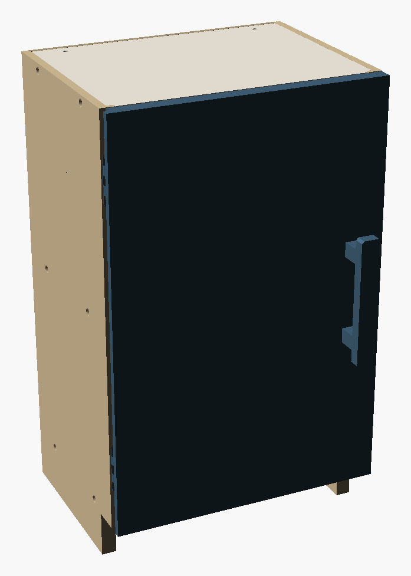

**Kit:** `cabinet-1door-300x500-p2s`  |  **Printed parts:** 20 tiles + 27 keys  |  **build plates:** 19  |  **print time (sliced, PETG, 3 walls, 15 % gyroid):** 81 h, 3.2 kg

### Hardware you need

- 2 x Leaf hinge (printed in place, in the kit), 50 mm
- 8 x M3 x 10 countersunk screw (ISO 10642 / DIN 7991) for the hinge leaves
- 12 x M4 button-head screw 25 mm (ISO 7380)
- 12 x M4 hex nut (DIN 934, captive in the shelf)
- 9 x M3 x 16 self-tapping screw (back panel)
- 4 x Neodymium disc magnet 8 x 3 mm
- 2 x M4 x 27 mm screw for the handle (from the inside, door 16 mm)
- 2 x M4 hex nut for the built-in handle posts
- 2 x Wall screw + plug or anti-tip strap for the 2 anchor holes in the top panel (wall dependent)

**Tools:** 2.5 mm hex key; PH1 screwdriver; rubber mallet (optional), cyanoacrylate glue (optional); drill for the wall anchor; PH1 / T10 screwdriver for the M3 hinge screws (soldering iron only with `hinge_inserts`)

---

### 0  Print and prepare
Print every plate with **PETG** (3 wall loops, 15 % gyroid, 0.2 mm). Use the **3MF** of this model: it carries modifier volumes that print the walls around every screw and insert hole with **6 wall loops and 100 % infill** (with plain STL files set 4-5 walls around these holes yourself). Print the **fit-test coupon** (`fit-test.stl`) first: the dovetail block must slide by hand with light friction, the bow-tie key must press in with your thumb, the **print-in-place hinge** must swing freely right after printing and an **M3 x 10 countersunk screw** must cut into its boss. If it is too tight / loose, change `fit` (0.25 default) or `hl_gap` (0.4 default) in the Customizer and generate the plates again.

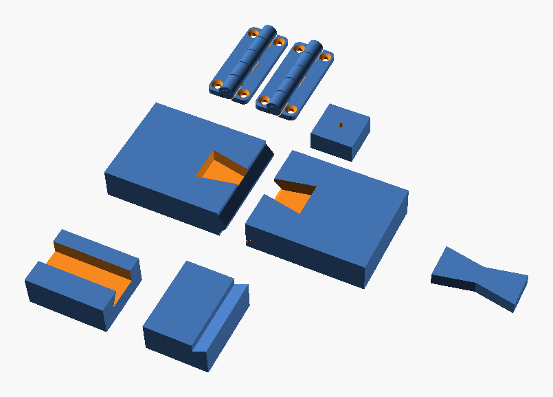

### 1  Join the tiles of every big panel
Large panels are printed as bed-sized tiles. Lay the tiles of one panel next to each other, **tongue into groove**, face-down on the table. Press the **bow-tie keys** into the pockets on the hidden face (the face that was *up* on the printer: inner face of the sides, underside of the shelves, back of the doors). Keys sit 0.4 mm below the surface; a drop of cyanoacrylate makes the seam permanent. The back panel has plain tongue-and-groove seams (add a few drops of glue or a strip of tape on the rear).

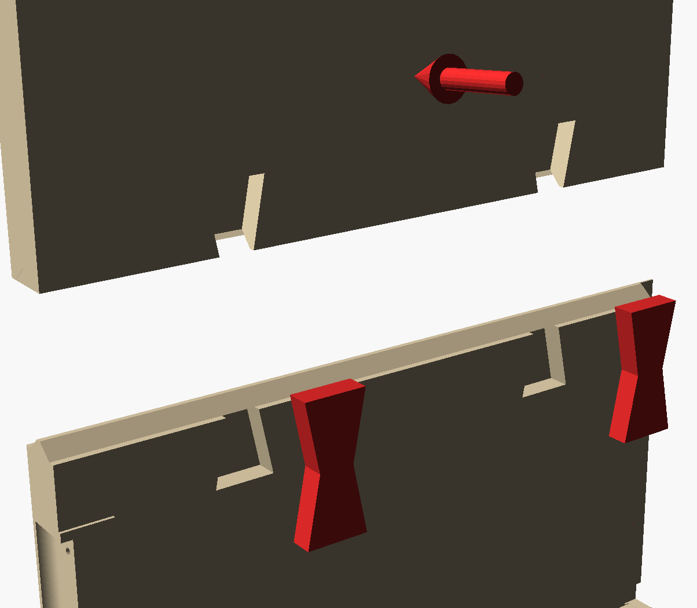

### 2  Insert the captive nuts
Press one M4 hex nut into every slot on the underside of the shelf / top / bottom panels (4 per panel). A touch of tape or glue keeps it in while you assemble.

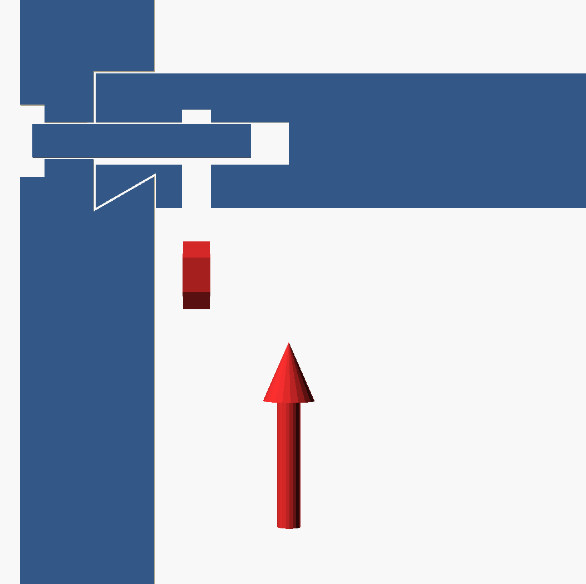

### 3  Slide the shelves into the left side
Stand the left side on the table (inner face up). Push **every horizontal panel from the rear** into its dovetail groove until it stops against the blind front end. The tenon blocks lock the panel against the side - it cannot be pulled out sideways.

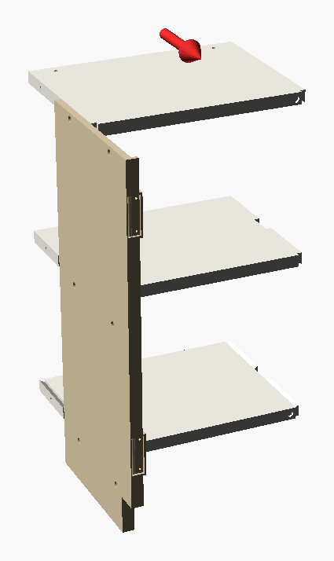

### 4  Slide the right side on
Place the right side in front of the shelf ends and slide it **backwards** over all tenons at once until its grooves stop. Use a rubber mallet if the fit is tight.

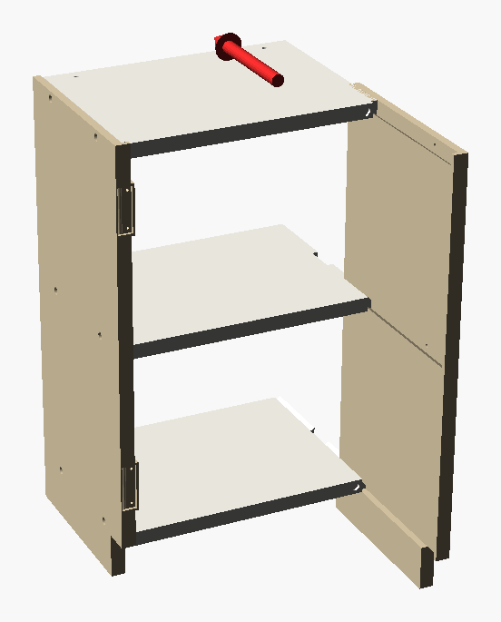

### 5  Back panel
Slide the back panel into the rabbet from the rear and fix it with the M3 screws (pilot holes in the rear edge of every shelf). It locks all shelves against sliding out backwards.

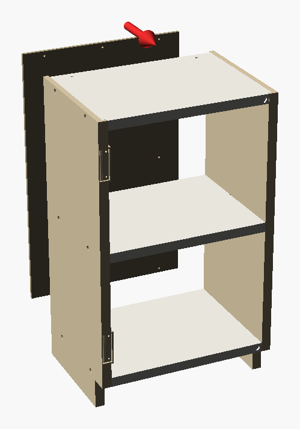

### 6  Fasten the dovetails (optional but recommended for heavy loads)
From the outside drive the **M4 x 25 button-head screws** through the side panel into the captive nuts (2.5 mm hex key). The head sits flush in its recess.

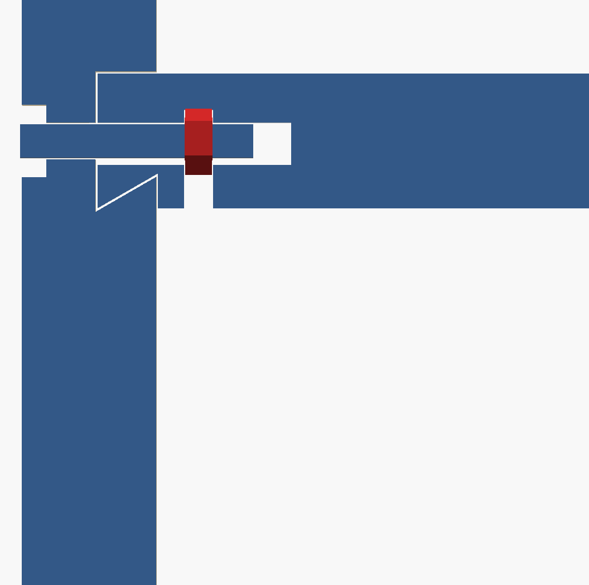

### 7  Hang the doors
**Hinges:** every hinge is one print-in-place part (two leaves joined by a printed pin) - do not pull it apart. Lay the door face-down, press a hinge leaf into its pocket on the back of the door and fix it with **two M3 x 10 countersunk screws** (the screws cut their own thread in the reinforced boss; with `hinge_inserts=true` press M3 heat-set inserts in first). Swing the hinge open, push the other leaf **from the front** into the pocket in the front edge of the side panel and fix it with two M3 x 10 screws. Repeat for every hinge, then close the door: it covers the opening as an overlay door and the hinges are hidden behind it. Check that the door swings freely; if a screw head stands proud the countersink is too shallow, re-print the leaf or lower `hinge_fit`.

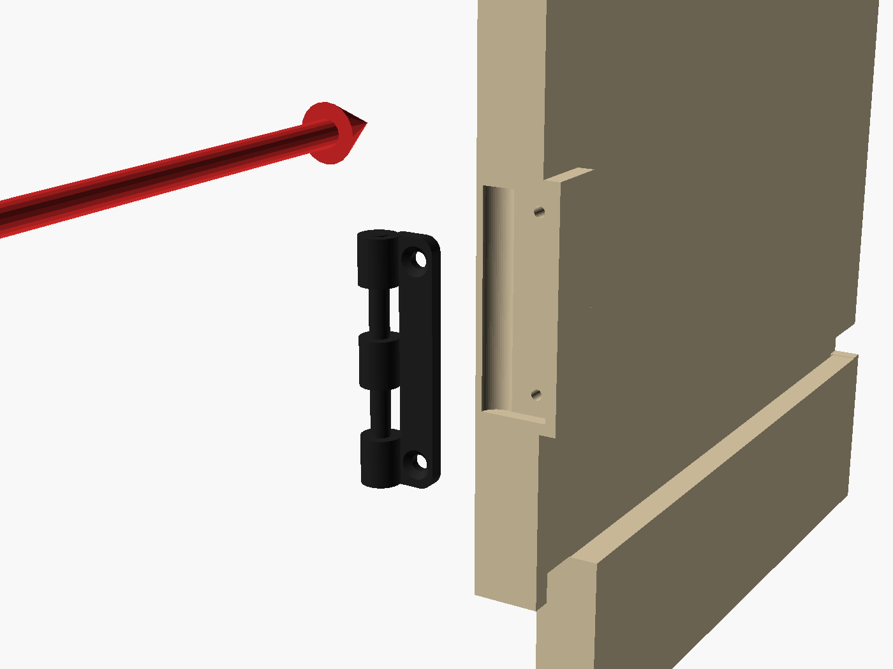
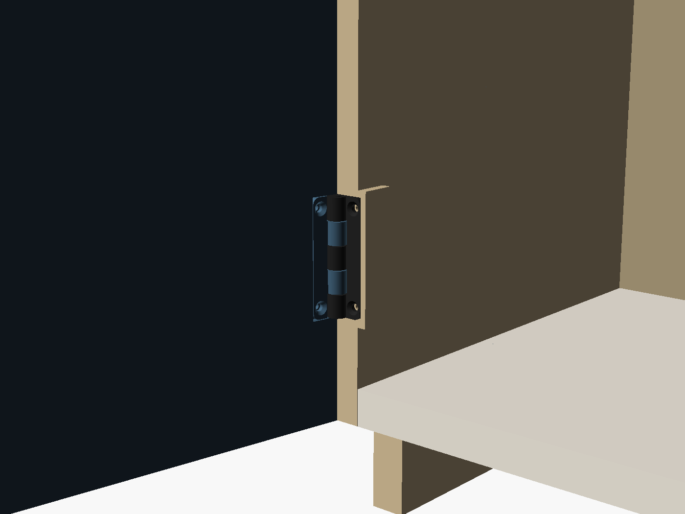
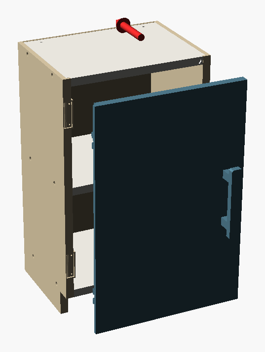

### 8  Magnets and handles
Press the magnets into the pockets (door back face + shelf front edge), **test the polarity before gluing**.

Built-in pull: press a hex nut into the pocket on top of each post, hold the pull on the door front and drive the screws **from the inside** through the door into the nuts.

### 9  Secure the cabinet to the wall
**Mandatory.** The two holes in the top panel take wall brackets or an anti-tip strap. Free-standing, an empty cabinet of this kind tips forward under a small load on its front edge (see *tip-over* in the verification summary below).

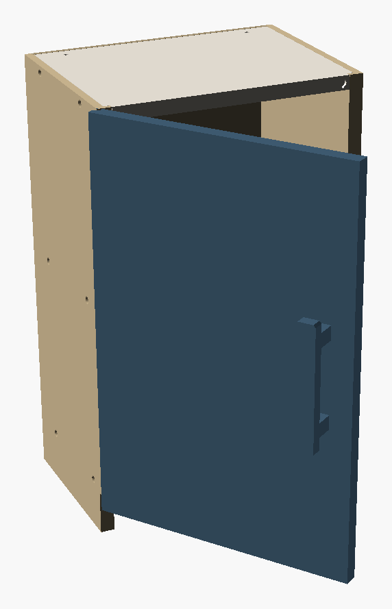

---

## Verification summary

### Verified by simulation

| | Check | Result |
|---|---|---|
| OK | S1 3 horizontal panels slide from the rear into the left side (tool-free) | worst intersection 0.00 mm3 over 16 positions each |
| OK | S2 right side slides from the front over all tenons simultaneously | worst 0.00 mm3 |
| OK | S3 back panel slides into the rabbet from the rear | worst 0.00 mm3 |
| OK | S4 1 door(s) slide in from the front onto the hinge side | worst 0.00 mm3 |
| OK | S5 doors swing 0..110 deg without touching the carcass | worst 0.00 mm3 |
| OK | S6 printed leaf hinges seat in their pockets from the front (M3 screws from the front, door swung open) | worst 0.00 mm3 |
| OK | L1a shelves cannot be pushed out backwards once the back panel is on |  |
| OK | L1b shelves cannot slide forwards (blind groove stop) |  |
| OK | L2 sides cannot be pulled apart (half-dovetail locks every shelf) |  |
| - | mass model | cabinet 3.2 kg (solid PETG 11.5 kg, fill factor 0.27 calibrated on the slicer weight); centre of mass x=151 y=89 z=267 mm |
| - | tip-over (front edge load) | load that tips the empty cabinet forward: 6 kg; loaded 23 kg: 60 kg (lever = toe-kick 30 mm) |
| OK | stability class: wall anchor REQUIRED | top panel carries the 2 anchor holes (wall_anchor = true) |
| OK | centre of mass is centred between the sides | offset +1 mm |
| OK | free-standing with all doors open at 90 deg | door moment 1.4 N*m vs stabilising 1.4 N*m -> TIPS when empty: wall anchor is MANDATORY (anchor holes are part of the top panel) |
| OK | door-open tipping is covered by the wall anchor | wall_anchor holes present |
| OK | shelf rating: 20 kg evenly distributed per shelf (stress and deflection <= L/200) | span 268 mm, shelf 16 mm thick |
| OK | shelf seam (bow-tie keys as tension ties) carries the bending moment | capacity 24.0 N*m vs demand 4.93 N*m (15 kg), safety 4.9 |
| OK | dovetail bearing pressure on the sloped flank | 0.15 MPa (allow 3.0) per shelf end, 2 blocks |
| OK | tenon neck shear (across layers) | 0.044 MPa (allow 1.33) |
| OK | leaf hinge: screw withdrawal under the open-door couple (safety 4 vs 120 N per M3) | door 0.76 kg, 3.6 N on the outer hinge, 1.8 N per screw |
| OK | leaf hinge: door weight per hinge (shear on the leaf / screws) | 3.7 N per hinge (2 hinges) |

*Calculated with documented assumptions for printed PETG (E 600 MPa, bending 8 MPa, key tension 15 MPa); always test with your printer and material.*

### Printability

| | Check | Result |
|---|---|---|
| - | catalog | 7 parts, 20 tiles, dims {'W': '300', 'H': '500', 'D': '220', 'comp_h': '201', 'n_sh': '1', 'n_doors': '1', 'hinge': 'lea |
| OK | all 20 tiles fit the bed (256x256) |  |
| OK | all tiles lie flat on the bed (zmin = 0) |  |
| OK | every tile is ONE connected body |  |
| OK | no large unsupported overhangs / long bridges (>10.5 mm) |  |
| OK | tile seams (15): tongues sit in grooves without interference |  |
| OK | assembly (closed): no part-part interference (17 pairs) |  |
| OK | shelf 1 <-> left side clearance | gap=0.150 (design 0.15) |
| OK | back panel <-> side clearance | gap=0.200 (design 0.1) |
| OK | assembly (doors open 60 deg): no part-part interference (17 pairs) |  |
| OK | assembly (doors open 110 deg): no part-part interference (17 pairs) |  |
| OK | hardware part 'key' prints flat, one body, no steep overhang | z0=0.00 bodies=1 overhangs=[] size=[40.0, 18.0, 6.6] |
| OK | hardware part 'handle' prints flat, one body, no steep overhang | z0=0.00 bodies=1 overhangs=[] size=[140.0, 22.0, 36.0] |
| OK | hinge (print-in-place): flat on the bed, exactly two separate leaves (they must not fuse) | z0=0.00 bodies=2 size=[22.4, 50.0, 8.0] |
| OK | hinge leaves swing 0..180 deg without touching each other | worst overlap 0.00 mm3 |

Checks: printability, seams, interference and clearances were measured on the real exported meshes; assembly was simulated with swept-path collision tests.
