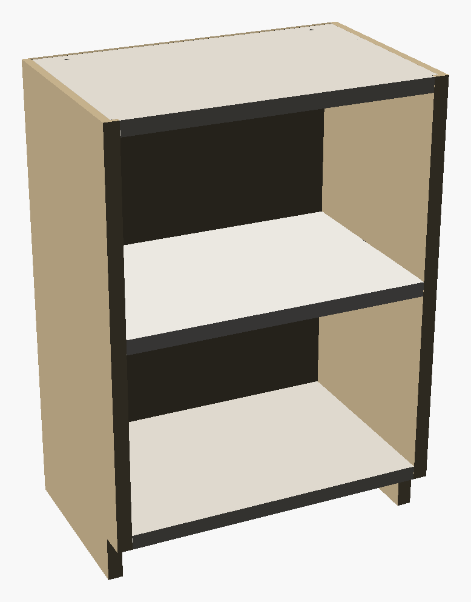
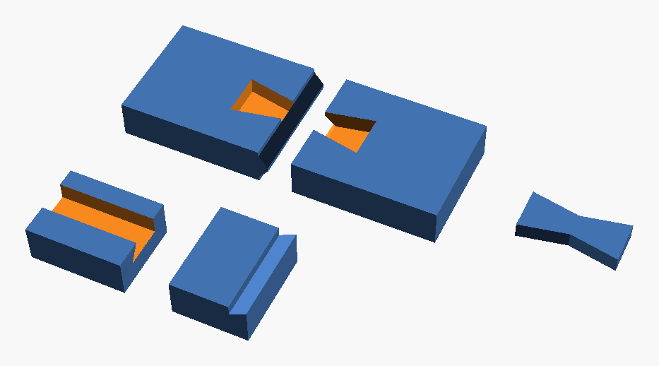
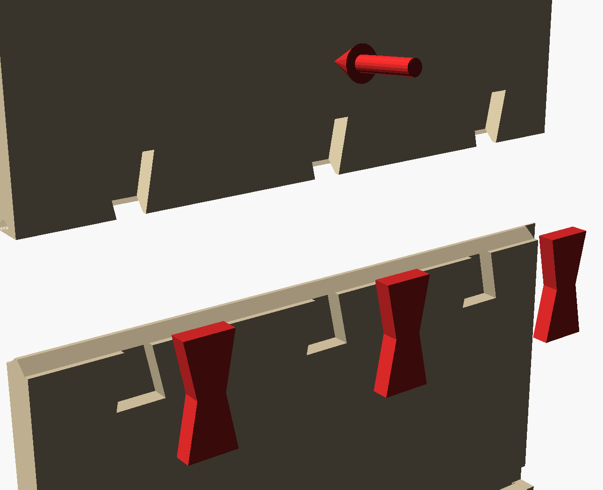
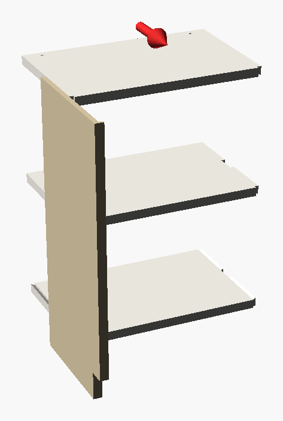
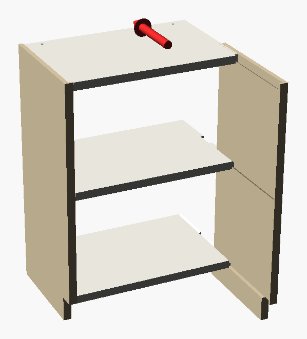
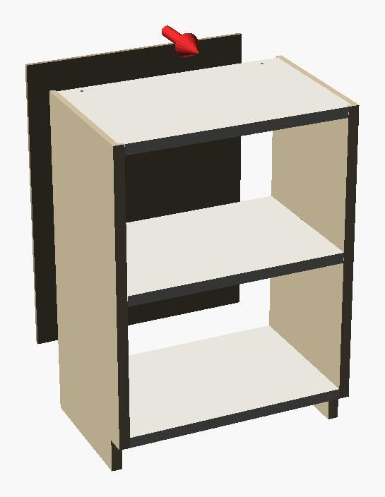

# Open mini bookshelf 360 x 500 x 230 mm, 1 shelf, back panel - tool-free dovetail

## Assembly manual

**Kit:** `mini-open-shelf-360x500-p2s`  |  **Printed parts:** 16 tiles + 24 keys  |  **build plates:** 15  |  **print time (sliced, PETG, 3 walls, 15 % gyroid):** 68 h, 2.7 kg

### Hardware you need

- 2 x Wall screw + plug or anti-tip strap for the 2 anchor holes in the top panel (wall dependent)

**Tools:** rubber mallet (optional), cyanoacrylate glue (optional); drill for the wall anchor

---

### 0  Print and prepare
Print every plate with **PETG** (3 wall loops, 15 % gyroid, 0.2 mm). Print the **fit-test coupon** (`fit-test.stl`) first: the dovetail block must slide by hand with light friction, the hinge pin must turn freely and the bow-tie key must press in with your thumb. If it is too tight / loose, change `fit` (0.25 default) or `hinge_fit` in the Customizer and generate the plates again.

### 1  Join the tiles of every big panel
Large panels are printed as bed-sized tiles. Lay the tiles of one panel next to each other, **tongue into groove**, face-down on the table. Press the **bow-tie keys** into the pockets on the hidden face (the face that was *up* on the printer: inner face of the sides, underside of the shelves, back of the doors). Keys sit 0.4 mm below the surface; a drop of cyanoacrylate makes the seam permanent. The back panel has plain tongue-and-groove seams (add a few drops of glue or a strip of tape on the rear).

### 3  Slide the shelves into the left side
Stand the left side on the table (inner face up). Push **every horizontal panel from the rear** into its dovetail groove until it stops against the blind front end. The tenon blocks lock the panel against the side - it cannot be pulled out sideways.

### 4  Slide the right side on
Place the right side in front of the shelf ends and slide it **backwards** over all tenons at once until its grooves stop. Use a rubber mallet if the fit is tight.

### 5  Back panel
Slide the back panel into the rabbet from the rear. It also locks all shelves against sliding out backwards. Friction fit - add a few drops of glue or tape if you want it permanent.

### 9  Secure the cabinet to the wall
**Mandatory.** The two holes in the top panel take wall brackets or an anti-tip strap. Free-standing, an empty cabinet of this kind tips forward under a small load on its front edge (see *tip-over* in the verification summary below).

---

## Verification summary

### Verified by simulation

| | Check | Result |
|---|---|---|
| OK | S1 3 horizontal panels slide from the rear into the left side (tool-free) | worst intersection 0.00 mm3 over 16 positions each |
| OK | S2 right side slides from the front over all tenons simultaneously | worst 0.00 mm3 |
| OK | S3 back panel slides into the rabbet from the rear | worst 0.00 mm3 |
| OK | L1a shelves cannot be pushed out backwards once the back panel is on |  |
| OK | L1b shelves cannot slide forwards (blind groove stop) |  |
| OK | L2 sides cannot be pulled apart (half-dovetail locks every shelf) |  |
| - | mass model | cabinet 2.7 kg (solid PETG 10.2 kg, fill factor 0.27 calibrated on the slicer weight); centre of mass x=180 y=127 z=265 mm |
| - | tip-over (front edge load) | load that tips the empty cabinet forward: 9 kg; loaded 23 kg: 66 kg (lever = toe-kick 30 mm) |
| OK | stability class: wall anchor REQUIRED | top panel carries the 2 anchor holes (wall_anchor = true) |
| OK | centre of mass is centred between the sides | offset +0 mm |
| OK | shelf rating: 15 kg evenly distributed per shelf (stress and deflection <= L/200) | span 328 mm, shelf 16 mm thick |
| OK | shelf seam (bow-tie keys as tension ties) carries the bending moment | capacity 36.0 N*m vs demand 6.03 N*m (15 kg), safety 6.0 |
| OK | dovetail bearing pressure on the sloped flank | 0.15 MPa (allow 3.0) per shelf end, 2 blocks |
| OK | tenon neck shear (across layers) | 0.044 MPa (allow 1.33) |

*Calculated with documented assumptions for printed PETG (E 600 MPa, bending 8 MPa, key tension 15 MPa); always test with your printer and material.*

### Printability

| | Check | Result |
|---|---|---|
| - | catalog | 6 parts, 16 tiles, dims {'W': '360', 'H': '500', 'D': '230', 'comp_h': '201', 'n_sh': '1', 'n_doors': '0', 'hinge': 'lea |
| OK | all 16 tiles fit the bed (256x256) |  |
| OK | all tiles lie flat on the bed (zmin = 0) |  |
| OK | every tile is ONE connected body |  |
| OK | no large unsupported overhangs / long bridges (>10.5 mm) |  |
| OK | tile seams (11): tongues sit in grooves without interference |  |
| OK | assembly (closed): no part-part interference (8 pairs) |  |
| OK | shelf 1 <-> left side clearance | gap=0.150 (design 0.15) |
| OK | back panel <-> side clearance | gap=0.200 (design 0.1) |
| OK | hardware part 'key' prints flat, one body, no steep overhang | z0=0.00 bodies=1 overhangs=[] size=[40.0, 18.0, 6.6] |

Checks: printability, seams, interference and clearances were measured on the real exported meshes; assembly was simulated with swept-path collision tests.
