# Parametric Niche Shelf System – Regal für schmale Nischen mit Eckpfosten, Schraubfüßen und Schlauchabdeckung

[← Alle Modelle im Überblick](../../README.de.md)

🌐 [English](README.md) | **Deutsch**

Parametrisches, vollständig druckbares Regalsystem für eine schmale Nische –
entstanden für die Lücke neben einer Camper-Toilette, nutzbar für jede Nische
(Vorratsspalt, Bad, Van, Werkstatt). Die Schalen haben vorne und seitlich einen
Rand gegen Herausrutschen, eine gedruckte Rückwand mit Schraubenlöchern,
stapelbare Eckpfosten, höhenverstellbare **gedruckte** Schraubfüße und optional
eine eigenständige Abdeckung für einen Lüftungsschlauch.

> **Das Modell mit allen Druckprofilen gibt es ausschließlich auf MakerWorld:**
> 👉 [MakerWorld-Link: https://makerworld.com/en/models/3464475-parametric-niche-shelf-system](https://makerworld.com/en/models/3464475-parametric-niche-shelf-system)
>
> 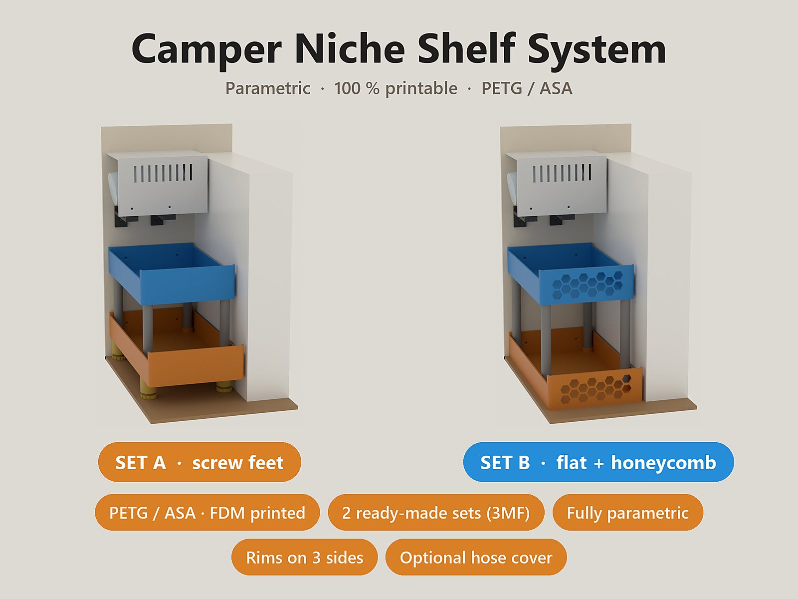

Du gibst im MakerWorld-Customizer die Maße deiner Nische ein (Tiefe, Breite
hinten und vorn, Höhe, optional die Lage eines Schlauchs), und das Modell
berechnet Schalen, Pfosten, Füße, Wandplatten und Abdeckung dazu. Das System
funktioniert in **geraden und schrägen Nischen** und kennt **fünf
Befestigungsarten** – vom freistehenden Regal bis zur Wandmontage. Jede
Befestigungsart (und die Schlauchabdeckung) ist eine eigene Customizer-Datei,
du siehst also nur die Einstellungen, die dafür wichtig sind.

## Inhaltsverzeichnis

- [Das Problem](#das-problem)
- [Die Idee](#die-idee)
- [Highlights](#highlights)
- [Customizer-Datei wählen](#customizer-datei-wählen)
- [Fertige Sets](#fertige-sets)
- [Parametrische Optionen](#parametrische-optionen)
- [Schräge Nische](#schräge-nische)
- [Befestigungsarten](#befestigungsarten)
- [Konstruktion](#konstruktion)
- [Was muss ich kaufen?](#was-muss-ich-kaufen)
- [Druckempfehlungen](#druckempfehlungen)
- [Montage](#montage)
- [Anwendungsbeispiele](#anwendungsbeispiele)
- [Fehlersuche / FAQ](#fehlersuche--faq)
- [Entwicklungsgeschichte](#entwicklungsgeschichte)
- [Downloads](#downloads)
- [Lizenz](#lizenz)

## Das Problem

Schmale Nischen sind schwer zu nutzen: Fertige Regale passen selten in ein Maß
wie 160 × 300 mm, und in einem fahrenden Camper müssen Flaschen, Sprühdosen und
Toilettenpapier beim Bremsen und Anfahren an Ort und Stelle bleiben. Dazu
kommen Besonderheiten der Nische:

- Wände, die nicht parallel laufen, etwa eine schräge Seite zur Toilette hin.
- Ein Lüftungsschlauch, der oben durch die Nische läuft und Platz braucht.
- Ein Boden, der nicht eben ist.
- Eine Wand, in die man nicht überall bohren möchte.

## Die Idee

Statt eines starren Regals gibt es einen Baukasten aus wenigen Teilen:

- **Schalen** mit Rand vorne und seitlich, die sich der Nische anpassen.
- **Eckpfosten**, auf denen die nächste Schale steht – ohne Schrauben im
  unteren Ende, mit Zentriertasche.
- **Gedruckte Schraubfüße**, die den Boden ausgleichen. Es muss nichts gekauft
  werden.
- **Rückwandplatten** oder **Wandwinkel**, wenn das Regal an die Wand soll.
- Eine **Schlauchabdeckung**, die von vorne eingeschoben wird.

Alles wird aus denselben Maßen berechnet. Passen die Werte nicht zusammen
(Schalen zu dicht, Rand zu niedrig, Schraubenlöcher zu nah), stoppt das Modell
mit einer klaren Meldung, statt stillschweigend schlechte Geometrie zu liefern.

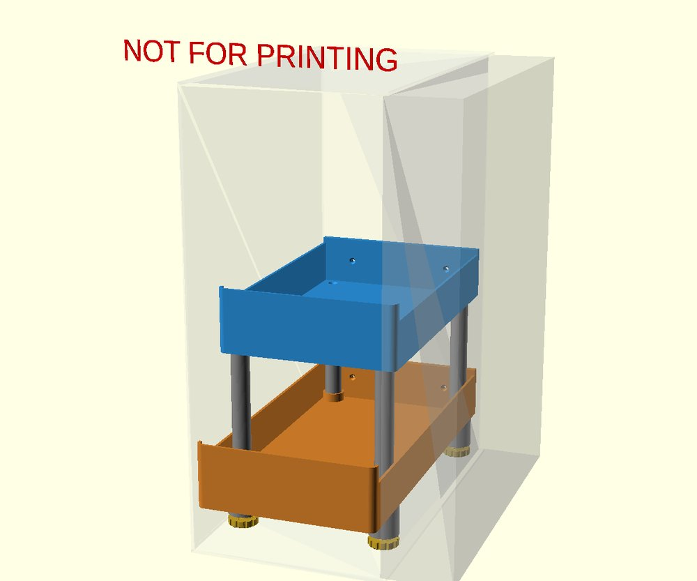

## Highlights

- **1 bis 4 Schalen** übereinander, jede mit eigener Höhe und eigener
  Tiefenbegrenzung (zum Beispiel obere Schale kürzer, damit ein Riegel
  erreichbar bleibt).
- **Gerade oder schräge Nische:** Breite hinten und vorn getrennt einstellbar.
- **Fünf Befestigungsarten**, von „freistehend, nichts in der Wand“ bis „nur
  Wandwinkel ohne Pfosten“.
- **Gedruckte Schraubfüße** (Trapezgewinde, Höhenverstellung per Hand) – oder
  gekaufte M8-Stellfüße, oder ganz ohne Füße.
- **Vorderrand massiv oder als Wabengitter** (leichter, weniger Filament).
- **Optionale Schlauchabdeckung** mit Wandarmen, Lüftungsschlitzen und
  Versteifungsrippen, getestet auf Einschiebbarkeit.
- **Passungstest-Platte** (5 Minuten Druck), um die Nische vor dem großen Druck
  zu prüfen.
- **Zwei Verbindungsarten:** selbstschneidende Schraubenlöcher oder
  Gewindeeinsätze (Heat-Set-Inserts) mit Gewindestiften.
- **Schraubenkopf wählbar:** Senkkopf oder Innensechskant; M2 bis M5 für alle
  Wandschrauben.
- **Lastabschätzung** für Wandwinkel (Gewicht je Schale, Faktor für Fahrbetrieb).
- **Prüfungen und Hinweise** in der Konsole: Höhenreserve je Fach,
  Pfostenlängen, Einkaufsliste für genau deine Einstellungen. Unmögliche
  Kombinationen zeigen eine **rote Meldung in der Vorschau** statt eines leeren
  Modells.

## Customizer-Datei wählen

Auf MakerWorld bietet **Customize** sechs `.scad`-Dateien an. Wähle die, die zu
deiner Befestigung passt; jede zeigt nur ihre eigenen Einstellungen (etwa 30 bis
80 statt rund 120) und ein `part`-Menü mit den sinnvollen Einträgen. Die Formen
sind mit der früheren Einzeldatei identisch (Mesh für Mesh verglichen).

| Nr. | Datei | Haltung der Schalen | Vorschau |
|---|---|---|---|
| 1 | `1-posts-backwall-screws` (Standard) | gedruckte Pfosten und verstellbare Füße; Rückwandplatten an die Wand geschraubt | 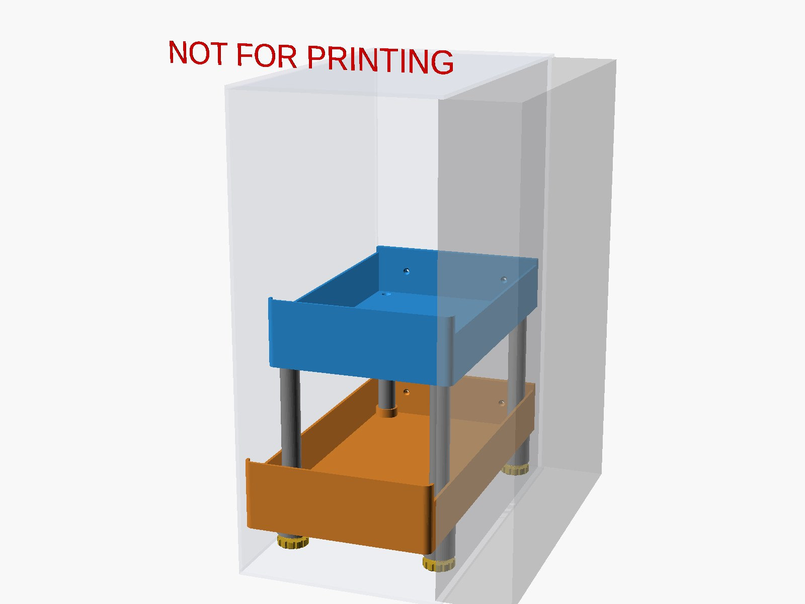 |
| 2 | `2-posts-wall-brackets` | Pfosten und Füße plus Wandwinkel unter den Schalen | 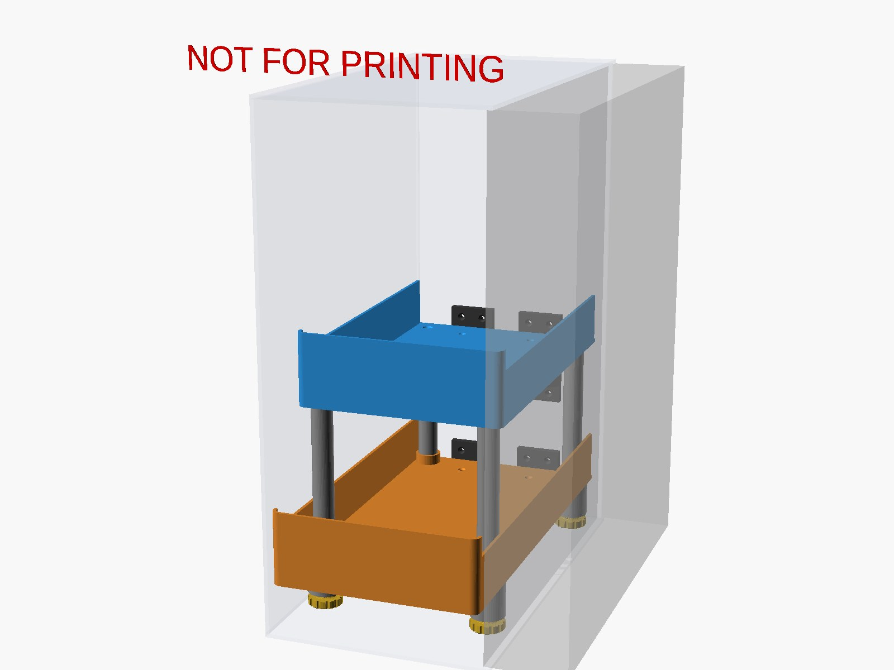 |
| 3 | `3-freestanding-posts` | nur Pfosten und Füße, nichts in der Wand | 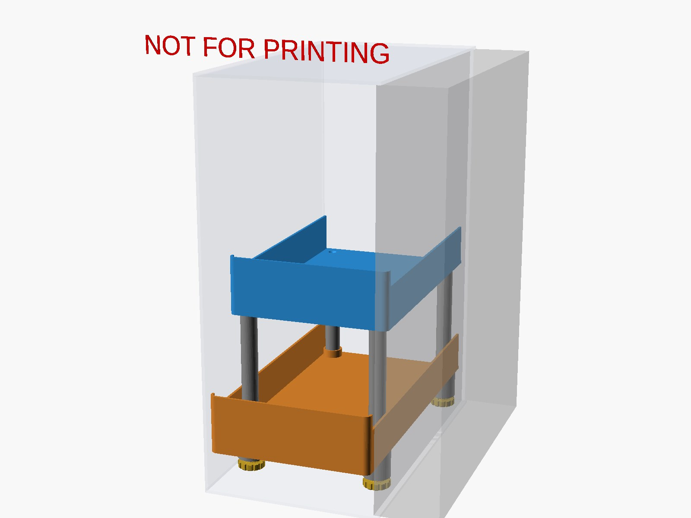 |
| 4 | `4-brackets-no-posts` | keine Pfosten, Schalen hängen an Wandwinkeln | 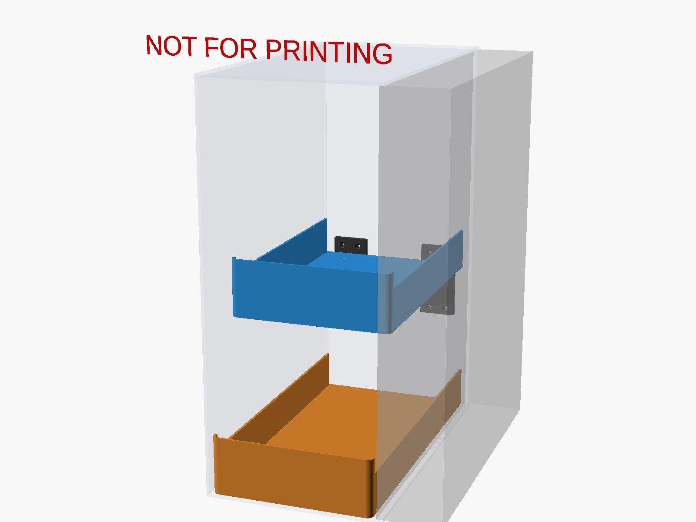 |
| 5 | `5-backwall-no-posts` | keine Pfosten, Schalen hängen nur an den Rückwandschrauben – **nur flache Schalen** | 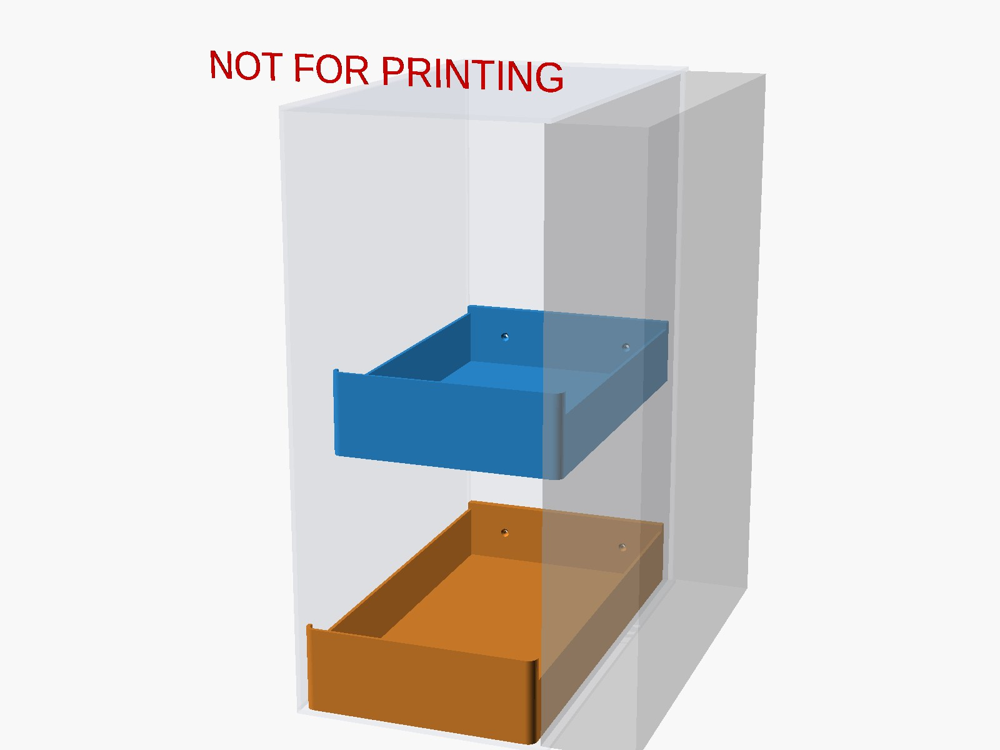 |
| 6 | `6-hose-cover` | die optionale Schlauchabdeckung, eigenständig; mit 1 bis 5 kombinierbar | 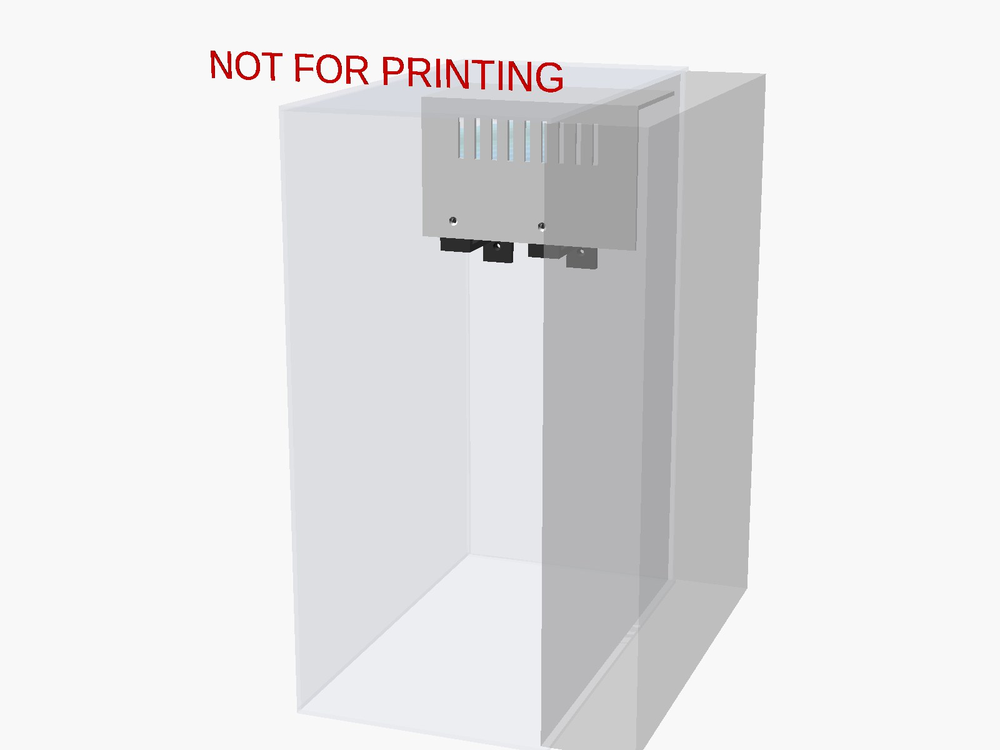 |

- **Abdeckung mit Schalen:** Die Schalen-Dateien kennen den Schlauch nicht. Die
  Unterkante der obersten Schale muss unter *arms_from − 3 − Reichweite* bleiben
  (`arms_from` zeigt die Konsole von Datei 6; Reichweite 45 mm Rückwand, 19 mm
  Winkel, 3 mm freistehend). In der Standard-Nische: **≤ 187 mm** (Dateien 1
  und 5), **≤ 213 mm** (2 und 4), **≤ 229 mm** (3).
- **Einstellungen werden nicht zwischen den Dateien geteilt:** Trage die
  Nischenmaße in jeder verwendeten Datei ein.
- **Datei 5:** Eine nur an den Wandschrauben hängende Schale ist ein Ausleger.
  Mit 2 Schrauben und 2 kg (Faktor 4) darf sie etwa 181 mm tief sein, mit 4
  Schrauben etwa 365 mm; die Konsole zeigt die Auszugskraft und warnt.

## Fertige Sets

Zwei vollständige Sets für meine eigene Nische (160 × 300 × 380 mm, Bambu Lab
H2C, ASA) liegen auf MakerWorld bereit. Jedes Set ist ein 3MF mit vier Platten.

| | Set A „Schraubfüße“ | Set B „Flach + Wabenfront“ |
|---|---|---|
| Vorderrand | massiv | **Wabengitter** |
| Untere Schale | auf vier **gedruckten Schraubfüßen** (gleicht Unebenheiten aus) | **direkt auf dem Boden** (spart 37 mm Höhe) |
| Pfosten | 4 × 115 mm | 4 × 152 mm |
| Geeignet für | unebenen Boden, einfaches Ausrichten | niedrige Nischen, wenige Teile, luftige Optik |

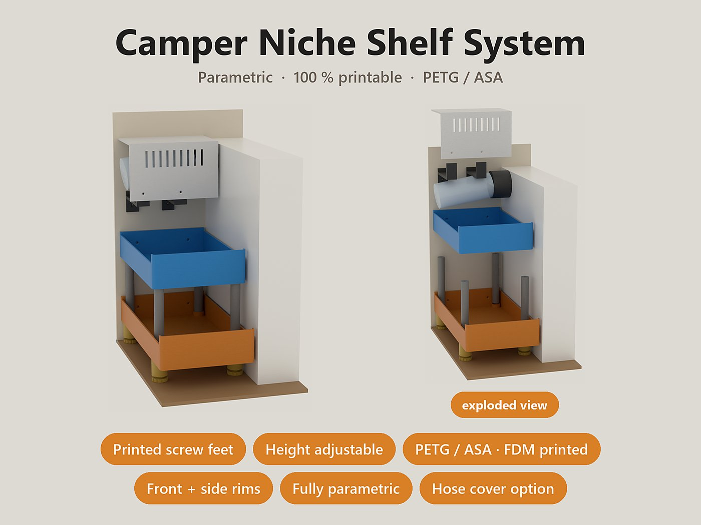

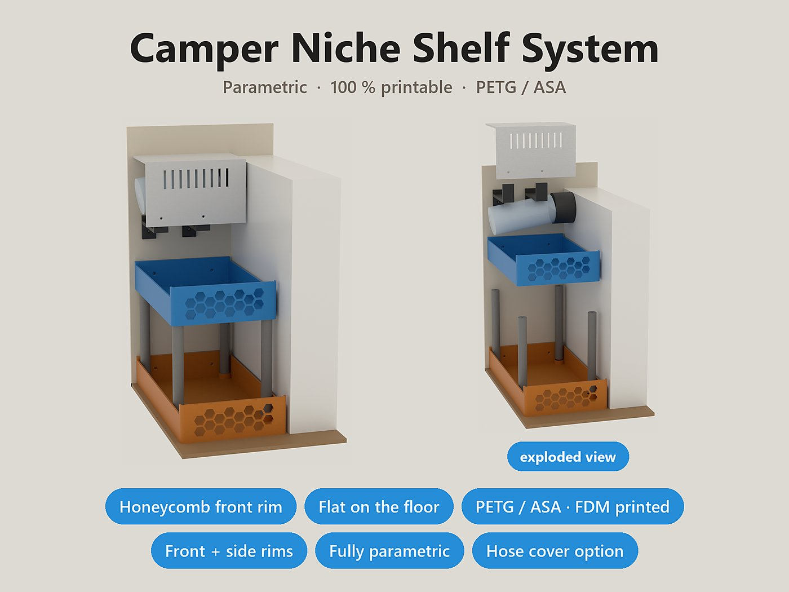

Eigene Maße und andere Befestigungsarten exportierst du aus dem Customizer.

**Set C – drei Schalen, gestaffelte Tiefe (neu):** Nische 160 × 223 × 400 mm, Schalen 220 / 180 / 120 mm tief, gedruckte
Pfosten und kurze gedruckte Füße unter der untersten Schale. Ein 3MF für den Bambu Lab H2C (ASA), **jede Teilegruppe auf
einer eigenen Bauplatte** (untere, mittlere, obere Schale, Pfosten und Füße; zusammen etwa 14 h und 495 g) plus Passprobe.
Customizer-Einstellungen (Datei 1): `tray_count` = 3, `niche_depth` = 223, `niche_w_back` = `niche_w_front` = 160,
`niche_h` = 400, `tray_depth_limit` = [0, 181, 121], `tray_z` = [0, 150, 290].

**Set D – dasselbe mit gedruckten Wandwinkeln (neu):** Customizer-Datei 2, Nische 160 × 228 × 400 mm (die Wandplatten der Winkel
brauchen 5 mm), ein 3MF für den Bambu Lab P2S (ASA) mit **5 Platten**: untere, mittlere und obere Schale, Pfosten und Füße sowie
6 Wandwinkel (zusammen etwa 16,7 h und 579 g). Jede Platte der Sets C und D passt auf das 256-mm-Bett von P2S und P1S.

**Gewinde der Schraubfüße:** echtes Trapezgewinde (60° Flanken, Steigung 3,5 mm, Zahn 1,0–2,2 mm dick, 0,25 mm Spiel, in CAD mit
OpenCascade gemessen). Das frühere Gewinde hatte nur etwa 0,2 mm dicke Zähne und ist in allen Dateien und Sets ersetzt.

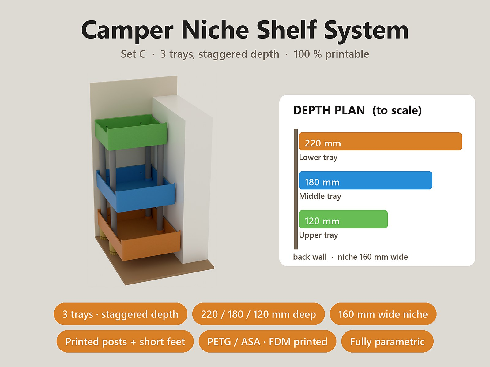

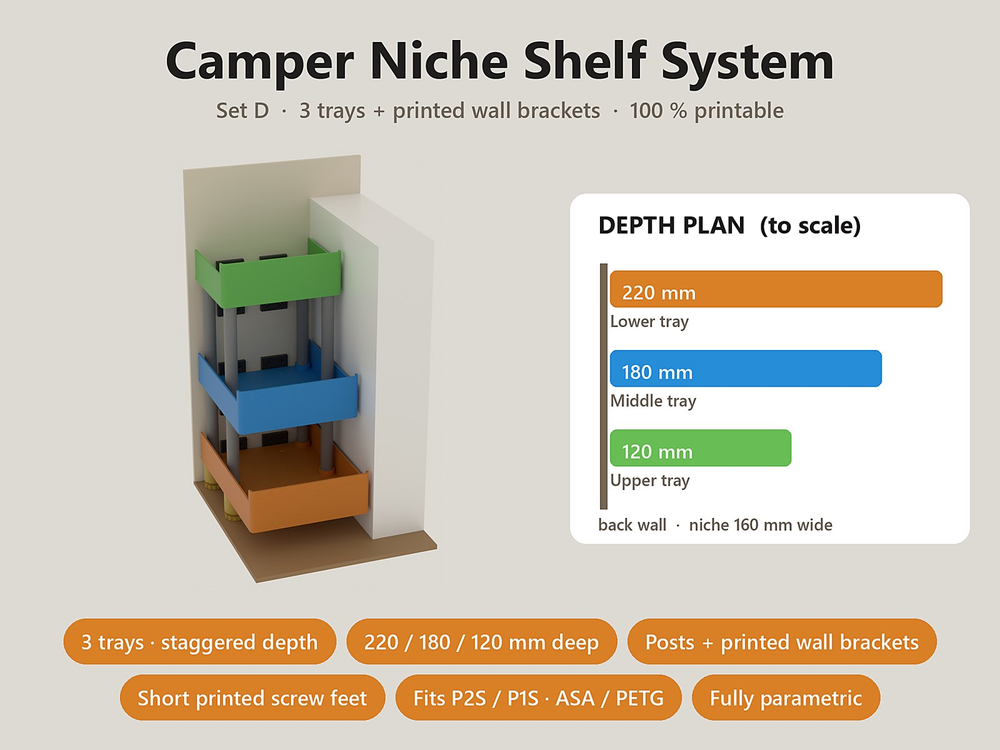

## Parametrische Optionen

Die Optionen im Customizer sind in Gruppen geordnet (die Liste zeigt alle
Optionen der Gesamtansicht; jede der sechs Dateien zeigt die passende Auswahl):

| Gruppe | Was du einstellst |
|---|---|
| Teileauswahl (`part`) | Vorschau montiert / explodiert, alle Teile einfarbig oder mehrfarbig, einzelne Schale, Wandwinkel, Pfosten und Füße, Schlauchabdeckung, Passungstest |
| Schnelleinstellung | Anzahl Schalen (`tray_count`), Füße (`feet`), Schlauchabdeckung an/aus (`hose_enable`) |
| Nischenmaße | Tiefe, Breite hinten und vorn, Höhe, maximale Schalenbreite |
| Schlauch | Höhe links und rechts, Durchmesser, Abstand zur Rückwand, Luft ums Rohr, Anschlussstück |
| Spiele | Abstand links und rechts zur Wand, Abstand vorne, Passungsspiel der Wandwinkel |
| Schalen | Höhe jeder Schale, Tiefenbegrenzung je Schale, Bodendicke, Randstärke, Randhöhen, Eckenradius, Trennwände, Abflussschlitze, Vorderrand massiv oder Wabe |
| Befestigung | `mounting`, Schraubengröße, Kopfform, Anzahl Wandlöcher, Rückwanddicke und -höhe, Wandabstand |
| Wandwinkel | Anzahl, Dicke, Länge, Stegmaße, Verriegelung der Schale |
| Lastprüfung | Gewicht je Schale, Faktor für Fahrbetrieb, zulässige Spannung und Auszugskraft |
| Pfosten, Füße, Verbindungen | Pfostendurchmesser, Verbindungsart, Einsatzmaße, M8-Stellfüße |
| Gedruckte Schraubfüße | Gewindedurchmesser und -steigung, Verstellbereich, Fußscheibe, Gewindespiel |
| Schlauchabdeckung | Dicke, Höhe, Luft zum Schlauch, Anzahl und Maße der Wandarme, Lüftung, Rippen |
| Farben, Druckbett, Qualität | Farben der Schalen und Teile, Druckbettgröße (nur für Warnungen), Glättung |

Listen wie `tray_z` (Höhe jeder Schale) und `tray_depth_limit` (Tiefe jeder
Schale) bestehen aus einem Wert pro Schale.

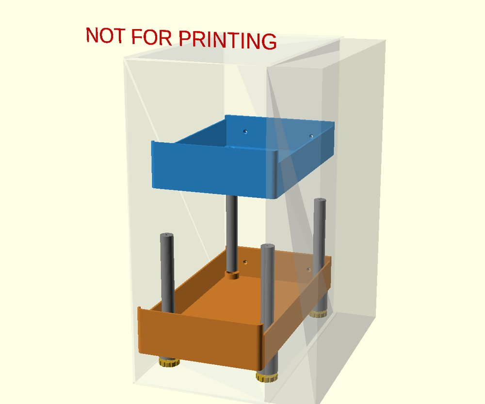

## Schräge Nische

Nicht jede Nische hat parallele Wände. Läuft die rechte Seite (oder ein
Hindernis wie die Toilette) schräg, trägst du die freie Breite **an der
Rückwand** (`niche_w_back`) und **an der Öffnung** (`niche_w_front`)
getrennt ein, zum Beispiel 160 mm hinten und 110 mm vorn. Die rechte Kante jeder
Schale, die Ränder, die Rückwandplatten, die Pfosten und die Wandwinkel folgen
dann der schrägen Wand; der Abstand bleibt `side_gap_right`. Die Schale wird zum
Keil statt zum Rechteck.

- Funktioniert mit allen fünf Befestigungsarten und mit 1 bis 4 Schalen
  (in der Konstruktion für 160 → 110 mm geprüft).
- **Wandwinkel** bleiben gerade und liegen immer über ihre ganze Länge unter der
  Schale. Ist die Schale an der Winkelspitze schmal, werden sie dünner (bis etwa
  22 mm, die Rippe wird höher), dann weniger, und unter flachen Schalen kürzer –
  ohne Stützmaterial. Nur wenn nicht einmal ein Winkel passt (Datei 2: Schale
  an der Winkelspitze schmaler als etwa 82 mm), erscheint eine rote Meldung;
  nimm dann Datei 4 oder 5.
- Die Schalenbreite ist durch `tray_max_w` (Standard 170 mm) begrenzt und muss
  mindestens 40 mm betragen, sonst erscheint eine Meldung.
- Ragt etwas nur an einer Stelle vor, nimmst du den **kleineren** Wert oder
  vergrößerst `side_gap_right`.
- Keilförmige Schalen sind nicht rechteckig: Drucke zuerst den
  **Passungstest**, er zeigt die genaue Kontur.

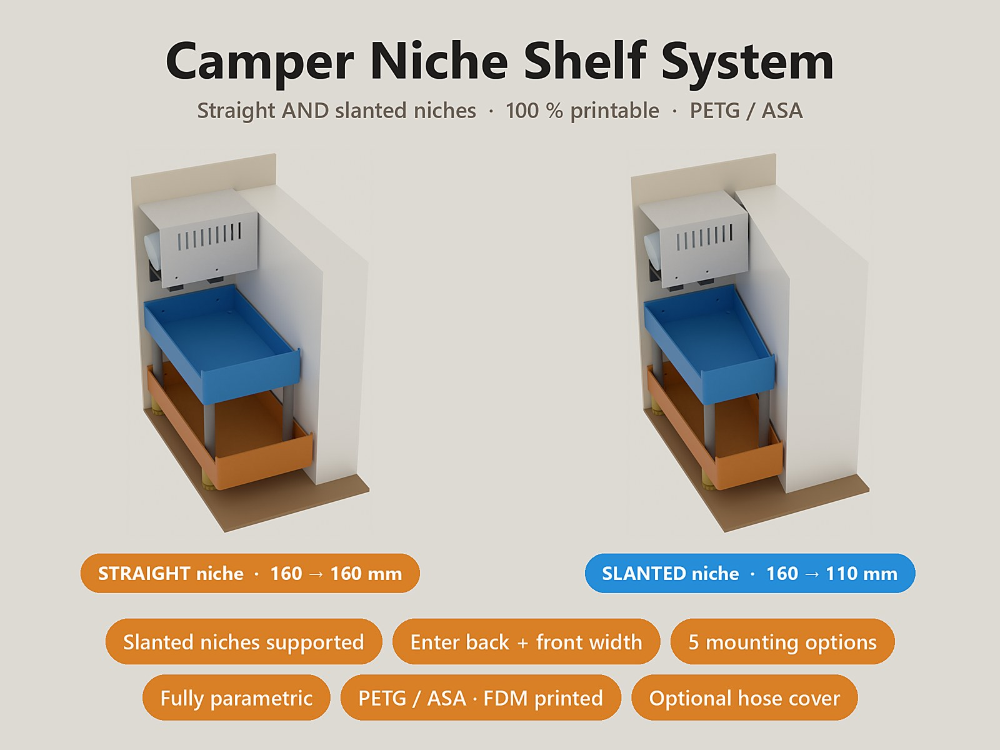

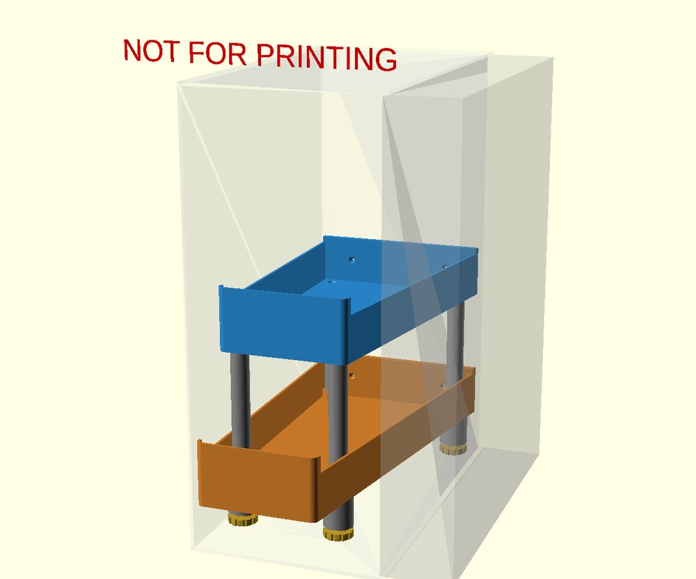

## Befestigungsarten

Eine Einstellung (`mounting`), keine widersprüchlichen Kombinationen. Auf
MakerWorld bestimmt die geöffnete Datei die Wahl (Dateien 1 bis 5):

| Option | Haltung | Zusätzlich nötig | Geeignet für |
|---|---|---|---|
| **Posts and feet + back wall screws** (Standard) | Pfosten und Füße tragen; die gedruckte Rückwand jeder Schale wird an die Wand geschraubt | Wandschrauben (`wall_holes` je Schale) | Camper, jede Nutzung mit Bewegung |
| **Posts and feet + wall brackets** | wie oben, zusätzlich gedruckte Wandwinkel unter den Schalen | je Winkel 4 Wandschrauben, 1 × M3 × 8 als Schalenverriegelung | schwerere Lasten, mehr Steifigkeit |
| **Posts and feet only** | freistehend, **nichts in der Wand** | nur die M4-Schrauben | Mietwohnung, Fliesen, ortsfeste Nutzung |
| **Wall brackets only without posts** | keine Pfosten oder Füße, jede Schale hängt an Wandwinkeln (Schale 1 steht auf dem Boden) | je Winkel 4 Wandschrauben (`bracket_count` 2–3) | maximale Freiheit zwischen den Fächern |
| **Back wall screws only without posts** | Schalen hängen nur an den Wandschrauben (Konsole warnt); **nur für flache Schalen** | Wandschrauben | leichte Lasten, flache Schalen, feste Wand |

Weitere Einstellungen dazu:

- **Füße** (`feet`, nur mit Pfosten): gedruckte Schraubfüße, gekaufte
  M8-Stellfüße oder keine (Schale steht auf dem Boden, spart etwa 37 mm).
- **Wandabstand** (`wall_gap`, 0 bis 30 mm): gedruckte Abstandshülsen hinter
  den Rückwandplatten für unebene Wände.
- **Wandwinkel:** `bracket_count`, `br_len`, `br_inset`, `lock_tray`. Die
  Konsole gibt eine Lastabschätzung aus; sie ist nur ein Richtwert, prüfe deine
  Wand.

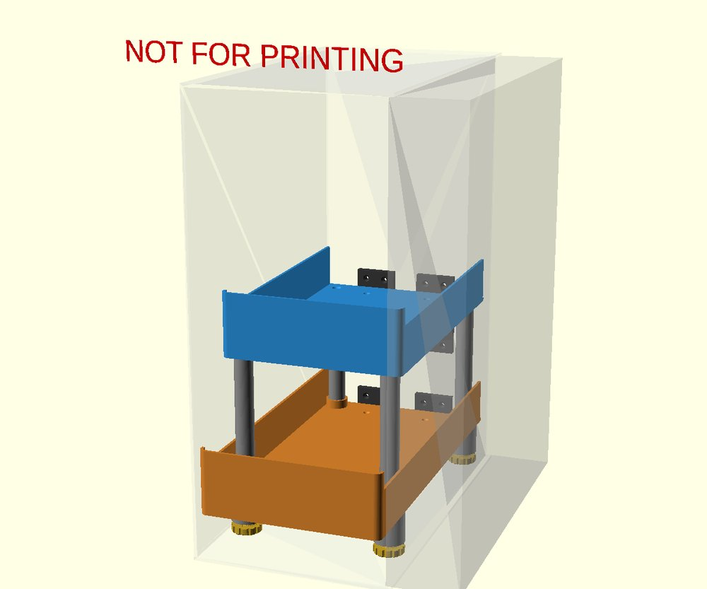

## Konstruktion

- **Schalen** haben einen Rand vorne und an beiden Seiten, abgerundete vordere
  Ecken und vier Eckbohrungen für die Pfosten. Auf der Rückseite sitzt eine
  Platte mit Senkungen für die Wandschrauben.
- **Pfosten** stehen in Zentriertaschen (8 mm tief) auf der Schale darunter und
  werden nur oben mit einer M4-Schraube durch die nächste Schale fixiert. Hat
  eine obere Schale eine kleinere Tiefe, rücken die Pfosten automatisch nach
  hinten.
- **Gedruckte Schraubfüße:** Fußblock und Fuß haben ein grobes Trapezgewinde
  (Ø 18 mm, Steigung 3,5 mm, geprüfte Kombination). Der Fuß lässt sich von Hand
  drehen; der Verstellbereich beträgt 8 mm.
- **Schlauchabdeckung:** kein geschlossenes „U“ (das ließe sich um einen an
  beiden Enden befestigten Schlauch nicht montieren), sondern ein **L**, das von
  vorne eingeschoben und an kleinen Wandarmen unterhalb des Schlauchs
  festgeschraubt wird, wo ein Schraubendreher hinkommt. Eine Pfadsimulation
  bestätigte, dass sich die Abdeckung einschieben lässt und Schlauch, Anschluss
  und Schalen freibleiben.
- **Passungstest:** dünne Umrissplatte der Schale in der Größe deiner
  Eingaben.

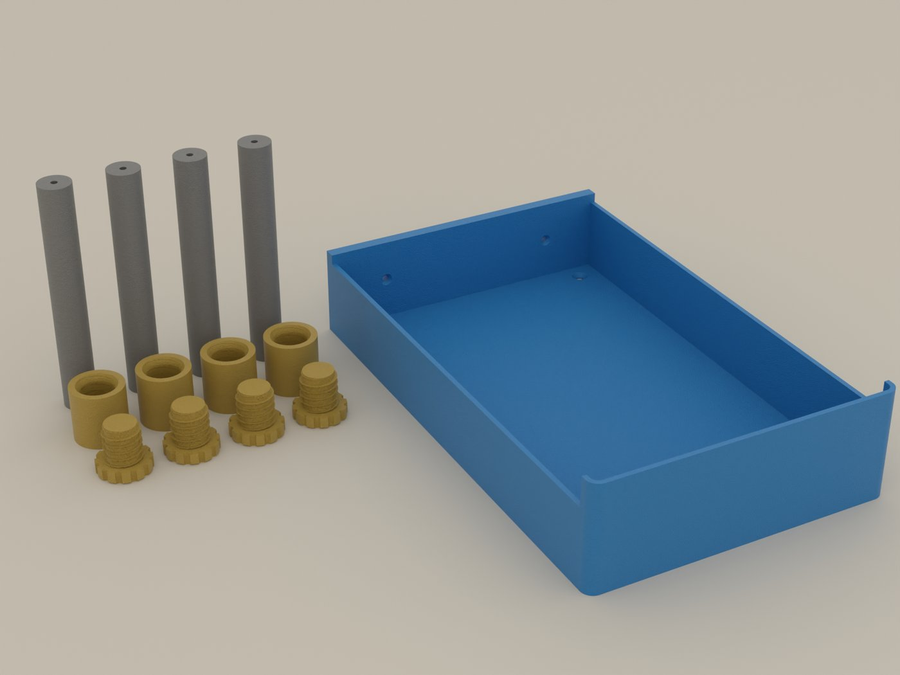

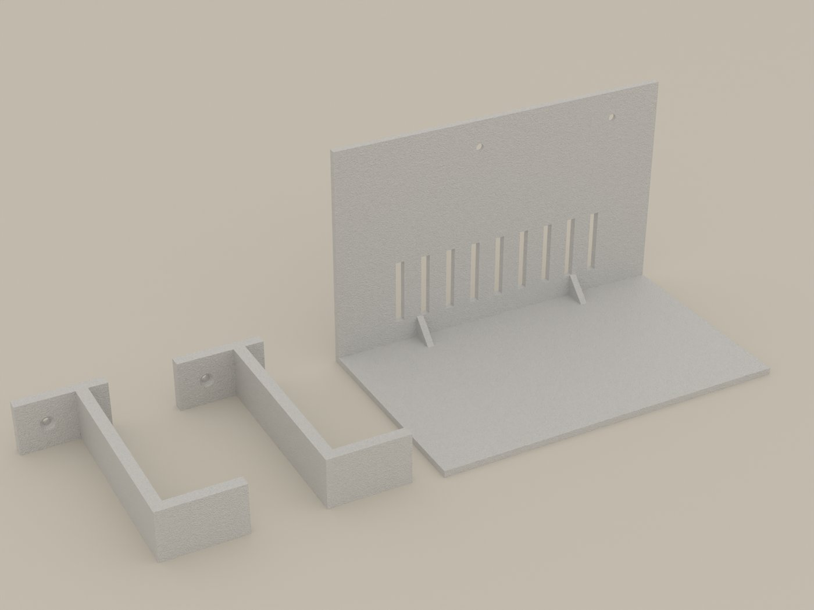

## Was muss ich kaufen?

Fast nichts: Pfosten, Füße und Rückwandplatten sind gedruckt. Es fehlen nur
Schrauben.

Standardaufbau (2 Schalen, Rückwandschrauben, gedruckte Füße, Schlauchabdeckung):

| Menge | Schraube | Wofür |
|---|---|---|
| **8** (Set A) / **4** (Set B) | **M4 × 10 Senkkopf** (ISO 10642 / DIN 7991) | Schale → Füße / Pfosten; sie schneiden ihr Gewinde selbst in die gedruckten 3,3-mm-Löcher |
| **6** | **Wandschrauben, Senkkopf**, Größe M3 (Standard), M2 bis M5 möglich | 2 je Schalen-Rückwand plus 1 je Wandarm der Abdeckung; Art und Länge hängen von **deiner** Wand ab |
| **2** | **M3 × 8 Senkkopf** | Schlauchabdeckung → Wandarme |
| 4, optional | Filz- oder Gummischeiben Ø 26 mm, selbstklebend | unter den Schraubfüßen (Set A) |

- **Innensechskant statt Senkkopf:** `screw_head = Socket head hex screw`, dann
  M4 × 8 für Schale → Pfosten und M3 × 6 für die Abdeckung.
- **Gewindeeinsätze:** `joint = Heat-set inserts`, dann M4-Einsätze (Bohrung
  Ø 5,6 mm, einstellbar), M4-Gewindestifte und M4 × 10 Senkschrauben für die
  oberste Schale. Die Schalen werden dabei zwischen Fußblock und Pfosten
  geklemmt.
- Die Konsole in OpenSCAD gibt die genaue Liste für deine Einstellungen aus.

## Druckempfehlungen

- **Material:** **ASA** oder PETG. Ein geparkter Camper wird heiß, PLA wird ab
  etwa 50 °C weich.
- **Schalen und Abdeckung:** 0,4-mm-Düse, 0,2 mm Schichthöhe, 2 bis 4 Wände,
  15 % Infill.
- **Fußblöcke und Schraubfüße (Set A):** 0,16 mm Schichthöhe, 4 Wände, 40 %
  Infill, langsame Außenwände – ein Gewinde besteht fast nur aus Perimetern.
- **Pfosten und Wandarme:** 3 bis 4 Wände, 25 bis 40 % Infill.
- **Stützen:** nicht nötig; alle Teile liegen druckfertig.
- **Drucker:** Die Sets sind für den **Bambu Lab H2C** geslict (die untere
  Schale ist 297 mm tief). Auf einem 256-mm-Drucker verkürzt du die Schalen im
  Customizer (`front_setback`, `wall_gap`); das Modell warnt, wenn etwas nicht
  aufs Druckbett passt (`bed_xy`).
- **Gewindetest:** Druck einen Fußblock und einen Schraubfuß und schraube sie
  zusammen. Zu streng: `thread_clear` von 0,35 auf 0,45; zu locker: 0,25.

Die geschätzten Werte der Sets (Bambu Studio) betragen etwa 15,5 h und 455 g
für Set A sowie 14,75 h und 420 g für Set B.

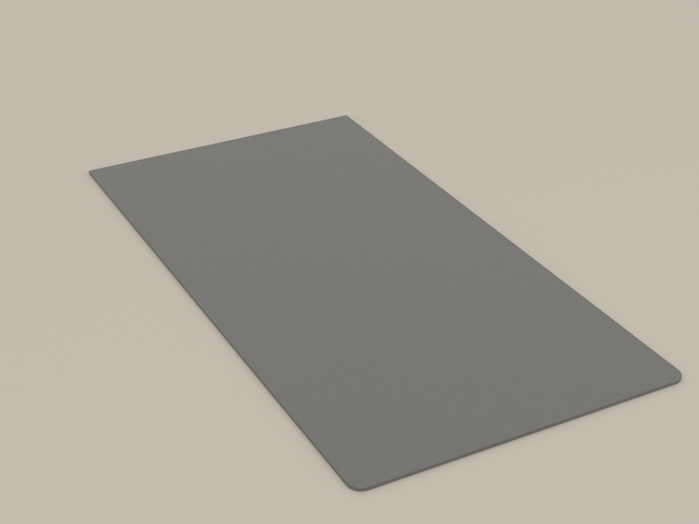

## Montage

1. **Füße (Set A):** Jeden Schraubfuß von unten in den Fußblock drehen, etwa
   4 mm Abstand zwischen Scheibe und Block lassen (eine Umdrehung = 3,5 mm).
   Alle vier gleich einstellen, die hinteren sind später schwer erreichbar.
2. **Untere Schale:** Set A auf die vier Fußblöcke setzen und je eine M4 × 10
   von oben durch die Eckbohrung schrauben; Set B einfach auf den Boden stellen.
3. **Pfosten** in die vier Zentriertaschen stellen (unten nicht verschraubt).
4. **Obere Schale** auf die Pfosten setzen und je eine M4 × 10 von oben in den
   Pfosten schrauben. Für 3 bis 4 Schalen Schritt 3 und 4 wiederholen.
5. **Ausrichten** mit der Wasserwaage (Set A: vordere Füße von Hand drehen).
6. **Wand:** Löcher anzeichnen, vorbohren, jede Schale anschrauben. Mit
   Wandabstand zuerst die Hülsen in die Taschen drücken.
7. **Schlauchabdeckung (optional):** Wandarme unterhalb des Schlauchs
   anschrauben, die Abdeckung von vorne einschieben und mit je einer M3 × 8
   an den Armen fixieren.

## Anwendungsbeispiele

- **Camper-Nische neben der Toilette** (das Original): zwei Schalen, obere
  Schale kürzer, Schlauchabdeckung darüber.
- **Einzelne Schale unter einer Schublade:** `tray_count` = 1, keine Pfosten,
  zum Beispiel 85 × 290 mm.
- **Schräge Nische im Bad oder Van:** `niche_w_back` und `niche_w_front`
  unterschiedlich.
- **Mietwohnung:** Datei 3 (`3-freestanding-posts`), nichts in der Wand.
- **Wenig Platz zwischen den Fächern:** Datei 4 (Wandwinkel ohne Pfosten).

## Fehlersuche / FAQ

**Kann ich es auch außerhalb eines Campers nutzen?**
Ja, getestet für Nischen von 90 bis 300 mm Breite, 180 bis 420 mm Tiefe und
250 bis 900 mm Höhe.

**Auf welcher Seite liegt der Schlauch?**
Rechts, wenn man in die Nische schaut. Für eine gespiegelte Nische tauscht du
die seitlichen Abstände.

**Breite Schalen biegen sich durch.**
Schalen über 200 mm Breite ruhen nur auf vier Pfosten: `tray_t` auf 4 bis
5 mm erhöhen und Trennwände (`tray_dividers`) einsetzen.

**Warum ist die obere Schale mit Abdeckung nur etwa 187 mm hoch?**
Die Wandarme der Abdeckung brauchen Platz. Die Schalen-Dateien kennen den
Schlauch nicht: Halte die Unterkante der obersten Schale unter dem Grenzwert aus
„Customizer-Datei wählen“ (187 / 213 / 229 mm in der Standard-Nische).

**Statt des Modells erscheint roter Text.**
Eine Einstellung ist nicht möglich (zum Beispiel Schale zu schmal oder Böden zu
dicht). Der Text sagt, was du ändern musst.

**Ein rotes Schild sagt „NO POSTS“, „NO BRACKETS“ oder „NO HOSE COVER“.**
Der gewählte Eintrag wird mit deinen Einstellungen nicht benutzt. Wähle einen
anderen Eintrag oder öffne die passende Datei.

**Die Vorschau lässt sich nicht drucken.**
Richtig: Die beiden Vorschau-Einträge dienen nur zum Ansehen und zeigen ein
rotes „NOT FOR PRINTING“-Schild. Zum Drucken wählst du einen Druckeintrag.

**Grenzen:** 1 bis 4 Schalen; Schalen und Abdeckung werden nicht automatisch
geteilt.

> ⚠️ **Status:** in der Konstruktion geprüft (alle Befestigungsarten, 1 bis 4
> Schalen, viele Nischengrößen, jeder Eintrag des `part`-Menüs) und für alle
> mitgelieferten 3MF-Dateien probegeslict. **Noch nicht von mir gedruckt.**
> Drucke bitte zuerst den Passungstest und berichte in den Kommentaren, wie es
> bei dir funktioniert hat.

## Entwicklungsgeschichte

Am Anfang stand ein Maßband in der Camper-Nische (siehe Foto): Tiefe, Breite
hinten und vorn, Höhe und die Lage des Lüftungsschlauchs. Diese Maße sind die
Grundlage des Modells. Weil jede Nische anders ist, sind sie als Parameter
umgesetzt, und ein Prüfpaket im Modell (Schalen, Pfosten, Abdeckung,
Befestigung) stoppt falsche Eingaben mit einer klaren Meldung, statt schlechte
Geometrie zu erzeugen. Dazu kamen die gedruckten Schraubfüße, die schräge Nische
und die fünf Befestigungsarten, damit das Regal auch dort passt, wo meine
Nische nicht ist.

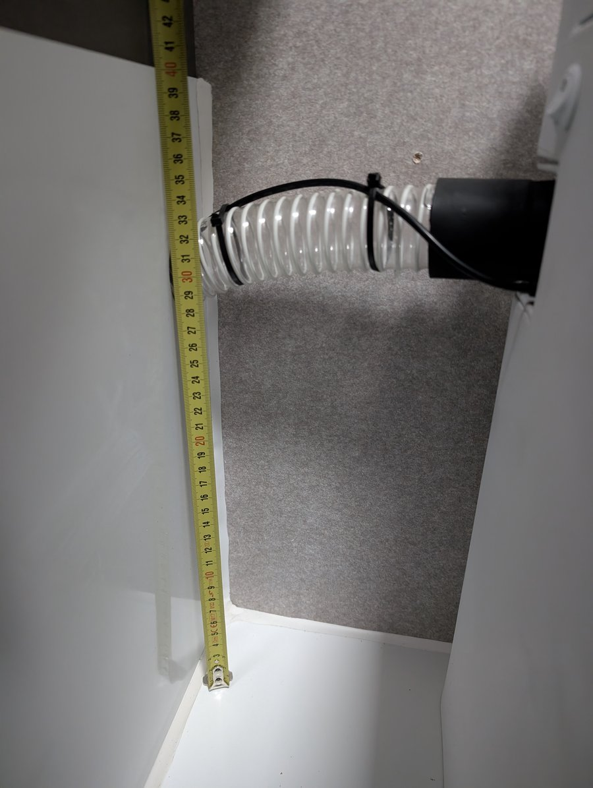

Die Bilder in diesem Ordner sind Renderings der Modellgeometrie beziehungsweise
daraus abgeleitete Szenenbilder; das Nischenfoto ist eine echte Aufnahme.

## Downloads

Print files are intentionally available exclusively on MakerWorld (die sechs Customizer-Dateien gehören zum MakerWorld-Eintrag).

👉 MakerWorld-Link: https://makerworld.com/en/models/3464475-parametric-niche-shelf-system

Profil: <https://makerworld.com/en/@BetaHydri>

## Lizenz

Dokumentation und Bilder in diesem Repository: © BetaHydri. Das Modell (inkl.
Quellcode) und alle Druckdateien werden ausschließlich über MakerWorld unter
der dort angegebenen Lizenz verteilt. Dieses Repository enthält bewusst keine
Modell-, Quellcode- oder Druckdateien. Modell- und Druckdateien werden
ausschließlich über MakerWorld verteilt.
