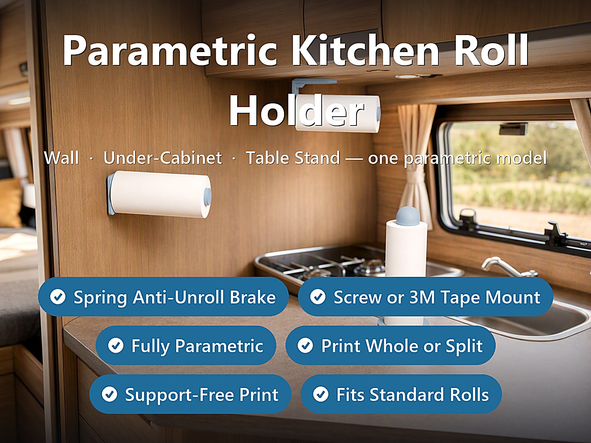
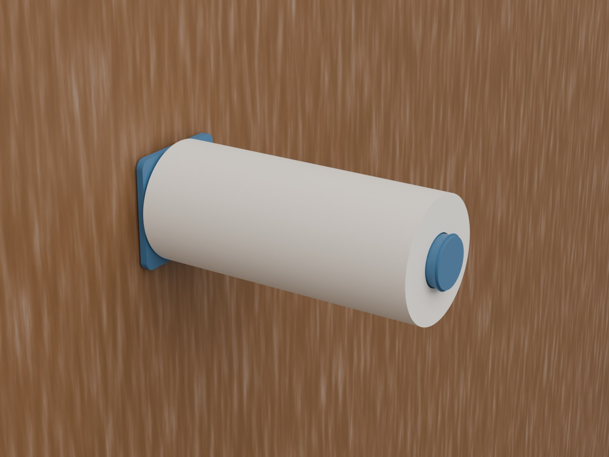
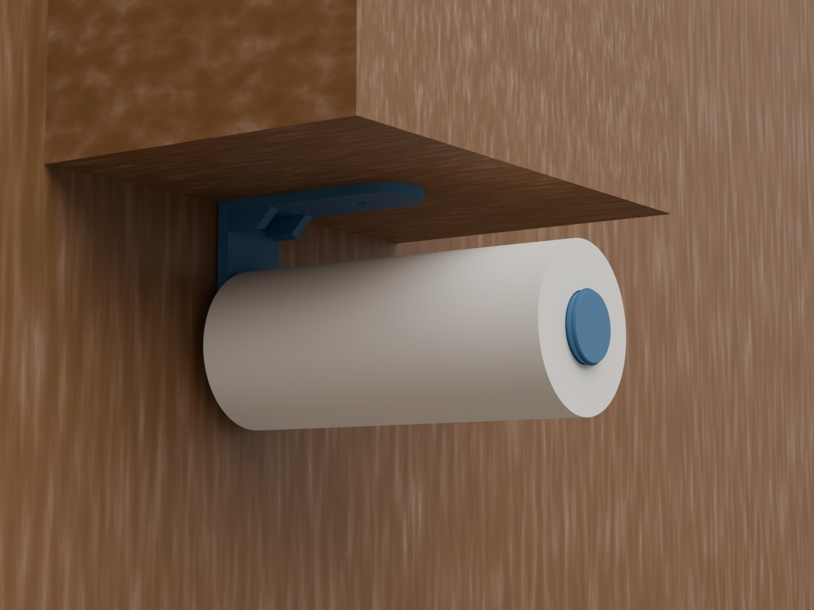
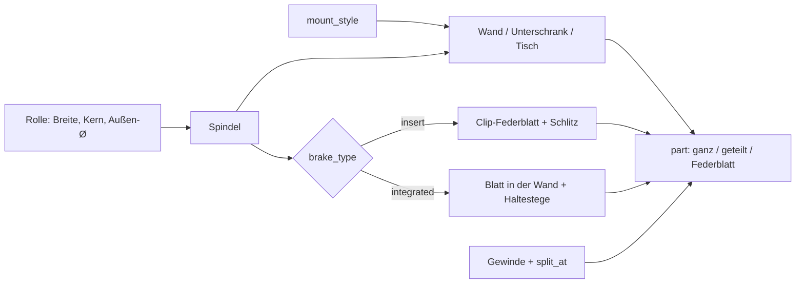
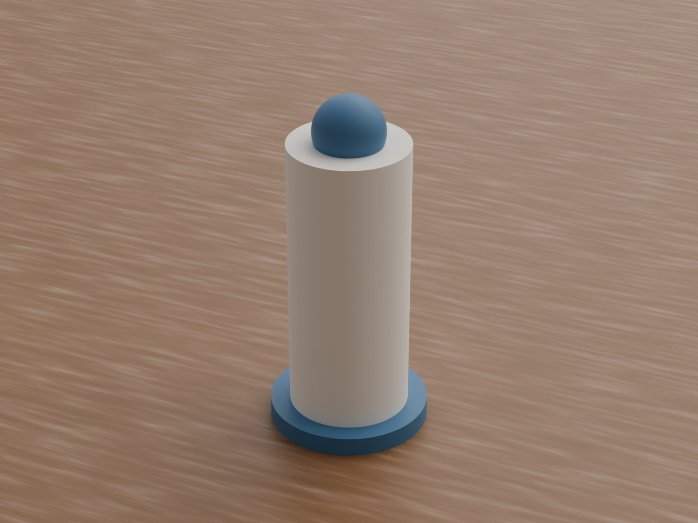
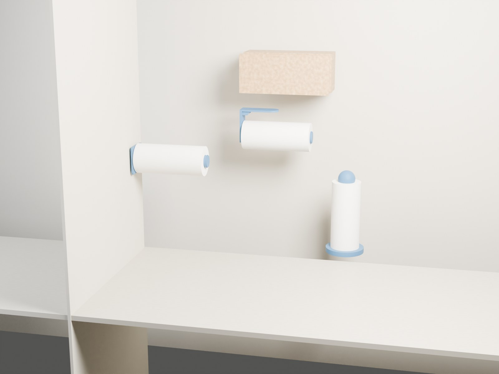
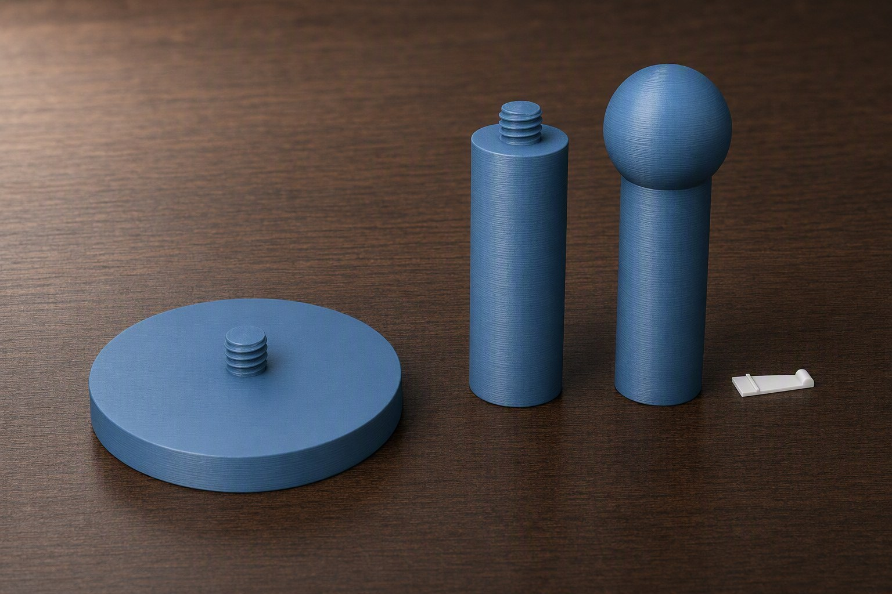

# Parametric Kitchen Paper Towel Roll Holder – Wand, Unterschrank oder Tischständer mit Federbremse

[← Alle Modelle im Überblick](../../README.de.md)

🌐 [English](README.md) | **Deutsch**

Parametrischer Küchenrollenhalter für den FDM-Druck: eine Datei, drei
Montagearten (an der Wand, unter dem Hängeschrank, frei auf dem Tisch) und
dieselbe Spindel mit eingebauter Federbremse, damit die Rolle einhändig
abreißt und nicht von allein abrollt. Rollenbreite, Kerndurchmesser, Montage
und Teilung für kleine Druckbetten stellst du im MakerWorld-Customizer ein.

> **Das Modell mit allen Druckprofilen gibt es ausschließlich auf MakerWorld:**
> 👉 [MakerWorld-Link: https://makerworld.com/en/models/3143928-parametric-kitchen-paper-towel-roll-holder](https://makerworld.com/en/models/3143928-parametric-kitchen-paper-towel-roll-holder)
>
> 

Der **Parametric Kitchen Paper Towel Roll Holder** besteht aus einer Spindel,
auf die die Rolle von der offenen Seite aufgeschoben wird, und je nach Stil
einer Rückplatte (Wand), einem Winkel mit Deckenflansch (Unterschrank) oder
einem beschwerten Fuß mit senkrechter Säule (Tisch). Die Bremse ist ein
Federblatt, das leicht in den Pappkern drückt. Lange Teile lassen sich per
gedrucktem Gewinde teilen und passen dann auf Druckbetten mit 256 mm.

## Inhaltsverzeichnis

- [Das Problem](#das-problem)
- [Die Idee](#die-idee)
- [Highlights](#highlights)
- [Parametrische Optionen](#parametrische-optionen)
- [Konstruktion](#konstruktion)
- [Druckempfehlungen](#druckempfehlungen)
- [Anwendungsbeispiele](#anwendungsbeispiele)
- [Fehlersuche / FAQ](#fehlersuche--faq)
- [Entwicklungsgeschichte](#entwicklungsgeschichte)
- [Downloads](#downloads)
- [Lizenz](#lizenz)

## Das Problem

Küchenrollenhalter gibt es in jedem Baumarkt – nur selten für den Ort, an dem
du ihn brauchst:

- Im Wohnmobil, Camper oder Boot rüttelt die Fahrt die Rolle ab; ohne Bremse
  liegt nach der ersten Kurve die halbe Rolle auf dem Boden.
- Unter einem Hängeschrank ist der Platz begrenzt, und frische Rollen sind dick
  (bis ca. 150 mm Durchmesser). Ein Winkel, der für die halb leere Rolle passt,
  schleift an der vollen.
- Rollen sind unterschiedlich breit (ca. 180–260 mm) und haben verschieden
  weite Kerne (ca. 38–46 mm). Ein starrer Halter passt nur zu einem Fall.
- Die Rolle ist 260 mm breit, das Druckbett hat 256 mm – ein einteiliger Halter
  passt nicht auf den Drucker.
- Wer nicht bohren darf (Mietwohnung, Möbelfront), braucht eine
  Klebe-Variante.

## Die Idee

Eine Spindel mit Bremse für alle drei Montagearten. Sie ist etwas dünner als
der Kern (`spin_play`), sodass sich die Rolle frei dreht; nur die Bremse sitzt
ein Stück höher als der Kern (`brake_preload`) und erzeugt einen leichten
Dauerwiderstand. Die Bremse ist standardmäßig ein **separates Federblatt zum
Einclipsen**, das flach gedruckt wird und auch in geteilten Teilen funktioniert.
Lange Teile teilt das Modell auf Wunsch in zwei Segmente mit grobem, gedrucktem
Schraubgewinde. Alle Maße in Millimetern, alle Werte als Customizer-Parameter.

## Highlights

- **Drei Montagearten in einer Datei:** Wand (Spindel seitlich), Unterschrank
  (Spindel hängt nach unten, Schrauben nach oben) und Tischständer.
- **Federbremse gegen Abrollen:** Zwei Bauarten über `brake_type`: `insert`
  (Standard) ist ein separates Clip-Federblatt, `integrated` ein
  druckintegriertes Blatt in der Spindelwand (nur für einteilige Spindeln).
- **Einstellbare Bremskraft:** `brake_preload` (0 = freilaufend, typisch
  0,4–0,7 mm).
- **Rollen-Voreinstellungen:** `roll_preset` mit Standard 230, Deutsch 260,5,
  Groß 250, Kompakt 180 und Eigen; Kern- und Außendurchmesser als Parameter.
- **Schrauben oder Klebeband:** `screw_hole_dia = 0` ergibt eine glatte
  Rückplatte für doppelseitiges Klebeband.
- **Ganz oder geteilt:** Teilung per gedrucktem Gewinde ohne Kleber für
  256-mm-Druckbetten.
- **Dicke Rollen im Blick:** `clearance_roll_dia` hält den Unterschrank-Winkel
  frei für die größte Rolle, die je hängen soll.
- **Tischständer mit Beschwerung:** `weight_recess` für Sand oder Münzen.
- **Materialhinweise:** PLA zu Hause, PETG im Fahrzeug, der Clip bevorzugt in
  PETG.

## Parametrische Optionen

Die Namen entsprechen den Customizer-Parametern des Modells.

### Ausgabe und Montage

| Parameter | Bedeutung | Standard | Bereich / Einheit |
|---|---|---|---|
| `part` | Ausgabe: Vorschau Wand, Vorschau Tisch, `Wall holder`, `Wall holder split`, `Table base`, `Table post`, `Table split`, `Brake spring` | Vorschau Wand | Auswahl |
| `mount_style` | `Vertical wall` (Spindel steht seitlich ab, Schrauben seitlich) oder `Under-shelf` (Spindel hängt nach unten, Schrauben nach oben); wirkt nur auf die Wandteile | `Vertical wall` | Auswahl |

### Küchenrolle

| Parameter | Bedeutung | Standard | Bereich / Einheit |
|---|---|---|---|
| `roll_preset` | Rollenbreite: Standard 230 mm, Deutsch 260,5 mm, Groß 250 mm, Kompakt 180 mm, Eigen | Standard 230 mm | Auswahl |
| `roll_length_custom` | Eigene Rollenbreite (nur bei `Custom`) | 230 | 120–320 mm |
| `core_inner_dia` | Innendurchmesser des Pappkerns (nachmessen) | 41 | 30–60 mm, Schritt 0,5 |
| `roll_outer_dia` | Außendurchmesser deiner vollen Rolle (Referenz und Warnungen) | 98 | 90–160 mm |
| `clearance_roll_dia` | Größte Rolle, die je hängen soll; Unterschrank-Winkel und Streben werden immer für diesen Durchmesser freigeschnitten | 140 | 98–170 mm |
| `roll_clear_gap` | Luftspalt rund um die Rolle je Seite | 4 | 1–12 mm, Schritt 0,5 |

### Passung und Bremse

| Parameter | Bedeutung | Standard | Bereich / Einheit |
|---|---|---|---|
| `spin_play` | Radialspiel, damit sich die Rolle frei dreht (je Seite) | 0,8 | 0,3–2,0 mm, Schritt 0,1 |
| `enable_brake` | Bremse ein/aus | an | an / aus |
| `brake_type` | `integrated` (druckintegriertes Blatt, nur einteilige Spindel) oder `insert` (separates Clip-Federblatt) | `insert` | Auswahl |
| `brake_preload` | Bremskraft: 0 = keine, höher = fester | 0,5 | 0,0–1,5 mm, Schritt 0,1 |
| `enable_end_stop` | Endwulst, der die Rolle am Abrutschen hindert | an | an / aus |

### Clip-Federblatt (`brake_type = insert`)

| Parameter | Bedeutung | Standard | Bereich / Einheit |
|---|---|---|---|
| `brake_blade_w` | Breite von Fuß und Blatt-Basis | 15 | 8–24 mm |
| `brake_blade_len` | Gesamtlänge des Clips (Fuß plus freie Zunge); länger = weicher | 34 | 18–50 mm |
| `brake_blade_thk` | Dicke von Fuß und Rastlippe | 1,6 | 1,0–2,4 mm, Schritt 0,1 |
| `brake_spring_thk` | Dicke der freien Federzunge | 1,0 | 0,8–1,6 mm, Schritt 0,1 |
| `brake_tip_w` | Breite der Zungenspitze; schmaler = weicher | 9 | 6–18 mm |
| `brake_slot_clear` | Spiel zwischen Clip und Schlitz je Seite | 0,2 | 0,1–0,4 mm, Schritt 0,05 |

### Integrierte Bremse (`brake_type = integrated`)

Das Blatt ist eine hohe, dünne Zunge in der Spindelwand. Beim stehenden Druck
kann sie schwingen; dünne Haltestege verhindern das und werden nach dem
Druck abgeknipst.

| Parameter | Bedeutung | Standard | Bereich / Einheit |
|---|---|---|---|
| `brake_tie_count` | Höchstzahl der Haltestege (0 = keine) | 4 | 0–6 |
| `brake_tie_h` | Höhe jedes Stegs | 0,6 | 0,3–1,2 mm, Schritt 0,1 |
| `brake_tie_start` | Druckhöhe des ersten Stegs | 90 | 40–150 mm, Schritt 5 |
| `brake_tie_spacing` | Abstand der Stege nach oben | 110 | 30–180 mm, Schritt 5 |

### Wandmontage

| Parameter | Bedeutung | Standard | Bereich / Einheit |
|---|---|---|---|
| `wall_plate_w` | Breite der Rückplatte (Wand); der Unterschrank-Steg ist fest 50 mm | 90 | 50–140 mm |
| `wall_plate_h` | Höhe der Rückplatte | 92 | 50–160 mm |
| `wall_plate_t` | Dicke der Rückplatte | 6 | 4–12 mm, Schritt 0,5 |
| `wall_plate_round` | Eckenrundung der Rückplatte | 8 | 2–20 mm |
| `screw_hole_dia` | Schraubenloch (M4 ca. 4,5); 0 = Platte nur zum Kleben | 4,5 | 0–8 mm, Schritt 0,5 |
| `screw_head_dia` | Senkdurchmesser für den Schraubenkopf | 9 | 6–16 mm, Schritt 0,5 |
| `screw_spacing` | Abstand der beiden Schraubenlöcher | 60 | 30–130 mm |
| `spool_extra` | Zusätzliche Spindellänge über die Rolle hinaus | 12 | 6–30 mm |

### Unterschrank (nur `mount_style = Under-shelf`)

| Parameter | Bedeutung | Standard | Bereich / Einheit |
|---|---|---|---|
| `shelf_depth` | Länge der oberen Montagefläche (vorne–hinten); länger = mehr Klebefläche | 130 | 45–220 mm |
| `shelf_tab_w` | Breite der Befestigungszunge; läuft in einem Bogen aus | 50 | 24–140 mm |
| `shelf_drop` | Abstand von der Montagefläche zur Spindel; muss den Rollenradius freihalten | 90 | 55–140 mm |
| `web_t` | Dicke des Stegs | 8 | 5–16 mm, Schritt 0,5 |

### Tischständer

| Parameter | Bedeutung | Standard | Bereich / Einheit |
|---|---|---|---|
| `base_dia` | Durchmesser des Fußes | 130 | 90–220 mm |
| `base_h` | Dicke der Fußscheibe | 16 | 8–40 mm |
| `post_h` | Säulenhöhe über dem Fuß (sollte mindestens der Rollenbreite entsprechen) | 220 | 80–300 mm |
| `knob_dia` | Durchmesser der Kugel oben (0 = keine) | 58 | 0–90 mm |
| `weight_recess` | Ringaussparung unter dem Fuß für Sand oder Münzen (0 = aus) | 0 | 0–30 mm |

### Gedruckte Gewindeverbindung

| Parameter | Bedeutung | Standard | Bereich / Einheit |
|---|---|---|---|
| `thread_dia` | Außendurchmesser des Gewindes | 18 | 12–30 mm, Schritt 0,5 |
| `thread_pitch` | Steigung; absichtlich grob | 3,5 | 3–6 mm, Schritt 0,5 |
| `thread_len` | Eingriffslänge (ab 4 Windungen robust) | 14 | 8–24 mm |
| `thread_clear` | Spiel am Innengewinde | 0,35 | 0,15–0,7 mm, Schritt 0,05 |
| `split_at` | Wo ein Teil in zwei Segmente geteilt wird (Anteil der Länge) | 0,55 | 0,35–0,7, Schritt 0,05 |

### Qualität

| Parameter | Bedeutung | Standard | Bereich / Einheit |
|---|---|---|---|
| `round_res` | Glätte der runden Flächen (für den Export erhöhen) | 96 | 48–220, Schritt 8 |
| `thread_res` | Glätte der Gewindewendel | 64 | 32–128, Schritt 8 |

## Konstruktion

### OpenSCAD-Ansatz

Das Modell ist reines OpenSCAD ohne externe Bibliotheken und läuft im
MakerWorld-Customizer. Ein `part`-Selektor gibt Vorschau (mit Geisterrolle und
rotem Banner), ganze Teile, geteilte Teile oder das Federblatt aus. Alle Teile
sind in ihrer Druckausrichtung modelliert.

### Parametrische Logik

| Größe | Formel / Regel |
|---|---|
| Spindelradius | Kernradius − `spin_play` |
| Bremshöhe | Kernradius + `brake_preload` |
| Spindellänge | Rollenbreite + `spool_extra` |
| Freischnitt Unterschrank | Radius der größeren von `roll_outer_dia` und `clearance_roll_dia`, plus `roll_clear_gap` |
| Clip-Schlitzlänge | `brake_blade_len` + 2 mm |
| Haltefuß des Clips | 30 % der Clip-Länge, mindestens 8 mm, höchstens 14 mm |
| Bremsdom über der Spindel | `spin_play` + `brake_preload` |
| Gewindetiefe | 0,42 × `thread_pitch` |
| Plattenbreite Unterschrank | fest 50 mm (Wand: `wall_plate_w`) |

Mit den Voreinstellungen (Kerninnendurchmesser 41 mm, Rolle 230 mm) ergeben
sich: Spindelradius 19,7 mm (Ø 39,4 mm), Bremsradius 21,0 mm, Spindellänge
242 mm, Clip-Schlitzlänge 36 mm, Haltefuß 10,2 mm, Gewindetiefe ca. 1,5 mm und
ein Bremsdom von 1,3 mm über der Spindeloberfläche. Mit der Rolle „Deutsch
260,5 mm“ wird die Spindel 272,5 mm lang.

Die Werte sind aus den Formeln und den Standardwerten abgeleitet.

### Besondere Algorithmen

- **Spindel dünner als der Kern, Bremse dicker:** Die Rolle dreht sich frei auf
  dem Schaft; nur der Bremsdom stößt in den Pappkern und erzeugt
  Reibung. Die Stärke ist ein einziger Regler (`brake_preload`).
- **Clip mit Rastlippe:** Der Clip hat einen kräftigen Fuß, der unter eine
  Lippe im Schlitz gleitet und von der Rolle nie herausgedrückt wird. Eine
  kleine Rastnase schnappt in eine Nut. Daran hängt eine dünne, verjüngte
  Federzunge mit einem gerundeten Dom an der freien Spitze und einem Luftspalt
  von 2,6 mm darunter.
- **Federzunge statt Höcker:** Ein früher Testdruck zeigte: Ein dicker,
  voll breiter und kurzer Clip mit Dom in der Mitte bleibt starr und wirkt nur
  als Höcker. Deshalb ist die Zunge heute dünner als der Fuß, verjüngt sich
  zur Spitze und der Dom sitzt am freien Ende.
- **Integrierte Bremse mit Haltestegen:** Das Blatt ist aus der Spindelwand
  geschnitten: zwei Seitenschlitze und eine Aussparung darunter. Beim stehenden
  Druck schwingt die freie Zunge ab ca. 100 mm Höhe; dünne, abknipsbare Stege
  im Abstand von `brake_tie_spacing` verhindern das Rattern.
- **Gedrucktes Grobgewinde:** Trapezprofil mit flachem Kamm, 3,5 mm Steigung und
  ca. 4 Windungen. Es ist robust und von Hand schraubbar; ein Tropfen Kleber
  macht es dauerhaft.
- **Teilung nach Anteil:** `split_at` teilt Wandspindel und Tischsäule in zwei
  Segmente. Das Segment mit der freien Spitze bekommt den Endwulst, sodass die
  zusammengesetzte Spindel nur einen Wulst hat.
- **Unterschrank frei für die dickste Rolle:** Winkel und Streben werden für
  `clearance_roll_dia` plus Luftspalt freigeschnitten, nicht für die gerade
  hängende Rolle.
- **Spindel direkt auf der Platte:** Bei der Wandvariante sitzt die Spindel ohne
  Stützstrebe auf der Platte. Eine frühere Strebe kollidierte mit jeder Rolle
  und wurde entfernt.

### Modularität

Der Code trennt Spindel, Bremse (beide Bauarten), Clip, Rückplatte, Unterschrank-
Winkel, Tischfuß und Säule, das gedruckte Gewinde sowie die Vorschau mit
Geisterrolle. Die „alles auf einer Platte“-Ausgaben ordnen die Segmente und den
Clip nebeneinander an.

### Druckoptimierungen

- **Federblatt druckt flach**, Dom nach oben, ohne Stützen.
- **Tischfuß flach**, ebenfalls ohne Stützen.
- **Clip automatisch dabei:** Bei Teilen mit Clip-Schlitz legt das Modell den
  Clip daneben auf die Platte, damit er nicht vergessen wird.
- **Geteilte Teile:** Segmente und Clip liegen auf einer 256-mm-Platte.
- **Grobes Gewinde:** Trapezprofil statt feinem V-Gewinde.

## Druckempfehlungen

Die Profile sind für **Bambu PETG Basic** gebaut (0,20 mm Layerhöhe, 2 Wände,
Gyroid 10 %). Teilteile und kleine Teile sind für den **P2S** (256 mm) ausgelegt,
einteilige hohe Teile für den **H2C**.

| Einstellung | Empfehlung |
|---|---|
| Material | PETG für den Halter; PLA zu Hause möglich, Clip bevorzugt in PETG |
| Layerhöhe | 0,20 mm |
| Wände | 2 |
| Infill | Gyroid 10 % |
| Supports | Spindelteile mit Clip-Schlitz: leichte Baumstützen; Tischfuß und Clip: keine |
| Ausrichtung | Wand: Platte auf dem Bett, Spindel nach oben; Tischfuß flach; Säulen und geteilte Spindeln stehend; Clip flach |

**Besondere Hinweise**

- **Wohnmobil, Auto und Boot:** In einer aufgeheizten Kabine verzieht sich PLA.
  Dort mindestens PETG verwenden.
- **Einteilig braucht Höhe:** Eine einteilige Wandspindel ist ca. Rollenbreite +
  12 mm + Plattendicke hoch, also bei 230 mm Rolle etwa 248 mm und bei 260,5 mm
  Rolle etwa 278 mm. Die Tischsäule mit Kugel misst bei den Voreinstellungen ca.
  272 mm. Auf einem 256-mm-Bett nutzt du die geteilten Ausgaben.
- **Integrierte Bremse:** Nur bei `brake_type = integrated` die Haltestege nach
  dem Druck mit einem Seitenschneider bündig abknipsen. Die Zunge muss danach
  frei federn.
- **Montage:** Gewindeteile von Hand verschrauben, Tischsäule in den Fuß
  schrauben, Clip in den Schlitz drücken. Wand und Unterschrank mit zwei Schrauben
  oder doppelseitigem Klebeband.
- **Teilen im Slicer:** Jedes Teil lässt sich auch im Bambu Studio mit dem
  Schneidwerkzeug (Planar oder Schwalbenschwanz) und Steckverbindern teilen.

## Anwendungsbeispiele

- **Camper, Wohnmobil und Boot:** Unterschrank-Variante mit Federbremse, dazu
  Halter in PETG.
- **Küche an der Wand:** Wandplatte neben der Arbeitsfläche, aufgeschraubt oder
  geklebt.
- **Mietwohnung ohne Bohren:** `screw_hole_dia = 0` und doppelseitiges
  Klebeband (z. B. 3M VHB).
- **Tisch und Theke:** Der Tischständer steht frei, ohne Montage.
- **Werkstatt und Homelab-Ecke:** Papierrolle für Reinigung und Etiketten,
  angeschraubt an die Werkbank oder unter ein Regalbrett.
- **Kleine Drucker:** Geteilte Ausgabe für 256-mm-Betten.
- **Andere Rollen:** Breite und Kern über Presets oder `Custom` anpassen.

## Fehlersuche / FAQ

| Symptom | Ursache | Fix |
|---|---|---|
| Die Rolle bremst nicht | Bremsdom zu niedrig | `brake_preload` erhöhen (typisch 0,4–0,7) |
| Die Rolle läuft schwer | Bremse zu stark oder `spin_play` zu klein | `brake_preload` verringern oder `spin_play` erhöhen |
| Die Rolle passt nicht auf die Spindel | `core_inner_dia` falsch | Kern nachmessen und eintragen |
| Der Clip federt nicht | Zunge zu dick oder zu breit | `brake_spring_thk` ≤ 1,4 mm, `brake_tip_w` ≤ 14 mm; in PETG drucken |
| Der Clip lässt sich nicht einschieben | Passung zu eng | `brake_slot_clear` erhöhen |
| Der Clip fehlt auf der Platte | Er wird nur bei Teilen mit Schlitz automatisch beigelegt | `part = Brake spring` separat exportieren |
| Die Zunge der integrierten Bremse klemmt | Haltestege nicht entfernt | Stege bündig abknipsen |
| Unterschrank schleift an der Rolle | Winkel auf zu kleine Rolle ausgelegt | `clearance_roll_dia` und `shelf_drop` erhöhen |
| Das Gewinde sitzt zu stramm | Druck fällt etwas größer aus | `thread_clear` erhöhen |
| Das Gewinde wackelt | Spiel zu groß | `thread_clear` verringern |
| Teil passt nicht aufs Druckbett | Spindel einteilig zu lang | `Wall holder split` bzw. `Table split` verwenden |
| Rolle rutscht von der Säule | Säule kürzer als die Rolle | `post_h` mindestens so groß wie die Rollenbreite |

## Entwicklungsgeschichte

Die ersten Dateien des Modells stammen vom 6. August 2026: Vorschauansichten,
Skripte für die Titelbilder und die erste Wand-, Unterschrank- und Tischversion
mit integrierter Federbremse als druckintegriertem Blatt. Beim stehenden Druck
schwingt die lange freie Zunge ab ca. 100 mm Druckhöhe; dagegen kamen die
abknipsbaren Haltestege dazu. Am 7. August 2026 kam das
Clip-Federblatt: Es lässt sich flach in PETG drucken und passt in jedes
geteilte Teil. Der erste Clip lag im Test flach und wirkte nur als Höcker; die
Neukonstruktion mit dünner, verjüngter Zunge und Dom an der Spitze löste das.
Weitere Korrekturen betrafen eine Stützstrebe, die mit jeder Rolle
kollidierte (entfernt), einen doppelten Endwulst an der Teilungsstelle und den
Freischnitt für dicke Rollen im Unterschrank. Am 8. August 2026 entstanden die
„alles auf einer Platte“-Ausgaben für geteilte Teile; die Beschreibung stammt
vom 31. August 2026.

Die Bilder in diesem Repository sind Renderings der Modellgeometrie
beziehungsweise daraus abgeleitete Szenenbilder; Druckfotos sind nicht dabei.

## Downloads

Print files are intentionally available exclusively on MakerWorld.

👉 MakerWorld-Link: https://makerworld.com/en/models/3143928-parametric-kitchen-paper-towel-roll-holder

Profil: <https://makerworld.com/en/@BetaHydri>

## Lizenz

Dokumentation und Bilder in diesem Repository: © BetaHydri. Das Modell (inkl.
Quellcode) und alle Druckdateien werden ausschließlich über MakerWorld unter
der dort angegebenen Lizenz verteilt. Dieses Repository enthält bewusst keine
Modell-, Quellcode- oder Druckdateien.
