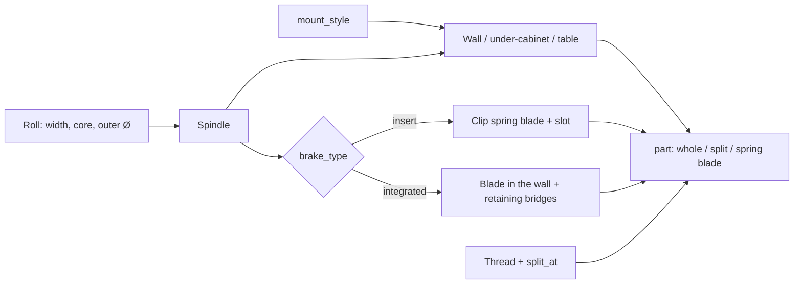

# Parametric Kitchen Paper Towel Roll Holder – Wall, Under-Cabinet or Tabletop Stand with Spring Brake

[← All models](../../README.md)

🌐 **English** | [Deutsch](README.de.md)

A parametric kitchen paper towel roll holder for FDM printing: one file, three
mounting styles (on the wall, under the wall cabinet, free-standing on the
table) and the same spindle with a built-in spring brake, so that the roll
tears off with one hand and does not unroll by itself. You set roll width, core
diameter, mounting and the split for small print beds in the MakerWorld
Customizer.

> **The model with all print profiles is available exclusively on MakerWorld:**
> 👉 [MakerWorld link: https://makerworld.com/en/models/3143928-parametric-kitchen-paper-towel-roll-holder](https://makerworld.com/en/models/3143928-parametric-kitchen-paper-towel-roll-holder)
>
> 

The **Parametric Kitchen Paper Towel Roll Holder** consists of a spindle onto
which the roll is slid from the open side and, depending on the style, a back
plate (wall), a bracket with a ceiling flange (under-cabinet) or a weighted
base with a vertical post (table). The brake is a spring blade that presses
lightly into the cardboard core. Long parts can be split using a printed thread
and then fit on 256 mm print beds.

## Table of Contents

- [The Problem](#the-problem)
- [The Idea](#the-idea)
- [Highlights](#highlights)
- [Parametric Options](#parametric-options)
- [Design](#design)
- [Print Recommendations](#print-recommendations)
- [Use Cases](#use-cases)
- [Troubleshooting / FAQ](#troubleshooting--faq)
- [Development History](#development-history)
- [Downloads](#downloads)
- [License](#license)

## The Problem

Paper towel holders are available in every hardware store – but rarely for the
place where you need one:

- In a motorhome, camper or boat, driving shakes the roll loose; without a
  brake, half the roll is on the floor after the first curve.
- Space under a wall cabinet is limited, and fresh rolls are thick (up to about
  150 mm in diameter). A bracket that fits the half-empty roll rubs against the
  full one.
- Rolls come in different widths (about 180–260 mm) and have cores of different
  sizes (about 38–46 mm). A rigid holder fits only one case.
- The roll is 260 mm wide, the print bed is 256 mm – a one-piece holder does not
  fit on the printer.
- If you are not allowed to drill (rental apartment, furniture front), you need
  an adhesive variant.

## The Idea

One spindle with a brake for all three mounting styles. It is slightly thinner
than the core (`spin_play`) so that the roll turns freely; only the brake sits
a little higher than the core (`brake_preload`) and creates a light constant
resistance. By default, the brake is a **separate clip-in spring blade** that is
printed flat and also works in split parts. If desired, the model splits long
parts into two segments with a coarse, printed screw thread. All dimensions are
in millimeters, all values are Customizer parameters.

## Highlights

- **Three mounting styles in one file:** wall (spindle sticks out sideways),
  under-cabinet (spindle hangs downward, screws point upward) and table stand.
- **Spring brake against unrolling:** Two designs via `brake_type`: `insert`
  (default) is a separate clip-in spring blade, `integrated` is a blade
  integrated into the print in the spindle wall (for one-piece spindles only).
- **Adjustable braking force:** `brake_preload` (0 = free-running, typically
  0.4–0.7 mm).
- **Roll presets:** `roll_preset` with Standard 230, German 260.5, Large 250,
  Compact 180 and Custom; core and outer diameter as parameters.
- **Screws or adhesive tape:** `screw_hole_dia = 0` gives a smooth back plate
  for double-sided adhesive tape.
- **Whole or split:** Splitting via a printed thread without glue for 256 mm
  print beds.
- **Thick rolls in mind:** `clearance_roll_dia` keeps the under-cabinet bracket
  clear for the largest roll that is ever to hang there.
- **Table stand with weight:** `weight_recess` for sand or coins.
- **Material notes:** PLA at home, PETG in the vehicle, the clip preferably in
  PETG.

## Parametric Options

The names correspond to the model's Customizer parameters.

### Output and Mounting

| Parameter | Meaning | Default | Range / Unit |
|---|---|---|---|
| `part` | Output: preview wall, preview table, `Wall holder`, `Wall holder split`, `Table base`, `Table post`, `Table split`, `Brake spring` | preview wall | selection |
| `mount_style` | `Vertical wall` (spindle sticks out sideways, screws on the side) or `Under-shelf` (spindle hangs downward, screws point upward); affects the wall parts only | `Vertical wall` | selection |

### Paper Towel Roll

| Parameter | Meaning | Default | Range / Unit |
|---|---|---|---|
| `roll_preset` | Roll width: Standard 230 mm, German 260.5 mm, Large 250 mm, Compact 180 mm, Custom | Standard 230 mm | selection |
| `roll_length_custom` | Custom roll width (only with `Custom`) | 230 | 120–320 mm |
| `core_inner_dia` | Inner diameter of the cardboard core (measure it) | 41 | 30–60 mm, step 0.5 |
| `roll_outer_dia` | Outer diameter of your full roll (reference and warnings) | 98 | 90–160 mm |
| `clearance_roll_dia` | Largest roll that is ever to hang there; the under-cabinet bracket and struts are always cut clear for this diameter | 140 | 98–170 mm |
| `roll_clear_gap` | Air gap around the roll per side | 4 | 1–12 mm, step 0.5 |

### Fit and Brake

| Parameter | Meaning | Default | Range / Unit |
|---|---|---|---|
| `spin_play` | Radial clearance so that the roll turns freely (per side) | 0.8 | 0.3–2.0 mm, step 0.1 |
| `enable_brake` | Brake on/off | on | on / off |
| `brake_type` | `integrated` (blade integrated into the print, one-piece spindle only) or `insert` (separate clip-in spring blade) | `insert` | selection |
| `brake_preload` | Braking force: 0 = none, higher = firmer | 0.5 | 0.0–1.5 mm, step 0.1 |
| `enable_end_stop` | End bead that keeps the roll from slipping off | on | on / off |

### Clip-in Spring Blade (`brake_type = insert`)

| Parameter | Meaning | Default | Range / Unit |
|---|---|---|---|
| `brake_blade_w` | Width of foot and blade base | 15 | 8–24 mm |
| `brake_blade_len` | Overall length of the clip (foot plus free tongue); longer = softer | 34 | 18–50 mm |
| `brake_blade_thk` | Thickness of foot and locking lip | 1.6 | 1.0–2.4 mm, step 0.1 |
| `brake_spring_thk` | Thickness of the free spring tongue | 1.0 | 0.8–1.6 mm, step 0.1 |
| `brake_tip_w` | Width of the tongue tip; narrower = softer | 9 | 6–18 mm |
| `brake_slot_clear` | Clearance between clip and slot per side | 0.2 | 0.1–0.4 mm, step 0.05 |

### Integrated Brake (`brake_type = integrated`)

The blade is a tall, thin tongue in the spindle wall. When printed standing up
it can vibrate; thin retaining bridges prevent this and are snipped off after
printing.

| Parameter | Meaning | Default | Range / Unit |
|---|---|---|---|
| `brake_tie_count` | Maximum number of retaining bridges (0 = none) | 4 | 0–6 |
| `brake_tie_h` | Height of each bridge | 0.6 | 0.3–1.2 mm, step 0.1 |
| `brake_tie_start` | Print height of the first bridge | 90 | 40–150 mm, step 5 |
| `brake_tie_spacing` | Spacing of the bridges going upward | 110 | 30–180 mm, step 5 |

### Wall Mounting

| Parameter | Meaning | Default | Range / Unit |
|---|---|---|---|
| `wall_plate_w` | Width of the back plate (wall); the under-cabinet web is fixed at 50 mm | 90 | 50–140 mm |
| `wall_plate_h` | Height of the back plate | 92 | 50–160 mm |
| `wall_plate_t` | Thickness of the back plate | 6 | 4–12 mm, step 0.5 |
| `wall_plate_round` | Corner rounding of the back plate | 8 | 2–20 mm |
| `screw_hole_dia` | Screw hole (M4 approx. 4.5); 0 = plate for gluing only | 4.5 | 0–8 mm, step 0.5 |
| `screw_head_dia` | Countersink diameter for the screw head | 9 | 6–16 mm, step 0.5 |
| `screw_spacing` | Distance between the two screw holes | 60 | 30–130 mm |
| `spool_extra` | Additional spindle length beyond the roll | 12 | 6–30 mm |

### Under-Cabinet (only `mount_style = Under-shelf`)

| Parameter | Meaning | Default | Range / Unit |
|---|---|---|---|
| `shelf_depth` | Length of the upper mounting surface (front to back); longer = more adhesive area | 130 | 45–220 mm |
| `shelf_tab_w` | Width of the fastening tab; ends in an arc | 50 | 24–140 mm |
| `shelf_drop` | Distance from the mounting surface to the spindle; must keep the roll radius clear | 90 | 55–140 mm |
| `web_t` | Thickness of the web | 8 | 5–16 mm, step 0.5 |

### Table Stand

| Parameter | Meaning | Default | Range / Unit |
|---|---|---|---|
| `base_dia` | Diameter of the base | 130 | 90–220 mm |
| `base_h` | Thickness of the base disc | 16 | 8–40 mm |
| `post_h` | Post height above the base (should be at least the roll width) | 220 | 80–300 mm |
| `knob_dia` | Diameter of the ball on top (0 = none) | 58 | 0–90 mm |
| `weight_recess` | Annular recess under the base for sand or coins (0 = off) | 0 | 0–30 mm |

### Printed Thread Connection

| Parameter | Meaning | Default | Range / Unit |
|---|---|---|---|
| `thread_dia` | Outer diameter of the thread | 18 | 12–30 mm, step 0.5 |
| `thread_pitch` | Pitch; intentionally coarse | 3.5 | 3–6 mm, step 0.5 |
| `thread_len` | Engagement length (robust from 4 turns) | 14 | 8–24 mm |
| `thread_clear` | Clearance on the internal thread | 0.35 | 0.15–0.7 mm, step 0.05 |
| `split_at` | Where a part is split into two segments (fraction of the length) | 0.55 | 0.35–0.7, step 0.05 |

### Quality

| Parameter | Meaning | Default | Range / Unit |
|---|---|---|---|
| `round_res` | Smoothness of the round surfaces (increase for export) | 96 | 48–220, step 8 |
| `thread_res` | Smoothness of the thread helix | 64 | 32–128, step 8 |

## Design

### OpenSCAD Approach

The model is pure OpenSCAD without external libraries and runs in the
MakerWorld Customizer. A `part` selector outputs the preview (with a ghost roll
and red banner), whole parts, split parts or the spring blade. All parts are
modeled in their print orientation.

### Parametric Logic

| Quantity | Formula / Rule |
|---|---|
| Spindle radius | core radius − `spin_play` |
| Brake height | core radius + `brake_preload` |
| Spindle length | roll width + `spool_extra` |
| Under-cabinet clearance cut | radius of the larger of `roll_outer_dia` and `clearance_roll_dia`, plus `roll_clear_gap` |
| Clip slot length | `brake_blade_len` + 2 mm |
| Retaining foot of the clip | 30 % of the clip length, at least 8 mm, at most 14 mm |
| Brake dome above the spindle | `spin_play` + `brake_preload` |
| Thread depth | 0.42 × `thread_pitch` |
| Plate width under-cabinet | fixed 50 mm (wall: `wall_plate_w`) |

With the default settings (core inner diameter 41 mm, roll 230 mm), the result
is: spindle radius 19.7 mm (Ø 39.4 mm), brake radius 21.0 mm, spindle length
242 mm, clip slot length 36 mm, retaining foot 10.2 mm, thread depth approx.
1.5 mm and a brake dome of 1.3 mm above the spindle surface. With the "German
260.5 mm" roll, the spindle becomes 272.5 mm long.

The values are derived from the formulas and the default values.

### Special Algorithms

- **Spindle thinner than the core, brake thicker:** The roll turns freely on
  the shaft; only the brake dome pushes into the cardboard core and creates
  friction. The strength is a single control (`brake_preload`).
- **Clip with locking lip:** The clip has a sturdy foot that slides under a lip
  in the slot and is never pushed out by the roll. A small latch snaps into a
  groove. Attached to it is a thin, tapered spring tongue with a rounded dome
  at the free tip and an air gap of 2.6 mm underneath.
- **Spring tongue instead of bump:** An early test print showed that a thick,
  full-width and short clip with a dome in the middle stays rigid and acts only
  as a bump. That is why the tongue is now thinner than the foot, tapers toward
  the tip, and the dome sits at the free end.
- **Integrated brake with retaining bridges:** The blade is cut out of the
  spindle wall: two side slots and a cut-out underneath. When printed standing
  up, the free tongue vibrates from about 100 mm height; thin, snip-off bridges
  at the spacing of `brake_tie_spacing` prevent the chatter.
- **Printed coarse thread:** Trapezoidal profile with a flat crest, 3.5 mm
  pitch and approx. 4 turns. It is robust and can be screwed by hand; a drop of
  glue makes it permanent.
- **Split by fraction:** `split_at` splits the wall spindle and table post into
  two segments. The segment with the free tip gets the end bead, so the
  assembled spindle has only one bead.
- **Under-cabinet clear for the thickest roll:** Bracket and struts are cut
  clear for `clearance_roll_dia` plus air gap, not for the straight-hanging
  roll.
- **Spindle directly on the plate:** In the wall variant, the spindle sits on
  the plate without a support strut. An earlier strut collided with every roll
  and was removed.

### Modularity

The code separates spindle, brake (both designs), clip, back plate,
under-cabinet bracket, table base and post, the printed thread and the preview
with ghost roll. The "everything on one plate" outputs arrange the segments and
the clip side by side.

### Print Optimizations

- **Spring blade prints flat**, dome facing up, without supports.
- **Table base flat**, likewise without supports.
- **Clip included automatically:** For parts with a clip slot, the model places
  the clip next to it on the plate so that it is not forgotten.
- **Split parts:** Segments and clip lie on a 256 mm plate.
- **Coarse thread:** Trapezoidal profile instead of a fine V-thread.

## Print Recommendations

The profiles are built for **Bambu PETG Basic** (0.20 mm layer height, 2 walls,
gyroid 10 %). Split parts and small parts are designed for the **P2S** (256 mm),
one-piece tall parts for the **H2C**.

| Setting | Recommendation |
|---|---|
| Material | PETG for the holder; PLA possible at home, clip preferably in PETG |
| Layer height | 0.20 mm |
| Walls | 2 |
| Infill | Gyroid 10 % |
| Supports | Spindle parts with clip slot: light tree supports; table base and clip: none |
| Orientation | Wall: plate on the bed, spindle pointing up; table base flat; posts and split spindles standing; clip flat |

**Special notes**

- **Motorhome, car and boat:** In a heated cabin, PLA warps. Use at least PETG
  there.
- **One-piece needs height:** A one-piece wall spindle is approx. roll width +
  12 mm + plate thickness tall, so about 248 mm for a 230 mm roll and about
  278 mm for a 260.5 mm roll. The table post with ball measures approx. 272 mm
  with the default settings. On a 256 mm bed, use the split outputs.
- **Integrated brake:** Only with `brake_type = integrated`, snip the retaining
  bridges off flush with side cutters after printing. The tongue must then be
  able to spring freely.
- **Assembly:** Screw threaded parts together by hand, screw the table post
  into the base, press the clip into the slot. Wall and under-cabinet with two
  screws or double-sided adhesive tape.
- **Splitting in the slicer:** Any part can also be split in Bambu Studio with
  the cut tool (planar or dovetail) and connectors.

## Use Cases

- **Camper, motorhome and boat:** Under-cabinet variant with spring brake,
  plus holder in PETG.
- **Kitchen on the wall:** Wall plate next to the work surface, screwed on or
  glued.
- **Rental apartment without drilling:** `screw_hole_dia = 0` and double-sided
  adhesive tape (e.g. 3M VHB).
- **Table and counter:** The table stand stands free, without mounting.
- **Workshop and homelab corner:** Paper roll for cleaning and labels, screwed
  to the workbench or under a shelf board.
- **Small printers:** Split output for 256 mm beds.
- **Other rolls:** Adjust width and core via presets or `Custom`.

## Troubleshooting / FAQ

| Symptom | Cause | Fix |
|---|---|---|
| The roll does not brake | Brake dome too low | increase `brake_preload` (typically 0.4–0.7) |
| The roll runs stiffly | Brake too strong or `spin_play` too small | decrease `brake_preload` or increase `spin_play` |
| The roll does not fit on the spindle | `core_inner_dia` wrong | measure the core and enter it |
| The clip does not spring | Tongue too thick or too wide | `brake_spring_thk` ≤ 1.4 mm, `brake_tip_w` ≤ 14 mm; print in PETG |
| The clip cannot be pushed in | Fit too tight | increase `brake_slot_clear` |
| The clip is missing on the plate | It is only included automatically for parts with a slot | export `part = Brake spring` separately |
| The tongue of the integrated brake is stuck | Retaining bridges not removed | snip the bridges off flush |
| Under-cabinet rubs against the roll | Bracket designed for too small a roll | increase `clearance_roll_dia` and `shelf_drop` |
| The thread is too tight | Print comes out slightly larger | increase `thread_clear` |
| The thread wobbles | Clearance too large | decrease `thread_clear` |
| Part does not fit on the print bed | One-piece spindle too long | use `Wall holder split` or `Table split` |
| Roll slips off the post | Post shorter than the roll | `post_h` at least as large as the roll width |

## Development History

The first files of the model date from August 6, 2026: preview views, scripts
for the cover images and the first wall, under-cabinet and table version with
the integrated spring brake as a blade integrated into the print. When printed
standing up, the long free tongue vibrates from about 100 mm print height; the
snip-off retaining bridges were added to counter this. On August 7, 2026, the
clip spring blade was added: it can be printed flat in PETG and fits into every
split part. In testing, the first clip lay flat and acted only as a bump; the
redesign with a thin, tapered tongue and a dome at the tip solved this. Further
corrections concerned a support strut that collided with every roll (removed),
a double end bead at the split point and the clearance cut for thick rolls in
the under-cabinet variant. On August 8, 2026, the "everything on one plate"
outputs for split parts were created; the description dates from August 31,
2026.

The images in this repository are renderings of the model geometry or scene
images derived from it; there are no photos of prints.

## Downloads

Print files are intentionally available exclusively on MakerWorld.

👉 MakerWorld link: https://makerworld.com/en/models/3143928-parametric-kitchen-paper-towel-roll-holder

Profile: <https://makerworld.com/en/@BetaHydri>

## License

Documentation and images in this repository: © BetaHydri. The model (including
source code) and all print files are distributed exclusively via MakerWorld
under the license stated there. This repository intentionally contains no
model, source code or print files.
