# Parametric Picture Frames – Bilderrahmen in jeder Größe und Form, fünf Profile, Snap-Schlüssel ohne Kleber

[← Alle Modelle im Überblick](../../README.de.md)

🌐 [English](README.md) | **Deutsch**

Drucke einen Bilderrahmen **genau so groß und so geformt wie dein Bild**: ein
Foto, ein Poster, ein Sechseck, eine Raute. Der Rahmen besteht aus **Gehrungsleisten**,
die auf der Rückseite von kleinen gedruckten **Snap-Schlüsseln** zusammengehalten
werden: kein Kleber, von vorn nichts zu sehen, und du kannst den Rahmen wieder
auseinandernehmen. Glas, Foto und Rückwand halten **flexible Zungen**, die du
zum Bildwechsel herausziehst.

> **Das Modell mit allen Druckprofilen gibt es ausschließlich auf MakerWorld:**
> 👉 [MakerWorld-Link: https://makerworld.com/en/models/3551154-parametric-picture-frame](https://makerworld.com/en/models/3551154-parametric-picture-frame#profileId-4062778)
>
> 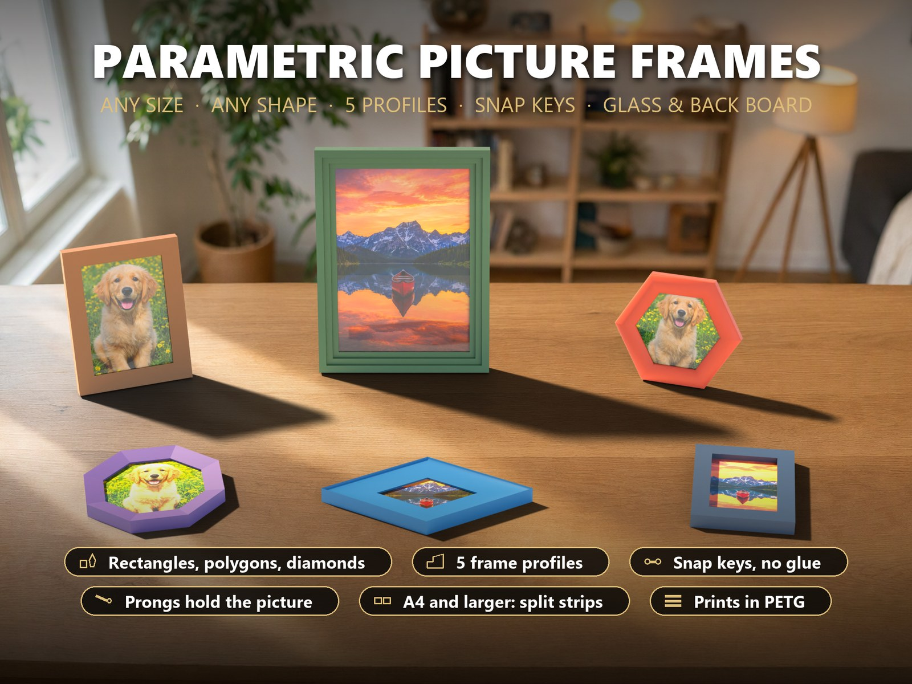

## Inhaltsverzeichnis

- [Highlights](#highlights)
- [Die Profile](#die-profile)
- [Die Verbindung](#die-verbindung)
- [Parametrische Optionen](#parametrische-optionen)
- [Beispiele](#beispiele)
- [Druckempfehlungen](#druckempfehlungen)
- [Montage](#montage)
- [Was geprüft wurde](#was-geprüft-wurde)
- [Downloads](#downloads)
- [Lizenz](#lizenz)

## Highlights

- **Such das Bild aus, bekomm den Rahmen.** Standardgrößen von 9 x 13 cm bis A3
  in der Auswahlliste oder jede beliebige Größe. Oder ein **regelmäßiges Vieleck
  mit 3 bis 12 Seiten** oder eine **Raute** mit beliebigem Winkel: jede Ecke
  bekommt automatisch ihren eigenen Gehrungswinkel.
- **Fünf Profile.** Flach, Fase, halbrund, Stufen (Kassette) und Hohlkehle.
  Breite 20 bis 70 mm, Tiefe 14 bis 50 mm, Lippe 2 bis 10 mm.
- **Verbindungen ohne Kleber.** Auf der Rückseite jeder Gehrung hat jede Leiste
  eine Tasche. Ein flacher **Snap-Schlüssel** (zwei geschlitzte Ringköpfe an
  einem Steg) wird von hinten in beide Taschen gedrückt: Eine kleine Raste an
  jedem Kopf **klickt in eine Nut** am Taschengrund. Der Schlüssel wird liegend
  gedruckt, die Schichten laufen also in Zugrichtung der Verbindung, und beim
  Druck steht nichts frei in der Luft. Von vorn ist nichts zu sehen, und ein
  dünner Schraubendreher in der runden Aussparung an der Verbindung hebelt den
  Schlüssel wieder heraus. Mit der Einstellung **Schlüsselsitz** passt du den
  Halt an deinen Drucker an.
- **Große Rahmen aus mehreren Leisten.** Seiten, die länger sind als das Bett
  minus 14 mm, werden automatisch geteilt, und auch die Stoßstellen bekommen
  Schlüssel: ein **A4-Rahmen** oder **Posterrahmen** passt auf ein 256-mm-Bett.
- **Glas, Foto, Rückwand.** Der Falz ist so tief wie dein Stapel (Glas 0 bis
  6 mm, Foto, Rückwand 1,5 bis 8 mm) plus Platz für die Zungen. Keine Rückwand?
  Drucke eine **Rückplatte** (wenn sie aufs Bett passt).
- **Bild jederzeit wechseln.** Die **flexiblen Zungen** rutschen in kleine
  Fenster in der Falzwand und drücken den Stapel nach vorn. Seitlich
  herausziehen, Bild tauschen, wieder einschieben.
- **Aufhängen.** Zwei **Schlüssellöcher** in der oberen Leiste (Rechtecke und
  Vielecke mit flacher Oberseite).
- **Druck ohne Stützen.** Jede Leiste liegt mit der Rückseite auf dem Bett. Die
  Lippe, die das Bild hält, hat unten eine **45°-Fase** (nur ein 0,5 mm breites
  Band berührt das Glas), sodass nichts in der Luft hängt: nur Schrägen bis 55°
  und Brücken bis 10 mm. Der Rahmen wird dafür etwa um die Lippenbreite plus
  1 mm tiefer.
- **Narrensicher.** Wenn eine Einstellung nicht funktionieren kann (Rahmen zu
  schmal für die Schlüssel, zu flach für den Stapel, eine Leiste breiter als das
  Bett, eine zu kleine Öffnung), **ersetzt eine rote Meldung das Modell**: du
  kannst nie versehentlich ein kaputtes Teil herunterladen.

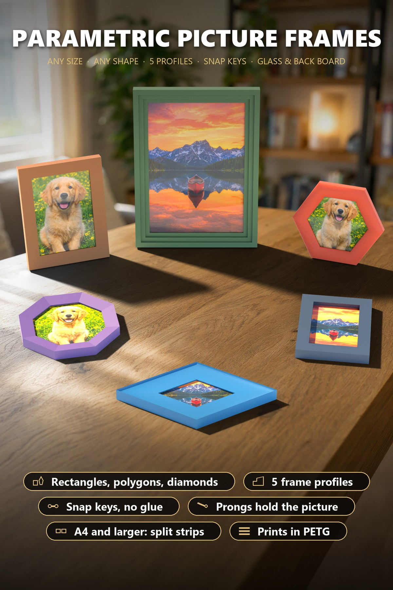

## Die Profile

| Profil | Aussehen | Gut für |
|---|---|---|
| Flat (flach) | rechteckige Leiste | moderne, schlanke Rahmen, Fotos 10 x 15 |
| Bevel (Fase) | fällt zum Bild hin ab | der klassische Fotorahmen |
| Half-round (halbrund) | gerundete Oberseite | weiche, freundliche Rahmen, Vielecke |
| Steps (Stufen) | Kassette mit zwei Stufen | Poster, Kunstdrucke, A4 |
| Cove (Hohlkehle) | hohle Rille | Rauten und breite Rahmen |

## Die Verbindung

| | Snap-Schlüssel |
|---|---|
| **So hält er** | zwei geschlitzte Ringköpfe mit einer kleinen Raste rasten in Nuten am Taschengrund ein; ein steifer Steg verbindet sie |
| **Druckposition** | der Schlüssel liegt flach: Schichten in Zugrichtung, keine Stützen, keine freistehenden Teile |
| **Sitz** | `key fit` 0 bis 0,15 mm: kleiner = fester. Die Test-Ecke zeigt in etwa 30 Minuten, wie der Schlüssel auf deinem Drucker sitzt |
| **Wieder lösen** | mit einem dünnen Schraubendreher in der runden Aussparung an der Verbindung herauswippen |
| **Reserve** | 2 zusätzliche Schlüssel werden mitgedruckt (mehr im Customizer) |

Wähle **Keine**, wenn du die Gehrungen lieber kleben möchtest.

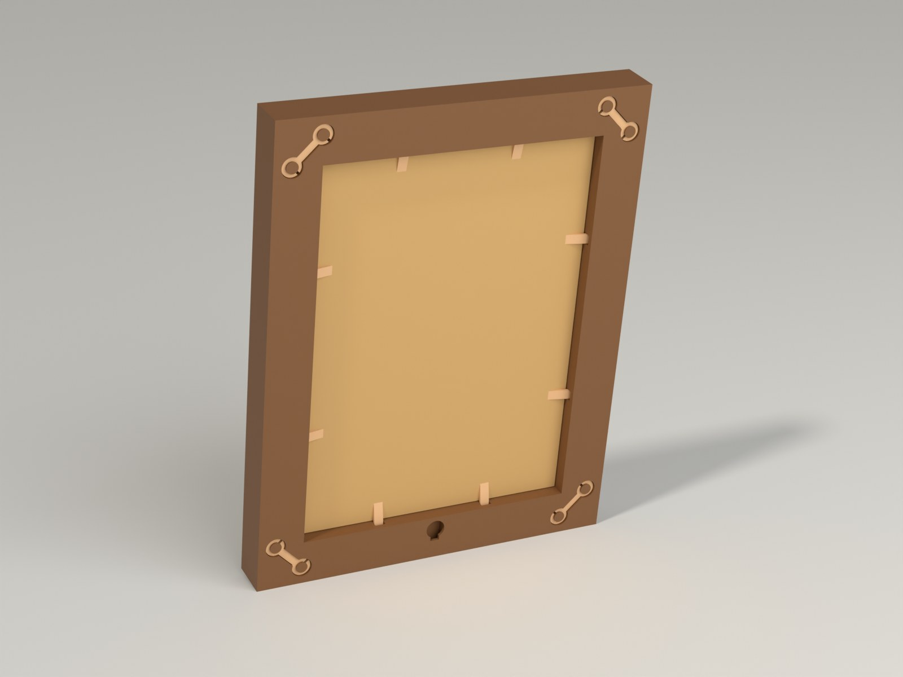

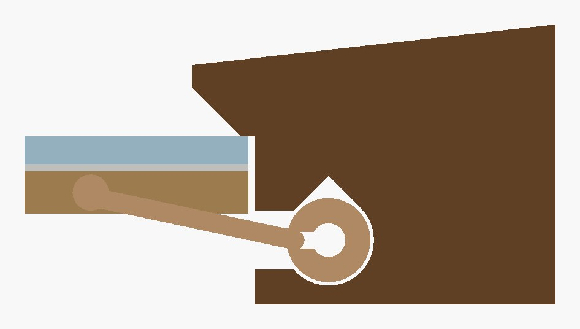

## Parametrische Optionen

| Gruppe | Optionen |
|---|---|
| Bild und Umriss | Rechteck (Standardgrößen oder frei bis 600 mm), regelmäßiges Vieleck (3 bis 12 Seiten, Seite 20 bis 300 mm) oder Raute (Seite und Winkel 30 bis 85°) |
| Rahmenprofil | Profil, Rahmenbreite, Tiefe und Lippe (der Rahmen wird an der dünnsten Stelle etwa um Lippe + 1 mm tiefer) |
| Bildstapel und Rückseite | Dicke von Glas, Foto und Rückwand, Spiel (0,2 bis 0,5 mm), eigene Rückwand oder gedruckte Rückplatte, Zungen an oder aus, Schlüssellöcher an oder aus |
| Verbindungen | Snap-Schlüssel oder keine; Schlüsseldicke, Schlüsselsitz, Anzahl Ersatzschlüssel, Test-Ecke an oder aus |
| Drucker und Farben | Bettgröße (wähle **denselben Drucker im MakerWorld-Bettmenü**), Rahmenfarbe und Schlüsselfarbe; das Ansichtsmenü zeigt den fertigen Rahmen, die Rückseite oder die Explosionsansicht |

Ein Customizer-Download besteht aus mehreren Platten: zuerst die Test-Ecke, dann die
Leisten, auf der letzten Platte die Schlüssel und Zungen.

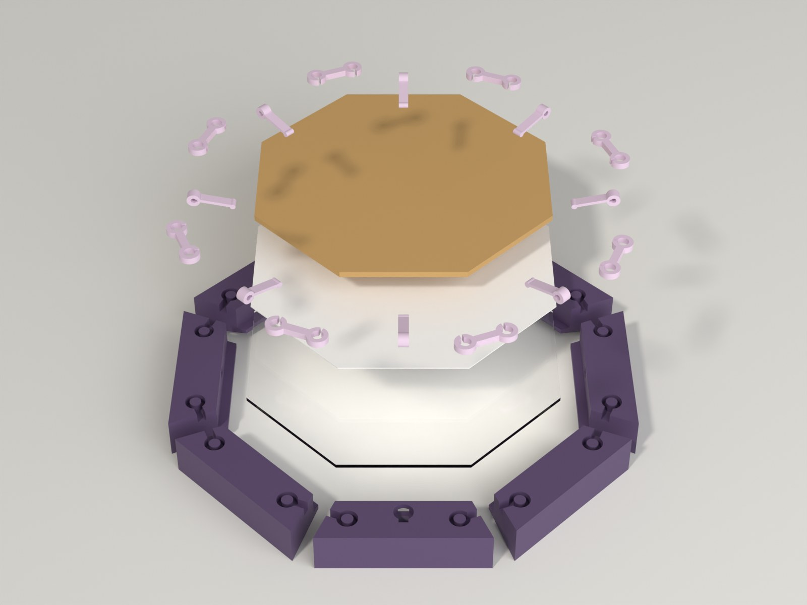

## Beispiele

Druckfertige Bambu-Profile (**PETG, P2S**, 0,20 mm, 3 Wände, 15 % Gyroid,
testgeslict) gibt es auf MakerWorld, alle Platten in einer 3MF: zuerst die
Test-Ecke, dann die Leistenplatten, dann eine Platte mit Snap-Schlüsseln und Zungen.

| Beispiel | Bild | Profil | Verbindung | Teile | Zeit / Gewicht |
|---|---|---|---|---|---|
| 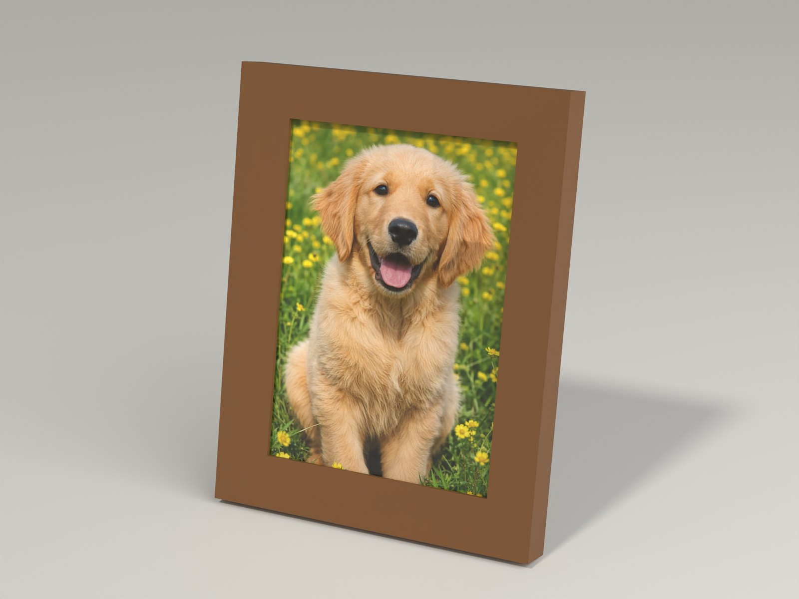 **Fotorahmen 13 x 18 cm** | 130 x 180 mm | Fase | Snap-Schlüssel | 4 Leisten, 6 Snap-Schlüssel, 8 Zungen, Test-Ecke | 5,3 h / 148 g (3 Platten) |
| 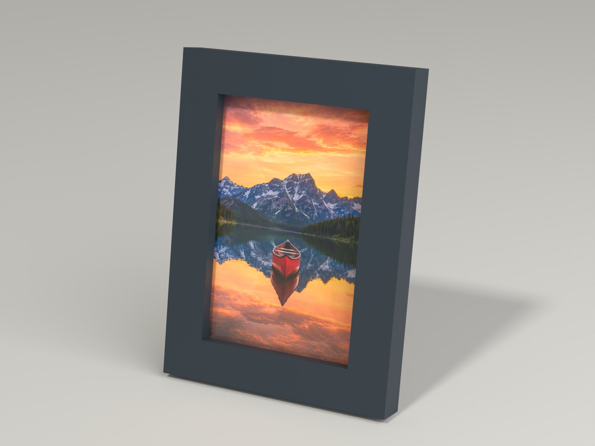 **Fotorahmen 10 x 15 cm, flaches Profil** | 100 x 150 mm | flach | Snap-Schlüssel | 4 Leisten, 6 Snap-Schlüssel, 5 Zungen, Test-Ecke | 3,9 h / 117 g (3 Platten) |
| 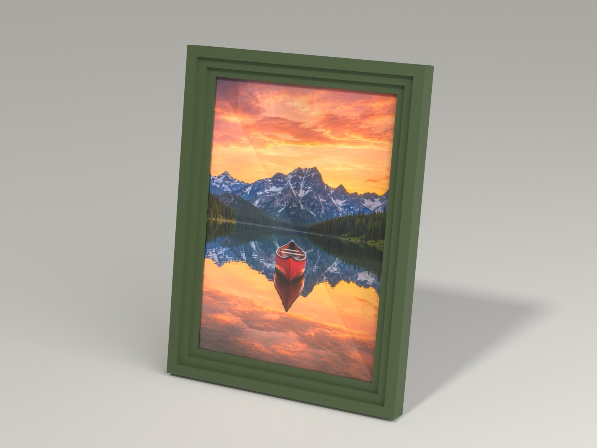 **A4-Posterrahmen, geteilte Seiten** | 210 x 297 mm | Stufen (Kassette) | Snap-Schlüssel | 8 Leisten, 10 Snap-Schlüssel, 10 Zungen, Test-Ecke | 9,0 h / 278 g (4 Platten) |
| 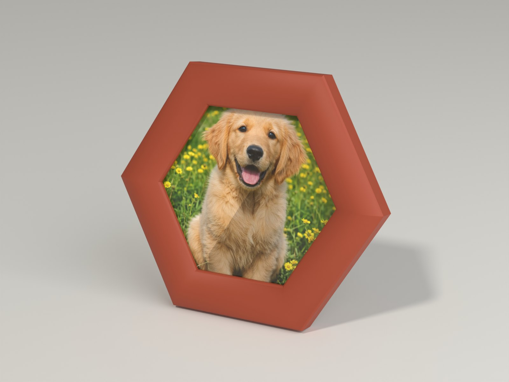 **Sechseck-Rahmen** | regelmäßiges 6-Eck, Seite 70 mm | halbrund | Snap-Schlüssel | 6 Leisten, 8 Snap-Schlüssel, 5 Zungen, Test-Ecke | 4,4 h / 121 g (3 Platten) |
| 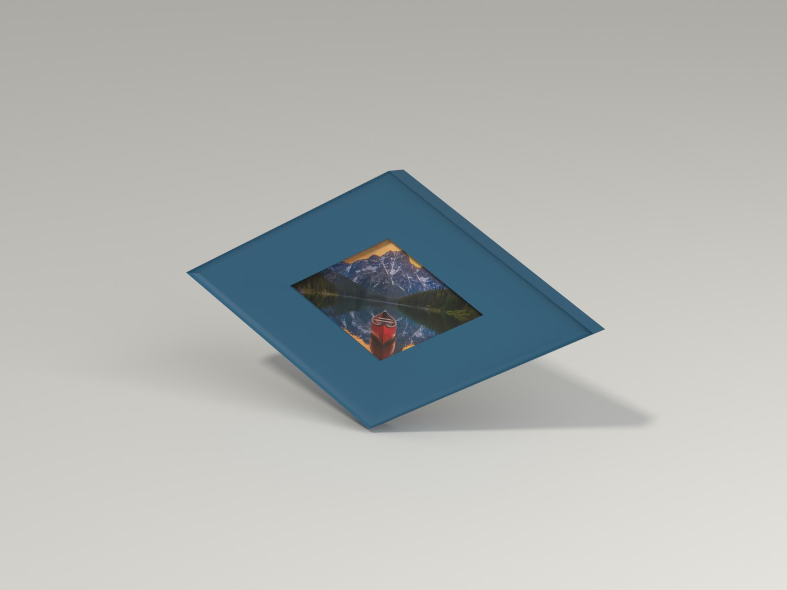 **Rautenrahmen** | Raute, Seite 90 mm, Winkel 60° | Hohlkehle | Snap-Schlüssel | 4 Leisten, 6 Snap-Schlüssel, 8 Zungen, Test-Ecke | 5,5 h / 156 g (3 Platten) |
| 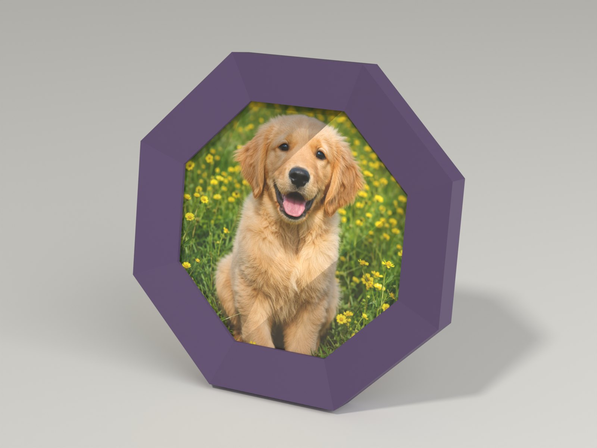 **Achteck-Rahmen** | regelmäßiges 8-Eck, Seite 60 mm | Fase | Snap-Schlüssel | 8 Leisten, 10 Snap-Schlüssel, 7 Zungen, Test-Ecke | 4,8 h / 126 g (4 Platten) |

Jede andere Größe oder Form druckst du mit dem Customizer.

## Druckempfehlungen

| Einstellung | Empfehlung |
|---|---|
| Drucker | Bambu Lab P2S (die Beispiele), P1S und jeder Drucker mit 256-mm-Bett; wähle den Drucker im MakerWorld-Bettmenü |
| Filament | **PETG** für alles (ASA oder PLA gehen auch). Die **Schlüssel** sollten PETG sein (steif, sie müssen einrasten); die **Zungen** kannst du auch in **TPU 95A** drucken, das ist weicher |
| Schichthöhe / Wände | 0,20 mm, 3 Wände |
| Füllung | 15 % Gyroid |
| Stützen / Brim | keine (Stützen im Slicer aus lassen: die Lippe hat eine 45°-Fase) |
| Lage | Leisten liegen mit der Rückseite auf dem Bett, Schlüssel und Zungen liegen flach |
| Genauigkeit | Der Schlüssel rastet um wenige Zehntelmillimeter ein, der Sitz hängt also von deinem Drucker ab. Drucke zuerst die **Test-Ecke**. Ist der Schlüssel schwer hineinzudrücken, erhöhe `key fit` um 0,05; fällt er heraus, senke es um 0,05 |

> **Status:** Die Geometrie ist an den echten exportierten Netzen geprüft, und
> jedes Beispiel ist in Bambu Studio testgeslict. **In dieser Version noch
> nicht gedruckt.** Die erste Version hatte runde Zapfen auf der Rückseite der
> Leisten; beim ersten echten Druck sind sie abgebrochen (jeder Zapfen war
> eine freistehende Säule), deshalb wurde die Verbindung **neu gebaut**. Die
> erste Platte jedes Downloads ist eine **Test-Ecke** (zwei kurze
> Leistenstücke und ein Schlüssel): drucke sie vor einem ganzen Rahmen.

## Montage

1. Lege die Leisten als Ring mit der **Rückseite nach oben** auf den Tisch; die
   Gehrungen berühren sich.
2. Drücke von hinten in die zwei Taschen jeder Verbindung einen Snap-Schlüssel,
   bis die Rasten klicken und er bündig sitzt.
3. Drehe den Rahmen **mit der Vorderseite nach unten** auf eine weiche
   Unterlage und lege Glas, Foto und Rückwand ein.
4. Schiebe jede Zunge in ihr Fenster, das Polster des Arms flach auf die
   Rückwand gedrückt.
5. Häng ihn an eine Schraube: der Kopf geht durch den runden Teil des
   Schlüssellochs, dann schiebst du den Rahmen nach unten.

## Was geprüft wurde

Alle Prüfungen laufen an den **echten exportierten Netzen** (OpenSCAD,
Manifold) in 16 Konfigurationen aus Rechteck, Dreieck, Sechseck, Achteck,
Raute, geteiltem A4, großem Glas, breiter und schmaler Lippe und mehreren
Schlüssel-Einstellungen, dazu 6 bewusst falsche Einstellungen, die die rote
Meldung zeigen müssen: **951 Prüfungen, 0 fehlgeschlagen**.

- **Die Gehrungen schließen:** die Fläche aller Leisten über der Lippenfase
  entspricht dem äußeren Umriss minus Öffnung, und benachbarte Leisten
  überlappen nicht.
- **Falz:** entspricht dem Bild plus Spiel auf jeder Seite.
- **Jede Leiste** ist ein Körper, liegt flach auf dem Bett, passt aufs Bett und
  **druckt ohne Stützen**. Die Prüfung ist streng: Ein flacher Absatz, der mehr
  als etwa 1 mm freisteht, fällt durch (Brücken bis 10 mm sind in Ordnung). Die
  frühere Prüfung ließ bis etwa 5,8 mm durch und übersah die flache vordere
  Lippe, die im echten Druck Stützen brauchte.
- **Die Lippenfase** wird an den Schnitten gemessen: In jeder Höhe beginnt das
  Material genau dort, wo die 45°-Linie es sagt.
- **Keine freistehenden Inseln:** Jede Schicht jeder Leiste ist ein
  zusammenhängendes Gebiet. Die runden Zapfen der ersten Version waren
  getrennte Säulen von bis zu 4,6 mm Höhe.
- **Wände:** mindestens 2 mm um jede Tasche und jedes Fenster.
- **Schlüssel und Zungen** sitzen in ihren Taschen, ohne den Rahmen zu berühren
  (Überlappungsvolumen 0,000 mm³).
- **Snap-Schlüssel:** Der Kopf schließt sich um 0,25 mm, während die Raste durch
  die Taschenöffnung gedrückt wird; das dehnt das PETG um etwa **1,5 %** (2,2 %
  bei 0,1 mm zu strammem Drucker; Grenze 3 %). Die Raste greift auch, wenn der
  Drucker 0,1 mm zu locker druckt, und der Schlüssel druckt flach ohne Stützen.
  Der Steg ist mit etwa 300 N Zugkraft abgeschätzt (eine Schätzung, keine
  Messung).
- **Zunge:** etwa **1,7 N** auf den Stapel bei 1,5 mm Auslenkung, Biegedehnung
  beim Einschieben **1,8 %**.
- **Alle Platten** liegen im Bett; jedes Beispiel ist testgeslict, und die 3MF
  lädt in Bambu Studio nur mit Bambu-Filament.

**Noch nicht geprüft:** wie fest der gedruckte Snap-Schlüssel wirklich hält und
wie viel Kraft zum Eindrücken und Herausziehen nötig ist; das hängt von der
Toleranz deines Druckers ab. Von dieser Version ist noch nichts gedruckt.

## Downloads

Druckdateien gibt es bewusst ausschließlich auf MakerWorld.

👉 MakerWorld-Link: https://makerworld.com/en/models/3551154-parametric-picture-frame#profileId-4062778

Profil: <https://makerworld.com/en/@BetaHydri>

## Lizenz

Dokumentation und Bilder in diesem Repository; Modell- und Druckdateien werden
ausschließlich über MakerWorld verteilt. Dokumentation und Bilder: © BetaHydri.
Das Modell (inkl. Quellcode) und alle Druckdateien stehen unter der auf
MakerWorld angegebenen Lizenz. Dieses Repository enthält bewusst keine Modell-,
Quellcode- oder Druckdateien.
