# Parametric Picture Frames – Any Size, Any Shape, Five Profiles, Snap-Together Clasps, No Glue

[← All models](../../README.md)

🌐 **English** | [Deutsch](README.de.md)

Print a picture frame **exactly as big and as shaped as your picture**: a photo,
a poster, a hexagon, a diamond. The frame is made from **mitred strips** held
together by small printed **clasps on the back**: no glue, nothing visible from
the front, and you can take the frame apart again. Glass, photo and back board
are held by **flexible prongs** you can pull out to change the picture.

> **The model with all print profiles is available exclusively on MakerWorld:**
> 👉 [MakerWorld link: https://makerworld.com/en/models/3551154-parametric-picture-frame](https://makerworld.com/en/models/3551154-parametric-picture-frame#profileId-4062778)
>
> 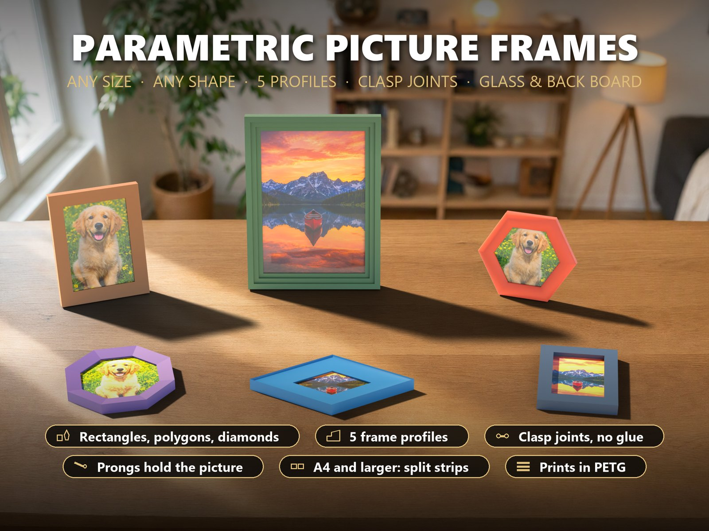

## Table of Contents

- [Highlights](#highlights)
- [The profiles](#the-profiles)
- [The joints](#the-joints)
- [Parametric Options](#parametric-options)
- [Samples](#samples)
- [Print Recommendations](#print-recommendations)
- [Assembly](#assembly)
- [What was checked](#what-was-checked)
- [Downloads](#downloads)
- [License](#license)

## Highlights

- **Pick the picture, get the frame.** Standard sizes from 9 x 13 cm to A3 in a
  dropdown, or type any size. Or choose a **regular polygon with 3 to 12 sides**
  or a **rhombus** with any angle: every corner gets its own mitre angle
  automatically.
- **Five profiles.** Flat, bevel, half-round, steps (cassette) and cove. Width
  20 to 70 mm, depth 14 to 50 mm, lip 2 to 10 mm.
- **Joints without glue.** On the back of every mitre sit two round pegs in
  pockets. A **clasp** (two slit C-ends and a rigid bar) is pressed onto both
  pegs with a friction fit; the pegs sit 0.3 mm further apart than the C-ends,
  so the clasp **draws the mitre shut**. Nothing is visible from the front, and
  a thin screwdriver levers the clasp off again. Prefer a rigid part? Choose the
  **tapered butterfly key**; a **spring clip** is also in the Customizer.
- **Big frames in several strips.** Sides longer than the bed minus 14 mm are
  split automatically, and the butt joints get clasps too: an **A4 frame** or a
  **poster frame** prints on a 256 mm bed.
- **Glass, photo, back board.** The rabbet is as deep as your stack (glass 0 to
  6 mm, photo, board 1.5 to 8 mm) plus room for the prongs. No board? Print a
  **back plate** (if it fits the bed).
- **Change the picture any time.** The **flexible prongs** slide into small
  windows in the rabbet wall and press the stack forward. Pull them out
  sideways, swap the picture, slide them back.
- **Hang it.** Two **keyholes** in the top strip (rectangles and polygons with a
  flat top).
- **Prints without support.** Every strip lies with its back on the bed: slopes
  up to 55° and short bridges only.
- **Foolproof.** If a setting cannot work (frame too narrow for the clasps,
  frame too shallow for the stack, a strip wider than the bed, an opening that
  is too small) **a red message replaces the model**, so you can never download
  a broken part by accident.

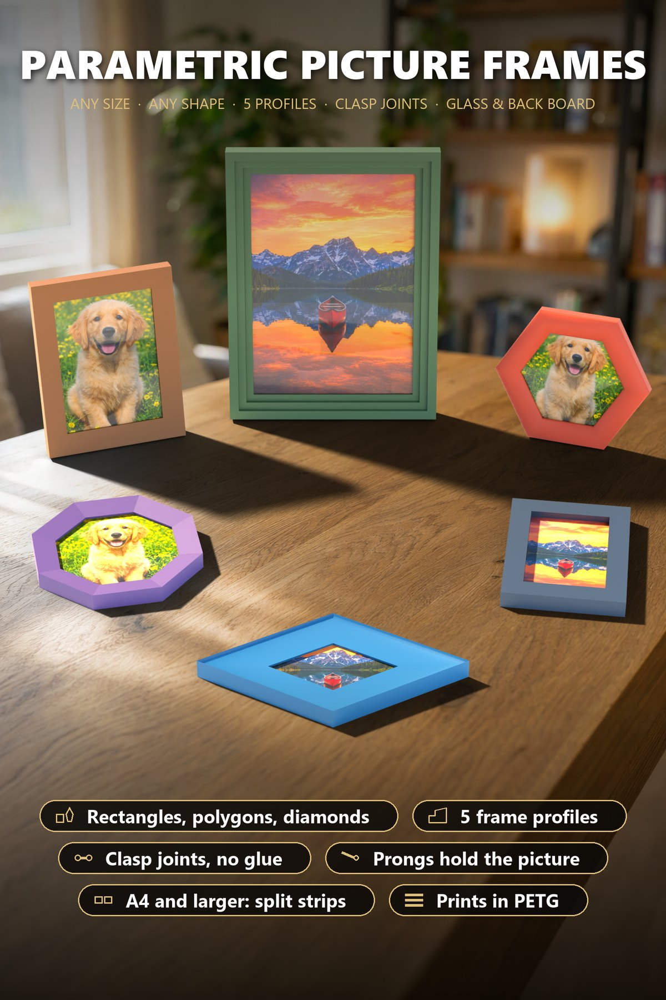

## The profiles

| Profile | Look | Good for |
|---|---|---|
| Flat | rectangular strip | modern, slim frames, photos 10 x 15 |
| Bevel | slopes down to the picture | the classic photo frame |
| Half-round | rounded top | soft, friendly frames, polygons |
| Steps | cassette with two steps | posters, art prints, A4 |
| Cove | hollow groove | diamonds and wide frames |

## The joints

| | Clasp (default) | Butterfly key | Spring clip |
|---|---|---|---|
| **How it holds** | two slit C-ends grip round pegs with a friction fit, rigid bar between them | tapered dumbbell pressed into tight pockets | two C-rings and a zigzag spring |
| **Draws the mitre shut** | yes, the pegs are 0.3 mm further apart | by the tight fit of the taper | yes, by the spring (about 6 N) |
| **Take apart again** | lever off with a thin screwdriver | lever out at the round relief | lever off; the spring can fatigue |
| **Good for** | everything | rigid frames, small corner parts | maximum pull |

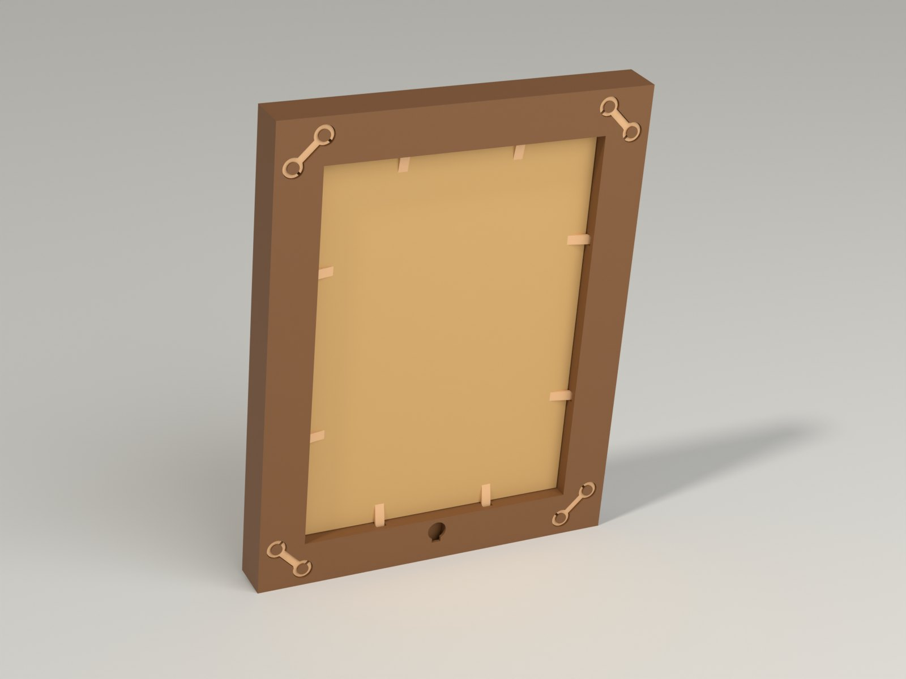

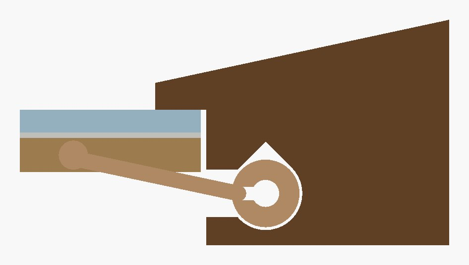

## Parametric Options

| Group | Options |
|---|---|
| Picture and outline | Rectangle (standard sizes or custom up to 600 mm), regular polygon (3 to 12 sides, side 20 to 300 mm) or rhombus (side and angle 30 to 85°) |
| Frame profile | Profile, frame width, depth and lip |
| Picture stack and back | Thickness of glass, photo and back board, clearance, own board or printed back plate, prongs on or off, keyholes on or off |
| Joints | Clasp, butterfly key, spring clip or none; clasp thickness, peg diameter, number of spare clasps |
| Printer and colours | Bed size (pick **the same printer in the MakerWorld bed menu**), frame colour and clasp colour; the view menu shows the assembled frame, the back or the exploded view |

A Customizer download is a set of plates: the strips first, the clasps and
prongs on the last plate.

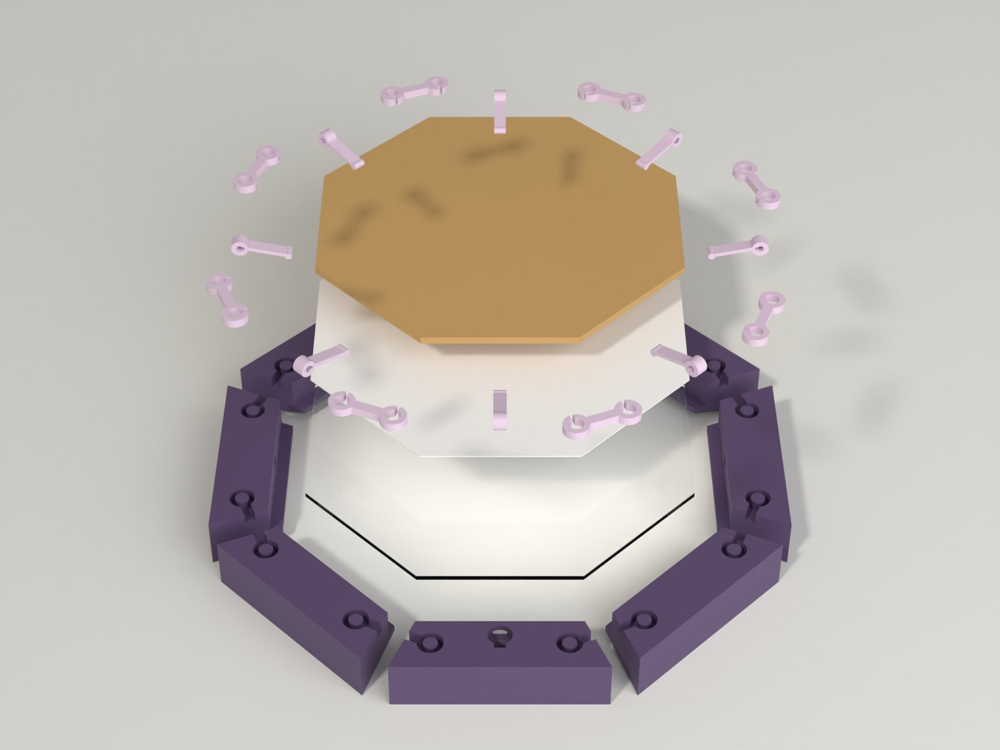

## Samples

Ready-to-print Bambu profiles (**PETG, P2S**, 0.20 mm, 3 walls, 15 % gyroid,
test-sliced) are available on MakerWorld, every plate in one 3MF: first the
strip plates, then a plate with the clasps and prongs.

| Sample | Picture | Profile | Joint | Parts | Time / weight |
|---|---|---|---|---|---|
| 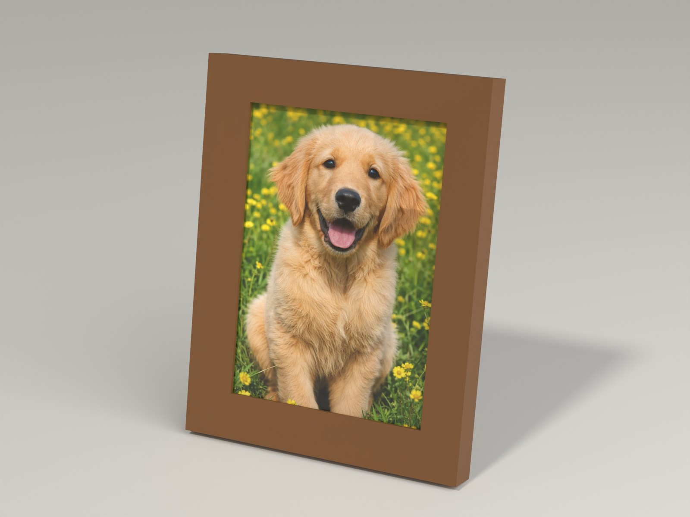 **Photo frame 13 x 18 cm** | 130 x 180 mm | bevel | Clasp | 4 strips, 6 clasps, 8 prongs | 4.6 h / 127 g (2 plates) |
| 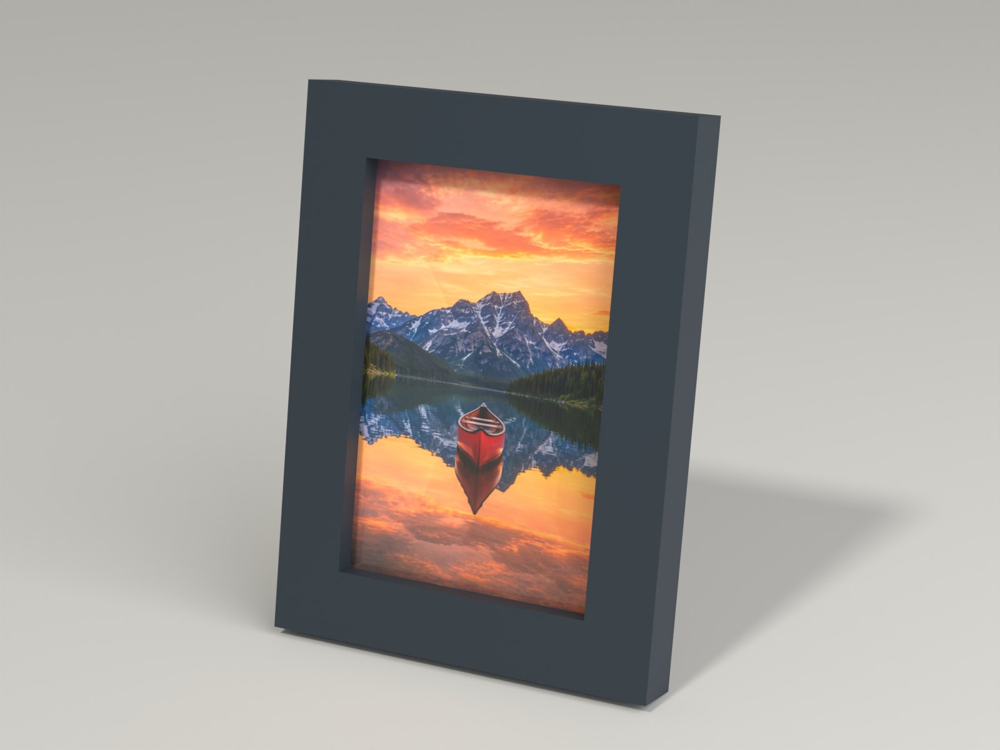 **Photo frame 10 x 15 cm, butterfly keys** | 100 x 150 mm | flat | Butterfly key (rigid) | 4 strips, 6 keys, 6 prongs | 3.3 h / 102 g (2 plates) |
| 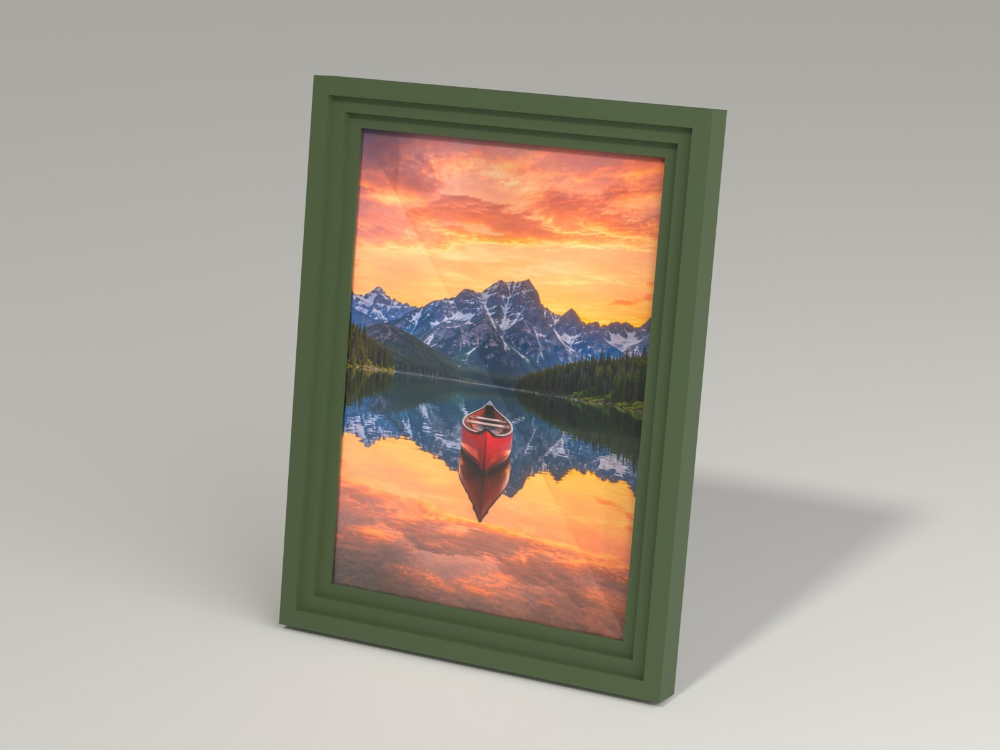 **A4 poster frame, split sides** | 210 x 297 mm | steps (cassette) | Clasp | 8 strips, 10 clasps, 12 prongs | 8.3 h / 255 g (3 plates) |
| 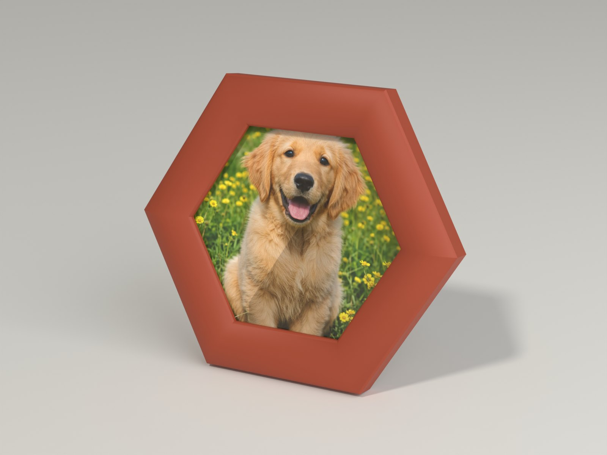 **Hexagon frame** | regular 6-gon, side 70 mm | half-round | Clasp | 6 strips, 8 clasps, 6 prongs | 3.7 h / 101 g (2 plates) |
| 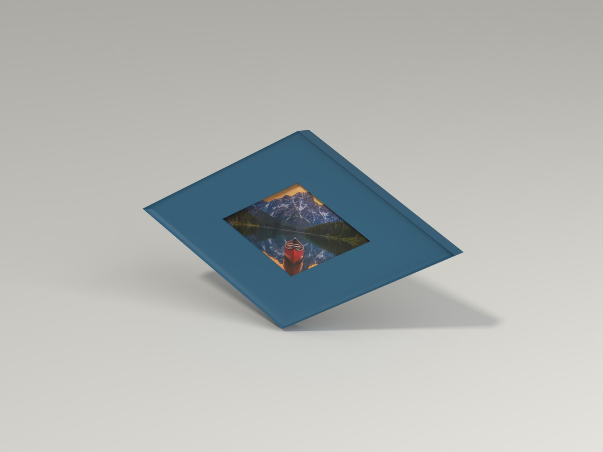 **Diamond frame** | rhombus, side 90 mm, angle 60° | cove | Clasp | 4 strips, 6 clasps, 8 prongs | 4.4 h / 126 g (2 plates) |
| 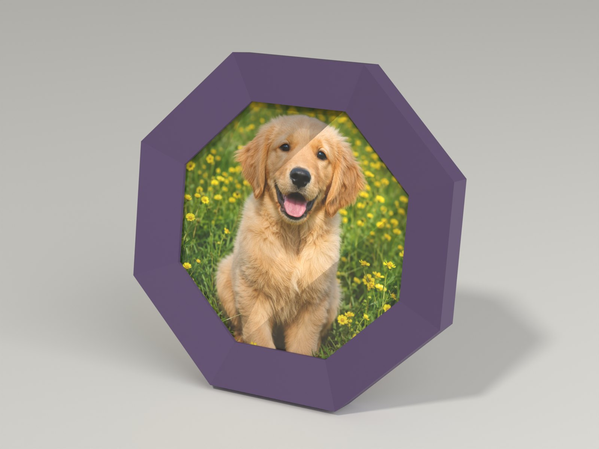 **Octagon frame** | regular 8-gon, side 60 mm | bevel | Clasp | 8 strips, 10 clasps, 8 prongs | 4.2 h / 105 g (3 plates) |

Print any other size or shape with the Customizer.

## Print Recommendations

| Setting | Recommendation |
|---|---|
| Printer | Bambu Lab P2S (the samples), P1S and any printer with a 256 mm bed; pick the printer in the MakerWorld bed menu |
| Filament | **PETG** for everything (ASA or PLA work too). Clasps and prongs can also be printed in **TPU 95A**, which is softer and easier to push on |
| Layer height / walls | 0.20 mm, 3 walls |
| Infill | 15 % gyroid |
| Support / brim | none |
| Pose | Strips lie with their back on the bed, clasps and prongs lie flat |
| Accuracy | The clasp relies on the pegs coming out slightly large. If a clasp is too tight, sand the pegs gently; if it is too loose, print the clasp with one more wall |

> **Status:** the geometry is checked on the real exported meshes and every
> sample is test-sliced in Bambu Studio. The clasp fit has **not been printed
> yet**, so print **one test joint first** (a short strip pair and a clasp)
> before you print a whole frame.

## Assembly

1. Lay the strips as a ring on the table with the **back up**; the mitres touch.
2. Press a clasp onto the two pegs of every joint from behind until it is flush.
3. Turn the frame **face down** on a soft surface and lay in glass, photo and
   back board.
4. Slide every prong into its window, the pad of the arm pressed flat onto the
   board.
5. Hang it on a screw: the head goes through the round part of the keyhole, then
   slide the frame down.

## What was checked

All checks run on the **real exported meshes** (OpenSCAD, Manifold) in 12
configurations of rectangle, triangle, hexagon, octagon, rhombus, split A4 and
big glass, plus 5 deliberately wrong settings that must show the red message:
**386 checks, 0 failed**.

- **The mitres close:** the area of all strips above the rabbet equals the outer
  outline minus the opening (13 x 18: 17 992 mm² vs 17 992 mm²) and neighbouring
  strips do not overlap.
- **Rabbet:** equals the picture plus the clearance on every side.
- **Every strip** is one body, lies flat on the bed, fits the bed and **prints
  without support** (overhangs checked layer by layer: slopes to 55°, ledges
  2.9 mm, bridges 10 mm).
- **Walls:** at least 2 mm around every pocket and window, 13 mm behind every
  prong window.
- **Clasps, keys and prongs** sit in their pockets without touching the frame
  (overlap volume 0.000 mm³).
- **Clasp:** a C-end pushed over the 0.2 mm peg bump bends by about **1.6 %**
  (limit 3 % for PETG).
- **Prong:** about **1.7 N** on the stack for 1.5 mm deflection, bending strain
  while sliding in **1.8 %**.
- **All plates** are inside the bed; each sample is test-sliced and the 3MF
  reloads in Bambu Studio with Bambu filament only.

**Not checked yet:** how well a printed clasp really grips; this depends on your
printer's tolerance.

## Downloads

Print files are intentionally available exclusively on MakerWorld.

👉 MakerWorld link: https://makerworld.com/en/models/3551154-parametric-picture-frame#profileId-4062778

Profile: <https://makerworld.com/en/@BetaHydri>

## License

Documentation and images in this repository; model and print files are
distributed exclusively via MakerWorld. Documentation and images: © BetaHydri.
The model (including source code) and all print files are under the license
stated on MakerWorld. This repository deliberately contains no model, source
code or print files.
