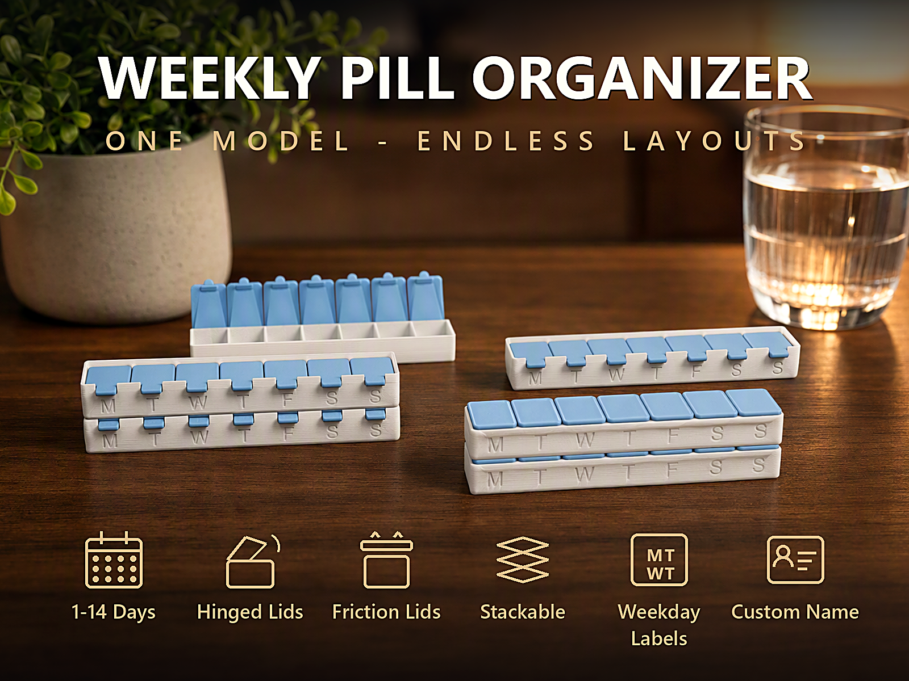
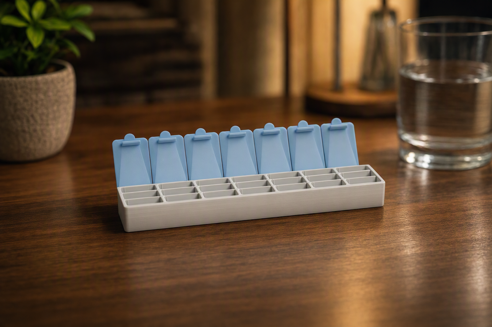
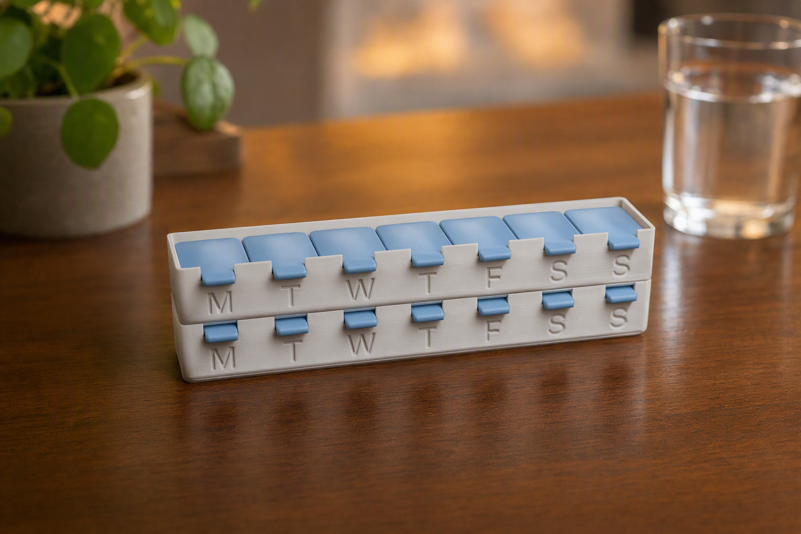
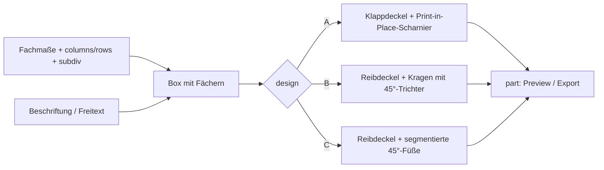
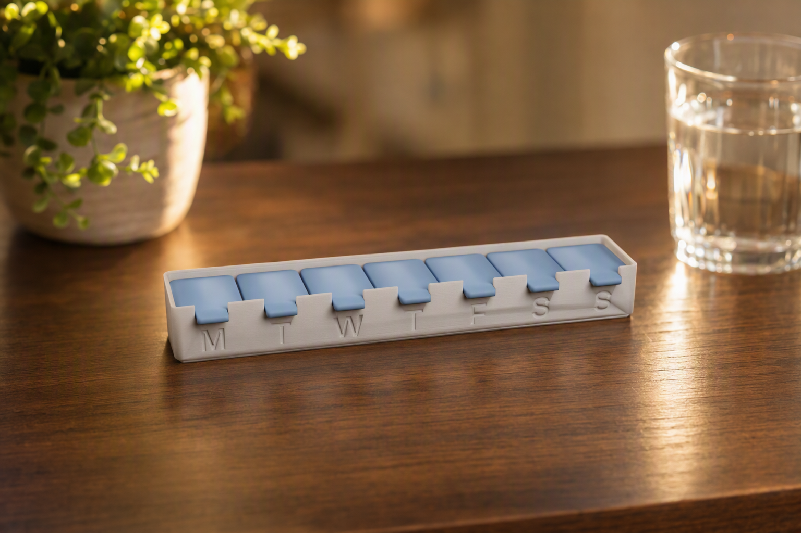
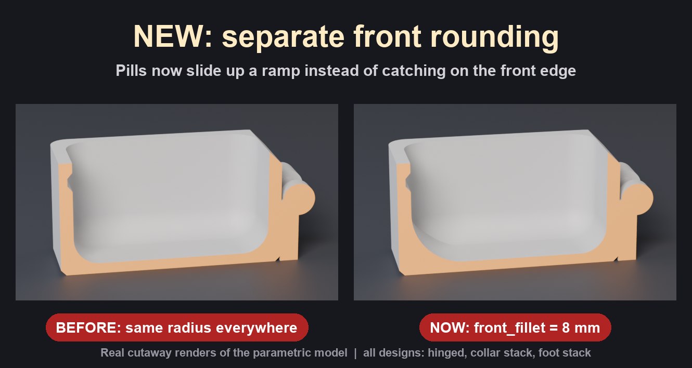
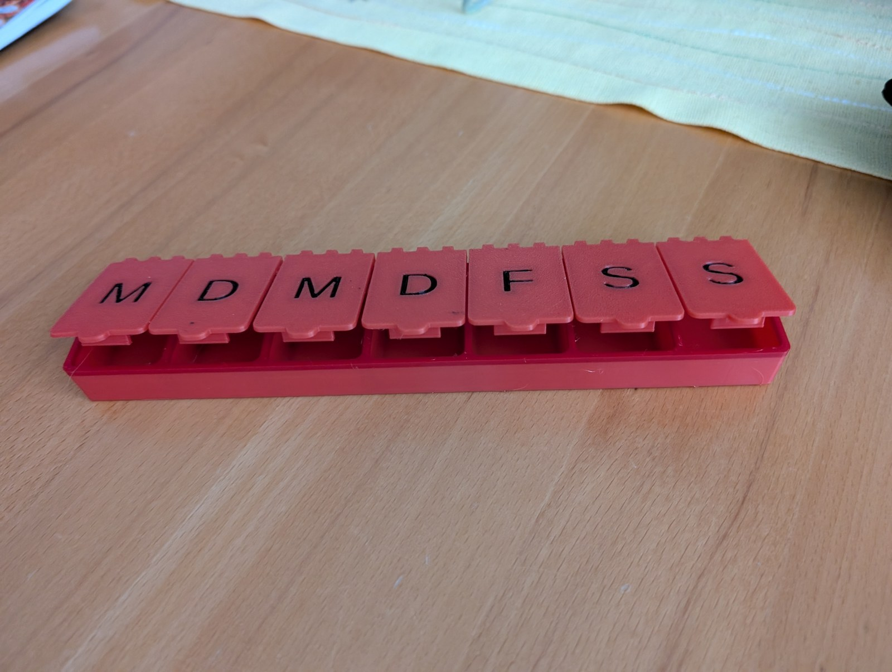

# Parametric Pill Box – Wochendosierer mit Scharnier- oder Reibdeckeln, stapelbar und beschriftbar

[← Alle Modelle im Überblick](../../README.de.md)

🌐 [English](README.md) | **Deutsch**

Parametrische Pillendose für den FDM-Druck: ein Streifen aus 1–14
Tagesfächern, wahlweise mit Print-in-Place-Klappdeckeln oder mit losen
Reibdeckeln, mit zwei Stapelsystemen, Wochentags-Beschriftung und Freitext –
alles im MakerWorld-Customizer, drei Designs in einer Datei.

> **Das Modell mit allen Druckprofilen gibt es ausschließlich auf MakerWorld:**
> 👉 [MakerWorld-Link: https://makerworld.com/en/models/3120609-ultimate-parametric-pill-box](https://makerworld.com/en/models/3120609-ultimate-parametric-pill-box)
>
> 

Die **Parametric Pill Box** erzeugt eine Dose mit einem Fach pro Tag. Über das
erste Menü `design` wählst du, wie die Deckel funktionieren: **A** mit je einem
Klappdeckel pro Tag und Print-in-Place-Scharnier, **B** mit losen
Reibdeckeln und Stapel-Kragen oder **C** mit losen Reibdeckeln und
segmentierten 45°-Füßen. Fachgröße, Unterteilung (z. B. Morgen/Mittag/Abend),
Beschriftung und Druckerprüfung gelten für alle drei Designs.

## Inhaltsverzeichnis

- [Das Problem](#das-problem)
- [Die Idee](#die-idee)
- [Highlights](#highlights)
- [Parametrische Optionen](#parametrische-optionen)
- [Konstruktion](#konstruktion)
- [Druckempfehlungen](#druckempfehlungen)
- [Anwendungsbeispiele](#anwendungsbeispiele)
- [Fehlersuche / FAQ](#fehlersuche--faq)
- [Entwicklungsgeschichte](#entwicklungsgeschichte)
- [Downloads](#downloads)
- [Lizenz](#lizenz)

## Das Problem

Wochendosierer aus dem Laden haben ein festes Raster – und selten das, was du
brauchst:

- Die Fächer sind zu klein für die große Kapsel oder zu groß für die
  Mini-Tablette.
- Morgens, mittags und abends will man trennen können, ohne drei Dosen zu
  kaufen.
- Dünne Klappdeckel aus Kunststoff brechen am Scharnier oder gehen von selbst
  auf.
- Eine Dose für zwei Wochen oder für vier Personen gibt es nicht – man stellt
  mehrere nebeneinander.
- Tabletten bleiben an der Kante hängen, wenn man sie mit dem Finger nach vorne
  herausziehen will.

## Die Idee

Ein einziges Modell erzeugt Dosen von einem Fach bis zu 14 Tagen je Streifen
und mehrere Streifen auf einer Platte (`rows`). Breite, Länge und Tiefe eines
Tagesfachs sind frei einstellbar, jedes Fach lässt sich in bis zu vier
Unterfächer teilen. Weil unterschiedliche Menschen unterschiedliche Deckel
mögen, liegen drei Deckelkonzepte in einer Datei: Klappdeckel ohne Zusammenbau,
Reibdeckel mit stapelbarem Kragen und Reibdeckel mit stapelbaren Füßen. Alle
Maße in Millimetern, alle Werte als Customizer-Parameter.

## Highlights

- **Drei Designs in einer Datei:** `Hinged lids`, `Friction + collar stack`
  und `Friction + foot stack`.
- **Print-in-Place-Scharnier pro Tag (Design A):** Box und Deckel liegen flach
  und offen auf dem Bett, ohne Stützen; nach dem Druck jeden Deckel einmal
  lösen.
- **Snap-Verschluss:** Nut-und-Feder-Rastung, `latch_grip` stellt die
  Klickkraft ein.
- **Stapelbar (Designs B und C):** Kragen mit 45°-Trichter oder segmentierte
  45°-Füße unter jedem Fach; `stackable` schaltet das Stapeln ab.
- **1–14 Tage je Streifen**, bis zu 6 Streifen (`rows`) auf einer Platte.
- **Fachgröße frei:** `day_w`, `day_len`, `well_depth`, bis zu 4 Unterfächer
  (`subdiv`).
- **Rampe zum Herausnehmen:** `front_fillet` rundet nur die Kante zwischen
  Fachboden und Vorderwand, damit Tabletten nach vorne herausgleiten.
- **Beschriftung:** Wochentage (DE/EN, 1–3 Buchstaben) oder Zahlen, außen
  graviert, bei Design A auch innen erhaben; Wochenstart Montag oder Sonntag.
- **Freitext** (z. B. ein Name) auf Front, Rückseite oder Stirnseite.
- **Mehrfarb-Export:** Körper, Deckel und Text als getrennte Farbgruppen.
- **Bauraum-Prüfung:** Warnung in der Konsole, wenn das flache Layout nicht aufs
  Druckbett passt.
- **Acht fertige Varianten** mit Bambu-Studio-Profilen für den P1S.

## Parametrische Optionen

Die Namen entsprechen den Customizer-Parametern des Modells (Stand der
Modelldatei vom 11. Oktober 2026).

### Design und Ausgabe

| Parameter | Bedeutung | Standard | Bereich / Einheit |
|---|---|---|---|
| `design` | `Hinged lids` (A), `Friction + collar stack` (B), `Friction + foot stack` (C) | `Hinged lids` | Auswahl |
| `part` | `Preview closed`, `Preview closed 2-color` (beide nicht druckbar), `Multicolor Export`, `Single Color Export` | `Preview closed` | Auswahl |
| `preview_angle` | Nur Vorschau von Design A: Öffnungswinkel der Deckel | 12 | 0–180° |

### Anzahl der Tage

| Parameter | Bedeutung | Standard | Bereich / Einheit |
|---|---|---|---|
| `columns` | Tage je Streifen; 7 = eine Woche | 7 | 1–14 |
| `rows` | Streifen auf der Platte; jeder Streifen ist ein eigenes Teil | 1 | 1–6 |

### Fachgröße pro Tag

| Parameter | Bedeutung | Standard | Bereich / Einheit |
|---|---|---|---|
| `day_w` | Innenbreite eines Tagesfachs (X) | 22 | 10–60 mm |
| `day_len` | Innenlänge eines Tagesfachs (Y) | 30 | 12–90 mm |
| `well_depth` | Innentiefe der Fächer (Z) | 16 | 6–45 mm |
| `subdiv` | Fächer pro Tag: 1 = keine Trennung, 2 = morgens/abends, 3 = morgens/mittags/abends | 1 | 1–4 |
| `fillet` | Rundung der senkrechten Ecken, der Seitenkanten und der Rückkante des Fachs | 4 | 1–4 mm, Schritt 0,5 |
| `front_fillet` | Rundung der Kante Fachboden → Vorderwand (Rampe zum Herausnehmen), nie kleiner als `fillet`, automatisch begrenzt | 8 | 1–20 mm, Schritt 0,5 |

### Verschluss – Design A

| Parameter | Bedeutung | Standard | Bereich / Einheit |
|---|---|---|---|
| `latch_style` | `None` oder `Snap` (Nut-und-Feder-Rastung) | `Snap` | Auswahl |
| `latch_grip` | Überschneidung von Rippe und Nut; größer = festerer Klick | 0,55 | 0,15–1,2 mm, Schritt 0,05 |

### Reibdeckel – beide Stapelmodelle

| Parameter | Bedeutung | Standard | Bereich / Einheit |
|---|---|---|---|
| `lid_fit` | Spiel je Seite zwischen Deckelrand und Fach; kleiner = fester | 0,07 | 0,00–0,40 mm, Schritt 0,01 |
| `lid_skirt` | Wie tief der Deckelrand ins Fach reicht | 7 | 3–14 mm, Schritt 0,5 |

### Stapel-Kragen – Design B

| Parameter | Bedeutung | Standard | Bereich / Einheit |
|---|---|---|---|
| `lift_tab` | Zuglasche an der Deckelvorderkante zum Abheben mit dem Fingernagel | `On` | `Off`, `On` |
| `lift_reach` | Wie weit die Lasche über die Boxvorderkante ragt | 5 | 0–12 mm, Schritt 0,5 |

### Stapel-Füße – Design C

| Parameter | Bedeutung | Standard | Bereich / Einheit |
|---|---|---|---|
| `print_orient` | Druckausrichtung des Exports: `Auto`, `Tipped front`, `Opening down`, `Upright` (bestimmt, wo die Brücken liegen) | `Auto` | Auswahl |

### Stapeln – beide Stapelmodelle

| Parameter | Bedeutung | Standard | Bereich / Einheit |
|---|---|---|---|
| `stackable` | Box stapelbar machen; `Off` = Box und Deckel drucken flach | `On` | `Off`, `On` |
| `stack_preview` | Nur Vorschau: wie viele Einheiten gestapelt gezeigt werden | 2 | 1–4 |

### Beschriftung außen (graviert)

| Parameter | Bedeutung | Standard | Bereich / Einheit |
|---|---|---|---|
| `label_style` | `None`, `1 Letter`, `2 Letters`, `3 Letters`, `Numbers` | `1 Letter` | Auswahl |
| `label_lang` | Sprache der Wochentage (innen und außen) | `EN` | `DE`, `EN` |
| `week_start` | Wochenstart | `Monday` | `Monday`, `Sunday` |

### Beschriftung innen (erhaben) – Design A

| Parameter | Bedeutung | Standard | Bereich / Einheit |
|---|---|---|---|
| `inner_emboss` | Erhabene Wochentage auf der Deckelinnenseite | `Off` | `Off`, `On` |
| `inner_style` | Stil der Innenschrift | `2 Letters` | `1 Letter`, `2 Letters`, `3 Letters`, `Numbers` |
| `inner_height` | Höhe der erhabenen Schrift | 0,6 | 0,3–1,5 mm, Schritt 0,1 |
| `inner_size` | Schriftgröße (0 = automatisch, höchstens 6 mm) | 0 | 0–6 mm, Schritt 0,5 |
| `inner_tab_gap` | Abstand der Oberkante der Innenschrift zur Vorderkante | 5 | 2–15 mm, Schritt 0,5 |

### Freitext

| Parameter | Bedeutung | Standard | Bereich / Einheit |
|---|---|---|---|
| `front_text` | Freitext, einmal graviert (z. B. ein Name); leer = keiner | leer | Freitext |
| `front_text_size` | Schriftgröße (0 = automatisch) | 0 | 0–20 mm, Schritt 0,5 |
| `front_text_side` | Fläche für den Text: `Front`, `Back`, `Left end`, `Right end` | `Front` | Auswahl |

### Drucker und Passung

| Parameter | Bedeutung | Standard | Bereich / Einheit |
|---|---|---|---|
| `printer` | Bauraum für die Prüfung: 180 (A1 mini), 256 (A1/P1S/P2S/X1), 325 (H2C/A2L), 350 (H2D/H2S), unbegrenzt | 256 | Auswahl |
| `hinge_gap` | Scharnierspiel (Design A); klemmt → erhöhen, wackelt → verringern | 0,30 | 0,25–0,60 mm, Schritt 0,01 |

## Konstruktion

### OpenSCAD-Ansatz

Das Modell ist reines OpenSCAD ohne externe Bibliotheken und läuft im
MakerWorld-Customizer. Die Fächer sitzen in einer Reihe (X), die Tiefe liegt in
Y. Das Menü `design` schaltet zwischen den drei Deckelkonzepten um; Fachgrößen,
Trennwände, Beschriftung und Druckerprüfung sind gemeinsam. Eine
Start-Kamera zeigt je nach Design und Vorschau die gesamte Dose oder den
Stapel mittig an.

### Parametrische Logik

| Größe | Formel / Regel |
|---|---|
| Streifenbreite (Design A) | `columns` · `day_w` + (`columns` + 1) · Wand (2,0 mm) |
| Außenmaß Tiefe / Höhe (Design A) | `day_len` + 2 · Wand; `well_depth` + Boden (1,6 mm) |
| Scharnierachse (Design A) | Höhe = (Boxhöhe + Deckeldicke) / 2; Y = Boxtiefe + Barrelradius + `hinge_gap` |
| Scharnier-Segmente | ungerade Anzahl, die Enden gehören zur Box; Barrel Ø 5,0 mm, Stift Ø 2,8 mm |
| Wand Design B | Kragenwand (1,8 mm) + Auflage (1,2 mm) = 3,0 mm |
| Trennwand Design B | max(1,6 mm; 2 · Auflage + Deckelspalt) = 3,0 mm |
| Kragenhöhe Design B | Deckelplatte (2,6 mm) + Versenkung (2,8 mm) = 5,4 mm über der Auflage |
| Stapelabstand Design B | Kragenoberkante − 45°-Fase (2,4 mm) |
| Front-Rundung | höchstens Fachtiefe − Eintauchtiefe des Deckels − 1 mm |

Mit den Voreinstellungen (7 Tage, 22 × 30 × 16 mm) ergibt sich für Design A
eine Außenbreite von 170 mm bei 34 mm Tiefe und 17,6 mm Höhe. Für Design B sind
es 178 × 36 mm Grundfläche bei 23,0 mm Höhe mit Kragen.

Die Werte sind aus den Formeln und den Standardwerten abgeleitet.

### Besondere Algorithmen

- **Achse auf halber Höhe:** Ein flacher Deckel deckt die Oberseite nur ab,
  wenn die Scharnierachse auf halber Höhe von Box plus Deckel liegt. Eine
  tiefe Achse würde den Deckel nach unten klappen (Klappschale statt
  Einzeldeckel). Die Faltung um 180° ist ihre eigene Umkehrung; deshalb wird der
  Verschluss in geschlossener Lage modelliert und in die Drucklage gedreht.
- **Riser umschließt den Barrel:** Die Deckelsegmente bestehen aus Barrel und
  einem massiven Block bis zur Achsenmitte; die Stiftbohrung wird erst danach
  gebohrt. Sonst bleibt eine dünne Berührlinie, und das Scharnier bricht ab.
- **Versteifungssteg hinter der Platte:** Ein Steg bindet alle Deckelsegmente zu
  einem steifen Träger und liegt geschlossen hinter der Rückwand, sodass er nie
  mit den Wänden kollidiert.
- **Fase an der Klappkante:** An der hinteren Oberkante der Wände sitzt eine
  Fase (`back_relief`, 2,0 mm). Ein im CAD kollisionsfreier Deckel kann im Druck
  wegen des Scharnierspiels an der scharfen Kante hängen bleiben.
- **Snap mit stumpfer Rippe:** Die Rastung nutzt eine Rippe mit flacher Spitze
  und eine passende Nut. Eine scharfe Dreiecksspitze druckt auf der 0,4-mm-Düse
  nicht auf die volle Höhe. Der Deckel schließt auf einem Bogen; die Rippe muss
  hoch genug sein, damit sie beim Öffnen nicht sofort nach oben aus der Nut
  gleitet.
- **Reibdeckel mit Schürze pro Unterfach:** Die Deckelschürze taucht mit
  `lid_fit` Spiel in das Fach. Bei mehreren Unterfächern gibt es eine Schürze
  je Unterfach, und das Spiel wird automatisch etwas kleiner, weil kleine Zellen
  fast nur aus Eckenradius bestehen. Eine Einführfase an der Schürzenspitze
  erleichtert das Aufsetzen.
- **Kragen mit Auflage und eingelassenen Deckeln (Design B):** Die Fächer sitzen
  nach innen versetzt zum äußeren Kragen. Die Oberkanten der Innenwände bilden
  eine umlaufende Auflage, auf der die Deckel liegen, und die Deckel sitzen
  unter der Kragenoberkante. Der 45°-Trichter des Kragens nimmt die 45°-Fase der
  nächsten Box auf. Damit das Stapeln funktioniert, muss die Fase größer als
  die Kragenwand sein, und die Deckel müssen tiefer liegen als die Fase hoch ist.
- **Zuglasche mit Kragenkerbe (Design B):** Der Kragen wird an jeder Lasche
  über die gesamte Höhe unterbrochen. Sonst bleibt ein Steg über der Lasche, und
  die Deckel wirken wie eine geschlossene Schale.
- **Segmentierte Füße (Design C):** Unter jedem Fach sitzt ein 45°-Fuß, in
  jedem Deckel eine passende 45°-V-Nut. Weil das pro Fach gilt, funktioniert das
  Stapeln für jede Tageszahl, auch versetzt.
- **Rampe nur vorne:** `front_fillet` verändert nur die Kante zwischen
  Fachboden und Vorderwand; die übrigen Rundungen bleiben bei `fillet`.
- **Text auf Seitenflächen:** Der Text wird für Front, Rückseite und
  Stirnseiten in die jeweilige Fläche graviert; die Spiegelung ist je Seite so
  gewählt, dass die Schrift richtig herum lesbar ist.

### Modularität

Der Code trennt Scharnier-Segmente, Verschluss, Reibdeckel, Kragen und Füße,
Beschriftung, Freitext, Fachformen sowie die Farb-Wrapper für Einzel- und
Mehrfarbausgabe. Geteilte Größen (Fächer, Trennwände, Beschriftung, Druckerprüfung) gelten für alle
Designs. Die Vorschau-Modi haben ein rotes „NOT FOR PRINTING“-Banner, das für
Studiobilder abschaltbar ist.

### Druckoptimierungen

- **Flach und offen (Design A):** Box und Deckel liegen koplanar auf dem Bett;
  das Scharnier ist sofort beweglich, ohne Stützen.
- **Box aufrecht, Deckel flach (Design B):** Die Box steht auf dem Boden, die
  Deckel liegen mit der Schürze nach oben daneben. Box und Deckel sind zwei
  getrennte Objekte.
- **Kein Brückenboden:** Das Stapelmerkmal sitzt in Design B an der Box-Schale
  statt am Deckel, damit kein flacher Taschenboden gebrückt werden muss.
- **Fase unten** (0,8 mm) gegen Elefantenfuß.
- **Wanddicken:** Wand 2,0 mm, Boden 1,6 mm, Trennwand 1,6 mm.

## Druckempfehlungen

Die mitgelieferten Profile sind für **Bambu Lab P1S** mit Bambu PLA Basic
erstellt und im Bambu Studio testgeslict (0,20 mm Layerhöhe, 3 Wände, Gyroid
15 %). Das Modell lässt sich auch auf P2S, H2C und anderen Bambu-Druckern
drucken; `printer` prüft den Bauraum.

| Einstellung | Empfehlung |
|---|---|
| Material | PLA (Profile); PETG ist zäher am Scharnier |
| Layerhöhe | 0,16–0,20 mm; feiner = leichtgängigeres Scharnier |
| Wände | 2–3 empfohlen; die Profile nutzen 3 |
| Infill | 15–20 % |
| Supports | keine |
| Ausrichtung | wie exportiert: flach (Design A) bzw. Box aufrecht und Deckel flach (Design B) |
| Scharnierspiel (`hinge_gap`) | Standard 0,30 mm; klemmt → erhöhen, wackelt → verringern |
| Deckelspiel (`lid_fit`) | Standard 0,07 mm je Seite; bei Press-Sitz 0,00, bei zu festem Sitz 0,10–0,15 |
| Brücken (Design C, Deckel-Nut) | PLA: Brückenfluss 1,5, 25 mm/s; PETG: 1,4, 15 mm/s; 45°; Lüfter ca. 100 % |

**Besondere Hinweise**

- **Design A:** Nach dem Druck jeden Deckel einmal vorsichtig bewegen, damit
  sich das Scharnier löst.
- Profile mit mehreren Teilen auf einer Platte im Bambu Studio per Rechtsklick
  **In Objekte aufteilen** trennen (außer bei Design B, dessen Export bereits
  getrennte Objekte liefert).
- **Mehrfarbexport** (`Multicolor Export`): STL **direkt aus der
  OpenSCAD-Vorschau** exportieren, ohne F6/Render und ohne Kommandozeile –
  sonst werden alle Farbgruppen zu einem Körper vereinigt.
- Vorschau-Modi sind absichtlich nicht druckbar.
- Die Hinweise zu Brücken stammen aus eigenen Druckversuchen mit der Nut-Variante;
  sie hängen von Drucker und Material ab.

### Fertige Varianten

Alle Profile für den P1S mit Bambu PLA Basic, Gyroid 15 %.

| Variante | Design | Inhalt |
|---|---|---|
| `woche_7tage` | A | 7 Tage, ein Fach pro Tag |
| `woche_3fach` | A | 7 Tage, 3 Unterfächer pro Tag |
| `zwei_wochen` | A | 2 Streifen à 7 Tage |
| `stackable-1week` | Reibdeckel | 7 Tage, stapelbar |
| `stackable-2weeks` | Reibdeckel | 2 Streifen à 7 Tage, stapelbar |
| `stackable-7day-3slots` | Reibdeckel | 7 Tage, 3 Unterfächer, `day_len` 60 mm |
| `stackable-7day-2slots-pills` | Reibdeckel | 7 Tage, 2 Unterfächer, Fach 30 × 35 × 18 mm, Text „PILLS“ an der rechten Stirnseite |
| `nonstackable-1week` | Reibdeckel | 7 Tage, nicht stapelbar |

Die Reibdeckel-Varianten entstanden mit einer früheren Fassung der Modelldatei
(Menüeintrag „Friction + stack“); die Designs B und C im aktuellen Stand
bauen darauf auf.

## Anwendungsbeispiele

- **Wochendosierer:** 7 Tage mit Wochentagen auf den Deckeln, wahlweise
  deutsch oder englisch.
- **Morgens, mittags, abends:** `subdiv = 3` teilt jeden Tag in drei Fächer.
- **Zwei oder vier Wochen:** mehrere Streifen über `rows`.
- **Große Kapseln oder Nahrungsergänzung:** Fachmaße über `day_w`, `day_len`
  und `well_depth` anpassen.
- **Reisedose für wenige Tage:** `columns` auf 3 oder 5 setzen.
- **Dosen für die Familie:** Namen per Freitext auf Front oder Stirnseite.
- **Platzsparend stapeln:** Design B oder C, je nach Geschmack mit Kragen oder
  Füßen.
- **Mehrfarbdose:** Körper, Deckel und Text in verschiedenen Farben über
  `Multicolor Export`.
- **Kleinteile-Organizer:** Schrauben oder Schmuck statt Tabletten.

## Fehlersuche / FAQ

| Symptom | Ursache | Fix |
|---|---|---|
| Deckel (Design A) klemmt oder lässt sich nicht öffnen | Scharnierspiel zu klein | `hinge_gap` erhöhen |
| Deckel (Design A) wackelt | Scharnierspiel zu groß | `hinge_gap` verringern |
| Deckel schließt nicht ganz, bleibt ein paar Grad offen | Kontakt an der hinteren Wandkante durch Druckungenauigkeit | Fase an der Klappkante vergrößern (`back_relief`, im Code); notfalls die Kante mit Schleifpapier anfasen |
| Snap rastet nicht oder hält nicht | Rastung zu schwach | `latch_grip` erhöhen |
| Reibdeckel fällt heraus | Spiel zu groß | `lid_fit` verringern (bis 0,00) |
| Reibdeckel sitzt zu fest | Spiel zu klein | `lid_fit` auf 0,10–0,15 erhöhen |
| Deckel schwer abzuheben (Design B) | keine Zuglasche | `lift_tab` auf `On` setzen, `lift_reach` anpassen |
| Boxen lassen sich nicht stapeln | `stackable` aus | `stackable` auf `On` setzen |
| Tabletten bleiben an der Vorderkante hängen | zu kleine Rampe | `front_fillet` erhöhen |
| Flaches Layout passt nicht aufs Bett | zu viele Tage oder Streifen | `columns`/`rows` verringern oder größeren Drucker wählen; die Konsole zeigt eine Warnung |
| Zweifarb-STL hat nur eine Farbe | Export über F6/Render oder Kommandozeile | STL direkt aus der Vorschau exportieren |
| Vorschau zeigt „NOT FOR PRINTING“ | Vorschau-Modus aktiv | `part` auf `Single Color Export` oder `Multicolor Export` setzen |
| Text liegt nicht auf der gewünschten Seite | `front_text_side` falsch | Seite wählen; bei den Reibdesigns trägt die Front die Wochentage |

## Entwicklungsgeschichte

Die ersten Dateien stammen vom 31. Juli 2026. Als Vorbild diente eine
Referenz-Dose (STEP/STL), deren Scharnier ich mit OCP in Barrel, Stift und
Segmentmuster zerlegt habe. Daraus ergab sich die Achse auf halber Höhe und das
Print-in-Place-Prinzip.

Der erste Testdruck am 1. August 2026 deckte zwei Fehler auf: Der
Versteifungssteg rammte die Wände, und der Snap-Verschluss berührte kaum. Beides
wurde mit einem schmaleren Steg bzw. einer neu angeordneten Rastung behoben,
später mit Hilfe einer Bogen-Analyse nochmals überarbeitet. Am 3. August kam
die erhabene Innenschrift dazu, am 4. August entstanden die ersten
Druckprofile.

Am 9. August folgte das zweite Design mit losen Reibdeckeln und
Front-Beschriftung; schwebende Deckel im Flach-Layout wurden behoben. Am 10. und 11. August wurde das Stapeln
überarbeitet: Weg von einer Nut im Deckel, die beim Druck brücken musste, hin
zu einem Kragen mit Auflage und versenkten Deckeln an der Box. Am 17. August
konnte der Freitext auch beim Scharnierdesign auf jede Seite gesetzt werden.

Am 11. Oktober 2026 wurden die drei Designs in einer Datei zusammengeführt
und die Einstellung `front_fillet` ergänzt – auf Rückmeldung aus der
Community, dass Tabletten an der Vorderkante hängen bleiben.

Die Bilder in diesem Repository sind Renderings der Modellgeometrie
beziehungsweise daraus abgeleitete Szenenbilder; ein Foto zeigt ein reales
Testexemplar.

## Downloads

Print files are intentionally available exclusively on MakerWorld.

👉 MakerWorld-Link: https://makerworld.com/en/models/3120609-ultimate-parametric-pill-box

Profil: <https://makerworld.com/en/@BetaHydri>

## Lizenz

Dokumentation und Bilder in diesem Repository: © BetaHydri. Das Modell (inkl.
Quellcode) und alle Druckdateien werden ausschließlich über MakerWorld unter
der dort angegebenen Lizenz verteilt. Dieses Repository enthält bewusst keine
Modell-, Quellcode- oder Druckdateien. Modell- und Druckdateien werden
ausschließlich über MakerWorld verteilt.
