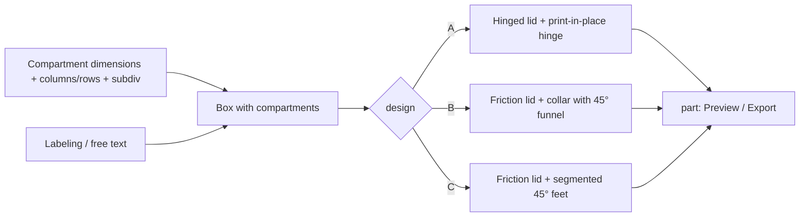

# Parametric Pill Box – Weekly Pill Organizer with Hinged or Friction Lids, Stackable and Labelable

[← All models](../../README.md)

🌐 **English** | [Deutsch](README.de.md)

A parametric pill box for FDM printing: a strip of 1–14 daily compartments,
optionally with print-in-place hinged lids or with loose friction lids, with
two stacking systems, weekday labels and free text – all in the MakerWorld
Customizer, three designs in one file.

> **The model with all print profiles is available exclusively on MakerWorld:**
> 👉 [MakerWorld link: https://makerworld.com/en/models/3120609-ultimate-parametric-pill-box](https://makerworld.com/en/models/3120609-ultimate-parametric-pill-box)
>
> 

The **Parametric Pill Box** generates a box with one compartment per day. With
the first menu, `design`, you choose how the lids work: **A** with one hinged
lid per day and a print-in-place hinge, **B** with loose friction lids and
stacking collars, or **C** with loose friction lids and segmented 45° feet.
Compartment size, subdivision (e.g. morning/noon/evening), labeling and the
printer check apply to all three designs.

## Table of Contents

- [The Problem](#the-problem)
- [The Idea](#the-idea)
- [Highlights](#highlights)
- [Parametric Options](#parametric-options)
- [Design](#design)
- [Print Recommendations](#print-recommendations)
- [Use Cases](#use-cases)
- [Troubleshooting / FAQ](#troubleshooting--faq)
- [Development History](#development-history)
- [Downloads](#downloads)
- [License](#license)

## The Problem

Store-bought weekly organizers have a fixed grid – and rarely the one you
need:

- The compartments are too small for the large capsule or too big for the
  mini tablet.
- You want to separate morning, noon and evening without buying three boxes.
- Thin plastic hinged lids break at the hinge or pop open by themselves.
- A box for two weeks or for four people does not exist – you place several
  next to each other.
- Pills get caught on the edge when you try to pull them out toward the front
  with a finger.

## The Idea

A single model generates boxes from one compartment up to 14 days per strip
and several strips on one plate (`rows`). Width, length and depth of a daily
compartment can be set freely, and each compartment can be divided into up to
four sub-compartments. Because different people like different lids, three lid
concepts live in one file: hinged lids that need no assembly, friction lids
with a stackable collar and friction lids with stackable feet. All dimensions
are in millimeters, all values are Customizer parameters.

## Highlights

- **Three designs in one file:** `Hinged lids`, `Friction + collar stack`
  and `Friction + foot stack`.
- **Print-in-place hinge per day (design A):** Box and lid lie flat and open on
  the bed, without supports; after printing, loosen each lid once.
- **Snap closure:** Tongue-and-groove detent, `latch_grip` sets the click
  force.
- **Stackable (designs B and C):** Collar with 45° funnel or segmented 45° feet
  under each compartment; `stackable` turns stacking off.
- **1–14 days per strip**, up to 6 strips (`rows`) on one plate.
- **Free compartment size:** `day_w`, `day_len`, `well_depth`, up to 4
  sub-compartments (`subdiv`).
- **Ramp for removal:** `front_fillet` rounds only the edge between the
  compartment floor and the front wall, so that pills slide out toward the
  front.
- **Labeling:** Weekdays (DE/EN, 1–3 letters) or numbers, engraved on the
  outside, also raised on the inside for design A; week start Monday or
  Sunday.
- **Free text** (e.g. a name) on the front, back or end face.
- **Multicolor export:** Body, lid and text as separate color groups.
- **Build volume check:** Warning in the console if the flat layout does not fit
  on the print bed.
- **Eight ready-made variants** with Bambu Studio profiles for the P1S.

## Parametric Options

The names correspond to the model's Customizer parameters (as of the model file
of October 11, 2026).

### Design and Output

| Parameter | Meaning | Default | Range / Unit |
|---|---|---|---|
| `design` | `Hinged lids` (A), `Friction + collar stack` (B), `Friction + foot stack` (C) | `Hinged lids` | selection |
| `part` | `Preview closed`, `Preview closed 2-color` (both not printable), `Multicolor Export`, `Single Color Export` | `Preview closed` | selection |
| `preview_angle` | Preview of design A only: opening angle of the lids | 12 | 0–180° |

### Number of Days

| Parameter | Meaning | Default | Range / Unit |
|---|---|---|---|
| `columns` | Days per strip; 7 = one week | 7 | 1–14 |
| `rows` | Strips on the plate; each strip is a separate part | 1 | 1–6 |

### Compartment Size per Day

| Parameter | Meaning | Default | Range / Unit |
|---|---|---|---|
| `day_w` | Inner width of a daily compartment (X) | 22 | 10–60 mm |
| `day_len` | Inner length of a daily compartment (Y) | 30 | 12–90 mm |
| `well_depth` | Inner depth of the compartments (Z) | 16 | 6–45 mm |
| `subdiv` | Compartments per day: 1 = no division, 2 = morning/evening, 3 = morning/noon/evening | 1 | 1–4 |
| `fillet` | Rounding of the vertical corners, the side edges and the back edge of the compartment | 4 | 1–4 mm, step 0.5 |
| `front_fillet` | Rounding of the edge compartment floor → front wall (ramp for removal), never smaller than `fillet`, automatically limited | 8 | 1–20 mm, step 0.5 |

### Closure – Design A

| Parameter | Meaning | Default | Range / Unit |
|---|---|---|---|
| `latch_style` | `None` or `Snap` (tongue-and-groove detent) | `Snap` | selection |
| `latch_grip` | Overlap of rib and groove; larger = firmer click | 0.55 | 0.15–1.2 mm, step 0.05 |

### Friction Lids – Both Stacking Models

| Parameter | Meaning | Default | Range / Unit |
|---|---|---|---|
| `lid_fit` | Clearance per side between lid rim and compartment; smaller = tighter | 0.07 | 0.00–0.40 mm, step 0.01 |
| `lid_skirt` | How deep the lid rim reaches into the compartment | 7 | 3–14 mm, step 0.5 |

### Stacking Collar – Design B

| Parameter | Meaning | Default | Range / Unit |
|---|---|---|---|
| `lift_tab` | Pull tab on the front edge of the lid for lifting it off with a fingernail | `On` | `Off`, `On` |
| `lift_reach` | How far the tab protrudes beyond the front edge of the box | 5 | 0–12 mm, step 0.5 |

### Stacking Feet – Design C

| Parameter | Meaning | Default | Range / Unit |
|---|---|---|---|
| `print_orient` | Print orientation of the export: `Auto`, `Tipped front`, `Opening down`, `Upright` (determines where the bridges lie) | `Auto` | selection |

### Stacking – Both Stacking Models

| Parameter | Meaning | Default | Range / Unit |
|---|---|---|---|
| `stackable` | Make the box stackable; `Off` = box and lid print flat | `On` | `Off`, `On` |
| `stack_preview` | Preview only: how many units are shown stacked | 2 | 1–4 |

### Labeling on the Outside (Engraved)

| Parameter | Meaning | Default | Range / Unit |
|---|---|---|---|
| `label_style` | `None`, `1 Letter`, `2 Letters`, `3 Letters`, `Numbers` | `1 Letter` | selection |
| `label_lang` | Language of the weekdays (inside and outside) | `EN` | `DE`, `EN` |
| `week_start` | Week start | `Monday` | `Monday`, `Sunday` |

### Labeling on the Inside (Raised) – Design A

| Parameter | Meaning | Default | Range / Unit |
|---|---|---|---|
| `inner_emboss` | Raised weekdays on the inside of the lid | `Off` | `Off`, `On` |
| `inner_style` | Style of the inner lettering | `2 Letters` | `1 Letter`, `2 Letters`, `3 Letters`, `Numbers` |
| `inner_height` | Height of the raised lettering | 0.6 | 0.3–1.5 mm, step 0.1 |
| `inner_size` | Font size (0 = automatic, at most 6 mm) | 0 | 0–6 mm, step 0.5 |
| `inner_tab_gap` | Distance from the top edge of the inner lettering to the front edge | 5 | 2–15 mm, step 0.5 |

### Free Text

| Parameter | Meaning | Default | Range / Unit |
|---|---|---|---|
| `front_text` | Free text, engraved once (e.g. a name); empty = none | empty | free text |
| `front_text_size` | Font size (0 = automatic) | 0 | 0–20 mm, step 0.5 |
| `front_text_side` | Surface for the text: `Front`, `Back`, `Left end`, `Right end` | `Front` | selection |

### Printer and Fit

| Parameter | Meaning | Default | Range / Unit |
|---|---|---|---|
| `printer` | Build volume for the check: 180 (A1 mini), 256 (A1/P1S/P2S/X1), 325 (H2C/A2L), 350 (H2D/H2S), unlimited | 256 | selection |
| `hinge_gap` | Hinge clearance (design A); sticks → increase, wobbles → decrease | 0.30 | 0.25–0.60 mm, step 0.01 |

## Design

### OpenSCAD Approach

The model is pure OpenSCAD without external libraries and runs in the
MakerWorld Customizer. The compartments sit in a row (X), the depth lies in Y.
The `design` menu switches between the three lid concepts; compartment sizes,
dividers, labeling and the printer check are shared. A start camera shows
the whole box or the stack centered, depending on the design and preview.

### Parametric Logic

| Quantity | Formula / Rule |
|---|---|
| Strip width (design A) | `columns` · `day_w` + (`columns` + 1) · wall (2.0 mm) |
| Outer dimensions depth / height (design A) | `day_len` + 2 · wall; `well_depth` + floor (1.6 mm) |
| Hinge axis (design A) | height = (box height + lid thickness) / 2; Y = box depth + barrel radius + `hinge_gap` |
| Hinge segments | odd number, the ends belong to the box; barrel Ø 5.0 mm, pin Ø 2.8 mm |
| Wall design B | collar wall (1.8 mm) + ledge (1.2 mm) = 3.0 mm |
| Divider design B | max(1.6 mm; 2 · ledge + lid gap) = 3.0 mm |
| Collar height design B | lid plate (2.6 mm) + recess (2.8 mm) = 5.4 mm above the ledge |
| Stacking spacing design B | collar top edge − 45° chamfer (2.4 mm) |
| Front rounding | at most compartment depth − lid insertion depth − 1 mm |

With the default settings (7 days, 22 × 30 × 16 mm), design A has an outer
width of 170 mm at 34 mm depth and 17.6 mm height. For design B, the footprint
is 178 × 36 mm at a height of 23.0 mm including the collar.

The values are derived from the formulas and the default values.

### Special Algorithms

- **Axis at half height:** A flat lid only covers the top if the hinge axis is
  at half the height of box plus lid. A low axis would fold the lid downward
  (clamshell instead of individual lid). The 180° fold is its own inverse; that
  is why the closure is modeled in the closed position and rotated into the
  print position.
- **Riser encloses the barrel:** The lid segments consist of the barrel and a
  solid block up to the axis center; the pin bore is drilled only afterwards.
  Otherwise a thin contact line remains and the hinge breaks off.
- **Stiffening bar behind the plate:** A bar ties all lid segments into a rigid
  beam and lies behind the back wall when closed, so that it never collides
  with the walls.
- **Chamfer on the folding edge:** A chamfer (`back_relief`, 2.0 mm) sits on the
  rear top edge of the walls. A lid that is collision-free in CAD can catch on
  the sharp edge in the print because of the hinge clearance.
- **Snap with blunt rib:** The detent uses a rib with a flat tip and a matching
  groove. A sharp triangular tip does not print to full height on the 0.4 mm
  nozzle. The lid closes along an arc; the rib must be tall enough that it does
  not immediately slide upward out of the groove when opening.
- **Friction lid with skirt per sub-compartment:** The lid skirt dips into the
  compartment with `lid_fit` clearance. With several sub-compartments there is
  one skirt per sub-compartment, and the clearance is automatically made
  slightly smaller, because small cells consist almost entirely of corner
  radius. A lead-in chamfer at the skirt tip makes fitting easier.
- **Collar with ledge and recessed lids (design B):** The compartments are set
  inward from the outer collar. The top edges of the inner walls form a
  surrounding ledge on which the lids lie, and the lids sit below the top edge
  of the collar. The 45° funnel of the collar receives the 45° chamfer of the
  next box. For stacking to work, the chamfer must be larger than the collar
  wall, and the lids must sit lower than the chamfer is tall.
- **Pull tab with collar notch (design B):** The collar is interrupted over its
  full height at each tab. Otherwise a bar remains above the tab, and the lids
  act like a closed tray.
- **Segmented feet (design C):** Under each compartment sits a 45° foot, and in
  each lid a matching 45° V-groove. Because this applies per compartment,
  stacking works for any number of days, even offset.
- **Ramp at the front only:** `front_fillet` changes only the edge between the
  compartment floor and the front wall; the other roundings stay at `fillet`.
- **Text on side faces:** The text is engraved into the respective face for
  front, back and end faces; the mirroring is chosen per side so that the
  lettering reads the right way around.

### Modularity

The code separates hinge segments, closure, friction lid, collar and feet,
labeling, free text, compartment shapes and the color wrappers for single- and
multicolor output. Shared dimensions (compartments, dividers, labeling, printer
check) apply to all designs. The preview modes have a red "NOT FOR PRINTING"
banner that can be switched off for studio images.

### Print Optimizations

- **Flat and open (design A):** Box and lid lie coplanar on the bed; the hinge
  is movable immediately, without supports.
- **Box upright, lid flat (design B):** The box stands on the floor, the lids
  lie next to it with the skirt facing up. Box and lid are two separate
  objects.
- **No bridged floor:** In design B, the stacking feature sits on the box shell
  instead of the lid, so that no flat pocket floor has to be bridged.
- **Chamfer at the bottom** (0.8 mm) against elephant foot.
- **Wall thicknesses:** wall 2.0 mm, floor 1.6 mm, divider 1.6 mm.

## Print Recommendations

The supplied profiles are created for the **Bambu Lab P1S** with Bambu PLA
Basic and test-sliced in Bambu Studio (0.20 mm layer height, 3 walls, gyroid
15 %). The model can also be printed on the P2S, H2C and other Bambu printers;
`printer` checks the build volume.

| Setting | Recommendation |
|---|---|
| Material | PLA (profiles); PETG is tougher at the hinge |
| Layer height | 0.16–0.20 mm; finer = smoother-running hinge |
| Walls | 2–3 recommended; the profiles use 3 |
| Infill | 15–20 % |
| Supports | none |
| Orientation | as exported: flat (design A) or box upright and lid flat (design B) |
| Hinge clearance (`hinge_gap`) | default 0.30 mm; sticks → increase, wobbles → decrease |
| Lid clearance (`lid_fit`) | default 0.07 mm per side; 0.00 for a press fit, 0.10–0.15 if too tight |
| Bridges (design C, lid groove) | PLA: bridge flow 1.5, 25 mm/s; PETG: 1.4, 15 mm/s; 45°; fan approx. 100 % |

**Special notes**

- **Design A:** After printing, carefully move each lid once so that the hinge
  breaks free.
- Separate profiles with several parts on one plate in Bambu Studio by
  right-clicking **Split to objects** (except for design B, whose export
  already delivers separate objects).
- **Multicolor export** (`Multicolor Export`): export the STL **directly from
  the OpenSCAD preview**, without F6/Render and without the command line –
  otherwise all color groups are merged into one body.
- Preview modes are intentionally not printable.
- The notes on bridges come from my own print tests with the groove variant;
  they depend on printer and material.

### Ready-Made Variants

All profiles for the P1S with Bambu PLA Basic, gyroid 15 %.

| Variant | Design | Content |
|---|---|---|
| `woche_7tage` | A | 7 days, one compartment per day |
| `woche_3fach` | A | 7 days, 3 sub-compartments per day |
| `zwei_wochen` | A | 2 strips of 7 days |
| `stackable-1week` | friction lid | 7 days, stackable |
| `stackable-2weeks` | friction lid | 2 strips of 7 days, stackable |
| `stackable-7day-3slots` | friction lid | 7 days, 3 sub-compartments, `day_len` 60 mm |
| `stackable-7day-2slots-pills` | friction lid | 7 days, 2 sub-compartments, compartment 30 × 35 × 18 mm, text "PILLS" on the right end face |
| `nonstackable-1week` | friction lid | 7 days, not stackable |

The friction-lid variants were created with an earlier version of the model
file (menu entry "Friction + stack"); designs B and C in the current version
build on it.

## Use Cases

- **Weekly organizer:** 7 days with weekdays on the lids, in German or English
  as desired.
- **Morning, noon, evening:** `subdiv = 3` divides each day into three
  compartments.
- **Two or four weeks:** several strips via `rows`.
- **Large capsules or supplements:** Adjust compartment dimensions via `day_w`,
  `day_len` and `well_depth`.
- **Travel box for a few days:** Set `columns` to 3 or 5.
- **Boxes for the family:** Names via free text on the front or end face.
- **Space-saving stacking:** Design B or C, with collar or feet depending on
  taste.
- **Multicolor box:** Body, lid and text in different colors via
  `Multicolor Export`.
- **Small-parts organizer:** Screws or jewelry instead of pills.

## Troubleshooting / FAQ

| Symptom | Cause | Fix |
|---|---|---|
| Lid (design A) sticks or cannot be opened | Hinge clearance too small | increase `hinge_gap` |
| Lid (design A) wobbles | Hinge clearance too large | decrease `hinge_gap` |
| Lid does not close fully, stays open a few degrees | Contact at the rear wall edge due to print inaccuracy | enlarge the chamfer on the folding edge (`back_relief`, in the code); if necessary, bevel the edge with sandpaper |
| Snap does not engage or does not hold | Detent too weak | increase `latch_grip` |
| Friction lid falls out | Clearance too large | decrease `lid_fit` (down to 0.00) |
| Friction lid sits too tight | Clearance too small | increase `lid_fit` to 0.10–0.15 |
| Lid hard to lift off (design B) | no pull tab | set `lift_tab` to `On`, adjust `lift_reach` |
| Boxes cannot be stacked | `stackable` off | set `stackable` to `On` |
| Pills get stuck on the front edge | Ramp too small | increase `front_fillet` |
| Flat layout does not fit on the bed | too many days or strips | decrease `columns`/`rows` or choose a larger printer; the console shows a warning |
| Two-color STL has only one color | Export via F6/Render or command line | export the STL directly from the preview |
| Preview shows "NOT FOR PRINTING" | Preview mode active | set `part` to `Single Color Export` or `Multicolor Export` |
| Text is not on the desired side | `front_text_side` wrong | choose the side; with the friction designs, the front carries the weekdays |

## Development History

The first files date from July 31, 2026. A reference box (STEP/STL) served as
the model; I broke down its hinge with OCP into barrel, pin and segment
pattern. This yielded the axis at half height and the print-in-place
principle.

The first test print on August 1, 2026 revealed two errors: The stiffening bar
rammed the walls, and the snap closure barely made contact. Both were fixed
with a narrower bar and a rearranged detent, respectively, and later revised
again with the help of an arc analysis. On August 3, the raised inner lettering
was added, and on August 4 the first print profiles were created.

On August 9 came the second design with loose friction lids and front
labeling; floating lids in the flat layout were fixed. On August 10 and 11, stacking was
reworked: away from a groove in the lid that had to bridge during printing,
toward a collar with a ledge and recessed lids on the box. On August 17, the
free text could also be placed on any side for the hinged design.

On October 11, 2026, the three designs were merged into one file and the
`front_fillet` setting was added – following feedback from the community that
pills get stuck on the front edge.

The images in this repository are renderings of the model geometry or scene
images derived from it; one photo shows a real test piece.

## Downloads

Print files are intentionally available exclusively on MakerWorld.

👉 MakerWorld link: https://makerworld.com/en/models/3120609-ultimate-parametric-pill-box

Profile: <https://makerworld.com/en/@BetaHydri>

## License

Documentation and images in this repository: © BetaHydri. The model (including
source code) and all print files are distributed exclusively via MakerWorld
under the license stated there. This repository intentionally contains no
model, source code or print files. Model and print files are distributed
exclusively via MakerWorld.
