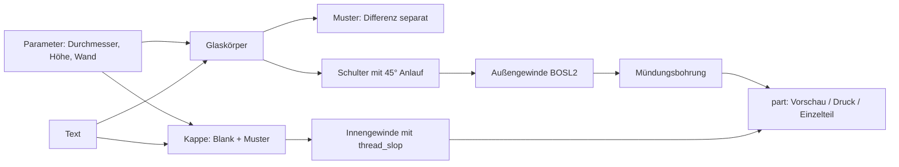

# Parametric Screw-Top Jar

[← Alle Modelle im Überblick](../../README.de.md)

🌐 [English](README.md) | **Deutsch**

Parametrisches Schraubglas mit echtem, gedrucktem Trapezgewinde: Die Kappe wird von außen über den Hals gedreht, Größe, Muster und Beschriftung stellst du im Customizer ein.

> **Das Modell mit allen Druckprofilen gibt es ausschließlich auf MakerWorld:**
> 👉 [MakerWorld-Link: https://makerworld.com/en/models/3243358-parametric-screw-top-jar-options-color-and-text](https://makerworld.com/en/models/3243358-parametric-screw-top-jar-options-color-and-text)
>
> 

Das **Parametric Screw-Top Jar** ist ein rundes Vorratsglas aus zwei Teilen: Glas und Schraubkappe. Das Gewinde ist ein grobes Trapezgewinde (BOSL2 `threaded_rod`), das etwa drei Umdrehungen weit greift und sich von Hand leicht drehen lässt. Glas und Kappe haben je ein eigenes Oberflächenmuster (neun Stück zur Auswahl), und auf Glaswand und Kappendeckel lässt sich ein Wort gravieren. Beide Teile drucken ohne Stützen.

## Inhaltsverzeichnis

- [Das Problem](#das-problem)
- [Die Idee](#die-idee)
- [Highlights](#highlights)
- [Parametrische Optionen](#parametrische-optionen)
- [Konstruktion](#konstruktion)
- [Druckempfehlungen](#druckempfehlungen)
- [Anwendungsbeispiele](#anwendungsbeispiele)
- [Fehlersuche / FAQ](#fehlersuche--faq)
- [Entwicklungsgeschichte](#entwicklungsgeschichte)
- [Downloads](#downloads)
- [Lizenz](#lizenz)

## Das Problem

Vorratsdosen aus dem 3D-Drucker scheitern meist am Deckel. Ein Reibsitz hängt direkt an der Maßhaltigkeit des Druckers: Ist er zu stramm, bekommst du die Kappe kaum ab, ist er zu locker, fällt sie herunter. Ein Gewinde löst das Greifen mechanisch, bringt aber eigene Fallstricke mit:

- Ein Gewinde braucht ein definiertes Spiel zwischen Innen- und Außengewinde. Das passende Maß hängt von Drucker, Düse und Material ab.
- Feine Gewinde (1 mm Steigung und weniger) drucken schlecht und werden schnell schwergängig. Grob und robust ist für Handschrauben besser.
- Jeder Behälter soll ein anderes Maß haben: eine kleine Gewürzdose, ein hohes Mehlglas, ein breites Nudelglas.
- Oberflächenmuster und Beschriftung sind bei gedruckten Dosen gewünscht, treiben aber schnell die Dateigröße und die Rechenzeit hoch, wenn man sie naiv modelliert.

## Die Idee

Das Modell leitet das ganze Glas aus wenigen Parametern ab. Das Gewinde sitzt **mit vollem Körperdurchmesser oben auf dem Glas** (auf einer Schulter, dem „Lip"), die Kappe ist nur wenige Millimeter breiter als der Körper und trägt das passende Innengewinde. Beim Zuschrauben setzt der Kappenrand plan auf der Schulter auf. Das Spiel zwischen den Gewinden ist ein eigener Regler (`thread_slop`), damit du es auf deinen Drucker abstimmen kannst.

Die Konstruktion lehnt sich an das Gewindekonzept des öffentlichen MakerWorld-Modells „Customizable jar" an, das ebenfalls BOSL2 `threaded_rod` nutzt. Die Oberflächenmuster, die Beschriftung und die Druckoptimierungen stammen aus eigener Entwicklung.

## Highlights

- **Echtes Schraubgewinde:** grobes Trapezgewinde (Standard: 2,8 mm Steigung, 3 Umdrehungen = 8,4 mm Gewindehöhe), von Hand ein- und ausdrehbar.
- **Gewinde mit vollem Körperdurchmesser:** das Glas hat keinen schmalen Hals, die Kappe setzt auf einer Schulter auf.
- **Stützenfrei:** das Glas steht auf dem flachen Boden, die Kappe druckt mit der Deckelplatte nach unten. Die Unterseite der Schulter läuft in 45° aus, damit sie selbsttragend druckt.
- **Neun Oberflächenmuster**, getrennt wählbar für Glas und Kappe: glatt, V-Rillen, runde Rillen, rechteckige Nuten, horizontale Ringe, 45°-Diagonale, Kreuzschraffur, Noppen, Facetten.
- **Kappe mit Griffprofil:** Rändel (Rippen) oder dasselbe Muster wie das Glas.
- **Beschriftung:** ein Wort um die Glaswand (Buchstabe für Buchstabe auf dem Bogen) und ein Wort auf dem Kappendeckel, graviert. Die Schrift bleibt bei jedem Muster lesbar.
- **Zweifarb-fähig:** der Multicolor-Export trennt Glas, Kappe und Beschriftung in Farbgruppen. Die Beschriftung bekommt die Farbe des jeweils anderen Teils.
- **Beliebige Größe:** Durchmesser 30–200 mm, Höhe 30–300 mm.
- **Sechs fertige Varianten** (Kaffee, Zucker, Tee, Mehl, Gewürze, Nudeln) mit Bambu-Studio-Profilen für P1S und Bambu PLA Basic.

## Parametrische Optionen

Die Namen entsprechen den Customizer-Parametern des Modells.

### Teil und Ansicht

| Parameter | Bedeutung | Standard | Bereich / Einheit |
|---|---|---|---|
| `part` | Ausgabe: `Preview assembled` (Kappe aufgeschraubt) und `Preview open` (Kappe daneben) sind nur Anzeige und nicht druckbar; `both` (Glas + Kappe, druckfertig), `Multicolor Export` (zweifarbig), `body` (nur Glas), `lid` (nur Kappe) | `Preview open` | Auswahl |

Beide Vorschau-Modi zeigen ein rotes „NOT FOR PRINTING"-Banner.

### Außenmaße, Wand und Boden

| Parameter | Bedeutung | Standard | Bereich / Einheit |
|---|---|---|---|
| `diameter` | Außendurchmesser des Glases | 80 | 30–200 mm |
| `height` | Höhe des Glaskörpers bis zur Gewindeschulter | 100 | 30–300 mm |
| `wall` | Wandstärke des Glases | 2,4 | 2,0–6,0 mm |
| `floor_t` | Bodenstärke | 2,4 | 2,0–6,0 mm |

### Gewinde und Kappe

| Parameter | Bedeutung | Standard | Bereich / Einheit |
|---|---|---|---|
| `thread_pitch` | Gewindesteigung; größer = gröber, schneller zu drehen | 2,8 | 1,5–4 mm |
| `thread_turns` | Zahl der Gewindegänge im Eingriff; Gewindehöhe = Umdrehungen × Steigung | 3 | 2–6 (Schritt 0,5) |
| `thread_slop` | Druckspiel zwischen Innen- und Außengewinde (BOSL2 `$slop`); größer = lockerer | 0,12 | 0,05–0,30 mm |
| `lid_tolerance` | Zusätzlicher Durchmesser am Kappen-Innengewinde | 0,1 | 0–1,0 mm |
| `cap_wall` | Wandstärke der Kappe um das Gewinde | 2,2 | 1,6–6,0 mm |
| `cap_top` | Stärke der Kappen-Deckelplatte | 2,4 | 2,0–6,0 mm |
| `lip_height` | Höhe der Schulter unter dem Gewinde, auf der der Kappenrand aufsitzt | 3,5 | 2–8 mm |
| `lip_flange` | Wie weit die Schulter über die geschlossene Kappe übersteht | 1,0 | 0–4 mm |
| `lip_round` | Verrundung der oberen Außenkante der Schulter | 1,0 | 0–2 mm |

### Muster auf dem Glas

| Parameter | Bedeutung | Standard | Bereich / Einheit |
|---|---|---|---|
| `pattern` | Oberflächenmuster der Glaswand: `none`, `grooves_v`, `grooves_round`, `grooves_rect`, `rings`, `diagonal`, `crosshatch`, `dimples`, `facets` | `none` | Auswahl |
| `pattern_count` | Zahl der Musterelemente am Umfang (Rillen; bei Ringen und Noppen nur indirekt) | 60 | 4–500 |
| `pattern_depth` | Tiefe des Musters in die Wand | 0,6 | 0,2–1,5 mm |
| `pattern_width` | Breite eines Musterelements; bei Noppen der Noppenradius | 1,4 | 0,5–5,0 mm |
| `facet_width` | Ziel-Breite einer Facette (nur bei `facets`); kleiner = mehr Facetten | 10 | 4–30 mm |
| `pattern_fade` | Rillen und Ringe enden so weit vor Hals und Boden (glattes Band) | 8 | 0–25 mm |

### Muster auf der Kappe

| Parameter | Bedeutung | Standard | Bereich / Einheit |
|---|---|---|---|
| `cap_pattern` | `match` (wie Glas), `grip` (Rändel) oder eines der Glasmuster | `match` | Auswahl |
| `cap_grip_count` | Zahl der Rändelrippen (nur bei `grip`) | 36 | 12–90 |
| `cap_grip_depth` | Rippenradius (nur bei `grip`) | 0,9 | 0,3–2,0 mm |

### Beschriftung

| Parameter | Bedeutung | Standard | Bereich / Einheit |
|---|---|---|---|
| `body_text_enabled` | Text auf der Glaswand | 0 | 0 / 1 |
| `body_text` | Text für die Glaswand | `TEXT` | frei |
| `body_text_size` | Schriftgröße; 0 = automatisch | 0 | 0–40 mm |
| `body_text_depth` | Gravurtiefe | 0,8 | 0,3–1,5 mm |
| `body_text_angle` | Winkelposition um das Glas (0 = +X) | 0 | 0–355° |
| `body_text_vpos` | Höhenlage: `Top`, `Middle`, `Bottom` | `Middle` | Auswahl |
| `body_text_z` | Exakte Höhe der Textmitte über dem Boden; 0 = `body_text_vpos` gilt | 0 | 0–300 mm |
| `text_panel_margin` | Freiraum rund um den Text, in dem das Muster ausgespart bleibt | 2 | 0–12 mm |
| `lid_text_enabled` | Text auf dem Kappendeckel | 0 | 0 / 1 |
| `lid_text` | Text für die Kappe | `TOP` | frei |
| `lid_text_size` | Schriftgröße; 0 = automatisch | 0 | 0–40 mm |
| `lid_text_depth` | Gravurtiefe | 0,6 | 0,3–1,5 mm |

### Qualität

| Parameter | Bedeutung | Standard | Bereich / Einheit |
|---|---|---|---|
| `round_res` | Auflösung der Rundungen (`$fn`) | 96 | 48–180 (Schritt 8) |
| `thread_res` | Segmente je Gewindeumdrehung; niedriger = deutlich schneller | 48 | 24–96 (Schritt 8) |

## Konstruktion

### OpenSCAD-Ansatz

Das Modell ist eine reine OpenSCAD-Konstruktion mit einer Bibliothek: BOSL2 liefert den Gewindekörper `threaded_rod`. Alle Maße stehen als benannte Parameter am Anfang, die Customizer-Gruppen entsprechen den Abschnitten oben. Ein `part`-Selektor am Ende entscheidet, ob eine Vorschau, ein Druck-Layout oder ein Einzelteil ausgegeben wird.

### Parametrische Logik

Aus den Eingaben werden die effektiven Maße abgeleitet. Die Tabelle zeigt die Formeln und die Werte für die Standardeinstellungen.

| Größe | Formel / Regel | Standardwert |
|---|---|---|
| Gewindehöhe | `max(2, thread_turns) × thread_pitch` | 8,4 mm |
| Außenradius Glas | `diameter / 2` (mindestens `2 × wall + 20` Durchmesser) | 40 mm |
| Mündungsradius | `max(6, Außenradius − wall − (0,8 + pattern_depth) / 2)` | 36,9 mm |
| Schulter-Außenradius | Kappenradius + `lip_flange` | 43,25 mm |
| Kappenradius außen | Außenradius + `lid_tolerance / 2` + `cap_wall` | 42,25 mm |
| Nennradius Innengewinde | Außenradius + (`lid_tolerance` + 1) / 2 | 40,55 mm |
| Kappenhöhe | `cap_top` + Gewindehöhe + 2 mm Auslauf | 12,8 mm |
| Gesamthöhe Glas | `height` + `lip_height` + Gewindehöhe | 111,9 mm |
| Mittenabstand im Druck-Layout | `diameter + 20` | 100 mm |

Die Breite des Druck-Layouts `both` beträgt damit bei den Standardmaßen etwa 185 mm (Schulter links bis Kappe rechts). Es passt auf ein 256-mm-Bett; bei großen Durchmessern musst du selbst prüfen, ob das Layout auf deinen Drucker passt.

### Besondere Algorithmen

- **Gewinde mit vollem Durchmesser auf einer Schulter:** Das Außengewinde sitzt mit dem Körperdurchmesser auf der Schulter, die Kappe hat das Innengewinde (`internal = true`) mit zusätzlichem Spiel. Der Kappenrand setzt plan auf der Schulteroberseite auf.
- **Schulter mit 45°-Anlauf:** Die Unterseite der Schulter läuft in 45° aus der Wand aus und druckt selbsttragend. Die Oberseite bleibt flach (Auflage für die Kappe), nur die obere Außenkante wird verrundet. Die Wurzel des Anlaufs wird separat aufgefüllt, damit sie bündig mit der Wand bleibt.
- **Muster als eigene Differenz:** Die vielen Rillen- und Noppenkörper werden getrennt vom Gewindekörper von der Wand abgezogen. Dasselbe Konstrukt in einer einzigen Differenz sprengte den Rechenbaum der OpenCSG-Vorschau und von MakerWorld.
- **Rillen ohne Verjüngung:** Vertikale Rillen sind ein einziger flacher Extrusionskörper über das Band zwischen den Fade-Rändern. Eine Verjüngung zur Spitze erzeugte entartete Spitzen, aus denen der Manifold-Renderer Millionen Facetten machte (Dateien im dreistelligen Megabyte-Bereich).
- **Facetten per Schnitt:** Das Facettenmuster ist ein Schnitt des Zylinders mit einem Polygonprisma, kein Abzug. Es kann die Wand deshalb nicht durchschneiden. Die Facettenzahl folgt aus `max(6, round(2πr / facet_width))`, bei Ø 84 mm und 10 mm Breite also 26.
- **Noppen mit Obergrenze:** Die Noppenzahl richtet sich nach Größe und ist auf etwa 300 Kugeln begrenzt, unabhängig von `pattern_count`. Die Kugeln werden zuerst vereinigt und dann in einem Schritt abgezogen.
- **Diagonale per Helix:** Diagonale Rillen sind verdrehte Extrusionen mit Verdrehwinkel `(57,29578 / r) × Höhe`, ergeben also 45° am Außenradius. Kreuzschraffur nutzt beide Drehrichtungen.
- **Beschriftung auf dem Bogen:** Jeder Buchstabe wird einzeln gedreht und radial eingraviert. Der Textbogen ist auf 90° begrenzt, die Schriftgröße passt sich automatisch an. Bei Mustern bleibt eine glatte Tafel um den Text frei; bei Facetten wird die Wand im Textfenster rund aufgefüllt, damit die Glyphen nicht über Facettenkanten laufen.
- **Kappenmuster mit Tiefenbegrenzung:** Die Mustertiefe auf der Kappe ist auf Kappenwand minus 0,8 mm begrenzt, damit die dünne Wand erhalten bleibt.

### Modularität

Das Modell ist in Bausteine zerlegt: Glaskörper, Schulter, Kappe, Rändel, die Muster-Bibliothek (Rillen, Ringe, Helix, Noppen, Facetten), Textbausteine für Wand und Kappe sowie farbige Wrapper für die Zweifarb-Ausgabe. Das gemeinsame Muster-Modul wird für Glas und Kappe verwendet und bekommt Radius, Band, Zahl, Breite und Tiefe als Argumente.

### Druckoptimierungen

- **Glas stehend, Kappe verkehrt:** Das Glas steht mit flachem Boden auf dem Bett, die Mündung zeigt nach oben. Die Kappe liegt mit der Deckelplatte auf dem Bett, die Öffnung zeigt nach oben. Beides braucht keine Stützen.
- **Bodenfase:** `bottom_chamfer` (Standard 0,6 mm) nimmt dem Elefantenfuß die Wirkung.
- **Gewindeauflösung getrennt:** `thread_res` ist unabhängig von `round_res`, weil das Gewinde den größten Teil der Rechenzeit ausmacht.
- **Wandreserve beim Muster:** Die Mustertiefe wird so begrenzt, dass mindestens 0,8 mm Wand bleiben.

## Druckempfehlungen

Die mitgelieferten Profile sind für **Bambu Lab P1S** mit **Bambu PLA Basic** erstellt und im Bambu Studio testgeslict. Das Modell selbst nennt P1S, P2S und H2C als geeignete Drucker.

| Einstellung | Empfehlung |
|---|---|
| Material | PLA (trockene Innenanwendung); PETG für Küche, Wärme oder zähere Haptik |
| Layerhöhe | 0,20 mm |
| Wände | 3 |
| Infill | 15 % Gyroid |
| Supports | keine |
| Ausrichtung | Glas stehend (Mündung oben); Kappe mit der Deckelplatte nach unten |
| Gewindespiel | `thread_slop` 0,12 mm als Startwert |

**Besondere Hinweise**

- Zuerst mit den Standardwerten drucken und die Passung prüfen, dann erst Größe und Muster ändern.
- Kappe zu stramm: `thread_slop` auf etwa 0,15 mm erhöhen. Kappe zu locker: senken. Zusätzlich lässt sich `lid_tolerance` nachziehen.
- Zweifarbdruck: In MakerWorld den Parametric Maker nutzen (siehe FAQ).

## Anwendungsbeispiele

- **Küchenvorrat:** Kaffee, Zucker, Tee, Mehl, Nudeln und Gewürze, jeweils mit passendem Wort an der Glaswand. Das sind die sechs mitgelieferten Varianten.
- **Werkstatt und Elektronik:** Schrauben, Muttern, Kabelbinder und Kleinteile in beschrifteten Gläsern mit eigenem Durchmesser.
- **Bastelkram:** Perlen, Knöpfe, Pailletten; mit Rändelkappe lässt sich die Kappe auch mit trockenen Fingern drehen.
- **Homelab:** Gläser für Patchkabel-Kleinteile, SD-Karten, Rack-Schrauben und Käfigmuttern.
- **Gartenbedarf:** Saatgut in beschrifteten Gläsern, das Glas in der Wunschgröße.
- **Zweifarb-Etiketten:** Glas hell, Kappe und Schrift in Kontrastfarbe.
- **Größenstaffel:** Mehrere Gläser mit demselben Gewinde und unterschiedlicher Höhe für ein einheitliches Regalbild.

## Fehlersuche / FAQ

| Symptom | Ursache | Fix |
|---|---|---|
| Kappe lässt sich nicht aufschrauben | Gewindespiel für Drucker oder Material zu klein | `thread_slop` auf etwa 0,15 mm erhöhen, ggf. `lid_tolerance` erhöhen |
| Kappe wackelt oder dreht durch | Gewindespiel zu groß | `thread_slop` senken, ggf. `lid_tolerance` verringern |
| Kappe schließt nicht plan ab | Schulter zu niedrig oder Gewinde zu kurz | `lip_height` oder `thread_turns` anpassen |
| Muster reicht nicht bis zum Hals oder Boden | `pattern_fade` hält die Randbänder glatt | `pattern_fade` verkleinern (0 = bis zum Rand) |
| Muster bricht vor dem Text ab | gewollt: glatte Tafel um die Schrift | `text_panel_margin` verkleinern |
| Datei riesig, Vorschau extrem langsam bei `diagonal` oder `crosshatch` | verdrehte außermittige Rillen erzeugen sehr viele Facetten | `pattern_count` niedrig halten oder ein anderes Muster wählen, z. B. `grooves_rect` |
| Vorschau oder Export langsam | hohe Auflösung | `round_res` und `thread_res` senken (Standard 96 und 48) |
| Zweifarbiger 3MF verliert Farben in Bambu Studio | Roh-Farben aus OpenSCAD übernimmt Bambu Studio nicht („invalid config, load geometry only") | den Parametric Maker auf MakerWorld nutzen, er erzeugt Bambu-Farbdaten |
| Lokales OpenSCAD meldet fehlendes `BOSL2` | die Bibliothek ist nicht installiert | BOSL2 in den OpenSCAD-`libraries`-Ordner klonen; auf MakerWorld ist sie vorhanden |
| Text nur teilweise lesbar auf Facetten | Textfenster liegt über Facettenkanten | der Text wird automatisch auf einer runden Fläche graviert; Größe oder Position über `body_text_size` und `body_text_vpos` anpassen |

## Entwicklungsgeschichte

Das Schraubglas ist aus einem runden Gefäß-Modell mit Reibdeckel entstanden. Der Reibdeckel wurde durch ein Gewinde ersetzt, die Beschriftung für Wand und Deckel sowie eine Mustersammlung wurden übernommen und erweitert.

Das Gewinde ging durch zwei Stufen: Zuerst ein selbst gebautes, grobes Trapezgewinde mit schmalem, abgesetztem Hals. Danach wurde es durch die Architektur mit BOSL2 `threaded_rod` ersetzt (Gewinde mit vollem Körperdurchmesser auf einer Schulter, Kappe als schlanker Zylinder), angelehnt an ein öffentliches MakerWorld-Glas.

Später gab es mehrere Korrekturen, jeweils belegt in der Entwicklung:

- Der Rechenbaum der Vorschau war zu groß geworden, als Muster und Gewinde in einer Differenz standen. Seitdem ist die Musterdifferenz getrennt.
- Das Facettenmuster fraß als subtraktives Muster die Wand durch („die Wand verschwindet"). Es wurde auf einen Schnitt mit einem Polygonprisma umgestellt.
- Das Rillenmuster mit Verjüngung erzeugte Millionen Facetten und 48-MB-3MF-Dateien. Der flache Extrusionskörper ersetzte es.
- Die Schulterunterseite war zunächst ein waagerechter Überhang. Sie wurde als 45°-Anlauf mit verrundeter Oberkante neu gebaut.
- Beim Zweifarbdruck übernahm Bambu Studio die Farben der OpenSCAD-3MF nicht. Der Weg über MakerWorld Parametric Maker liefert Bambu-Farbdaten.

Die sechs Varianten (Kaffee, Zucker, Tee, Mehl, Gewürze, Nudeln) entstanden am 31. August 2026.

| Variante | Maße (Ø × H) | Glasmuster | Kappe | Text |
|---|---|---|---|---|
| Kaffee (`v1_coffee_smooth`) | 84 × 120 mm | glatt | Rändel | Glas und Kappe: COFFEE |
| Zucker (`v2_sugar_dimples`) | 84 × 95 mm | Noppen | wie Glas | Glas unten: SUGAR |
| Tee (`v3_tea_facets`) | 84 × 110 mm | Facetten (10 mm) | Facetten | Glas oben und Kappe: TEA |
| Mehl (`v4_flour_grooves`) | 90 × 130 mm | runde Rillen | wie Glas | Glas: FLOUR |
| Gewürze (`v5_spice_rings`) | 70 × 120 mm | Ringe | Rändel | Glas unten und Kappe: SPICE |
| Nudeln (`v6_pasta_ribs`) | 95 × 150 mm | rechteckige Nuten (44, 3 mm) | wie Glas | Glas oben: PASTA |

Die Bilder in diesem Repository sind Visualisierungen auf Basis der Modellgeometrie.

## Downloads

Print files are intentionally available exclusively on MakerWorld.

👉 MakerWorld-Link: https://makerworld.com/en/models/3243358-parametric-screw-top-jar-options-color-and-text

Profil: <https://makerworld.com/en/@BetaHydri>

## Lizenz

Dokumentation und Bilder in diesem Repository: © BetaHydri. Das Modell (inkl. Quellcode) und alle Druckdateien werden ausschließlich über MakerWorld unter der dort angegebenen Lizenz verteilt. Dieses Repository enthält bewusst keine Modell-, Quellcode- oder Druckdateien.
