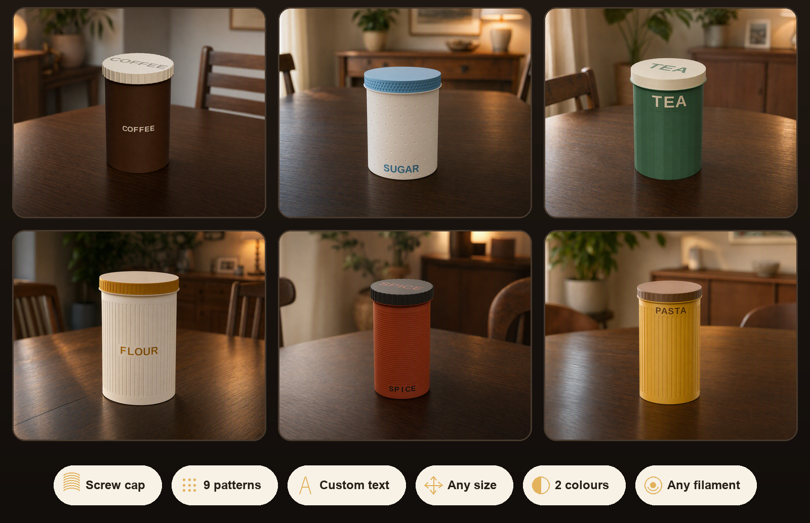
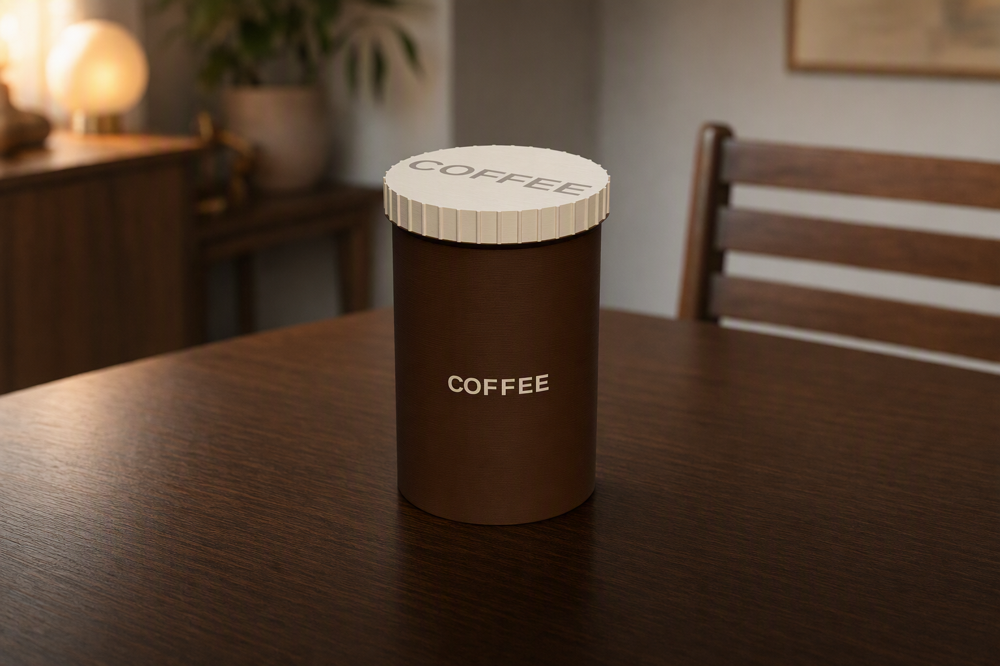
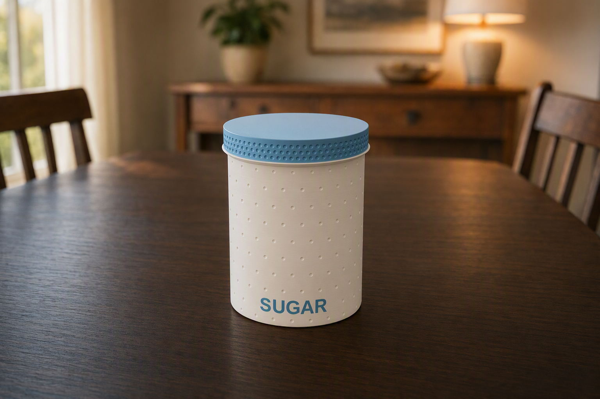
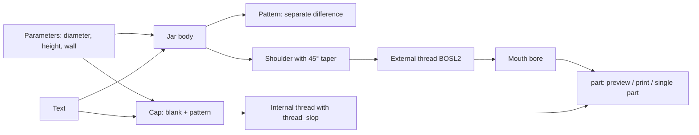
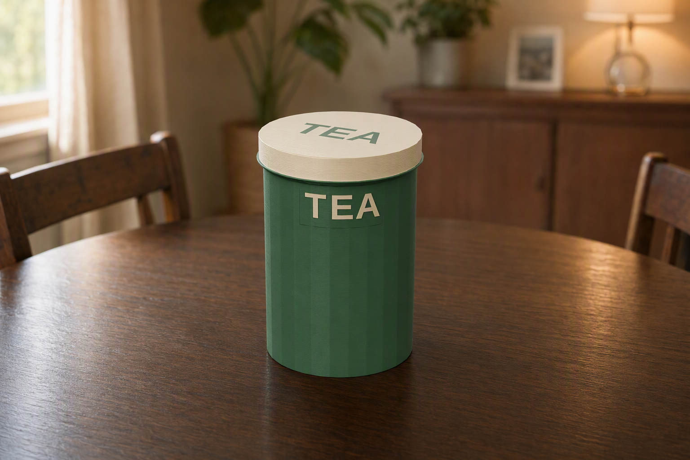
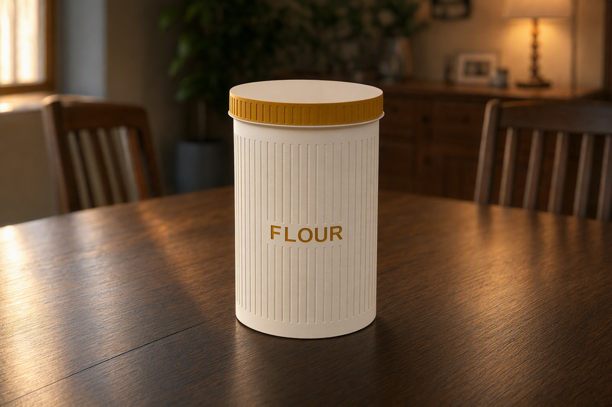
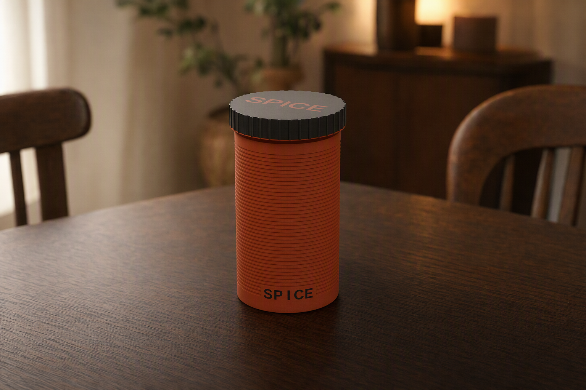

# Parametric Screw-Top Jar

[← All models](../../README.md)

🌐 **English** | [Deutsch](README.de.md)

A parametric screw-top jar with a real printed trapezoidal thread: the cap is turned onto the neck from the outside, and you set size, pattern and lettering in the Customizer.

> **The model with all print profiles is available exclusively on MakerWorld:**
> 👉 [MakerWorld link: https://makerworld.com/en/models/3243358-parametric-screw-top-jar-options-color-and-text](https://makerworld.com/en/models/3243358-parametric-screw-top-jar-options-color-and-text)
>
> 

The **Parametric Screw-Top Jar** is a round storage jar made of two parts: jar and screw cap. The thread is a coarse trapezoidal thread (BOSL2 `threaded_rod`) that engages about three turns and turns easily by hand. Jar and cap each have their own surface pattern (nine to choose from), and a word can be engraved on the jar wall and the cap lid. Both parts print without supports.

## Table of Contents

- [The Problem](#the-problem)
- [The Idea](#the-idea)
- [Highlights](#highlights)
- [Parametric Options](#parametric-options)
- [Design](#design)
- [Print Recommendations](#print-recommendations)
- [Use Cases](#use-cases)
- [Troubleshooting / FAQ](#troubleshooting--faq)
- [Development History](#development-history)
- [Downloads](#downloads)
- [License](#license)

## The Problem

Storage containers from the 3D printer mostly fail at the lid. A friction fit depends directly on the dimensional accuracy of the printer: if it is too tight, you can hardly get the cap off; if it is too loose, it falls off. A thread solves the gripping mechanically, but brings its own pitfalls:

- A thread needs a defined clearance between internal and external thread. The right amount depends on printer, nozzle and material.
- Fine threads (1 mm pitch and less) print poorly and quickly become stiff. Coarse and robust is better for hand-turned threads.
- Every container should have a different size: a small spice jar, a tall flour jar, a wide pasta jar.
- Surface patterns and lettering are desirable on printed containers, but quickly drive up file size and computation time if modeled naively.

## The Idea

The model derives the entire jar from a few parameters. The thread sits **at full body diameter on top of the jar** (on a shoulder, the "lip"), the cap is only a few millimeters wider than the body and carries the matching internal thread. When screwing it on, the cap rim sits flat on the shoulder. The clearance between the threads is a control of its own (`thread_slop`), so that you can tune it to your printer.

The design is inspired by the thread concept of the public MakerWorld model "Customizable jar", which also uses BOSL2 `threaded_rod`. The surface patterns, the lettering and the print optimizations are my own development.

## Highlights

- **Real screw thread:** coarse trapezoidal thread (default: 2.8 mm pitch, 3 turns = 8.4 mm thread height), can be screwed on and off by hand.
- **Thread at full body diameter:** the jar has no narrow neck; the cap sits on a shoulder.
- **Support-free:** the jar stands on its flat bottom, the cap prints with the lid plate facing down. The underside of the shoulder tapers out at 45° so that it prints self-supporting.
- **Nine surface patterns**, selectable separately for jar and cap: smooth, V-grooves, round grooves, rectangular grooves, horizontal rings, 45° diagonal, crosshatch, dimples, facets.
- **Cap with grip profile:** knurling (ribs) or the same pattern as the jar.
- **Lettering:** one word around the jar wall (letter by letter along the arc) and one word on the cap lid, engraved. The lettering stays legible with every pattern.
- **Two-color capable:** the multicolor export separates jar, cap and lettering into color groups. The lettering gets the color of the other part.
- **Any size:** diameter 30–200 mm, height 30–300 mm.
- **Six ready-made variants** (coffee, sugar, tea, flour, spices, pasta) with Bambu Studio profiles for the P1S and Bambu PLA Basic.

## Parametric Options

The names correspond to the model's Customizer parameters.

### Part and View

| Parameter | Meaning | Default | Range / Unit |
|---|---|---|---|
| `part` | Output: `Preview assembled` (cap screwed on) and `Preview open` (cap beside it) are display only and not printable; `both` (jar + cap, print-ready), `Multicolor Export` (two-color), `body` (jar only), `lid` (cap only) | `Preview open` | selection |

Both preview modes show a red "NOT FOR PRINTING" banner.

### Outer Dimensions, Wall and Floor

| Parameter | Meaning | Default | Range / Unit |
|---|---|---|---|
| `diameter` | Outer diameter of the jar | 80 | 30–200 mm |
| `height` | Height of the jar body up to the thread shoulder | 100 | 30–300 mm |
| `wall` | Wall thickness of the jar | 2.4 | 2.0–6.0 mm |
| `floor_t` | Floor thickness | 2.4 | 2.0–6.0 mm |

### Thread and Cap

| Parameter | Meaning | Default | Range / Unit |
|---|---|---|---|
| `thread_pitch` | Thread pitch; larger = coarser, quicker to turn | 2.8 | 1.5–4 mm |
| `thread_turns` | Number of thread turns in engagement; thread height = turns × pitch | 3 | 2–6 (step 0.5) |
| `thread_slop` | Print clearance between internal and external thread (BOSL2 `$slop`); larger = looser | 0.12 | 0.05–0.30 mm |
| `lid_tolerance` | Additional diameter on the cap's internal thread | 0.1 | 0–1.0 mm |
| `cap_wall` | Wall thickness of the cap around the thread | 2.2 | 1.6–6.0 mm |
| `cap_top` | Thickness of the cap lid plate | 2.4 | 2.0–6.0 mm |
| `lip_height` | Height of the shoulder below the thread on which the cap rim sits | 3.5 | 2–8 mm |
| `lip_flange` | How far the shoulder protrudes beyond the closed cap | 1.0 | 0–4 mm |
| `lip_round` | Rounding of the upper outer edge of the shoulder | 1.0 | 0–2 mm |

### Pattern on the Jar

| Parameter | Meaning | Default | Range / Unit |
|---|---|---|---|
| `pattern` | Surface pattern of the jar wall: `none`, `grooves_v`, `grooves_round`, `grooves_rect`, `rings`, `diagonal`, `crosshatch`, `dimples`, `facets` | `none` | selection |
| `pattern_count` | Number of pattern elements around the circumference (grooves; for rings and dimples only indirectly) | 60 | 4–500 |
| `pattern_depth` | Depth of the pattern into the wall | 0.6 | 0.2–1.5 mm |
| `pattern_width` | Width of a pattern element; for dimples, the dimple radius | 1.4 | 0.5–5.0 mm |
| `facet_width` | Target width of a facet (only with `facets`); smaller = more facets | 10 | 4–30 mm |
| `pattern_fade` | Grooves and rings end this far before neck and floor (smooth band) | 8 | 0–25 mm |

### Pattern on the Cap

| Parameter | Meaning | Default | Range / Unit |
|---|---|---|---|
| `cap_pattern` | `match` (like the jar), `grip` (knurling) or one of the jar patterns | `match` | selection |
| `cap_grip_count` | Number of knurling ribs (only with `grip`) | 36 | 12–90 |
| `cap_grip_depth` | Rib radius (only with `grip`) | 0.9 | 0.3–2.0 mm |

### Lettering

| Parameter | Meaning | Default | Range / Unit |
|---|---|---|---|
| `body_text_enabled` | Text on the jar wall | 0 | 0 / 1 |
| `body_text` | Text for the jar wall | `TEXT` | free |
| `body_text_size` | Font size; 0 = automatic | 0 | 0–40 mm |
| `body_text_depth` | Engraving depth | 0.8 | 0.3–1.5 mm |
| `body_text_angle` | Angular position around the jar (0 = +X) | 0 | 0–355° |
| `body_text_vpos` | Vertical position: `Top`, `Middle`, `Bottom` | `Middle` | selection |
| `body_text_z` | Exact height of the text center above the floor; 0 = `body_text_vpos` applies | 0 | 0–300 mm |
| `text_panel_margin` | Free space around the text in which the pattern is left out | 2 | 0–12 mm |
| `lid_text_enabled` | Text on the cap lid | 0 | 0 / 1 |
| `lid_text` | Text for the cap | `TOP` | free |
| `lid_text_size` | Font size; 0 = automatic | 0 | 0–40 mm |
| `lid_text_depth` | Engraving depth | 0.6 | 0.3–1.5 mm |

### Quality

| Parameter | Meaning | Default | Range / Unit |
|---|---|---|---|
| `round_res` | Resolution of the curves (`$fn`) | 96 | 48–180 (step 8) |
| `thread_res` | Segments per thread turn; lower = significantly faster | 48 | 24–96 (step 8) |

## Design

### OpenSCAD Approach

The model is a pure OpenSCAD design with one library: BOSL2 provides the thread body `threaded_rod`. All dimensions are named parameters at the start; the Customizer groups correspond to the sections above. A `part` selector at the end decides whether a preview, a print layout or a single part is output.

### Parametric Logic

The effective dimensions are derived from the inputs. The table shows the formulas and the values for the default settings.

| Quantity | Formula / Rule | Default value |
|---|---|---|
| Thread height | `max(2, thread_turns) × thread_pitch` | 8.4 mm |
| Outer radius of jar | `diameter / 2` (at least `2 × wall + 20` diameter) | 40 mm |
| Mouth radius | `max(6, outer radius − wall − (0.8 + pattern_depth) / 2)` | 36.9 mm |
| Shoulder outer radius | cap radius + `lip_flange` | 43.25 mm |
| Cap outer radius | outer radius + `lid_tolerance / 2` + `cap_wall` | 42.25 mm |
| Nominal radius of internal thread | outer radius + (`lid_tolerance` + 1) / 2 | 40.55 mm |
| Cap height | `cap_top` + thread height + 2 mm run-out | 12.8 mm |
| Overall height of jar | `height` + `lip_height` + thread height | 111.9 mm |
| Center spacing in print layout | `diameter + 20` | 100 mm |

The width of the `both` print layout is therefore about 185 mm with the default dimensions (shoulder on the left to cap on the right). It fits on a 256 mm bed; with large diameters you have to check yourself whether the layout fits on your printer.

### Special Algorithms

- **Full-diameter thread on a shoulder:** The external thread sits at the body diameter on the shoulder, the cap has the internal thread (`internal = true`) with additional clearance. The cap rim sits flat on the top of the shoulder.
- **Shoulder with 45° taper:** The underside of the shoulder tapers out of the wall at 45° and prints self-supporting. The top stays flat (seat for the cap); only the upper outer edge is rounded. The root of the taper is filled separately so that it stays flush with the wall.
- **Pattern as a separate difference:** The many groove and dimple bodies are subtracted from the wall separately from the thread body. The same construct in a single difference blew up the computation tree of the OpenCSG preview and of MakerWorld.
- **Grooves without taper:** Vertical grooves are a single flat extrusion body over the band between the fade edges. A taper toward the tip produced degenerate tips from which the Manifold renderer made millions of facets (files in the three-digit megabyte range).
- **Facets by intersection:** The facet pattern is an intersection of the cylinder with a polygon prism, not a subtraction. It therefore cannot cut through the wall. The facet count follows from `max(6, round(2πr / facet_width))`, so 26 at Ø 84 mm and 10 mm width.
- **Dimples with an upper limit:** The number of dimples depends on size and is limited to about 300 spheres, independent of `pattern_count`. The spheres are first united and then subtracted in one step.
- **Diagonal via helix:** Diagonal grooves are twisted extrusions with a twist angle of `(57.29578 / r) × height`, thus giving 45° at the outer radius. Crosshatch uses both directions of rotation.
- **Lettering on the arc:** Each letter is rotated individually and engraved radially. The text arc is limited to 90°, and the font size adapts automatically. With patterns, a smooth panel stays free around the text; with facets, the wall in the text window is filled round so that the glyphs do not run across facet edges.
- **Cap pattern with depth limit:** The pattern depth on the cap is limited to cap wall minus 0.8 mm so that the thin wall is preserved.

### Modularity

The model is broken down into building blocks: jar body, shoulder, cap, knurling, the pattern library (grooves, rings, helix, dimples, facets), text building blocks for wall and cap, and colored wrappers for the two-color output. The shared pattern module is used for jar and cap and receives radius, band, count, width and depth as arguments.

### Print Optimizations

- **Jar upright, cap upside down:** The jar stands with its flat bottom on the bed, the mouth pointing up. The cap lies with its lid plate on the bed, the opening pointing up. Neither needs supports.
- **Bottom chamfer:** `bottom_chamfer` (default 0.6 mm) takes the edge off the elephant foot.
- **Thread resolution separate:** `thread_res` is independent of `round_res` because the thread accounts for most of the computation time.
- **Wall reserve for the pattern:** The pattern depth is limited so that at least 0.8 mm of wall remains.

## Print Recommendations

The supplied profiles are created for the **Bambu Lab P1S** with **Bambu PLA Basic** and test-sliced in Bambu Studio. The model itself names the P1S, P2S and H2C as suitable printers.

| Setting | Recommendation |
|---|---|
| Material | PLA (dry indoor use); PETG for kitchen, heat or a tougher feel |
| Layer height | 0.20 mm |
| Walls | 3 |
| Infill | 15 % gyroid |
| Supports | none |
| Orientation | Jar upright (mouth up); cap with the lid plate facing down |
| Thread clearance | `thread_slop` 0.12 mm as a starting value |

**Special notes**

- Print with the default values first and check the fit, and only then change size and pattern.
- Cap too tight: increase `thread_slop` to about 0.15 mm. Cap too loose: decrease it. In addition, `lid_tolerance` can be adjusted.
- Two-color printing: Use the Parametric Maker in MakerWorld (see FAQ).

## Use Cases

- **Kitchen storage:** Coffee, sugar, tea, flour, pasta and spices, each with a matching word on the jar wall. These are the six supplied variants.
- **Workshop and electronics:** Screws, nuts, cable ties and small parts in labeled jars with their own diameter.
- **Crafting supplies:** Beads, buttons, sequins; with a knurled cap, the cap can also be turned with dry fingers.
- **Homelab:** Jars for patch cable accessories, SD cards, rack screws and cage nuts.
- **Gardening supplies:** Seeds in labeled jars, the jar in the size you want.
- **Two-color labels:** Light jar, cap and lettering in a contrasting color.
- **Size series:** Several jars with the same thread and different heights for a uniform look on the shelf.

## Troubleshooting / FAQ

| Symptom | Cause | Fix |
|---|---|---|
| Cap cannot be screwed on | Thread clearance too small for printer or material | increase `thread_slop` to about 0.15 mm, if necessary increase `lid_tolerance` |
| Cap wobbles or spins freely | Thread clearance too large | decrease `thread_slop`, if necessary decrease `lid_tolerance` |
| Cap does not close flush | Shoulder too low or thread too short | adjust `lip_height` or `thread_turns` |
| Pattern does not reach the neck or floor | `pattern_fade` keeps the edge bands smooth | decrease `pattern_fade` (0 = to the edge) |
| Pattern stops before the text | intended: smooth panel around the lettering | decrease `text_panel_margin` |
| File huge, preview extremely slow with `diagonal` or `crosshatch` | twisted off-center grooves produce very many facets | keep `pattern_count` low or choose a different pattern, e.g. `grooves_rect` |
| Preview or export slow | high resolution | decrease `round_res` and `thread_res` (default 96 and 48) |
| Two-color 3MF loses colors in Bambu Studio | Bambu Studio does not accept raw colors from OpenSCAD ("invalid config, load geometry only") | use the Parametric Maker on MakerWorld, it generates Bambu color data |
| Local OpenSCAD reports missing `BOSL2` | the library is not installed | clone BOSL2 into the OpenSCAD `libraries` folder; on MakerWorld it is available |
| Text only partly legible on facets | Text window lies across facet edges | the text is automatically engraved on a round surface; adjust size or position via `body_text_size` and `body_text_vpos` |

## Development History

The screw-top jar grew out of a round container model with a friction lid. The friction lid was replaced by a thread, and the lettering for wall and lid as well as a collection of patterns were adopted and extended.

The thread went through two stages: first a self-built, coarse trapezoidal thread with a narrow, stepped neck. It was then replaced by the architecture with BOSL2 `threaded_rod` (full-body-diameter thread on a shoulder, cap as a slim cylinder), inspired by a public MakerWorld jar.

Later there were several corrections, each documented during development:

- The preview's computation tree had become too large when pattern and thread were in one difference. Since then, the pattern difference has been separate.
- The facet pattern, as a subtractive pattern, ate through the wall ("the wall disappears"). It was changed to an intersection with a polygon prism.
- The groove pattern with taper produced millions of facets and 48 MB 3MF files. The flat extrusion body replaced it.
- The underside of the shoulder was initially a horizontal overhang. It was rebuilt as a 45° taper with a rounded top edge.
- With two-color printing, Bambu Studio did not accept the colors of the OpenSCAD 3MF. The route via MakerWorld Parametric Maker delivers Bambu color data.

The six variants (coffee, sugar, tea, flour, spices, pasta) were created on August 31, 2026.

| Variant | Dimensions (Ø × H) | Jar pattern | Cap | Text |
|---|---|---|---|---|
| Coffee (`v1_coffee_smooth`) | 84 × 120 mm | smooth | knurling | Jar and cap: COFFEE |
| Sugar (`v2_sugar_dimples`) | 84 × 95 mm | dimples | like jar | Jar bottom: SUGAR |
| Tea (`v3_tea_facets`) | 84 × 110 mm | facets (10 mm) | facets | Jar top and cap: TEA |
| Flour (`v4_flour_grooves`) | 90 × 130 mm | round grooves | like jar | Jar: FLOUR |
| Spices (`v5_spice_rings`) | 70 × 120 mm | rings | knurling | Jar bottom and cap: SPICE |
| Pasta (`v6_pasta_ribs`) | 95 × 150 mm | rectangular grooves (44, 3 mm) | like jar | Jar top: PASTA |

The images in this repository are visualizations based on the model geometry.

## Downloads

Print files are intentionally available exclusively on MakerWorld.

👉 MakerWorld link: https://makerworld.com/en/models/3243358-parametric-screw-top-jar-options-color-and-text

Profile: <https://makerworld.com/en/@BetaHydri>

## License

Documentation and images in this repository: © BetaHydri. The model (including source code) and all print files are distributed exclusively via MakerWorld under the license stated there. This repository intentionally contains no model, source code or print files.
