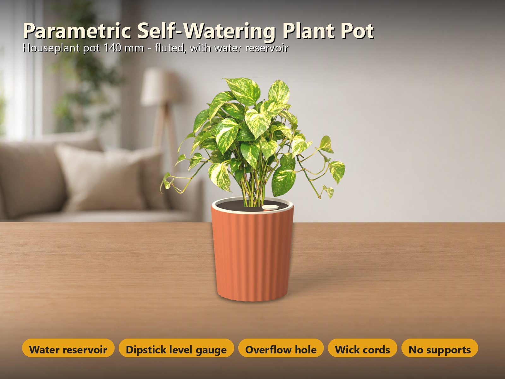
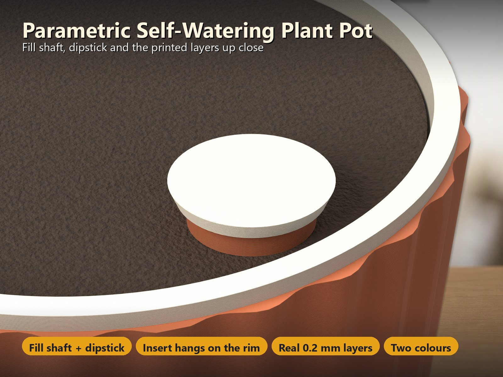
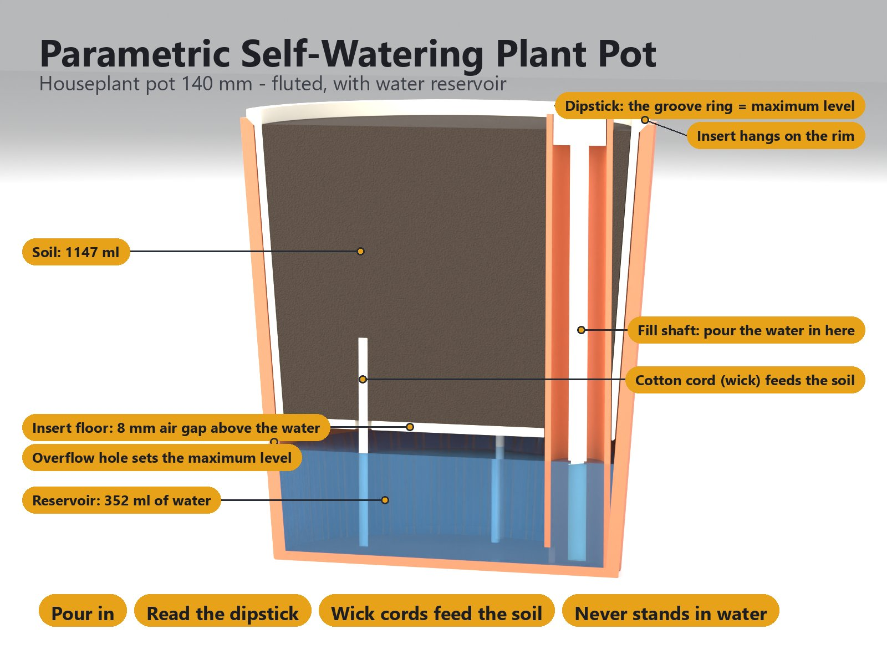
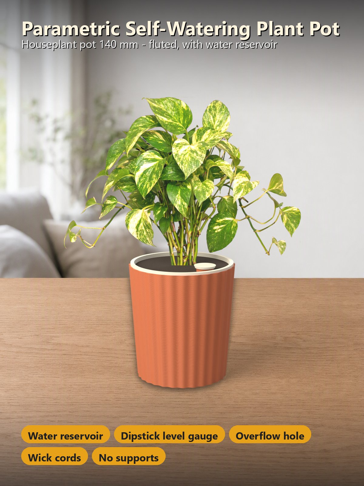
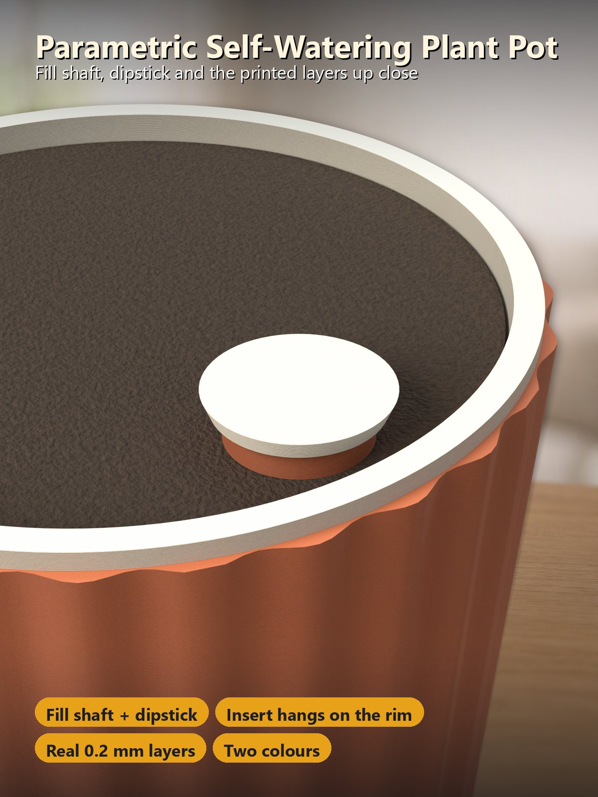

# Parametric Self-Watering Pot – Wasserreservoir, Peilstab und Dochtschnüre, jede Größe, jeder Drucker

[← Alle Modelle im Überblick](../../README.de.md)

🌐 [English](README.md) | **Deutsch**

Ein Topf, der **deine Pflanze selbst gießt**. Ein **Wasserreservoir** sitzt unter
dem Pflanzeinsatz, ein **Einfüllschacht** nimmt das Wasser auf, ein **Peilstab**
zeigt den Füllstand, und **Baumwollschnüre** ziehen das Wasser in die Erde. Im
MakerWorld-Customizer wählst du eine Größe (oder gibst deine eigene ein) und eine
Oberfläche, **glatt, gerillt oder facettiert**; er legt alles auf **zwei Platten
in zwei Farben**, ohne Stützen.

> **Das Modell mit allen Druckprofilen gibt es ausschließlich auf MakerWorld:**
> 👉 [MakerWorld-Link: https://makerworld.com/en/models/3517470-parametric-self-watering-pot](https://makerworld.com/en/models/3517470-parametric-self-watering-pot#profileId-4020169)
>
> 

> **Status:** Die Geometrie wird automatisch am echten Modell geprüft (siehe
> [Entwicklungsgeschichte](#entwicklungsgeschichte)), und jedes Profil ist in
> Bambu Studio test-geslict. Der Topf ist **noch nicht gedruckt worden**. Mach
> bitte den **Dichtigkeitstest** (siehe
> [Das Reservoir dicht bekommen](#das-reservoir-dicht-bekommen)), bevor du
> einpflanzt.

## Inhaltsverzeichnis

- [Das Problem](#das-problem)
- [Die Idee](#die-idee)
- [Highlights](#highlights)
- [So funktioniert es](#so-funktioniert-es)
- [Das Reservoir dicht bekommen](#das-reservoir-dicht-bekommen)
- [Parametrische Optionen](#parametrische-optionen)
- [Konstruktion](#konstruktion)
- [Druckempfehlungen](#druckempfehlungen)
- [Anwendungsfälle](#anwendungsfälle)
- [Fehlersuche / FAQ](#fehlersuche--faq)
- [Entwicklungsgeschichte](#entwicklungsgeschichte)
- [Downloads](#downloads)
- [Lizenz](#lizenz)

## Das Problem

Ein selbstbewässernder Topf ist schnell gezeichnet und schwer richtig zu machen:

- Pflanzen, die im Wasser stehen, faulen. Die Wurzeln brauchen ein **Reservoir
  unter der Erde** und einen **Luftspalt** dazwischen, keinen Topf voller Wasser.
- Du musst sehen, wie viel Wasser noch da ist, und nachfüllen können, ohne die
  Pflanze herauszuheben.
- Das Wasser muss aus dem Reservoir in die Erde gelangen, und überschüssiges
  Wasser (Regen, Überfüllen) muss irgendwohin.
- FDM-Drucke sind **nicht automatisch wasserdicht**: Die Wände sind Stapel
  runder Kunststofflinien mit winzigen Lücken, und die senkrechte Naht jeder
  Schicht ist eine Schwachstelle.
- Töpfe gibt es in vielen Größen, und ein Topf, der nicht auf dein Druckbett
  passt, ist nutzlos. Außerdem soll ein Topf ohne Stützen druckbar sein.

## Die Idee

Der Topf besteht aus **drei Teilen**. Das **Reservoir** ist der Außentopf: Es
hält das Wasser, hat einen **Einfüllschacht** an der Innenwand und ein
**Überlaufloch** auf der maximalen Füllhöhe. Der **Einsatz** ist der Pflanztopf:
Er hängt am Rand des Reservoirs, sein Boden bleibt **8 mm über der maximalen
Füllhöhe**, und **Baumwollschnüre** laufen durch die **Dochtlöcher** im Boden
nach unten ins Wasser. Der **Peilstab** verschließt den Einfüllschacht; zieh ihn
heraus, um den Füllstand abzulesen, der **Rillenring am Stab ist die
Maximalmarke**. Das Reservoir wird in Farbe 1 gedruckt, Einsatz und Peilstab in
Farbe 2, jede Farbe auf **eigener Platte**, sodass Bambu Studio keinen
Prime-Tower ergänzt. Alle Maße in Millimetern.

## Highlights

- **Wasser für Wochen.** Das Reservoir fasst 200 ml (Kräutertopf) bis 2,3 l
  (XL-Pflanzgefäß). Die Wurzeln stehen nie im Wasser: Der Einsatzboden bleibt
  **8 mm über der maximalen Füllhöhe**, und ein kleines **Überlaufloch** lässt
  überschüssiges Wasser abfließen.
- **Einfüllschacht mit Peilstab.** Gieß das Wasser durch den runden Schacht an
  der Wand ein. Zieh den Peilstab heraus: Der **Rillenring am Stab ist die
  Maximalmarke**.
- **Dochtschnüre versorgen die Erde.** Baumwollschnüre (oder ein Filzstreifen)
  laufen durch die **Dochtlöcher** im Einsatzboden nach unten ins Wasser.
  0–6 Löcher, 4–10 mm.
- **Drei Oberflächen, eine Datei.** Glatt, **gerillt** (senkrechte Rippen) oder
  **facettiert** (5–16 Seiten), dazu Konizität, Wand- und Bodenstärke.
- **Zwei Farben, kein Prime-Tower.** Reservoir in Farbe 1, Einsatz und Peilstab
  in Farbe 2, jede Farbe auf eigener Platte.
- **Keine Stützen.** Der Topf wird aufrecht gedruckt; der Fuß des Einfüllschachts
  ist eine kurze 8-mm-Brücke.
- **Größen für jede Pflanze.** Vier Voreinstellungen und eine freie Größe:
  Kräutertopf 110 mm, Zimmerpflanze 140 mm und 180 mm, Pflanzgefäß XL 260 mm
  (großes Bett).
- **Unmögliche Einstellungen werden abgelehnt.** Topf zu breit für den Drucker,
  zu wenig Platz für Erde oder ein Einfüllschacht, der nicht passt: Die Vorschau
  zeigt eine **rote Meldung statt eines Modells**.
- **Vier fertige Varianten** mit test-geslicten Bambu-Studio-Profilen für 3, 4
  und 5 Wände (siehe [Druckempfehlungen](#druckempfehlungen)).

## So funktioniert es

1. Häng den **Einsatz** in das **Reservoir**: Sein Flansch liegt auf dem Rand, eine
   Aussparung lässt Platz für den Einfüllschacht.
2. Schieb eine **Baumwollschnur** (oder einen Filzstreifen) durch jedes
   **Dochtloch**: etwa 10 cm lang, das untere Ende reicht ins Wasser, das obere
   liegt in der Erde. Füll den Einsatz mit Blumenerde und pflanze ein.
3. Gieß Wasser in den **Einfüllschacht**, bis der Peilstab die **Maximalmarke**
   zeigt. Überschüssiges Wasser läuft durch das Überlaufloch ab.
4. Füll nach, wenn der Peilstab einen niedrigen Stand zeigt. Prüf den Peilstab
   nach ein paar Tagen noch einmal, um zu sehen, wie viel deine Pflanze trinkt.

## Das Reservoir dicht bekommen

3D-Drucke vom FDM-Drucker sind **nicht automatisch wasserdicht**. Der Topf ist
darauf ausgelegt, und diese Schritte machen ihn dicht:

1. **Material: PETG oder ASA.** PETG verbindet die Schichten gut und nimmt kein
   Wasser auf. **PLA ist eine schlechte Wahl**: Es nimmt Feuchtigkeit auf, wird
   weich und läuft mit der Zeit weiß an.
2. **Wände: nimm das Profil mit 4 oder 5 Wänden.** Eine Wand kann Wasser
   durchlassen, drei oder vier halten es meist zurück. Die Profile nutzen außerdem
   **6 untere und 6 obere Schichten** (der Boden ist die zweite Schwachstelle) und
   **zufällige Nähte**, sodass keine Naht gerade durch alle Wände läuft.
3. **Fluss und Temperatur.** Erhöhe in Bambu Studio die **Flussrate** (Filament >
   Flow ratio; das Bambu-PETG-Preset nutzt 0,95) auf **1,00–1,05** und die
   Düsentemperatur um etwa **5 °C**. Bessere Schichthaftung presst Kunststoff in
   die Lücken. Geh nicht weit über 1,05: Die Rillen werden klumpig.
4. **Drucke das Reservoir ohne Unterbrechung** und nutze kein Entwurfsprofil
   (dicke Schichten, hohe Geschwindigkeit). Die Profile nutzen 0,20-mm-Schichten.
5. **Dichtigkeitstest vor dem Einpflanzen.** Stell das leere Reservoir auf ein
   **trockenes Küchentuch**, füll es bis zum Überlaufloch und warte **2–3
   Stunden**. Ein trockenes Tuch heißt: wasserdicht; ein feuchter Fleck oder ein
   welliges Tuch heißt: „langsames Schwitzen“.
6. **Wenn es schwitzt: abdichten.** Streich die **Innenseite** dünn mit **Epoxid**
   (zum Beispiel XTC-3D) oder 2–3 Schichten klarem **Acrylspray**, oder setz einen
   **wasserdichten Topfeinsatz** ins Reservoir. Nur das Reservoir muss
   abgedichtet werden: Einsatz und Erde stehen nie im Wasser.

Gut zu wissen: *Wasserdicht* heißt, die Form hält Wasser zurück; *wasserfest*
heißt, der Kunststoff selbst übersteht Wasser. PETG und ASA sind beides. Der Topf
ist **nicht lebensmittelecht**: Zieh keinen Salat und keine Kräuter, die du isst,
in einem blanken, unversiegelten Druck ohne Einsatz.

## Parametrische Optionen

Die Namen entsprechen den Customizer-Parametern des Modells.

### Größe

| Parameter | Bedeutung | Standard | Bereich / Einheit |
|---|---|---|---|
| `preset` | Größe des Topfs: `herb110` (Ø 110 × 115), `plant140` (Ø 140 × 150), `plant180` (Ø 180 × 180), `planter260` (Ø 260 × 240, großes Bett) oder `custom` | `plant140` | Auswahl |
| `custom_d` | Außendurchmesser am Rand, wenn die Voreinstellung `custom` ist | 150 | 80–300 mm, Schritt 5 |
| `custom_h` | Höhe des Reservoirs bei `custom` (ohne den Flansch des Einsatzes) | 160 | 100–300 mm, Schritt 5 |
| `taper` | Der Topf wird zum Rand hin breiter: Winkel der Wand zur Senkrechten | 4 | 0–10°, Schritt 1 |

### Wasserreservoir

| Parameter | Bedeutung | Standard | Bereich / Einheit |
|---|---|---|---|
| `water_h` | Maximale Wassertiefe über dem Boden; das Überlaufloch sitzt auf dieser Höhe | 35 | 15–100 mm |
| `fill_d` | Innendurchmesser des Einfüllschachts | 18 | 12–30 mm |
| `wick_n` | Dochtlöcher im Einsatzboden für die Baumwollschnüre (0 = keine) | 3 | 0–6 |
| `wick_d` | Durchmesser der Dochtlöcher | 6 | 4–10 mm, Schritt 0,5 |
| `overflow` | Überlaufloch in der Reservoirwand auf der maximalen Füllhöhe (Regen, Überfüllen) | an | an / aus |

### Oberfläche und Wände

| Parameter | Bedeutung | Standard | Bereich / Einheit |
|---|---|---|---|
| `style` | Oberfläche des Reservoirs: `smooth` (glatt), `fluted` (gerillt, senkrechte Rippen) oder `faceted` (Vieleck) | `fluted` | Auswahl |
| `flutes` | Anzahl der Rillen (gerillt) | 28 | 8–60 |
| `flute_depth` | Tiefe der Rillen (gerillt) | 2 | 1–5 mm, Schritt 0,5 |
| `sides` | Anzahl der Seiten (facettiert) | 8 | 5–16 |
| `wall` | Wandstärke (ein Vielfaches von 0,4 mm druckt am saubersten) | 2,4 | 1,6–4 mm, Schritt 0,4 |
| `floor_t` | Bodenstärke des Reservoirs | 3,2 | 2,4–6 mm, Schritt 0,4 |

### Farben

| Parameter | Bedeutung | Standard | Bereich / Einheit |
|---|---|---|---|
| `two_colors` | Reservoir in Farbe 1, Einsatz und Peilstab in Farbe 2, jede Farbe auf eigenen Platten, kein Prime-Tower | an | an / aus |
| `color_pot` | Farbe des Reservoirs | `#c9704a` | Farbe |
| `color_insert` | Farbe von Einsatz und Peilstab | `#f2ead8` | Farbe |

### Drucker

| Parameter | Bedeutung | Standard | Bereich / Einheit |
|---|---|---|---|
| `printer` | Legt die Plattengröße fest: `P2S` (256-mm-Betten: P1S, P2S, X1C, A1), `H2C` (großes Bett) oder `A1M` (A1 mini, 180-mm-Bett). **Wähle im MakerWorld-Bettmenü denselben Drucker.** | `P2S` | Auswahl |

### Vorschau und Qualität

| Parameter | Bedeutung | Standard | Bereich / Einheit |
|---|---|---|---|
| `cutaway` | Assemble-Ansicht: schneidet ein Viertel des Topfs weg, um Wasser, Einsatz und Einfüllschacht zu zeigen (der Download bleibt unberührt) | an | an / aus |
| `$fn` | Kreisqualität | 96 | 48–160, Schritt 8 |

## Konstruktion

### OpenSCAD-Ansatz

Das Modell ist eine einzelne parametrische OpenSCAD-Datei mit drei Teilen:
Reservoir, Einsatz und Peilstab. Alles wird aus Außendurchmesser und Höhe am Rand
abgeleitet; der Innenraum des Reservoirs folgt der Konizität, und der Einsatz
wird aus dem Innenradius am Einsatzboden gebaut, sodass er jeder Größe und
Konizität folgt. Die Assemble-Ansicht im Customizer zeigt einen Schnitt durch den
Topf mit Wasser, Erde und Einsatz; sie ist nicht Teil des Downloads.

### Parametrische Logik

- **Voreinstellungen:** vier Größen plus `custom`. Der Durchmesser ist der
  größte Außendurchmesser am Rand, die Höhe ist die Höhe des Reservoirs.
- **Wasserstand:** Die Unterseite des Einsatzbodens liegt auf Bodenstärke +
  `water_h` + 8 mm. Das Überlaufloch (5 mm) ist 2,5 mm über der maximalen
  Füllhöhe zentriert, sodass es auf der maximalen Füllhöhe offen ist.
- **Einfüllschacht:** ein Rohr mit 2 mm Wand an der Innenwand, von oben bis zum
  Boden offen; ein Schlitz an seinem Fuß lässt das Wasser ein. Er ist unten
  1,2 mm in die Wand eingeschmolzen.
- **Dochtlöcher:** auf einem Ring im Einsatzboden, abseits des Einfüllschachts.
- **Platten:** zwei Platten (Reservoir; Einsatz und Peilstab). Passt der Peilstab
  beim gewählten Drucker nicht neben den Einsatz, bekommt er eine dritte Platte.
- **Abgelehnte Einstellungen:** Topf zu breit für das Druckbett (maximaler
  Durchmesser ist Bettgröße minus 10 mm), weniger als 30 mm Erdtiefe,
  Einfüllschacht passt nicht, Topf niedriger als 100 mm, Dochtlöcher zu nah am
  Einfüllschacht oder am Rand des Bodens, Rillen zu tief für die Wand. Die
  Vorschau zeigt eine rote Meldung statt eines Modells.

### Besondere Algorithmen

- **Gerillte und facettierte Kontur:** Die Kontur wird pro Höhe aus dem größten
  Radius auf dieser Höhe berechnet, sodass Rillen und Facetten der Konizität der
  Wand folgen.
- **Einsatzflansch:** Der Einsatz hängt mit einem 3-mm-Flansch am Rand des
  Reservoirs; der Rand hat eine kleine Fase.
- **Elefantenfuß-Ausgleich:** Die ersten Schichten der Basis sind um 0,4 mm
  eingezogen, sodass der Topf auch auf eine texturierte PEI-Platte passt.

### Druckoptimierungen

- Keine Stützen: Der Topf wird aufrecht gedruckt; der Fuß des Einfüllschachts ist
  eine kurze 8-mm-Brücke, der einzige Überhang steiler als 45°.
- Zwei Farben auf getrennten Platten, kein Prime-Tower.
- Spiel für den gedruckten Sitz: Einsatz 0,5 mm um die Topfwand, 0,4 mm um den
  Einfüllschacht, Peilstabstopfen 0,4 mm in der Bohrung.

## Druckempfehlungen

Die Profile sind für den **Bambu Lab P2S** (und jedes 256-mm-Bett) und den
**H2C** gebaut, mit 0,20 mm Schichthöhe und Gyroid 15 %, und in Bambu Studio
test-geslict. Wähle im MakerWorld-Bettmenü denselben Drucker, denn MakerWorld
prüft nur das gewählte Bett.

| Einstellung | Empfehlung |
|---|---|
| Material | **PETG** (ASA im Freien oder für das XL-Pflanzgefäß); PLA wird nicht empfohlen |
| Schichthöhe | 0,20 mm |
| Wände | 4–5 für das Reservoir (die Profile gibt es mit 3, 4 und 5) |
| Füllung | 15 % Gyroid |
| Untere / obere Schichten | 6 / 6 |
| Nähte | zufällig |
| Stützen | keine |
| Platten | Platte 1 Reservoir in Farbe 1, Filament wechseln, Platte 2 Einsatz und Peilstab in Farbe 2 |

| Variante | Größe | Oberfläche | Wasser / Erde | Drucker | Material | Zeit / Gewicht (4 Wände) |
|---|---|---|---|---|---|---|
| `herb-110-smooth` | 110 × 115 mm | glatt | 198 ml / 520 ml | P2S (jedes 256-mm-Bett) | PETG | 5,3 h / 137 g |
| `plant-140-fluted` | 140 × 150 mm | gerillt | 352 ml / 1,1 l | P2S (jedes 256-mm-Bett) | PETG | 14,0 h / 287 g |
| `plant-180-faceted` | 180 × 180 mm | 8 Facetten | 692 ml / 2,1 l | P2S (jedes 256-mm-Bett) | PETG | 16,5 h / 446 g |
| `planter-260-xl` | 260 × 240 mm | gerillt | 2,3 l / 7,1 l | H2C | ASA | 33,5 h / 719 g |

Jedes Profil ist ein **Zwei-Platten-Zwei-Farben-Projekt**. Die Farben sind
Terrakotta und Creme (Salbeigrün für den 180-mm-Topf, Anthrazit für das XL);
ändere sie in Bambu Studio. Jede andere Größe ist eine Änderung im Customizer.
Das Wasservolumen ist aus der Geometrie berechnet, nicht gemessen.

**Passung und Feintuning**

- Der Einsatz hat 0,5 mm Spiel um die Topfwand, 0,4 mm um den Schacht; der
  Peilstabstopfen 0,4 mm in der Bohrung. Sind deine Teile zu stramm oder zu lose,
  hängt das von Drucker und Filament ab; probiere es mit dem ersten Druck aus.
- Die Basis ist um 0,4 mm eingezogen (Elefantenfuß-Ausgleich), sodass sie auch auf
  eine texturierte PEI-Platte passt.

## Anwendungsfälle

- **Kräuter auf der Fensterbank:** Der 110-mm-Topf fasst 200 ml Wasser. Nicht
  lebensmittelecht: Nutze einen Einsatz oder dichte das Reservoir ab, wenn du
  isst, was du anbaust.
- **Zimmerpflanzen:** 140 und 180 mm für Alltagspflanzen, die gleichmäßig trinken.
- **Urlaubsbewässerung:** Vor der Abreise auffüllen, die Pflanze zieht das Wasser
  im eigenen Tempo durch die Schnüre.
- **Balkon und Terrasse:** das XL-Pflanzgefäß (260 mm, ASA) für große Pflanzen;
  das Überlaufloch lässt Regen ablaufen.
- **Deine eigene Größe:** `custom` mit beliebigem Durchmesser von 80 bis 300 mm
  und Höhe von 100 bis 300 mm.
- **Verschiedene Drucker:** dasselbe Design für 256-mm-Betten, den H2C und den
  A1 mini (180-mm-Bett).

## Fehlersuche / FAQ

| Symptom | Ursache | Lösung |
|---|---|---|
| Die Vorschau zeigt eine rote Meldung statt eines Modells | Die Einstellungen können nicht funktionieren (Topf zu breit für den Drucker, zu wenig Erde, Einfüllschacht zu groß, …) | Lies die Meldung; wähle einen kleineren Durchmesser, einen höheren Topf, ein kleineres `water_h` oder ein kleineres `fill_d` |
| Das Reservoir schwitzt Wasser | FDM-Wände sind nicht automatisch wasserdicht | Nimm das Profil mit 4 oder 5 Wänden, erhöhe die Flussrate, dichte die Innenseite mit Epoxid oder Acrylspray ab oder nutze einen Topfeinsatz (siehe [Das Reservoir dicht bekommen](#das-reservoir-dicht-bekommen)) |
| Der Kunststoff läuft weiß an und wird weich | PLA nimmt Wasser auf | In PETG oder ASA drucken |
| Die Erde bleibt trocken | Schnüre zu kurz oder nicht im Wasser | Prüfe, dass das untere Ende jeder Schnur das Wasser erreicht und das obere in der Erde liegt; mehr Dochtlöcher mit `wick_n` |
| Die Erde ist zu nass | Zu viele oder zu weite Dochtlöcher | `wick_n` oder `wick_d` verringern |
| Wasser läuft aus dem Überlaufloch | Reservoir über die Maximalmarke gefüllt, oder Regen | Beabsichtigt; nur bis zur Maximalmarke füllen |
| Der Einsatz sitzt stramm oder lose im Topf | Der Druck fällt etwas größer oder kleiner aus | Elefantenfuß entgraten; sag mir, wie es passt |
| Die Rillen sehen klumpig aus | Flussrate weit über 1,05 | Flussrate auf 1,00–1,05 senken |
| Eine Platte ist zu groß fürs Bett | Anderer Drucker als der gewählte | Im MakerWorld-Bettmenü den passenden Drucker wählen |
| Der Peilstab liegt auf einer dritten Platte | Er passt auf dem gewählten Bett nicht neben den Einsatz | Beabsichtigt; drucke auch die dritte Platte |

## Entwicklungsgeschichte

Der Topf ist ein vollständig parametrisches Design für den FDM-Druck: Reservoir,
Einsatz und Peilstab aus einer Datei, jede Größe, drei Oberflächen, zwei Farben.

In Version 1.0.0 wurden 10 Konfigurationen (alle vier Voreinstellungen, glatt,
gerillt und facettiert mit 6, 8 und 12 Seiten, Konizitäten von 0 bis 8°,
Wassertiefen von 20–80 mm, 0–6 Dochtlöcher, mit und ohne Überlaufloch, drei
Drucker) automatisch an der echten Geometrie geprüft: **372 Prüfungen, 0
fehlgeschlagen**. Reservoir, Einsatz und Peilstab überlappen sich nie; das
Überlaufloch ist auf der maximalen Füllhöhe offen, und der Einsatzboden bleibt
8 mm über dem Wasser; der Einfüllschacht ist von oben bis zum Boden offen; das
Wasservolumen stimmt mit dem Netz auf 1,5 % überein; jedes Teil ist ein
wasserdichtes Vollkörpernetz, keine Wand ist dünner als 1,2 mm, und außer kurzen
Brücken gibt es keinen Überhang steiler als 45°; jede Platte liegt innerhalb des
Betts. Alle vier Profile wurden in Bambu Studio test-geslict. Der Topf ist noch
nicht gedruckt worden.

Die Töpfe auf den Bildern sind die echte Geometrie des Modells, aus dem
exportierten Netz mit den gedruckten Schichtlinien gerendert. Die Umgebung
(Küche, Wohnzimmer, Flur, Terrasse) wurde von einer KI um den Topf herum gemalt,
der unverändert eingesetzt wurde; die Pflanzen sind echte Fotos, die in die Erde
gesetzt wurden, und Wasser und Schnüre im Schnittbild sind Illustrationen. Nichts
davon ist Teil des Modells. Es sind keine Fotos von Drucken enthalten.

## Downloads

Druckdateien gibt es absichtlich ausschließlich auf MakerWorld.

👉 MakerWorld-Link: https://makerworld.com/en/models/3517470-parametric-self-watering-pot#profileId-4020169

Profil: <https://makerworld.com/en/@BetaHydri>

## Lizenz

Dokumentation und Bilder in diesem Repository: © BetaHydri. Das Modell
(einschließlich Quellcode) und alle Druckdateien werden ausschließlich über
MakerWorld unter der dort angegebenen Lizenz verbreitet. Dieses Repository
enthält bewusst kein Modell, keinen Quellcode und keine Druckdateien.
