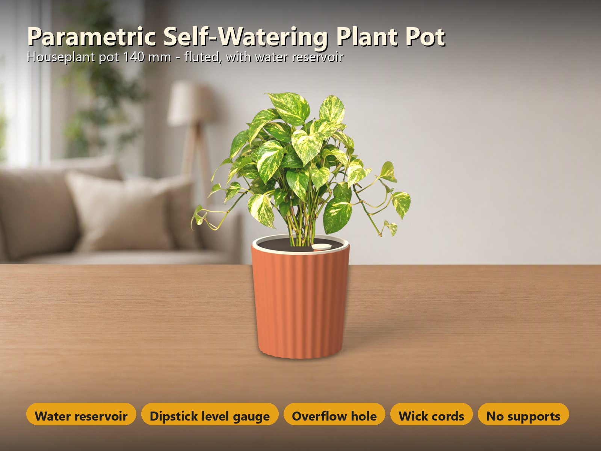
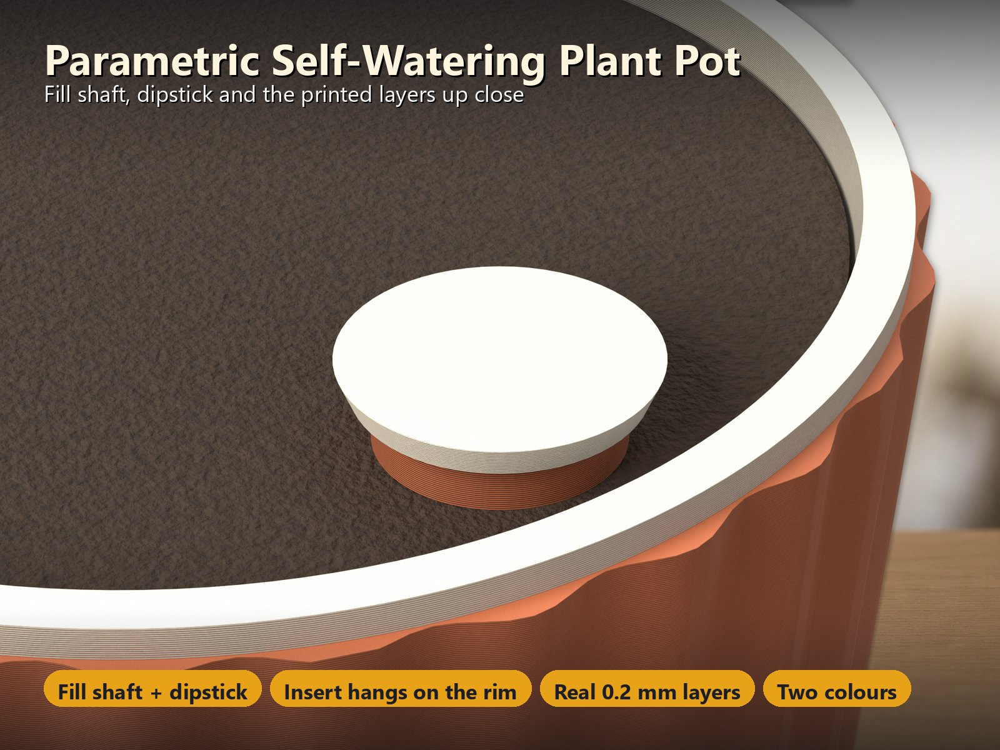
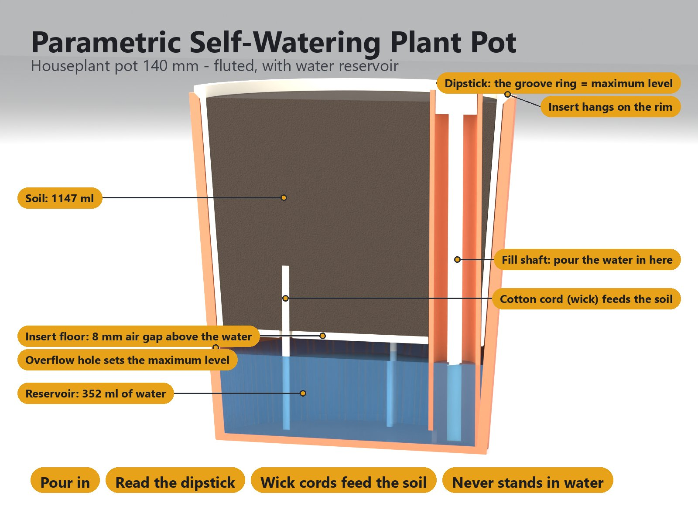
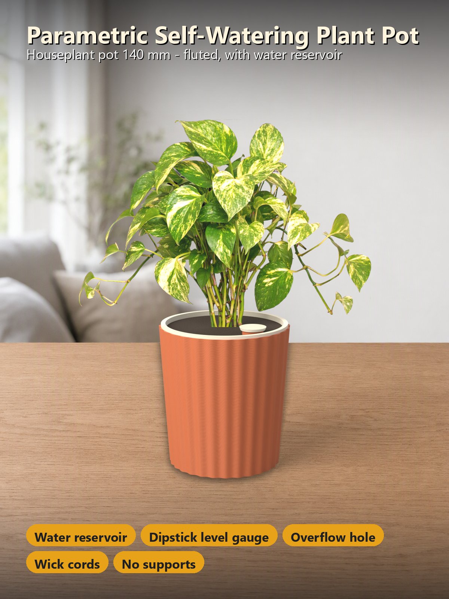
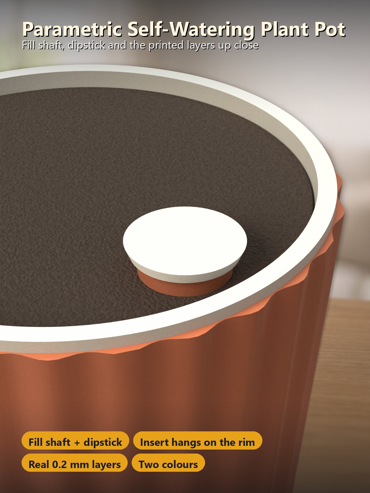

# Parametric Self-Watering Pot – Reservoir, Dipstick and Wick Cords, Any Size, Any Printer

[← All models](../../README.md)

🌐 **English** | [Deutsch](README.de.md)

A pot that **waters your plant for you**. A **water reservoir** sits under the
planting insert, a **fill shaft** takes the water, a **dipstick** shows the
level, and **cotton cords** draw the water up into the soil. You pick a size (or
type your own) and a surface, **smooth, fluted or faceted**, in the MakerWorld
Customizer; it lays everything out on **two plates in two colours**, without
supports.

> **The model with all print profiles is available exclusively on MakerWorld:**
> 👉 [MakerWorld link: https://makerworld.com/en/models/3517470-parametric-self-watering-pot](https://makerworld.com/en/models/3517470-parametric-self-watering-pot#profileId-4020169)
>
> 

> **Status:** the geometry is checked automatically on the real model (see
> [Development History](#development-history)) and every profile is test-sliced
> in Bambu Studio. The pot has **not been printed yet**. Please do the **leak
> test** (see [Make the Reservoir Watertight](#make-the-reservoir-watertight))
> before you plant.

## Table of Contents

- [The Problem](#the-problem)
- [The Idea](#the-idea)
- [Highlights](#highlights)
- [How It Works](#how-it-works)
- [Make the Reservoir Watertight](#make-the-reservoir-watertight)
- [Parametric Options](#parametric-options)
- [Design](#design)
- [Print Recommendations](#print-recommendations)
- [Use Cases](#use-cases)
- [Troubleshooting / FAQ](#troubleshooting--faq)
- [Development History](#development-history)
- [Downloads](#downloads)
- [License](#license)

## The Problem

A self-watering pot is easy to draw and harder to get right:

- Plants that stand in water rot. The roots need a **reservoir below the soil**
  and an **air gap** in between, not a pot full of water.
- You have to see how much water is left and be able to refill it without
  lifting out the plant.
- Water has to get from the reservoir into the soil, and surplus water (rain,
  over-filling) has to go somewhere.
- FDM prints are **not automatically watertight**: the walls are stacks of round
  plastic lines with tiny gaps, and the vertical seam of each layer is a weak
  spot.
- Pots come in many sizes, and a pot that does not fit your printer bed is
  useless. A pot should also print without supports.

## The Idea

The pot has **three parts**. The **reservoir** is the outer pot: it holds the
water, has a **fill shaft** along its inner wall and an **overflow hole** at the
maximum level. The **insert** is the planting pot: it hangs on the rim of the
reservoir, its floor stays **8 mm above the maximum level**, and **cotton cords**
run through the **wick holes** in its floor down into the water. The
**dipstick** closes the fill shaft; pull it out to read the level, the **groove
ring on the rod is the maximum mark**. The reservoir is printed in colour 1,
insert and dipstick in colour 2, each colour on **its own plate**, so Bambu
Studio adds no prime tower. All dimensions in millimetres.

## Highlights

- **Water for weeks.** The reservoir holds 200 ml (herb pot) up to 2.3 l (XL
  planter). The roots never stand in water: the insert floor stays **8 mm above
  the maximum level**, and a small **overflow hole** lets surplus water run out.
- **Fill shaft with dipstick.** Pour the water in through the round shaft along
  the wall. Pull the dipstick out: the **groove ring on the rod is the maximum
  mark**.
- **Wick cords feed the soil.** Cotton cords (or a strip of felt) run through the
  **wick holes** in the insert floor down into the water. 0–6 holes, 4–10 mm.
- **Three surfaces, one file.** Smooth, **fluted** (vertical ribs) or
  **faceted** (5–16 sides), plus taper, wall and floor thickness.
- **Two colours, no prime tower.** Reservoir in colour 1, insert and dipstick in
  colour 2, each colour on its own plate.
- **No supports.** The pot prints upright; the foot of the fill shaft is a short
  8 mm bridge.
- **Sizes for every plant.** Four presets and a custom size: herb pot 110 mm,
  houseplant 140 mm and 180 mm, planter XL 260 mm (large bed).
- **Impossible settings are refused.** Pot too wide for the printer, not enough
  room for soil or a fill shaft that does not fit: the preview shows a **red
  message instead of a model**.
- **Four ready-made variants** with test-sliced Bambu Studio profiles for 3, 4
  and 5 walls (see [Print Recommendations](#print-recommendations)).

## How It Works

1. Hang the **insert** in the **reservoir**: its flange rests on the rim, a notch
   leaves room for the fill shaft.
2. Push a **cotton cord** (or a strip of felt) through every **wick hole**: about
   10 cm long, the lower end reaches the water, the upper end lies in the soil.
   Fill the insert with potting soil and plant.
3. Pour water into the **fill shaft** until the dipstick shows the **maximum
   mark**. Surplus water leaves through the overflow hole.
4. Refill when the dipstick shows the level is low. Check the dipstick again
   after a few days to see how much your plant drinks.

## Make the Reservoir Watertight

3D prints made on an FDM printer are **not automatically watertight**. The pot is
designed for it, and these steps make it leak-free:

1. **Material: PETG or ASA.** PETG bonds well between layers and does not take up
   water. **PLA is a poor choice**: it absorbs moisture, softens and turns white
   over time.
2. **Walls: use the 4 or 5 wall profile.** One wall may let water through, three
   or four usually stop it. The profiles also use **6 bottom and 6 top layers**
   (the floor is the second weak spot) and **random seams**, so no seam runs
   straight through all walls.
3. **Flow and temperature.** In Bambu Studio raise the **flow ratio** (Filament >
   Flow ratio; the Bambu PETG preset uses 0.95) to **1.00–1.05** and the nozzle
   temperature by about **5 °C**. Better layer bonding squeezes plastic into the
   gaps. Do not go far above 1.05: the flutes get blobby.
4. **Print the reservoir without interruptions** and do not use a draft profile
   (thick layers, fast speed). The profiles use 0.20 mm layers.
5. **Leak test before planting.** Put the empty reservoir on a **dry paper
   towel**, fill it up to the overflow hole and wait **2–3 hours**. A dry towel
   means it is watertight; a damp spot or a crinkled towel means a "slow weep".
6. **If it weeps: seal it.** Paint the **inside** with a thin coat of **epoxy**
   (for example XTC-3D) or 2–3 coats of clear **acrylic spray**, or put a
   **waterproof pot liner** into the reservoir. Only the reservoir has to be
   sealed: the insert and the soil never stand in the water.

Good to know: *watertight* means the shape holds water, *waterproof* means the
plastic itself survives water. PETG and ASA are both. The pot is **not food
safe**: do not grow salad or herbs you eat in a bare, unsealed print without a
liner.

## Parametric Options

The names correspond to the model's Customizer parameters.

### Size

| Parameter | Meaning | Default | Range / Unit |
|---|---|---|---|
| `preset` | Size of the pot: `herb110` (Ø 110 × 115), `plant140` (Ø 140 × 150), `plant180` (Ø 180 × 180), `planter260` (Ø 260 × 240, large bed) or `custom` | `plant140` | selection |
| `custom_d` | Outer diameter at the rim when the preset is `custom` | 150 | 80–300 mm, step 5 |
| `custom_h` | Height of the reservoir when the preset is `custom` (without the flange of the insert) | 160 | 100–300 mm, step 5 |
| `taper` | The pot gets wider towards the rim: angle of the wall from vertical | 4 | 0–10°, step 1 |

### Water Reservoir

| Parameter | Meaning | Default | Range / Unit |
|---|---|---|---|
| `water_h` | Maximum water depth above the floor; the overflow hole sits at this level | 35 | 15–100 mm |
| `fill_d` | Inner diameter of the fill shaft | 18 | 12–30 mm |
| `wick_n` | Wick holes in the insert floor for the cotton cords (0 = none) | 3 | 0–6 |
| `wick_d` | Diameter of the wick holes | 6 | 4–10 mm, step 0.5 |
| `overflow` | Overflow hole in the reservoir wall at the maximum water level (rain, over-filling) | on | on / off |

### Surface and Walls

| Parameter | Meaning | Default | Range / Unit |
|---|---|---|---|
| `style` | Surface of the reservoir: `smooth`, `fluted` (vertical ribs) or `faceted` (polygon) | `fluted` | selection |
| `flutes` | Number of flutes (fluted) | 28 | 8–60 |
| `flute_depth` | Depth of the flutes (fluted) | 2 | 1–5 mm, step 0.5 |
| `sides` | Number of sides (faceted) | 8 | 5–16 |
| `wall` | Wall thickness (a multiple of 0.4 mm prints cleanest) | 2.4 | 1.6–4 mm, step 0.4 |
| `floor_t` | Floor thickness of the reservoir | 3.2 | 2.4–6 mm, step 0.4 |

### Colours

| Parameter | Meaning | Default | Range / Unit |
|---|---|---|---|
| `two_colors` | Reservoir in colour 1, insert and dipstick in colour 2, each colour on its own plates, no prime tower | on | on / off |
| `color_pot` | Colour of the reservoir | `#c9704a` | colour |
| `color_insert` | Colour of the insert and the dipstick | `#f2ead8` | colour |

### Printer

| Parameter | Meaning | Default | Range / Unit |
|---|---|---|---|
| `printer` | Sets the plate size: `P2S` (256 mm beds: P1S, P2S, X1C, A1), `H2C` (large bed) or `A1M` (A1 mini, 180 mm bed). **Choose the same printer in the MakerWorld bed menu.** | `P2S` | selection |

### Preview and Quality

| Parameter | Meaning | Default | Range / Unit |
|---|---|---|---|
| `cutaway` | Assemble view: cuts away a quarter of the pot to show the water, the insert and the fill shaft (the download is not affected) | on | on / off |
| `$fn` | Circle quality | 96 | 48–160, step 8 |

## Design

### OpenSCAD Approach

The model is a single parametric OpenSCAD file with three parts: reservoir,
insert and dipstick. Everything is derived from the outer diameter and height at
the rim; the cavity of the reservoir follows the taper, and the insert is built
from the cavity radius at its floor, so it follows every size and taper. The
Assemble view in the Customizer shows a cut-away of the pot with water, soil and
insert; it is not part of the download.

### Parametric Logic

- **Presets:** four sizes plus `custom`. Diameter is the widest outer diameter
  at the rim, height is the height of the reservoir.
- **Water level:** the underside of the insert floor sits at floor thickness +
  `water_h` + 8 mm. The overflow hole (5 mm) is centred 2.5 mm above the maximum
  level, so it is open at the maximum level.
- **Fill shaft:** a tube with a 2 mm wall along the inner wall, open from the top
  to the floor; a slot at its foot lets the water in. It is fused 1.2 mm into
  the wall at the bottom.
- **Wick holes:** on a ring in the insert floor, away from the fill shaft.
- **Plates:** two plates (reservoir; insert and dipstick). If the dipstick does
  not fit next to the insert for the chosen printer, it gets a third plate.
- **Refused settings:** pot too wide for the printer bed (maximum diameter is
  bed size minus 10 mm), less than 30 mm of soil depth, fill shaft that does not
  fit, pot lower than 100 mm, wick holes too close to the fill shaft or to the
  edge of the floor, flutes too deep for the wall. The preview shows a red
  message instead of a model.

### Special Algorithms

- **Fluted and faceted outline:** the outline is calculated per height from the
  widest radius at that height, so flutes and facets follow the taper of the wall.
- **Insert flange:** the insert hangs on the rim of the reservoir with a 3 mm
  flange; the rim has a small bevel.
- **Elephant-foot compensation:** the first layers of the base are stepped in by
  0.4 mm, so the pot also fits a textured PEI plate.

### Print Optimisations

- No supports anywhere: the pot prints upright; the foot of the fill shaft is a
  short 8 mm bridge, the only overhang steeper than 45°.
- Two colours on separate plates, no prime tower.
- Play for the printed fit: insert 0.5 mm around the pot wall, 0.4 mm around the
  fill shaft, dipstick plug 0.4 mm in the bore.

## Print Recommendations

The profiles are built for the **Bambu Lab P2S** (and any 256 mm bed) and the
**H2C**, with 0.20 mm layer height and gyroid 15 %, and test-sliced in Bambu
Studio. Choose the same printer in the MakerWorld bed menu, because MakerWorld
only checks the selected bed.

| Setting | Recommendation |
|---|---|
| Material | **PETG** (ASA outdoors or for the XL planter); PLA is not recommended |
| Layer height | 0.20 mm |
| Walls | 4–5 for the reservoir (the profiles come with 3, 4 and 5) |
| Infill | 15 % gyroid |
| Bottom / top layers | 6 / 6 |
| Seams | random |
| Supports | none |
| Plates | plate 1 reservoir in colour 1, swap the filament, plate 2 insert and dipstick in colour 2 |

| Variant | Size | Surface | Water / soil | Printer | Material | Time / weight (4 walls) |
|---|---|---|---|---|---|---|
| `herb-110-smooth` | 110 × 115 mm | smooth | 198 ml / 520 ml | P2S (any 256 mm bed) | PETG | 5.3 h / 137 g |
| `plant-140-fluted` | 140 × 150 mm | fluted | 352 ml / 1.1 l | P2S (any 256 mm bed) | PETG | 14.0 h / 287 g |
| `plant-180-faceted` | 180 × 180 mm | 8 facets | 692 ml / 2.1 l | P2S (any 256 mm bed) | PETG | 16.5 h / 446 g |
| `planter-260-xl` | 260 × 240 mm | fluted | 2.3 l / 7.1 l | H2C | ASA | 33.5 h / 719 g |

Each profile is a **two-plate, two-colour project**. Colours are terracotta and
cream (sage green for the 180 mm pot, anthracite for the XL); change them in
Bambu Studio. Every other size is one change in the Customizer. The water volume
is calculated from the geometry, not measured.

**Fit and tuning**

- The insert has 0.5 mm play around the pot wall, 0.4 mm around the shaft; the
  dipstick plug 0.4 mm in the bore. If your parts are too tight or too loose, it
  depends on your printer and filament; test it with the first print.
- The base is stepped in by 0.4 mm (elephant-foot compensation), so it also fits
  a textured PEI plate.

## Use Cases

- **Herbs on the windowsill:** the 110 mm pot holds 200 ml of water.
  Not food safe: use a liner or seal the reservoir if you eat what you grow.
- **Houseplants:** 140 and 180 mm for everyday plants that drink steadily.
- **Holiday watering:** fill it up before you leave, the plant draws water through
  the cords at its own pace.
- **Balcony and terrace:** the XL planter (260 mm, ASA) for big plants; the
  overflow hole lets rain run out.
- **Your own size:** `custom` with any diameter from 80 to 300 mm and height from
  100 to 300 mm.
- **Different printers:** the same design for 256 mm beds, the H2C and the A1 mini
  (180 mm bed).

## Troubleshooting / FAQ

| Symptom | Cause | Fix |
|---|---|---|
| The preview shows a red message instead of a model | The settings cannot work (pot too wide for the printer, not enough soil, fill shaft too big, …) | Read the message; choose a smaller diameter, a taller pot, a lower `water_h` or a smaller `fill_d` |
| The reservoir weeps water | FDM walls are not automatically watertight | Use the 4 or 5 wall profile, raise the flow ratio, seal the inside with epoxy or acrylic spray, or use a pot liner (see [Make the Reservoir Watertight](#make-the-reservoir-watertight)) |
| The plastic turns white and soft | PLA takes up water | Print in PETG or ASA |
| The soil stays dry | Cords too short or not in the water | Check that the lower end of every cord reaches the water and the upper end lies in the soil; add wick holes with `wick_n` |
| The soil is too wet | Too many or too wide wick holes | Reduce `wick_n` or `wick_d` |
| Water runs out of the overflow hole | Reservoir filled above the maximum level, or rain | Intended; fill only up to the maximum mark |
| The insert is stiff or loose in the pot | The print comes out slightly larger or smaller | Deburr the elephant's foot; tell me how it fits |
| The flutes look blobby | Flow ratio far above 1.05 | Lower the flow ratio to 1.00–1.05 |
| A plate is too big for the bed | Another printer than the selected one | Choose the matching printer in the MakerWorld bed menu |
| The dipstick is on a third plate | It does not fit next to the insert on the chosen bed | Intended; print the third plate as well |

## Development History

The pot is a fully parametric design for FDM printing: reservoir, insert and
dipstick from one file, any size, three surfaces, two colours.

In version 1.0.0, 10 configurations (all four presets, smooth, fluted and
faceted with 6, 8 and 12 sides, tapers from 0 to 8°, water depths of 20–80 mm,
0–6 wick holes, with and without overflow hole, three printers) were checked
automatically on the real geometry: **372 checks, 0 failed**. Reservoir, insert
and dipstick never overlap; the overflow hole is open at the maximum level and
the insert floor stays 8 mm above the water; the fill shaft is open from the top
to the floor; the water volume matches the mesh within 1.5 %; every part is one
watertight solid mesh with no wall thinner than 1.2 mm and no overhang steeper
than 45° apart from short bridges; every plate lies inside the bed. All four
profiles were test-sliced in Bambu Studio. The pot has not been printed yet.

The pots in the images are the real geometry of the model, rendered from the
exported mesh with the printed layer lines. The surroundings (kitchen, living
room, hallway, terrace) were painted by an AI around the pot, which was pasted in
unchanged; the plants are real photographs placed in the soil, and the water and
cords in the cut-away are illustrations. None of this is part of the model. No
photos of prints are included.

## Downloads

Print files are intentionally available exclusively on MakerWorld.

👉 MakerWorld link: https://makerworld.com/en/models/3517470-parametric-self-watering-pot#profileId-4020169

Profile: <https://makerworld.com/en/@BetaHydri>

## License

Documentation and images in this repository: © BetaHydri. The model (including
source code) and all print files are distributed exclusively via MakerWorld
under the license stated there. This repository deliberately contains no model,
source code or print files.
