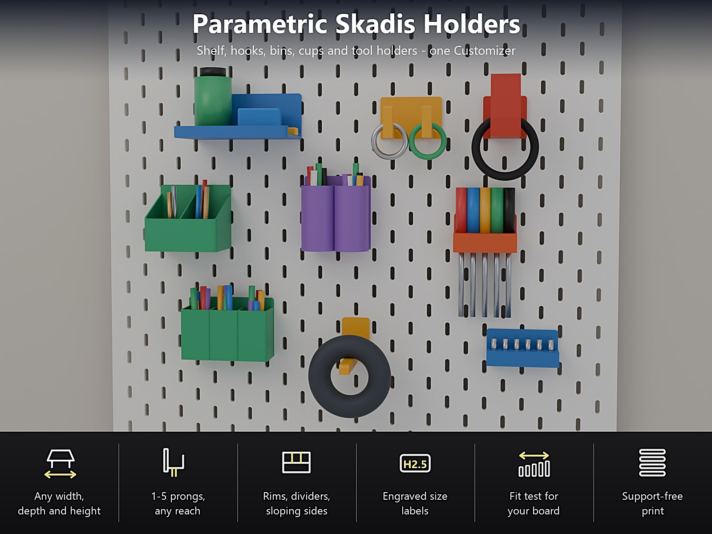
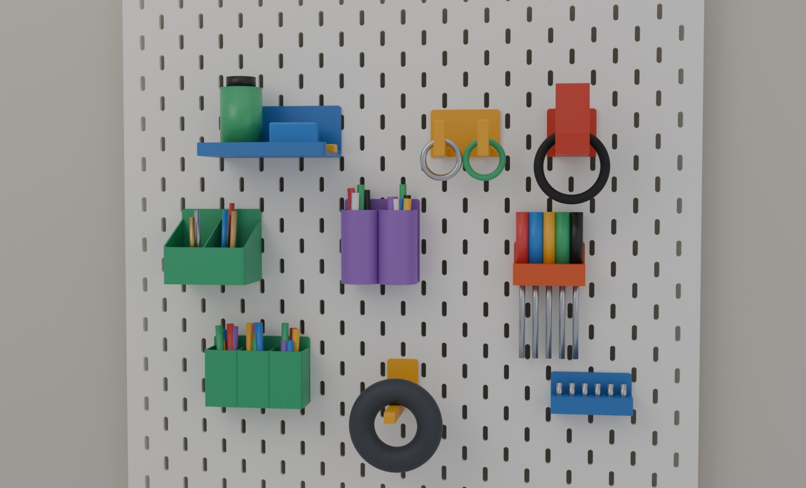
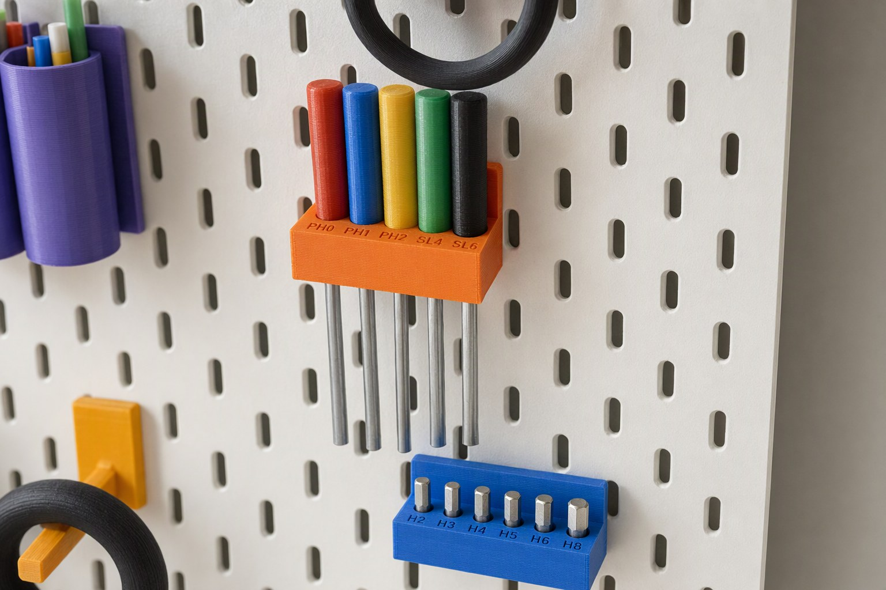
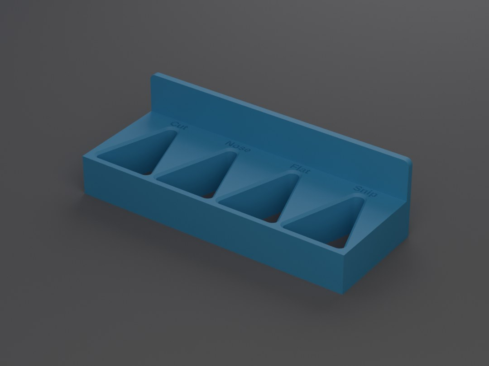
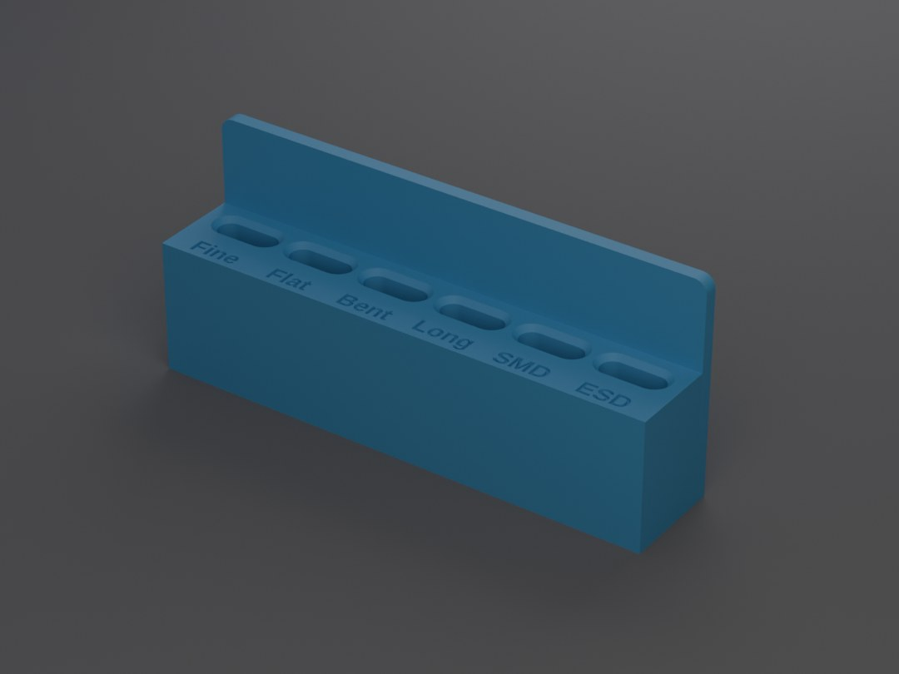
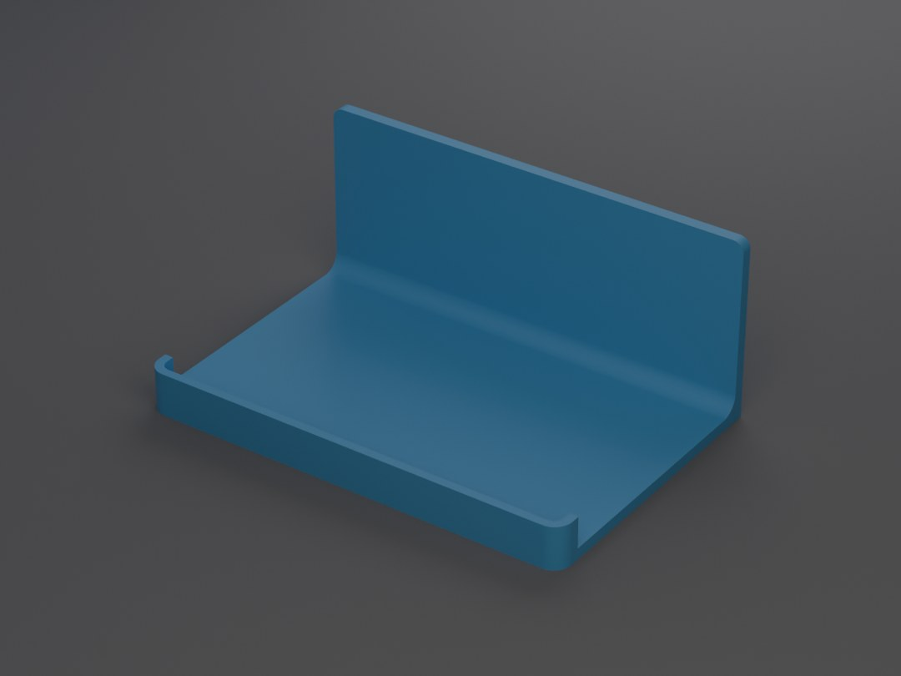
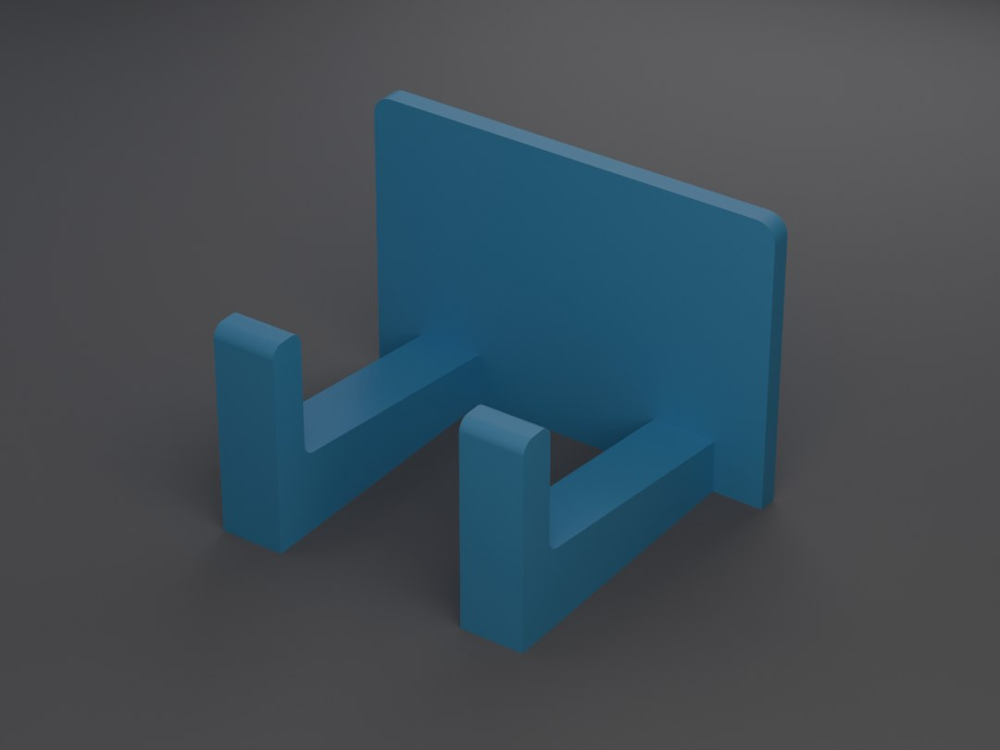

# Parametric Skadis Holders – Regal, Haken, Boxen, Becher und Werkzeughalter für das IKEA-SKÅDIS-Board

[← Alle Modelle im Überblick](../../README.de.md)

🌐 [English](README.md) | **Deutsch**

**Eine OpenSCAD-Datei, ein Customizer, sechs Halter für das IKEA-SKÅDIS-Board:**
Regal oder Tisch, Haken und Stifte, Aufbewahrungsbox, Becher, Werkzeughalter und
ein Passungstest. Halter wählen, Maße eintragen, ohne Stützen drucken. Jeder
Halter hängt mit gedruckten Hakenlaschen in den Schlitzen deines Boards: in die
Schlitze fallen lassen, er hält durch sein Eigengewicht, zum Abnehmen anheben.

> **Das Modell mit allen Druckprofilen gibt es ausschließlich auf MakerWorld:**
> 👉 [MakerWorld-Link: https://makerworld.com/en/models/3591819-parametric-skadis-holders](https://makerworld.com/en/models/3591819-parametric-skadis-holders#profileId-4114026)
>
> 

## Inhaltsverzeichnis

- [Highlights](#highlights)
- [Die sechs Halter](#die-sechs-halter)
- [Werkzeughalter: rund, sechskant, Schlitz und V-Kerbe](#werkzeughalter-rund-sechskant-schlitz-und-v-kerbe)
- [Parametrische Optionen](#parametrische-optionen)
- [So wird er eingehängt](#so-wird-er-eingehängt)
- [Druckprofile](#druckprofile)
- [Druckempfehlungen](#druckempfehlungen)
- [Zu den Bildern](#zu-den-bildern)
- [Downloads](#downloads)
- [Marke](#marke)
- [Lizenz](#lizenz)

## Highlights

- **Ein Customizer, sechs Halter.** Regal / Tisch, Haken und Stifte,
  Aufbewahrungsbox, Becher, Werkzeughalter und ein Passungstest, alles aus einer
  Datei.
- **Beliebige Größe.** Breite, Tiefe und Höhe von Regal und Box, Anzahl und
  Ausladung der Zinken, Anzahl und Größe der Becher, Anzahl und Größe der
  Werkzeuglöcher.
- **Einhängen ohne Werkzeug.** Der Halter hat gedruckte Hakenlaschen: durch die
  Schlitze stecken, loslassen, und die Beine haken hinter dem Board ein. Der
  Halter sitzt durch sein Eigengewicht fest und lässt sich jederzeit abnehmen,
  wenn du umräumen willst.
- **Werkzeughalter für jedes Werkzeug.** Runde Löcher für Schraubendreher,
  Sechskantlöcher für Bits und Inbusschlüssel, Schlitze für dünne, flache
  Werkzeuge und eine **V-Kerbe für Zangen, Scheren und Pinzetten**, die für jede
  Dicke passt. Ein optionaler **Boden** verhindert, dass kleine Werkzeuge
  durchrutschen, und **Größenangaben werden eingraviert** (`H1.5, H2, H2.5 ...`).
- **Erst der Passungstest.** Ein kleiner Druck mit fünf Laschen unterschiedlichen
  Spiels zeigt, wie dein Board und dein Drucker zusammenpassen, bevor du einen
  großen Halter druckst.
- **Narrensicher.** Unsinnige Werte werden angepasst und die Assemble-Ansicht
  sagt dir, was geändert wurde (orangefarbener Text). Unmögliche Eingaben zeigen
  eine rote Meldung statt eines Modells, zum Beispiel ein Regal, das breiter ist
  als dein Druckbett.
- **Keine Stützen.** Die Beine stehen auf dem Druckbett und die Pfeiler sind
  kurze Brücken.

## Die sechs Halter

| Halter | Was es ist | Wichtigste Einstellungen |
|---|---|---|
| Regal / Tisch | Ein Regal oder ein flacher Tisch | Breite, Tiefe, Rückenhöhe; Rand vorn, an den Seiten oder rundum (oder keiner); steife Rundung zur Rückplatte; wahlweise runde Bodenlöcher |
| Haken und Stifte | Kopfhörer-, Schlüssel-, Kabel- oder Taschenhaken oder ein gerader Stift für Spulen und Rollen | 1 bis 5 Zinken nebeneinander, Abstand, Breite, Ausladung, Armhöhe, Steigung; aufgebogene Spitze (Höhe, Dicke, Neigung zum Board); Spitzenhöhe 0 = gerader Stift |
| Aufbewahrungsbox | Box mit niedrigerer Front als Rückwand, damit du hineingreifen kannst | Breite, Tiefe, Höhe, Fronthöhe (schräge Seiten), wahlweise Trennwände |
| Becher | 1 bis 4 Becher nebeneinander für Stifte, Pinsel und Marker | Rund oder eckig, Innenmaß, Höhe |
| Werkzeughalter | Löcher für Schraubendreher, Bits, Inbusschlüssel, Zangen, Scheren und Pinzetten | Mehrere Spalten, Form, Größe, Boden, Beschriftung (siehe unten) |
| Passungstest | Fünf kleine Laschen mit unterschiedlichem Spiel | Laschenbreite oder Laschentiefe hinter dem Board |

## Werkzeughalter: rund, sechskant, Schlitz und V-Kerbe

- **Rund:** Löcher für Schraubendreher, Feilen und Pinsel.
- **Sechskant:** Löcher für Sechskant-Bits und Inbusschlüssel (Schlüsselweite
  eintragen).
- **Schlitz:** für dünne, flache Werkzeuge. Der Schlitz ist nur so dick, wie du
  ihn einstellst; eine geschlossene Zange passt deshalb nicht hindurch.
- **V-Kerbe:** für **Zangen und Scheren beliebiger Dicke.** Das Werkzeug wird von
  oben hineingesteckt, sinkt ein, bis die Tasche so schmal ist wie das Werkzeug
  dick, und klemmt dort. Du stellst die Breite am schmalen Ende, die Breite am
  breiten Ende (etwa 30 mm passen für die meisten Zangen) und die Länge ein
  (40 mm: die Zange muss zwischen Keilspitze und Front passen). Eine
  **geschlossene Front** verhindert, dass die Zange nach vorn herausfällt; eine
  offene Kerbe läuft durch die Front. Der V-Kerben-Halter hat eine Reihe.
- **Boden:** Mit einem Boden von mindestens 0,8 mm unter den Löchern werden alle
  Formen zu Sacklöchern: zusammengedrückte Pinzetten mit der Spitze nach unten,
  Pinsel und Kleinteile bleiben darin. Bei 0 gehen die Löcher durch.
- **Größenangaben:** ein Text pro Spalte, durch Kommas getrennt, von links nach
  rechts, zum Beispiel `H1.5,H2,H2.5,H3,H4,H5,H6,H8` oder `PH1,PH2,SL5,SL6`. Die
  Buchstaben werden 0,6 mm tief in die Oberseite vor den Löchern eingraviert und
  drucken deshalb ohne Stützen. Bei schmalen Spalten werden die Buchstaben
  kleiner; würden sie zu klein, bittet dich der Customizer, die Texte zu kürzen.

| | |
|---|---|
|  |  |
| **V-Kerben-Halter** für vier Zangen, Texte eingraviert | **Schlitzhalter mit Boden** für sechs Pinzetten |

## Parametrische Optionen

| Bereich | Einstellung | Wirkung |
|---|---|---|
| 1 - Model | Model | Regal, Haken, Box, Becher, Werkzeughalter oder Passungstest. |
| 1 - Model | Tab columns | Anzahl der Hakenlaschen; 0 = automatisch (eine Lasche bis 56 mm Breite, zwei bis 96 mm usw.). |
| 2 - Shelf | Width, depth, back height | Größe des Regals. |
| 2 - Shelf | Rim, rim height, fillet | Kein Rand, vorn, seitlich oder rundum; Randhöhe; Rundung (steifer). |
| 2 - Shelf | Floor holes, hole size, web | Wahlweise runde Löcher im Sechseck-Raster. |
| 3 - Hooks | Prongs, spacing, width | Anzahl, Abstand und Breite der Zinken. |
| 3 - Hooks | Reach, arm, slope | Länge, Höhe am Board und Anstieg zur Spitze. |
| 3 - Hooks | Tip height, thickness, lean | Aufgebogene Spitze; 0 = gerader Stift; Neigung zum Board. |
| 3 - Hooks | Plate height | Eine höhere Platte kippt unter Last weniger. |
| 4 - Bin | Width, depth, height, front height | Größe; eine niedrigere Front ergibt schräge Seiten. |
| 4 - Bin | Plate extra, dividers, divider thickness | Platte über der Box; Wände quer durch die Box. |
| 5 - Cup | Count, shape, size, height, plate extra | 1 bis 4 Becher, rund oder eckig. |
| 6 - Tool holder | Columns, rows | Anzahl der Löcher. |
| 6 - Tool holder | Shape, size, slot length | Rund / Sechskant / Schlitz / V-Kerbe; Werkzeugdurchmesser, Schlüsselweite, Dicke oder Breite am schmalen Ende der Kerbe. |
| 6 - Tool holder | V-notch width, length, front | Breite am breiten Ende, Länge, geschlossene oder offene Front. |
| 6 - Tool holder | Floor | 0 = Löcher gehen durch; mit Boden sind die Löcher Sacklöcher. |
| 6 - Tool holder | Clearance, web, block thickness, plate extra | Lochspiel (0,5 mm), Material zwischen den Löchern, Höhe des Blocks. |
| 6 - Tool holder | Labels, label size | Kommagetrennte Texte, einer pro Spalte, 0,6 mm tief eingraviert. |
| 7 - Fit test | Kind | Laschenbreite oder Tiefe hinter dem Board. |
| 8 - Walls and plate | Wall, floor, plate thickness, corner radius, rim thickness | Vielfache von 0,4 mm drucken am saubersten. |
| 9 - Board fit | Board thickness, tab clearance, play, tab height, leg catch, leg thickness | Passung nach dem Passungstest an dein Board anpassen. |
| 10 - Printer and colour | Printer, colour, quality | Bettgröße (P2S / H2C / A1 mini). |

Die Hakenlaschen werden automatisch in einer Reihe von Schlitzen im Abstand von
40 mm platziert. **Wähle vor dem Download im MakerWorld-Bettmenü denselben
Drucker**, den du unter `10 - Printer and colour` eingestellt hast.

## So wird er eingehängt

1. Halte den Halter etwas **über** die Schlitze, die du nutzen willst (die
   Hakenlaschen sitzen am unteren Ende des Halters).
2. **Stecke die Laschen durch die Schlitze,** bis die Platte am Board anliegt.
3. **Lass ihn fallen:** die Beine haken hinter dem Board ein.
4. **Zum Abnehmen** hebst du ihn etwa 7 mm an, bis er anschlägt, und ziehst ihn
   nach vorn.

## Druckprofile

Druckfertige Bambu-Profile für den **P2S** (PETG, 0,20 mm, 3 oder 4 Wände,
20 % Gyroid, 3 mm Brim, probegeslict, keine Stützen, je eine Platte) gibt es auf
MakerWorld für diese Beispiele:

| Halter | Beispiele |
|---|---|
| Regal / Tisch | `shelf-120x80`, `table-200x120-holes` |
| Haken und Stifte | `hook-single`, `hook-double`, `hook-peg-100`, `hook-headphone` |
| Aufbewahrungsbox | `bin-80x60`, `bin-120-3-dividers` |
| Becher | `cup-pens-40`, `cup-3x-square-30` |
| Werkzeughalter | `tools-screwdrivers-4`, `tools-hex-bits-8`, `tools-pliers-4` (V-Kerbe), `tools-tweezers-6` (Sackschlitze) |
| Passungstest | `fit-test-width`, `fit-test-depth` |

Jede andere Größe kommt aus dem Customizer.

## Druckempfehlungen

- **Material:** PETG empfohlen (die Beine der Laschen federn etwas und tragen die
  Last). Für leichte Dinge reicht auch PLA.
- **Wände und Füllung:** 4 Wände, 20 % Gyroid.
- **Brim:** 3 mm Außen-Brim für die dünne Platte und die Beine.
- **Stützen:** keine. Die Beine stehen auf dem Druckbett, die Pfeiler sind
  Brücken von etwa 5,4 mm, alles andere ist senkrecht oder 45 Grad geneigt.
- **Erster Druck für dein Board? Drucke den Passungstest.** Die Lasche, die
  leichtgängig mit etwas Spiel hineingeht, liefert deine Werte für
  `tab clearance` und `play`. IKEA veröffentlicht keine Zeichnung des Boards,
  deshalb weichen Boards etwas voneinander ab: miss die Dicke deines Boards an
  einem Schlitzrand und trage sie unter `9 - Board fit` ein.
- **Belastung:** eine Abschätzung, keine Messung. Etwa 1 bis 2 kg auf einem Regal,
  etwa 1 kg auf einem einzelnen Haken nahe am Board. Schwere Dinge tief und nah
  am Board lagern; eine große Last weit vor dem Board zieht stark an den Beinen.

## Zu den Bildern

Die Halter auf den Bildern sind Renderings der echten Modellgeometrie. Die
Nahaufnahme der Werkzeughalter am Board ist eine KI-gestützte Illustration auf
Basis dieser Renderings; die Werkzeuge und Bits in den Haltern sind
Illustrationen und nicht Teil des Modells. Es sind keine Fotos eines Drucks.

## Downloads

Druckdateien gibt es bewusst ausschließlich auf MakerWorld.

👉 MakerWorld-Link: https://makerworld.com/en/models/3591819-parametric-skadis-holders#profileId-4114026

Profil: <https://makerworld.com/en/@BetaHydri>

## Marke

SKÅDIS ist eine Marke der Inter IKEA Systems B.V.; dieses Modell steht in keiner
Verbindung zu IKEA.

## Lizenz

Dokumentation und Bilder in diesem Repository; Modell und Druckdateien werden
ausschließlich über MakerWorld vertrieben. Dokumentation und Bilder: © BetaHydri.
Das Modell (einschließlich Quellcode) und alle Druckdateien stehen unter der
auf MakerWorld angegebenen Lizenz. Dieses Repository enthält bewusst keine
Modell-, Quellcode- oder Druckdateien.
