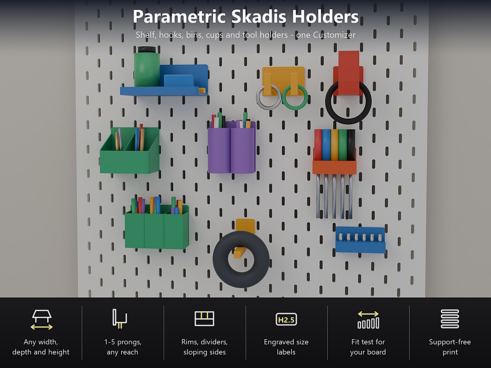
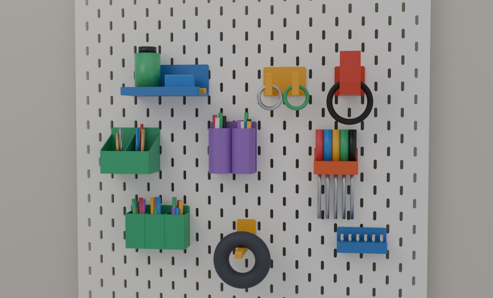
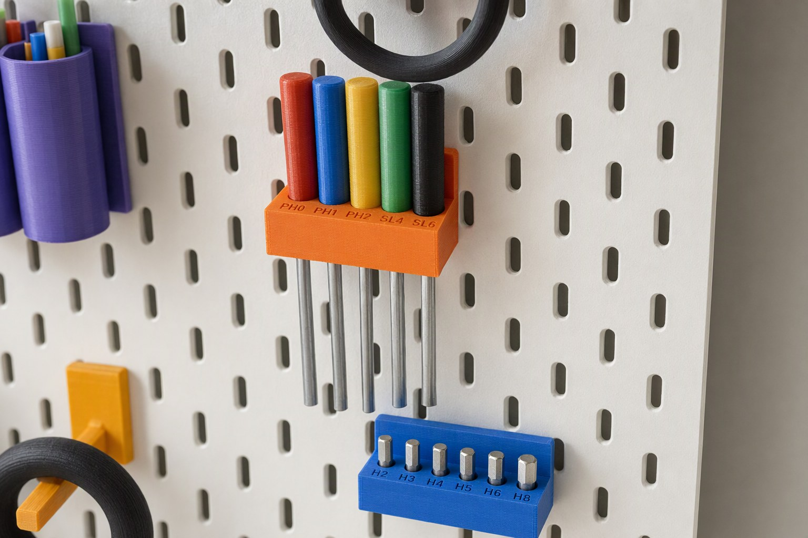
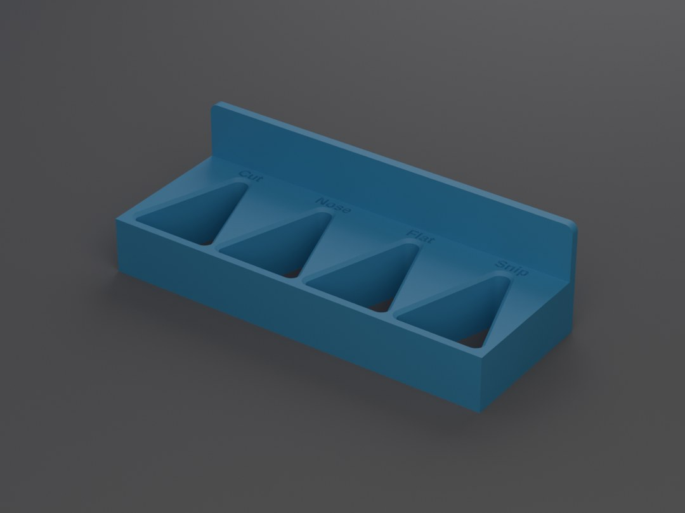
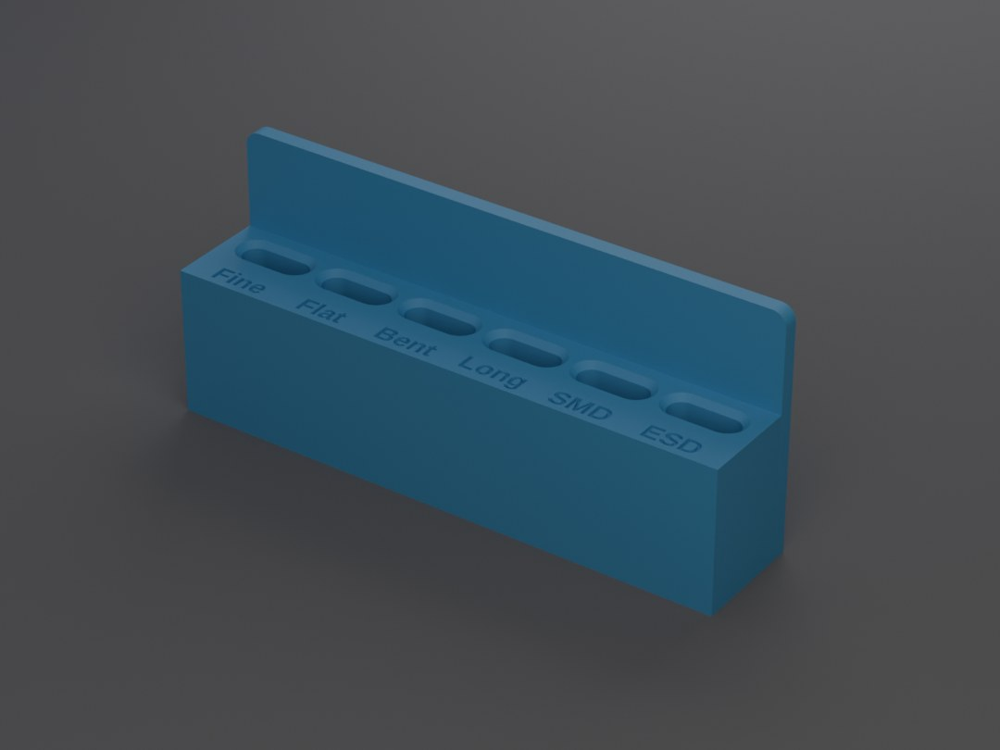
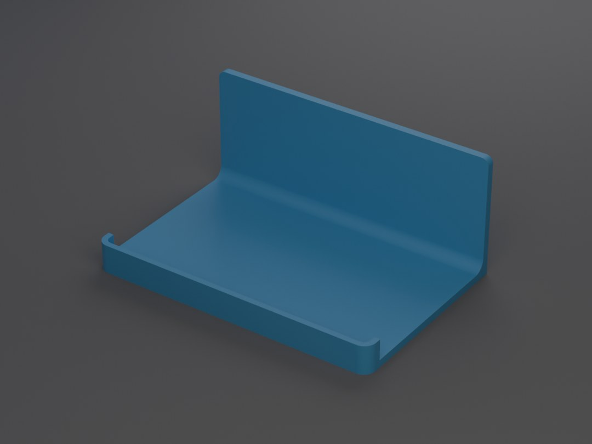
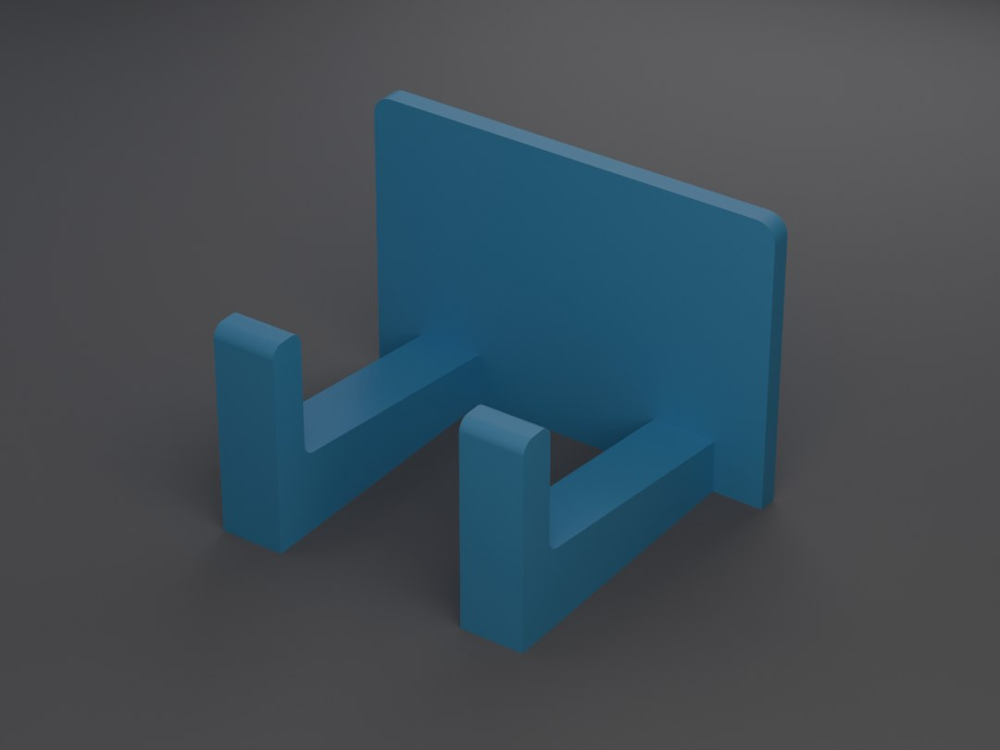

# Parametric Skadis Holders – Shelf, Hooks, Bins, Cups and Tool Holders for the IKEA SKÅDIS Board

[← All models](../../README.md)

🌐 **English** | [Deutsch](README.de.md)

**One OpenSCAD file, one Customizer, six holders for the IKEA SKÅDIS board:**
shelf or table, hooks and pegs, storage bin, cup, tool holder and a fit test.
Pick the holder, type in your size, print it without supports. Every holder
hangs in the slots of your board on printed hook tabs: drop it into the slots,
it locks by its own weight, lift it to take it off.

> **The model with all print profiles is available exclusively on MakerWorld:**
> 👉 [MakerWorld link: https://makerworld.com/en/models/3591819-parametric-skadis-holders](https://makerworld.com/en/models/3591819-parametric-skadis-holders#profileId-4114026)
>
> 

## Table of Contents

- [Highlights](#highlights)
- [The six holders](#the-six-holders)
- [Tool holders: round, hexagon, slot and V-notch](#tool-holders-round-hexagon-slot-and-v-notch)
- [Parametric Options](#parametric-options)
- [How to hang it](#how-to-hang-it)
- [Print profiles](#print-profiles)
- [Print Recommendations](#print-recommendations)
- [About the Images](#about-the-images)
- [Downloads](#downloads)
- [Trademark](#trademark)
- [License](#license)

## Highlights

- **One Customizer, six holders.** Shelf / table, hooks and pegs, storage bin,
  cup, tool holder and a fit test, all from one file.
- **Any size.** Width, depth and height of shelf and bin, number and reach of
  the prongs, number and size of the cups, number and size of the tool holes.
- **Hang on without tools.** The holder has printed hook tabs: push them through
  the slots, let go, and the legs hook behind the board. The holder locks by its
  own weight and lifts off whenever you want to rearrange.
- **Tool holders for every tool.** Round holes for screwdrivers, hexagon holes
  for bits and hex keys, slots for thin flat tools and a **V-notch for pliers,
  scissors and tweezers** that works for any thickness. An optional **floor**
  keeps small tools from falling through, and **size labels are engraved** in
  the top (`H1.5, H2, H2.5 ...`).
- **Fit test first.** A small print with five tabs of different play shows how
  your board and your printer work together before you print a big holder.
- **Fool-proof.** Silly values are adapted and the Assemble view tells you what
  changed (orange text). Impossible requests show a red message instead of a
  model, for example a shelf wider than your printer bed.
- **No supports.** The legs stand on the bed and the pillars are short bridges.

## The six holders

| Holder | What it is | Main settings |
|---|---|---|
| Shelf / table | A shelf or a flat table | Width, depth, back height; rim at the front, at the sides or all round (or none); stiff rounded joint to the back plate; optional round floor holes |
| Hooks and pegs | Headphone, key, cable or bag hook, or a straight peg for spools and rolls | 1 to 5 prongs side by side, spacing, width, reach, arm height, slope; upturned tip (height, thickness, lean towards the board); tip height 0 = straight peg |
| Storage bin | Bin with a front lower than the back, so you can reach in | Width, depth, height, front height (sloping sides), optional dividers |
| Cup | 1 to 4 cups side by side for pens, brushes and markers | Round or square, inner size, height |
| Tool holder | Holes for screwdrivers, bits, hex keys, pliers, scissors and tweezers | Several columns, shape, size, floor, labels (see below) |
| Fit test | Five small tabs with different play | Tab width or tab depth behind the board |

## Tool holders: round, hexagon, slot and V-notch

- **Round** holes for screwdrivers, files and brushes.
- **Hexagon** holes for hex bits and hex keys (enter the size across the flats).
- **Slot** for thin, flat tools. The slot is only as thick as you set it, so a
  closed pair of pliers does not go through.
- **V-notch** for **pliers and scissors of any thickness.** The tool is dropped
  in from the top, sinks until the pocket is as narrow as the tool is thick and
  wedges there. You set the width at the narrow end, the width at the wide end
  (about 30 mm fits most pliers) and the length (40 mm: the pliers have to fit
  between the wedge point and the front). A **closed front** keeps the pliers
  from falling out forward; an open notch runs through the front. The V-notch
  holder has one row.
- **Floor:** with a floor of at least 0.8 mm under the holes, every shape gets
  blind holes: tweezers pressed together with the tip down, brushes and small
  parts stay in. With 0 the holes go all the way through.
- **Size labels:** one label per column, separated by commas, from left to
  right, for example `H1.5,H2,H2.5,H3,H4,H5,H6,H8` or `PH1,PH2,SL5,SL6`. The
  letters are engraved 0.6 mm deep in the top face in front of the holes, so
  they print without supports. The letters shrink to fit a narrow column; if
  they would get too small, the Customizer asks you to shorten the labels.

| | |
|---|---|
|  |  |
| **V-notch holder** for four pliers, labels engraved | **Slot holder with a floor** for six tweezers |

## Parametric Options

| Section | Setting | What it does |
|---|---|---|
| 1 - Model | Model | Shelf, hook, bin, cup, tool holder or fit test. |
| 1 - Model | Tab columns | Number of hook tabs; 0 = automatic (one tab up to 56 mm width, two up to 96 mm, and so on). |
| 2 - Shelf | Width, depth, back height | Size of the shelf. |
| 2 - Shelf | Rim, rim height, fillet | No rim, front, sides or all round; height of the rim; rounded joint (stiffer). |
| 2 - Shelf | Floor holes, hole size, web | Optional round holes in a hexagon grid. |
| 3 - Hooks | Prongs, spacing, width | Number, distance and width of the prongs. |
| 3 - Hooks | Reach, arm, slope | Length, height at the board and rise towards the tip. |
| 3 - Hooks | Tip height, thickness, lean | Upturned tip; 0 = straight peg; lean towards the board. |
| 3 - Hooks | Plate height | A taller plate tilts less under load. |
| 4 - Bin | Width, depth, height, front height | Size; a lower front gives sloping sides. |
| 4 - Bin | Plate extra, dividers, divider thickness | Plate above the bin; walls across the bin. |
| 5 - Cup | Count, shape, size, height, plate extra | 1 to 4 cups, round or square. |
| 6 - Tool holder | Columns, rows | Number of holes. |
| 6 - Tool holder | Shape, size, slot length | Round / hexagon / slot / V-notch; tool diameter, flats, thickness or width at the narrow end of the notch. |
| 6 - Tool holder | V-notch width, length, front | Width at the wide end, length, closed or open front. |
| 6 - Tool holder | Floor | 0 = holes go through; with a floor the holes are blind. |
| 6 - Tool holder | Clearance, web, block thickness, plate extra | Hole play (0.5 mm), material between the holes, height of the block. |
| 6 - Tool holder | Labels, label size | Comma-separated labels, one per column, engraved 0.6 mm deep. |
| 7 - Fit test | Kind | Tab width or depth behind the board. |
| 8 - Walls and plate | Wall, floor, plate thickness, corner radius, rim thickness | Multiples of 0.4 mm print cleanest. |
| 9 - Board fit | Board thickness, tab clearance, play, tab height, leg catch, leg thickness | Tune the fit to your board after the fit test. |
| 10 - Printer and colour | Printer, colour, quality | Bed size (P2S / H2C / A1 mini). |

The hook tabs are placed automatically in one row of slots, 40 mm apart. **Choose
the same printer in the MakerWorld bed menu** that you set under
`10 - Printer and colour` before you download.

## How to hang it

1. Hold the holder a little **above** the slots you want to use (the hook tabs
   are at the bottom of the holder).
2. **Push the tabs through the slots** until the plate touches the board.
3. **Let it drop:** the legs hook behind the board.
4. **To take it off,** lift it about 7 mm until it stops and pull it forward.

## Print profiles

Ready-to-print Bambu profiles for the **P2S** (PETG, 0.20 mm, 3 or 4 walls,
20 % gyroid, 3 mm brim, test-sliced, no supports, one plate each) are available
on MakerWorld for these examples:

| Holder | Examples |
|---|---|
| Shelf / table | `shelf-120x80`, `table-200x120-holes` |
| Hooks and pegs | `hook-single`, `hook-double`, `hook-peg-100`, `hook-headphone` |
| Storage bin | `bin-80x60`, `bin-120-3-dividers` |
| Cup | `cup-pens-40`, `cup-3x-square-30` |
| Tool holder | `tools-screwdrivers-4`, `tools-hex-bits-8`, `tools-pliers-4` (V-notch), `tools-tweezers-6` (blind slots) |
| Fit test | `fit-test-width`, `fit-test-depth` |

Any other size comes from the Customizer.

## Print Recommendations

- **Material:** PETG recommended (the legs flex a little and carry the load).
  PLA is fine for light things.
- **Walls and infill:** 4 walls, 20 % gyroid.
- **Brim:** 3 mm outer brim for the thin plate and legs.
- **Supports:** none. The legs stand on the bed, the pillars are bridges of
  about 5.4 mm, everything else is vertical or at 45 degrees.
- **First print on your board? Print the fit test.** The tab that goes in
  smoothly with a little wobble gives your values for `tab clearance` and
  `play`. IKEA does not publish a drawing of the board, so boards differ
  slightly: measure the thickness of yours at a slot edge and enter it under
  `9 - Board fit`.
- **Load:** an estimate, not a measurement. About 1 to 2 kg on a shelf, about
  1 kg on a single hook close to the board. Keep heavy things low and close to
  the board; a heavy load far in front of the board pulls hard on the legs.

## About the Images

The holders in the pictures are renderings of the real model geometry. The close-up
of the tool holders on the board is an AI-assisted illustration based on those
renderings; the tools and bits in the holders are illustrations and not part of
the model. These are not photographs of a print.

## Downloads

Print files are intentionally available exclusively on MakerWorld.

👉 MakerWorld link: https://makerworld.com/en/models/3591819-parametric-skadis-holders#profileId-4114026

Profile: <https://makerworld.com/en/@BetaHydri>

## Trademark

SKÅDIS is a trademark of Inter IKEA Systems B.V.; this model is not affiliated
with IKEA.

## License

Documentation and images in this repository; model and print files are
distributed exclusively via MakerWorld. Documentation and images: © BetaHydri.
The model (including source code) and all print files are under the license
stated on MakerWorld. This repository deliberately contains no model, source
code or print files.
