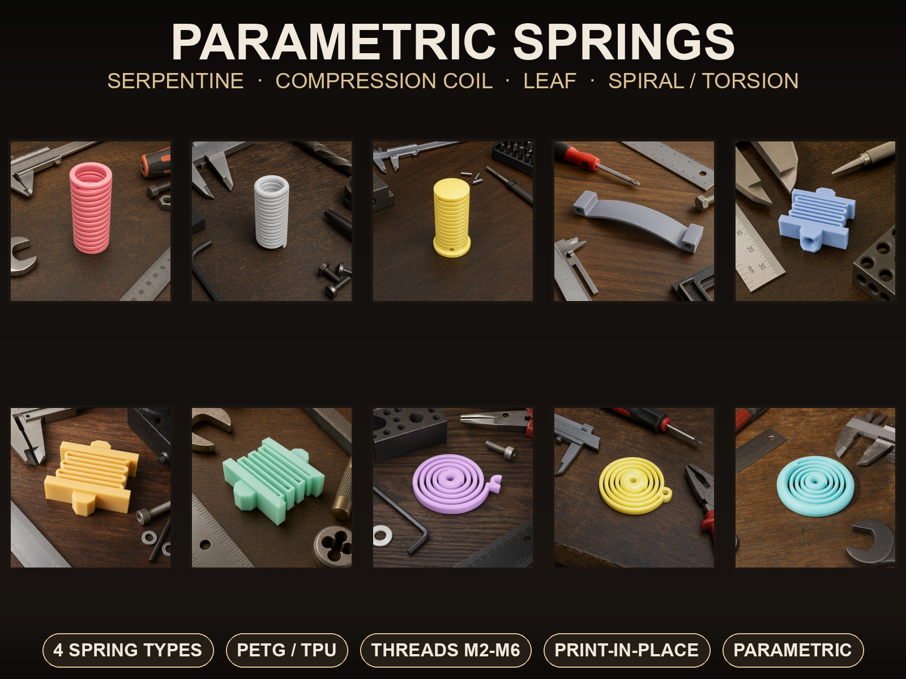
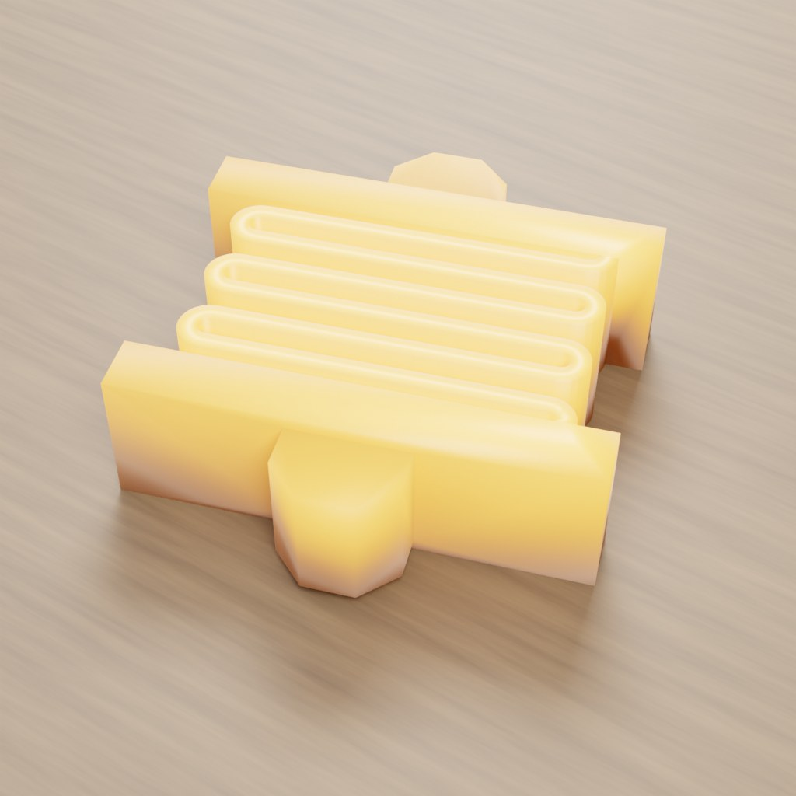
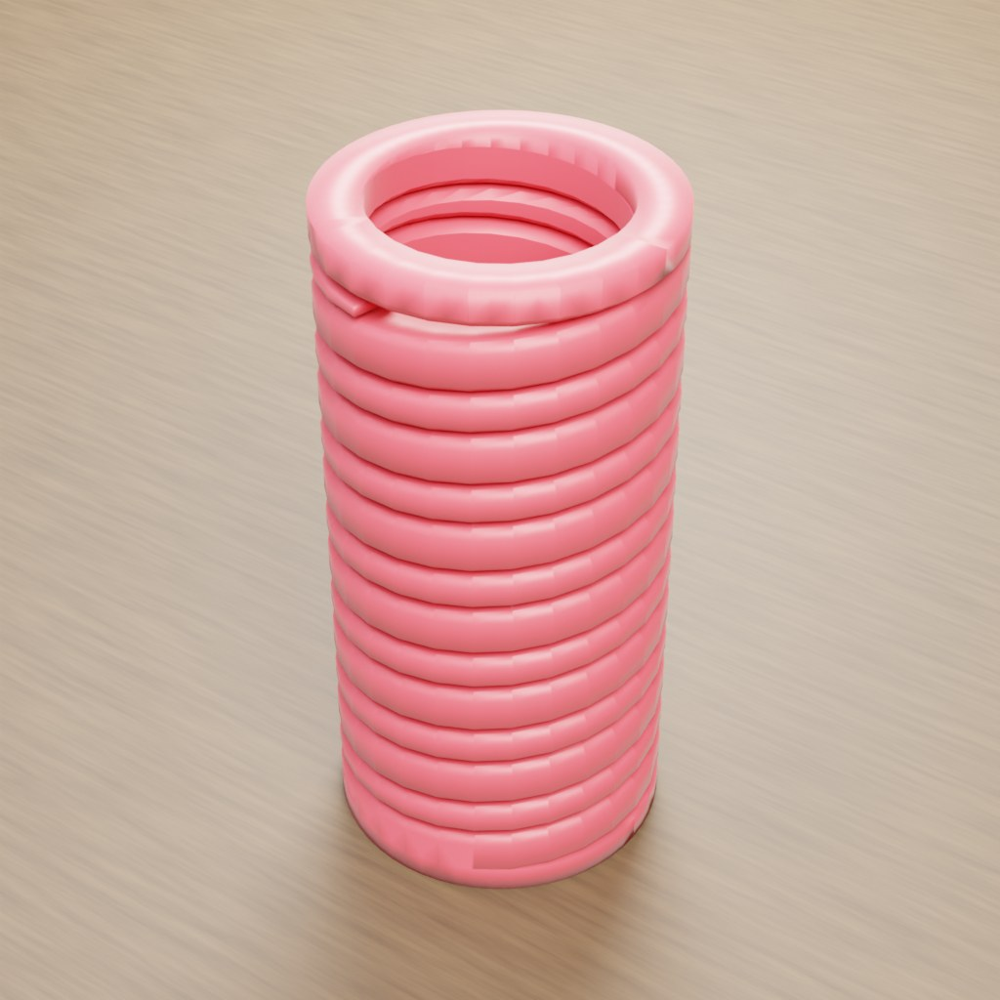
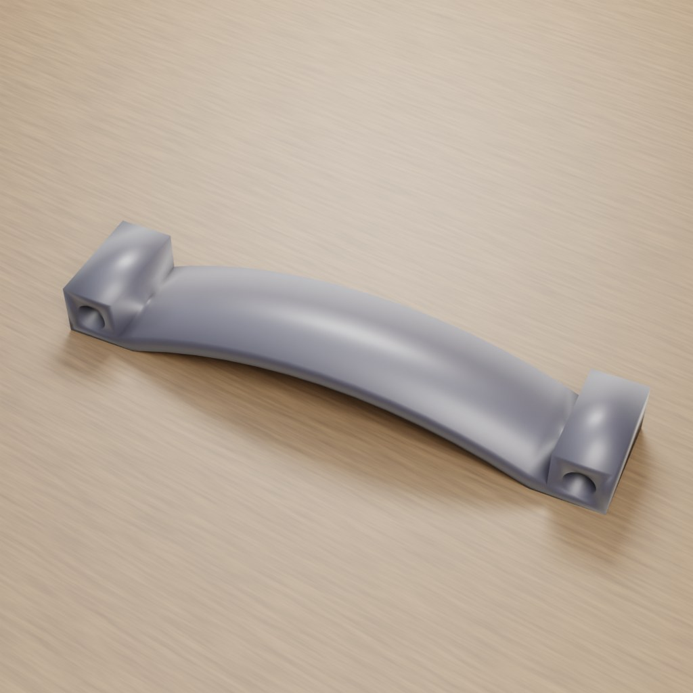
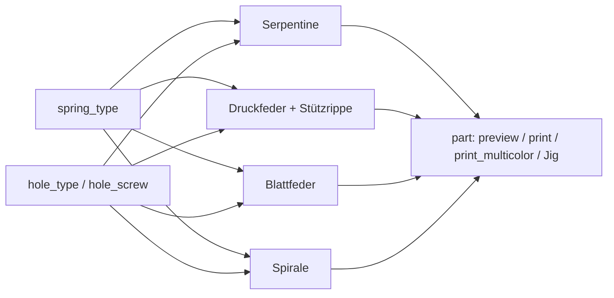
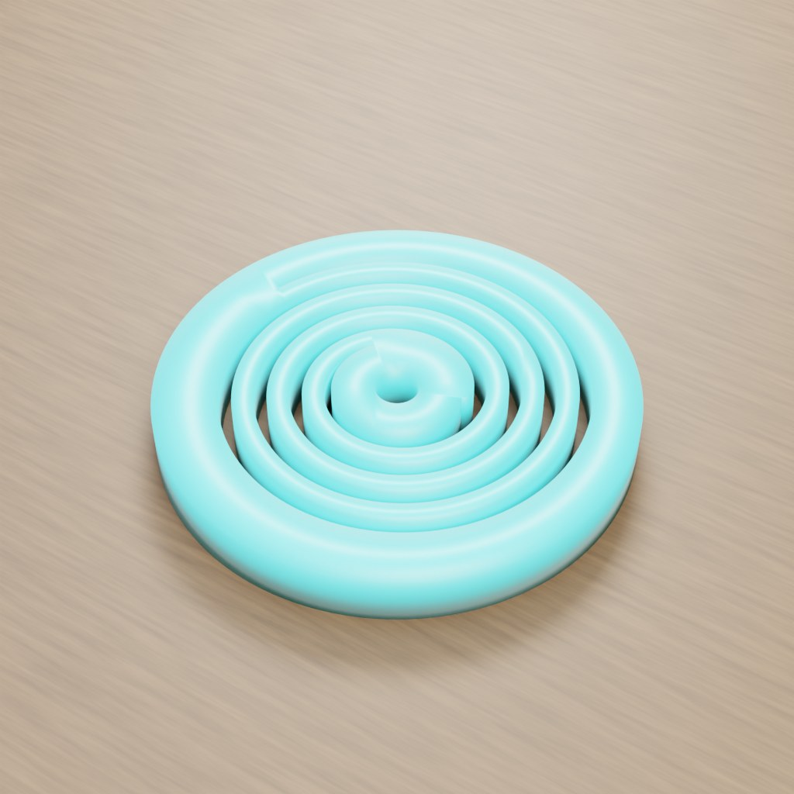
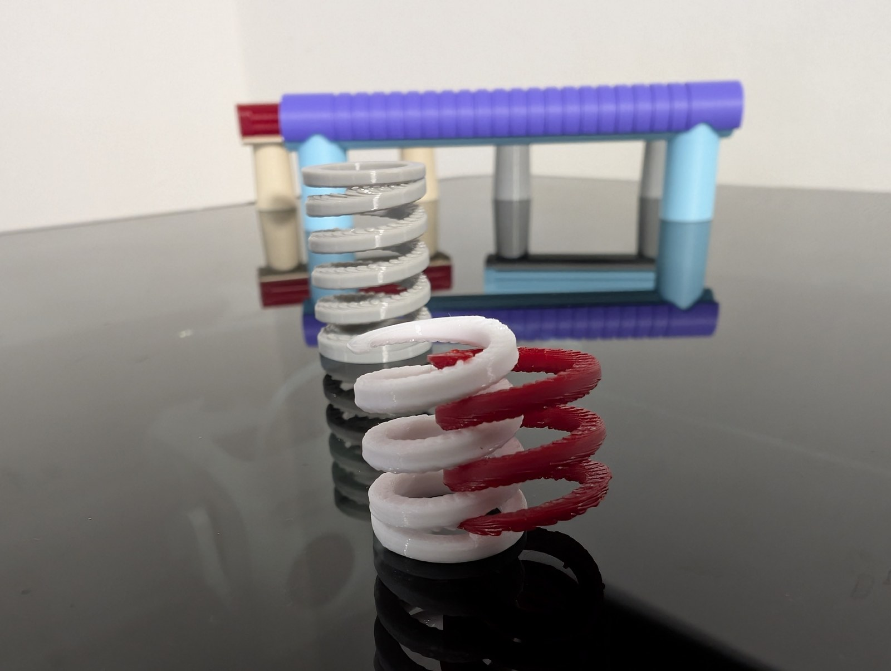

# Parametric Spring Generator – Vier Federtypen mit flexiblen Befestigungen

[← Alle Modelle im Überblick](../../README.de.md)

🌐 [English](README.md) | **Deutsch**

Parametrischer Generator für funktionale 3D-gedruckte Federn: Serpentinenfeder,
Druckfeder (Kompressionsspirale), Blattfeder und flache Spiral-/Torsionsfeder in
einem Modell. Jeder Typ ist so orientiert, dass die Biegung entlang der
Druckschichten läuft – einstellbar im MakerWorld-Customizer.

> **Das Modell mit allen Druckprofilen gibt es ausschließlich auf MakerWorld:**
> 👉 [MakerWorld-Link: https://makerworld.com/en/models/3188130-parametric-springs-with-flexible-mounting-options](https://makerworld.com/en/models/3188130-parametric-springs-with-flexible-mounting-options)
>
> 

Der **Parametric Spring Generator** erzeugt vier Federfamilien aus einem
Parametersatz. Du wählst zuerst den Federtyp (`spring_type`), stellst dann nur die
Gruppe des gewählten Typs ein und legst fest, ob Befestigungslöcher glatt oder als
gedrucktes metrisches Gewinde (M2–M6) ausgeführt werden. Die Druckmodi legen jedes
Teil bereits in die passende Druckorientierung. Die Druckfeder bringt eine
entfernbare Print-in-Place-Stützrippe mit, sodass kein Slicer-Support nötig ist.

## Inhaltsverzeichnis

- [Das Problem](#das-problem)
- [Die Idee](#die-idee)
- [Highlights](#highlights)
- [Parametrische Optionen](#parametrische-optionen)
- [Konstruktion](#konstruktion)
- [Druckempfehlungen](#druckempfehlungen)
- [Anwendungsbeispiele](#anwendungsbeispiele)
- [Fehlersuche / FAQ](#fehlersuche--faq)
- [Entwicklungsgeschichte](#entwicklungsgeschichte)
- [Downloads](#downloads)
- [Lizenz](#lizenz)

## Das Problem

Gedruckte Federn sind ein Thema für sich:

- Kunststoff ist **entlang** der Druckschichten stabil und **quer** dazu schwach.
  Eine Feder, die Schichten auseinanderzieht, bricht nach wenigen Zyklen.
- Fertige Modelle gibt es meist nur für einen Typ und mit festen Anschlüssen. Wer
  eine Feder mit **bestimmter Befestigung** braucht (Zapfen, Schraubauge,
  Montageplatte, Verankerungsring), findet selten etwas Parametrisches.
- Eine stehend gedruckte Spiralfeder hängt in den Lücken durch, normaler Support
  verschmilzt mit den Windungen und lässt sich nicht mehr entfernen.
- Löcher und Gewinde, die waagerecht liegen, werden rau oder sacken ein.

Der Ausgangspunkt war schlicht: Ich brauchte Federn mit mehreren verschiedenen
Befestigungsarten und habe kein flexibles parametrisches Modell dafür gefunden.

## Die Idee

Vier Federtypen teilen sich eine Parameterstruktur, eine Gruppe für
Befestigungslöcher und eine Ausgabe-Auswahl. Die Orientierung im Druck war von
Anfang an Teil des Entwurfs:

- Serpentine und Blattfeder liegen flach und biegen sich in der Druckebene.
- Die Druckfeder steht aufrecht, die Last läuft entlang der Helixachse und damit
  entlang der Schichten. Eine separate, 0,4 mm abgesetzte Stützrippe füllt die
  Lücken und wird nach dem Druck entfernt.
- Die Spiralfeder wickelt sich flach und speichert die Drehenergie in der Ebene.

Bei waagerechten Bohrungen (Zapfenloch der Serpentine) setzt das Modell auf
**tropfenförmige Löcher** statt auf gedruckte Gewinde; bei senkrechten Bohrungen
(Blattfeder-Auge, Druckfeder-Platte, Spiral-Nabe) sind echte gedruckte Gewinde
möglich.

## Highlights

- **Vier Federtypen:** `serpentine`, `compression`, `leaf` und `spiral`.
- **Serpentinenfeder:** runde oder eckige Windungen, Endkappen, Schwalbenschwanz-Zapfen
  an beiden Enden, optional mit Bohrung im Zapfen.
- **Druckfeder mit Print-in-Place-Stütze:** stehend ohne Slicer-Support druckbar, die
  Stützrippe wird nach dem Druck herausgedreht oder -gezogen.
- **Enden der Druckfeder:** plan geschliffen (`flat`), offen (`open`) oder mit
  Montageplatte unten (`plate`) und offenem oder geschlossenem Deckel oben.
- **Blattfeder:** gewölbte Klinge mit massiven Befestigungsaugen.
- **Spiralfeder:** flache archimedische Spirale mit Nabe und Verankerungsring,
  Stiftlasche oder Haken am äußeren Ende.
- **Befestigungslöcher überall wählbar:** glatt oder gedrucktes metrisches Gewinde
  M2 bis M6 (`hole_type`, `hole_screw`).
- **Zwei-Material-Trick:** Feder, Stützrippe und Abreißnadeln sind getrennte
  Farbgruppen, die Stütze kann in einem anderen Filament gedruckt werden.
- **Montagehilfe (Jig)** für die Serpentine: ein geschlitzter Halter, der die flache
  Feder beim Einstecken der Zapfen führt.
- **Zehn Referenzvarianten** mit Bambu-Studio-Profilen für den P2S (PETG).

## Parametrische Optionen

Die Namen entsprechen den Customizer-Parametern des Modells. Nur die Gruppe des
gewählten Federtyps wird ausgewertet.

### Schritt 1 – Federtyp

| Parameter | Bedeutung | Standard | Bereich / Einheit |
|---|---|---|---|
| `spring_type` | Federtyp: `serpentine`, `compression`, `leaf`, `spiral` | `serpentine` | Auswahl |

### Serpentinenfeder

| Parameter | Bedeutung | Standard | Bereich / Einheit |
|---|---|---|---|
| `ser_coils` | Anzahl der Windungen; mehr = weicher, längerer Federweg | 8 | 3–24 |
| `ser_style` | Windungsform: `round` (halbkreisförmig) oder `square` (eckiger Mäander) | `round` | Auswahl |
| `ser_wire` | Drahtstärke; der wichtigste Härte-Regler | 0,8 | 0,6–2,0 mm, Schritt 0,1 |
| `ser_depth` | Tiefe (Z, gedruckte Höhe); tiefer = steifer | 6 | 3–12 mm, Schritt 0,5 |
| `ser_width` | Breite (X); breiter = steifer | 16 | 10–40 mm |
| `ser_cap_h` | Höhe der massiven Endkappen, 0 = keine | 1,6 | 0–8 mm, Schritt 0,2 |
| `ser_cap_ext` | Überstand der Endkappen seitlich über die Windungen | 1,6 | 0–4 mm, Schritt 0,2 |
| `ser_pegs` | Schwalbenschwanz-Zapfen an beiden Enden | 1 | 0 = keine, 1 = ja |
| `ser_peg_w` | Zapfenquerschnitt (quadratisch) | 5 | 3–8 mm, Schritt 0,2 |
| `ser_peg_l` | Zapfenlänge | 4 | 2–8 mm, Schritt 0,2 |
| `ser_peg_hole` | Bohrung in der Zapfenachse (glatt oder nach Schritt 2) | 0 | 0 = massiv, 1 = Bohrung |
| `ser_tool_grip` | Zusatzlänge je Ende der Montagehilfe | 0 | 0–40 mm |

### Druckfeder (Kompressionsspirale)

| Parameter | Bedeutung | Standard | Bereich / Einheit |
|---|---|---|---|
| `coil_dia` | Mittlerer Windungsdurchmesser (Drahtmitte); Außendurchmesser = Wert + Drahtbreite | 18 | 8–60 mm |
| `coil_wire` | Radiale Drahtbreite; dicker = steifer | 3,0 | 1,5–6 mm, Schritt 0,1 |
| `coil_wire_h` | Axiale Drahthöhe des rechteckigen Bands; klein = weiches Flachband | 3,0 | 1,0–6 mm, Schritt 0,1 |
| `coil_turns` | Aktive Windungen (wird ignoriert, wenn `coil_len` gesetzt ist) | 6 | 2–20, Schritt 0,5 |
| `coil_len` | Ziel-Freilänge, 0 = Windungszahl verwenden | 0 | 0–150 mm |
| `coil_gap` | Abstand zwischen den Windungen | 3,0 | 0,4–12 mm, Schritt 0,1 |
| `coil_support` | Print-in-Place-Stützrippe an/aus | `on` | `on`, `off` |
| `coil_clearance` | Abstand zwischen Feder und Stützrippe je Fläche; größer = lockerer | 0,4 | 0,2–0,8 mm, Schritt 0,05 |
| `coil_chamfer` | Fase an den Drahtkanten, 0 = keine | 0,5 | 0–2 mm, Schritt 0,1 |
| `coil_support_tabs` | Abreißnadeln je Windung, die die Stütze beim Druck halten | 3 | 0–8 |
| `coil_ends` | Enden: `flat` (plan, steht gerade), `open` (offen), `plate` (Montageplatte unten) | `flat` | Auswahl |
| `coil_plate_t` | Dicke der Montageplatte | 2,0 | 1,2–4 mm, Schritt 0,2 |
| `coil_plate_d` | Plattendurchmesser, 0 = Federaußendurchmesser | 0 | 0–90 mm |
| `coil_top` | Oberes Ende bei `plate`: `closed` (überbrückter Deckel) oder `open` | `closed` | Auswahl |
| `coil_screw_len` | Länge des Schraubkanals, 0 = automatisch | 0 | 0–40 mm |

### Blattfeder

| Parameter | Bedeutung | Standard | Bereich / Einheit |
|---|---|---|---|
| `leaf_len` | Sehnenlänge zwischen den Enden | 80 | 30–200 mm |
| `leaf_w` | Breite (Y) | 18 | 8–50 mm |
| `leaf_t` | Klingendicke; bestimmt die Steifigkeit | 3,0 | 1,5–8 mm, Schritt 0,1 |
| `leaf_rise` | Bogenhöhe; bestimmt den Federweg bis zum Flachdrücken | 10 | 2–40 mm |
| `leaf_hole` | Durchmesser der Befestigungsaugen, 0 = keine | 5 | 0–12 mm, Schritt 0,5 |

### Spiral-/Torsionsfeder

| Parameter | Bedeutung | Standard | Bereich / Einheit |
|---|---|---|---|
| `spiral_hub` | Nabendurchmesser | 12 | 4–40 mm |
| `spiral_bore` | Bohrung der Nabe, 0 = massiv | 4 | 0–20 mm, Schritt 0,5 |
| `spiral_wire` | Bandbreite der Spirale | 2,0 | 1,0–5 mm, Schritt 0,1 |
| `spiral_gap` | Abstand zwischen den Windungen (bleibt offen, damit Schichten nicht verschmelzen) | 1,2 | 0,4–4 mm, Schritt 0,1 |
| `spiral_turns` | Anzahl der Windungen | 4 | 2–12, Schritt 0,5 |
| `spiral_h` | Flache Dicke (Z) | 5 | 2–14 mm, Schritt 0,5 |
| `spiral_outer` | Äußeres Ende: `ring` (Verankerungsring), `tab` (Stiftlasche mit Loch), `hook` (Haken) | `ring` | Auswahl |
| `spiral_ring_wall` | Wandstärke des Rings | 2,5 | 1,2–6 mm, Schritt 0,1 |
| `spiral_ring_holes` | Montagelöcher im Ring, 0 = keine | 0 | 0–8 |
| `spiral_tab` | Durchmesser der Stiftlasche | 8 | 4–16 mm, Schritt 0,5 |

### Schritt 2 – Befestigungslöcher

| Parameter | Bedeutung | Standard | Bereich / Einheit |
|---|---|---|---|
| `hole_type` | Lochart für alle Montagelöcher: `plain` (glatt) oder `threaded` (gedrucktes Gewinde) | `plain` | Auswahl |
| `hole_screw` | Schraubengröße für Gewinde bzw. Durchgangsloch | `M3` | M2, M2.5, M3, M4, M5, M6 |

### Schritt 3 – Vorschau und Export

| Parameter | Bedeutung | Standard | Bereich / Einheit |
|---|---|---|---|
| `part` | Ausgabe: `preview` (farbige Anzeige), `print` (ein Material), `print_multicolor` (Feder, Stütze, Nadeln getrennt), `print_with_tool` (Serpentine plus Jig), `tool_only` (nur Jig) | `preview` | Auswahl |
| `col_part` | Vorschaufarbe der Feder | `RoyalBlue` | 13 Farben |
| `col_support` | Farbe der Stützrippe (Vorschau und Mehrfarb-Export) | `Gainsboro` | 13 Farben |
| `col_needle` | Farbe der Abreißnadeln | `Crimson` | 13 Farben |

### Schritt 4 – Qualität

| Parameter | Bedeutung | Standard | Bereich / Einheit |
|---|---|---|---|
| `round_res` | Glätte der Rundungen (`$fn`); für den Export erhöhen | 96 | 32–200, Schritt 8 |

## Konstruktion

### OpenSCAD-Ansatz

Das Modell ist reines OpenSCAD ohne externe Bibliotheken und läuft im
MakerWorld-Customizer. Ein Dispatcher wählt anhand von `spring_type` die passende
Feder und anhand von `part` die Ausgabe (Vorschau oder bettfertige Druckpose).
Alle Maße sind in Millimetern.

### Parametrische Logik

Abgeleitete Größen aus den Formeln im Modell:

| Größe | Formel / Regel |
|---|---|
| Serpentine: Zeilenabstand | 2 × `ser_wire` (die Lücke ist so breit wie der Draht) |
| Serpentine: Wendekreis (rund) | halber Zeilenabstand |
| Serpentine: Höhe der Windungen | (`ser_coils` − 1) × Zeilenabstand + `ser_wire` |
| Druckfeder: Steigung | max(`coil_gap` + `coil_wire_h`, `coil_wire_h` + 0,4) – die Windungen können nie verschmelzen |
| Druckfeder: Windungszahl bei Länge | (`coil_len` − `coil_wire_h`) / Steigung, plus 1 bei geschlossenen Enden |
| Druckfeder: Stützrippe aktiv | wenn `coil_gap` − 2 × `coil_clearance` ≥ 0,4 mm |
| Druckfeder: Stützrippen-Höhe | lokale Lücke − 2 × `coil_clearance` |
| Blattfeder: Bogenradius | R = (Länge² / 4 + Höhe²) / (2 × Höhe) |
| Blattfeder: Auge | Pad = Lochdurchmesser + 4 mm, damit die Bohrung die Klinge nicht durchtrennt |
| Spirale: Wachstum je Windung | `spiral_wire` + `spiral_gap` |
| Spirale: Außenradius der Mittellinie | Nabenradius + Wachstum × Windungen |

Mit den Voreinstellungen ergeben sich zum Beispiel:

- **Serpentine** (8 Windungen, Draht 0,8 mm): Zeilenabstand 1,6 mm, Windungshöhe
  12,0 mm, Breite mit Endkappen 19,2 mm.
- **Druckfeder** (Ø 18 mm, Band 3 × 3 mm, 6 Windungen, Lücke 3 mm): Steigung 6 mm,
  Außendurchmesser 21 mm, Freihöhe 33 mm vor dem Schleifen der Enden (rund 31 mm
  danach). Die Stützrippe ist 2,2 mm hoch und hält 0,4 mm Abstand zum Band.
- **Blattfeder** (80 mm Sehne, 10 mm Bogenhöhe): Bogenradius 85 mm.
- **Spirale** (Nabe 12 mm, Band 2 mm, Lücke 1,2 mm, 4 Windungen, Ring 2,5 mm):
  3,2 mm Wachstum je Windung, Ringaußendurchmesser rund 44,6 mm.

Die Werte sind aus den Formeln und den Standardwerten abgeleitet.

### Besondere Algorithmen

- **Serpentine als Hull-Kette:** Die Mittellinie wird als Punktfolge aus Zeilen und
  Halbkreis-Wendungen erzeugt, benachbarte Punkte werden mit Kreisprofilen
  „verhüllt“ (Hull) und einmal extrudiert. Das Ergebnis ist ein einziges Band.
- **Rechteckige Helix für die Druckfeder:** Das Drahtprofil ist ein gefastes
  Rechteck mit senkrechten Innen- und Außenwänden. Die Helix entsteht aus vielen
  dünnen Schnitten, die paarweise verhüllt werden. Die Steigung wird über ein
  Integral der Steigungsfunktion gerampt, sodass die Endwindungen flach auslaufen.
- **Print-in-Place-Stützrippe:** Eine zweite, in die Lücken eingefügte Helix füllt jede
  Lücke bis auf `coil_clearance`. Ihre Höhe folgt der lokalen Steigung, sie läuft
  also in die flachen Enden aus und verschmilzt dort nicht. Zu enge Lücken
  überspringt das Modell automatisch.
- **Abreißnadeln:** Dünne Pfeiler (0,6 mm) überbrücken den Abstand zwischen Feder und
  Stütze, damit die Rippe beim Druck nicht schwimmt. Sie brechen beim Entfernen ab.
- **Geschliffene Enden:** Bei `flat` und `plate` werden Ober- und Unterseite
  abgeschnitten, damit echte ebene Auflageflächen entstehen. Feder, Stütze und
  Nadeln werden identisch behandelt und bleiben deckungsgleich.
- **Tropfenloch im Zapfen:** Ein waagerechtes Loch bekommt ein 45°-Dach (Tropfenform),
  damit es ohne Support rund bleibt. Durchmesser und Dach sind so begrenzt, dass
  mindestens rund 0,8 mm Seitenwand und 0,4 mm Dach bleiben. Bei „threaded“ wird hier
  statt eines Gewindes ein **Kernloch für selbstschneidende Schrauben** gebohrt.
- **Gedrucktes Innengewinde:** Der Gewindeschneider ist ein verdrehter, extrudierter
  Zahnquerschnitt mit Einlaufkonus; die Steigung folgt der gewählten
  Schraubengröße (M2–M6).
- **Spiralenden:** Der Verankerungsring verschmilzt das freie Ende der Spirale mit
  einem konzentrischen Ring. Der Haken ist ein „Zuckerstangen“-Bogen aus geraden
  Abschnitt und 180°-Kurve mit gleicher Bandbreite.

### Modularität

Der Code trennt Serpentine, Zapfen und Zapfenloch, Montagehilfe, Helix-Bausteine
(Profil, Segment, Stützrippe, Nadel, Endring), Gewinde- und Lochgenerator,
Blattprofil, Spiralen-Generator und die Druckposen. Die Gewindemaße (M2–M6) und
Kernloch-Durchmesser sind zentral hinterlegt und gelten für alle Montagelöcher.

### Druckoptimierungen

- **Biegung entlang der Schichten:** Serpentine und Blattfeder liegen flach, die
  Blattfeder mit dem Bogen in der Ebene und der Breite nach oben.
- **Druckfeder stehend, ohne Slicer-Support:** Die eigene Stützrippe ersetzt ihn.
- **Fasen** an den Drahtkanten für saubere erste und letzte Layer.
- **Gesicherte Löcher:** Das Augen-Pad und die Zapfenbegrenzung verhindern, dass
  Bohrungen das Bauteil durchtrennen.
- **Offene Windungsabstände** bei der Spirale, damit Layer nicht verschmelzen.

## Druckempfehlungen

Die mitgelieferten Profile sind für den **Bambu Lab P2S** mit PETG erstellt (4 Wände,
Gyroid 40 %). Das Modell lässt sich auch auf anderen Bambu-Lab-Druckern fertigen.

| Federtyp | Ausrichtung | Material | Layerhöhe | Wände / Infill |
|---|---|---|---|---|
| Serpentine | flach (wie modelliert) | PETG / TPU | 0,15–0,20 mm | 3–4 Wände |
| Druckfeder | stehend | TPU / PETG | 0,10–0,20 mm | hoher Infill (70–100 %), langsam |
| Blattfeder | flach, Bogen in der Ebene (Breite nach oben) | PETG | 0,15–0,20 mm | 3–4 Wände |
| Spirale | flach | TPU / PETG | 0,10–0,15 mm | 3–4 Wände, langsam |

**Besondere Hinweise**

- **Kein PLA** für arbeitende Federn: PLA ist zu spröde. PETG ist federnd und zäh,
  TPU weich mit hohem Rückfederungsvermögen.
- **Kunststoff kriecht:** Eine Feder nicht dauerhaft voll zusammengedrückt lagern;
  im Zweifel eine dickere Drahtstärke wählen.
- **Supports:** keine vom Slicer. Bei der Druckfeder niemals Baum- oder
  Normal-Support aktivieren – er verschmilzt mit den Windungen. Die Feder auch nie
  liegend drucken, sonst läuft die Last quer zu den Schichten und sie delaminiert.
- **Brim:** Ein Brim von 5–8 mm hilft der Druckfeder (kleine Standfläche).
- **Stützrippe entfernen:** Bei offenen Enden herausdrehen; bei Platte oder Deckel
  seitlich durch die Nut herausziehen. Die Abreißnadeln brechen ab, ein stumpfes
  Messer hilft.
- **Zwei Materialien:** Im Modus `print_multicolor` kommen Feder, Stütze und Nadeln
  als drei Objekte in den Slicer. Feder in PETG oder TPU, Stütze und Nadeln in PLA:
  PLA haftet schlecht an PETG über den 0,4-mm-Abstand und löst sich leichter.
  Dafür den STL **direkt aus der OpenSCAD-Vorschau** exportieren, ohne F6/Render
  und ohne Kommandozeile – sonst werden die Gruppen vereinigt.
- **Gewinde:** Gedruckte Gewinde mit 0,10–0,15 mm Layerhöhe und mindestens 3 Wänden
  drucken und mit Gewindebohrer oder Schraube nacharbeiten. Der Customizer warnt,
  wenn Nabe oder Zapfen für das Gewinde zu klein sind.
- **Federrate messen:** Die Formel für Metallfedern passt nicht auf ein gedrucktes
  Band. Mit bekannten Gewichten belasten (F = m · 9,81 N), Federweg x ablesen,
  k = F / x.
- Im Modus `preview` ist das Modell nur Anzeige. Zum Drucken auf einen Druckmodus
  umstellen; diese legen das Teil in die vorgesehene Orientierung.

## Anwendungsbeispiele

- **Serpentinenfeder als Rückstellelement** in Klappen und Gehäusen, mit den
  Zapfen in passende Schlitze gesteckt.
- **Druckfeder für Taster und Stößel:** Montageplatte unten, geschlossener Deckel
  oben als Auflage.
- **Blattfeder als Klemme oder Andruckelement:** Bogenhöhe und Dicke bestimmen
  Kraft und Weg, die Augen nehmen Schrauben auf.
- **Spiralfeder als Torsionsrückstellung:** Ring fixieren, Nabe auf eine Achse
  setzen; mit Stiftlasche oder Haken als freies Ende.
- **Prototypen im Homelab:** Rack-Blenden, Gehäuseklappen oder Kabelhalter mit
  federnder Rückstellung.
- **Zwei-Material-Druck:** Feder in PETG, Stützrippe in PLA zum leichten Entfernen.

## Fehlersuche / FAQ

| Symptom | Ursache | Fix |
|---|---|---|
| Feder bricht nach wenigen Zyklen | PLA oder Last quer zu den Schichten | PETG oder TPU verwenden; Druckpose des Modus nicht ändern |
| Feder ist zu hart oder zu weich | Drahtstärke / Tiefe / Windungen passen nicht | Serpentine: `ser_wire`, `ser_depth`, `ser_coils`; Druckfeder: `coil_wire`, `coil_wire_h`, `coil_gap`, `coil_turns` |
| Stützrippe lässt sich nicht lösen | `coil_clearance` zu klein für den Drucker | `coil_clearance` erhöhen (bis 0,8 mm) |
| Stützrippe schwimmt beim Druck | zu wenige Abreißnadeln | `coil_support_tabs` erhöhen |
| Keine Stützrippe im Modell | Lücke zu klein | `coil_gap` erhöhen: nötig ist `coil_gap` − 2 × `coil_clearance` ≥ 0,4 mm |
| Feder verschmilzt zu einem Block | Support im Slicer aktiv | Slicer-Support ausschalten |
| Gewinde im Zapfen rau oder fehlt | waagerechtes Loch | `plain` für Durchgangsloch oder selbstschneidende Schraube ins Kernloch drehen |
| Mehrfarb-STL hat nur eine Farbe | Export über F6/Render oder Kommandozeile | STL direkt aus der Vorschau exportieren |
| Spirale wirkt verschmolzen | `spiral_gap` zu klein | `spiral_gap` erhöhen |

## Entwicklungsgeschichte

Die Dateien des Modells stammen vom 18. August 2026. Ausgangspunkt war ein
bewährtes flaches Serpentinen-Muster; dazu kamen Druckfeder, Blattfeder und
Spiralfeder sowie die gemeinsame Gruppe für Befestigungslöcher. Die Geometrie der
Druckfeder (Bandbreite, rund 0,4 mm Trennabstand der Stützrippe, Einrückung der
Stütze von den Enden) wurde an einer gedruckten Probe abgeleitet; die Stütze ließ
sich im Test mit einem stumpfen Messer entfernen, ohne die Feder zu beschädigen.
Auf Gewindekanäle für waagerechte Bohrungen habe ich bewusst verzichtet und
stattdessen Tropfenlöcher mit Kernloch verwendet, weil die Druckorientierung für
mich wichtig war.

Die Bilder in diesem Repository sind Renderings der Modellgeometrie
beziehungsweise daraus abgeleitete Szenenbilder; das letzte Bild ist ein
Praxisfoto.

## Downloads

Print files are intentionally available exclusively on MakerWorld.

👉 MakerWorld-Link: https://makerworld.com/en/models/3188130-parametric-springs-with-flexible-mounting-options

Profil: <https://makerworld.com/en/@BetaHydri>

## Lizenz

Dokumentation und Bilder in diesem Repository; Modell- und Druckdateien werden
ausschließlich über MakerWorld verteilt. Dokumentation und Bilder: © BetaHydri.
Das Modell (inkl. Quellcode) und alle Druckdateien stehen unter der auf
MakerWorld angegebenen Lizenz. Dieses Repository enthält bewusst keine Modell-,
Quellcode- oder Druckdateien.
