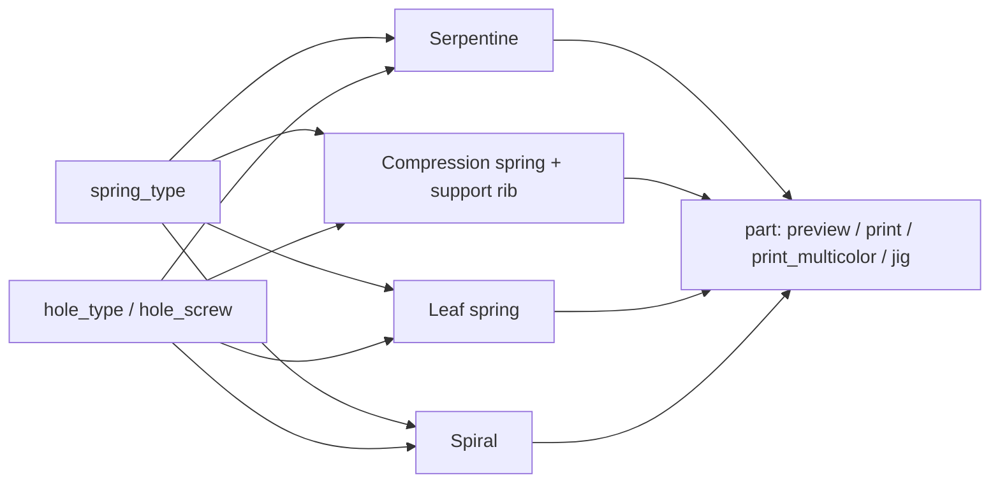

# Parametric Spring Generator – Four Spring Types with Flexible Mounting Options

[← All models](../../README.md)

🌐 **English** | [Deutsch](README.de.md)

Parametric generator for functional 3D-printed springs: serpentine spring,
compression spring (helical coil), leaf spring and flat spiral/torsion spring in
a single model. Each type is oriented so that the bending runs along the print
layers – adjustable in the MakerWorld Customizer.

> **The model with all print profiles is available exclusively on MakerWorld:**
> 👉 [MakerWorld link: https://makerworld.com/en/models/3188130-parametric-springs-with-flexible-mounting-options](https://makerworld.com/en/models/3188130-parametric-springs-with-flexible-mounting-options)
>
> 

The **Parametric Spring Generator** creates four spring families from a single
parameter set. You first choose the spring type (`spring_type`), then adjust only
the group for the selected type, and decide whether mounting holes are made
plain or as printed metric threads (M2–M6). The print modes already place each
part in the appropriate print orientation. The compression spring comes with a
removable print-in-place support rib, so no slicer support is needed.

## Table of Contents

- [The Problem](#the-problem)
- [The Idea](#the-idea)
- [Highlights](#highlights)
- [Parametric Options](#parametric-options)
- [Design](#design)
- [Print Recommendations](#print-recommendations)
- [Use Cases](#use-cases)
- [Troubleshooting / FAQ](#troubleshooting--faq)
- [Development History](#development-history)
- [Downloads](#downloads)
- [License](#license)

## The Problem

Printed springs are a topic of their own:

- Plastic is strong **along** the print layers and weak **across** them. A spring
  that pulls layers apart breaks after a few cycles.
- Ready-made models usually exist for only one type and with fixed connections.
  If you need a spring with a **specific mounting method** (peg, screw eye,
  mounting plate, anchor ring), you will rarely find anything parametric.
- A coil spring printed upright sags in the gaps, and normal support fuses with
  the coils and can no longer be removed.
- Holes and threads that lie horizontally come out rough or sag.

The starting point was simply this: I needed springs with several different
mounting methods and could not find a flexible parametric model for them.

## The Idea

Four spring types share one parameter structure, one group for mounting holes and
one output selection. Print orientation was part of the design from the start:

- The serpentine and leaf springs lie flat and bend in the print plane.
- The compression spring stands upright, and the load runs along the helix axis
  and therefore along the layers. A separate support rib, offset by 0.4 mm, fills
  the gaps and is removed after printing.
- The spiral spring winds flat and stores the rotational energy in the plane.

For horizontal bores (the serpentine's peg hole), the model relies on
**teardrop-shaped holes** instead of printed threads; for vertical bores (leaf
spring eye, compression spring plate, spiral hub), true printed threads are
possible.

## Highlights

- **Four spring types:** `serpentine`, `compression`, `leaf` and `spiral`.
- **Serpentine spring:** round or square coils, end caps, dovetail pegs at both
  ends, optionally with a bore in the peg.
- **Compression spring with print-in-place support:** printable upright without
  slicer support; the support rib is unscrewed or pulled out after printing.
- **Compression spring ends:** ground flat (`flat`), open (`open`) or with a
  mounting plate at the bottom (`plate`) and an open or closed cap at the top.
- **Leaf spring:** curved blade with solid mounting eyes.
- **Spiral spring:** flat Archimedean spiral with hub and anchor ring, pin tab or
  hook at the outer end.
- **Mounting holes selectable everywhere:** plain or printed metric thread M2 to M6
  (`hole_type`, `hole_screw`).
- **Two-material trick:** spring, support rib and tear-off needles are separate
  color groups; the support can be printed in a different filament.
- **Assembly aid (jig)** for the serpentine: a slotted holder that guides the flat
  spring while the pegs are inserted.
- **Ten reference variants** with Bambu Studio profiles for the P2S (PETG).

## Parametric Options

The names correspond to the model's Customizer parameters. Only the group of the
selected spring type is evaluated.

### Step 1 – Spring Type

| Parameter | Meaning | Default | Range / Unit |
|---|---|---|---|
| `spring_type` | Spring type: `serpentine`, `compression`, `leaf`, `spiral` | `serpentine` | Selection |

### Serpentine Spring

| Parameter | Meaning | Default | Range / Unit |
|---|---|---|---|
| `ser_coils` | Number of coils; more = softer, longer spring travel | 8 | 3–24 |
| `ser_style` | Coil shape: `round` (semicircular) or `square` (angular meander) | `round` | Selection |
| `ser_wire` | Wire thickness; the most important stiffness control | 0.8 | 0.6–2.0 mm, step 0.1 |
| `ser_depth` | Depth (Z, printed height); deeper = stiffer | 6 | 3–12 mm, step 0.5 |
| `ser_width` | Width (X); wider = stiffer | 16 | 10–40 mm |
| `ser_cap_h` | Height of the solid end caps, 0 = none | 1.6 | 0–8 mm, step 0.2 |
| `ser_cap_ext` | Lateral overhang of the end caps beyond the coils | 1.6 | 0–4 mm, step 0.2 |
| `ser_pegs` | Dovetail pegs at both ends | 1 | 0 = none, 1 = yes |
| `ser_peg_w` | Peg cross-section (square) | 5 | 3–8 mm, step 0.2 |
| `ser_peg_l` | Peg length | 4 | 2–8 mm, step 0.2 |
| `ser_peg_hole` | Bore along the peg axis (plain or as per Step 2) | 0 | 0 = solid, 1 = bore |
| `ser_tool_grip` | Additional length per end of the assembly aid | 0 | 0–40 mm |

### Compression Spring (Helical Coil)

| Parameter | Meaning | Default | Range / Unit |
|---|---|---|---|
| `coil_dia` | Mean coil diameter (wire center); outer diameter = value + wire width | 18 | 8–60 mm |
| `coil_wire` | Radial wire width; thicker = stiffer | 3.0 | 1.5–6 mm, step 0.1 |
| `coil_wire_h` | Axial wire height of the rectangular band; small = soft flat band | 3.0 | 1.0–6 mm, step 0.1 |
| `coil_turns` | Active turns (ignored if `coil_len` is set) | 6 | 2–20, step 0.5 |
| `coil_len` | Target free length, 0 = use the number of turns | 0 | 0–150 mm |
| `coil_gap` | Gap between the turns | 3.0 | 0.4–12 mm, step 0.1 |
| `coil_support` | Print-in-place support rib on/off | `on` | `on`, `off` |
| `coil_clearance` | Gap between spring and support rib per surface; larger = looser | 0.4 | 0.2–0.8 mm, step 0.05 |
| `coil_chamfer` | Chamfer on the wire edges, 0 = none | 0.5 | 0–2 mm, step 0.1 |
| `coil_support_tabs` | Tear-off needles per turn that hold the support during printing | 3 | 0–8 |
| `coil_ends` | Ends: `flat` (flat, stands straight), `open` (open), `plate` (mounting plate at the bottom) | `flat` | Selection |
| `coil_plate_t` | Thickness of the mounting plate | 2.0 | 1.2–4 mm, step 0.2 |
| `coil_plate_d` | Plate diameter, 0 = spring outer diameter | 0 | 0–90 mm |
| `coil_top` | Top end with `plate`: `closed` (bridged cap) or `open` | `closed` | Selection |
| `coil_screw_len` | Length of the screw channel, 0 = automatic | 0 | 0–40 mm |

### Leaf Spring

| Parameter | Meaning | Default | Range / Unit |
|---|---|---|---|
| `leaf_len` | Chord length between the ends | 80 | 30–200 mm |
| `leaf_w` | Width (Y) | 18 | 8–50 mm |
| `leaf_t` | Blade thickness; determines the stiffness | 3.0 | 1.5–8 mm, step 0.1 |
| `leaf_rise` | Arch height; determines the spring travel until flattened | 10 | 2–40 mm |
| `leaf_hole` | Diameter of the mounting eyes, 0 = none | 5 | 0–12 mm, step 0.5 |

### Spiral/Torsion Spring

| Parameter | Meaning | Default | Range / Unit |
|---|---|---|---|
| `spiral_hub` | Hub diameter | 12 | 4–40 mm |
| `spiral_bore` | Bore of the hub, 0 = solid | 4 | 0–20 mm, step 0.5 |
| `spiral_wire` | Band width of the spiral | 2.0 | 1.0–5 mm, step 0.1 |
| `spiral_gap` | Gap between the turns (stays open so layers do not fuse) | 1.2 | 0.4–4 mm, step 0.1 |
| `spiral_turns` | Number of turns | 4 | 2–12, step 0.5 |
| `spiral_h` | Flat thickness (Z) | 5 | 2–14 mm, step 0.5 |
| `spiral_outer` | Outer end: `ring` (anchor ring), `tab` (pin tab with hole), `hook` (hook) | `ring` | Selection |
| `spiral_ring_wall` | Wall thickness of the ring | 2.5 | 1.2–6 mm, step 0.1 |
| `spiral_ring_holes` | Mounting holes in the ring, 0 = none | 0 | 0–8 |
| `spiral_tab` | Diameter of the pin tab | 8 | 4–16 mm, step 0.5 |

### Step 2 – Mounting Holes

| Parameter | Meaning | Default | Range / Unit |
|---|---|---|---|
| `hole_type` | Hole type for all mounting holes: `plain` (plain) or `threaded` (printed thread) | `plain` | Selection |
| `hole_screw` | Screw size for thread or clearance hole | `M3` | M2, M2.5, M3, M4, M5, M6 |

### Step 3 – Preview and Export

| Parameter | Meaning | Default | Range / Unit |
|---|---|---|---|
| `part` | Output: `preview` (colored display), `print` (single material), `print_multicolor` (spring, support, needles separate), `print_with_tool` (serpentine plus jig), `tool_only` (jig only) | `preview` | Selection |
| `col_part` | Preview color of the spring | `RoyalBlue` | 13 colors |
| `col_support` | Color of the support rib (preview and multicolor export) | `Gainsboro` | 13 colors |
| `col_needle` | Color of the tear-off needles | `Crimson` | 13 colors |

### Step 4 – Quality

| Parameter | Meaning | Default | Range / Unit |
|---|---|---|---|
| `round_res` | Smoothness of curves (`$fn`); increase for export | 96 | 32–200, step 8 |

## Design

### OpenSCAD Approach

The model is pure OpenSCAD without external libraries and runs in the MakerWorld
Customizer. A dispatcher selects the matching spring based on `spring_type` and
the output (preview or bed-ready print pose) based on `part`. All dimensions are
in millimeters.

### Parametric Logic

Derived values from the formulas in the model:

| Quantity | Formula / Rule |
|---|---|
| Serpentine: row spacing | 2 × `ser_wire` (the gap is as wide as the wire) |
| Serpentine: turning radius (round) | half the row spacing |
| Serpentine: height of the coils | (`ser_coils` − 1) × row spacing + `ser_wire` |
| Compression spring: pitch | max(`coil_gap` + `coil_wire_h`, `coil_wire_h` + 0.4) – the turns can never fuse |
| Compression spring: number of turns for a given length | (`coil_len` − `coil_wire_h`) / pitch, plus 1 for closed ends |
| Compression spring: support rib active | if `coil_gap` − 2 × `coil_clearance` ≥ 0.4 mm |
| Compression spring: support rib height | local gap − 2 × `coil_clearance` |
| Leaf spring: arc radius | R = (length² / 4 + height²) / (2 × height) |
| Leaf spring: eye | pad = hole diameter + 4 mm, so the bore does not sever the blade |
| Spiral: growth per turn | `spiral_wire` + `spiral_gap` |
| Spiral: outer radius of the centerline | hub radius + growth × turns |

With the default settings, this results in, for example:

- **Serpentine** (8 coils, 0.8 mm wire): row spacing 1.6 mm, coil height
  12.0 mm, width with end caps 19.2 mm.
- **Compression spring** (Ø 18 mm, 3 × 3 mm band, 6 turns, 3 mm gap): pitch 6 mm,
  outer diameter 21 mm, free height 33 mm before grinding the ends (around 31 mm
  afterwards). The support rib is 2.2 mm high and keeps a 0.4 mm gap to the band.
- **Leaf spring** (80 mm chord, 10 mm arch height): arc radius 85 mm.
- **Spiral** (12 mm hub, 2 mm band, 1.2 mm gap, 4 turns, 2.5 mm ring):
  3.2 mm growth per turn, ring outer diameter around 44.6 mm.

The values are derived from the formulas and the default values.

### Special Algorithms

- **Serpentine as a hull chain:** The centerline is generated as a point sequence
  of rows and semicircular turns; adjacent points are "wrapped" (hull) with
  circular profiles and extruded once. The result is a single band.
- **Rectangular helix for the compression spring:** The wire profile is a
  chamfered rectangle with vertical inner and outer walls. The helix is built from
  many thin slices that are hulled in pairs. The pitch is ramped via an integral
  of the pitch function, so that the end turns run out flat.
- **Print-in-place support rib:** A second helix inserted into the gaps fills each
  gap down to `coil_clearance`. Its height follows the local pitch, so it runs out
  into the flat ends and does not fuse there. The model automatically skips gaps
  that are too narrow.
- **Tear-off needles:** Thin pillars (0.6 mm) bridge the gap between spring and
  support so that the rib does not float during printing. They break off when
  removed.
- **Ground ends:** With `flat` and `plate`, the top and bottom are cut off to
  create truly flat bearing surfaces. Spring, support and needles are treated
  identically and remain congruent.
- **Teardrop hole in the peg:** A horizontal hole gets a 45° roof (teardrop shape)
  so that it stays round without support. Diameter and roof are limited so that at
  least around 0.8 mm of side wall and 0.4 mm of roof remain. With "threaded", a
  **pilot hole for self-tapping screws** is drilled here instead of a thread.
- **Printed internal thread:** The thread cutter is a twisted, extruded tooth
  cross-section with a lead-in cone; the pitch follows the selected screw size
  (M2–M6).
- **Spiral ends:** The anchor ring fuses the free end of the spiral with a
  concentric ring. The hook is a "candy cane" arc made of a straight section and
  a 180° curve with the same band width.

### Modularity

The code separates the serpentine, peg and peg hole, assembly aid, helix building
blocks (profile, segment, support rib, needle, end ring), thread and hole
generator, leaf profile, spiral generator and the print poses. The thread
dimensions (M2–M6) and pilot hole diameters are stored centrally and apply to all
mounting holes.

### Print Optimizations

- **Bending along the layers:** The serpentine and leaf springs lie flat, with the
  leaf spring's arch in the plane and its width facing up.
- **Compression spring upright, without slicer support:** Its own support rib
  replaces it.
- **Chamfers** on the wire edges for clean first and last layers.
- **Secured holes:** The eye pad and the peg limit prevent bores from severing the
  part.
- **Open turn gaps** on the spiral so that layers do not fuse.

## Print Recommendations

The supplied profiles are created for the **Bambu Lab P2S** with PETG (4 walls,
gyroid 40 %). The model can also be produced on other Bambu Lab printers.

| Spring type | Orientation | Material | Layer height | Walls / Infill |
|---|---|---|---|---|
| Serpentine | flat (as modeled) | PETG / TPU | 0.15–0.20 mm | 3–4 walls |
| Compression spring | upright | TPU / PETG | 0.10–0.20 mm | high infill (70–100 %), slow |
| Leaf spring | flat, arch in the plane (width facing up) | PETG | 0.15–0.20 mm | 3–4 walls |
| Spiral | flat | TPU / PETG | 0.10–0.15 mm | 3–4 walls, slow |

**Special notes**

- **No PLA** for working springs: PLA is too brittle. PETG is resilient and
  tough; TPU is soft with high rebound.
- **Plastic creeps:** Do not store a spring permanently fully compressed; if in
  doubt, choose a thicker wire.
- **Supports:** none from the slicer. For the compression spring, never enable
  tree or normal support – it fuses with the turns. Also never print the spring
  lying down, otherwise the load runs across the layers and it delaminates.
- **Brim:** A brim of 5–8 mm helps the compression spring (small footprint).
- **Removing the support rib:** With open ends, unscrew it; with a plate or cap,
  pull it out sideways through the groove. The tear-off needles break off; a
  blunt knife helps.
- **Two materials:** In `print_multicolor` mode, spring, support and needles
  arrive in the slicer as three objects. Spring in PETG or TPU, support and
  needles in PLA: PLA adheres poorly to PETG across the 0.4 mm gap and comes off
  more easily. For this, export the STL **directly from the OpenSCAD preview**,
  without F6/Render and without the command line – otherwise the groups are
  merged.
- **Threads:** Print printed threads with 0.10–0.15 mm layer height and at least
  3 walls, and rework them with a tap or screw. The Customizer warns if the hub
  or peg is too small for the thread.
- **Measuring the spring rate:** The formula for metal springs does not fit a
  printed band. Load it with known weights (F = m · 9.81 N), read off the spring
  travel x, k = F / x.
- In `preview` mode, the model is for display only. To print, switch to a print
  mode; these place the part in the intended orientation.

## Use Cases

- **Serpentine spring as a return element** in flaps and enclosures, with the
  pegs inserted into matching slots.
- **Compression spring for buttons and plungers:** mounting plate at the bottom,
  closed cap at the top as a bearing surface.
- **Leaf spring as a clamp or pressure element:** arch height and thickness
  determine force and travel; the eyes accept screws.
- **Spiral spring as a torsion return:** fix the ring, place the hub on an axle;
  with a pin tab or hook as the free end.
- **Homelab prototypes:** rack panels, enclosure flaps or cable holders with
  spring-loaded return.
- **Two-material printing:** spring in PETG, support rib in PLA for easy removal.

## Troubleshooting / FAQ

| Symptom | Cause | Fix |
|---|---|---|
| Spring breaks after a few cycles | PLA or load across the layers | Use PETG or TPU; do not change the print pose of the mode |
| Spring is too hard or too soft | Wire thickness / depth / turns do not fit | Serpentine: `ser_wire`, `ser_depth`, `ser_coils`; compression spring: `coil_wire`, `coil_wire_h`, `coil_gap`, `coil_turns` |
| Support rib cannot be released | `coil_clearance` too small for the printer | Increase `coil_clearance` (up to 0.8 mm) |
| Support rib floats during printing | too few tear-off needles | Increase `coil_support_tabs` |
| No support rib in the model | Gap too small | Increase `coil_gap`: `coil_gap` − 2 × `coil_clearance` ≥ 0.4 mm is required |
| Spring fuses into a block | Slicer support active | Turn off slicer support |
| Thread in the peg is rough or missing | horizontal hole | `plain` for a clearance hole, or drive a self-tapping screw into the pilot hole |
| Multicolor STL has only one color | Export via F6/Render or command line | Export the STL directly from the preview |
| Spiral looks fused | `spiral_gap` too small | Increase `spiral_gap` |

## Development History

The model's files date from August 18, 2026. The starting point was a proven flat
serpentine pattern; the compression spring, leaf spring and spiral spring were
added, along with the shared group for mounting holes. The compression spring's
geometry (band width, roughly 0.4 mm separation gap of the support rib, inset of
the support from the ends) was derived from a printed sample; in testing, the
support could be removed with a blunt knife without damaging the spring. I
deliberately dispensed with thread channels for horizontal bores and used
teardrop holes with a pilot hole instead, because print orientation was important
to me.

The images in this repository are renderings of the model geometry or scene
images derived from it; the last image is a real-life photo.

## Downloads

Print files are intentionally available exclusively on MakerWorld.

👉 MakerWorld link: https://makerworld.com/en/models/3188130-parametric-springs-with-flexible-mounting-options

Profile: <https://makerworld.com/en/@BetaHydri>

## License

Documentation and images in this repository; model and print files are distributed
exclusively via MakerWorld. Documentation and images: © BetaHydri.
The model (including source code) and all print files are under the license
stated on MakerWorld. This repository intentionally contains no model, source
code or print files.
