# Parametric Tool Wall – French-Cleat-Wandplatte im 42-mm-Raster mit einhängbaren Haltern

[← Alle Modelle im Überblick](../../README.de.md)

🌐 [English](README.md) | **Deutsch**

Parametrische Werkzeugwand, die du aus **einer Wandplatte und beliebig vielen einhängbaren Modulen** baust. Die Platte ist eine **French Cleat im 42-mm-Raster** (1–7 Zellen breit, 1–7 Reihen hoch, eine 45°-Leiste pro Reihe). Die Module hängen an jeder Leiste, **lassen sich seitlich verschieben** und **abheben**, wenn du umbauen willst. Im MakerWorld-Customizer wählst du bis zu fünf Module aus **16 Halter-Typen**: **runde Löcher**, **Sechskant-Taschen**, **Schlitze**, **V-Kerben für Zangen**, eine **Ablage mit Gridfinity-Sockeln**, **Haken**, einen **Stiftebecher**, **Stifte für Spulen**, einen **Hammerhalter**, eine Bohrmaschinen-Aufnahme, einen Rohrzangen-Halter und mehr. Runde, Schlitz- und V-Kerben-Halter gibt es mit **Boden** und **eingravierten Beschriftungen**. Alles wird auf **zwei Platten in zwei Farben** gelegt.

> **Das Modell mit allen Druckprofilen gibt es ausschließlich auf MakerWorld:**
> 👉 [MakerWorld-Link: https://makerworld.com/en/models/3526950-parametric-tool-wall](https://makerworld.com/en/models/3526950-parametric-tool-wall#profileId-4032192)
>
> 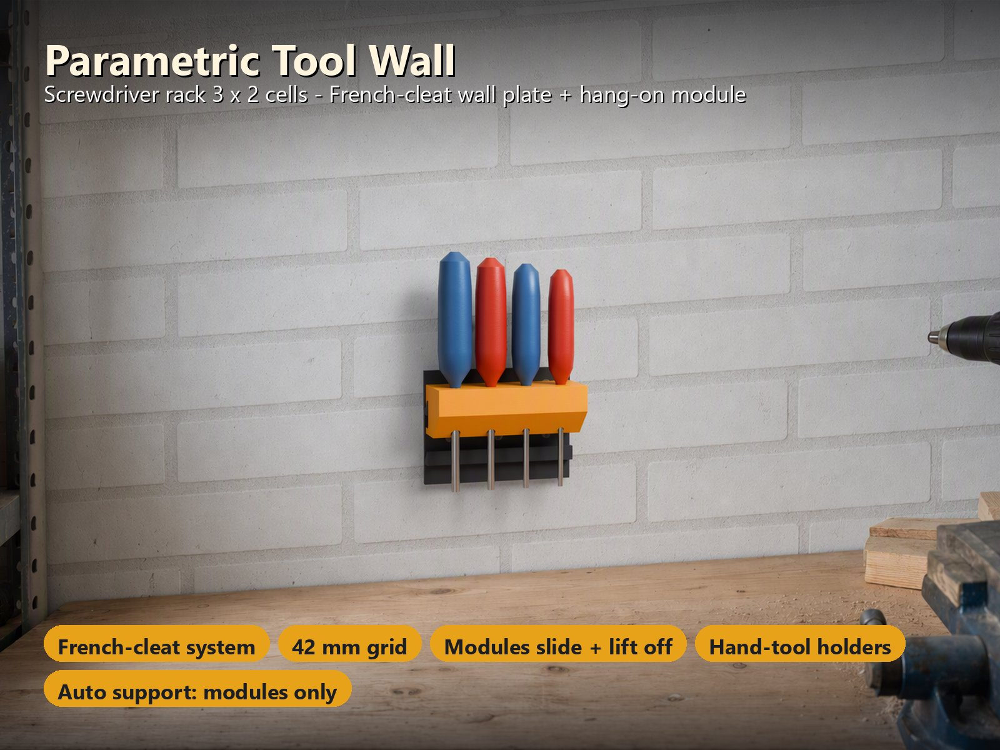

> **Stand:** Die Geometrie wird automatisch geprüft (siehe [Prüfung und Stand](#prüfung-und-stand)), und jedes Profil ist in Bambu Studio testweise geslict. **Vom Autor noch nicht gedruckt.** Die Tragfähigkeit ist eine **Berechnung**, **keine Messung** (siehe [Belastbarkeit](#belastbarkeit)). **Stiftebecher, gerade Stifte und Hammerhalter sind neue, ungetestete Drucke**: Probiere sie zuerst mit leichter Last, für sie wird keine Tragfähigkeit angegeben. Rückmeldungen zu Passung und Last sind in den MakerWorld-Kommentaren willkommen.

## Inhaltsverzeichnis

- [Das Problem](#das-problem)
- [Die Idee](#die-idee)
- [Highlights](#highlights)
- [So funktioniert es](#so-funktioniert-es)
- [Parametrische Optionen](#parametrische-optionen)
- [Konstruktion](#konstruktion)
- [Belastbarkeit](#belastbarkeit)
- [Druckempfehlungen](#druckempfehlungen)
- [Anwendungsfälle](#anwendungsfälle)
- [Fehlersuche / FAQ](#fehlersuche--faq)
- [Prüfung und Stand](#prüfung-und-stand)
- [Zu den Bildern](#zu-den-bildern)
- [Downloads](#downloads)
- [Lizenz](#lizenz)

## Das Problem

Eine gedruckte Werkzeugwand klingt einfach, aber die Details entscheiden, ob sie nützlich bleibt:

- Jede Werkstatt ist anders: andere Anzahl an Schraubendrehern, Zangen, Sechskantschlüsseln und Bits. Ein starrer Halter passt von Anfang an nicht.
- Werkzeuge ändern sich. Eine Wand, die sich nur mit Abschrauben umbauen lässt, ist bald voller Kompromisse.
- Ein Halter, der unter dem Gewicht seiner Werkzeuge nach vorn kippt, taugt nichts; eine French Cleat muss auch eine Last an der Vorderkante der Ablage tragen.
- Wandplatten und Halter sind große Teile. Sie müssen auf dein Druckbett passen und sollten mit möglichst wenig Stützen druckbar sein.
- Normbehälter (Gridfinity) sind gut für Kleinteile, brauchen aber meist eine Grundplatte.

## Die Idee

Die Wand trägt **eine Platte mit einer 45°-Cleat-Leiste pro Reihe**, mit einer Senkkopfschraube pro 42-mm-Zelle an der Wand befestigt. Die **Module** haben eine passende Lippe; man setzt sie hinter die Leiste und lässt los, und die Schräge **zieht sie an die Wand**, sodass sie durch ihr Eigengewicht hängen. Ein **Abstandshalter unten an der Rückwand** liegt unterhalb der Leiste an der Wandplatte an und verhindert, dass das Modul nach vorn kippt. Ein Modul **gleitet seitlich** an der Leiste entlang und wird **etwa 10 mm angehoben**, um es abzunehmen. Keine Schrauben, kein Werkzeug, keine Clips. Platte in einer Farbe, Module in einer anderen, jede Farbe auf **eigenen Platten**, daher ist kein Prime-Tower nötig. Alle Maße in Millimetern.

## Highlights

- **French-Cleat-System.** Die 45°-Leiste zieht jedes Modul an die Wand. Ein **Abstandshalter unten an der Rückwand** verhindert das Vorkippen, auch bei Last an der Vorderkante der Ablage. Zum Abnehmen hebst du das Modul etwa 10 mm an. Zieht man es waagerecht heraus, klettert es die Schräge hinauf (etwa das 1–2-Fache seines Gewichts); reiße Werkzeuge also nicht seitlich heraus.
- **In Sekunden umbauen.** Module **gleiten seitlich** an einer Leiste und hängen in **jeder Reihe, auch der untersten**: Die Wandplatte reicht 11 mm (mit Haken 23 mm) unter die unterste Leiste, sodass der Abstandshalter eines Moduls in der untersten Reihe immer Platte hinter sich hat. Ein Modul ist 41 mm hoch (Haken 53 mm); Module in direkt benachbarten Reihen haben also nur 1 mm Abstand: Um ein unteres Modul abzuheben, nimmst du zuerst das Modul darüber ab (oder schiebst das untere seitlich über das Reihenende hinaus).
- **16 Halter-Typen.** Runde Löcher (abgestufte Größen, z. B. 5–9 mm), Sechskant-Taschen (abgestuft für einen Satz Sechskantschlüssel oder alle 6,35 mm für 1/4"-Bits), Schlitze (Zangen 28 × 12 mm, Maulschlüssel 22 × 7 mm, Pinzetten oder eigene Größe), **V-Kerben** für Zangen und Scheren beliebiger Dicke, eine **Gridfinity-Ablage**, **Haken**, ein **Stiftebecher**, **gerade Stifte** für Spulen und Rollen, ein **Hammerhalter** (zwei Haken mit Lücke: der Kopf liegt auf beiden, der Stiel hängt dazwischen nach unten) sowie eine Bohrmaschinen-Aufnahme, ein Bohrerständer, ein Rohrzangen-Halter, eine Schleifpapier-/Scheibentasche, ein Messschieber-Halter, eine Box mit offener Front und ein Arbeitstisch (siehe [Weitere Halter](#9--weitere-halter)).
- **V-Kerben für Zangen.** Eine nach oben offene, konische Tasche: Die Zange sinkt ein, bis die Tasche so schmal ist wie sie dick, und klemmt dort, ein Halter passt also für Zangen beliebiger Dicke. Eine Wand vorn verhindert, dass sie nach vorn herausfällt.
- **Boden und eingravierte Beschriftungen.** Runde, Schlitz- und V-Kerben-Halter können einen **Boden** bekommen (Sacklöcher, damit Pinsel und Pinzetten nicht durchrutschen), und Halter mit Löchern tragen **0,6 mm tief eingravierte Beschriftungen**, eine pro Loch, zum Beispiel Cut, Nose, Flat, Snip. Für die Schlitze gibt es eine fertige Pinzetten-Voreinstellung.
- **Wechselbare Behälter und große Wände.** Die Ablage gibt es mit herausnehmbaren Behältern (41,5 × 41,5 mm, 21–70 mm hoch) mit Beschriftungsfläche oder eingraviertem Text, und eine große Wand bis 60 × 60 Zellen lässt sich in bettgroße Felder mit optionalen Passstiften teilen.
- **Gridfinity-kompatible Ablage.** Nur die Ablage folgt der Gridfinity-Spezifikation: **42-mm-Sockel** (Profil 0,7 / 1,8 / 2,15 mm aus der Community-Spezifikation). Standard-1×1-Behälter sitzen darin, werden seitlich gehalten und lassen sich gerade herausheben. Die Wandplatte selbst ist eine French Cleat, keine Gridfinity-Grundplatte. Nicht mit dem Gridfinity-Projekt (MIT-Lizenz, von Zack Freedman) verbunden.
- **Jede Größe.** 1–7 Zellen breit und hoch, Platte 4–8 mm dick, Senkschrauben M3 / M4 / M5, eine pro Zelle. 5 Zellen passen auf ein 256-mm-Bett, **7 Zellen auf den H2C** (dort wegen des Fußes 6 Reihen hoch), 4 Zellen auf den A1 mini.
- **Zwei Farben, kein Prime-Tower.** Platte in Farbe 1, Module in Farbe 2, jede Farbe auf **eigener Platte**.
- **Stützen nur dort, wo die French Cleat sie braucht.** Die Platte wird auf dem Rücken ohne Stützen gedruckt (die Leistenschräge ist genau 45°). Die Module werden aufrecht mit flachem Fuß gedruckt; die Hänge-Lippe eines Moduls ist ein Keil, der nach unten zur Wand zeigt, daher brauchen die Module **Stützen an zwei Stellen auf der Wandseite der Rückwand**: unter dem Abstandshalter und unter der 45°-Lippe. Die fertigen Projekte enthalten sie als Stützblock (Stützentyp **normal (manuell)**); die Wandplatte hat keine.
- **Vier fertige Beispielvarianten und vierzehn Erweiterungs-Kits** mit testweise geslicten Bambu-Studio-Profilen (siehe [Druckempfehlungen](#druckempfehlungen)).

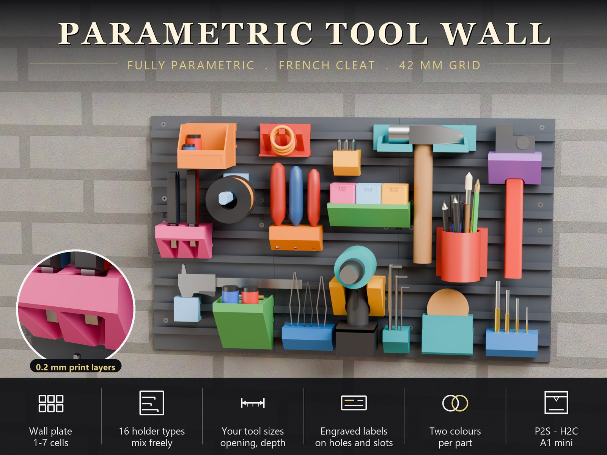

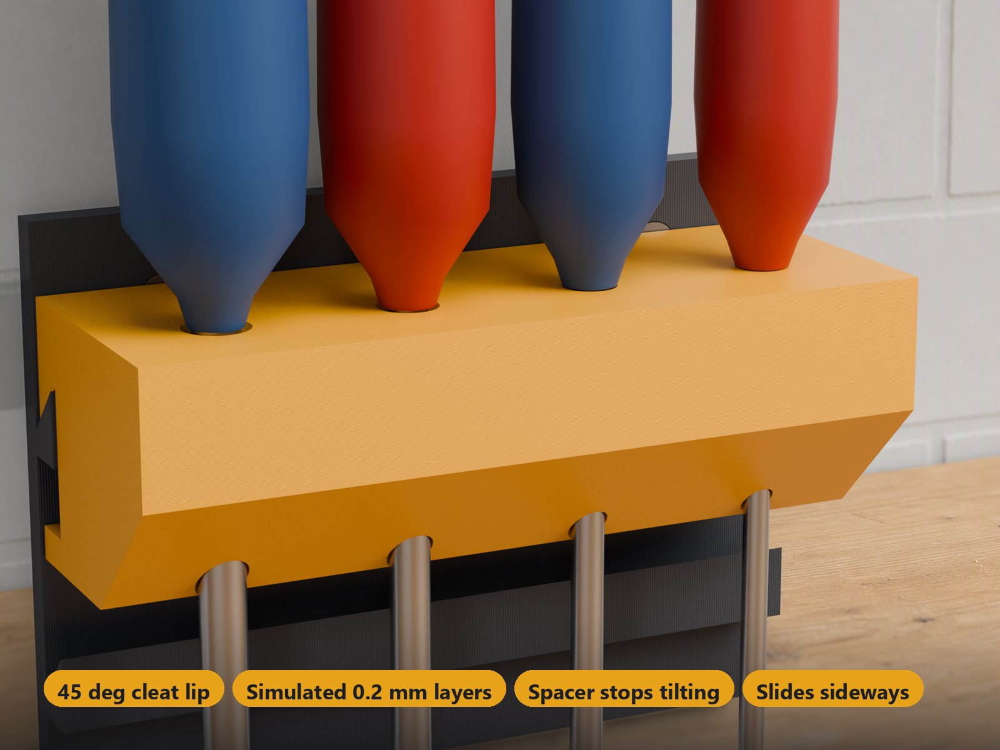

## So funktioniert es

Halbschnitt durch die echten Teile des Standard-Beispiels (Beschriftungen aus dem Modell projiziert):

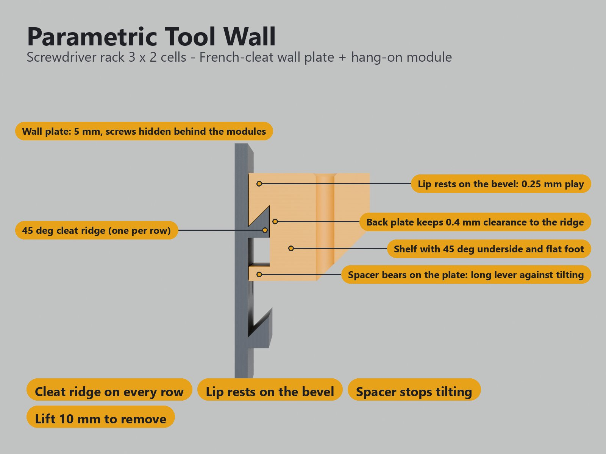

- **Cleat-Leiste:** 8 mm tief, 45°-Schräge, 4 mm Schrägenhöhe an der Plattenfläche (der Leistenfuß). Eine Leiste pro Reihe.
- **Lippe:** liegt mit 0,25 mm vertikalem Spiel (0,18 mm senkrecht zur Schräge) auf der Schräge; die Rückwand hält 0,4 mm Abstand zur Leiste.
- **Abstandshalter:** unten an der Rückwand, 0,4 mm von der Plattenfläche und 11 mm unter dem Leistenfuß. Er ist der Kippanschlag mit langem Hebel und gibt die Platte beim 10-mm-Anheben noch frei.
- **Ablage:** 45°-Unterseite und 14 mm flacher Fuß, damit das Modul aufrecht gedruckt wird.

## Parametrische Optionen

Die Namen entsprechen den Customizer-Parametern des Modells.

### 1 – Wandplatte

| Parameter | Bedeutung | Standard | Bereich / Einheit |
|---|---|---|---|
| `plate_cols` | Zellen in der Breite (Plattenbreite = Zellen × 42 mm). 5 passen auf ein 256-mm-Bett, 7 auf den H2C | 4 | 1–7 |
| `plate_rows` | Zellreihen (eine Leiste pro Reihe; Plattenhöhe = Reihen × 42 mm plus Fuß) | 3 | 1–7 |
| `plate_t` | Plattendicke; die Schrauben sitzen versenkt in der Platte | 5 | 4–8 mm, Schritt 0,5 |
| `screw` | Schraube für die Wand: eine pro Zelle, versenkt, hinter den Modulen verborgen | `m4` | `m3` (M3), `m4` (M4 oder 4-mm-Holzschraube), `m5` (M5 oder 5-mm-Holzschraube) |

Die Platte bekommt automatisch einen **Fuß** unter der untersten Leiste (11 mm, mit Haken 23 mm). Für eine **große Wand** wählst du den Kachel-Modus: Eine Wand bis 60 × 60 Zellen wird in bettgroße Felder mit durchgehendem 42-mm-Leistenraster, 0,3 mm Fugen und optionalen losen Passstiften geteilt. Jedes Feld braucht eigene Wandbefestigungen; die Stifte richten nur aus.

### 2 – Module

Bis zu fünf Module. Für jedes wählst du Typ und Breite in 42-mm-Zellen; der Customizer legt sie selbst auf der Wandplatte und den Druckplatten aus.

| Parameter | Bedeutung | Standard | Bereich / Einheit |
|---|---|---|---|
| `module_1` … `module_5` | Modultyp: `none`, `round` (runde Löcher: Schraubendreher, runde Werkzeuge, Feilen), `hex` (Sechskant-Taschen: Sechskantschlüssel und Bits), `slots` (Zangen, Maulschlüssel, Pinzetten), `vee` (V-Kerben für Zangen und Scheren), `tray` (Ablage mit Gridfinity-Sockeln), `hook` (Haken für Kabel, Schlüssel, Handschuhe), `cup` (Stiftebecher), `peg` (gerade Stifte), `hammer` (Hammerhalter), `drill`, `drillbits`, `pipewrench`, `sanding`, `caliper`, `box`, `table` (siehe [Weitere Halter](#9--weitere-halter)) | `round`, `hex`, `slots`, `none`, `none` | Auswahl |
| `width_1` … `width_5` | Modulbreite in Zellen | 2, 1, 2, 2, 1 | 1–4 |

### 3 – Runde Löcher

| Parameter | Bedeutung | Standard | Bereich / Einheit |
|---|---|---|---|
| `round_n` | Löcher pro Rund-Modul | 3 | 1–8 |
| `round_d_min` | Kleinstes Loch; die Löcher wachsen vom kleinsten zum größten | 5 | 3–20 mm, Schritt 0,5 |
| `round_d_max` | Größtes Loch | 9 | 3–25 mm, Schritt 0,5 |
| `round_pitch` | Abstand zwischen den Löchern. Schraubendrehergriffe sind 25–35 mm dick, daher über 28 bleiben | 30 | 14–50 mm |

### 4 – Sechskantschlüssel und Bits

| Parameter | Bedeutung | Standard | Bereich / Einheit |
|---|---|---|---|
| `hex_n` | Taschen pro Sechskant-Modul | 4 | 1–24 |
| `hex_rows` | Reihen von Taschen (die Taschen werden auf die Reihen verteilt; jede Reihe ist zentriert). Ein 1-Zellen-Modul fasst 9 Sechskantschlüssel in 3 Reihen | 1 | 1–3 |
| `hex_af` | Größe der ersten Tasche über Schlüsselweite (6,35 = 1/4"-Bit) | 2,5 | 1,5–12 mm, Schritt 0,05 |
| `hex_step` | Größenschritt von Tasche zu Tasche (0 = alle gleich, für Bits; etwa 0,8 = ein Satz Sechskantschlüssel) | 0,8 | 0–2 mm, Schritt 0,05 |
| `hex_fit` | Spiel der Tasche, auf die Schlüsselweite addiert | 0,3 | 0,1–0,6 mm, Schritt 0,05 |
| `hex_depth` | Tiefe der Taschen | 20 | 8–40 mm |
| `hex_through` | Taschen gehen ganz durch (Sechskantschlüssel hängen an ihrem Knick) statt blind zu enden | aus | an / aus |

### 5 – Schlitze (Zangen, Maulschlüssel)

| Parameter | Bedeutung | Standard | Bereich / Einheit |
|---|---|---|---|
| `slot_kind` | Wofür die Schlitze sind: `pliers` (Backen 28 × 12 mm), `wrench` (Maulschlüssel, Griff 22 × 7 mm), `tweezers` (Schlitz 14 × 5 mm) oder `custom` (nutzt die beiden Maße darunter) | `pliers` | Auswahl |
| `slot_w` | Schlitzbreite entlang des Moduls (nur custom) | 26 | 8–60 mm, Schritt 0,5 |
| `slot_t` | Schlitzdicke (nur custom) | 10 | 3–30 mm, Schritt 0,5 |
| `slot_n` | Schlitze pro Schlitz-Modul | 2 | 1–8 |
| `slot_fit` | Spiel des Schlitzes, auf beide Maße addiert | 0,5 | 0,2–1 mm, Schritt 0,1 |

### 6 – Haken

| Parameter | Bedeutung | Standard | Bereich / Einheit |
|---|---|---|---|
| `hook_n` | Haken pro Haken-Modul | 3 | 1–6 |
| `hook_len` | Länge eines Hakens; er zeigt im 45°-Winkel nach oben, damit nichts abrutscht | 30 | 20–50 mm, Schritt 2 |

Die Einstellungen für runde Löcher, Sechskant, Schlitze und Haken gelten für **jedes Modul dieses Typs** (zwei Sechskant-Module teilen sich dieselben Sechskantgrößen). Die Ablage bekommt einen Gridfinity-Sockel pro Zelle und ist 6 mm breiter als ihre Zellen.

### 7 – Farben

| Parameter | Bedeutung | Standard | Bereich / Einheit |
|---|---|---|---|
| `two_colors` | Wandplatte in Farbe 1, Module in Farbe 2, jeweils auf eigenen Platten (kein Prime-Tower) | an | an / aus |
| `color_plate` | Farbe der Wandplatte | `#3a3f47` | Farbe |
| `color_module` | Farbe der Module | `#e8a21a` | Farbe |

### 8 – Drucker und Qualität

| Parameter | Bedeutung | Standard | Bereich / Einheit |
|---|---|---|---|
| `printer` | Legt die Plattengröße fest: `P2S` (256-mm-Betten: P1S, P2S, X1C, A1), `H2C` (großes Bett), `A1M` (A1 mini, 180-mm-Bett). **Wähle vor dem Download denselben Drucker im MakerWorld-Bett-Menü.** | `P2S` | Auswahl |
| `$fn` | Kreisqualität | 48 | 24–96, Schritt 8 |

### 9 – Weitere Halter

Wähle diese Typen in einem der Felder `module_1` … `module_5`. Alle nutzen dieselbe Einhänge-Schnittstelle wie die ersten Halter, eine bereits gedruckte Wand funktioniert also weiter.

| Typ | Was es ist | Wichtigste Einstellungen |
|---|---|---|
| `vee` | **V-Kerben** für Zangen und Scheren beliebiger Dicke. Geschlossene, konische Taschen: Das Werkzeug wird von oben hineingesteckt und klemmt dort, wo die Tasche so schmal ist wie das Werkzeug dick. Köpfe von 8 × 18, 10 × 22 und 12 × 25 mm passen in der Standardtasche zwischen Keilspitze und Frontwand. | `vee_n` Taschen nebeneinander (eine Reihe, 1–5), `vee_width` 30 mm vorn, `vee_depth` 40 mm lang, `vee_size` + `vee_fit` = 6,5 mm am schmalen Ende; wahlweise `vee_floor` und `vee_labels` |
| `cup` | **Stiftebecher**, rund oder eckig, mit der Rückwand verbunden. Neuer, ungetesteter Druck | `cup_shape`, `cup_size` (60 mm innen), `cup_height` (80 mm), `cup_wall` (1,6 mm) |
| `peg` | **Gerade Stifte** für Spulen und Rollen: achteckiger Querschnitt mit flacher Unterseite und 45°-Ecken, druckt also ohne Stützen. Neuer, ungetesteter Druck | `peg_n` 1–3, `peg_len` 40–150 mm, `peg_d` (14 mm), `peg_pitch`, `peg_tilt` (3°: Die Oberseite steigt zur Spitze an, damit Spulen zur Wand lehnen) |
| `hammer` | **Hammerhalter:** zwei Haken mit einer Lücke in der Mitte. Der Kopf liegt auf beiden Haken, der Stiel hängt in der Lücke senkrecht nach unten; die Lücke ist nach vorn offen. Eine kleine Lippe am äußeren Ende jedes Hakens verhindert nur, dass der Kopf seitlich abrutscht. Neuer, ungetesteter Druck | `hammer_gap` (34 mm, freie Lücke für den Stiel), `hammer_span` (130 mm, Abstand der Lippen = längster Kopf), `hammer_depth` (40 mm Ausladung), `hammer_tip` (12 mm Lippenhöhe, 0 = glatte Haken), `hammer_lean` (10°) |
| `drill` | Aufnahme für Bohrmaschine / Akkuschrauber: vorn offene 42-mm-Gabel, 70 mm Ausladung, 2 mm C-Lippe je Seite | `drill_opening`, `drill_depth`, `drill_lip` |
| `drillbits` | Abgestufter Ständer mit Sacklöchern für Bohrer von 3 bis 10 mm | `bit_n`, `bit_d_min`, `bit_d_max`, `bit_fit`, `bit_pitch`, `bit_depth` |
| `pipewrench` | Rohrzangen-Halter: geschlossener Schlitz (32 × 16 mm), zwei Löcher oder offene Gabel | `wrench_style`, `wrench_slot_w`, `wrench_slot_t`, `wrench_opening`, `wrench_depth` |
| `sanding` | Stehende Tasche für Schleifpapier und Schleifscheiben, 125 × 12 mm | `sand_width`, `sand_stack`, `sand_lip` |
| `caliper` | Messschieber-Halter: Backenschlitz 30 × 5 mm, die Schiene liegt flach an der Wand | `caliper_jaw_w`, `caliper_jaw_t`, `caliper_fit`, `caliper_pocket`, `caliper_gap` |
| `box` | Box mit offener Front 120 × 100 × 70 mm mit niedriger Front und schrägen Seiten, wahlweise Beschriftungsfläche oder eingravierter Text | `box_width`, `box_depth`, `box_height`, `box_text`, `box_text_style` |
| `table` | Arbeitstisch: flache Ablage mit Rand (`flat`) oder mit Mulden für 32-mm-Farbtöpfe | `table_surface`, `table_depth`, `table_lip`, `table_pots_x`, `table_pots_y`, `table_pot_d` |

Miss deine eigenen Werkzeuge, bevor du einen Halter wählst. Eine Bohrmaschinen-Aufnahme, ein Rohrzangen-Halter oder ein Messschieber-Halter ist **nicht universell passend**: Stelle die Öffnung im Customizer auf dein Werkzeug ein.

### 10 – Boden und Beschriftungen

| Parameter | Bedeutung | Standard | Bereich / Einheit |
|---|---|---|---|
| `round_floor`, `slot_floor`, `vee_floor` | Boden unter den Löchern von Rund-, Schlitz- und V-Kerben-Haltern. 0 = die Löcher gehen durch, sonst sind sie Sacklöcher (Pinsel und Pinzetten rutschen nicht durch). Die Löcher müssen mindestens 8 mm tief bleiben | 0 | 0 oder mindestens 0,8 mm |
| `round_labels`, `hex_labels`, `slot_labels`, `vee_labels` | Kommagetrennte Beschriftungen, eine pro Loch, 0,6 mm tief eingraviert; die erste gehört zum Loch ganz links von vorn gesehen | leer | Text |
| `label_size` | Buchstabenhöhe; die Buchstaben schrumpfen passend | 4 | 3–8 mm |

### 11 – Wechselbare Behälter

Wähle eine `tray` und schalte `include_bins` ein, um **einen einzelnen 1 × 1-Behälter pro Sockel** zu bekommen (41,5 × 41,5 mm). `bin_height` ist die Gesamthöhe inklusive Fuß (21–70 mm, Standard 35). `bin_label` fügt eine vertiefte Beschriftungsfläche von 29 × 10 mm hinzu; `bin_text` graviert dort freien Text (bis 24 Zeichen) ein, entweder graviert in einer Farbe oder als farbige Einlage (braucht einen Farbwechsel). Die Behälter haben keinen Deckel, keine Trennwände und keinen Stapelrand und werden mit der Öffnung nach oben ohne Stützen gedruckt. Lass über einem eingesetzten Behälter mindestens 6 mm Platz zum Herausnehmen.

**Vorschau:** Die Assemble-Ansicht im Customizer zeigt die Wandplatte mit allen eingehängten Modulen (und Gridfinity-Behältern in der Ablage); sie gehört nicht zum Download.

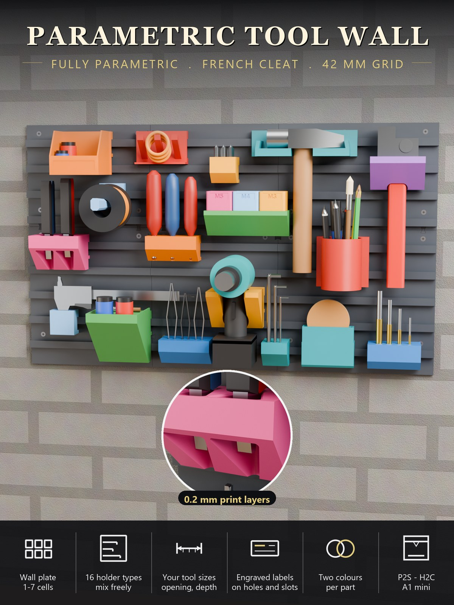

Wenn eine Einstellung nicht funktionieren kann (Platte zu breit für den Drucker, Module passen nicht auf die Platte, zu viele Löcher für die Modulbreite), zeigt die Vorschau eine **rote Meldung statt eines Modells**.

## Konstruktion

### OpenSCAD-Ansatz

Das Modell ist eine einzige parametrische OpenSCAD-Datei. Die Wandplatte liegt bei y = 0, ihre Vorderfläche bei y = `plate_t`. Alles wird nur einmal definiert: das Leistenprofil, das Hängeprofil der Module und die Anordnung der Features. Dieselben Definitionen erzeugen die zusammengebaute Vorschau und die Druckplatten.

### Parametrische Logik

- **Wandplatte:** eine 45°-Cleat-Leiste pro Reihe im 42-mm-Raster, ein Senkloch pro Zelle, dazu der automatische Fuß unter der untersten Leiste.
- **Module:** Jedes Modul ist eine Ablage mit Rückwand und Lippe, dazu die Halter-Features seines Typs. Die Einstellungen für rund, Sechskant, Schlitz und Haken gelten global pro Typ.
- **Anordnung:** Die Module werden von der obersten Reihe aus von links nach rechts auf der Wandplatte platziert und auf die Druckplatten gepackt. Platte 1 ist die Wandplatte (Farbe 1), Platte 2 und folgende enthalten die Module (Farbe 2).
- **Ablehnung:** Unmögliche Einstellungen ergeben eine rote Meldung statt Geometrie.

### Besondere Details

- **Kippanschlag mit langem Hebel:** Der Abstandshalter unten an der Rückwand lässt eine Last bis 29 mm vor der Leistenfläche ganz ohne Reibung halten.
- **Gridfinity-Sockel:** Die Ablage hat einen Sockel pro Zelle (Profil 0,7 / 1,8 / 2,15 mm); der Rand um die Sockel ist mindestens 2,5 mm breit.
- **Haken:** 10 mm breite Zapfen, die im 45°-Winkel nach oben zeigen.

### Druckoptimierungen

- **Die Wandplatte wird auf dem Rücken, Leisten nach oben, ohne Stützen gedruckt** (die Schräge ist genau 45°).
- Kein Überhang steiler als 45° an der Wandplatte oder in der Druckpose der Module, außer dem Abstandshalter und dem Lippenkeil auf der Wandseite der Rückwand, die Stützen brauchen.
- Die Module werden aufrecht auf einem 14 mm breiten flachen Fuß gedruckt.

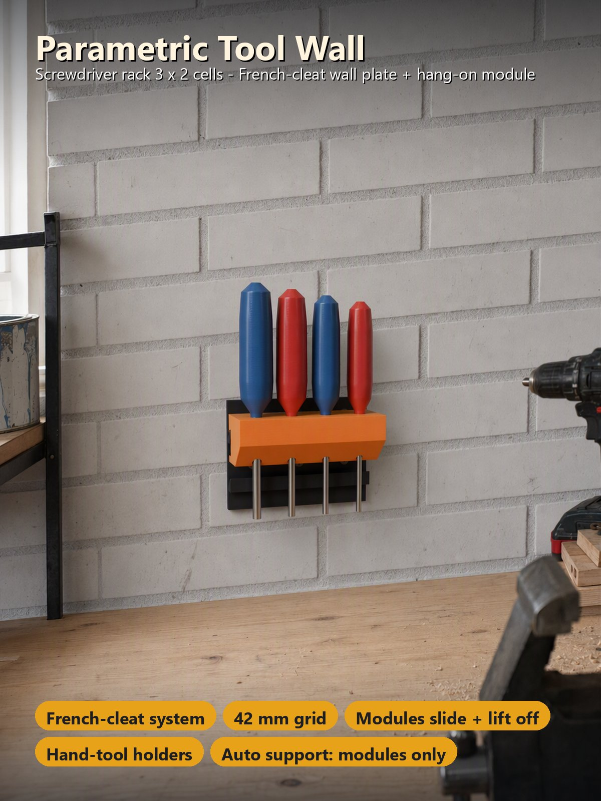

## Belastbarkeit

> **Berechnung, keine Messung.** Die Werte unten stammen aus einer Reibungsstatik-Rechnung und einem 2D-Finite-Elemente-Modell des echten Querschnitts (Leiste, Lippe, Abstandshalter, Wandplatte auf den Schrauben). Sie geben die Last an, die ein Werkzeug, ein Behälter oder ein Haken tragen kann.

**Annahmen** (PETG-Werte aus der Literatur, nicht gemessen): Zug quer zu den Schichten 20 MPa, Schub zwischen den Schichten 12 MPa, Zug in der Ebene 40 MPa; die Platte wird auf dem Rücken gedruckt, die Module aufrecht; Sicherheitsfaktor 3; die Last eines Werkzeugs wird auf seinen Rasterabstand verteilt (konservativ, das Modul ist durchgehend).

| Modul | Je | Arbeitslast (SF 3) | Bruchschätzung |
|---|---|---|---|
| runde Löcher | Schraubendreher (30 mm Abstand) | 7,5 kg (5,3 kg an der Vorderkante) | 22 kg |
| Schlitze | Zange (36 mm Abstand) | 8,8 kg (6,1 kg) | 26 kg |
| Sechskant-Taschen | Sechskantschlüssel | 3,3 kg (2,4 kg) | 10 kg |
| Ablage | 1×1-Behälter | 7,3 kg (4,5 kg an der Vorderkante) | 22 kg |
| Haken | Haken (10 mm), Mitte / Spitze | 2,1 kg / 1,1 kg | 6,2 / 3,4 kg |

- **Kippen:** Der Abstandshalter gibt der Rückwand einen Hebel von etwa 27 mm gegen das Kippen. Eine Last bis **29 mm vor der Leistenfläche hält ganz ohne Reibung** (vor dem Abstandshalter waren es 10 mm). Das deckt jede Werkzeugposition ab; die Ablage braucht bei einer Last ganz vorn an der Kante nur einen Reibwert von etwa 0,14.
- **Abziehen:** Ein waagerechter Zug muss das Modul an der 45°-Schräge anheben: etwa das **1-Fache des Hängegewichts ohne Reibung, das 1,9-Fache mit Reibwert 0,3**. Reiße Werkzeuge nicht seitlich heraus.
- **Wandschraube:** Der Zug in der Schraube über einem Modul beträgt etwa das 1,7–2,6-Fache der Last. Verankere die Platte in Ständern oder mit Dübeln, die dafür ausgelegt sind.
- Die schwächsten Teile sind die **Haken** (10 mm breite Zapfen, aufrecht gedruckt, Zug quer zu den Schichten) und der Fuß der Leiste; deshalb ist der Leistenfuß 4 mm hoch.
- **Keine Tragfähigkeitsangabe** gibt es für die V-Kerben, den Stiftebecher, die Stifte, den Hammerhalter, die Bohrmaschinen-Aufnahme, den Rohrzangen-Halter und die anderen neueren Halter. Beginne mit leichter Last und miss dein eigenes Werkzeug, deine Spule oder deinen Hammerstiel. Der Arbeitstisch ist mit etwa 1,4 kg pro 37 mm Topfbreite berechnet, wenn die ganze Last an der Vorderkante liegt (grobe Abschätzung).
- **Kein Ersatz für einen Test:** Drucke ein Modul, hänge ein Gewicht daran und teile dem Autor mit, was du erhältst. Nimm mehr Schrauben oder eine dickere Platte (bis 8 mm), wenn du auf Nummer sicher gehen willst.

## Druckempfehlungen

Die Profile sind für den **Bambu Lab P2S** (und jedes 256-mm-Bett) und den **H2C** gebaut, mit PETG, 0,20 mm Schichthöhe und Gyroid 15 %, und in Bambu Studio testweise geslict. Wähle denselben Drucker im MakerWorld-Bett-Menü, weil MakerWorld nur das gewählte Bett prüft.

| Einstellung | Empfehlung |
|---|---|
| Drucker | P2S, P1S und jedes andere 256-mm-Bett (bis 5 Zellen); 7 Zellen brauchen den H2C; der A1 mini (180-mm-Bett) nimmt bis zu 4 Zellen |
| Material | PETG (PLA ist für eine Werkzeugwand in einem trockenen Raum in Ordnung); Platte und Module im selben Material |
| Schichthöhe | 0,20 mm |
| Wände | 4 (die Profile gibt es mit 3, 4 und 5) |
| Deck- / Bodenschichten | 5 / 4 |
| Füllung | 15 % Gyroid |
| Stützen | Wandplatte: keine. Module: Stützen an zwei Stellen auf der Wandseite der Rückwand (unter dem Abstandshalter und unter der 45°-Lippe), Stützentyp **normal (manuell)** |
| Platten | Platte 1: Wandplatte auf dem Rücken liegend, Leisten nach oben, in Farbe 1; Filament wechseln; Platte 2: Module aufrecht in Farbe 2 |

Die fertigen Projekte enthalten die Stützen bereits als Stützblock nur für die Module. Wenn du selbst eine STL slicest oder einen Customizer-Download ohne diesen Block druckst, stelle den Stützentyp auf **normal (manuell)** und male die Unterseite des Abstandshalters und der Lippe mit dem Stützen-Pinsel an; nutze keine automatischen oder Baumstützen. Brich nach dem Druck die Stütze von der Wandseite aus und **säubere die 45°-Fläche der Lippe** (Messer oder feine Feile), damit das Modul flach auf der Leiste sitzt. Stifte, Stiftebecher, Hammerhaken und V-Kerben brauchen außer Lippe und Abstandshalter keine Stützen. Der flache Arbeitstisch wird auf seiner Vorderkante stehend mit einer abbrechbaren Rippe gedruckt und braucht keine Stützen. Behälter werden mit der Öffnung nach oben ohne Stützen gedruckt.

**Stützen leichter entfernen (optionaler Tipp):** Die Stütze unter Abstandshalter und Lippe sitzt auf der 45°-Fläche, und PETG auf PETG verbindet sich hart. Wenn dein Drucker mit zwei Filamenten drucken kann, drucke nur die **Stützen-Kontaktschichten** (die Berührungsschichten zwischen Stütze und Modul) aus einem Filament, das nicht am Modul haftet. Bambu Lab dokumentiert **Bambu PLA Basic als Stützen-Kontaktschicht unter einem Modul aus PETG HF oder PETG Basic** für H2D und P2S: PLA und PETG haften schlecht aufeinander, die Stütze bricht also sauber ab. Drucke dieses PLA bei 230 °C mit 60 °C Bett, trockne beide Filamente, nutze das PLA nur für die Kontaktschicht und öffne bei einem geschlossenen Drucker Tür oder Haube, damit die Kammer kühl bleibt. Ein eigenes **Bambu Support for PLA/PETG** funktioniert ebenfalls und erlaubt einen oberen Z-Abstand von 0 für eine glatte 45°-Fläche. **Verwende kein PVA mit PETG.** Eine zweite Düse (H2D, X2D, H2C, H3C) macht den Materialwechsel schnell und mit wenig Abfall; bei einem Drucker mit einer Düse und AMS spült jeder Wechsel viel Filament aus. Wähle in Bambu Studio das Kontaktschicht-Filament in den Stützen-Einstellungen. An genau diesem Modell nicht getestet.

### Beispielvarianten

Vier druckfertige Beispielvarianten (die drei kleineren mit 3 / 4 / 5 Wänden). Der Customizer kann jede andere Kombination bauen.

| Variante | Platte | Module | Drucker | Material | Zeit / Gewicht (4 Wände, Platte 1 + Platte 2 inkl. Stützen) |
|---|---|---|---|---|---|
| `screwdriver-rack-3x2` | 3 × 2 Zellen (126 × 95 mm) | 1 Rund-Modul, 3 Zellen, 4 Löcher 5–8 mm | P2S (jedes 256-mm-Bett) | PETG | 1,3 h / 49 g + 2,3 h / 86 g |
| `pliers-hexkeys-4x2` | 4 × 2 Zellen (168 × 95 mm) | Zangen-Modul (2 Schlitze) + Sechskantschlüssel-Modul (9 Taschen 1,5–5,9 mm in 3 Reihen, 1 Zelle breit) | P2S (jedes 256-mm-Bett) | PETG | 1,6 h / 66 g + 2,9 h / 101 g |
| `tray-bits-hooks-5x4` | 5 × 4 Zellen (210 × 191 mm) | Gridfinity-Ablage (2 Sockel) + Bit-Halter (6 × 1/4" in 2 Reihen) + 3 Haken | P2S (jedes 256-mm-Bett) | PETG | 4,0 h / 162 g + 4,5 h / 160 g |
| `workshop-7x3-h2c` | 7 × 3 Zellen (294 × 149 mm) | rund, Sechskantschlüssel (9 Taschen, 3 Reihen), Zangen, Gridfinity-Ablage (3 Sockel), Haken | H2C | PETG | 4,2 h / 179 g + 9,5 h / 349 g |

Jedes Profil ist ein **Zwei-Platten-Projekt in zwei Farben**: Platte 1 = Wandplatte (Filament 1), Platte 2 = die Module (Filament 2). Die Farben sind Anthrazit / Bernstein (Anthrazit / Petrol beim Ablage-Set, Graphit / Rot bei der Werkstatt); ändere sie in Bambu Studio.

### Erweiterungs-Kits

Vierzehn weitere druckfertige Kits (P2S, PETG, 4 Wände). Sie nutzen dieselbe Einhänge-Schnittstelle, eine bereits gedruckte Wand funktioniert also weiter: Jedes Kit enthält den Halter und eine optionale Wandplatte.

| Kit | Halter |
|---|---|
| `drill-cradle-3x2` | vorn offene 42-mm-Gabel mit 2 mm C-Lippe je Seite, 70 mm Ausladung |
| `drill-bit-rack-4x2` | sechs Sacklöcher für Bohrer von 3 bis 10 mm |
| `pipe-wrench-holder-3x2` | geschlossener Schlitz 32 × 16 mm (oder zwei Löcher, oder offene Gabel) |
| `sanding-pocket-5x2` | Tasche 125 × 12 mm mit 25 mm Wänden |
| `caliper-fork-2x2` | Backenschlitz 30 × 5 mm, 20 mm tief |
| `storage-box-3x2` | Box mit offener Front 120 × 100 × 70 mm mit Beschriftungsfläche |
| `work-table-3x2` | flacher Tisch mit 3 Mulden für 32-mm-Farbtöpfe |
| `work-table-flat-3x2` | schlichter flacher Tisch mit 6 mm Rand, ohne Mulden |
| `gridfinity-bins-35mm-3x2` | Ablage mit zwei Sockeln + zwei 35-mm-Behälter |
| `pliers-vee-4x2` | vier V-Kerben mit den Beschriftungen Cut, Nose, Flat, Snip |
| `tweezers-floor-4x2` | sechs Sackschlitze 14,5 × 5,5 mm mit 1,6 mm Boden, beschriftet |
| `pen-cup-3x2` | runder Stiftebecher, 60 mm innen, 80 mm hoch (ungetestet) |
| `spool-peg-3x2` | zwei 100-mm-Stifte im Abstand von 84 mm, Oberseite 3 Grad nach oben geneigt (ungetestet) |
| `hammer-holder-4x2` | zwei Haken mit 34 mm Lücke: Der Kopf (bis 130 mm) liegt auf beiden, der Stiel hängt dazwischen (ungetestet) |

| | |
|---|---|
| 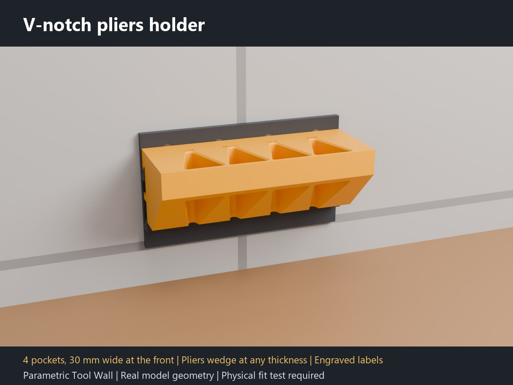 | 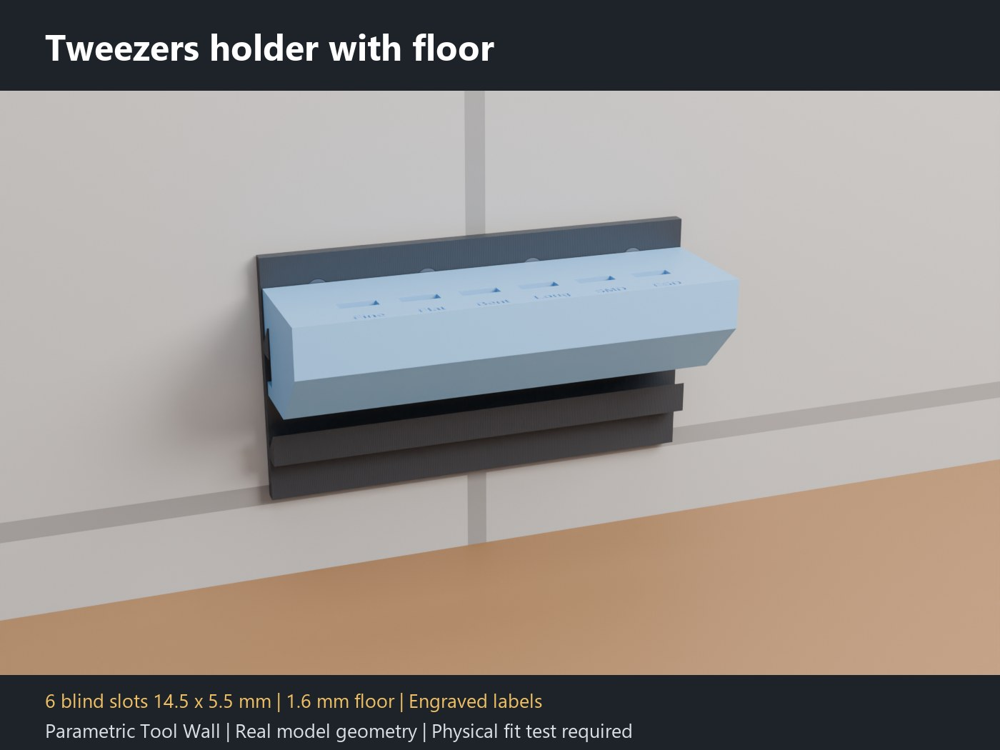 |
| **pliers-vee-4x2:** vier V-Kerben | **tweezers-floor-4x2:** sechs Sackschlitze mit Boden |
| 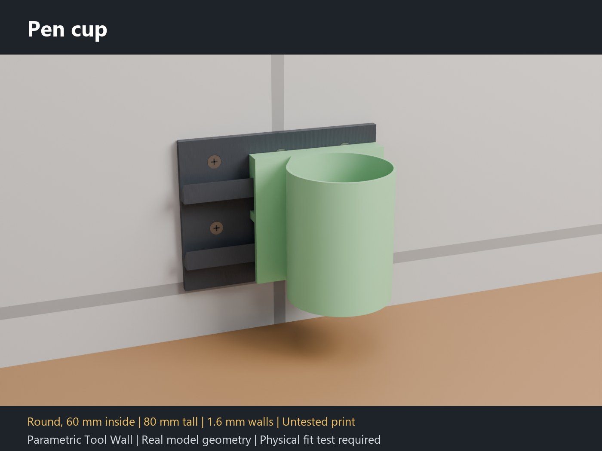 | 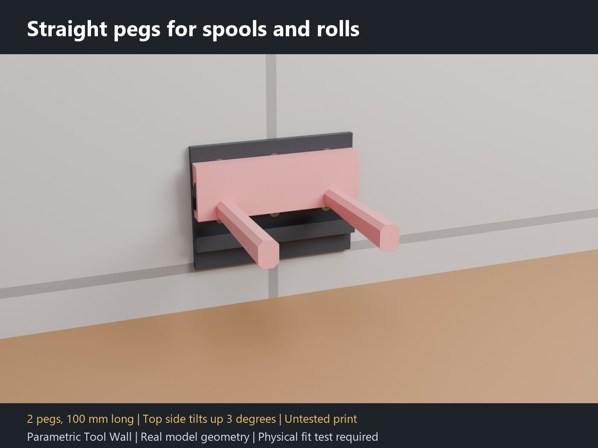 |
| **pen-cup-3x2:** runder Stiftebecher | **spool-peg-3x2:** zwei Stifte für Spulen |
| 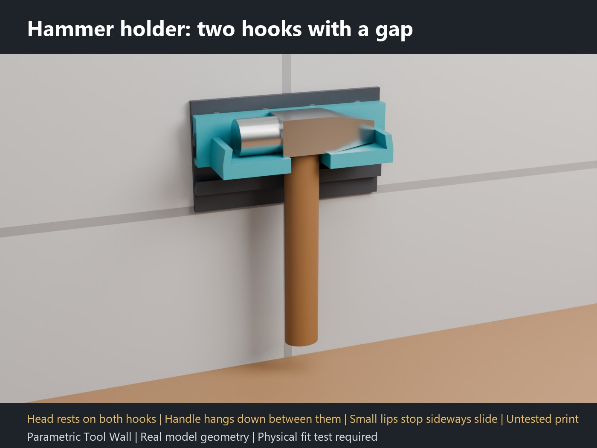 | |
| **hammer-holder-4x2:** zwei Haken mit Lücke für den Stiel | |

Stiftebecher, Spulenstifte und Hammerhalter sind ungetestete Drucke. Jedes Kit enthält eine englische und eine deutsche Montageanleitung (PDF).

### Montage

1. Halte die **Wandplatte** an die Wand, richte sie aus, markiere die Schraublöcher und bohre. Es gibt **eine Senkkopfschraube pro 42-mm-Zelle**: Nimm Schrauben, die zu deiner Wand passen (Dübel für Mauerwerk, Holzschrauben für Holz). Schraube sie an, **bevor** du die Module einhängst, weil die Module die meisten Löcher verdecken.
2. **Modul einhängen:** Halte es über eine Leiste, setze die Lippe hinter die Vorderkante der Leiste und lass es fallen. Die Schräge zieht es an die Wand. Schiebe es seitlich an seinen Platz.
3. **Abnehmen:** Etwa 10 mm anheben und herausziehen.
4. **Ablage:** Ein Standard-Gridfinity-1×1-Behälter (41,5 mm) sitzt in jedem Sockel. Die Ablage ist **6 mm breiter als ihre Zellen** (3 mm Rand auf jeder Seite); berücksichtige das bei der Planung der Reihe.

## Anwendungsfälle

- **Schraubendreher-Halter:** ein Rund-Modul über der Werkbank, abgestufte Lochgrößen für verschiedene Griffe.
- **Zangen und Schlüssel:** Schlitze für Zangen und Maulschlüssel in Griffweite oder **V-Kerben**, die Zangen und Scheren beliebiger Dicke aufnehmen.
- **Sechskantschlüssel- und Bit-Halter:** bis zu 24 Taschen in 1 bis 3 Reihen, abgestuft für einen Satz Sechskantschlüssel oder alle 6,35 mm für 1/4"-Bits.
- **Kleinteile:** eine Ablage mit Gridfinity-Sockeln für Standardbehälter.
- **Pinzetten und Pinsel:** Schlitze oder runde Löcher mit Boden und eingravierten Beschriftungen.
- **Stifte, Spulen, Hammer:** ein Stiftebecher, gerade Stifte für Spulen und Rollen, ein Hammerhalter mit Lücke für den Stiel.
- **Kabel, Schlüssel, Handschuhe:** Haken, die im 45°-Winkel nach oben zeigen.
- **Eine wachsende Werkstattwand:** Starte mit einer kleinen Platte und einem Modul, füge später Reihen und Module hinzu oder baue um, wenn sich deine Werkzeuge ändern.
- **Verschiedene Drucker:** 4 Zellen auf dem A1 mini, 5 Zellen auf 256-mm-Betten, 7 Zellen auf dem H2C.

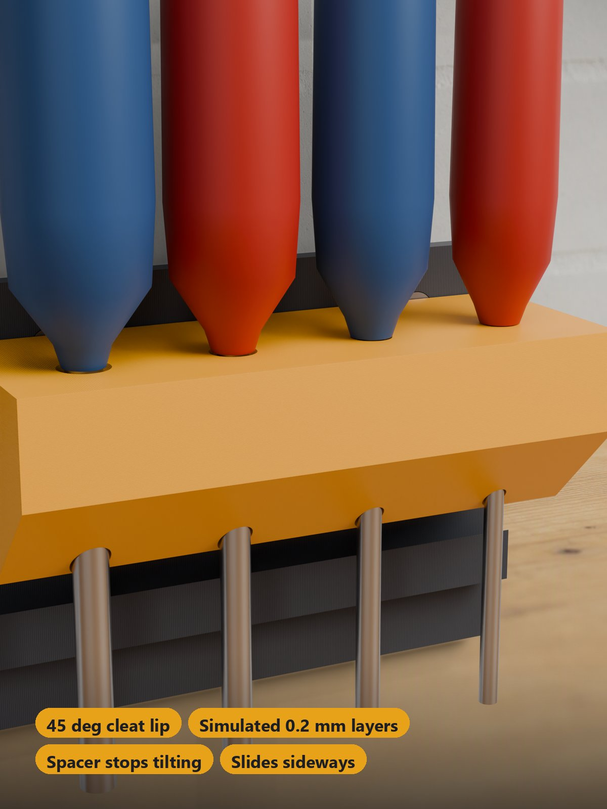

## Fehlersuche / FAQ

| Symptom | Ursache | Lösung |
|---|---|---|
| Die Vorschau zeigt eine rote Meldung statt eines Modells | Die Einstellung kann nicht funktionieren: Platte zu breit für den Drucker, Module passen nicht auf die Platte oder zu viele Löcher für die Modulbreite | `plate_cols`, die Modulbreiten oder die Zahl der Löcher verringern oder einen größeren Drucker wählen |
| Das Modul sitzt nicht flach auf der Leiste | Stützenreste oder eine raue Fläche an der Lippe | Stütze aus dem Schlitz hinter der Lippe brechen und die 45°-Fläche der Lippe mit Messer oder feiner Feile säubern |
| Ich bekomme ein unteres Modul nicht abgehoben | Module in direkt benachbarten Reihen haben nur 1 mm Abstand | Zuerst das Modul darüber abnehmen oder das untere seitlich über das Reihenende hinausschieben |
| Ein Werkzeug kommt beim seitlichen Ziehen samt Modul mit | Ein waagerechter Zug lässt das Modul die Schräge hinaufklettern (etwa das 1–2-Fache seines Gewichts) | Das Werkzeug senkrecht herausheben; Werkzeuge nicht seitlich herausreißen |
| Ein Werkzeug passt nicht in sein Loch oder seine Tasche | Werkzeug größer als die eingestellte Größe | Größe (`round_d_max`, `hex_af`, `slot_w` / `slot_t`) oder Spiel (`hex_fit`, `slot_fit`) erhöhen |
| Werkzeuge in benachbarten Löchern berühren sich | Griffe sind dicker als der Rasterabstand | `round_pitch` erhöhen (für Schraubendreher über 28 mm halten) |
| Ein Gridfinity-Behälter sitzt zu fest oder zu locker | Die Passung ist gegen einen modellierten Behälter aus der Community-Spezifikation geprüft, nicht gegen einen echten | Dem Autor in den MakerWorld-Kommentaren mitteilen |
| Ein Behälter passt nicht neben die Ablage | Die Ablage ist 6 mm breiter als ihre Zellen (3 mm Rand auf jeder Seite) | Die breitere Ablage bei der Planung der Reihe berücksichtigen |
| Die Platte passt nicht aufs Bett | Anderer Drucker als der gewählte | Passenden Drucker im MakerWorld-Bett-Menü wählen (5 Zellen auf 256-mm-Betten, 7 Zellen auf dem H2C, 4 Zellen auf dem A1 mini) |
| Ich will mehr Sicherheit bei schweren Lasten | Die Lastwerte sind nur Berechnungen | Dickere Platte (bis 8 mm), mehr Schrauben und Ständer oder gute Dübel nutzen; siehe [Belastbarkeit](#belastbarkeit) |

## Prüfung und Stand

Die gesamte Prüfung (jeder Modultyp einschließlich V-Kerben, Stiftebecher, Stifte, Hammerhalter, Boden, Beschriftungen und Kachelwand, in vielen Konfigurationen und auf allen drei Druckern) wurde automatisch an der echten Geometrie durchgeführt: **1502 Prüfungen in der Hauptprüfung, 0 fehlgeschlagen**. Die ursprünglichen Halter und die Platte verhalten sich genau wie vor der Erweiterung.

- **Wandplatte:** ein wasserdichter Körper, eine Leiste pro Reihe im **42-mm-Raster**, Schrägenwinkel **45°**, ein Schraubloch pro Zelle mit der Senkung an der Vorderfläche, Löcher frei von den Leisten, kein Überhang steiler als 45°.
- **Einhängen:** Module und Platte **überschneiden sich nie**; die Lippe hat **0,18 mm Spiel an der Schräge** und **0,4 mm zur Plattenfläche**; ein waagerechter Zug kollidiert mit der Platte, das Modul kann also nur durch **Anheben** um etwa 10 mm an der Schräge entlang weg; es **gleitet** seitlich; der **Abstandshalter** sitzt 0,4 mm von der Plattenfläche und bleibt 11 mm unter dem Leistenfuß, auch bei einem Modul in der untersten Reihe; ein Kippen des Moduls um die Leistenspitze wird nach einem kleinen Winkel gestoppt; Module bleiben auf der Platte.
- **Module:** Runde Löcher und Sechskant-Taschen haben die eingestellten Größen (Sechskant-Taschen über Schlüsselweite gemessen), Schlitze haben das eingestellte Spiel, Haken sind 10 mm breit und zeigen im 45°-Winkel nach oben.
- **Gridfinity-Ablage:** Ein modellierter Behälter (42 / 41,5 mm, 0,8 / 1,8 / 2,15 mm Fuß, aus der Community-Spezifikation) **passt** in jeden Sockel, wird **seitlich gehalten** und **lässt sich gerade herausheben**; der Rand um die Sockel ist mindestens 2,5 mm breit.
- **Druckplatten:** jedes Modul genau einmal, alles innerhalb des Betts, mindestens 8 mm zwischen den Modulen; Module werden aufrecht ohne Überhänge über 45° gedruckt.
- Fünf unmögliche Einstellungen werden mit einer roten Meldung statt eines Modells **abgelehnt**.

Die gedruckte Passung hängt von deinem Drucker ab. **Vom Autor noch nicht gedruckt**; die Gridfinity-Passung ist gegen einen modellierten Behälter geprüft, **nicht mit einem echten Behälter getestet**.

## Zu den Bildern

Die Wandplatten, Module, Schraubenköpfe und Gridfinity-Behälter auf jedem Bild sind die echte Geometrie des Modells (aus den exportierten Teilen gerendert, mit simulierten Schichtlinien; es sind Renderings, keine Fotos eines Drucks). Die Werkstatt drumherum (Ziegel-, Beton- oder Sperrholzwand, Werkbank, Regale, Schraubstock) wurde von einer KI **um** das Modell herum gemalt, das unverändert eingesetzt wurde. Die Werkzeuge (Schraubendreher, Zangen, Sechskantschlüssel, Bits, Schlüssel, Kabel) sind KI-generierte Bilder von Werkzeugen, die in den Löchern stecken; die Schrauben und der Behälterinhalt sind Illustrationen. Nichts davon ist Teil des Modells. Die Kit-Bilder zeigen die echte Halter-Geometrie in einer einfachen Szene; die Werkzeuge darin (Hammer, Pinzetten, Stifte, Spulen) sind einfache Illustrationen. Es sind keine Fotos von Drucken enthalten.

## Downloads

Druckdateien gibt es bewusst ausschließlich auf MakerWorld.

👉 MakerWorld-Link: https://makerworld.com/en/models/3526950-parametric-tool-wall#profileId-4032192

Profil: <https://makerworld.com/en/@BetaHydri>

## Lizenz

Dokumentation und Bilder in diesem Repository: © BetaHydri. Das Modell (einschließlich Quellcode) und alle Druckdateien werden ausschließlich über MakerWorld unter der dort genannten Lizenz verteilt. Dieses Repository enthält bewusst kein Modell, keinen Quellcode und keine Druckdateien.
