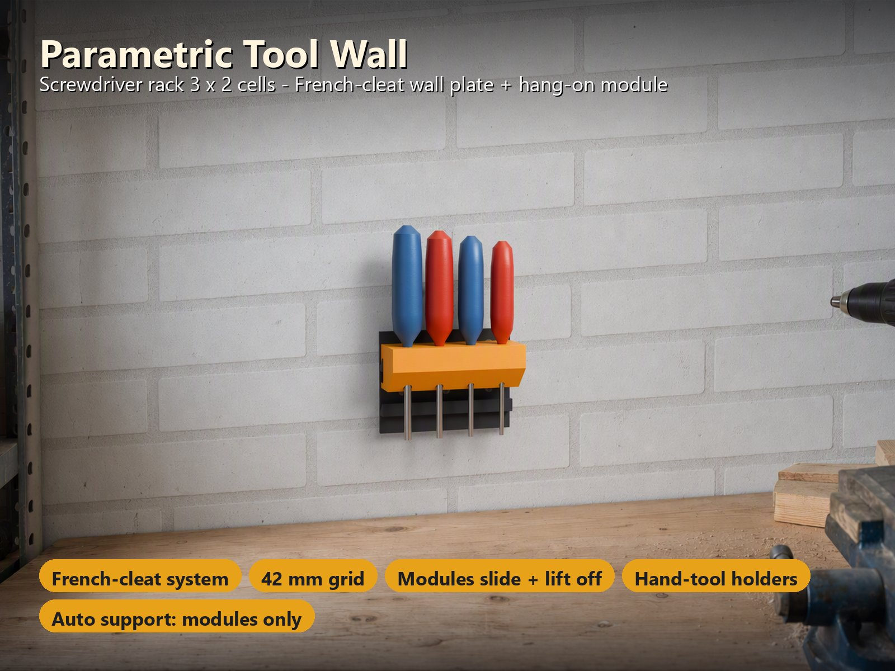
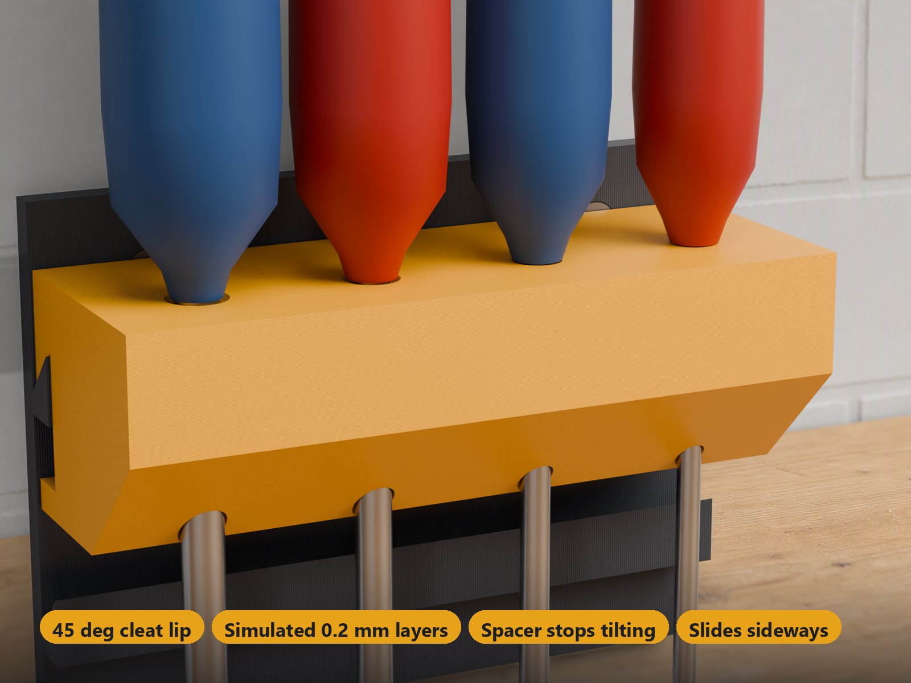
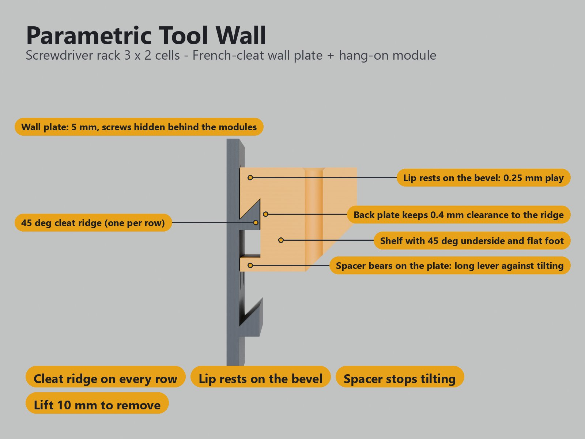
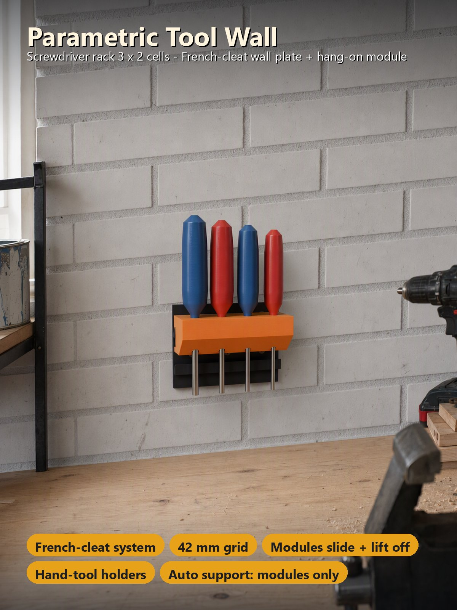
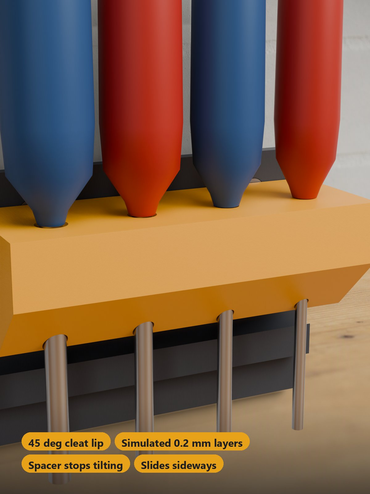

# Parametric Tool Wall – French-Cleat Wall Plate on a 42 mm Grid with Hang-On Holders

[← All models](../../README.md)

🌐 **English** | [Deutsch](README.de.md)

Parametric tool wall you build from **one wall plate and as many hang-on modules as you like**. The plate is a **French cleat on a 42 mm grid** (1–7 cells wide, 1–7 rows high, one 45° ridge per row). The modules hang on any ridge, **slide sideways** and **lift off** when you want to rearrange. In the MakerWorld Customizer you pick up to five modules: **round holes**, **hex pockets**, **slots**, a **tray with Gridfinity sockets** and **hooks**. Everything is laid out on **two plates in two colours**.

> **The model with all print profiles is available exclusively on MakerWorld:**
> 👉 [MakerWorld link: https://makerworld.com/en/models/3526950-parametric-tool-wall](https://makerworld.com/en/models/3526950-parametric-tool-wall#profileId-4032192)
>
> 

> **Status:** the geometry is checked automatically (see [Verification and Status](#verification-and-status)) and every profile is test-sliced in Bambu Studio. **Not yet printed by the author.** The load capacity is a **calculation**, **not a measurement** (see [Load Estimate](#load-estimate)). Feedback on fit and load is welcome in the MakerWorld comments.

## Table of Contents

- [The Problem](#the-problem)
- [The Idea](#the-idea)
- [Highlights](#highlights)
- [How It Works](#how-it-works)
- [Parametric Options](#parametric-options)
- [Design](#design)
- [Load Estimate](#load-estimate)
- [Print Recommendations](#print-recommendations)
- [Use Cases](#use-cases)
- [Troubleshooting / FAQ](#troubleshooting--faq)
- [Verification and Status](#verification-and-status)
- [About the Images](#about-the-images)
- [Downloads](#downloads)
- [License](#license)

## The Problem

A printed tool wall sounds simple, but the details decide whether it stays useful:

- Every workshop is different: a different number of screwdrivers, pliers, hex keys and bits. A fixed rack is wrong from the start.
- Tools change. A wall that cannot be rearranged without unscrewing things is soon full of compromises.
- A holder that tilts forward under the weight of its tools is useless; a French cleat has to carry the load at the front of the shelf as well.
- Wall plates and holders are large parts. They must fit your print bed and should print with as few supports as possible.
- Standard bins (Gridfinity) are a good way to store small parts, but they usually need a baseplate.

## The Idea

The wall carries **a plate with one 45° cleat ridge per row**, screwed to the wall with one countersunk screw per 42 mm cell. The **modules** have a matching lip; they are put behind the ridge, let go, and the bevel **pulls them against the wall** so they hang by their own weight. A **spacer at the bottom of the back plate** rests against the wall plate below the ridge and stops the module from tilting forward. A module **slides sideways** along the ridge and is taken off by **lifting it about 10 mm**. No screws, no tools, no clips. Plate in one colour, modules in another, each colour on **its own plates**, so no prime tower is needed. All dimensions in millimetres.

## Highlights

- **French-cleat system.** The 45° ridge pulls every module against the wall. A **spacer at the bottom of the back plate** stops the module from tilting forward, even with a load at the front of the shelf. To take a module off, lift it about 10 mm. Pulling it out horizontally makes it climb the bevel (about 1–2 times its weight), so do not yank tools out sideways.
- **Rearrange in seconds.** Modules **slide sideways** along a ridge and hang on **every row, including the lowest**: the wall plate reaches 11 mm (23 mm with hooks) below the lowest ridge, so the spacer of a bottom-row module always has plate behind it. A module is 41 mm tall (hooks 53 mm), so modules in directly neighbouring rows have only 1 mm between them: to lift a lower module off, first take off the module above it (or slide the lower one out sideways past the end of the row).
- **Five module types.** Round holes (graduated sizes, e.g. 5–9 mm), hex pockets (graduated for a hex key set, or all 6.35 mm for 1/4" bits), slots (pliers 28 × 12 mm, flat wrench 22 × 7 mm or your own size), a **Gridfinity tray** and **hooks**.
- **Gridfinity-compatible tray module.** Only the tray follows the Gridfinity spec: **42 mm sockets** (0.7 / 1.8 / 2.15 mm profile from the community spec). Standard 1 × 1 bins sit in it, are held sideways and lift straight out. The wall plate itself is a French cleat, not a Gridfinity baseplate. Not affiliated with the Gridfinity project (MIT-licensed, by Zack Freedman).
- **Any size.** 1–7 cells wide and high, plate 4–8 mm thick, M3 / M4 / M5 countersunk screws, one per cell. 5 cells fit a 256 mm bed, **7 cells fit the H2C** (6 rows high there because of the foot), 4 cells the A1 mini.
- **Two colours, no prime tower.** Plate in colour 1, modules in colour 2, each colour on **its own plate**.
- **Supports only where the French cleat needs them.** The plate prints on its back without supports (the ridge bevel is exactly 45°). The modules print upright with a flat foot; the hanging lip of a module is a wedge that points down towards the wall, so Bambu Studio puts **automatic support under the lip, the shelf chamfer and the hook tips**. The profiles already contain this setting for the modules only (the wall plate has none).
- **Four ready-made sample variants** with test-sliced Bambu Studio profiles for 3, 4 and 5 walls (see [Print Recommendations](#print-recommendations)).

## How It Works

Half section through the real parts of the default sample (labels projected from the model):

- **Cleat ridge:** 8 mm deep, 45° bevel, 4 mm bevel height at the plate face (the ridge root). One ridge per row.
- **Lip:** rests on the bevel with 0.25 mm vertical play (0.18 mm normal to the bevel); the back plate keeps 0.4 mm clearance to the ridge.
- **Spacer:** at the bottom of the back plate, 0.4 mm from the plate face and 11 mm below the ridge foot. It is the tilt stop with a long lever and still clears the plate when you lift the module by 10 mm.
- **Shelf:** a 45° underside and a 14 mm flat foot, so the module prints upright.

## Parametric Options

The names correspond to the model's Customizer parameters.

### 1 – Wall Plate

| Parameter | Meaning | Default | Range / Unit |
|---|---|---|---|
| `plate_cols` | Cells across (plate width = cells × 42 mm). 5 fit a 256 mm bed, 7 fit the H2C | 4 | 1–7 |
| `plate_rows` | Cell rows (one ridge per row; plate height = rows × 42 mm plus the foot) | 3 | 1–7 |
| `plate_t` | Plate thickness; the screws sit countersunk in the plate | 5 | 4–8 mm, step 0.5 |
| `screw` | Screw for the wall: one per cell, countersunk, hidden behind the modules | `m4` | `m3` (M3), `m4` (M4 or 4 mm wood screw), `m5` (M5 or 5 mm wood screw) |

The plate gets an automatic **foot** below the lowest ridge (11 mm, 23 mm with hooks).

### 2 – Modules

Up to five modules. For each one, choose the type and the width in 42 mm cells; the Customizer lays them out on the wall plate and on the print plates by itself.

| Parameter | Meaning | Default | Range / Unit |
|---|---|---|---|
| `module_1` … `module_5` | Module type: `none`, `round` (round holes: screwdrivers, round tools, files), `hex` (hex pockets: hex keys and bits), `slots` (pliers and flat wrenches), `tray` (tray with Gridfinity sockets), `hook` (hooks for cables, keys, gloves) | `round`, `hex`, `slots`, `none`, `none` | selection |
| `width_1` … `width_5` | Module width in cells | 2, 1, 2, 2, 1 | 1–4 |

### 3 – Round Holes

| Parameter | Meaning | Default | Range / Unit |
|---|---|---|---|
| `round_n` | Holes per round module | 3 | 1–8 |
| `round_d_min` | Smallest hole; the holes grow from smallest to largest | 5 | 3–20 mm, step 0.5 |
| `round_d_max` | Largest hole | 9 | 3–25 mm, step 0.5 |
| `round_pitch` | Distance between holes. Screwdriver handles are 25–35 mm thick, so keep it above 28 | 30 | 14–50 mm |

### 4 – Hex Keys and Bits

| Parameter | Meaning | Default | Range / Unit |
|---|---|---|---|
| `hex_n` | Pockets per hex module | 4 | 1–24 |
| `hex_rows` | Rows of pockets (the pockets are shared out over the rows; each row is centred). A 1-cell module holds 9 hex keys in 3 rows | 1 | 1–3 |
| `hex_af` | Size of the first pocket across the flats (6.35 = 1/4" bit) | 2.5 | 1.5–12 mm, step 0.05 |
| `hex_step` | Size step from pocket to pocket (0 = all the same, for bits; about 0.8 = a set of hex keys) | 0.8 | 0–2 mm, step 0.05 |
| `hex_fit` | Play of the pocket, added to the size across the flats | 0.3 | 0.1–0.6 mm, step 0.05 |
| `hex_depth` | Depth of the pockets | 20 | 8–40 mm |
| `hex_through` | Pockets go all the way through (hex keys hang by their bend) instead of ending blind | off | on / off |

### 5 – Slots (Pliers, Flat Wrenches)

| Parameter | Meaning | Default | Range / Unit |
|---|---|---|---|
| `slot_kind` | What the slots are for: `pliers` (jaws 28 × 12 mm), `wrench` (flat wrench, handle 22 × 7 mm) or `custom` (uses the two sizes below) | `pliers` | selection |
| `slot_w` | Slot width along the module (custom only) | 26 | 8–60 mm, step 0.5 |
| `slot_t` | Slot thickness (custom only) | 10 | 3–30 mm, step 0.5 |
| `slot_n` | Slots per slots module | 2 | 1–5 |
| `slot_fit` | Play of the slot, added on both sizes | 0.5 | 0.2–1 mm, step 0.1 |

### 6 – Hooks

| Parameter | Meaning | Default | Range / Unit |
|---|---|---|---|
| `hook_n` | Hooks per hook module | 3 | 1–6 |
| `hook_len` | Length of a hook; it points up at 45° so things cannot slide off | 30 | 20–50 mm, step 2 |

The round, hex, slot and hook settings apply to **every module of that type** (two hex modules share the same hex sizes). The tray gets one Gridfinity socket per cell and is 6 mm wider than its cells.

### 7 – Colours

| Parameter | Meaning | Default | Range / Unit |
|---|---|---|---|
| `two_colors` | Wall plate in colour 1, modules in colour 2, each on its own plates (no prime tower) | on | on / off |
| `color_plate` | Colour of the wall plate | `#3a3f47` | colour |
| `color_module` | Colour of the modules | `#e8a21a` | colour |

### 8 – Printer and Quality

| Parameter | Meaning | Default | Range / Unit |
|---|---|---|---|
| `printer` | Sets the plate size: `P2S` (256 mm beds: P1S, P2S, X1C, A1), `H2C` (large bed), `A1M` (A1 mini, 180 mm bed). **Choose the same printer in the MakerWorld bed menu before you download.** | `P2S` | selection |
| `$fn` | Circle quality | 48 | 24–96, step 8 |

**Preview:** the Assemble view in the Customizer shows the wall plate with all modules hung on it (and Gridfinity bins in the tray); it is not part of the download.

If a setting cannot work (plate too wide for the printer, modules do not fit on the plate, too many holes for the module width), the preview shows a **red message instead of a model**.

## Design

### OpenSCAD Approach

The model is a single parametric OpenSCAD file. The wall plate sits at y = 0 and its front face at y = `plate_t`. Everything is defined once: the ridge profile, the module hanging profile and the feature layout. The same definitions produce the assembled preview and the print plates.

### Parametric Logic

- **Wall plate:** one 45° cleat ridge per row at a 42 mm pitch, one countersunk screw hole per cell, plus the automatic foot below the lowest ridge.
- **Modules:** each module is a shelf with a back plate and a lip, plus the holder features of its type. Round, hex, slot and hook settings are global per type.
- **Layout:** the modules are placed on the wall plate from the top row, left to right, and packed onto the print plates. Plate 1 is the wall plate (colour 1), plate 2 and following hold the modules (colour 2).
- **Refusals:** impossible settings give a red message instead of geometry.

### Special Details

- **Tilt stop with a long lever:** the spacer at the bottom of the back plate lets a load up to 29 mm in front of the ridge face hold without any friction.
- **Gridfinity sockets:** the tray has one socket per cell (0.7 / 1.8 / 2.15 mm profile); the rim around the sockets is at least 2.5 mm.
- **Hooks:** 10 mm wide pegs that point up at 45°.

### Print Optimisations

- **The wall plate prints on its back, ridges up, without supports** (the bevel is exactly 45°).
- No overhang steeper than 45° on the wall plate or in the module print pose, apart from the lip wedge, the shelf chamfer and the hook tips, which need automatic support.
- The modules print upright on a 14 mm flat foot.

## Load Estimate

> **Calculation, not a measurement.** The values below come from a friction-statics calculation and a 2D finite-element model of the real cross-section (ridge, lip, spacer, wall plate on the screws). They give the load one tool, bin or hook can carry.

**Assumptions** (PETG values from the literature, not measured): tension across the layers 20 MPa, shear between layers 12 MPa, in-plane tension 40 MPa; the plate is printed on its back, the modules upright; safety factor 3; the load of a tool is spread over its pitch (conservative, the module is continuous).

| Module | Per | Working load (SF 3) | Break estimate |
|---|---|---|---|
| round holes | screwdriver (30 mm pitch) | 7.5 kg (5.3 kg at the front edge) | 22 kg |
| slots | pliers (36 mm pitch) | 8.8 kg (6.1 kg) | 26 kg |
| hex pockets | hex key | 3.3 kg (2.4 kg) | 10 kg |
| tray | 1 × 1 bin | 7.3 kg (4.5 kg at the front edge) | 22 kg |
| hooks | hook (10 mm), mid / tip | 2.1 kg / 1.1 kg | 6.2 / 3.4 kg |

- **Tilting:** the spacer gives the back plate a lever of about 27 mm against tilting. A load up to **29 mm in front of the ridge face holds without any friction** (before the spacer was added it was 10 mm). That covers every tool position; the tray needs a friction coefficient of only about 0.14 with a load at its very front edge.
- **Pull-off:** a horizontal pull has to lift the module along the 45° bevel: about **1 × the hanging weight without friction, 1.9 × with friction 0.3**. Do not yank tools out sideways.
- **Wall screw:** the tension in the screw above a module is about 1.7–2.6 × the load. Anchor the plate in studs or with plugs that are rated for that.
- The weakest parts are the **hooks** (10 mm wide pegs printed upright, tension across the layers) and the root of the ridge; the ridge root is 4 mm high for this reason.
- **This is not a replacement for a test:** print one module, hang a weight on it and tell the author what you get. Use more screws or a thicker plate (up to 8 mm) if you want to be on the safe side.

## Print Recommendations

The profiles are built for the **Bambu Lab P2S** (and any 256 mm bed) and the **H2C**, with PETG, 0.20 mm layer height and gyroid 15 %, and test-sliced in Bambu Studio. Choose the same printer in the MakerWorld bed menu, because MakerWorld only checks the selected bed.

| Setting | Recommendation |
|---|---|
| Printer | P2S, P1S and any other 256 mm bed (up to 5 cells); 7 cells need the H2C; the A1 mini (180 mm bed) takes up to 4 cells |
| Material | PETG (PLA is fine for a tool wall in a dry room); print plate and modules in the same material |
| Layer height | 0.20 mm |
| Walls | 4 (the profiles come with 3, 4 and 5) |
| Top / bottom layers | 5 / 4 |
| Infill | 15 % gyroid |
| Supports | wall plate: none. Modules: **normal (auto), threshold angle 50°, "on build plate only" off** |
| Plates | plate 1: wall plate lying on its back, ridges up, in colour 1; swap the filament; plate 2: modules upright in colour 2 |

The profiles already contain the support setting for the module objects only. If you slice an STL yourself, enable the same support settings for the modules. After printing, break the support out of the slot behind the lip and **clean the 45° face of the lip** (knife or fine file) so the module sits flat on the ridge.

### Sample Variants

Four ready-to-print sample variants (each with 3 / 4 / 5 walls). The Customizer can build any other combination.

| Variant | Plate | Modules | Printer | Material | Time / weight (4 walls, plate 1 + plate 2 incl. support) |
|---|---|---|---|---|---|
| `screwdriver-rack-3x2` | 3 × 2 cells (126 × 95 mm) | 1 round module, 3 cells, 4 holes 5–8 mm | P2S (any 256 mm bed) | PETG | 1.3 h / 49 g + 2.3 h / 86 g |
| `pliers-hexkeys-4x2` | 4 × 2 cells (168 × 95 mm) | pliers module (2 slots) + hex key module (9 pockets 1.5–5.9 mm in 3 rows, 1 cell wide) | P2S (any 256 mm bed) | PETG | 1.6 h / 66 g + 2.9 h / 101 g |
| `tray-bits-hooks-5x4` | 5 × 4 cells (210 × 191 mm) | Gridfinity tray (2 sockets) + bit holder (6 × 1/4" in 2 rows) + 3 hooks | P2S (any 256 mm bed) | PETG | 4.0 h / 162 g + 4.5 h / 160 g |
| `workshop-7x3-h2c` | 7 × 3 cells (294 × 149 mm) | round, hex keys (9 pockets, 3 rows), pliers, Gridfinity tray (3 sockets), hooks | H2C | PETG | 4.2 h / 179 g + 9.5 h / 349 g |

Each profile is a **two-plate, two-colour project**: plate 1 = wall plate (filament 1), plate 2 = the modules (filament 2). The colours are anthracite / amber (anthracite / teal for the tray set, graphite / red for the workshop); change them in Bambu Studio.

### Assembly

1. Hold the **wall plate** against the wall, level it, mark the screw holes and drill. There is **one countersunk screw per 42 mm cell**: use screws that fit your wall (wall plugs for masonry, wood screws for wood). Screw it on **before** you hang the modules, because the modules cover most of the holes.
2. **Hang a module:** hold it above a ridge, put the lip behind the front edge of the ridge and let it drop. The bevel pulls it against the wall. Slide it sideways to its place.
3. **Take it off:** lift it about 10 mm and pull it out.
4. **Tray:** a standard Gridfinity 1 × 1 bin (41.5 mm) sits in every socket. The tray is **6 mm wider than its cells** (3 mm rim on each side), so keep that in mind when you plan the row.

## Use Cases

- **Screwdriver rack:** a round-hole module above the workbench, graduated hole sizes for different handles.
- **Pliers and wrenches:** slots for pliers and flat wrenches within easy reach.
- **Hex key and bit holder:** up to 24 pockets, in 1 to 3 rows, graduated for a hex key set or all 6.35 mm for 1/4" bits.
- **Small parts:** a tray with Gridfinity sockets for standard bins.
- **Cables, keys, gloves:** hooks that point up at 45°.
- **A growing workshop wall:** start with a small plate and a module, add rows and modules later, or rearrange when your tools change.
- **Different printers:** 4 cells on the A1 mini, 5 cells on 256 mm beds, 7 cells on the H2C.

## Troubleshooting / FAQ

| Symptom | Cause | Fix |
|---|---|---|
| The preview shows a red message instead of a model | The setting cannot work: plate too wide for the printer, modules do not fit on the plate, or too many holes for the module width | Reduce `plate_cols`, the module widths or the number of holes, or choose a larger printer |
| The module does not sit flat on the ridge | Support residue or a rough face on the lip | Break the support out of the slot behind the lip and clean the 45° face of the lip with a knife or fine file |
| I cannot lift a lower module off | Modules in directly neighbouring rows have only 1 mm between them | Take off the module above first, or slide the lower one out sideways past the end of the row |
| A tool comes out together with the module when I pull it sideways | A horizontal pull makes the module climb the bevel (about 1–2 times its weight) | Lift the tool out vertically; do not yank tools out sideways |
| A tool does not fit its hole or pocket | Tool larger than the set size | Increase the size (`round_d_max`, `hex_af`, `slot_w` / `slot_t`) or the play (`hex_fit`, `slot_fit`) |
| The tools in neighbouring holes touch each other | Handles are thicker than the pitch | Increase `round_pitch` (keep it above 28 mm for screwdrivers) |
| A Gridfinity bin sits too tight or too loose | The fit is checked against a modelled bin from the community spec, not against a real bin | Tell the author in the MakerWorld comments |
| A bin does not fit next to the tray | The tray is 6 mm wider than its cells (3 mm rim on each side) | Keep the wider tray in mind when planning the row |
| The plate does not fit the bed | Another printer than the selected one | Choose the matching printer in the MakerWorld bed menu (5 cells on 256 mm beds, 7 cells on the H2C, 4 cells on the A1 mini) |
| I want more safety for heavy loads | The load figures are calculations only | Use a thicker plate (up to 8 mm), more screws and studs or good wall plugs; see [Load Estimate](#load-estimate) |

## Verification and Status

11 configurations (default, every module type, blind and through hex pockets, 1 to 7 cells wide, M4 / M5 screws, plates of 5 and 7 mm, three printers, plate only) were checked automatically on the real geometry: **589 checks, 0 failed**.

- **Wall plate:** one watertight solid, one ridge per row at a **42 mm pitch**, bevel angle **45°**, one screw hole per cell with the countersink at the front face, holes clear of the ridges, no overhang steeper than 45°.
- **Hanging:** modules and plate **never overlap**; the lip has **0.18 mm play on the bevel** and **0.4 mm to the plate face**; a horizontal pull collides with the plate, so the module can only leave by **lifting** it about 10 mm along the bevel; it **slides** sideways; the **spacer** sits 0.4 mm from the plate face and stays 11 mm below the ridge foot, also for a module in the lowest row; tilting a module about the ridge tip is stopped after a small angle; modules stay on the plate.
- **Modules:** round holes and hex pockets have the sizes you set (hex pockets measured across the flats), slots have the play you set, hooks are 10 mm wide and point up at 45°.
- **Gridfinity tray:** a modelled bin (42 / 41.5 mm, 0.8 / 1.8 / 2.15 mm foot, from the community spec) **fits** every socket, is **held sideways** and **lifts straight out**; the rim around the sockets is at least 2.5 mm.
- **Print plates:** every module exactly once, everything inside the bed, at least 8 mm between modules; modules print upright without overhangs over 45°.
- Five impossible settings are **refused** with a red message instead of a model.

Printed fit depends on your printer. **Not yet printed by the author**; the Gridfinity fit is verified against a modelled bin, **not tested with a real bin**.

## About the Images

The wall plates, modules, screw heads and Gridfinity bins in every image are the real geometry of the model (rendered from the exported parts, with simulated layer lines; these are renderings, not photographs of a print). The workshop around them (brick, concrete or plywood wall, workbench, shelving, vise) was painted by an AI **around** the model, which was pasted in unchanged. The tools (screwdrivers, pliers, hex keys, bits, keys, cable) are AI-generated images of tools placed in the holes; the screws and the bin contents are illustrations. None of this is part of the model. No photos of prints are included.

## Downloads

Print files are intentionally available exclusively on MakerWorld.

👉 MakerWorld link: https://makerworld.com/en/models/3526950-parametric-tool-wall#profileId-4032192

Profile: <https://makerworld.com/en/@BetaHydri>

## License

Documentation and images in this repository: © BetaHydri. The model (including source code) and all print files are distributed exclusively via MakerWorld under the license stated there. This repository deliberately contains no model, source code or print files.
