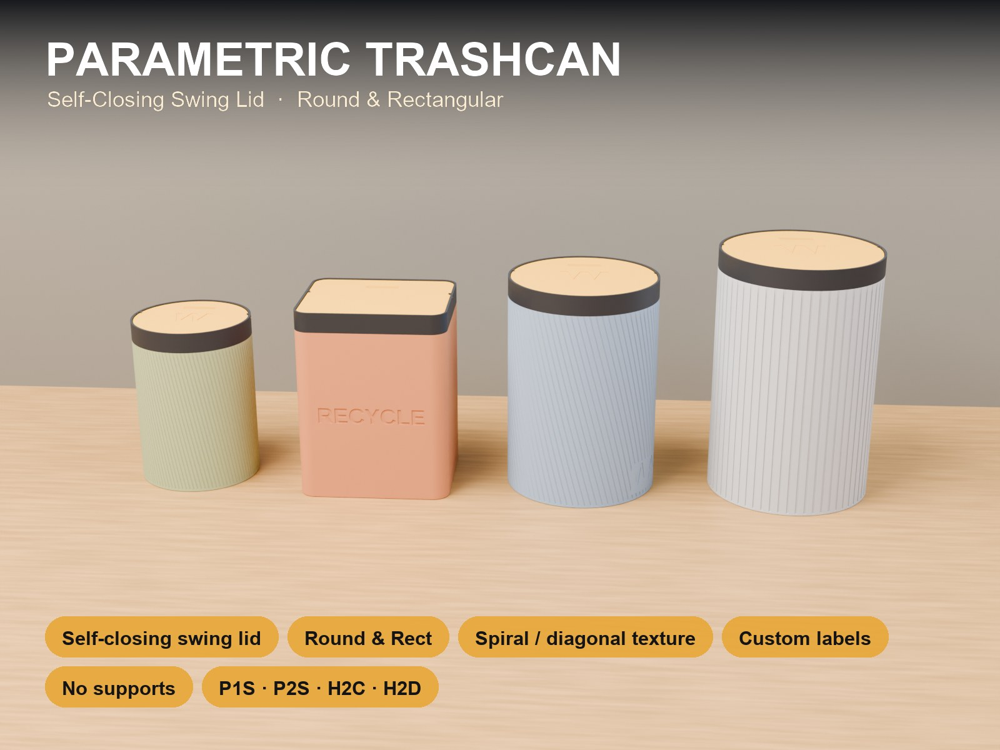
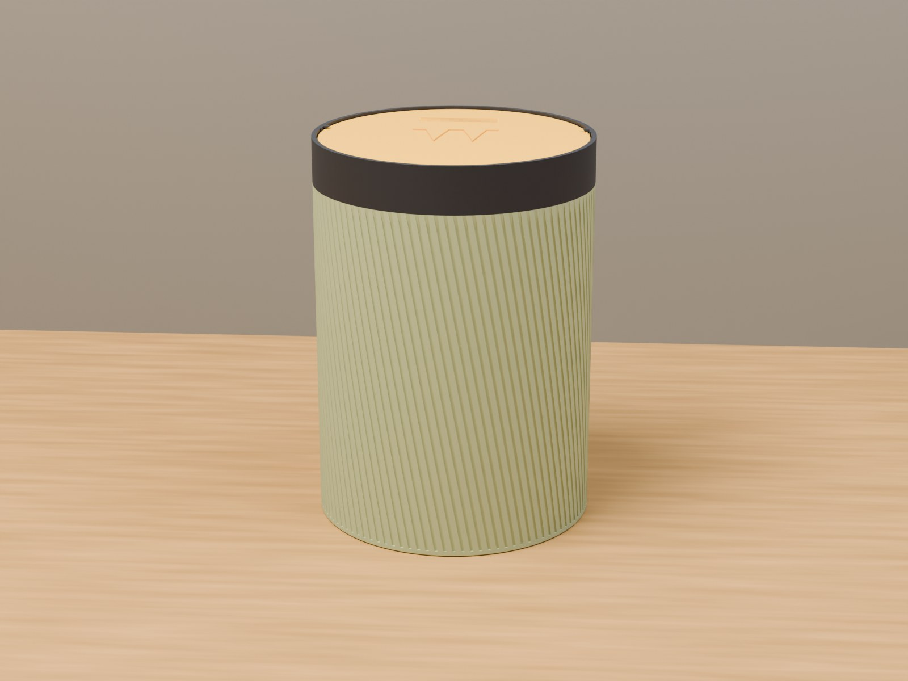
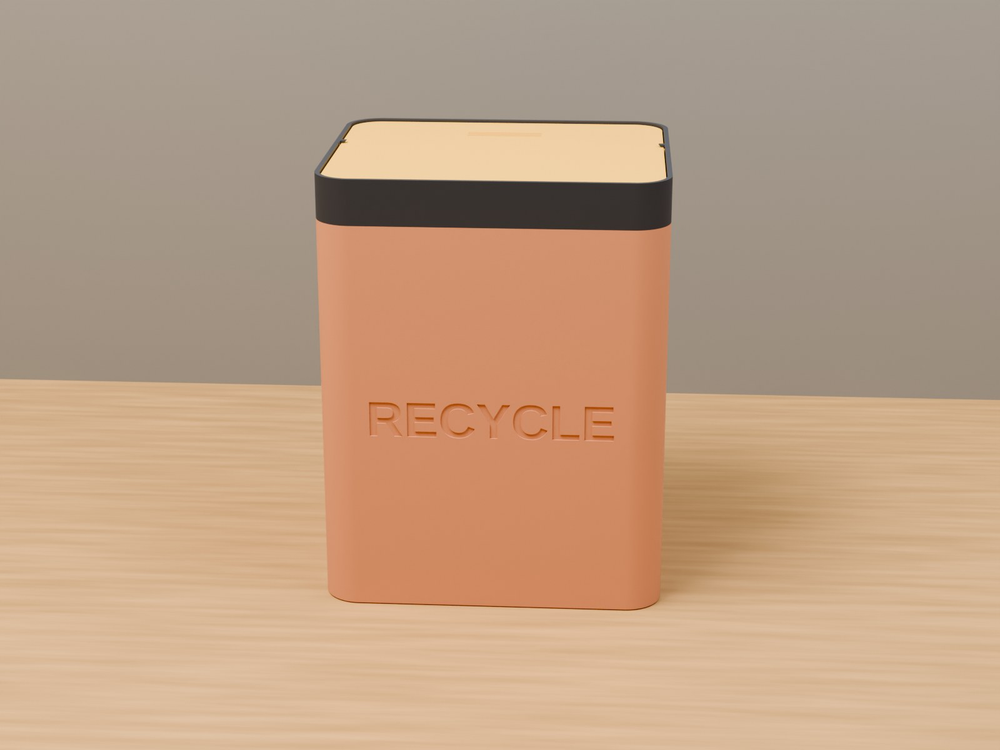
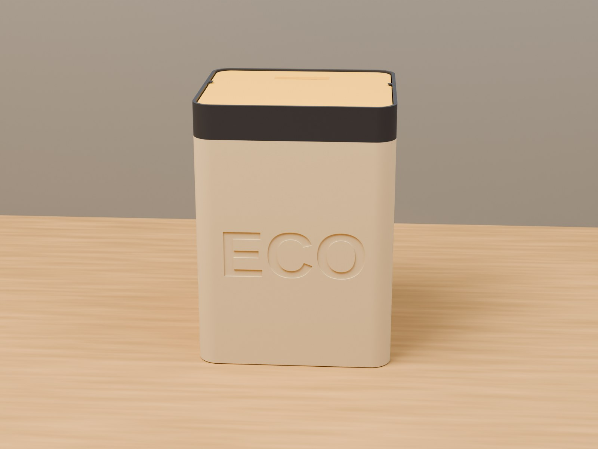

# Mülleimer 3D-drucken: selbstschließende Schwenkklappe, parametrisch, rund oder eckig

👉 **MakerWorld-Link:** <https://makerworld.com/en/models/3276497-parametric-trash-can> – Profil:
<https://makerworld.com/en/@BetaHydri>

## Motivation: Der Eimer, der sich selbst schließt

Ein offener Mülleimer am Schreibtisch, in der Werkstatt oder im Wohnmobil stört
und riecht. Ein Kippdeckel braucht eine freie Hand. Mich hat interessiert, ob
sich ein Eimer mit Schwenkklappe komplett drucken lässt – ohne Feder, ohne
Magnet, ohne Support – und das in den Maßen, die gerade gebraucht werden. Der
**Parametric Trashcan** ist das Ergebnis: Eimer, Rahmen und Klappe,
einstellbar im MakerWorld-Customizer.

## Funktionen im Überblick

- **Selbstschließende Klappe:** außermittiger Drehpunkt (`pivot_offset`); die
  schwerere Hälfte zieht die Klappe zurück in die Schließstellung.
- **Rund oder eckig:** `shape` wählt Zylinder oder Rechteck, `corner_r` den
  Eckenradius; Maße bis 300 mm Breite bzw. Durchmesser und 400 mm Höhe.
- **Rahmen mit Schnapp-Sitz:** Der Kragen sitzt bündig auf der abgesetzten Schulter
  des Eimers, eine kleine Wulst hält ihn.
- **Zapfen-Gelenk** mit einstellbarem Lagerspiel (`pivot_play`).
- **Anschlag-Lippe und Öffnungsbegrenzung** (`stopper_w`, `swing_limit`,
  `stop_angle`).
- **Rillenmuster mit Drall:** rechteckig, V-Nut oder gerundet; Spirale beim
  runden, diagonal beim eckigen Eimer (`relief_angle`).
- **Beschriftung** an der Wand und auf der Klappe.
- **Bauraumprüfung** für H2D, H2C, P2S und P1S in der Konsole.
- **Sechs Referenzvarianten** mit Profilen für vier Bambu-Lab-Drucker.

## Entwicklungsprozess

Am 3. September 2026 habe ich angefangen, ein bestehendes parametrisches
Boxmodell um eine Schwenkklappe zu erweitern. Vorlage war eine vermessene
zweiteilige Klappe. Ihre Geometrie habe ich nicht kopiert, sondern nur das
Prinzip übernommen: ein Drehpunkt, der nicht in der Plattenmitte sitzt.

Einige Stationen:

- **Anschlag-Lippe.** Zuerst war sie ein Halbring um die ganze schwere Seite und
  sah aus wie ein halb geschlossener Deckel. Die Messung an der Vorlage zeigte,
  dass der Eingriff nur rund 0,8 mm beträgt. Daraus wurde ein dünner Ring.
- **Streifenband unter dem Kragen.** Es erschien auch im Blender-Render, nicht nur
  in der Vorschau, und blieb bei jeder Auflösung gleich. Ursache war eine
  deckungsgleiche Fläche im Sitzabsatz. Seitdem überragt der Schnitt die Wand.
- **Schnapp-Nut.** Zusätzlich zum Absatz im dünnen Eimerrand führte sie zu einem
  leeren Layer beim Slicen. Die Nut entfiel, der Rand bleibt glatt.
- **Öffnungsbegrenzung.** Ohne Anschlag schwang die Klappe über den toten Punkt
  hinaus; zwei Anschlagblätter an den Gelenkflanken begrenzen sie jetzt knapp unter
  90°.

Am 4. September standen sechs Referenzvarianten mit Profilen und
Szenenbildern. Danach folgten bis in den Oktober mehrere Testdruck-Runden zu
Gelenk und Sitz.

## Technische Hintergründe

**Gravitationsrückkehr.** Die Schwenkachse liegt um `pivot_offset` ×
Innenradius zur Druckseite versetzt. Dort ist die Klappe kurz, auf der anderen
Seite lang und schwer. Der Schwerpunkt liegt dadurch immer hinter der Achse und
die Klappe fällt zurück. Beim Standard (Ø 120 mm) beträgt der Versatz 9,2 mm.

**Zapfen und Bohrung.** Die Zapfen haben eine abgeschrägte Spitze zum Einrasten.
Die Bohrung ist `pin_d` + `pivot_play` groß, bewusst etwas größer, weil
waagerechte Bohrungen im Druck eng werden. Die Gelenk-Nocken im Rahmen sind an die
Außenfläche beschnitten, damit nichts über die Wand ragt.

**Dünnring statt Hülle.** Für die Anschlag-Lippe wollte ich zwei Ringe verhüllen
– die konvexe Hülle eines Rings ist aber eine volle Scheibe. Die Lippe ist
deshalb die Differenz aus der vergrößerten Öffnung und einem massiven Innenkegel.
So bleibt die Öffnung frei, und die Unterseite ist eine selbsttragende
45°-Fläche.

**Rillen mit Drall.** Beim runden Eimer wird die ganze Rillenreihe über die Höhe
verdreht, beim eckigen jede Rille in der Wandebene gekippt. Die Rillentiefe wird
auf `wall` − 0,8 mm begrenzt, ein Kegelstumpf zieht sie oben auf Null.

**Druckposen.** Eimer aufrecht, Rahmen umgedreht, Klappe mit der Oberseite
nach unten. Das ist eine starre Drehung, keine Spiegelung, die Schrift bleibt
lesbar.

## Druck-Erfahrungen und Empfehlungen

Die Profile sind mit **PLA**, 0,20 mm Layerhöhe, 15 % Gyroid und ohne Support im
Bambu Studio testgeslict, je Variante als ein Plan mit allen drei Teilen. Passt
eine vergrößerte Variante nicht mehr auf eine Platte, druckst du Eimer, Rahmen und
Klappe getrennt.

Zum Zusammenbau biegst du die Klappe leicht und rastest die Zapfen in die
Rahmenbohrungen ein. Dann prüfst du, ob sie frei schwenkt und von selbst
schließt, und drückst den Rahmen auf den Eimer, bis er bündig sitzt. Ein neuer
Zapfen läuft anfangs stramm; ein paarmal bewegen oder `pivot_play` erhöhen.
Zögert die Klappe beim Schließen, erhöhst du `pivot_offset`.

Für den **Mehrfarb-Export** (`Multicolor Export`) exportierst du den STL direkt aus
der OpenSCAD-Vorschau, ohne F6/Render und ohne Kommandozeile.

## Einsatzideen

- Papierkorb am Schreibtisch mit Rillenstruktur
- Werkstatt-Eimer mit Aufschrift `WASTE`
- Rattelfreier Eimer im Wohnmobil oder Camper
- Mülltrennung mit `PAPER`, `ECO` oder `RECYCLE`
- Eimer in Wunschmaß, mit Bauraumprüfung für das eigene Druckbett

## Fazit und Aufruf zum Mitmachen

Der Mülleimer ist ein Baukasten für Eimer mit selbstschließender Klappe. Wenn du
ihn druckst, freue ich mich über **Makes** mit Fotos, besonders zu Lagerspiel und
Schließverhalten auf anderen Druckern. Schreib einfach einen Kommentar auf
MakerWorld.

👉 **MakerWorld-Link:** <https://makerworld.com/en/models/3276497-parametric-trash-can>

---

## 10 SEO-Titel

1. Mülleimer 3D-drucken: parametrisch mit selbstschließender Schwenkklappe
2. Schwenkdeckel-Mülleimer ohne Feder und Magnet: Schwerkraft statt Mechanik
3. Parametric Trashcan für Bambu Lab: rund oder eckig, jede Größe
4. Mülleimer für das Wohnmobil 3D-drucken: rattelfrei und selbstschließend
5. Papierkorb mit Rillenstruktur 3D-drucken: Spirale oder diagonal
6. Mülleimer mit Beschriftung: PAPER, ECO, RECYCLE im Customizer
7. Selbstschließende Klappe konstruieren: außermittiger Drehpunkt erklärt
8. Mülleimer ohne Support drucken: Eimer, Rahmen und Klappe flach
9. Parametric Trash Can: Self-Closing Swing Lid, Round and Rectangular
10. Gedruckter Schwenkdeckel: Lagerspiel und Anschlag richtig einstellen

## 20 relevante Suchbegriffe

- Mülleimer 3D-Druck
- Mülleimer mit Schwenkdeckel 3D drucken
- selbstschließender Deckel 3D-Druck
- Schwenkklappe 3D-Druck
- parametrischer Mülleimer OpenSCAD
- Papierkorb 3D drucken
- Trash can 3D print
- Swing lid trash can
- Self closing lid 3D print
- Mülleimer Wohnmobil 3D-Druck
- Mülleimer Camper
- Mülleimer Werkstatt
- Mülltrennung 3D-Druck
- Eimer mit Deckel 3D-Druck
- Gravitationsklappe
- Bambu Lab Mülleimer
- MakerWorld Mülleimer
- Customizer Mülleimer
- Eimer mit Rillen 3D-Druck
- funktionale 3D-Drucke

## 10 GitHub-Tags

- parametric
- openscad
- trashcan
- waste-bin
- swing-lid
- 3d-printing
- bambu-lab
- makerworld
- customizer
- functional-print

## 5 LinkedIn-Post-Ideen

1. „Eine Klappe, die sich selbst schließt – ohne Feder“: Wie ein außermittiger
   Drehpunkt reicht.
2. „Wenn die konvexe Hülle eines Rings eine Scheibe ist“: Ein Bug beim Bau einer
   Anschlag-Lippe und die Lösung.
3. „Ein Streifenband, das bei jeder Auflösung bleibt“: Fehlersuche an einer
   deckungsgleichen Fläche.
4. „Drei Teile, kein Support“: Druckposen als Teil des Entwurfs.
5. „Vom Boxmodell zum Mülleimer“: wie aus einem bestehenden parametrischen Modell
   ein neues Produkt wird.

## 5 Reddit-Post-Ideen

1. r/functionalprint – „Parametric trash can with a self-closing swing lid, no
   springs, no supports“ mit dem Hero-Bild.
2. r/openscad – „Why hulling two rings gives you a disc“: Erklärung des
   Anschlag-Lippen-Ansatzes ohne Quelltext.
3. r/BambuLab – „One trash can model, four printers: build-volume check in the
   console“.
4. r/3Dprinting – „Printed pivot pins: what play works for a rotating fit on your
   printer?“ als Diskussionsfrage.
5. r/3Dprinting – „Spiral and diagonal grooves on round and rectangular bins from
   one parameter“.
