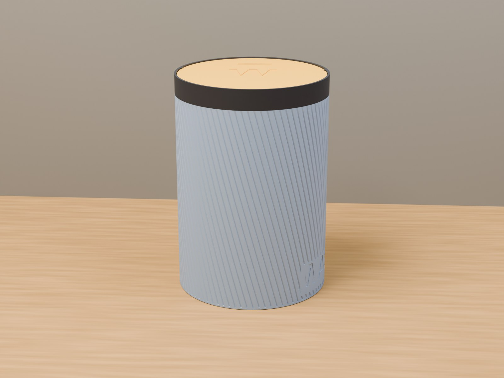
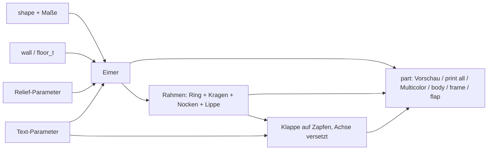
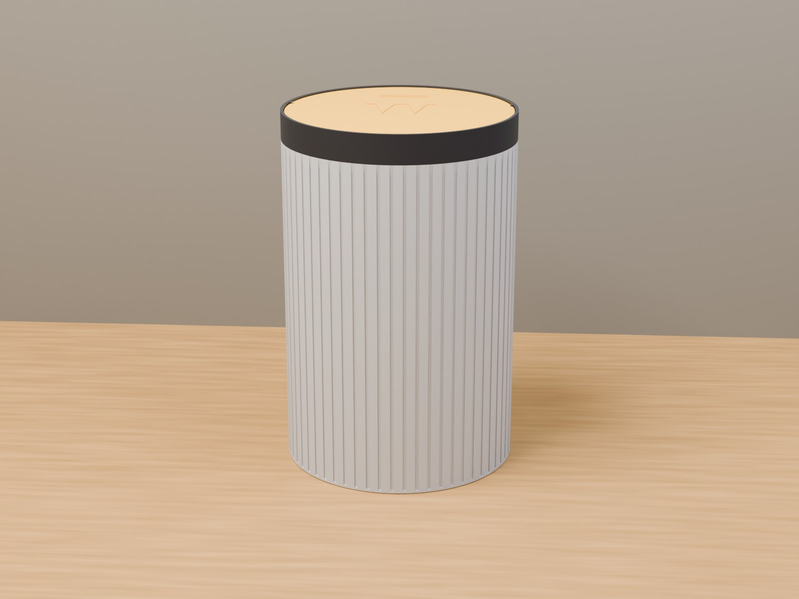

# Parametric Trashcan – Mülleimer mit selbstschließender Schwenkklappe, rund oder eckig

[← Alle Modelle im Überblick](../../README.de.md)

🌐 [English](README.md) | **Deutsch**

Parametrischer Mülleimer für den FDM-Druck: runder oder rechteckiger Behälter
mit aufschnappbarem Rahmen und einer Schwenkklappe, die durch Schwerkraft von
selbst wieder schließt. Keine Feder, kein Magnet, keine Elektronik – und alle
Teile drucken ohne Support. Alles stellst du im MakerWorld-Customizer ein.

> **Das Modell mit allen Druckprofilen gibt es ausschließlich auf MakerWorld:**
> 👉 [MakerWorld-Link: https://makerworld.com/en/models/3276497-parametric-trash-can](https://makerworld.com/en/models/3276497-parametric-trash-can)
>
> 

Der **Parametric Trashcan** besteht aus drei Teilen: dem **Eimer** (Körper), dem
**Rahmen** (Kragen, der auf den Eimer schnappt) und der **Klappe**, die auf zwei
Zapfen im Rahmen schwenkt. Der Drehpunkt liegt außermittig, die schwerere Hälfte
zieht die Klappe immer nach unten – also zurück in die Schließstellung. Form,
Maße, Wandstärken, Spiel, Rillenmuster und Beschriftung sind Parameter.

## Inhaltsverzeichnis

- [Das Problem](#das-problem)
- [Die Idee](#die-idee)
- [Highlights](#highlights)
- [Parametrische Optionen](#parametrische-optionen)
- [Konstruktion](#konstruktion)
- [Druckempfehlungen](#druckempfehlungen)
- [Anwendungsbeispiele](#anwendungsbeispiele)
- [Fehlersuche / FAQ](#fehlersuche--faq)
- [Entwicklungsgeschichte](#entwicklungsgeschichte)
- [Downloads](#downloads)
- [Lizenz](#lizenz)

## Das Problem

Ein Mülleimer mit Deckel ist schnell gekauft – aber selten passend:

- Offene Eimer sind unschön und riechen; Kippdeckel brauchen eine Hand.
- Für Schreibtisch, Werkbank, Bad oder Wohnmobil sind die Maße der
  Standardmodelle meist falsch.
- Ein gedrucktes Gelenk, das erst nach dem Druck gelöst werden muss, oder ein
  Deckel, der Support braucht, ist unpraktisch.
- Gleiches Design in rund und eckig, mit Rillen oder Aufschrift, will man ohne
  zweites Modell umschalten können.

## Die Idee

Das Prinzip stammt von einer vermessenen zweiteiligen Schwenkklappe: Der
Drehpunkt sitzt nicht in der Mitte der Platte, sondern zur Druckseite
(„Push-Seite“) hin versetzt. Die lange Hälfte ist schwerer und kippt von selbst
nach unten, die Klappe kehrt in die Schließstellung zurück. Drückst du die
kurze Hälfte nach unten, geht sie auf, der Müll fällt hinein und die Klappe
schließt wieder.

Dieses Prinzip habe ich auf runde und rechteckige Eimer übertragen (nicht 1:1
kopiert) und in drei Teile gegliedert, die alle ohne Support druckbar sind.
Alle Maße in Millimetern, alle Werte als Customizer-Parameter.

## Highlights

- **Selbstschließende Klappe:** außermittiger Drehpunkt (`pivot_offset`), Rückkehr
  allein durch Schwerkraft.
- **Rund oder eckig:** `shape` wählt Zylinder oder Rechteck mit `corner_r`;
  Durchmesser, Breite und Tiefe bis 300 mm, Höhe bis 400 mm.
- **Drei Teile, kein Support:** Eimer aufrecht, Rahmen umgedreht (Ringfläche auf
  dem Bett), Klappe mit der Oberseite nach unten.
- **Rahmen mit Schnapp-Sitz:** Kragen sitzt bündig auf der abgesetzten Schulter
  des Eimers, eine kleine Schnapp-Wulst hält ihn.
- **Zapfen-Gelenk:** zwei runde Zapfen an der Klappe in Bohrungen der
  Rahmen-Nocken, mit 45°-Einführfase an den Zapfen.
- **Anschlag-Lippe und Öffnungsbegrenzung:** eine dünne Lippe fängt die geschlossene
  Klappe; zwei kleine Anschlagblätter an den Gelenkflanken begrenzen das Öffnen
  knapp unter 90°, damit die Klappe immer zurückfällt.
- **Rillenmuster** mit drei Profilen (rechteckig, V-Nut, gerundet) und
  **Drall** (`relief_angle`): Spirale beim runden, diagonal beim eckigen Eimer.
- **Rillen laufen unter dem Kragen aus** (`relief_fade`), kein ausgefranstes
  Rillenende.
- **Beschriftung** an der Wand und auf der Klappe; Rillen weichen dem Text aus.
- **Mehrfarb-Export** für Eimer, Rahmen, Klappe und Texte.
- **Druckerprüfung:** Die Konsole warnt, wenn ein Teil nicht auf das gewählte
  Druckbett passt (H2D, H2C, P2S, P1S).
- **Sechs Referenzvarianten** mit Bambu-Studio-Profilen.

## Parametrische Optionen

Die Namen entsprechen den Customizer-Parametern des Modells.

### Ausgabe

| Parameter | Bedeutung | Standard | Bereich / Einheit |
|---|---|---|---|
| `part` | Ausgabe: `Preview assembled` (Klappe zu, nicht druckbar), `Preview open` (Klappe gekippt, nicht druckbar), `print all` (alle Teile flach), `Multicolor Export` (alle Teile mehrfarbig), `body`, `frame`, `flap` | `Preview open` | Auswahl |
| `open_angle` | Kippwinkel der Klappe in der Vorschau `Preview open` | 55 | 0–90°, Schritt 5 |

### Form und Maße

| Parameter | Bedeutung | Standard | Bereich / Einheit |
|---|---|---|---|
| `shape` | `round` (Zylinder) oder `rect` (Rechteck) | `round` | Auswahl |
| `diameter` | Außendurchmesser (rund) | 120 | 40–300 mm |
| `width` | Breite X (eckig) | 140 | 40–300 mm |
| `depth` | Tiefe Y (eckig); die Schwenkachse läuft quer zu X, versetzt entlang Y | 120 | 40–300 mm |
| `height` | Außenhöhe des Eimers ohne Rahmen | 160 | 40–400 mm |
| `corner_r` | Eckenradius (eckig) | 12 | 0–60 mm, Schritt 0,5 |

### Wände und Boden

| Parameter | Bedeutung | Standard | Bereich / Einheit |
|---|---|---|---|
| `wall` | Wandstärke | 2,4 | 1,6–6,0 mm, Schritt 0,1 |
| `floor_t` | Bodenstärke | 2,4 | 1,6–6,0 mm, Schritt 0,1 |

### Rahmen (Kragen)

| Parameter | Bedeutung | Standard | Bereich / Einheit |
|---|---|---|---|
| `frame_wall` | Wandstärke des Kragens | 2,6 | 1,6–6,0 mm, Schritt 0,1 |
| `frame_overlap` | Wie weit der Kragenrand nach unten über die Eimerwand reicht | 12,0 | 6,0–40,0 mm, Schritt 0,5 |
| `frame_top` | Dicke des oberen Rings über dem Eimerrand | 3,0 | 2,0–6,0 mm, Schritt 0,1 |
| `fit_clearance` | Spalt zwischen Kragenrand und Eimerwand je Seite | 0,20 | 0,05–0,5 mm, Schritt 0,05 |
| `frame_chamfer` | Einführfase am Kragenrand | 1,2 | 0–3,0 mm, Schritt 0,1 |
| `snap_enabled` | Schnapp-Wulst am Kragen | 1 | 0 = Nein, 1 = Ja |
| `snap_depth` | Tiefe der Schnapp-Wulst | 0,6 | 0,3–1,2 mm, Schritt 0,1 |

### Schwenkklappe

| Parameter | Bedeutung | Standard | Bereich / Einheit |
|---|---|---|---|
| `flap_th` | Plattendicke der Klappe (wird intern auf mindestens `pin_d` + 0,4 angehoben) | 3,0 | 2,0–6,0 mm, Schritt 0,1 |
| `flap_gap` | Spalt zwischen Klappenrand und Rahmenöffnung je Seite | 0,5 | 0,4–2,0 mm, Schritt 0,05 |
| `pin_d` | Zapfendurchmesser | 3,6 | 2,5–6,0 mm, Schritt 0,1 |
| `pin_len` | Zapfenlänge in die Bohrung | 3,2 | 2,0–6,0 mm, Schritt 0,1 |
| `pivot_play` | Lagerspiel: Bohrung = `pin_d` + Wert; größer = freier | 0,5 | 0,25–1,0 mm, Schritt 0,05 |
| `pivot_offset` | Versatz der Achse zur Push-Seite als Anteil des Radius bzw. der halben Tiefe; größer = stärkere Schließneigung | 0,16 | 0,06–0,32, Schritt 0,01 |
| `stopper_w` | Überstand der Anschlag-Lippe nach innen; klein halten, muss größer als `flap_gap` sein | 0,8 | 0,4–1,2 mm, Schritt 0,1 |
| `stopper_arc` | Bogen der Lippe an der schweren Kante (nur rund) | 90 | 60–180°, Schritt 5 |
| `swing_limit` | Öffnungsbegrenzung durch zwei Anschlagblätter an den Gelenkflanken | 1 | 0 = Nein, 1 = Ja |
| `stop_angle` | Maximaler Öffnungswinkel bis zum Anschlag; unter 90°, damit die Klappe zurückfällt | 85 | 78–90°, Schritt 1 |

### Relief / Textur

| Parameter | Bedeutung | Standard | Bereich / Einheit |
|---|---|---|---|
| `relief_enabled` | Rillen an der Außenwand | 0 | 0 = Aus, 1 = An |
| `relief_style` | Rillenform | 2 | 0 = Rechteck, 1 = V-Nut, 2 = Gerundet |
| `relief_count` | Gesamtzahl der Rillen am Umfang | 100 | 4–500 |
| `relief_depth` | Tiefe jeder Rille (wird auf `wall` − 0,8 mm begrenzt) | 0,6 | 0,2–1,2 mm, Schritt 0,1 |
| `relief_width` | Breite jeder Rille | 1,2 | 0,5–4,0 mm, Schritt 0,1 |
| `relief_angle` | Drall: rund = Spirale über die ganze Höhe, eckig = diagonale Rillen, 0 = gerade | 0 | −180–180°, Schritt 5 |
| `relief_corner` | Nur eckig: freie Wand an jeder Ecke | 4,0 | 1,0–20 mm, Schritt 0,5 |
| `relief_fade` | Länge, auf der die Rillen oben zu Null auslaufen, 0 = harter Rand | 8 | 0–25 mm, Schritt 0,5 |

### Text – Eimerwand

| Parameter | Bedeutung | Standard | Bereich / Einheit |
|---|---|---|---|
| `body_text_enabled` | Text an der Wand | 0 | 0 = Aus, 1 = An |
| `body_text` | Text | `TRASH` | Freitext |
| `body_text_size` | Schriftgröße (0 = automatisch) | 0 | 0–60 mm, Schritt 0,5 |
| `body_text_depth` | Gravurtiefe | 0,6 | 0,3–1,5 mm, Schritt 0,1 |
| `body_text_side` | Wand für den Text (eckig) | `Front` | `Front`, `Back`, `Left`, `Right` |
| `body_text_angle` | Winkelposition (rund), 0 = +X | 0 | 0–355°, Schritt 5 |
| `body_text_vpos` | Vertikale Position | `Middle` | `Top`, `Middle`, `Bottom` |
| `text_panel_margin` | Glatter Freiraum um den Text, frei von Rillen | 3 | 0–15 mm, Schritt 0,5 |

### Text – Klappenoberseite

| Parameter | Bedeutung | Standard | Bereich / Einheit |
|---|---|---|---|
| `flap_text_enabled` | Zeichen auf der Klappenoberseite | 0 | 0 = Aus, 1 = An |
| `flap_text` | Text oder Symbol | `♻` | Freitext |
| `flap_text_size` | Schriftgröße (0 = automatisch) | 0 | 0–60 mm, Schritt 0,5 |
| `flap_text_depth` | Gravurtiefe | 0,6 | 0,3–1,5 mm, Schritt 0,1 |

### Qualität und Druckerprüfung

| Parameter | Bedeutung | Standard | Bereich / Einheit |
|---|---|---|---|
| `$fn` | Glätte der runden Flächen | 72 | 24–160, Schritt 8 |
| `target_printer` | Zieldrucker für die Bauraumprüfung: `H2D` (350 × 320 × 325), `H2C` (325 × 320 × 320), `P2S`, `P1S` (je 256 × 256 × 256) | `H2D` | Auswahl |

## Konstruktion

### OpenSCAD-Ansatz

Das Modell ist reines OpenSCAD ohne externe Bibliotheken und läuft im
MakerWorld-Customizer. Der `part`-Selektor entscheidet, ob Vorschau, ein
Druck-Layout oder ein Einzelteil ausgegeben wird. Eingaben werden intern
begrenzt: Wand, Boden und Kragen mindestens 1,6 mm, Höhe mindestens
Boden + 30 mm, Durchmesser bzw. Breite und Tiefe mindestens 40 mm.

### Parametrische Logik

| Größe | Formel / Regel |
|---|---|
| Innenradius (rund) | Außenradius − `wall` |
| Achsversatz | `pivot_offset` × Innenradius bzw. halbe Innentiefe, Richtung Push-Seite (+Y) |
| Bohrungsdurchmesser | `pin_d` + `pivot_play` |
| Klappendicke | max(`flap_th`, `pin_d` + 0,4, 2,0) |
| Klappenradius / -halbmaß | Öffnung − `flap_gap` je Seite |
| Ringhöhe oben | max(`frame_top`, Klappendicke + 2 + 0,6) |
| Sitz (Absatz am Eimerrand) | max(1, min(`frame_wall`, `wall` − `fit_clearance` − 0,9)) |
| Schnapp-Wulst | min(`snap_depth`, Sitz − 0,4) |
| Relief-Tiefe | begrenzt auf `wall` − 0,8 mm |
| Rillen enden | `frame_overlap` unterhalb des Eimerrands, mit `relief_fade` Auslauf |

Mit den Voreinstellungen (rund, Ø 120 × 160 mm) ergeben sich: Achsversatz
9,2 mm, Bohrung Ø 4,1 mm, Klappendicke 4,0 mm (die Zapfen bestimmen die Dicke),
Klappen-Durchmesser 114,2 mm, Ringhöhe 6,6 mm, Sitz 1,3 mm und Außendurchmesser
des Rahmens 125,6 mm.

Die Werte sind aus den Formeln und den Standardwerten abgeleitet.

### Besondere Algorithmen

- **Gravitationsrückkehr:** Der Drehpunkt liegt zur Push-Seite versetzt; die
  längere, schwerere Hälfte der Klappe kippt nach unten. Einen eigenen Rückstell-
  mechanismus braucht es nicht.
- **Zapfen in Nocken:** Zwei Zapfen mit abgeschrägter Spitze an der Klappe laufen in
  Bohrungen von Nocken im Rahmen. Die Nocken werden an der Außenfläche des Rahmens
  abgeschnitten, damit nichts über die Wand hinausragt. Die Bohrung ist leicht
  übergroß, damit sie beim waagerechten Druck rund bleibt.
- **Anschlag-Lippe als Dünnring:** Die Lippe ist die Differenz aus der vergrößerten
  Öffnung und einem massiven Innenkegel. Würde man zwei Ringe verhüllen, füllte
  die Hülle die Mitte; mit massiven Scheiben bleibt die Öffnung frei und die Unterseite
  wird zur selbsttragenden 45°-Fläche. Bei rund deckt die Lippe einen
  Viertelkreis (`stopper_arc`), bei eckig die ganze Vorderseite.
- **Anschlagblätter:** Zwei einseitige, radiale Blätter an den Gelenkflanken
  (eines an der Klappe, eines am Rahmen) berühren sich flächig; der Anschlag
  liegt exakt beim Winkel `stop_angle`, unabhängig von der Blattdicke.
- **Sitz ohne Koinzidenz:** Der Absatz am Eimerrand wird mit einem Schnitt
  erzeugt, dessen Außenkante 2 mm außerhalb der Wand liegt. So entsteht keine
  deckungsgleiche Fläche, die im Druck Streifen erzeugen würde.
- **Rillen:** Rund: eine Rillenreihe mit Verdrehung (Spirale) über die Höhe. Eckig:
  jede Rille wird in der Wandebene gekippt (diagonal). Das Auslaufen erfolgt über
  einen Kegelstumpf, der die Rillentiefe nach oben auf Null zieht.
- **Text auf der Wand:** Größe und Position werden aus der Wandfläche, der
  Rillenzone und `text_panel_margin` abgeleitet; Rillen sparen das Textfeld aus. Im
  Mehrfarbmodus füllt eine Farbeinlage die Vertiefung, deren Tiefe min(`wall` − 0,6;
  max(`body_text_depth`; 1,6)) beträgt.

### Modularität

Der Code trennt Eimer, Sitzabsatz, Rillen (mit Auslauf), Text-Volumen, Rahmen
(Ring, Kragenrand, Einführfase, Nocken, Lippe, Anschlagblätter), Klappe (Platte,
Zapfen, Griffrillen, Text) und die Farb-Wrapper für Vorschau und Mehrfarb-Export.
Ein Vorschau-Banner und eine Start-Kamera zeigen die Teile zentriert.

### Druckoptimierungen

- **Eimer aufrecht:** Boden auf dem Bett, keine Überhänge.
- **Rahmen umgedreht:** Die flache Ringfläche liegt auf dem Bett; Nocken sind an
  die Ringebene beschnitten, damit nichts unter den Bodenpunkt ragt.
- **Klappe mit der Oberseite nach unten:** Die sichtbare Fläche und die Beschriftung
  liegen am Bett und werden besonders sauber; ein Farbwechsel fällt in die erste
  Lage. Die Drehung um 180° ist eine starre Drehung, die Schrift bleibt auf der
  fertigen Fläche lesbar.
- **Lippe mit 45°-Unterseite** und Rillen, die zu Null auslaufen.
- **Rillentiefe begrenzt:** mindestens 0,8 mm Wand bleiben stehen.
- **Griffrillen** (vier flache Linien) markieren, wo man auf die Klappe drückt.

## Druckempfehlungen

Die mitgelieferten Profile liegen als je ein Druckplan mit allen drei Teilen vor
und sind im Bambu Studio testgeslict (0,20 mm Layerhöhe, Gyroid 15 %, Bambu PLA).
Die sechs Varianten decken P1S, P2S, H2C und H2D ab:

| Variante | Drucker | Form | Maße (mm) | Textur | Beschriftung |
|---|---|---|---|---|---|
| `round-120-fluted` | P1S | rund | Ø 120 × 160 | gerundet, 25° Spirale | Zeichen auf der Klappe |
| `rect-115-eco` | P2S | eckig | 115 × 105 × 150 | rechteckig, 20° diagonal | „ECO“ |
| `round-150-vgroove` | H2C | rund | Ø 150 × 210 | V-Nut, 40° Spirale | „WASTE“ unten, Zeichen auf der Klappe |
| `rect-150-recycle` | H2C | eckig | 150 × 128 × 185 | gerundet, 30° diagonal | „RECYCLE“ |
| `round-160-ribbed` | H2D | rund | Ø 160 × 240 | gerade Rippen | Zeichen auf der Klappe |
| `rect-118-paper` | P1S | eckig | 118 × 108 × 140 | gerundet, gerade | „PAPER“ |

| Einstellung | Empfehlung |
|---|---|
| Material | PLA (Profile); PETG/ASA auf P2S, H2C, H2D möglich |
| Layerhöhe | 0,20 mm |
| Wände | 2–3 |
| Infill | 15 % Gyroid |
| Supports | keine |
| Ausrichtung | Eimer aufrecht, Rahmen umgedreht (Ring auf dem Bett), Klappe Oberseite nach unten |

**Besondere Hinweise**

- **Zusammenbau:** Klappe leicht biegen und die beiden Zapfen in die Bohrungen des
  Rahmens einrasten lassen; prüfen, dass sie frei schwenkt und von selbst schließt.
  Dann den Rahmen auf den Eimer drücken, bis der Kragen bündig auf dem Absatz sitzt
  und die Schnapp-Wulst hält.
- **Zu groß für eine Platte:** Eimer, Rahmen und Klappe sind unabhängig und lassen
  sich getrennt drucken.
- **Zweifarb-Look:** Beschriftung im Slicer färben oder die Klappe in einem zweiten
  Filament drucken.
- **Mehrfarb-Export** (`Multicolor Export`): STL **direkt aus der
  OpenSCAD-Vorschau** exportieren, ohne F6/Render und ohne Kommandozeile –
  sonst werden die Farbgruppen vereinigt.
- **Vorschau-Modi** sind nicht druckbar (rotes „NOT FOR PRINTING“-Banner).
- **Einlaufzeit:** Ein neuer Zapfen läuft anfangs stramm; ein paarmal hin- und
  herbewegen.
- **Spiralrillen:** 20–40° bei 60–110 Rillen sehen am besten aus.

## Anwendungsbeispiele

- **Schreibtisch und Büro:** kleiner, geschlossener Papierkorb mit Rillenstruktur.
- **Werkbank und Werkstatt:** Eimer für Späne und Verpackungen, Aufschrift
  `WASTE`.
- **Wohnmobil und Camper:** rattelfreier, selbstschließender Eimer in Wunschmaß.
- **Küche und Bad:** schmale, eckige Eimer mit Beschriftung wie `PAPER` oder `ECO`.
- **Mülltrennung:** mehrere Eimer in Rund und Eckig mit `RECYCLE`, `PAPER` und
  anderen Aufschriften.
- **Eigene Größen:** Maße über `diameter` bzw. `width`, `depth` und `height`; die
  Konsole meldet, ob es auf das gewählte Druckbett passt.

## Fehlersuche / FAQ

| Symptom | Ursache | Fix |
|---|---|---|
| Klappe schließt zu zögerlich | Achsversatz zu klein oder Reibung | `pivot_offset` erhöhen; `pivot_play` erhöhen, falls der Zapfen stramm läuft |
| Frische Zapfen sind schwergängig | Druckmaß, noch keine Einlaufzeit | mehrfach bewegen; `pivot_play` erhöhen |
| Klappe klemmt im Rahmen | Spalt zu klein | `flap_gap` erhöhen |
| Klappe liegt nicht bündig auf | Lippe zu klein | `stopper_w` erhöhen; sie muss größer als `flap_gap` sein |
| Rahmen sitzt zu locker oder klemmt | Spiel des Kragens | `fit_clearance` verringern bzw. erhöhen |
| Rahmen hält nicht auf dem Eimer | Schnapp-Wulst zu flach | `snap_depth` erhöhen oder `snap_enabled` prüfen |
| Rillen wirken zu flach oder fehlen | `relief_depth` wird auf `wall` − 0,8 mm begrenzt | `wall` erhöhen oder `relief_depth` verringern |
| Rillenenden unter dem Kragen sichtbar | kein Auslauf | `relief_fade` erhöhen |
| Text sitzt nicht, wo er soll | Position falsch gewählt | `body_text_side` (eckig), `body_text_angle` (rund), `body_text_vpos` anpassen |
| Konsole meldet „does NOT fit“ | Teil größer als das Druckbett | Maße verringern oder Zieldrucker wechseln |
| Zweifarb-STL hat nur eine Farbe | Export über F6/Render oder Kommandozeile | STL direkt aus der Vorschau exportieren |

## Entwicklungsgeschichte

Am 3. September 2026 begann die Entwicklung: Ein bestehendes parametrisches
Boxmodell (rund oder eckig, Relief, Text) sollte um eine selbstschließende
Schwenkklappe zu einem Mülleimer erweitert werden. Als Vorlage diente eine
vermessene zweiteilige Klappe; übernommen wurde nur das Prinzip des
außermittigen Drehpunkts, nicht die Geometrie.

Am selben Tag entstanden die drei Teile, die Anschlag-Lippe (zuerst als großer
Halbring, dann auf rund 0,8 mm Überstand reduziert) und die Rillen mit Drall
(`relief_angle`). Ein auffälliges Streifenband unter dem Kragen stellte sich als
deckungsgleiche Fläche im Sitzabsatz heraus; seitdem überragt der Schnitt die Wand.
Am 4. September 2026 folgten der Auslauf der Rillen (`relief_fade`), die
Öffnungsbegrenzung durch Anschlagblätter und sechs Referenzvarianten für P1S,
P2S, H2C und H2D mit Szenenbildern.

Ende September und Anfang Oktober 2026 folgten mehrere Testdruck-Runden zu
Gelenk, Lagerspiel und Sitz des Rahmens. Die Beschreibungsdatei wurde zuletzt am
2. Oktober 2026 geändert, die Modelldatei am 12. Oktober 2026.

Die Bilder in diesem Repository sind Renderings der Modellgeometrie
beziehungsweise daraus abgeleitete Szenenbilder; Druckfotos sind nicht dabei.

## Downloads

Print files are intentionally available exclusively on MakerWorld.

👉 MakerWorld-Link: https://makerworld.com/en/models/3276497-parametric-trash-can

Profil: <https://makerworld.com/en/@BetaHydri>

## Lizenz

Dokumentation und Bilder in diesem Repository; Modell- und Druckdateien werden
ausschließlich über MakerWorld verteilt. Dokumentation und Bilder: © BetaHydri.
Das Modell (inkl. Quellcode) und alle Druckdateien stehen unter der auf
MakerWorld angegebenen Lizenz. Dieses Repository enthält bewusst keine Modell-,
Quellcode- oder Druckdateien.
