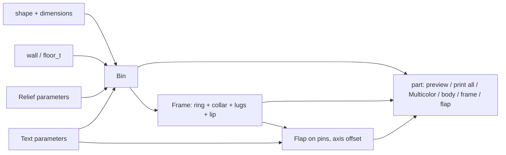

# Parametric Trashcan – Trash Can with Self-Closing Swing Flap, Round or Rectangular

[← All models](../../README.md)

🌐 **English** | [Deutsch](README.de.md)

Parametric trash can for FDM printing: a round or rectangular container with a
snap-on frame and a swing flap that closes by itself again through gravity. No
spring, no magnet, no electronics – and all parts print without support. You set
everything in the MakerWorld Customizer.

> **The model with all print profiles is available exclusively on MakerWorld:**
> 👉 [MakerWorld link: https://makerworld.com/en/models/3276497-parametric-trash-can](https://makerworld.com/en/models/3276497-parametric-trash-can)
>
> 

The **Parametric Trashcan** consists of three parts: the **bin** (body), the
**frame** (collar that snaps onto the bin) and the **flap**, which pivots on two
pins in the frame. The pivot point is off-center, so the heavier half always pulls
the flap down – that is, back into the closed position. Shape, dimensions, wall
thicknesses, clearance, groove pattern and lettering are parameters.

## Table of Contents

- [The Problem](#the-problem)
- [The Idea](#the-idea)
- [Highlights](#highlights)
- [Parametric Options](#parametric-options)
- [Design](#design)
- [Print Recommendations](#print-recommendations)
- [Use Cases](#use-cases)
- [Troubleshooting / FAQ](#troubleshooting--faq)
- [Development History](#development-history)
- [Downloads](#downloads)
- [License](#license)

## The Problem

A trash can with a lid is quickly bought – but rarely a good fit:

- Open bins are unsightly and smell; tilt lids need a hand.
- For desk, workbench, bathroom or camper van, the dimensions of standard models
  are usually wrong.
- A printed hinge that has to be freed after printing, or a lid that needs
  support, is impractical.
- The same design in round and rectangular, with grooves or lettering, should be
  switchable without needing a second model.

## The Idea

The principle comes from a measured two-part swing flap: the pivot point is not in
the middle of the plate but offset toward the push side ("push side"). The long
half is heavier and tips down by itself, so the flap returns to the closed
position. If you push the short half down, it opens, the trash falls in and the
flap closes again.

I transferred this principle to round and rectangular bins (not copied 1:1) and
divided it into three parts, all of which can be printed without support. All
dimensions are in millimeters, all values are Customizer parameters.

## Highlights

- **Self-closing flap:** off-center pivot point (`pivot_offset`), return by gravity
  alone.
- **Round or rectangular:** `shape` selects cylinder or rectangle with `corner_r`;
  diameter, width and depth up to 300 mm, height up to 400 mm.
- **Three parts, no support:** bin upright, frame upside down (ring surface on the
  bed), flap with the top side facing down.
- **Frame with snap fit:** the collar sits flush on the stepped shoulder of the
  bin, and a small snap bead holds it.
- **Pin hinge:** two round pins on the flap in bores of the frame lugs, with a 45°
  lead-in chamfer on the pins.
- **Stop lip and opening limiter:** a thin lip catches the closed flap; two small
  stop blades on the hinge flanks limit opening to just under 90°, so the flap
  always falls back.
- **Groove pattern** with three profiles (rectangular, V-groove, rounded) and
  **twist** (`relief_angle`): spiral on the round bin, diagonal on the rectangular
  bin.
- **Grooves fade out under the collar** (`relief_fade`), no ragged groove end.
- **Lettering** on the wall and on the flap; grooves make way for the text.
- **Multicolor export** for bin, frame, flap and texts.
- **Printer check:** the console warns if a part does not fit on the selected
  print bed (H2D, H2C, P2S, P1S).
- **Six reference variants** with Bambu Studio profiles.

## Parametric Options

The names correspond to the model's Customizer parameters.

### Output

| Parameter | Meaning | Default | Range / Unit |
|---|---|---|---|
| `part` | Output: `Preview assembled` (flap closed, not printable), `Preview open` (flap tilted, not printable), `print all` (all parts flat), `Multicolor Export` (all parts multicolor), `body`, `frame`, `flap` | `Preview open` | Selection |
| `open_angle` | Tilt angle of the flap in the `Preview open` preview | 55 | 0–90°, step 5 |

### Shape and Dimensions

| Parameter | Meaning | Default | Range / Unit |
|---|---|---|---|
| `shape` | `round` (cylinder) or `rect` (rectangle) | `round` | Selection |
| `diameter` | Outer diameter (round) | 120 | 40–300 mm |
| `width` | Width X (rectangular) | 140 | 40–300 mm |
| `depth` | Depth Y (rectangular); the pivot axis runs across X, offset along Y | 120 | 40–300 mm |
| `height` | Outer height of the bin without frame | 160 | 40–400 mm |
| `corner_r` | Corner radius (rectangular) | 12 | 0–60 mm, step 0.5 |

### Walls and Floor

| Parameter | Meaning | Default | Range / Unit |
|---|---|---|---|
| `wall` | Wall thickness | 2.4 | 1.6–6.0 mm, step 0.1 |
| `floor_t` | Floor thickness | 2.4 | 1.6–6.0 mm, step 0.1 |

### Frame (Collar)

| Parameter | Meaning | Default | Range / Unit |
|---|---|---|---|
| `frame_wall` | Wall thickness of the collar | 2.6 | 1.6–6.0 mm, step 0.1 |
| `frame_overlap` | How far the collar rim extends downward over the bin wall | 12.0 | 6.0–40.0 mm, step 0.5 |
| `frame_top` | Thickness of the top ring above the bin rim | 3.0 | 2.0–6.0 mm, step 0.1 |
| `fit_clearance` | Gap between collar rim and bin wall per side | 0.20 | 0.05–0.5 mm, step 0.05 |
| `frame_chamfer` | Lead-in chamfer on the collar rim | 1.2 | 0–3.0 mm, step 0.1 |
| `snap_enabled` | Snap bead on the collar | 1 | 0 = No, 1 = Yes |
| `snap_depth` | Depth of the snap bead | 0.6 | 0.3–1.2 mm, step 0.1 |

### Swing Flap

| Parameter | Meaning | Default | Range / Unit |
|---|---|---|---|
| `flap_th` | Plate thickness of the flap (internally raised to at least `pin_d` + 0.4) | 3.0 | 2.0–6.0 mm, step 0.1 |
| `flap_gap` | Gap between flap edge and frame opening per side | 0.5 | 0.4–2.0 mm, step 0.05 |
| `pin_d` | Pin diameter | 3.6 | 2.5–6.0 mm, step 0.1 |
| `pin_len` | Pin length into the bore | 3.2 | 2.0–6.0 mm, step 0.1 |
| `pivot_play` | Bearing clearance: bore = `pin_d` + value; larger = freer | 0.5 | 0.25–1.0 mm, step 0.05 |
| `pivot_offset` | Offset of the axis toward the push side as a fraction of the radius or half the depth; larger = stronger tendency to close | 0.16 | 0.06–0.32, step 0.01 |
| `stopper_w` | Inward overhang of the stop lip; keep small, must be larger than `flap_gap` | 0.8 | 0.4–1.2 mm, step 0.1 |
| `stopper_arc` | Arc of the lip on the heavy edge (round only) | 90 | 60–180°, step 5 |
| `swing_limit` | Opening limit via two stop blades on the hinge flanks | 1 | 0 = No, 1 = Yes |
| `stop_angle` | Maximum opening angle up to the stop; below 90° so the flap falls back | 85 | 78–90°, step 1 |

### Relief / Texture

| Parameter | Meaning | Default | Range / Unit |
|---|---|---|---|
| `relief_enabled` | Grooves on the outer wall | 0 | 0 = Off, 1 = On |
| `relief_style` | Groove shape | 2 | 0 = Rectangle, 1 = V-groove, 2 = Rounded |
| `relief_count` | Total number of grooves around the circumference | 100 | 4–500 |
| `relief_depth` | Depth of each groove (limited to `wall` − 0.8 mm) | 0.6 | 0.2–1.2 mm, step 0.1 |
| `relief_width` | Width of each groove | 1.2 | 0.5–4.0 mm, step 0.1 |
| `relief_angle` | Twist: round = spiral over the full height, rectangular = diagonal grooves, 0 = straight | 0 | −180–180°, step 5 |
| `relief_corner` | Rectangular only: free wall at each corner | 4.0 | 1.0–20 mm, step 0.5 |
| `relief_fade` | Length over which the grooves fade out to zero at the top, 0 = hard edge | 8 | 0–25 mm, step 0.5 |

### Text – Bin Wall

| Parameter | Meaning | Default | Range / Unit |
|---|---|---|---|
| `body_text_enabled` | Text on the wall | 0 | 0 = Off, 1 = On |
| `body_text` | Text | `TRASH` | Free text |
| `body_text_size` | Font size (0 = automatic) | 0 | 0–60 mm, step 0.5 |
| `body_text_depth` | Engraving depth | 0.6 | 0.3–1.5 mm, step 0.1 |
| `body_text_side` | Wall for the text (rectangular) | `Front` | `Front`, `Back`, `Left`, `Right` |
| `body_text_angle` | Angular position (round), 0 = +X | 0 | 0–355°, step 5 |
| `body_text_vpos` | Vertical position | `Middle` | `Top`, `Middle`, `Bottom` |
| `text_panel_margin` | Smooth clear area around the text, free of grooves | 3 | 0–15 mm, step 0.5 |

### Text – Flap Top

| Parameter | Meaning | Default | Range / Unit |
|---|---|---|---|
| `flap_text_enabled` | Character on the flap top | 0 | 0 = Off, 1 = On |
| `flap_text` | Text or symbol | `♻` | Free text |
| `flap_text_size` | Font size (0 = automatic) | 0 | 0–60 mm, step 0.5 |
| `flap_text_depth` | Engraving depth | 0.6 | 0.3–1.5 mm, step 0.1 |

### Quality and Printer Check

| Parameter | Meaning | Default | Range / Unit |
|---|---|---|---|
| `$fn` | Smoothness of round surfaces | 72 | 24–160, step 8 |
| `target_printer` | Target printer for the build volume check: `H2D` (350 × 320 × 325), `H2C` (325 × 320 × 320), `P2S`, `P1S` (each 256 × 256 × 256) | `H2D` | Selection |

## Design

### OpenSCAD Approach

The model is pure OpenSCAD without external libraries and runs in the MakerWorld
Customizer. The `part` selector decides whether a preview, a print layout or a
single part is output. Inputs are limited internally: wall, floor and collar at
least 1.6 mm, height at least floor + 30 mm, diameter or width and depth at least
40 mm.

### Parametric Logic

| Quantity | Formula / Rule |
|---|---|
| Inner radius (round) | outer radius − `wall` |
| Axis offset | `pivot_offset` × inner radius or half the inner depth, toward the push side (+Y) |
| Bore diameter | `pin_d` + `pivot_play` |
| Flap thickness | max(`flap_th`, `pin_d` + 0.4, 2.0) |
| Flap radius / half-dimension | opening − `flap_gap` per side |
| Ring height at the top | max(`frame_top`, flap thickness + 2 + 0.6) |
| Seat (step at the bin rim) | max(1, min(`frame_wall`, `wall` − `fit_clearance` − 0.9)) |
| Snap bead | min(`snap_depth`, seat − 0.4) |
| Relief depth | limited to `wall` − 0.8 mm |
| Grooves end | `frame_overlap` below the bin rim, with `relief_fade` run-out |

With the default settings (round, Ø 120 × 160 mm), this results in: axis offset
9.2 mm, bore Ø 4.1 mm, flap thickness 4.0 mm (the pins determine the thickness),
flap diameter 114.2 mm, ring height 6.6 mm, seat 1.3 mm and frame outer diameter
125.6 mm.

The values are derived from the formulas and the default values.

### Special Algorithms

- **Gravity return:** The pivot point is offset toward the push side; the longer,
  heavier half of the flap tips down. No separate return mechanism is needed.
- **Pins in lugs:** Two pins with a chamfered tip on the flap run in bores of lugs
  in the frame. The lugs are cut off at the outer surface of the frame so that
  nothing protrudes beyond the wall. The bore is slightly oversized so that it
  stays round when printed horizontally.
- **Stop lip as a thin ring:** The lip is the difference between the enlarged
  opening and a solid inner cone. If you hulled two rings, the hull would fill the
  middle; with solid disks the opening stays free and the underside becomes a
  self-supporting 45° surface. On the round version, the lip covers a quarter
  circle (`stopper_arc`); on the rectangular version, the entire front.
- **Stop blades:** Two one-sided, radial blades on the hinge flanks (one on the
  flap, one on the frame) touch each other flat; the stop lies exactly at the
  angle `stop_angle`, regardless of the blade thickness.
- **Seat without coincidence:** The step at the bin rim is created with a cut whose
  outer edge lies 2 mm outside the wall. This avoids a coincident surface that
  would create streaks in the print.
- **Grooves:** Round: a row of grooves with twist (spiral) over the height.
  Rectangular: each groove is tilted in the wall plane (diagonal). The run-out is
  achieved via a truncated cone that pulls the groove depth to zero toward the top.
- **Text on the wall:** Size and position are derived from the wall surface, the
  groove zone and `text_panel_margin`; grooves leave out the text field. In
  multicolor mode, a color inlay fills the recess, whose depth is min(`wall` − 0.6;
  max(`body_text_depth`; 1.6)).

### Modularity

The code separates the bin, seat step, grooves (with run-out), text volumes, frame
(ring, collar rim, lead-in chamfer, lugs, lip, stop blades), flap (plate, pins,
grip grooves, text) and the color wrappers for preview and multicolor export. A
preview banner and a start camera show the parts centered.

### Print Optimizations

- **Bin upright:** floor on the bed, no overhangs.
- **Frame upside down:** The flat ring surface lies on the bed; lugs are trimmed to
  the ring plane so that nothing protrudes below the base point.
- **Flap with the top side facing down:** The visible surface and the lettering lie
  on the bed and come out especially clean; a color change falls into the first
  layer. The 180° rotation is a rigid rotation, and the lettering remains legible
  on the finished surface.
- **Lip with 45° underside** and grooves that fade out to zero.
- **Groove depth limited:** at least 0.8 mm of wall remains.
- **Grip grooves** (four shallow lines) mark where to press on the flap.

## Print Recommendations

The supplied profiles are each provided as one print plan with all three parts and
are test-sliced in Bambu Studio (0.20 mm layer height, gyroid 15 %, Bambu PLA).
The six variants cover P1S, P2S, H2C and H2D:

| Variant | Printer | Shape | Dimensions (mm) | Texture | Lettering |
|---|---|---|---|---|---|
| `round-120-fluted` | P1S | round | Ø 120 × 160 | rounded, 25° spiral | Character on the flap |
| `rect-115-eco` | P2S | rectangular | 115 × 105 × 150 | rectangular, 20° diagonal | "ECO" |
| `round-150-vgroove` | H2C | round | Ø 150 × 210 | V-groove, 40° spiral | "WASTE" at the bottom, character on the flap |
| `rect-150-recycle` | H2C | rectangular | 150 × 128 × 185 | rounded, 30° diagonal | "RECYCLE" |
| `round-160-ribbed` | H2D | round | Ø 160 × 240 | straight ribs | Character on the flap |
| `rect-118-paper` | P1S | rectangular | 118 × 108 × 140 | rounded, straight | "PAPER" |

| Setting | Recommendation |
|---|---|
| Material | PLA (profiles); PETG/ASA possible on P2S, H2C, H2D |
| Layer height | 0.20 mm |
| Walls | 2–3 |
| Infill | 15 % gyroid |
| Supports | none |
| Orientation | Bin upright, frame upside down (ring on the bed), flap top side down |

**Special notes**

- **Assembly:** Flex the flap slightly and let the two pins snap into the bores of
  the frame; check that it swings freely and closes by itself. Then press the
  frame onto the bin until the collar sits flush on the step and the snap bead
  holds.
- **Too large for one plate:** Bin, frame and flap are independent and can be
  printed separately.
- **Two-color look:** Color the lettering in the slicer or print the flap in a
  second filament.
- **Multicolor export** (`Multicolor Export`): export the STL **directly from the
  OpenSCAD preview**, without F6/Render and without the command line –
  otherwise the color groups are merged.
- **Preview modes** are not printable (red "NOT FOR PRINTING" banner).
- **Break-in period:** A new pin initially runs tight; move it back and forth a
  few times.
- **Spiral grooves:** 20–40° with 60–110 grooves look best.

## Use Cases

- **Desk and office:** small, closed wastepaper bin with groove structure.
- **Workbench and workshop:** bin for shavings and packaging, lettering
  `WASTE`.
- **Camper van and motorhome:** rattle-free, self-closing bin in any size you
  like.
- **Kitchen and bathroom:** narrow, rectangular bins with lettering such as
  `PAPER` or `ECO`.
- **Waste separation:** several bins in round and rectangular with `RECYCLE`,
  `PAPER` and other lettering.
- **Custom sizes:** dimensions via `diameter` or `width`, `depth` and `height`; the
  console reports whether it fits on the selected print bed.

## Troubleshooting / FAQ

| Symptom | Cause | Fix |
|---|---|---|
| Flap closes too hesitantly | Axis offset too small or friction | Increase `pivot_offset`; increase `pivot_play` if the pin runs tight |
| Fresh pins are stiff | Print dimension, no break-in yet | Move several times; increase `pivot_play` |
| Flap jams in the frame | Gap too small | Increase `flap_gap` |
| Flap does not sit flush | Lip too small | Increase `stopper_w`; it must be larger than `flap_gap` |
| Frame sits too loose or jams | Clearance of the collar | Decrease or increase `fit_clearance` respectively |
| Frame does not hold on the bin | Snap bead too shallow | Increase `snap_depth` or check `snap_enabled` |
| Grooves look too shallow or are missing | `relief_depth` is limited to `wall` − 0.8 mm | Increase `wall` or decrease `relief_depth` |
| Groove ends visible under the collar | No run-out | Increase `relief_fade` |
| Text is not where it should be | Wrong position selected | Adjust `body_text_side` (rectangular), `body_text_angle` (round), `body_text_vpos` |
| Console reports "does NOT fit" | Part larger than the print bed | Reduce dimensions or change the target printer |
| Two-color STL has only one color | Export via F6/Render or command line | Export the STL directly from the preview |

## Development History

Development began on September 3, 2026: an existing parametric box model (round or
rectangular, relief, text) was to be extended with a self-closing swing flap to
make a trash can. A measured two-part flap served as a template; only the
principle of the off-center pivot point was adopted, not the geometry.

On the same day, the three parts, the stop lip (first as a large half ring, then
reduced to around 0.8 mm overhang) and the grooves with twist (`relief_angle`)
were created. A conspicuous band of streaks under the collar turned out to be a
coincident surface in the seat step; since then, the cut extends beyond the wall.
On September 4, 2026, the groove run-out (`relief_fade`), the opening limit via
stop blades and six reference variants for P1S, P2S, H2C and H2D with scene
images followed.

At the end of September and the beginning of October 2026, several test-print
rounds on the hinge, bearing clearance and frame seat followed. The description
file was last changed on October 2, 2026, the model file on October 12, 2026.

The images in this repository are renderings of the model geometry or scene
images derived from it; there are no print photos.

## Downloads

Print files are intentionally available exclusively on MakerWorld.

👉 MakerWorld link: https://makerworld.com/en/models/3276497-parametric-trash-can

Profile: <https://makerworld.com/en/@BetaHydri>

## License

Documentation and images in this repository; model and print files are distributed
exclusively via MakerWorld. Documentation and images: © BetaHydri.
The model (including source code) and all print files are under the license
stated on MakerWorld. This repository intentionally contains no model, source
code or print files.
