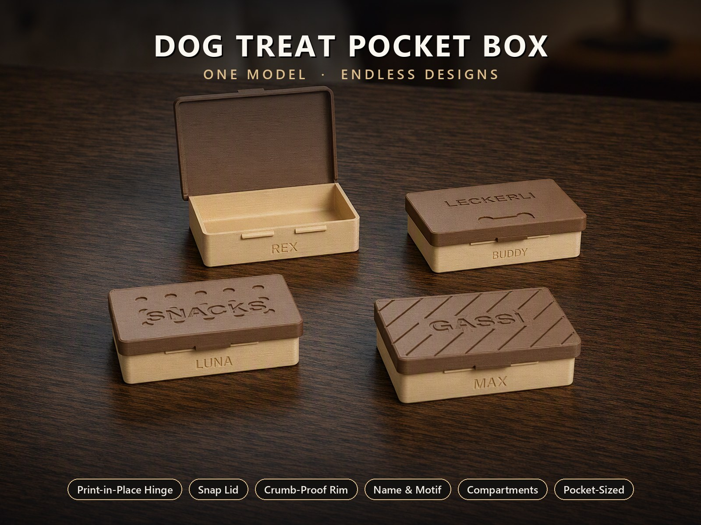
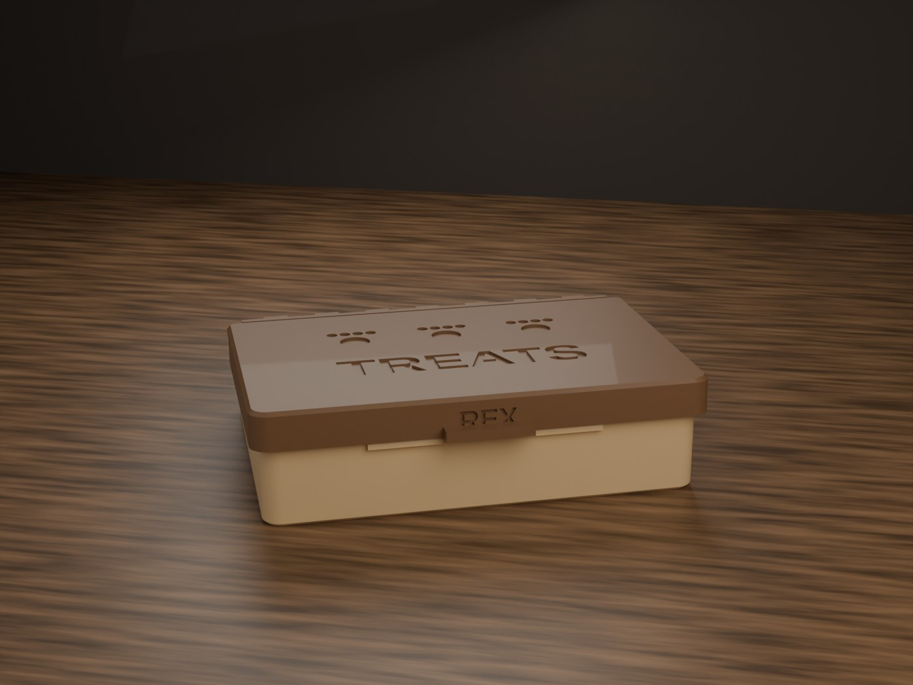
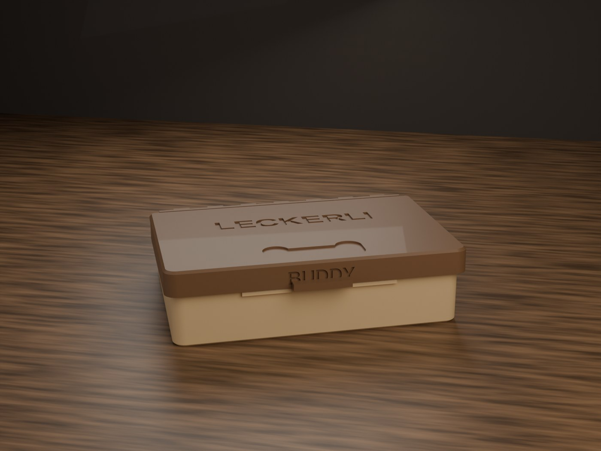
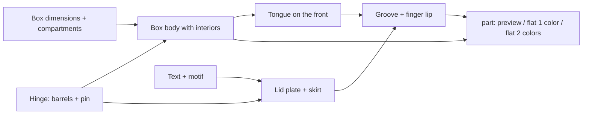
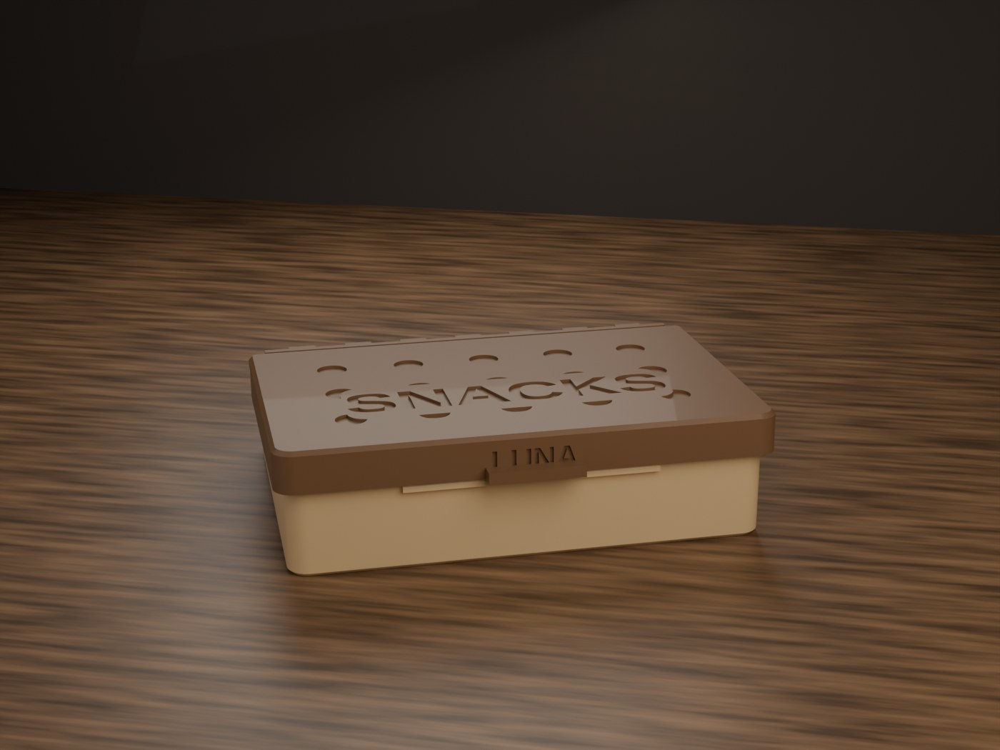
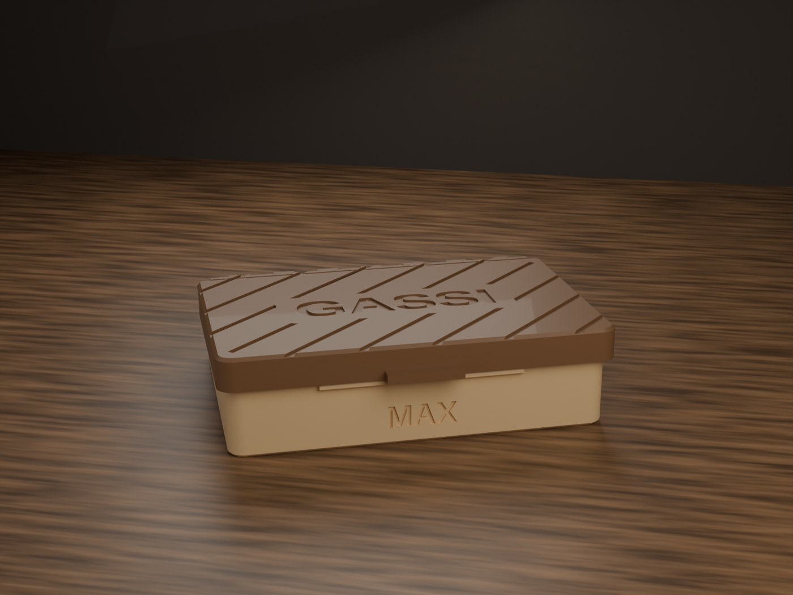

# Parametric Dog Treat Pocket Box

[← All models](../../README.md)

🌐 **English** | [Deutsch](README.de.md)

A pocket box for dog treats, printed in one piece: print-in-place hinge,
overlapping flip lid with snap closure, optionally with name, motif and
compartments.

> **The model with all print profiles is available exclusively on MakerWorld:**
> 👉 [MakerWorld link: https://makerworld.com/en/models/3200091-ultimative-treats-box](https://makerworld.com/en/models/3200091-ultimative-treats-box)
>
> 

The **Parametric Dog Treat Pocket Box** is a flat box for training treats
(default size 90 × 60 × 20 mm), produced as a flat, open layout without supports
and without assembly. The hinge is movable straight after printing; the lid
folds over the box and wraps around it on the outside so that no crumbs fall out.
You set name, motif, number of compartments, size and closure strength in the
MakerWorld Customizer.

## Table of Contents

- [The Problem](#the-problem)
- [The Idea](#the-idea)
- [Highlights](#highlights)
- [Parametric Options](#parametric-options)
- [Design](#design)
- [Print Recommendations](#print-recommendations)
- [Use Cases](#use-cases)
- [Troubleshooting / FAQ](#troubleshooting--faq)
- [Development History](#development-history)
- [Downloads](#downloads)
- [License](#license)

## The Problem

Treats in a jacket pocket are impractical: the bag tears, the crumbs spread, and
during training things have to be quick. A printed tin only solves this if it
meets a few requirements:

- It must be **flat enough for a pocket** and must not have sharp corners.
- The lid must **stay securely closed**, even when the box is squeezed in the
  pocket.
- It should close **crumb-tight** and still open with one hand.
- The hinge should work without assembly and without supports – otherwise the box
  is no longer a one-piece print.
- If you want to carry two kinds of treats or a clicker, you need compartments.

## The Idea

The model prints box and lid **flat next to each other**, connected by a low
knuckle hinge behind the back wall. After printing, the lid is folded 180°
upward and over the box. The hinge axis lies at half the height of box height plus
lid thickness, so that the flat lid plate rests on the top edges of the walls.

Instead of placing the latch inside, it sits **on the outside at the front**: a
small tongue (rib) on the box engages in a groove in the lid skirt. This leaves
the interior – even with compartments – untouched. The skirt wraps around the box
at the front and on both sides. All dimensions come from parameters; text and
motif are automatically limited so that they stay on the lid.

## Highlights

- **Print-in-place hinge** with continuous pin: printed flat and open, without
  supports. The hinge barrel sits directly behind the back wall and barely
  enlarges the footprint.
- **Overlapping lid** (`lid_rim` = `On`): the skirt lies on the outside over the
  front and sides, is crumb-tight and secures the lid laterally.
- **Latch on the outside (groove and tongue):** `latch_count` ribs on the front
  side, holding force via `latch_grip`.
- **Rear filler wedge** closes the gap at the hinge line.
- **Pocket-friendly rounding:** outer corners (`corner_r`), chamfered lid edge,
  rounded skirt ends.
- **Name and motif:** text on the lid (size automatic or manual), free text on
  the front, motifs `Paw`, `Bone`, `Dots`, `Ribs`, `Diagonal`.
- **Automatically limited placement:** offsets of text and motif stay on the
  surface with a margin; text and motif never overlap.
- **Optional compartments:** grid of `cells_x` × `cells_y` with print-in-place
  dividers.
- **Two-color mode:** box and lid as separate color bodies; engravings are output
  as color fill.
- **Four ready-made variants** with Bambu Studio profiles for P1S and PLA.

## Parametric Options

The names correspond to the model's Customizer parameters. All dimensions in
millimeters.

### Output

| Parameter | Meaning | Default | Range / Unit |
|---|---|---|---|
| `part` | `Preview closed`, `Preview open`, `Preview 2-color` (display only, with "NOT FOR PRINTING" banner), `Print flat (1 color)`, `Print flat (2 color)` (real print layout) | `Preview closed` | Selection |
| `preview_angle` | Opening angle in the preview (0 = closed, 180 = open flat) | 6 | 0–180 degrees |

### Box Size and Compartments

| Parameter | Meaning | Default | Range / Unit |
|---|---|---|---|
| `box_len_x` | Outer length of the box (X, along the hinge) | 90 | 50–180 mm |
| `box_depth_y` | Outer depth (Y) | 60 | 35–140 mm |
| `box_height_z` | Outer height of the box body (Z, without lid) | 20 | 12–60 mm |
| `corner_r` | Outer radius of the corners | 4 | 0–12 mm |
| `cells_x` | Compartments along X (1 = one large interior) | 1 | 1–6 |
| `cells_y` | Compartments along Y | 1 | 1–5 |
| `div_wall` | Thickness of the dividers | 1.6 | 1.0–3.0 mm |
| `fillet` | Inner radius at corners and floor for easy removal | 3.0 | 0.5–8 mm |

### Text

| Parameter | Meaning | Default | Range / Unit |
|---|---|---|---|
| `top_text` | Name or word on the lid top; empty = none | `TREATS` | Text |
| `top_text_size` | Text size as in Word; 0 = automatic (up to approx. ¼ of the lid surface) | 0 | 0–20 mm |
| `text_offset_x`, `text_offset_y` | Offset of the lid text, automatically limited to the surface | 0 / 0 | −90 to 90 mm |
| `front_text` | Free text, engraved into the front wall; empty = none | empty | Text |
| `front_text_size` | Size of the front text; 0 = automatic | 0 | 0–20 mm |
| `front_text_offset_x`, `front_text_offset_y` | Offset of the front text | 0 / 0 | −90 to 90 mm |

Regardless of the set value, the text size is limited so that the entire text
stays legible on the surface.

### Lid Decor, Rim and Closure

| Parameter | Meaning | Default | Range / Unit |
|---|---|---|---|
| `lid_decor` | Motif: `None`, `Paw`, `Bone`, `Dots`, `Ribs`, `Diagonal` | `Paw` | Selection |
| `decor_size` | Element size (paw, bone length, dot diameter, rib spacing) | 12 | 4–30 mm |
| `decor_offset_x`, `decor_offset_y` | Offset of the motif, automatically limited | 0 / 0 | −90 to 90 mm |
| `mark_depth` | Engraving depth of text and motif (0.8 = solid color block for two-color printing) | 0.8 | 0.3–1.5 mm |
| `lid_rim` | `On` = lid wraps around the box on the outside; `Off` = flat cap on the top edges of the walls | `On` | `Off`, `On` |
| `rim_height` | Overlap of the skirt along the outer wall | 6 | 3–14 mm |
| `latch_style` | `None` = friction only, `Snap` = snap latch | `Snap` | `None`, `Snap` |
| `latch_count` | Number of latches on the front | 2 | 1–4 |
| `latch_grip` | Holding force: overlap at the retaining bar (larger = firmer, harder to open) | 0.75 | 0.2–1.2 mm |

### Printer and Fit

| Parameter | Meaning | Default | Range / Unit |
|---|---|---|---|
| `printer` | Build volume; the model warns in the console if the flat layout does not fit | 256 | 180 (A1 mini), 256 (A1 / P1S / P2S / X1), 325 (H2C / A2L), 350 (H2D / H2S), 999 (unlimited) |
| `hinge_gap` | Clearance of the print-in-place hinge | 0.32 | 0.25–0.60 mm |

## Design

### OpenSCAD Approach

The model is pure OpenSCAD without libraries and Customizer-compatible. Axes:
X = length (the hinge runs along X), Y = depth, Z = height. Hard-wired values
(wall thickness, skirt wall, clearances, hinge dimensions) are in the hidden part
of the file and do not appear in the Customizer.

### Parametric Logic

| Quantity | Value / Rule |
|---|---|
| Outer wall / floor thickness | 2.0 mm / 1.6 mm |
| Lid plate | 2.0 mm |
| Skirt wall / clearance to the box per side | 1.6 mm / 0.4 mm |
| Hinge outer diameter / pin | 5.0 mm / 2.8 mm |
| Axis height `z_pin` | (box height + lid thickness) / 2 |
| Axis position `hinge_y` | box depth + barrel radius + `hinge_gap` (just behind the back wall) |
| Number of knuckles | `max(3, 2·floor(hinge width / 12) + 1)`, i.e. odd; 15 at default size |
| Compartment width | (box width − 2·wall − (`cells_x` − 1)·`div_wall`) / `cells_x` |
| Latches with compartments | at most one per compartment, in the middle of the compartment (only in the mode without skirt, see below) |
| Flat layout | default size approx. 94 mm wide and approx. 128 mm deep (from the formulas) |

### Special Algorithms

- **Folding transformation:** Lid accessories (latch, filler wedge, grooves) are
  modeled in closed coordinates and placed into the flat print layout by a 180°
  rotation about the hinge axis; a 180° rotation is its own inverse.
- **Alternating knuckles:** Odd number of segments, the ends belong to the box.
  Continuous pin, gaps of length `hinge_gap` between the segments.
- **Reinforcement rib:** A narrow rib along the hinge edge ties all lid segments
  into one stiff rail.
- **Rear chamfer and filler wedge:** The back wall gets a 45° chamfer so that the
  lid stays clear when closing; a matching wedge on the underside of the lid then
  closes the gap (`back_gap` 0.4 mm).
- **Text size and placement:** Automatic size from the lid surface and character
  count, additionally limited by the width; offsets are clamped to the surface
  minus margin (5 mm). The motif keeps its distance from the text.
- **Latch:** Tongue with a flat underside (locks against lifting) and a chamfered
  top (closes easily); a small cut at the front edge serves as a release chamfer.
  The groove in the skirt has 0.25 mm of clearance.
- **Two-color mode:** The engraving on the lid is placed as a body in the box color
  into the recess; the front text appears in the lid color.

### Modularity

The model consists of modules for the box body, interior compartments, hinge (box
and lid side), lid plate with skirt, latch (tongue and groove), rear filler
wedge, decor motifs (paw, bone, dots, ribs, diagonal) and the preview helpers.
The dispatcher selects the preview or print layout depending on `part`.

### Print Optimizations

- **Printed flat and open:** No supports; the finger lip on the skirt has a 45°
  surface that prints without supports.
- **Chamfered bottom edge** (0.8 mm) against elephant's foot.
- **Chamfer around the lid edge** on the later visible side, so that the closed
  box has no sharp edge in the pocket.
- **Latch on the outside:** The compartments stay free; the tongue lies outside
  the wall.
- **Safeguard against bad combinations:** The console warns if the flat layout
  exceeds `printer`.

## Print Recommendations

The supplied profiles are created for the **Bambu Lab P1S** with **Bambu PLA
Basic** and test-sliced in Bambu Studio. The model description also mentions P2S,
A1 (any 256 mm build volume) and H2C for larger boxes.

| Setting | Recommendation |
|---|---|
| Material | PLA (PETG possible, increase `hinge_gap` slightly) |
| Nozzle / layer height | 0.4 mm / 0.20 mm |
| Walls | 3 |
| Infill | 15 % gyroid |
| Supports | none |
| Orientation | flat as exported: box floor and lid plate on the bed, hinge in between |

**Special notes**

- After printing, fold the lid up and over the box; the hinge is movable
  straight away.
- **Two-color variant:** set `part` to `Print flat (2 color)` and export directly
  from the OpenSCAD OpenCSG preview (without F6/Render). Box and lid then remain
  separate filaments; the engraved name appears in the box color.
- Hinge clearance `hinge_gap`: Bambu approx. 0.30–0.40 mm. If it jams, increase
  it; if it wobbles, decrease it.

### Included Variants

| Variant | Text (size) | Motif | Compartments | Front text |
|---|---|---|---|---|
| `treats_paw_en` | TREATS (10) | `Paw` | 1 | REX |
| `leckerli_bone_de` | LECKERLI (8) | `Bone` | 1 | BUDDY |
| `snacks_dots_en` | SNACKS (11) | `Dots` | 2 × 1 | LUNA |
| `gassi_diag_de` | GASSI (12) | `Diagonal` | 3 × 1 | MAX |

All variants use the default box dimensions. The front texts are example names.

## Use Cases

- **Dog training on the go:** treats in the jacket pocket, one grip to open.
- **Two kinds of rewards:** `cells_x` = 2 for two kinds, `cells_x` = 3 for a third
  compartment, e.g. clicker or poop bags.
- **Personalized gifts:** the dog's name on the lid, motif of your choice.
- **Larger boxes:** increase `box_depth_y` and `box_height_z`; set `printer` to H2C
  or H2D if the flat layout becomes larger than 256 mm.
- **Small-parts box for the workbench:** screws, cable ties or SD cards in a
  lid case with compartments; motif `None`, lettering on the lid.
- **Rack or laptop bag:** small tin for adapters, USB sticks and cables.
- **Multiple dogs:** print several boxes with different names and identical
  dimensions.

## Troubleshooting / FAQ

| Symptom | Cause | Fix |
|---|---|---|
| Hinge jams or is fused | Clearance too small for printer or material | Increase `hinge_gap` (Bambu approx. 0.30–0.40 mm, range 0.25–0.60) |
| Hinge wobbles | Clearance too large | Decrease `hinge_gap` |
| Lid opens too easily or too hard | Holding force of the latch | Decrease or increase `latch_grip` respectively (0.2–1.2 mm) |
| Crumbs fall out | Lid without overlapping rim | Keep `lid_rim` = `On`; increase `rim_height` |
| Console warning about the flat layout | Layout larger than the selected build volume | Choose a suitable `printer` or reduce the box dimensions |
| Text is smaller than set | Size is limited to the surface | Increase lid width, shorten text or decrease `top_text_size` |
| Text and motif do not overlap | intended: the motif makes way for the text | Adjust `decor_size` or `decor_offset_x/y` |
| Fewer inner latches than `latch_count` | with `lid_rim` = `Off` and multiple compartments, the number of latches is limited to `cells_x` | Adjust `latch_count` to `cells_x` or use `lid_rim` = `On` |
| Preview shows red "NOT FOR PRINTING" | Preview mode active | Set `part` to `Print flat (1 color)` or `Print flat (2 color)` |

## Development History

The model belongs to a family of parametric OpenSCAD boxes with a print-in-place
hinge and a lettered lid. The hinge design follows the rules of this family: the
axis lies at half height, the lid plate folds over the top edges of the walls, and
a chamfer on the back wall ensures that the lid stays clear when closing.

The closure went through several stages. The source file still contains the
internal latch as a fallback mode: with `lid_rim` = `Off`, an internal latch with
a retaining tongue sits on the front wall, which adapts to the compartments so
that it never lands on a divider. The current default is the outer latch made of
groove and tongue with an overlapping skirt: it engages on the outside and does
not interfere with compartments. A small chamfer on the lower edge of the tongue
serves as a release ramp.

The four supplied variants and their print profiles (P1S, PLA, 3 walls) were
created on August 21, 2026.

## Downloads

Print files are intentionally available exclusively on MakerWorld.

👉 MakerWorld link: https://makerworld.com/en/models/3200091-ultimative-treats-box

Profile: <https://makerworld.com/en/@BetaHydri>

## License

Documentation and images in this repository: © BetaHydri. The model (including
source code) and all print files are distributed exclusively via MakerWorld under
the license stated there. This repository intentionally contains no model, source
code or print files.
