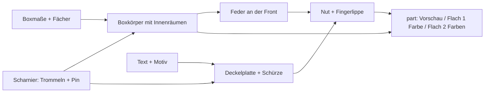

# Parametric Dog Treat Pocket Box

[← Alle Modelle im Überblick](../../README.md)

Eine Taschen-Box für Hundeleckerli, die in einem Stück gedruckt wird: Print-in-Place-Scharnier,
übergreifender Klappdeckel mit Schnapp-Verschluss, optional mit Namen, Motiv und Fächern.

> **Das Modell mit allen Druckprofilen gibt es ausschließlich auf MakerWorld:**
> 👉 [MakerWorld-Link: https://makerworld.com/en/models/3200091-ultimative-treats-box](https://makerworld.com/en/models/3200091-ultimative-treats-box)
>
> 

Die **Parametric Dog Treat Pocket Box** ist eine flache Box für Trainings-Leckerli
(Standardmaß 90 × 60 × 20 mm), die als flaches, offenes Layout ohne Stützen und ohne
Montage entsteht. Das Scharnier ist direkt nach dem Druck beweglich; der Deckel
klappt über die Box und umgreift sie außen, damit keine Krümel herausfallen. Name,
Motiv, Fächeranzahl, Größe und Verschlussstärke stellst du im MakerWorld-Customizer ein.

## Inhaltsverzeichnis

- [Das Problem](#das-problem)
- [Die Idee](#die-idee)
- [Highlights](#highlights)
- [Parametrische Optionen](#parametrische-optionen)
- [Konstruktion](#konstruktion)
- [Druckempfehlungen](#druckempfehlungen)
- [Anwendungsbeispiele](#anwendungsbeispiele)
- [Fehlersuche / FAQ](#fehlersuche--faq)
- [Entwicklungsgeschichte](#entwicklungsgeschichte)
- [Downloads](#downloads)
- [Lizenz](#lizenz)

## Das Problem

Leckerli in der Jackentasche sind unpraktisch: Die Tüte reißt, die Krümel verteilen
sich, und beim Training muss es schnell gehen. Eine gedruckte Dose löst das nur dann,
wenn sie ein paar Anforderungen erfüllt:

- Sie muss **flach genug für die Tasche** sein und darf keine scharfen Ecken haben.
- Der Deckel muss **sicher zubleiben**, auch wenn die Box in der Tasche gedrückt wird.
- Er soll **krümelfest** schließen und sich trotzdem mit einer Hand öffnen lassen.
- Das Scharnier soll ohne Montage und ohne Stützen auskommen – sonst ist die Box
  kein Ein-Teile-Druck mehr.
- Wer zwei Sorten Leckerli oder einen Clicker dabeihaben will, braucht Fächer.

## Die Idee

Das Modell druckt Box und Deckel **flach nebeneinander**, durch ein niedriges
Knuckle-Scharnier hinter der Rückwand verbunden. Nach dem Druck wird der Deckel
um 180° nach oben und über die Box geklappt. Die Scharnierachse liegt auf halber
Höhe von Boxhöhe plus Deckelstärke, damit die flache Deckelplatte auf den
Wandoberkanten aufliegt.

Statt den Schnapper innen anzubringen, sitzt er **außen an der Front**: eine kleine
Feder (Rippe) an der Box greift in eine Nut in der Deckelschürze. So bleibt der
Innenraum – auch mit Fächern – unberührt. Die Schürze umgreift die Box vorn und an
beiden Seiten. Alle Maße kommen aus Parametern; Text und Motiv werden automatisch so
begrenzt, dass sie auf dem Deckel bleiben.

## Highlights

- **Print-in-Place-Scharnier** mit durchgehendem Pin: flach und offen gedruckt, ohne
  Stützen. Die Scharniertrommel sitzt direkt hinter der Rückwand und vergrößert den
  Footprint kaum.
- **Übergreifender Deckel** (`lid_rim` = `On`): Die Schürze liegt außen über Front
  und Seiten, ist krümelfest und sichert den Deckel seitlich.
- **Schnapper außen (Nut und Feder):** `latch_count` Rippen an der Frontseite, Haltekraft
  über `latch_grip`.
- **Hinterer Füllkeil** schließt den Spalt an der Scharnierlinie.
- **Taschenfreundliche Rundungen:** Außenecken (`corner_r`), gefaste Deckelkante,
  abgerundete Schürzenenden.
- **Namen und Motiv:** Text auf dem Deckel (Größe automatisch oder manuell),
  Freitext an der Front, Motive `Paw`, `Bone`, `Dots`, `Ribs`, `Diagonal`.
- **Automatisch begrenzte Platzierung:** Versätze von Text und Motiv bleiben mit
  Randabstand auf der Fläche; Text und Motiv überlappen nie.
- **Optionale Fächer:** Raster aus `cells_x` × `cells_y` mit Print-in-Place-Trennwänden.
- **Zweifarb-Modus:** Box und Deckel als getrennte Farbkörper; Gravuren werden als
  Farbfüllung ausgegeben.
- **Vier fertige Varianten** mit Bambu-Studio-Profilen für P1S und PLA.

## Parametrische Optionen

Die Namen entsprechen den Customizer-Parametern des Modells. Alle Maße in
Millimetern.

### Ausgabe

| Parameter | Bedeutung | Standard | Bereich / Einheit |
|---|---|---|---|
| `part` | `Preview closed`, `Preview open`, `Preview 2-color` (nur Anzeige, mit „NOT FOR PRINTING“-Banner), `Print flat (1 color)`, `Print flat (2 color)` (echtes Druck-Layout) | `Preview closed` | Auswahl |
| `preview_angle` | Öffnungswinkel in der Vorschau (0 = zu, 180 = flach offen) | 6 | 0–180 Grad |

### Boxgröße und Fächer

| Parameter | Bedeutung | Standard | Bereich / Einheit |
|---|---|---|---|
| `box_len_x` | Außenlänge der Box (X, entlang des Scharniers) | 90 | 50–180 mm |
| `box_depth_y` | Außentiefe (Y) | 60 | 35–140 mm |
| `box_height_z` | Außenhöhe des Boxkörpers (Z, ohne Deckel) | 20 | 12–60 mm |
| `corner_r` | Außenradius der Ecken | 4 | 0–12 mm |
| `cells_x` | Fächer entlang X (1 = ein großer Innenraum) | 1 | 1–6 |
| `cells_y` | Fächer entlang Y | 1 | 1–5 |
| `div_wall` | Stärke der Trennwände | 1,6 | 1,0–3,0 mm |
| `fillet` | Innenradius an Ecken und Boden zum leichten Entnehmen | 3,0 | 0,5–8 mm |

### Text

| Parameter | Bedeutung | Standard | Bereich / Einheit |
|---|---|---|---|
| `top_text` | Name oder Wort auf der Deckeloberseite; leer = keiner | `TREATS` | Text |
| `top_text_size` | Textgröße wie in Word; 0 = automatisch (bis ca. ¼ der Deckelfläche) | 0 | 0–20 mm |
| `text_offset_x`, `text_offset_y` | Versatz des Deckeltextes, automatisch auf die Fläche begrenzt | 0 / 0 | −90 bis 90 mm |
| `front_text` | Freitext, in die Frontwand graviert; leer = keiner | leer | Text |
| `front_text_size` | Größe des Fronttextes; 0 = automatisch | 0 | 0–20 mm |
| `front_text_offset_x`, `front_text_offset_y` | Versatz des Fronttextes | 0 / 0 | −90 bis 90 mm |

Die Textgröße wird unabhängig vom eingestellten Wert so begrenzt, dass der gesamte
Text lesbar auf der Fläche bleibt.

### Deckel-Dekor, Rand und Verschluss

| Parameter | Bedeutung | Standard | Bereich / Einheit |
|---|---|---|---|
| `lid_decor` | Motiv: `None`, `Paw`, `Bone`, `Dots`, `Ribs`, `Diagonal` | `Paw` | Auswahl |
| `decor_size` | Elementgröße (Pfote, Knochenlänge, Punktdurchmesser, Rippenabstand) | 12 | 4–30 mm |
| `decor_offset_x`, `decor_offset_y` | Versatz des Motivs, automatisch begrenzt | 0 / 0 | −90 bis 90 mm |
| `mark_depth` | Gravurtiefe von Text und Motiv (0,8 = solider Farbblock für Zweifarbdruck) | 0,8 | 0,3–1,5 mm |
| `lid_rim` | `On` = Deckel greift außen über die Box; `Off` = flache Kappe auf den Wandoberkanten | `On` | `Off`, `On` |
| `rim_height` | Überlappung der Schürze entlang der Außenwand | 6 | 3–14 mm |
| `latch_style` | `None` = nur Reibung, `Snap` = Schnapper | `Snap` | `None`, `Snap` |
| `latch_count` | Anzahl der Schnapper an der Front | 2 | 1–4 |
| `latch_grip` | Haltekraft: Überlappung am Haltesteg (größer = fester, schwerer zu öffnen) | 0,75 | 0,2–1,2 mm |

### Drucker und Passung

| Parameter | Bedeutung | Standard | Bereich / Einheit |
|---|---|---|---|
| `printer` | Bauraum; das Modell warnt in der Konsole, wenn das flache Layout nicht passt | 256 | 180 (A1 mini), 256 (A1 / P1S / P2S / X1), 325 (H2C / A2L), 350 (H2D / H2S), 999 (unbegrenzt) |
| `hinge_gap` | Spiel des Print-in-Place-Scharniers | 0,32 | 0,25–0,60 mm |

## Konstruktion

### OpenSCAD-Ansatz

Das Modell ist reines OpenSCAD ohne Bibliotheken und Customizer-kompatibel.
Achsen: X = Länge (das Scharnier läuft entlang X), Y = Tiefe, Z = Höhe. Fest
verdrahtete Werte (Wandstärke, Schürzenwand, Spiele, Scharniermaße) stehen im
verborgenen Teil der Datei und gehen nicht in den Customizer ein.

### Parametrische Logik

| Größe | Wert / Regel |
|---|---|
| Außenwand / Bodenstärke | 2,0 mm / 1,6 mm |
| Deckelplatte | 2,0 mm |
| Schürzenwand / Spiel zur Box je Seite | 1,6 mm / 0,4 mm |
| Scharnier-Außendurchmesser / Pin | 5,0 mm / 2,8 mm |
| Achshöhe `z_pin` | (Boxhöhe + Deckelstärke) / 2 |
| Achslage `hinge_y` | Boxtiefe + Trommelradius + `hinge_gap` (knapp hinter der Rückwand) |
| Knuckle-Anzahl | `max(3, 2·floor(Scharnierbreite / 12) + 1)`, also ungerade; bei Standardmaß 15 |
| Fach-Breite | (Boxbreite − 2·Wand − (`cells_x` − 1)·`div_wall`) / `cells_x` |
| Schnapper bei Fächern | höchstens einer je Fach, in der Fachmitte (nur beim Modus ohne Schürze, siehe unten) |
| Flaches Layout | Standardmaß ca. 94 mm breit und ca. 128 mm tief (aus den Formeln) |

### Besondere Algorithmen

- **Falttransformation:** Deckel-Zubehör (Schnapper, Füllkeil, Nuten) wird in
  geschlossenen Koordinaten modelliert und per 180°-Drehung um die Scharnierachse in
  das flache Druck-Layout gelegt; eine 180°-Drehung ist ihre eigene Umkehrung.
- **Alternierende Knuckles:** Ungerade Segmentanzahl, die Enden gehören zur Box.
  Durchgehender Pin, Spalte der Länge `hinge_gap` zwischen den Segmenten.
- **Verstärkungsrippe:** Eine schmale Rippe entlang der Scharnierkante bindet alle
  Deckelsegmente zu einer steifen Schiene.
- **Rückseitige Fase und Füllkeil:** Die Rückwand erhält eine 45°-Fase, damit der
  Deckel beim Zuklappen frei bleibt; ein passender Keil an der Deckel-Unterseite
  schließt anschließend den Spalt (`back_gap` 0,4 mm).
- **Textgröße und Platzierung:** Automatische Größe aus Deckelfläche und Zeichenzahl,
  zusätzlich an die Breite begrenzt; Versätze werden auf Fläche minus Randabstand
  (5 mm) geklemmt. Das Motiv hält Abstand zum Text.
- **Schnapper:** Feder mit flacher Unterseite (sperrt gegen Anheben) und angefaster
  Oberseite (schließt leicht); ein kleiner Anschnitt an der Vorderkante dient als
  Auslösefase. Die Nut in der Schürze hat 0,25 mm Spiel.
- **Zweifarb-Modus:** Die Gravur auf dem Deckel wird als Körper in Boxfarbe in die
  Aussparung gesetzt; der Fronttext erscheint in der Deckelfarbe.

### Modularität

Das Modell besteht aus Modulen für Boxkörper, Innenfächer, Scharnier (Box- und
Deckelseite), Deckelplatte mit Schürze, Schnapper (Feder und Nut), Rückfüllkeil,
Dekor-Motive (Pfote, Knochen, Punkte, Rippen, Diagonale) und die Vorschau-Hilfen.
Der Dispatcher wählt je nach `part` Vorschau oder Druck-Layout.

### Druckoptimierungen

- **Flach und offen gedruckt:** Keine Stützen; die Fingerlippe an der Schürze hat
  eine 45°-Fläche, die ohne Stützen druckt.
- **Gefaste Unterkante** (0,8 mm) gegen den Elefantenfuß.
- **Fase um die Deckelkante** auf der späteren Sichtseite, damit die geschlossene
  Box in der Tasche keine scharfe Kante hat.
- **Schnapper außen:** Die Fächer bleiben frei; die Feder liegt außerhalb der Wand.
- **Vorsorge gegen Fehlkombinationen:** Die Konsole warnt, wenn das flache Layout
  `printer` überschreitet.

## Druckempfehlungen

Die mitgelieferten Profile sind für **Bambu Lab P1S** mit **Bambu PLA Basic**
erstellt und im Bambu Studio testgeslict. Die Modellbeschreibung nennt außerdem
P2S, A1 (jeder 256-mm-Bauraum) und H2C für größere Boxen.

| Einstellung | Empfehlung |
|---|---|
| Material | PLA (PETG möglich, `hinge_gap` etwas erhöhen) |
| Düse / Layerhöhe | 0,4 mm / 0,20 mm |
| Wände | 3 |
| Infill | 15 % Gyroid |
| Supports | keine |
| Ausrichtung | flach wie exportiert: Boxboden und Deckelplatte auf dem Bett, Scharnier dazwischen |

**Besondere Hinweise**

- Nach dem Druck den Deckel hochklappen und über die Box legen; das Scharnier ist
  direkt beweglich.
- **Zweifarb-Variante:** `part` auf `Print flat (2 color)` stellen und direkt aus
  der OpenSCAD-OpenCSG-Vorschau exportieren (ohne F6/Render). Dann bleiben Box und
  Deckel getrennte Filamente; der eingravierte Name erscheint in der Boxfarbe.
- Scharnier-Spiel `hinge_gap`: Bambu etwa 0,30–0,40 mm. Klemmt es, erhöhen; wackelt es,
  verringern.

### Mitgelieferte Varianten

| Variante | Text (Größe) | Motiv | Fächer | Fronttext |
|---|---|---|---|---|
| `treats_paw_en` | TREATS (10) | `Paw` | 1 | REX |
| `leckerli_bone_de` | LECKERLI (8) | `Bone` | 1 | BUDDY |
| `snacks_dots_en` | SNACKS (11) | `Dots` | 2 × 1 | LUNA |
| `gassi_diag_de` | GASSI (12) | `Diagonal` | 3 × 1 | MAX |

Alle Varianten verwenden die Standard-Boxmaße. Die Fronttexte sind Beispielnamen.

## Anwendungsbeispiele

- **Hundetraining unterwegs:** Leckerli in der Jackentasche, ein Griff zum Öffnen.
- **Zwei Sorten Belohnung:** `cells_x` = 2 für zwei Sorten, `cells_x` = 3 für ein
  drittes Fach, etwa Clicker oder Kotbeutel.
- **Personalisierte Geschenke:** Namen des Hundes auf dem Deckel, Motiv nach Wahl.
- **Größere Boxen:** `box_depth_y` und `box_height_z` erhöhen; `printer` auf H2C oder
  H2D stellen, wenn das flache Layout größer als 256 mm wird.
- **Kleinteile-Box für die Werkbank:** Schrauben, Kabelbinder oder SD-Karten in einem
  Deckel-Etui mit Fächern; Motiv `None`, Beschriftung auf dem Deckel.
- **Rack- oder Laptop-Tasche:** Kleine Dose für Adapter, USB-Sticks und Kabel.
- **Mehrere Hunde:** Mehrere Boxen mit unterschiedlichen Namen und identischen
  Maßen drucken.

## Fehlersuche / FAQ

| Symptom | Ursache | Fix |
|---|---|---|
| Scharnier klemmt oder ist verschweißt | Spiel zu klein für Drucker oder Material | `hinge_gap` erhöhen (Bambu etwa 0,30–0,40 mm, Bereich 0,25–0,60) |
| Scharnier wackelt | Spiel zu groß | `hinge_gap` verringern |
| Deckel geht zu leicht oder zu schwer auf | Haltekraft des Schnappers | `latch_grip` verringern bzw. erhöhen (0,2–1,2 mm) |
| Krümel fallen heraus | Deckel ohne übergreifenden Rand | `lid_rim` = `On` lassen; `rim_height` erhöhen |
| Konsolenwarnung zum flachen Layout | Layout größer als der gewählte Bauraum | passenden `printer` wählen oder Boxmaße verkleinern |
| Text ist kleiner als eingestellt | Größe wird auf die Fläche begrenzt | Deckelbreite vergrößern, Text kürzen oder `top_text_size` verringern |
| Text und Motiv überlappen sich nicht | gewollt: Motiv weicht dem Text aus | `decor_size` oder `decor_offset_x/y` anpassen |
| Weniger innere Schnapper als `latch_count` | bei `lid_rim` = `Off` und mehreren Fächern ist die Zahl der Schnapper auf `cells_x` begrenzt | `latch_count` an `cells_x` anpassen oder `lid_rim` = `On` |
| Vorschau zeigt rotes „NOT FOR PRINTING“ | Vorschau-Modus aktiv | `part` auf `Print flat (1 color)` oder `Print flat (2 color)` stellen |

## Entwicklungsgeschichte

Das Modell gehört zu einer Familie parametrischer OpenSCAD-Boxen mit
Print-in-Place-Scharnier und beschriftetem Deckel. Die Scharnier-Konstruktion folgt
den Regeln dieser Familie: Die Achse liegt auf halber Höhe, die Deckelplatte klappt
über die Wandoberkanten, und eine Fase an der Rückwand sorgt dafür, dass der Deckel
beim Zuklappen frei bleibt.

Der Verschluss durchlief mehrere Stufen. Die Quelldatei enthält den innenliegenden
Schnapper weiterhin als Rückfall-Modus: Bei `lid_rim` = `Off` sitzt ein innenliegender
Schnapper mit Haltezunge an der Frontwand, der sich an die Fächer anpasst, damit er
nie auf einer Trennwand landet. Der aktuelle Standard ist der äußere Schnapper aus
Nut und Feder mit übergreifender Schürze: Er greift außen und stört keine Fächer.
Eine kleine Fase an der Federunterkante dient als Auslöserampe.

Die vier mitgelieferten Varianten und ihre Druckprofile (P1S, PLA, 3 Wände) entstanden
am 21. August 2026.

## Downloads

Print files are intentionally available exclusively on MakerWorld.

👉 MakerWorld-Link: https://makerworld.com/en/models/3200091-ultimative-treats-box

Profil: <https://makerworld.com/en/@BetaHydri>

## Lizenz

Dokumentation und Bilder in diesem Repository: © BetaHydri. Das Modell (inkl.
Quellcode) und alle Druckdateien werden ausschließlich über MakerWorld unter
der dort angegebenen Lizenz verteilt. Dieses Repository enthält bewusst keine
Modell-, Quellcode- oder Druckdateien.
