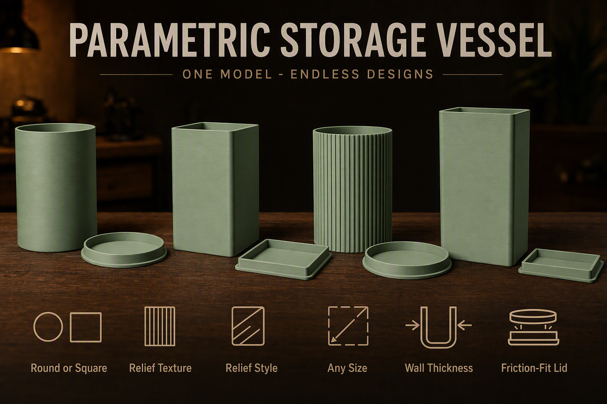
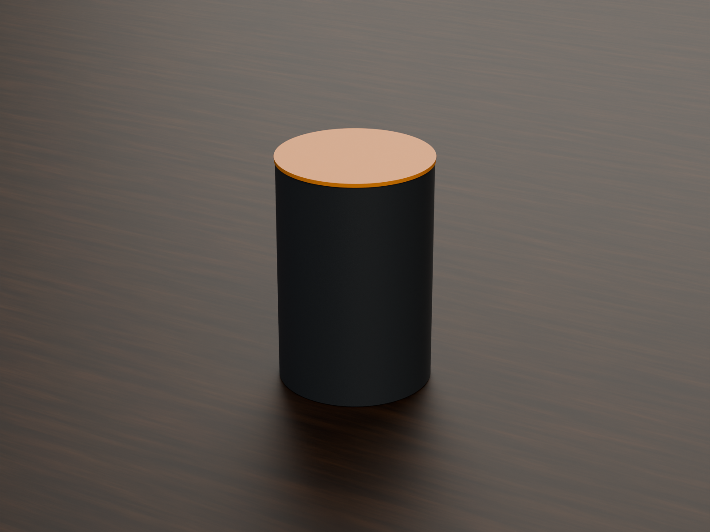
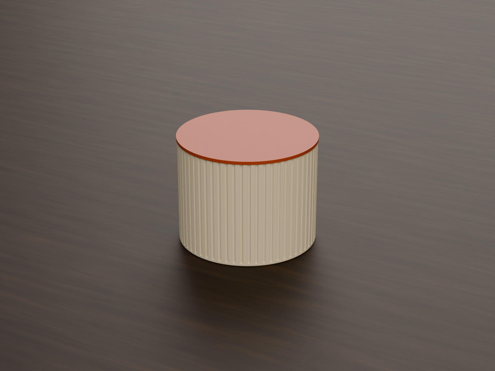
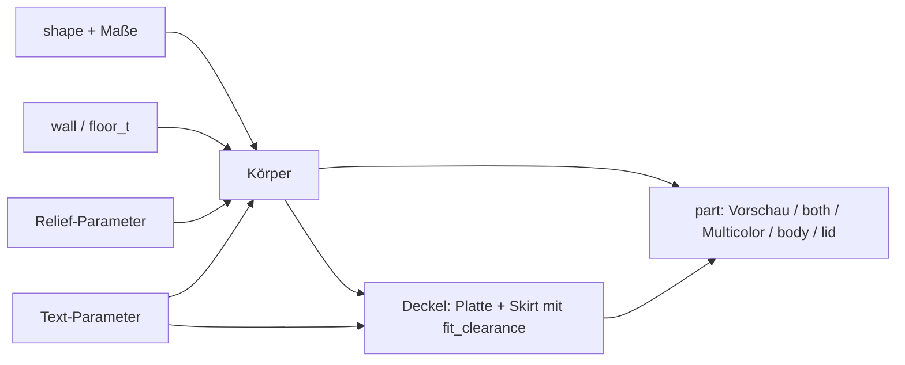
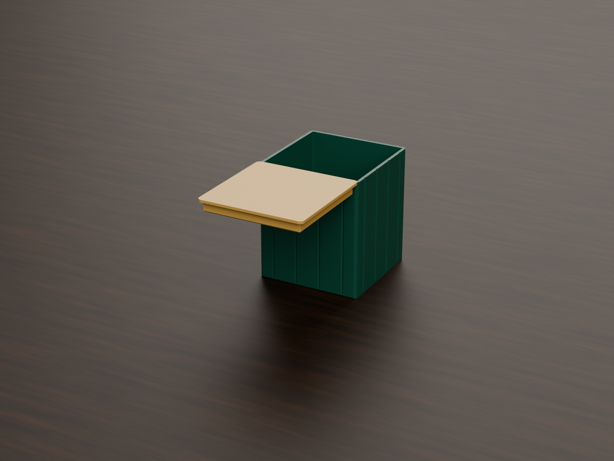
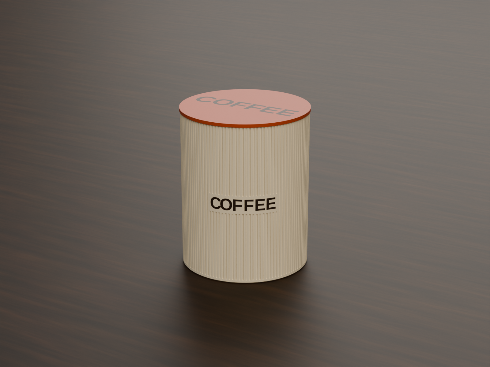
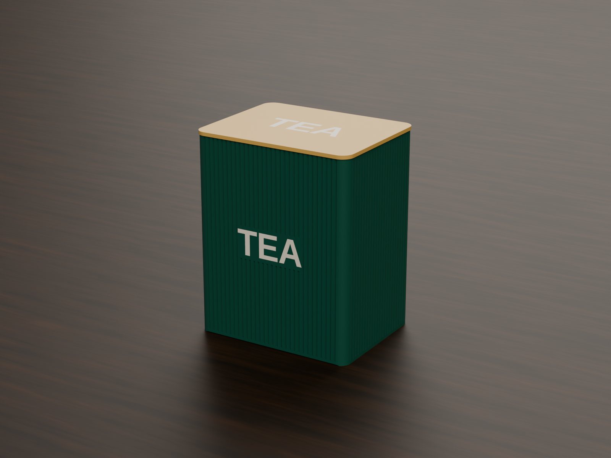

# Parametric Storage Vessel – Rund oder eckig, mit Steckdeckel, Rillen und Beschriftung

[← Alle Modelle im Überblick](../../README.de.md)

🌐 [English](README.md) | **Deutsch**

Parametrisches Vorratsgefäß für den FDM-Druck: runder oder rechteckiger Körper,
Steckdeckel mit einstellbarem Spiel, optionale Rillenstruktur und Text auf
Deckel und Wand – alles im MakerWorld-Customizer.

> **Das Modell mit allen Druckprofilen gibt es ausschließlich auf MakerWorld:**
> 👉 [MakerWorld-Link: https://makerworld.com/en/models/2917278-parametric-vessel-with-friction-fit-lid](https://makerworld.com/en/models/2917278-parametric-vessel-with-friction-fit-lid)
>
> 

Der **Parametric Storage Vessel** erzeugt ein Gefäß aus Körper und
Reibschluss-Deckel. Du wählst zwischen rund (Zylinder) und rechteckig (mit
Eckenradius), stellst Maße, Wandstärke, Deckelspiel und Rillenstruktur ein und
kannst optional einen Schriftzug auf den Deckel und die Wand setzen. Körper und
Deckel liegen flach und ohne Stützen auf dem Bett; ein Zweifarb-Modus gibt
Körper, Deckel und Text getrennte Farbgruppen.

## Inhaltsverzeichnis

- [Das Problem](#das-problem)
- [Die Idee](#die-idee)
- [Highlights](#highlights)
- [Parametrische Optionen](#parametrische-optionen)
- [Konstruktion](#konstruktion)
- [Druckempfehlungen](#druckempfehlungen)
- [Anwendungsbeispiele](#anwendungsbeispiele)
- [Fehlersuche / FAQ](#fehlersuche--faq)
- [Entwicklungsgeschichte](#entwicklungsgeschichte)
- [Downloads](#downloads)
- [Lizenz](#lizenz)

## Das Problem

Dosen und Gefäße für Werkstatt, Küche oder Regal gibt es fertig – nur selten
in genau dem Maß, das du brauchst:

- Das Fach im Regal ist 90 mm breit, die Dose aus dem Laden 100 mm.
- Ein Deckel, der zu locker sitzt, rutscht ab; einer, der zu stramm sitzt,
  lässt sich nicht mehr öffnen.
- Beschriftung per Aufkleber löst sich, und Gravuren im Slicer sind
  umständlich.
- Eine glatte Wand ist praktisch, eine strukturierte Wand sieht besser aus –
  und beides will man ohne zweites Modell umschalten können.

## Die Idee

Ein einziges Modell deckt runde und rechteckige Gefäße ab. Der Deckel wird aus
den Körpermaßen abgeleitet: Ein Rand (Skirt) schiebt sich mit einem
einstellbaren Spiel (`fit_clearance`) in die Öffnung, die Deckelplatte steht
rundum 0,5 mm über. Rillen, Aufschriften und Zweifarb-Ausgabe sind Optionen auf
derselben Grundform. Alle Maße in Millimetern, alle Werte als
Customizer-Parameter.

## Highlights

- **Zwei Formen:** `round` (Zylinder) und `rect` (Rechteck mit `corner_r`).
- **Freie Maße:** `diameter`, `width`, `depth` und `height` bis 320 mm.
- **Steckdeckel mit einstellbarem Spiel:** `fit_clearance` (Standard 0,15 mm je
  Seite), `skirt_depth` und eine Einführfase `skirt_chamfer`.
- **Rillenstruktur:** rechteckig, V-förmig oder gerundet; Anzahl, Tiefe und
  Breite einstellbar.
- **Text auf Deckel und Wand:** Aufschrift als saubere Vertiefung oder als
  bündige Farbeinlage im Mehrfarbdruck; bei runden Gefäßen folgt jeder
  Buchstabe der Krümmung.
- **Rillen weichen dem Text:** Um den Schriftzug bleibt ein glatter Bereich
  (`text_panel_margin`), die Rillen laufen darüber und darunter weiter.
- **Mehrfarbmodus:** Körper, Deckel und Text als getrennte Farbgruppen
  (`Multicolor Export`).
- **Vorschau-Modi:** zusammengebaut und geöffnet, zweifarbig, mit rotem
  „NOT FOR PRINTING“-Banner.
- **Druckfreundlich:** flacher Boden, Fase gegen Elefantenfuß, Mindestwand
  2 mm, ohne Stützen.
- **Fünf fertige Varianten** mit Bambu-Studio-Profilen für den P1S.

## Parametrische Optionen

Die Namen entsprechen den Customizer-Parametern des Modells.

### Ausgabe

| Parameter | Bedeutung | Standard | Bereich / Einheit |
|---|---|---|---|
| `part` | Ausgabe: `Preview 2-color` (zusammengebaut, nicht druckbar), `Preview open` (Deckel daneben, nicht druckbar), `both` (beide Teile flach, einfarbig), `Multicolor Export` (beide flach, zwei Farben), `body`, `lid` | `Preview open` | Auswahl |

### Form und Maße

| Parameter | Bedeutung | Standard | Bereich / Einheit |
|---|---|---|---|
| `shape` | `round` (Zylinder) oder `rect` (Rechteck) | `round` | Auswahl |
| `diameter` | Außendurchmesser (rund) | 80 | 20–320 mm |
| `width` | Breite X (rechteckig) | 80 | 20–320 mm |
| `depth` | Tiefe Y (rechteckig) | 80 | 20–320 mm |
| `height` | Außenhöhe des Körpers ohne Deckel | 100 | 20–320 mm |
| `corner_r` | Eckenradius (rechteckig), 0 = scharfe Ecken | 5 | 0–30 mm, Schritt 0,5 |

### Wände und Boden

| Parameter | Bedeutung | Standard | Bereich / Einheit |
|---|---|---|---|
| `wall` | Wandstärke, mindestens 2,0 | 2,4 | 2,0–6,0 mm, Schritt 0,1 |
| `floor_t` | Bodenstärke, mindestens 2,0 | 2,0 | 2,0–6,0 mm, Schritt 0,1 |

### Deckel

| Parameter | Bedeutung | Standard | Bereich / Einheit |
|---|---|---|---|
| `lid_enabled` | Deckel erzeugen (im aktuellen Modellstand wird der Wert nicht ausgewertet; den Deckel wählst du über `part`) | 1 | 0 = Nein, 1 = Ja |
| `fit_clearance` | Spalt zwischen Deckelrand und Innenwand je Seite; kleiner = fester | 0,15 | 0,05–0,5 mm, Schritt 0,05 |
| `skirt_depth` | Wie tief der Deckelrand in den Körper reicht | 8 | 3–30 mm, Schritt 0,5 |
| `skirt_chamfer` | Einführfase an der Spitze des Deckelrands | 1,0 | 0–3 mm, Schritt 0,1 |

### Kosmetik

| Parameter | Bedeutung | Standard | Bereich / Einheit |
|---|---|---|---|
| `bottom_chamfer` | Fase an der unteren Außenkante (gegen Elefantenfuß) | 0,6 | 0–2 mm, Schritt 0,1 |

### Relief / Textur

| Parameter | Bedeutung | Standard | Bereich / Einheit |
|---|---|---|---|
| `relief_enabled` | Senkrechte Rillen an der Außenwand | 0 | 0 = Aus, 1 = An |
| `relief_style` | Rillenform | 2 | 0 = Rechteck, 1 = V-Rille, 2 = Gerundet |
| `relief_count` | Gesamtzahl der Rillen am Umfang | 120 | 4–500 |
| `relief_depth` | Tiefe jeder Rille | 0,6 | 0,2–1,2 mm, Schritt 0,1 |
| `relief_width` | Breite jeder Rille | 1,0 | 0,5–4,0 mm, Schritt 0,1 |
| `relief_corner` | Mindestabstand der Rillen zu den Ecken (nur rechteckig) | 2,0 | 1,0–15 mm, Schritt 0,5 |

### Text – Deckeloberseite

| Parameter | Bedeutung | Standard | Bereich / Einheit |
|---|---|---|---|
| `lid_text_enabled` | Text auf der Deckeloberseite | 0 | 0 = Aus, 1 = An |
| `lid_text` | Text (leer = keiner) | `TOP` | Freitext |
| `lid_text_size` | Schriftgröße (0 = automatisch) | 0 | 0–40 mm, Schritt 0,5 |
| `lid_text_depth` | Gravurtiefe | 0,6 | 0,3–1,5 mm, Schritt 0,1 |

### Text – Gefäßwand

| Parameter | Bedeutung | Standard | Bereich / Einheit |
|---|---|---|---|
| `body_text_enabled` | Text auf der Wand | 0 | 0 = Aus, 1 = An |
| `body_text` | Text (leer = keiner) | `TEXT` | Freitext |
| `body_text_size` | Schriftgröße (0 = automatisch) | 0 | 0–40 mm, Schritt 0,5 |
| `body_text_depth` | Gravurtiefe | 0,8 | 0,3–1,5 mm, Schritt 0,1 |
| `body_text_side` | Wand für den Text (rechteckig) | `Front` | `Front`, `Back`, `Left`, `Right` |
| `body_text_angle` | Winkelposition des Texts (rund), 0 = +X / vorn | 0 | 0–355°, Schritt 5 |
| `body_text_vpos` | Vertikale Position | `Middle` | `Top`, `Middle`, `Bottom` |
| `body_text_z` | Genaue Höhe der Textmitte ab Boden (0 = Position oben verwenden) | 0 | 0–300 mm, Schritt 1 |
| `text_panel_margin` | Glatter Freiraum um den Text, frei von Rillen | 2 | 0–12 mm, Schritt 0,5 |

### Qualität

| Parameter | Bedeutung | Standard | Bereich / Einheit |
|---|---|---|---|
| `$fn` | Glätte der runden Flächen | 64 | 16–128, Schritt 8 |

## Konstruktion

### OpenSCAD-Ansatz

Das Modell ist reines OpenSCAD ohne externe Bibliotheken und läuft im
MakerWorld-Customizer. Ein `part`-Selektor entscheidet, ob Vorschau,
Druck-Layout oder ein Einzelteil ausgegeben wird. Eingaben werden intern
begrenzt: Wand und Boden mindestens 2 mm, Durchmesser mindestens
`2 × Wand + 4`, Höhe mindestens `Boden + 10`.

### Parametrische Logik

| Größe | Formel / Regel |
|---|---|
| Innenradius (rund) | Außenradius − `wall` |
| Deckelplatte | Dicke = max(`floor_t`, 2 mm); rund: Radius = Außenradius + 0,5 mm; eckig: 0,5 mm Überstand je Seite |
| Skirt-Außenmaß | Innenmaß des Körpers − 2 × `fit_clearance` |
| Skirt-Wand | max(1,5 mm, `wall` / 2) |
| Relief-Tiefe | begrenzt auf `wall` − 0,8 mm, damit mindestens 0,8 mm Wand bleiben |
| Text-Einlage (Mehrfarb) | min(`wall` − 0,6 mm, max(`body_text_depth`, 1,6 mm)) |
| Platte neben dem Körper | Versatz = Durchmesser bzw. Breite + 15 mm |

Mit den Voreinstellungen (rund, Ø 80 × 100 mm) ergeben sich: Innenradius
37,6 mm, Skirt-Außenradius 37,45 mm, Skirt-Wand 1,5 mm, Deckelplatte 2,0 mm.
Der Innenraum fasst rechnerisch ca. 0,43 l (Innenradius 37,6 mm, Innenhöhe
98 mm).

Die Werte sind aus den Formeln und den Standardwerten abgeleitet.

### Besondere Algorithmen

- **Deckelrand statt Gewinde:** Der Skirt ist ein dünnwandiger Rand, der mit
  `fit_clearance` Luft in den Innenraum passt und über die Reibung hält. Die
  Fase an der Spitze erleichtert das Einführen.
- **Rillen am Rechteck:** Rillen werden je Wand gleichmäßig verteilt. Der
  Abstand ergibt sich aus Umfang / `relief_count`; um die Ecken bleibt
  `relief_corner` frei.
- **Rillenprofile:** Rechteck, V-Rille und eine halbelliptische Rundung mit
  der Breite `relief_width` und der Tiefe `relief_depth`.
- **Text auf runder Wand:** Jeder Buchstabe sitzt auf seiner eigenen
  Tangentialebene an seiner Bogenposition und wird radial in die Wand
  geschnitten. Die Schrift folgt so der Krümmung. Die Gesamtbreite ist auf
  einen Bogen von 90° begrenzt.
- **Text auf ebener Wand:** Der Text wird in die gewählte Fläche graviert; die
  Größe berücksichtigt die ebene Fläche ohne Eckenradius.
- **Glatte Zone um den Text:** Aus den Rillen wird ein Bereich um die Kontur
  des Texts (plus `text_panel_margin`) herausgeschnitten, damit kein Buchstabe
  in eine Rille ragt.
- **Text auf dem Deckel:** Der Text ist gespiegelt modelliert, damit er nach
  dem Umdrehen des Deckels auf dem Gefäß richtig lesbar ist.
- **Farbeinlage:** Im Mehrfarbmodus füllt eine eigene Farbgruppe exakt die
  Vertiefung. Die Einlage ist tiefer als die Einzelfarb-Gravur, weil eine 0,6 mm
  dünne Haut an einer senkrechten Wand fadig druckt.

### Modularität

Der Code trennt Körper, Deckel, Fase, Rillengeneratoren (rund und eckig),
Rillenprofil, Text-Volumen und die Farb-Wrapper für Einzel- und
Mehrfarbausgabe. Für die Vorschau gibt es ein Banner-Modul und eine
Start-Kamera, die beide Teile zentriert zeigt.

### Druckoptimierungen

- **Körper aufrecht, Deckel auf der flachen Oberseite:** Der Skirt zeigt nach
  oben, es sind keine Stützen nötig.
- **Fase unten** (`bottom_chamfer`) gegen Elefantenfuß.
- **Mindestwände:** Wand und Boden mindestens 2 mm, Rillen lassen mindestens
  0,8 mm Wand stehen.
- **Rillen enden am Boden:** Die Rillen laufen vom Bodenniveau bis zum Rand und
  schneiden den Boden nicht an.
- **Einlage statt dünner Haut:** Mehrfarb-Text als tiefer Farbblock.

## Druckempfehlungen

Die mitgelieferten Profile sind für **Bambu Lab P1S** mit Bambu PLA Basic
erstellt und im Bambu Studio testgeslict (0,20 mm Layerhöhe, 2 Wände, Gyroid
15 %). Das Modell lässt sich auch auf P2S (256 mm) und H2C (bis 325 mm für
große Gefäße) drucken.

| Einstellung | Empfehlung |
|---|---|
| Material | PLA (Profile) |
| Layerhöhe | 0,20 mm (0,12–0,16 mm für feinere Rillen) |
| Wände | 3 oder mehr empfohlen; die Profile nutzen 2 |
| Infill | 10–15 % für Dekoration, 30–40 % für Funktion |
| Supports | keine |
| Ausrichtung | Körper aufrecht auf dem flachen Boden, Deckel auf der flachen Oberseite |
| Deckelspiel (`fit_clearance`) | Standard 0,15 mm je Seite; bei lockerem Sitz verringern |

**Besondere Hinweise**

- Zweifarb-Ausgabe (`Multicolor Export`): STL **direkt aus der
  OpenSCAD-Vorschau** exportieren, ohne F6/Render und ohne Kommandozeile –
  sonst werden alle Gruppen zu einem Körper vereinigt und die Farben gehen
  verloren. Im Bambu Studio erscheinen Körper, Deckel und Text als getrennte
  Teile mit je einem Filament.
- Die Vorschau-Modi sind absichtlich nicht druckbar (rotes
  „NOT FOR PRINTING“-Banner).
- Alternativ färbst du Text und Deckel im Slicer mit dem Farbmal-Werkzeug.
- Der Deckel sitzt per Reibschluss (`fit_clearance`) und ist nicht luftdicht.

## Anwendungsbeispiele

- **Werkstatt-Dosen:** Schrauben, Dübel und Kabelbinder in Gefäßen mit
  passender Aufschrift an der Wand (`body_text`).
- **Regalfach-Maß:** Ein rechteckiges Gefäß, das exakt in ein Fach passt, über
  `width`, `depth` und `height`.
- **Vorratsdosen mit Aufschrift:** Runde Gefäße mit Texten wie `COFFEE`,
  `HONEY` oder eckige mit `TEA`; Text auf Deckel und Wand in Kontrastfarbe.
- **Kleinteile im Homelab:** Gefäße für Patchkabel, SSDs oder Schrauben mit
  Aufschrift auf dem Deckel.
- **Strukturierte Pflanzen- oder Stifttöpfe:** Gefäße mit feinen Rillen, ohne
  Deckel genutzt (`part = body`).
- **Zweifarb-Set:** Körper, Deckel und Text in drei Farben über
  `Multicolor Export`.
- **Serie in einer Reihe:** Mehrere Gefäße mit denselben Maßen und
  unterschiedlichen Aufschriften.

## Fehlersuche / FAQ

| Symptom | Ursache | Fix |
|---|---|---|
| Deckel sitzt zu locker | `fit_clearance` zu groß für den Drucker | `fit_clearance` verringern (z. B. 0,10 mm) |
| Deckel klemmt oder lässt sich nicht aufsetzen | Spiel zu klein, Druck fällt etwas größer aus | `fit_clearance` erhöhen (z. B. 0,25 mm) |
| Deckel lässt sich schlecht einführen | Einführfase zu klein | `skirt_chamfer` erhöhen |
| Deckel hält nicht fest | Skirt zu kurz | `skirt_depth` erhöhen |
| Rillen wirken zu flach oder fehlen | `relief_depth` wird auf `wall` − 0,8 mm begrenzt | `wall` erhöhen oder `relief_depth` verringern |
| Rechteck zeigt an einer Wand keine Rillen | Nutzbreite (Wandlänge − 2 × `relief_corner`) zu klein oder `relief_count` zu niedrig für die Wandlänge | `relief_corner` verkleinern oder `relief_count` erhöhen |
| Zweifarb-STL hat nur eine Farbe | Export über F6/Render oder Kommandozeile | STL direkt aus der Vorschau exportieren |
| Vorschau zeigt „NOT FOR PRINTING“ | Vorschau-Modus aktiv | `part` auf `both`, `Multicolor Export`, `body` oder `lid` setzen |
| Text sitzt nicht, wo er soll | Position falsch gewählt | `body_text_side` (eckig) bzw. `body_text_angle` (rund), `body_text_vpos` oder `body_text_z` anpassen |
| Text ist zu groß oder zu klein | Automatische Größe | `body_text_size` bzw. `lid_text_size` setzen |
| Langer Text auf runder Wand wird sehr klein | Textbreite ist auf einen Bogen von 90° begrenzt | Text kürzen |

## Entwicklungsgeschichte

Die ersten Dateien des Modells stammen aus dem Juni 2026: ein rundes und ein
eckiges Gefäß mit Deckel. Anfang August 2026 kamen die Referenzvarianten
(rund hoch, rund mit Rillen, eckig mit V-Rillen, rund mit feinen Rillen, eckig
gerundet), die Profile für den P1S und die Renderings dazu. Mitte August
folgte die Aufschrift auf Deckel und Gefäßwand mit Mehrfarb-Einlage: Die
Beispiel-Renderings vom 19. August 2026 zeigen Gefäße mit Aufschriften wie
COFFEE, HONEY und TEA. Im aktuellen Stand folgt die Schrift auf runden Wänden
buchstabenweise der Krümmung, und die Rillen weichen dem Text aus.

Die Bilder in diesem Repository sind Renderings der Modellgeometrie
beziehungsweise daraus abgeleitete Szenenbilder; Druckfotos sind nicht dabei.

## Downloads

Print files are intentionally available exclusively on MakerWorld.

👉 MakerWorld-Link: https://makerworld.com/en/models/2917278-parametric-vessel-with-friction-fit-lid

Profil: <https://makerworld.com/en/@BetaHydri>

## Lizenz

Dokumentation und Bilder in diesem Repository: © BetaHydri. Das Modell (inkl.
Quellcode) und alle Druckdateien werden ausschließlich über MakerWorld unter
der dort angegebenen Lizenz verteilt. Dieses Repository enthält bewusst keine
Modell-, Quellcode- oder Druckdateien.
