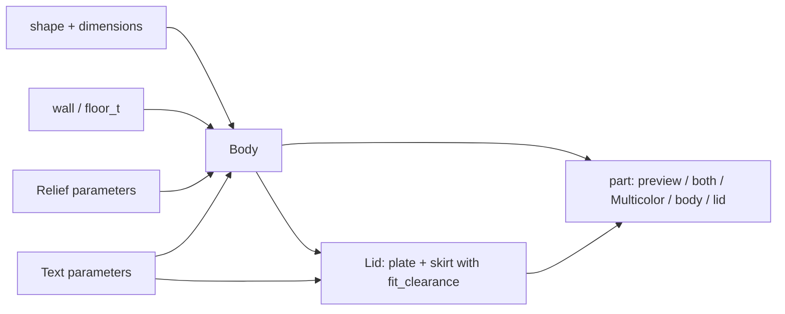

# Parametric Storage Vessel – Round or Rectangular, with Push-Fit Lid, Grooves and Lettering

[← All models](../../README.md)

🌐 **English** | [Deutsch](README.de.md)

Parametric storage vessel for FDM printing: round or rectangular body, push-fit
lid with adjustable clearance, optional groove structure and text on lid and
wall – all in the MakerWorld Customizer.

> **The model with all print profiles is available exclusively on MakerWorld:**
> 👉 [MakerWorld link: https://makerworld.com/en/models/2917278-parametric-vessel-with-friction-fit-lid](https://makerworld.com/en/models/2917278-parametric-vessel-with-friction-fit-lid)
>
> 

The **Parametric Storage Vessel** creates a vessel consisting of a body and a
friction-fit lid. You choose between round (cylinder) and rectangular (with
corner radius), set dimensions, wall thickness, lid clearance and groove
structure, and can optionally place lettering on the lid and the wall. Body and
lid lie flat and without supports on the bed; a two-color mode gives body, lid
and text separate color groups.

## Table of Contents

- [The Problem](#the-problem)
- [The Idea](#the-idea)
- [Highlights](#highlights)
- [Parametric Options](#parametric-options)
- [Design](#design)
- [Print Recommendations](#print-recommendations)
- [Use Cases](#use-cases)
- [Troubleshooting / FAQ](#troubleshooting--faq)
- [Development History](#development-history)
- [Downloads](#downloads)
- [License](#license)

## The Problem

Tins and vessels for workshop, kitchen or shelf are available ready-made – but
rarely in exactly the size you need:

- The shelf compartment is 90 mm wide, the tin from the store is 100 mm.
- A lid that fits too loosely slips off; one that fits too tightly can no longer
  be opened.
- Lettering via sticker comes off, and engraving in the slicer is
  cumbersome.
- A smooth wall is practical, a textured wall looks better – and you want to be
  able to switch between the two without needing a second model.

## The Idea

A single model covers round and rectangular vessels. The lid is derived from the
body dimensions: a rim (skirt) slides into the opening with an adjustable
clearance (`fit_clearance`), and the lid plate overhangs by 0.5 mm all around.
Grooves, lettering and two-color output are options on the same basic shape. All
dimensions in millimeters, all values as Customizer parameters.

## Highlights

- **Two shapes:** `round` (cylinder) and `rect` (rectangle with `corner_r`).
- **Free dimensions:** `diameter`, `width`, `depth` and `height` up to 320 mm.
- **Push-fit lid with adjustable clearance:** `fit_clearance` (default 0.15 mm per
  side), `skirt_depth` and a lead-in chamfer `skirt_chamfer`.
- **Groove structure:** rectangular, V-shaped or rounded; number, depth and width
  adjustable.
- **Text on lid and wall:** lettering as a clean recess or as a flush color inlay
  in multicolor printing; on round vessels, each letter follows the curvature.
- **Grooves make way for the text:** A smooth area remains around the lettering
  (`text_panel_margin`); the grooves continue above and below it.
- **Multicolor mode:** body, lid and text as separate color groups
  (`Multicolor Export`).
- **Preview modes:** assembled and open, two-color, with a red
  "NOT FOR PRINTING" banner.
- **Print-friendly:** flat base, chamfer against elephant's foot, minimum wall
  2 mm, no supports.
- **Five ready-made variants** with Bambu Studio profiles for the P1S.

## Parametric Options

The names correspond to the model's Customizer parameters.

### Output

| Parameter | Meaning | Default | Range / Unit |
|---|---|---|---|
| `part` | Output: `Preview 2-color` (assembled, not printable), `Preview open` (lid beside it, not printable), `both` (both parts flat, single color), `Multicolor Export` (both flat, two colors), `body`, `lid` | `Preview open` | Selection |

### Shape and Dimensions

| Parameter | Meaning | Default | Range / Unit |
|---|---|---|---|
| `shape` | `round` (cylinder) or `rect` (rectangle) | `round` | Selection |
| `diameter` | Outer diameter (round) | 80 | 20–320 mm |
| `width` | Width X (rectangular) | 80 | 20–320 mm |
| `depth` | Depth Y (rectangular) | 80 | 20–320 mm |
| `height` | Outer height of the body without lid | 100 | 20–320 mm |
| `corner_r` | Corner radius (rectangular), 0 = sharp corners | 5 | 0–30 mm, step 0.5 |

### Walls and Floor

| Parameter | Meaning | Default | Range / Unit |
|---|---|---|---|
| `wall` | Wall thickness, at least 2.0 | 2.4 | 2.0–6.0 mm, step 0.1 |
| `floor_t` | Floor thickness, at least 2.0 | 2.0 | 2.0–6.0 mm, step 0.1 |

### Lid

| Parameter | Meaning | Default | Range / Unit |
|---|---|---|---|
| `lid_enabled` | Create lid (in the current model version the value is not evaluated; you select the lid via `part`) | 1 | 0 = No, 1 = Yes |
| `fit_clearance` | Gap between lid rim and inner wall per side; smaller = tighter | 0.15 | 0.05–0.5 mm, step 0.05 |
| `skirt_depth` | How deep the lid rim reaches into the body | 8 | 3–30 mm, step 0.5 |
| `skirt_chamfer` | Lead-in chamfer at the tip of the lid rim | 1.0 | 0–3 mm, step 0.1 |

### Cosmetics

| Parameter | Meaning | Default | Range / Unit |
|---|---|---|---|
| `bottom_chamfer` | Chamfer on the lower outer edge (against elephant's foot) | 0.6 | 0–2 mm, step 0.1 |

### Relief / Texture

| Parameter | Meaning | Default | Range / Unit |
|---|---|---|---|
| `relief_enabled` | Vertical grooves on the outer wall | 0 | 0 = Off, 1 = On |
| `relief_style` | Groove shape | 2 | 0 = Rectangle, 1 = V-groove, 2 = Rounded |
| `relief_count` | Total number of grooves around the circumference | 120 | 4–500 |
| `relief_depth` | Depth of each groove | 0.6 | 0.2–1.2 mm, step 0.1 |
| `relief_width` | Width of each groove | 1.0 | 0.5–4.0 mm, step 0.1 |
| `relief_corner` | Minimum distance of the grooves from the corners (rectangular only) | 2.0 | 1.0–15 mm, step 0.5 |

### Text – Lid Top

| Parameter | Meaning | Default | Range / Unit |
|---|---|---|---|
| `lid_text_enabled` | Text on the lid top | 0 | 0 = Off, 1 = On |
| `lid_text` | Text (empty = none) | `TOP` | Free text |
| `lid_text_size` | Font size (0 = automatic) | 0 | 0–40 mm, step 0.5 |
| `lid_text_depth` | Engraving depth | 0.6 | 0.3–1.5 mm, step 0.1 |

### Text – Vessel Wall

| Parameter | Meaning | Default | Range / Unit |
|---|---|---|---|
| `body_text_enabled` | Text on the wall | 0 | 0 = Off, 1 = On |
| `body_text` | Text (empty = none) | `TEXT` | Free text |
| `body_text_size` | Font size (0 = automatic) | 0 | 0–40 mm, step 0.5 |
| `body_text_depth` | Engraving depth | 0.8 | 0.3–1.5 mm, step 0.1 |
| `body_text_side` | Wall for the text (rectangular) | `Front` | `Front`, `Back`, `Left`, `Right` |
| `body_text_angle` | Angular position of the text (round), 0 = +X / front | 0 | 0–355°, step 5 |
| `body_text_vpos` | Vertical position | `Middle` | `Top`, `Middle`, `Bottom` |
| `body_text_z` | Exact height of the text center from the floor (0 = use the position above) | 0 | 0–300 mm, step 1 |
| `text_panel_margin` | Smooth clear area around the text, free of grooves | 2 | 0–12 mm, step 0.5 |

### Quality

| Parameter | Meaning | Default | Range / Unit |
|---|---|---|---|
| `$fn` | Smoothness of round surfaces | 64 | 16–128, step 8 |

## Design

### OpenSCAD Approach

The model is pure OpenSCAD without external libraries and runs in the MakerWorld
Customizer. A `part` selector decides whether the preview, print layout or a
single part is output. Inputs are limited internally: wall and floor at least
2 mm, diameter at least `2 × wall + 4`, height at least `floor + 10`.

### Parametric Logic

| Quantity | Formula / Rule |
|---|---|
| Inner radius (round) | outer radius − `wall` |
| Lid plate | thickness = max(`floor_t`, 2 mm); round: radius = outer radius + 0.5 mm; rectangular: 0.5 mm overhang per side |
| Skirt outer dimension | inner dimension of the body − 2 × `fit_clearance` |
| Skirt wall | max(1.5 mm, `wall` / 2) |
| Relief depth | limited to `wall` − 0.8 mm so that at least 0.8 mm of wall remains |
| Text inlay (multicolor) | min(`wall` − 0.6 mm, max(`body_text_depth`, 1.6 mm)) |
| Plate beside the body | offset = diameter or width + 15 mm |

With the default settings (round, Ø 80 × 100 mm), this results in: inner radius
37.6 mm, skirt outer radius 37.45 mm, skirt wall 1.5 mm, lid plate 2.0 mm. The
interior holds approx. 0.43 l by calculation (inner radius 37.6 mm, inner height
98 mm).

The values are derived from the formulas and the default values.

### Special Algorithms

- **Lid rim instead of thread:** The skirt is a thin-walled rim that fits into
  the interior with `fit_clearance` of air and holds through friction. The
  chamfer at the tip makes insertion easier.
- **Grooves on the rectangle:** Grooves are distributed evenly per wall. The
  spacing results from circumference / `relief_count`; `relief_corner` remains
  free around the corners.
- **Groove profiles:** Rectangle, V-groove and a semi-elliptical rounding with
  the width `relief_width` and the depth `relief_depth`.
- **Text on a round wall:** Each letter sits on its own tangent plane at its arc
  position and is cut radially into the wall. The lettering thus follows the
  curvature. The total width is limited to an arc of 90°.
- **Text on a flat wall:** The text is engraved into the selected face; the size
  takes into account the flat face without the corner radius.
- **Smooth zone around the text:** An area around the contour of the text (plus
  `text_panel_margin`) is cut out of the grooves so that no letter protrudes
  into a groove.
- **Text on the lid:** The text is modeled mirrored so that it is legible when
  the lid is turned over onto the vessel.
- **Color inlay:** In multicolor mode, a separate color group fills the recess
  exactly. The inlay is deeper than the single-color engraving, because a 0.6 mm
  thin skin prints stringy on a vertical wall.

### Modularity

The code separates body, lid, chamfer, groove generators (round and rectangular),
groove profile, text volumes and the color wrappers for single-color and
multicolor output. For the preview there is a banner module and a start camera
that shows both parts centered.

### Print Optimizations

- **Body upright, lid on the flat top side:** The skirt points upward, no
  supports are needed.
- **Chamfer at the bottom** (`bottom_chamfer`) against elephant's foot.
- **Minimum walls:** Wall and floor at least 2 mm; grooves leave at least 0.8 mm
  of wall.
- **Grooves end at the floor:** The grooves run from floor level to the rim and do
  not cut into the floor.
- **Inlay instead of a thin skin:** Multicolor text as a deep color block.

## Print Recommendations

The supplied profiles are created for the **Bambu Lab P1S** with Bambu PLA Basic
and test-sliced in Bambu Studio (0.20 mm layer height, 2 walls, gyroid 15 %).
The model can also be printed on the P2S (256 mm) and H2C (up to 325 mm for large
vessels).

| Setting | Recommendation |
|---|---|
| Material | PLA (profiles) |
| Layer height | 0.20 mm (0.12–0.16 mm for finer grooves) |
| Walls | 3 or more recommended; the profiles use 2 |
| Infill | 10–15 % for decoration, 30–40 % for function |
| Supports | none |
| Orientation | Body upright on the flat floor, lid on the flat top side |
| Lid clearance (`fit_clearance`) | Default 0.15 mm per side; decrease if the fit is loose |

**Special notes**

- Two-color output (`Multicolor Export`): export the STL **directly from the
  OpenSCAD preview**, without F6/Render and without the command line –
  otherwise all groups are merged into one body and the colors are lost. In
  Bambu Studio, body, lid and text appear as separate parts with one filament
  each.
- The preview modes are intentionally not printable (red
  "NOT FOR PRINTING" banner).
- Alternatively, you can color text and lid in the slicer with the color paint
  tool.
- The lid sits by friction fit (`fit_clearance`) and is not airtight.

## Use Cases

- **Workshop tins:** screws, wall plugs and cable ties in vessels with matching
  lettering on the wall (`body_text`).
- **Shelf compartment size:** A rectangular vessel that fits exactly into a
  compartment, via `width`, `depth` and `height`.
- **Storage tins with lettering:** Round vessels with texts such as `COFFEE`,
  `HONEY` or rectangular ones with `TEA`; text on lid and wall in a contrast
  color.
- **Small parts in the homelab:** vessels for patch cables, SSDs or screws with
  lettering on the lid.
- **Textured plant or pen pots:** vessels with fine grooves, used without a lid
  (`part = body`).
- **Two-color set:** body, lid and text in three colors via
  `Multicolor Export`.
- **Series in a row:** Several vessels with the same dimensions and different
  lettering.

## Troubleshooting / FAQ

| Symptom | Cause | Fix |
|---|---|---|
| Lid fits too loosely | `fit_clearance` too large for the printer | Decrease `fit_clearance` (e.g. 0.10 mm) |
| Lid jams or cannot be put on | Clearance too small, print comes out slightly larger | Increase `fit_clearance` (e.g. 0.25 mm) |
| Lid is hard to insert | Lead-in chamfer too small | Increase `skirt_chamfer` |
| Lid does not hold firmly | Skirt too short | Increase `skirt_depth` |
| Grooves look too shallow or are missing | `relief_depth` is limited to `wall` − 0.8 mm | Increase `wall` or decrease `relief_depth` |
| Rectangle shows no grooves on one wall | Usable width (wall length − 2 × `relief_corner`) too small or `relief_count` too low for the wall length | Decrease `relief_corner` or increase `relief_count` |
| Two-color STL has only one color | Export via F6/Render or command line | Export the STL directly from the preview |
| Preview shows "NOT FOR PRINTING" | Preview mode active | Set `part` to `both`, `Multicolor Export`, `body` or `lid` |
| Text is not where it should be | Wrong position selected | Adjust `body_text_side` (rectangular) or `body_text_angle` (round), `body_text_vpos` or `body_text_z` |
| Text is too large or too small | Automatic size | Set `body_text_size` or `lid_text_size` |
| Long text on a round wall becomes very small | Text width is limited to an arc of 90° | Shorten the text |

## Development History

The first files of the model date from June 2026: a round and a rectangular
vessel with a lid. In early August 2026, the reference variants (tall round,
round with grooves, rectangular with V-grooves, round with fine grooves,
rectangular rounded), the profiles for the P1S and the renderings for them
followed. In mid-August, lettering on the lid and vessel wall with a multicolor
inlay followed: the example renderings from August 19, 2026 show vessels with
lettering such as COFFEE, HONEY and TEA. In the current version, the lettering on
round walls follows the curvature letter by letter, and the grooves make way for
the text.

The images in this repository are renderings of the model geometry or scene
images derived from it; there are no print photos.

## Downloads

Print files are intentionally available exclusively on MakerWorld.

👉 MakerWorld link: https://makerworld.com/en/models/2917278-parametric-vessel-with-friction-fit-lid

Profile: <https://makerworld.com/en/@BetaHydri>

## License

Documentation and images in this repository: © BetaHydri. The model (including
source code) and all print files are distributed exclusively via MakerWorld under
the license stated there. This repository intentionally contains no model, source
code or print files.
