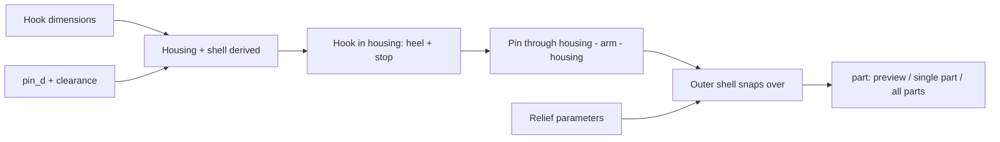

# Parametric Foldable Wall Hook – Folding Wall Hook with Pin Hinge

[← All models](../../README.md)

🌐 **English** | [Deutsch](README.de.md)

Parametric folding wall hook for FDM printing: it sits flush in its housing and
folds out when needed to carry towels, bags or jackets. Four parts (hook,
housing, pin, outer shell), all printable without supports; you set the
dimensions, decoration and holding forces in the MakerWorld Customizer.

> **The model with all print profiles is available exclusively on MakerWorld:**
> 👉 [MakerWorld link: https://makerworld.com/en/models/3056446-parametric-foldable-wall-hook](https://makerworld.com/en/models/3056446-parametric-foldable-wall-hook)
>
> 

The **Parametric Foldable Wall Hook** consists of a movable **hook** (arm), a
**housing** with a hook pocket, a sturdy **hinge pin** and a decorative **outer
shell** with a relief pattern. The hook pivots at the bottom and folds out
towards the front until a heel forms a hard stop against the solid back wall of
the housing. When closed, it sits flush in the housing, held by detent bumps.
The outer shell covers the pin ends so that the pin cannot work its way out.

## Table of Contents

- [The Problem](#the-problem)
- [The Idea](#the-idea)
- [Highlights](#highlights)
- [Parametric Options](#parametric-options)
- [Design](#design)
- [Print Recommendations](#print-recommendations)
- [Use Cases](#use-cases)
- [Troubleshooting / FAQ](#troubleshooting--faq)
- [Development History](#development-history)
- [Downloads](#downloads)
- [License](#license)

## The Problem

A wall hook that only folds out when needed is practical – but not trivial to
print:

- A hinge that is created "in place" during printing has a gap that turns the
  notches and engravings below it into spaghetti.
- A hook that is merely snapped in can work its way out; the pivot is then in
  the wrong position and the stop no longer engages.
- Without a detent, the closed hook falls into the housing or does not close
  flush.
- Under load, the hook must not fold shut but has to press into the stop.
- Dimensions and appearance depend on the use (towel, bag, hanger), so a rigid
  model rarely fits.

## The Idea

The pivot is at the **bottom**; the hook folds shut upwards and folds out
towards the front. A hanging load presses the arm into the stop: a heel below
the pivot meets the solid back wall with its full surface at `max_open_angle`.
The hinge is a **separate, load-bearing pin** that is inserted from the side
through housing, arm and housing. All four parts are individually printed
bodies – no hinge gap, no supports. All dimensions are in millimetres, all
values are Customizer parameters.

## Highlights

- **Four separate parts:** hook, housing, pin and outer shell, all printable
  without supports.
- **Load-bearing pin hinge:** `pin_d` (default 4 mm), secured by the outer
  shell.
- **Hard stop:** heel and solid back wall, angle set via `max_open_angle`
  (default 60°).
- **Flush, snap-in fit:** lateral detent bumps (`detent_*`) and an upper
  retaining bar (`top_seat_*`) – both adjustable independently of each other.
- **Hanger saddle notches:** optional 45° V-grooves (`hanger_notches`) for
  hanging a loop.
- **Finger grip recess** at the hook tip for pulling it out.
- **Decorative outer shell** with relief: grooves, rings, dots or diamond
  pattern.
- **Two mounting methods:** double-sided adhesive tape on the flat back or
  countersunk screws through the back wall (`mount_mode`).
- **Shell optional:** `use_shell = 0` gives a fully enclosed housing.
- **Colour preview** in four schemes, optionally with a translucent shell.
- **Three reference variants** (grooves, diamond, dots) with Bambu Studio
  profiles for the P2S.

## Parametric Options

The names correspond to the model's Customizer parameters.

### Output and Preview

| Parameter | Meaning | Default | Range / Unit |
|---|---|---|---|
| `part` | Output: `Vorschau ausgeklappt`, `Vorschau zugeklappt`, `DRUCK Alle auf Platte`, `DRUCK Alle Platte einfarbig`, `DRUCK Haken`, `DRUCK Gehaeuse`, `DRUCK Stift`, `DRUCK Aussenschale` | `Vorschau ausgeklappt` | Selection |
| `preview_angle` | Folding angle in the preview (display only), 0 = closed | 0 | 0–180° |
| `show_cover` | Show the outer shell in the preview (off: mechanism visible) | 1 | 0 = No, 1 = Yes |

### Size

| Parameter | Meaning | Default | Range / Unit |
|---|---|---|---|
| `body_width` | Minimum outer width of the shell (X); grows automatically with the hook width | 28 | 22–60 mm |
| `body_depth` | Overall depth / distance from the wall (Y); this is how deep the hook folds in | 17 | 12–32 mm, step 0.5 |

The outer height results automatically from the hook length.

### Hook

| Parameter | Meaning | Default | Range / Unit |
|---|---|---|---|
| `hook_width` | Hook width (X) | 16 | 8–40 mm, step 0.5 |
| `hook_thick` | Hook thickness (Y), also the hinge diameter (barrel) | 8 | 5–16 mm, step 0.5 |
| `hook_len` | Hook length from the pivot upwards (closed) | 44 | 20–110 mm |
| `max_open_angle` | Maximum opening angle from "closed"; this is where the heel lands on the back wall | 60 | 10–90° |
| `hanger_notches` | Hanger saddle notches (45° V-groove) on the inside: none, 2 or 3 positions | 2 | 0, 2, 3 |
| `notch_depth` | Depth of the saddle notches | 1.6 | 0.6–2.5 mm, step 0.1 |
| `grip_notch_depth` | Depth of the finger grip recess at the tip | 3.0 | 1.5–5.0 mm, step 0.1 |
| `grip_notch_wfrac` | Width of the finger recess as a fraction of the hook width | 0.82 | 0.5–0.95, step 0.02 |

### Hinge Pin

| Parameter | Meaning | Default | Range / Unit |
|---|---|---|---|
| `pin_d` | Pin diameter; choose a sturdy value, it carries the load | 4.0 | 2.5–7.0 mm, step 0.1 |
| `pin_play` | Running clearance between pin and arm bore per side | 0.20 | 0.10–0.40 mm, step 0.01 |
| `holder_pin_clear` | Clearance between pin and housing hole per side (insertion) | 0.12 | 0.05–0.30 mm, step 0.01 |

### Fit and Mounting

| Parameter | Meaning | Default | Range / Unit |
|---|---|---|---|
| `cover_wall` | Wall thickness of housing and outer shell | 2.0 | 1.2–4.0 mm, step 0.1 |
| `fit_clear` | Press fit housing ↔ shell per side | 0.18 | 0.05–0.40 mm, step 0.01 |
| `hinge_gap` | General hinge or barrel clearance | 0.40 | 0.25–0.60 mm, step 0.01 |
| `snap_protr` | Height of the snap rib shell ↔ housing | 0.45 | 0–1.0 mm, step 0.05 |
| `use_shell` | Use the outer shell (with snap grooves) or a fully enclosed housing | 1 | 0 = No, 1 = Yes |
| `mount_mode` | Mounting: adhesive tape (flat back) or countersunk screws through the back wall | 0 | 0, 1 |
| `screw_hole_d` | Diameter of the screw hole (M3 = 3.4; M4 = 4.5) | 3.4 | 2.5–6.0 mm, step 0.1 |
| `screw_head_d` | Diameter of the countersunk head | 6.4 | 5–12 mm, step 0.1 |

### Closure / Detent at the Housing Edge

| Parameter | Meaning | Default | Range / Unit |
|---|---|---|---|
| `detent_enable` | Lateral detent bumps that hold the closed hook flush | 1 | 0 = No, 1 = Yes |
| `detent_grip` | Holding strength = overlap bump ↔ hook side; 0.15 easy-moving, 0.30 firm | 0.15 | 0.10–0.80 mm, step 0.05 |
| `detent_pos` | Height of the detent along the hook length (0 = pivot, 1 = tip) | 0.65 | 0.40–0.95, step 0.05 |

### Upper Retaining Bar / Flush Fit

| Parameter | Meaning | Default | Range / Unit |
|---|---|---|---|
| `top_seat_enable` | Bar on the back wall for a flush fit and a gentle click (independent of notches and lateral bumps) | 1 | 0 = No, 1 = Yes |
| `top_seat_grip` | Holding strength of the upper bump = snap depth into the back of the hook | 0.35 | 0.15–0.80 mm, step 0.05 |
| `top_seat_pos` | Starting height of the bar along the hook length (0.5 = middle, 0.9 = near the tip) | 0.70 | 0.50–0.90, step 0.05 |

### Decoration

| Parameter | Meaning | Default | Range / Unit |
|---|---|---|---|
| `relief_style` | Relief on the outer walls of the shell | 1 | 0 = none, 1 = vertical grooves, 2 = horizontal rings, 3 = dots, 4 = diamond pattern (grooves + rings) |
| `relief_size` | Pattern spacing / pitch | 4 | 2–12 mm, step 0.5 |
| `relief_depth` | Relief depth | 0.6 | 0.3–1.6 mm, step 0.1 |
| `arm_relief` | Also decorate the front of the arm (remains printable) | 1 | 0 = No, 1 = Yes |

### Preview Colours (display only)

| Parameter | Meaning | Default | Range / Unit |
|---|---|---|---|
| `color_scheme` | Colour scheme: 0 = grey + orange, 1 = wood look + light, 2 = black + light, 3 = custom colours | 1 | 0–3 |
| `cover_color` | Custom colour of shell and hook (scheme 3) | `Peru` | Colour name |
| `kern_color` | Custom colour of housing and pin (scheme 3) | `AntiqueWhite` | Colour name |
| `cover_transparent` | Show the shell translucent | 0 | 0 = opaque, 1 = translucent |

### Quality

| Parameter | Meaning | Default | Range / Unit |
|---|---|---|---|
| `$fn` | Smoothness of curves; preview 48–64, final 96–128 | 64 | 24–160, step 8 |

## Design

### OpenSCAD Approach

The model is pure OpenSCAD without external libraries and runs in the
MakerWorld Customizer. The `part` selector outputs the preview, individual parts
or all four parts on one plate. The coordinates are X = width, Y = depth (away
from the wall), Z = height. The selection values of `part` deliberately contain
no colons, because the Customizer would read them as a value:label separator.

### Parametric Logic

The housing and the shell are **derived** from the hook dimensions:

| Quantity | Formula / Rule |
|---|---|
| Barrel radius | half the hook thickness (`hook_thick` / 2) |
| Minimum housing width | `hook_width` + 2 × (`hinge_gap` + pin radius + `holder_pin_clear` + 1.8) |
| Shell outer width | max(`body_width`, minimum width + 2 × (`cover_wall` + `fit_clear`)) |
| Pivot height above floor | max(`hook_thick`, half the shell width × 0.75 + 2) |
| Housing height | Pivot height + `hook_len` + 4 mm cap |
| Shell outer height | Housing height + 2 × (`cover_wall` + `fit_clear`) |
| Heel (stop) | (barrel radius + `hinge_gap` + `pin_play` + 0.2) / sin(`max_open_angle`) |
| Pin length | Housing width − 0.4 mm (ends about 0.2 mm inside the outer surfaces) |
| Notch depth | min(`notch_depth`, 30 % of the hook thickness) |
| Notch positions | between 40 % and 80 % of the hook length |

With the default settings this gives: shell outer width 29.0 mm, housing width
24.6 mm, pivot height 12.9 mm, outer height around 65.2 mm at 17 mm overall
depth, pin length 24.2 mm and a heel of around 5.5 mm.

The values are derived from the formulas and the default values.

### Special Algorithms

- **Cantilever arm with pivot at the bottom:** The arm folds shut into the
  pocket at the top and folds out towards the front. At `max_open_angle`, the
  heel below the pivot lands on the solid back wall; a load only presses it
  harder against it.
- **Heel as a full-width wedge:** After rotating by the opening angle, the rear
  wedge face lies flat in the plane of the back wall. The wedge ends exactly at
  this face so that it does not jam any earlier.
- **Swing path from a 2D fan:** The arm's clearance cut is created from a
  rotated 2D profile and extruded **once**. A union of many rotated 3D bodies
  would have produced coplanar top faces on a common plane and thus non-manifold
  edges.
- **Detent bump on the side edge:** A solid sphere in each side wall that
  slightly spreads the housing wall apart when closing. When closed, the arm
  recess sits exactly on the bump centre – giving a defined click and no
  permanent tension.
- **Upper retaining bar:** A solid block grows from the back wall (the bed
  during printing) to just short of the back of the closed hook. A small bump on
  it snaps into a recess on the back of the hook and gives gentle resistance when
  unfolding. The block is anchored in the back wall so that it does not
  "float".
- **Notches and recesses as rotated cubes:** A diamond rotated by 45° on the
  target surface produces V-grooves that are self-supporting when printed. The
  grip recess is a cylinder segment whose depth is limited so that a grip lip
  remains at the top.
- **Relief on the outer surface:** Grooves, rings, dots or a diamond pattern are
  cut out of the shell; the rings as the difference between a large and a
  smaller stadium disc.

### Modularity

The code separates the hook body, heel, bearing hole, swing path, housing
(pocket, pin hole, stop, bumps, retaining bar), pin, outer shell with surface
relief, and the mounting (adhesive tape or countersunk screw). The preview shows
the hook folded out to any angle, optionally without the shell or with a
translucent shell.

### Print Optimisations

- **Hook flat, front side up:** The grip recess is a channel open at the top, and
  the 45° notches on the underside are self-supporting. Because the arm lies
  separately, there is no hinge gap underneath.
- **Housing and shell with the back wall on the bed,** open front facing up.
- **Pin standing upright:** Every layer is a circle, which gives a precise round
  cross-section; chamfer at the top as an insertion aid, flat bottom for
  adhesion.
- **Roundings only as vertical walls** (heel, tip) so that nothing overhangs.
- **Recesses instead of ribs** on surfaces that would face down during printing.

## Print Recommendations

The supplied profiles are created for the **Bambu Lab P2S** with **PETG-CF** and
test-sliced in Bambu Studio (0.20 mm layer height, 3 walls, gyroid 15 %). They
differ in the relief: `rillen` (`relief_style` 1), `rautung` (4) and `punkte`
(3).

| Setting | Recommendation |
|---|---|
| Material | PETG-CF (profiles); PETG or PLA are also conceivable |
| Nozzle | 0.4 mm |
| Layer height | 0.20 mm |
| Walls | 3–4 (load-bearing hook: rather 4) |
| Infill | 20–40 %, hook and pin higher; the profiles use 15 % gyroid |
| Supports | none |
| Brim | recommended for the upright pin |
| Orientation | Hook flat (front side up), housing and shell back wall on the bed, pin upright |

**Special notes**

- **All parts on one plate:** The profiles contain the four parts as a single
  object. In Bambu Studio, right-click and choose "Split to Objects" so that each
  part can be arranged individually.
- **Two colours:** Outer shell in a contrasting colour; hook, housing and pin in
  one colour. Without an AMS, in separate prints; press fit and snap need no
  glue.
- **Pin:** Print it upright and enable a brim; printing slowly helps. For maximum
  shear strength, the pin can be laid down in the slicer; the layers then run
  along the load, but the cross-section becomes less round.
- **Assembly:** Place the hook in the housing, align the bore with the pin holes,
  insert the pin from the side (chamfer first), and press the assembly from the
  front into the outer shell. The shell covers the pin ends.
- **Mounting:** Double-sided adhesive tape on the flat back (`mount_mode` 0) or
  countersunk screws through the two holes in the back wall (`mount_mode` 1).
- The preview modes are for display only and not intended for printing.

## Use Cases

- **Towel hook in the bathroom** that sits flush against the wall when closed.
- **Space-saving jacket hook in the hallway,** folded out only when needed.
- **Bag and purse hook in the workshop or office.**
- **Hanger holder:** With the saddle notches (`hanger_notches`), the loop of a
  hanger sits securely in the hook.
- **Motorhome and camper:** a hook that stays closed while driving.
- **Custom sizes:** wider or longer via `hook_width` and `hook_len`; housing and
  shell grow automatically.
- **Individual look:** grooves, rings, dots or a diamond pattern on the shell.

## Troubleshooting / FAQ

| Symptom | Cause | Fix |
|---|---|---|
| Does the hook fall out? | No: the movement is a pure rotation about the pin, and the pin ends are covered by the shell | – |
| Bearing too stiff | Running clearance too small | Increase `pin_play` |
| Bearing too loose | Running clearance too large | Decrease `pin_play` |
| Pin is hard to insert | Insertion clearance too small | Increase `holder_pin_clear` |
| Hook is too hard to open | Holding forces too high | Decrease `detent_grip` and/or `top_seat_grip` (e.g. `detent_grip` 0.10) |
| Hook holds too loosely | Holding forces too low | Increase `detent_grip` and `top_seat_grip`; change the position with `detent_pos` |
| Finger recess too small to grip | Recess too shallow or narrow | Increase `grip_notch_depth` and/or `grip_notch_wfrac` |
| Opening angle does not fit | Stop angle | Change `max_open_angle` (default 60°) |
| Shell sits too loose or too tight | Press fit | Adjust `fit_clear`; snap hold via `snap_protr` |
| Thin slits visible in the housing | Snap grooves without a shell | `use_shell = 0`: fully enclosed housing |
| Pin should carry more | Cross-section too small | Increase `pin_d`; housing and arm grow with it |

## Development History

Development began on 13 July 2026 with a folding hook as one printable unit
(frame and hook print-in-place) with a slide-on decorative shell. The first
iterations showed the typical problems: the hook worked its way out of the
bearing when folding out, the stop did not engage, and the saddle notches turned
into spaghetti in the hinge gap when printed. On 14 July, several variants were
created (three parts with a snap-in bearing, print-in-place, two parts) until
the **four-part solution with a separate pin** prevailed: the pin secures the
bearing, and the shell covers its ends.

Further milestones: a full-width heel wedge instead of a thin tab, the swing path
as a once-extruded 2D profile against non-manifold edges and, on 15 July, the
detent bumps and the upper retaining bar. The three reference variants and the
studio renderings were created on 5 August 2026. A flush variant in which the
arm covers the entire front and releases with a press was explored as a separate
file; this repository documents the four-part pin variant.

The images in this repository are renderings of the model geometry or scene
images derived from it; no photos of prints are included.

## Downloads

Print files are intentionally available exclusively on MakerWorld.

👉 MakerWorld link: https://makerworld.com/en/models/3056446-parametric-foldable-wall-hook

Profile: <https://makerworld.com/en/@BetaHydri>

## License

Documentation and images in this repository; model and print files are
distributed exclusively via MakerWorld. Documentation and images: © BetaHydri.
The model (including source code) and all print files are under the license
stated on MakerWorld. This repository deliberately contains no model, source
code or print files.
