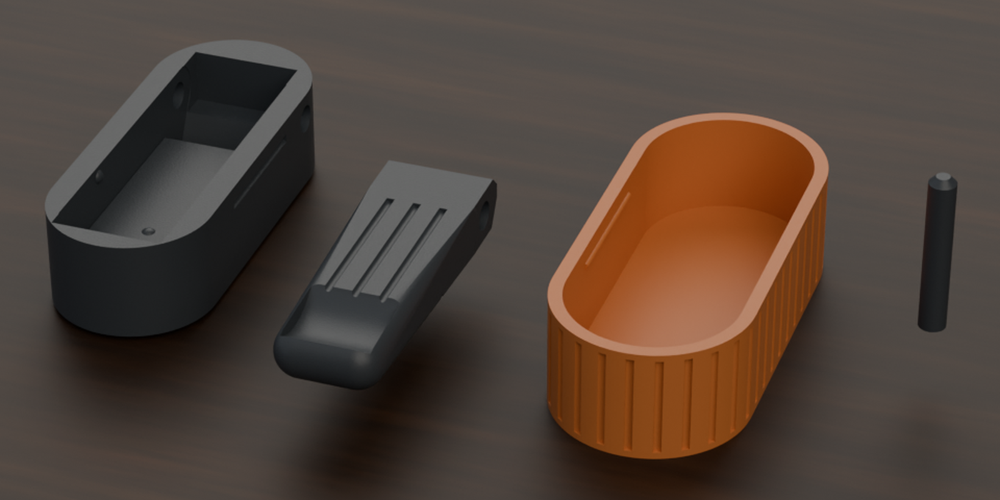
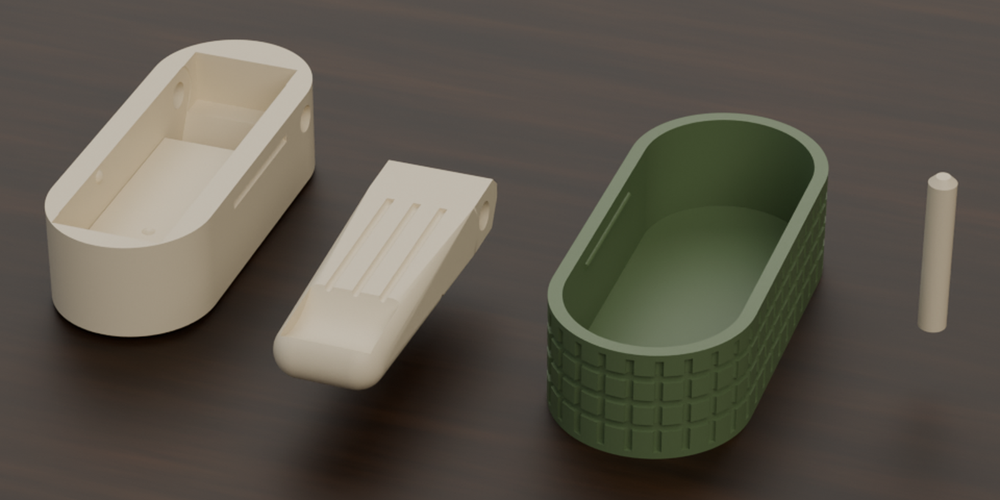
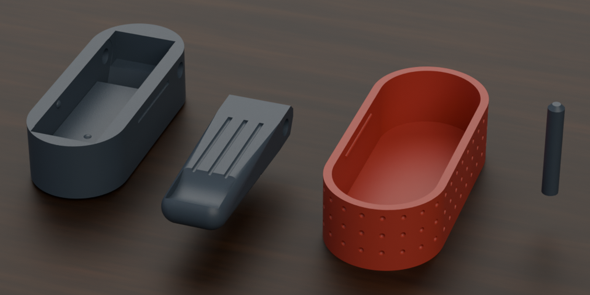
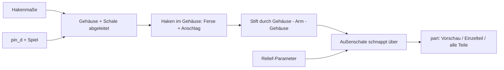

# Parametric Foldable Wall Hook – Klappbarer Wandhaken mit Stift-Scharnier

[← Alle Modelle im Überblick](../../README.md)

Parametrischer, klappbarer Wandhaken für den FDM-Druck: Er sitzt bündig in
seinem Gehäuse und klappt bei Bedarf aus, um Handtücher, Taschen oder Jacken zu
tragen. Vier Teile (Haken, Gehäuse, Stift, Außenschale), alle ohne Support
druckbar; Maße, Verzierung und Haltekräfte stellst du im MakerWorld-Customizer
ein.

> **Das Modell mit allen Druckprofilen gibt es ausschließlich auf MakerWorld:**
> 👉 [MakerWorld-Link: https://makerworld.com/en/models/3056446-parametric-foldable-wall-hook](https://makerworld.com/en/models/3056446-parametric-foldable-wall-hook)
>
> 

Der **Parametric Foldable Wall Hook** besteht aus einem beweglichen **Haken**
(Arm), einem **Gehäuse** mit Hakentasche, einem kräftigen **Scharnier-Stift** und
einer dekorativen **Außenschale** mit Relief. Der Haken dreht sich unten und
klappt nach vorn aus, bis eine Ferse an der massiven Rückwand des Gehäuses einen
harten Anschlag bildet. Geschlossen sitzt er per Einrast-Noppen bündig im
Gehäuse. Die Außenschale verdeckt die Stift-Enden, sodass der Stift nicht
herauswandern kann.

## Inhaltsverzeichnis

- [Das Problem](#das-problem)
- [Die Idee](#die-idee)
- [Highlights](#highlights)
- [Parametrische Optionen](#parametrische-optionen)
- [Konstruktion](#konstruktion)
- [Druckempfehlungen](#druckempfehlungen)
- [Anwendungsbeispiele](#anwendungsbeispiele)
- [Fehlersuche / FAQ](#fehlersuche--faq)
- [Entwicklungsgeschichte](#entwicklungsgeschichte)
- [Downloads](#downloads)
- [Lizenz](#lizenz)

## Das Problem

Ein Wandhaken, der nur bei Bedarf herausklappt, ist praktisch – gedruckt aber
nicht trivial:

- Ein Scharnier, das im Druck „in place“ entsteht, hat einen Spalt, der Kerben
  und Gravuren darunter zu Spaghetti macht.
- Ein Haken, der nur eingeschnappt ist, kann herauswandern; dann sitzt der
  Drehpunkt falsch und der Anschlag greift nicht mehr.
- Ohne Arretierung fällt der geschlossene Haken ins Gehäuse oder schließt nicht
  bündig ab.
- Unter Last darf der Haken nicht zuklappen, sondern muss in den Anschlag
  drücken.
- Maße und Optik hängen vom Einsatz ab (Handtuch, Beutel, Bügel), ein starres
  Modell passt selten.

## Die Idee

Der Drehpunkt sitzt **unten**, der Haken klappt nach oben zu und nach vorn aus.
Eine anhängende Last drückt den Arm in den Anschlag: Eine Ferse unter dem
Drehpunkt trifft bei `max_open_angle` flächig auf die massive Rückwand. Das
Scharnier ist ein **separater, lasttragender Stift**, der seitlich durch Gehäuse,
Arm und Gehäuse gesteckt wird. Alle vier Teile sind einzeln gedruckte Körper –
kein Scharnierspalt, keine Stützen. Alle Maße in Millimetern, alle Werte als
Customizer-Parameter.

## Highlights

- **Vier getrennte Teile:** Haken, Gehäuse, Stift und Außenschale, alle ohne
  Support druckbar.
- **Lasttragendes Stift-Scharnier:** `pin_d` (Standard 4 mm), von der Außenschale
  gesichert.
- **Harter Anschlag:** Ferse und massive Rückwand, Winkel über `max_open_angle`
  (Standard 60°).
- **Bündiger, einrastender Sitz:** seitliche Einrast-Noppen (`detent_*`) und ein
  oberer Halte-Steg (`top_seat_*`) – beide unabhängig voneinander einstellbar.
- **Bügel-Sattelkerben:** optionale 45°-V-Nuten (`hanger_notches`) zum Einhängen
  einer Schlaufe.
- **Griff-Fingermulde** an der Hakenspitze zum Herausziehen.
- **Dekorative Außenschale** mit Relief: Rillen, Ringe, Punkte oder Rautung.
- **Zwei Montagearten:** doppelseitiges Klebeband auf der flachen Rückseite oder
  Senkkopf-Schrauben durch die Rückwand (`mount_mode`).
- **Schale optional:** `use_shell = 0` liefert ein umlaufend geschlossenes Gehäuse.
- **Farbige Vorschau** in vier Schemata, optional mit durchscheinender Schale.
- **Drei Referenzvarianten** (Rillen, Rautung, Punkte) mit Bambu-Studio-Profilen
  für den P2S.

## Parametrische Optionen

Die Namen entsprechen den Customizer-Parametern des Modells.

### Ausgabe und Vorschau

| Parameter | Bedeutung | Standard | Bereich / Einheit |
|---|---|---|---|
| `part` | Ausgabe: `Vorschau ausgeklappt`, `Vorschau zugeklappt`, `DRUCK Alle auf Platte`, `DRUCK Alle Platte einfarbig`, `DRUCK Haken`, `DRUCK Gehaeuse`, `DRUCK Stift`, `DRUCK Aussenschale` | `Vorschau ausgeklappt` | Auswahl |
| `preview_angle` | Klappwinkel in der Vorschau (nur Anzeige), 0 = zu | 0 | 0–180° |
| `show_cover` | Außenschale in der Vorschau zeigen (aus: Mechanik sichtbar) | 1 | 0 = Nein, 1 = Ja |

### Größe

| Parameter | Bedeutung | Standard | Bereich / Einheit |
|---|---|---|---|
| `body_width` | Mindest-Außenbreite der Schale (X); wächst automatisch mit der Hakenbreite | 28 | 22–60 mm |
| `body_depth` | Bautiefe / Wandabstand (Y); so tief klappt der Haken ein | 17 | 12–32 mm, Schritt 0,5 |

Die Außenhöhe ergibt sich automatisch aus der Hakenlänge.

### Haken

| Parameter | Bedeutung | Standard | Bereich / Einheit |
|---|---|---|---|
| `hook_width` | Hakenbreite (X) | 16 | 8–40 mm, Schritt 0,5 |
| `hook_thick` | Hakendicke (Y), zugleich Scharnier-Durchmesser (Barrel) | 8 | 5–16 mm, Schritt 0,5 |
| `hook_len` | Hakenlänge ab Drehpunkt nach oben (geschlossen) | 44 | 20–110 mm |
| `max_open_angle` | Maximaler Ausklappwinkel ab „zu“; hier setzt die Ferse an der Rückwand auf | 60 | 10–90° |
| `hanger_notches` | Bügel-Sattelkerben (45°-V-Nut) auf der Innenseite: keine, 2 oder 3 Positionen | 2 | 0, 2, 3 |
| `notch_depth` | Tiefe der Sattelkerben | 1,6 | 0,6–2,5 mm, Schritt 0,1 |
| `grip_notch_depth` | Tiefe der Griff-Fingermulde an der Spitze | 3,0 | 1,5–5,0 mm, Schritt 0,1 |
| `grip_notch_wfrac` | Breite der Fingermulde als Anteil der Hakenbreite | 0,82 | 0,5–0,95, Schritt 0,02 |

### Scharnier-Stift

| Parameter | Bedeutung | Standard | Bereich / Einheit |
|---|---|---|---|
| `pin_d` | Stift-Durchmesser; kräftig wählen, er trägt die Last | 4,0 | 2,5–7,0 mm, Schritt 0,1 |
| `pin_play` | Laufspiel zwischen Stift und Armbohrung je Seite | 0,20 | 0,10–0,40 mm, Schritt 0,01 |
| `holder_pin_clear` | Spiel zwischen Stift und Gehäuseloch je Seite (Durchstecken) | 0,12 | 0,05–0,30 mm, Schritt 0,01 |

### Passung und Montage

| Parameter | Bedeutung | Standard | Bereich / Einheit |
|---|---|---|---|
| `cover_wall` | Wandstärke von Gehäuse und Außenschale | 2,0 | 1,2–4,0 mm, Schritt 0,1 |
| `fit_clear` | Presssitz Gehäuse ↔ Schale je Seite | 0,18 | 0,05–0,40 mm, Schritt 0,01 |
| `hinge_gap` | Allgemeines Scharnier- bzw. Barrel-Spiel | 0,40 | 0,25–0,60 mm, Schritt 0,01 |
| `snap_protr` | Höhe der Einrast-Rippe Schale ↔ Gehäuse | 0,45 | 0–1,0 mm, Schritt 0,05 |
| `use_shell` | Außenschale verwenden (mit Snap-Rillen) oder Gehäuse umlaufend geschlossen | 1 | 0 = Nein, 1 = Ja |
| `mount_mode` | Montage: Klebeband (flache Rückseite) oder Senkkopf-Schrauben durch die Rückwand | 0 | 0, 1 |
| `screw_hole_d` | Durchmesser des Schraubenlochs (M3 = 3,4; M4 = 4,5) | 3,4 | 2,5–6,0 mm, Schritt 0,1 |
| `screw_head_d` | Durchmesser des Senkkopfs | 6,4 | 5–12 mm, Schritt 0,1 |

### Verschluss / Einrasten am Gehäuserand

| Parameter | Bedeutung | Standard | Bereich / Einheit |
|---|---|---|---|
| `detent_enable` | Seitliche Einrast-Noppen, die den geschlossenen Haken bündig halten | 1 | 0 = Nein, 1 = Ja |
| `detent_grip` | Haltestärke = Überdeckung Noppe ↔ Hakenseite; 0,15 leichtgängig, 0,30 stramm | 0,15 | 0,10–0,80 mm, Schritt 0,05 |
| `detent_pos` | Höhe der Einrastung entlang der Hakenlänge (0 = Drehpunkt, 1 = Spitze) | 0,65 | 0,40–0,95, Schritt 0,05 |

### Oberer Halte-Steg / Bündiger Sitz

| Parameter | Bedeutung | Standard | Bereich / Einheit |
|---|---|---|---|
| `top_seat_enable` | Steg an der Rückwand für bündigen Sitz und sanften Klick (unabhängig von Kerben und seitlichen Noppen) | 1 | 0 = Nein, 1 = Ja |
| `top_seat_grip` | Haltestärke der oberen Noppe = Einrasttiefe in die Hakenrückseite | 0,35 | 0,15–0,80 mm, Schritt 0,05 |
| `top_seat_pos` | Starthöhe des Stegs entlang der Hakenlänge (0,5 = Mitte, 0,9 = nahe der Spitze) | 0,70 | 0,50–0,90, Schritt 0,05 |

### Verzierung

| Parameter | Bedeutung | Standard | Bereich / Einheit |
|---|---|---|---|
| `relief_style` | Relief auf den Außenwänden der Schale | 1 | 0 = keins, 1 = vertikale Rillen, 2 = horizontale Ringe, 3 = Punkte, 4 = Rautung (Rillen + Ringe) |
| `relief_size` | Musterabstand / Teilung | 4 | 2–12 mm, Schritt 0,5 |
| `relief_depth` | Relieftiefe | 0,6 | 0,3–1,6 mm, Schritt 0,1 |
| `arm_relief` | Auch die Vorderseite des Arms verzieren (bleibt druckbar) | 1 | 0 = Nein, 1 = Ja |

### Vorschau-Farben (nur Anzeige)

| Parameter | Bedeutung | Standard | Bereich / Einheit |
|---|---|---|---|
| `color_scheme` | Farbschema: 0 = Grau + Orange, 1 = Holz-Optik + Hell, 2 = Schwarz + Hell, 3 = Eigene Farben | 1 | 0–3 |
| `cover_color` | Eigene Farbe von Schale und Haken (Schema 3) | `Peru` | Farbname |
| `kern_color` | Eigene Farbe von Gehäuse und Stift (Schema 3) | `AntiqueWhite` | Farbname |
| `cover_transparent` | Schale durchscheinend zeigen | 0 | 0 = deckend, 1 = durchscheinend |

### Qualität

| Parameter | Bedeutung | Standard | Bereich / Einheit |
|---|---|---|---|
| `$fn` | Glätte der Kurven; Vorschau 48–64, final 96–128 | 64 | 24–160, Schritt 8 |

## Konstruktion

### OpenSCAD-Ansatz

Das Modell ist reines OpenSCAD ohne externe Bibliotheken und läuft im
MakerWorld-Customizer. Der `part`-Selektor gibt Vorschau, einzelne Teile oder
alle vier Teile auf einer Platte aus. Die Koordinaten sind X = Breite, Y = Tiefe
(von der Wand weg), Z = Höhe. Bei den Auswahlwerten von `part` gibt es bewusst
keine Doppelpunkte, weil der Customizer sie als Wert:Label-Trenner lesen würde.

### Parametrische Logik

Das Gehäuse und die Schale werden aus den Hakenmaßen **abgeleitet**:

| Größe | Formel / Regel |
|---|---|
| Barrel-Radius | halbe Hakendicke (`hook_thick` / 2) |
| Mindestbreite Gehäuse | `hook_width` + 2 × (`hinge_gap` + Stiftradius + `holder_pin_clear` + 1,8) |
| Außenbreite Schale | max(`body_width`, Mindestbreite + 2 × (`cover_wall` + `fit_clear`)) |
| Drehpunkthöhe über Boden | max(`hook_thick`, halbe Schalenbreite × 0,75 + 2) |
| Gehäusehöhe | Drehpunkthöhe + `hook_len` + 4 mm Kappe |
| Außenhöhe Schale | Gehäusehöhe + 2 × (`cover_wall` + `fit_clear`) |
| Ferse (Anschlag) | (Barrel-Radius + `hinge_gap` + `pin_play` + 0,2) / sin(`max_open_angle`) |
| Stiftlänge | Gehäusebreite − 0,4 mm (Enden rund 0,2 mm innerhalb der Außenflächen) |
| Kerbtiefe | min(`notch_depth`, 30 % der Hakendicke) |
| Kerbpositionen | zwischen 40 % und 80 % der Hakenlänge |

Mit den Voreinstellungen ergeben sich: Außenbreite der Schale 29,0 mm,
Gehäusebreite 24,6 mm, Drehpunkthöhe 12,9 mm, Außenhöhe rund 65,2 mm bei 17 mm
Bautiefe, Stiftlänge 24,2 mm und eine Ferse von rund 5,5 mm.

Die Werte sind aus den Formeln und den Standardwerten abgeleitet.

### Besondere Algorithmen

- **Kragarm mit Drehpunkt unten:** Der Arm klappt oben in die Tasche zu und nach
  vorn aus. Die Ferse unter dem Drehpunkt setzt bei `max_open_angle` an der
  massiven Rückwand auf; eine Last presst sie nur fester an.
- **Ferse als vollbreiter Keil:** Die hintere Keilfläche liegt nach der Drehung
  um den Öffnungswinkel flächig in der Rückwandebene. Der Keil endet genau an
  dieser Fläche, sodass er nicht schon früher klemmt.
- **Schwenkbahn aus einem 2D-Fächer:** Die Freischnitt-Bahn des Arms entsteht aus
  einem gedrehten 2D-Profil und wird **einmal** extrudiert. Eine Vereinigung vieler
  gedrehter 3D-Körper hätte auf einer gemeinsamen Ebene koplanare Deckflächen
  und damit nicht-manifolde Kanten erzeugt.
- **Einrast-Noppe am Seitenrand:** Eine Vollkugel in jeder Seitenwand, die
  die Gehäusewand beim Schließen leicht aufspreizt. Die Arm-Mulde liegt im
  geschlossenen Zustand exakt auf dem Noppenmittelpunkt – es gibt einen
  definierten Klick und keine Dauerspannung.
- **Oberer Halte-Steg:** Ein massiver Block wächst von der Rückwand (im Druck das
  Bett) bis kurz vor die geschlossene Hakenrückseite. Eine kleine Noppe darauf
  rastet in eine Mulde an der Hakenrückseite und gibt beim Aufklappen einen
  sanften Widerstand. Der Block ist in die Rückwand verankert, damit er nicht
  „schwebt“.
- **Kerben und Mulden als gedrehte Würfel:** Eine um 45° gedrehte Raute auf der
  Zielfläche ergibt V-Nuten, die im Druck selbsttragend sind. Die Griffmulde ist
  ein Zylinderabschnitt, dessen Tiefe so begrenzt wird, dass oben eine Griff-Lippe
  stehen bleibt.
- **Relief auf dem Mantel:** Rillen, Ringe, Punkte oder Rautung werden aus der Schale
  geschnitten; die Ringe als Differenz aus einer großen und einer kleineren
  Stadion-Scheibe.

### Modularität

Der Code trennt Hakenkörper, Ferse, Lagerloch, Schwenkbahn, Gehäuse (Tasche,
Stiftloch, Anschlag, Noppen, Halte-Steg), Stift, Außenschale mit Mantel-Relief
und die Montage (Klebeband oder Senkkopf-Schraube). Die Vorschau zeigt den
Haken beliebig weit ausgeklappt, wahlweise ohne Schale oder mit durchscheinender
Schale.

### Druckoptimierungen

- **Haken flach, Vorderseite oben:** Die Griffmulde ist eine nach oben offene
  Rinne, die 45°-Kerben auf der Unterseite sind selbsttragend. Weil der Arm
  separat liegt, gibt es keinen Scharnierspalt darunter.
- **Gehäuse und Schale mit der Rückwand auf dem Bett,** offene Front nach oben.
- **Stift stehend:** Jede Schicht ist ein Kreis, das ergibt einen präzisen
  Rundquerschnitt; Fase oben als Einfädelhilfe, flacher Boden für die Haftung.
- **Abrundungen nur als senkrechte Wände** (Ferse, Spitze), damit nichts
  überhängt.
- **Mulden statt Rippen** auf Flächen, die im Druck unten liegen würden.

## Druckempfehlungen

Die mitgelieferten Profile sind für den **Bambu Lab P2S** mit **PETG-CF**
erstellt und im Bambu Studio testgeslict (0,20 mm Layerhöhe, 3 Wände, Gyroid
15 %). Sie unterscheiden sich im Relief: `rillen` (`relief_style` 1), `rautung`
(4) und `punkte` (3).

| Einstellung | Empfehlung |
|---|---|
| Material | PETG-CF (Profile); PETG oder PLA sind ebenfalls denkbar |
| Düse | 0,4 mm |
| Layerhöhe | 0,20 mm |
| Wände | 3–4 (Haken tragend: eher 4) |
| Infill | 20–40 %, Haken und Stift höher; die Profile nutzen 15 % Gyroid |
| Supports | keine |
| Brim | beim stehenden Stift empfohlen |
| Ausrichtung | Haken flach (Vorderseite oben), Gehäuse und Schale Rückwand auf dem Bett, Stift stehend |

**Besondere Hinweise**

- **Alle Teile auf einer Platte:** Die Profile enthalten die vier Teile als ein
  Objekt. In Bambu Studio rechtsklicken und „In Objekte aufteilen“ („Split to
  Objects“) wählen, damit jedes Teil einzeln angeordnet werden kann.
- **Zwei Farben:** Die Außenschale in Kontrastfarbe, Haken, Gehäuse und Stift in
  einer Farbe. Ohne AMS in getrennten Drucken; Presssitz und Snap benötigen keinen
  Kleber.
- **Stift:** stehend drucken und einen Brim aktivieren, langsam drucken hilft. Für
  die maximale Scherfestigkeit lässt sich der Stift im Slicer umlegen; dann
  verlaufen die Schichten längs zur Last, der Querschnitt wird aber weniger rund.
- **Zusammenbau:** Haken ins Gehäuse legen, Bohrung mit den Stiftlöchern
  fluchten, Stift seitlich durchstecken (Fase voran), die Baugruppe von vorn in die
  Außenschale drücken. Die Schale verdeckt die Stift-Enden.
- **Montage:** Doppelseitiges Klebeband auf die flache Rückseite
  (`mount_mode` 0) oder Senkkopf-Schrauben durch die zwei Bohrungen der Rückwand
  (`mount_mode` 1).
- Die Vorschau-Modi sind nur Anzeige und nicht für den Druck gedacht.

## Anwendungsbeispiele

- **Handtuchhaken im Bad,** der geschlossen bündig an der Wand sitzt.
- **Platzsparender Jackenhaken im Flur,** ausgeklappt nur bei Bedarf.
- **Beutel- und Taschenhaken in Werkstatt oder Büro.**
- **Bügelhalter:** Mit den Sattelkerben (`hanger_notches`) liegt die Schlaufe
  eines Bügels sicher im Haken.
- **Wohnmobil und Camper:** ein Haken, der beim Fahren geschlossen bleibt.
- **Eigene Größen:** breiter oder länger über `hook_width` und `hook_len`; Gehäuse
  und Schale wachsen automatisch mit.
- **Individuelles Aussehen:** Rillen, Ringe, Punkte oder Rautung auf der Schale.

## Fehlersuche / FAQ

| Symptom | Ursache | Fix |
|---|---|---|
| Fällt der Haken heraus? | Nein: Die Bewegung ist reine Drehung um den Stift, die Stift-Enden sind von der Schale verdeckt | – |
| Lager zu schwergängig | Laufspiel zu klein | `pin_play` erhöhen |
| Lager zu locker | Laufspiel zu groß | `pin_play` verringern |
| Stift lässt sich schwer durchstecken | Durchsteck-Spiel zu klein | `holder_pin_clear` erhöhen |
| Haken lässt sich zu schwer öffnen | Haltekräfte zu hoch | `detent_grip` und/oder `top_seat_grip` verkleinern (z. B. `detent_grip` 0,10) |
| Haken hält zu locker | Haltekräfte zu niedrig | `detent_grip` und `top_seat_grip` erhöhen; Lage mit `detent_pos` ändern |
| Fingermulde zu klein zum Greifen | Mulde zu flach oder schmal | `grip_notch_depth` und/oder `grip_notch_wfrac` erhöhen |
| Öffnungswinkel passt nicht | Anschlagwinkel | `max_open_angle` ändern (Standard 60°) |
| Schale sitzt zu locker oder zu stramm | Presssitz | `fit_clear` anpassen; Snap-Halt über `snap_protr` |
| Dünne Schlitze im Gehäuse sichtbar | Snap-Rillen ohne Schale | `use_shell = 0`: Gehäuse umlaufend geschlossen |
| Stift soll mehr tragen | Querschnitt zu klein | `pin_d` erhöhen; Gehäuse und Arm wachsen mit |

## Entwicklungsgeschichte

Die Entwicklung begann am 13. Juli 2026 mit einem Klapphaken als eine
druckbare Einheit (Rahmen und Haken Print-in-Place) mit aufgeschobener
Dekorschale. In den ersten Iterationen zeigten sich die typischen Probleme: Der
Haken wanderte beim
Ausklappen aus dem Lager, der Anschlag griff nicht, und die Sattelkerben
druckten im Scharnierspalt zu Spaghetti. Am 14. Juli entstanden mehrere Varianten
(drei Teile mit Einknips-Lager, Print-in-Place, zwei Teile), bis sich die
**vierteilige Lösung mit separatem Stift** durchsetzte: Der Stift sichert das
Lager, die Schale verdeckt seine Enden.

Weitere Stationen: ein Ferse-Keil über die volle Breite statt eines dünnen
Lappens, die Schwenkbahn als einmal extrudiertes 2D-Profil gegen
nicht-manifolde Kanten und am 15. Juli die Einrast-Noppen und der obere
Halte-Steg. Die
drei Referenzvarianten und die Studio-Renderings entstanden am 5. August 2026. Eine
bündige Variante, bei der der Arm die ganze Front abdeckt und per Druck löst,
wurde als eigene Datei erkundet; dieses Repository dokumentiert die
vierteilige Stift-Variante.

Die Bilder in diesem Repository sind Renderings der Modellgeometrie
beziehungsweise daraus abgeleitete Szenenbilder; Druckfotos sind nicht dabei.

## Downloads

Print files are intentionally available exclusively on MakerWorld.

👉 MakerWorld-Link: https://makerworld.com/en/models/3056446-parametric-foldable-wall-hook

Profil: <https://makerworld.com/en/@BetaHydri>

## Lizenz

Dokumentation und Bilder in diesem Repository; Modell- und Druckdateien werden
ausschließlich über MakerWorld verteilt. Dokumentation und Bilder: © BetaHydri.
Das Modell (inkl. Quellcode) und alle Druckdateien stehen unter der auf
MakerWorld angegebenen Lizenz. Dieses Repository enthält bewusst keine Modell-,
Quellcode- oder Druckdateien.
