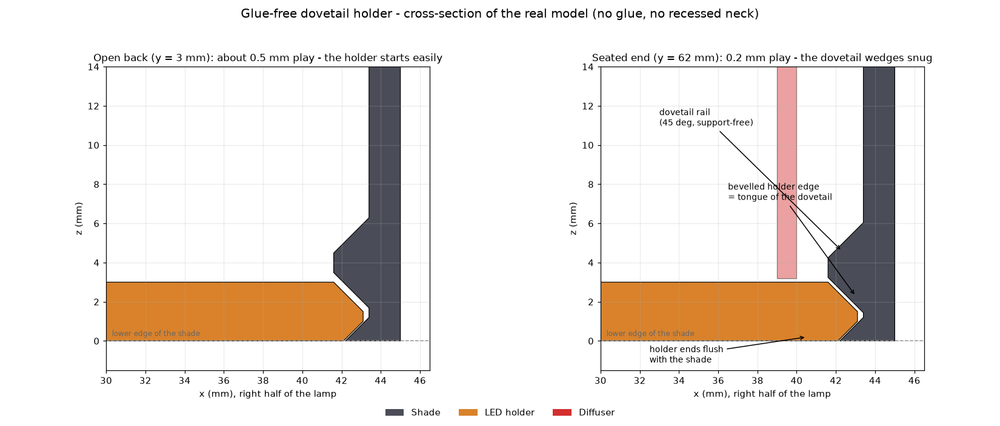

# Wandlampe 3D-drucken: parametrische Imperial-Lampe für E14 oder LED-Puck

👉 **MakerWorld-Link:** https://makerworld.com/en/models/3416896-parametric-imperial-lamp – Profil:
<https://makerworld.com/en/@BetaHydri>

> **230 V:** Die E14-Varianten laufen mit Netzspannung. Den Anschluss darf nur
> eine Fachkraft ausführen. Die Variante mit dem Bambu-LED-Kit (USB, 5 V) ist die
> sichere Alternative.

## Motivation: Eine Wandlampe, die zur eigenen Hardware passt

Ich wollte eine Wandlampe im Sci-Fi-Look, die ich nicht kaufen kann: hoch und
schmal, mit Schlitzfenstern, die das Licht streifig in den Raum werfen. Beim
Drucken lauern die üblichen Fallen: Fassungen unterscheiden sich von Hersteller
zu Hersteller, viele Fenster machen die Wand dünn, und eine Aufhängung, die man
sieht, zerstört den Eindruck. Das Ergebnis ist ein Modell, das die Hardware als
Parameter behandelt – und für die Leuchtfarbe ein loses Teil vorsieht.

Die Lampe ist ein Fan-Design im Look einer Sci-Fi-Kommandostation und steht in
keiner Verbindung zu den Rechteinhabern einer entsprechenden Filmreihe.

## Funktionen im Überblick

- **Halbturm für die Wand:** Front, zwei Seitenwände und Dach, die Rückseite
  ist offen und sitzt flach an der Wand. Maße über `lamp_width`, `lamp_height`
  (Standard 240 mm) und `lamp_depth`.
- **Drei Lichtquellen:** E14-Schraubfassung, kleiner E14-Konverter oder
  Bambu-LED-Kit-Puck (Ø 60 × 8 mm). Fassungsmaße (`e14_*`, `puck_*`) sind
  einstellbar.
- **Vier Fensterstile:** `imperial`, `slots`, `grid`, `none` für Front und
  Seiten.
- **Emblem:** Zahnrad als Speichenrad, vorne und optional an den Seiten.
- **Verdeckte Aufhängung:** Zwei Schlüssellöcher in einer Teil-Rückwand.
- **Loser Diffusor in eigener Farbe:** Farbe wechseln, ohne den Schirm neu zu drucken.
- **Halterung ohne Kleber:** Zwei Schwalbenschwanz-Schienen halten die Platte, sie schließt bündig ab.
- **Druckt ohne Stützen:** Schirm mit dem Dach auf dem Bett.

## Entwicklungsprozess

Der erste Stand stammt vom 2. Oktober 2026. Dazwischen lagen mehrere
Konstruktionsentscheidungen, die ich beim Test gefunden habe: Die Aufhängung
wanderte von frei stehenden Aufnahmen in eine Teil-Rückwand, der Innenraum
folgt der Außenkontur, und das Emblem wurde zum massiven Speichenrad. Am
9. Oktober 2026 waren die drei Referenzvarianten mit Profilen für den P1S
fertig.

## Technische Hintergründe

**Die Kontur.** Alles geht von einer 2D-Kontur aus: ein Rechteck mit
gerundeten Vorderecken und eckiger Rückseite für den Wandkontakt. Schirm,
Halterplatte und Diffusor sind jeweils diese Kontur, um unterschiedliche Beträge
nach innen versetzt. Dadurch passen sie bei jeder Maßänderung zusammen.

**Warum der Innenraum der Kontur folgt.** Ein quaderförmiger Hohlraum ragt in
den gerundeten Ecken diagonal über die Außenwand, verdünnt sie auf nahezu null
und öffnet einen Spalt, durch den das Licht des Diffusors scheint. Deshalb
entsteht der Hohlraum aus der versetzten Außenkontur.

**Der Halter ohne Kleber.** Die Halterplatte sitzt auf zwei 45°-Schwalbenschwanz-Schienen. Die
Schienenflächen sind 45°-Schrägen, sodass der Schirm mit dem Dach nach unten ohne
Stütze druckt.

**Das Emblem.** Das Emblem ist eine Scheibe, von der ein massives Speichenrad
abgezogen wird: Zahnkranz, Nabe und Speichen überlappen. Die Lücken leuchten.
Frühere Entwürfe mit nur tangentialen Berührungen von Zähnen und Stern
erzeugten nicht-manifolde Stellen. Die geschlossene Zone oben wächst mit
dem Emblemdurchmesser, damit es weder Dach noch Fenster berührt.

**Die Fenster.** Jedes Fenster ist eine Kapsel (Hülle aus zwei Kreisen). Der Stil
`imperial` füllt jede Spalte mit Kapseln von 10 bis 34 mm Länge; die
Längen stammen aus einer deterministischen Sinus-Hash-Funktion pro Spalte,
sodass dieselbe Einstellung immer dasselbe Muster ergibt. Mit den
Standardwerten sind es sechs Spalten vorne und fünf seitlich.

**Die Aufhängung.** Eine Teil-Rückwand am Dach trägt zwei Schlüssellöcher: Kopf-
und Schaftloch plus 9 mm Schlitz bei ±28 % der Innenbreite. Beim Druck mit dem
Dach unten steht sie senkrecht nahe am Bett und braucht keine Stützen.

**Das Einsetzen.** Die Halterung braucht keinen Kleber mehr: Zwei 45°-Schienen im
Schirm greifen über die angefasten Längskanten der Platte. Hinten hat sie etwa
0,5 mm Spiel und setzt sich leicht an, eingeschoben sind es 0,2 mm, und sie
klemmt. Sie schließt bündig mit der Unterkante ab; an der Wand verschließt die
Wand den offenen Rücken, sodass nichts herausrutschen kann. Der Diffusor (Wand
1,0 mm, Standardhöhe ca. 233 mm) wird von unten hochgeschoben, die Halterung von
hinten eingeschoben, dann sinkt der Diffusor auf die Platte. Dafür bleiben 2 mm
Hubweg unter dem Dach. Ich habe beide Wege in 2-mm-Schritten für Schraubfassung,
kleinen Konverter, Puck und eine kleine Lampe nachgerechnet: keine Kollision.

## Druck-Erfahrungen und Empfehlungen

Die Profile sind für den **P1S** mit PLA gebaut (0,20 mm Layerhöhe, Gyroid
15 %) und zweifarbig: Platte 1 mit Schirm und Halterung (Filament 1), Platte 2
mit dem Diffusor (Filament 2), jeweils nur eine Farbe pro Platte, also ohne
Prime-Tower. Der Schirm druckt mit dem Dach auf dem Bett, die Halterung flach,
der Diffusor stehend. Für den Schirm empfehle ich dunkles Filament, für den
Diffusor transluzentes PETG in Rot, Blau oder Grün. Dünne Wände (1,2–1,6 mm)
schimmern zusätzlich durch. Sitzt die Halterung zu stramm oder zu locker, hilft
`dt_clear` (0,25–0,3 bzw. 0,15 mm).

Nimm ausschließlich LED-Leuchtmittel; PLA erweicht ab etwa 50–60 °C. Die
Voreinstellungen passen zu einer E14-Schraubfassung mit Körper ca. 28 mm und
Ring ca. 43 mm sowie zu einer kleinen E14-LED mit Ø 15,4 mm. Miss deine
Hardware nach, bevor du druckst, und passe die `e14_*`- oder `puck_*`-Werte an.

## Einsatzideen

- Flur und Treppenhaus mit mehreren gleichen Lampen
- Gaming- und Medienzimmer mit rot oder violett leuchtendem Diffusor
- Werkstatt mit der Niedervolt-Variante (LED-Puck, USB)
- Homelab-Raum mit passend skalierter Höhe und Breite
- Ein Set mit verschiedenen Diffusoren: Farbe wechseln heißt nur den Diffusor
  tauschen

## Fazit und Aufruf zum Mitmachen

Die Lampe ist ein Baukasten für Sci-Fi-Wandbeleuchtung: Maße, Fensterstil,
Emblem und Lichtquelle sind Parameter. Wenn du sie druckst, freue ich mich über
**Makes** mit Fotos, besonders mit anderen Fassungen und Diffusorfarben.
Rückmeldungen zu abweichenden Fassungsmaßen helfen, die Voreinstellungen zu
verbessern. Schreib einfach einen Kommentar auf MakerWorld.

👉 **MakerWorld-Link:** https://makerworld.com/en/models/3416896-parametric-imperial-lamp

---

## 10 SEO-Titel

1. Wandlampe 3D-drucken: parametrisch, mit E14-Fassung oder LED-Puck
2. Sci-Fi-Wandlampe aus dem 3D-Drucker: Schlitzfenster und Zahnrad-Emblem
3. Lampenschirm ohne Stützen drucken: Dach auf dem Bett, Fenster senkrecht
4. E14-Halterung 3D-Druck: Schraubfassung, Konverter und Bambu-LED-Kit
5. Verdeckte Schlüssellochaufhängung an einer gedruckten Wandlampe
6. Diffusor wechseln: Leuchtfarbe ändern ohne neuen Lampenschirm
7. Parametric Imperial Lamp: Wandlampe im Sci-Fi-Look für Bambu Lab
8. Halterplatte ohne Kleber: Schwalbenschwanz-Führung in einer 3D-gedruckten Lampe
9. Wandlampe mit Kabel von hinten: Zugentlastung im Halter
10. Lampe im Imperial-Look selbst bauen: OpenSCAD-Customizer auf MakerWorld

## 20 relevante Suchbegriffe

- Wandlampe 3D-Druck
- Lampenschirm 3D drucken
- 3D gedruckte Lampe
- E14 Halterung 3D-Druck
- E14 Fassung Halter
- Bambu LED Kit Lampe
- parametrische Lampe
- OpenSCAD Lampe
- Sci-Fi Lampe 3D-Druck
- Imperial Lamp 3D print
- wall lamp 3D print
- wall sconce 3D printed
- Lampe Diffusor 3D-Druck
- Schlüsselloch Aufhängung 3D-Druck
- Lampe ohne Support drucken
- Bambu Lab P1S Lampe
- MakerWorld Lampe
- Customizer Lampe
- Wandleuchte selber bauen
- funktionale 3D-Drucke

## 10 GitHub-Tags

- lamp
- wall-lamp
- lighting
- parametric
- openscad
- 3d-printing
- bambu-lab
- makerworld
- customizer
- sci-fi

## 5 LinkedIn-Post-Ideen

1. „Der Hohlraum folgt der Kontur“: Warum ein quaderförmiger Innenraum einen
   Lichtspalt in gerundeten Ecken erzeugt.
2. „Schwalbenschwanz statt Kleber“: Wie zwei 45°-Schienen die Halterplatte
   ohne Stütze und ohne Klebstoff halten.
3. „Hardware als Parameter“: Wie Fassungsmaße und Puck-Abstände das Modell
   an echte Teile anpassen.
4. „Zufall, der reproduzierbar ist“: Fensterlängen aus einer deterministischen
   Hash-Funktion.
5. „Sicherheit zuerst bei 230 V“: Warum das Projekt eine Niedervolt-Variante
   anbietet.

## 5 Reddit-Post-Ideen

1. r/3Dprinting – „Parametric wall lamp, prints roof-down without supports,
   swappable diffuser“ mit dem Hero-Bild.
2. r/openscad – „Making a hollow cavity follow a rounded outline instead of a
   cube: why it matters for thin walls“.
3. r/BambuLab – „Lamp with three light-source options: E14 screw socket, small
   converter, or the Bambu LED kit puck“.
4. r/functionalprint – „Hidden keyhole mount in a partial back panel that
   prints without support“.
5. r/3Dprinting – „Which PLA wall thickness glows nicely through slots?
   Default here is 1.6 mm“ als Diskussionsfrage.
