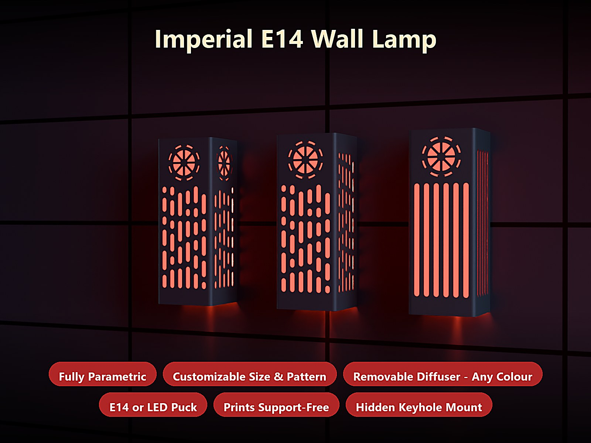
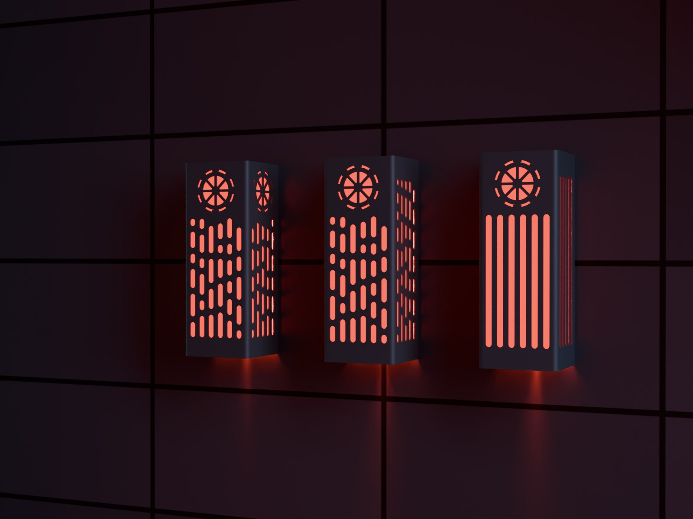
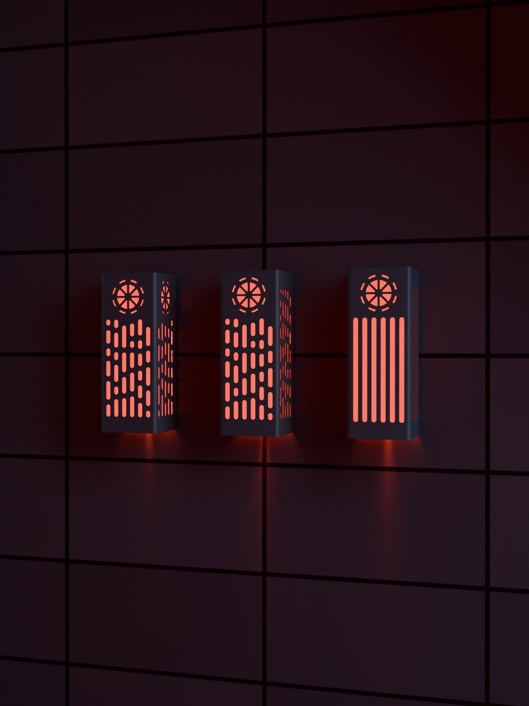
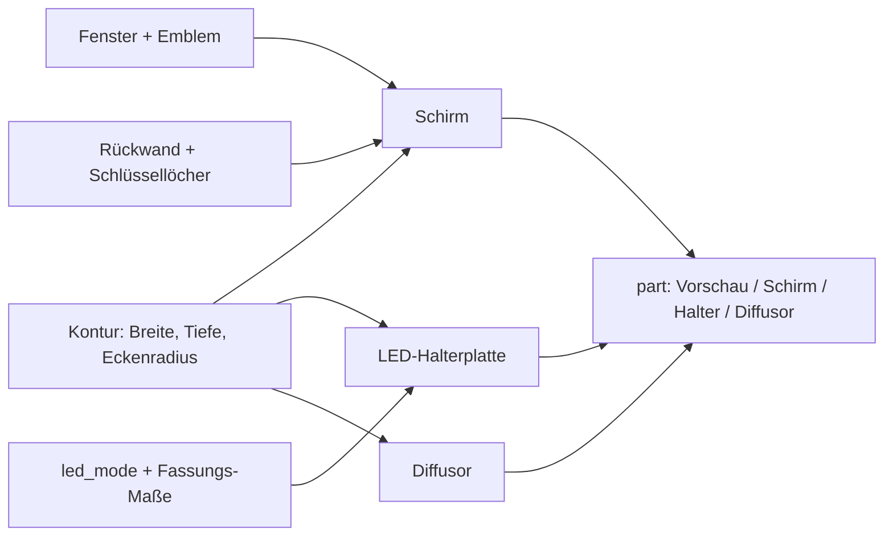
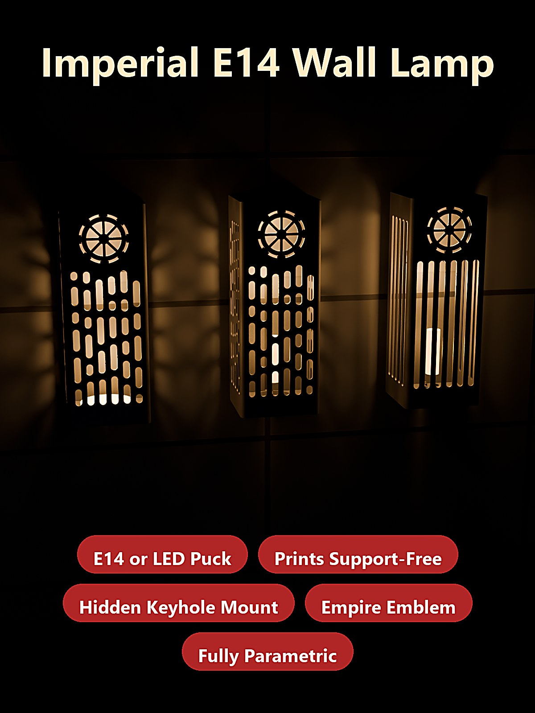

# Parametric Imperial Lamp – Wandlampe mit E14-Fassung oder LED-Puck, Schlitzfenstern und Emblem

[← Alle Modelle im Überblick](../../README.md)

Parametrische Wandlampe für den FDM-Druck im „Imperial“-Sci-Fi-Look: ein hoher,
quadratischer Halbturm mit senkrechten Schlitzfenstern und einem Zahnrad-Emblem,
dessen offene Rückseite flach an der Wand sitzt. Eine einschiebbare Halterung
nimmt wahlweise eine E14-Fassung oder den Bambu-LED-Kit-Puck auf; ein loser
Diffusor bestimmt die Leuchtfarbe. Alles stellst du im MakerWorld-Customizer
ein.

> **Das Modell mit allen Druckprofilen gibt es ausschließlich auf MakerWorld:**
> 👉 [MakerWorld-Link: https://makerworld.com/en/models/3416896-parametric-imperial-lamp](https://makerworld.com/en/models/3416896-parametric-imperial-lamp)
>
> 

> **Sicherheitshinweis 230 V:** Die E14-Varianten arbeiten mit Netzspannung.
> Den Anschluss einer 230-V-Lampenfassung darf nur eine Fachkraft nach den
> örtlichen Vorschriften ausführen. Wer das nicht sicher kann, nimmt die
> Niedervolt-Variante mit dem Bambu-LED-Kit (USB, 5 V).

Die **Parametric Imperial Lamp** ist ein Fan-Design im Look einer
Sci-Fi-Kommandostation und steht in keiner Verbindung zu den Rechteinhabern
einer entsprechenden Filmreihe. Der Schirm ist ein D-förmiger Halbturm: Front,
zwei Seitenwände und Dach, offen zur Wand und nach unten. Du stellst Höhe,
Breite, Tiefe, Fensterstil, Emblem und die Lichtquelle ein. Der Schirm druckt
mit dem Dach auf dem Bett und braucht keine Stützen.

## Inhaltsverzeichnis

- [Das Problem](#das-problem)
- [Die Idee](#die-idee)
- [Highlights](#highlights)
- [Parametrische Optionen](#parametrische-optionen)
- [Konstruktion](#konstruktion)
- [Druckempfehlungen](#druckempfehlungen)
- [Anwendungsbeispiele](#anwendungsbeispiele)
- [Fehlersuche / FAQ](#fehlersuche--faq)
- [Entwicklungsgeschichte](#entwicklungsgeschichte)
- [Downloads](#downloads)
- [Lizenz](#lizenz)

## Das Problem

Eine eigene Wandlampe zu drucken scheitert selten an der Optik, sondern an den
Details drumherum:

- Fassungen sind nicht normiert. Eine E14-Bakelit-Schraubfassung hat einen
  anderen Körper und Ring als ein kleiner E14-Konverter; ein Halter, der für
  die eine gebaut ist, passt zur anderen nicht.
- Ein Schirm mit vielen Fenstern wird dünnwandig: Brücken, Überhänge und
  Stützen verderben genau die Flächen, durch die später das Licht scheint.
- Die Aufhängung soll unsichtbar sein, aber tragen – und sie darf beim Druck
  keine Stützen verlangen.
- Das Kabel muss von der Wandseite her in die Lampe, nicht seitlich aus dem
  Schirm.
- Wer Farbe ins Licht bringen will, ändert nicht den ganzen Schirm, sondern nur
  den Diffusor – das muss konstruktiv vorgesehen sein.

## Die Idee

Der Schirm ist ein Halbturm mit offener Rückwand, der flach an der Wand sitzt.
Die Lichtquelle sitzt auf einer separaten Halterplatte, die von hinten auf
einen Absatz am Schirmboden geschoben wird. Der Diffusor ist ein drittes,
loses Teil. Alle Maße, Fenster, Emblem und Lichtquelle sind Customizer-Parameter.
Die Lampe druckt mit dem Dach nach unten, sodass Fenster senkrecht stehen und
nichts frei in der Luft hängt. Alle Maße in Millimetern.

## Highlights

- **Drei Lichtquellen:** E14-Bakelit-Schraubfassung (`e14_style = screw`),
  kleiner E14-Konverter (`e14_style = small`) oder der Bambu-LED-Kit-Puck
  (`led_mode = puck`); alternativ ohne Halterung (`led_mode = none`).
- **Vier Fensterstile:** `imperial` (Kapseln unterschiedlicher Länge), `slots`
  (gleichmäßige senkrechte Schlitze), `grid` und `none`.
- **Emblem als Speichenrad:** Das Zahnrad-Emblem lässt sich vorne und optional
  auf beiden Seitenflächen ausschneiden (`side_emblem`: `none`, `top`,
  `bottom`); Durchmesser, Stegbreite und Zähnezahl sind einstellbar.
- **Verdeckte Schlüssellochaufhängung:** Eine Teil-Rückwand am Dach trägt zwei
  Schlüssellöcher, die von vorne und von der Seite nicht zu sehen sind.
- **Kabel von hinten:** Ein Kabelkanal mit Zugentlastung führt das Kabel von der
  Wandseite zur Fassung.
- **Loser Diffusor:** Dünne U-Schale, in beliebiger Farbe druckbar und
  austauschbar.
- **Stützenfrei:** Schirm mit dem Dach auf dem Bett; der Auflagerand der
  Halterung ist eine 45°-Fase.
- **Gerundete Front:** `corner_radius` rundet die vorderen Ecken, die Rückseite
  bleibt eckig für den Wandkontakt.
- **Drei fertige Varianten** mit Bambu-Studio-Profilen für den P1S.

## Parametrische Optionen

Die Namen entsprechen den Customizer-Parametern des Modells.

### Ausgabe und Lichtquelle

| Parameter | Bedeutung | Standard | Bereich / Einheit |
|---|---|---|---|
| `part` | Ausgabe: `Preview assembled`, `Preview exploded`, `DRUCK Schirm`, `DRUCK LED-Halter`, `DRUCK Diffusor` | `Preview assembled` | Auswahl |
| `led_mode` | Lichtquelle | `e14` | `e14`, `puck`, `none` |

### Gesamtmaße

| Parameter | Bedeutung | Standard | Bereich / Einheit |
|---|---|---|---|
| `lamp_width` | Außenbreite (entlang der Wand) | 90 | 50–200 mm |
| `lamp_height` | Außenhöhe (an der Wand nach oben) | 240 | 100–320 mm |
| `lamp_depth` | Außentiefe (von der Wand weg) | 80 | 40–140 mm |
| `wall_t` | Wandstärke der Schale | 1,6 | 1,0–3,0 mm, Schritt 0,1 |
| `corner_radius` | Rundung der vorderen Ecken (0 = scharf) | 6 | 0–20 mm, Schritt 0,5 |

### Fenster

| Parameter | Bedeutung | Standard | Bereich / Einheit |
|---|---|---|---|
| `opening_style` | Fensterstil | `imperial` | `imperial`, `slots`, `grid`, `none` |
| `windows_front` | Fenster in der Front | an | an / aus |
| `windows_sides` | Fenster in den Seitenwänden | an | an / aus |
| `slot_width` | Breite eines Fensters (Kapsel) | 7 | 3–16 mm, Schritt 0,5 |
| `slot_gap_x` | Abstand zwischen Fensterspalten | 6 | 3–20 mm, Schritt 0,5 |
| `slot_gap_z` | Abstand zwischen Fensterreihen | 7 | 3–20 mm, Schritt 0,5 |
| `margin_top` | geschlossenes Band unter dem Dach (vorne wächst es für das Emblem mit) | 26 | 8–80 mm |
| `margin_bottom` | geschlossenes Band über dem Boden (Platz für die Halterung) | 24 | 8–80 mm |
| `margin_side` | geschlossener Randstreifen an den Flächenkanten | 7 | 3–30 mm |
| `side_full` | Seitenfenster reichen höher (ohne Emblem-Band der Front) | an | an / aus |

### Emblem

| Parameter | Bedeutung | Standard | Bereich / Einheit |
|---|---|---|---|
| `top_emblem` | Emblem oben in die Front schneiden | an | an / aus |
| `side_emblem` | zusätzliches Emblem auf beiden Seitenflächen | `none` | `none`, `top`, `bottom` |
| `emblem_diameter` | Durchmesser des Emblems | 52 | 20–120 mm |
| `emblem_bar` | Breite der Stege zwischen den Ausschnitten | 3,0 | 1,5–6 mm, Schritt 0,25 |
| `emblem_teeth` | Zahl der Zähne und Speichen | 8 | 6–16 |

### LED-Halterung und Fassungen

| Parameter | Bedeutung | Standard | Bereich / Einheit |
|---|---|---|---|
| `bracket_t` | Stärke der Halterplatte | 3,0 | 2–6 mm, Schritt 0,5 |
| `e14_style` | E14-Bauart: Bakelit-Schraubfassung oder kleiner Konverter | `screw` | `screw`, `small` |
| `e14_body_d` | Körperfreiraum der Schraubfassung | 28 | 20–40 mm, Schritt 0,5 |
| `e14_ring_d` | Basisring der Schraubfassung, sitzt im Kragen | 43 | 26–60 mm, Schritt 0,5 |
| `e14_center_d` | Mittelloch (M10×1-Gewinderohr bzw. Kabeldurchgang) | 10,5 | 6–16 mm, Schritt 0,5 |
| `e14_collar_h` | Höhe des Kragens, der den Basisring fasst | 5 | 0–12 mm, Schritt 0,5 |
| `e14_screw_span` | Abstand zweier Befestigungsschrauben (0 = nur Mutter auf dem M10-Rohr) | 0 | 0–50 mm, Schritt 0,5 |
| `e14_screw_d` | Vorbohrung der Befestigungsschrauben | 3,4 | 2–5 mm, Schritt 0,1 |
| `e14_small_d` | Durchmesser des kleinen Konverters (= Bohrung) | 16,5 | 12–24 mm, Schritt 0,5 |
| `e14_small_wall` | Wand des Haltedoms um den Konverter | 2,0 | 1–4 mm, Schritt 0,5 |
| `e14_small_boss` | Höhe des Haltedoms | 8 | 3–16 mm, Schritt 0,5 |
| `puck_d` | Puck-Durchmesser | 60 | 40–80 mm, Schritt 0,5 |
| `puck_h` | Puck-Höhe | 8 | 4–14 mm, Schritt 0,5 |
| `puck_screw_span` | Abstand der beiden Puck-Schrauben | 28 | 10–50 mm, Schritt 0,5 |
| `puck_screw_d` | Vorbohrung der Puck-Schrauben | 3,2 | 2–5 mm, Schritt 0,1 |
| `puck_center_d` | Mittel- bzw. Kabelloch | 7 | 3–16 mm, Schritt 0,5 |
| `cable_d` | Außendurchmesser des Netzkabels | 6,5 | 3–12 mm, Schritt 0,5 |
| `cable_strain` | Zugentlastung am Halterende | an | an / aus |

### Wandmontage

| Parameter | Bedeutung | Standard | Bereich / Einheit |
|---|---|---|---|
| `mount_keyholes` | Schlüssellöcher in der Rückwand | an | an / aus |
| `back_panel` | Teil-Rückwand am Dach über dem Montagebereich | an | an / aus |
| `back_panel_len` | Wie weit die Rückwand vom Dach nach unten reicht | 95 | 30–200 mm |
| `mount_screw_d` | Schaftdurchmesser der Wandschraube (Schlitz) | 4,2 | 3–8 mm, Schritt 0,1 |
| `mount_head_d` | Kopfdurchmesser der Wandschraube (großes Ende) | 8,5 | 5–16 mm, Schritt 0,1 |

### Vorschau-Farben und Qualität

| Parameter | Bedeutung | Standard | Bereich / Einheit |
|---|---|---|---|
| `show_warning` | rotes „NOT FOR PRINTING“-Banner in den Vorschauen | an | an / aus |
| `color_shell` | Farbe des Schirms in der Vorschau | `#2c2d33` | Farbwert |
| `color_diffuser` | Farbe des Diffusors in der Vorschau | `#f3ead2` | Farbwert |
| `color_led` | Farbe der Lichtquelle in der Vorschau | `#ffd77a` | Farbwert |
| `$fn` | Glätte der runden Flächen | 48 | 24–160, Schritt 8 |

## Konstruktion

### OpenSCAD-Ansatz

Das Modell ist reines OpenSCAD ohne externe Bibliotheken und läuft im
MakerWorld-Customizer. Ein `part`-Selektor gibt Vorschau (zusammengebaut oder
auseinandergezogen), Schirm, Halterung oder Diffusor aus. Alle Teile entstehen
aus derselben 2D-Kontur und passen deshalb zusammen: Wenn du Breite, Tiefe
oder Eckenradius änderst, rechnen sich Schirm, Halterplatte und Diffusor mit.

### Parametrische Logik

| Größe | Formel / Regel |
|---|---|
| Kontur | Rechteck mit zwei gerundeten Vorderecken (Radius `corner_radius`, begrenzt auf Breite/2 − 1 und Tiefe − 1); Rückseite eckig |
| Innenraum | Kontur um `wall_t` nach innen versetzt; Dach bleibt geschlossen, Rückwand und Boden sind offen |
| Auflagerand der Halterung | Absatz 3 mm über dem Boden, 2 mm hoch, 3 mm breit; die Oberseite ist eine 45°-Fase aus 0,2-mm-Stufen |
| Halterplatte | Kontur um `wall_t` + 0,3 mm Spiel nach innen versetzt, Stärke `bracket_t` |
| Diffusor | U-Schale, Wand 1,0 mm, Abstand zum Absatz 0,4 mm, 2 mm unter dem Dach |
| Emblem | Durchmesser = min(`emblem_diameter`, Frontbreite − 2 × `margin_side` − 2 × `wall_t`); oberes Band = max(`margin_top`, Durchmesser + 16 mm + `wall_t`) |
| Fensterspalten | Anzahl = ⌊(Nutzbreite + `slot_gap_x`) / (`slot_width` + `slot_gap_x`)⌋; die Spalten werden mittig angeordnet |
| Schlüsselloch | Kopfloch und Schaftloch plus 9 mm Schlitz, bei ±28 % der Innenbreite, 24 mm über der Unterkante der Rückwand |

Mit den Voreinstellungen (90 × 240 × 80 mm, Wand 1,6 mm) ergeben sich:
Innenbreite 86,8 mm, Emblem-Durchmesser 52 mm, oberes Frontband ca. 69,6 mm,
sechs Fensterspalten vorne und fünf an jeder Seite, Diffusorhöhe ca. 228 mm.

Die Werte sind aus den Formeln und den Standardwerten abgeleitet.

### Besondere Algorithmen

- **Innenraum folgt der Kontur:** Der Hohlraum wird aus der nach innen
  versetzten Außenkontur erzeugt, nicht aus einem Quader. Ein eckiger Hohlraum
  würde in den gerundeten Ecken diagonal über die Außenwand ragen, die Wand
  dort auf nahezu null verdünnen und einen Spalt öffnen, durch den das Licht
  des Diffusors scheint.
- **Auflagerand ohne Stützen:** Der Absatz für die Halterplatte besteht aus
  gestapelten dünnen Scheiben (Höhe 0,2 mm, jeweils 0,2 mm schmaler). Das ergibt
  eine 45°-Fase, die mit dem Dach nach unten ohne Stütze druckt. Der hintere Teil
  des Absatzes fehlt, damit die Halterplatte von hinten einschiebbar ist.
- **Fenster als Kapseln:** Jedes Fenster ist eine Kapsel (Hülle aus zwei
  Kreisen). Der Stil `imperial` füllt jede Spalte mit Kapseln zufälliger Länge
  (10 bis 34 mm). Die „Zufallszahl“ stammt aus einer deterministischen
  Sinus-Hash-Funktion pro Spalte, deshalb sieht dieselbe Einstellung bei jedem
  Rendern gleich aus.
- **Emblem ohne Punktkontakte:** Das Emblem ist eine Scheibe, von der ein
  massives Speichenrad abgezogen wird – Zahnkranz, Nabe und Speichen mit
  Überlappung. Die Lücken leuchten. Das Design vermeidet Stellen, an denen sich
  Zähne oder Sterne nur tangential berühren, weil daraus nicht-manifolde
  Geometrie entsteht.
- **Emblem-Band wächst mit:** Die geschlossene Zone oben passt sich der
  Emblemgröße an, damit das Emblem weder das Dach noch die Fenster berührt.
  Bei Seitenemblems rechnet das Modell die Fenstergrenzen der Seiten
  entsprechend um.
- **Teil-Rückwand als Aufhängung:** Eine Rückwand am Dach trägt die beiden
  Schlüssellöcher. Beim Druck mit dem Dach unten ist sie eine senkrechte Wand
  nahe am Bett – ohne Stützen und von Seite und Front verdeckt.
- **Kabelweg:** Ein Kanal in der Halterplatte führt von der Wandseite zur
  Fassung; zwei Zapfen bilden die Zugentlastung.
- **Diffusor als Offset:** Der Diffusor ist die Kontur, um Wand, Absatzbreite und
  Spiel nach innen versetzt, mit offener Rückseite. Er wird von unten
  hochgeschoben, die Halterung von hinten untergeschoben, dann sinkt er auf die
  Platte.

### Modularität

Der Code trennt Kontur, Schale, Auflagerand, Rückwand und Schlüsselloch,
Fensterfeld (drei Stile), Emblem, Halterplatte (drei Lichtquellen), Diffusor
und Vorschau. Die Fassungsmaße sind getrennte Parameter, damit sich die
Halterung an die eigene Hardware anpassen lässt.

### Druckoptimierungen

- **Schirm mit dem Dach auf dem Bett:** Mund oben, Fenster senkrecht,
  keine Brücken.
- **45°-Fase am Auflagerand:** keine Überhänge, keine Stützen.
- **Keine Punktkontakte** im Emblem, kein Eckspalt im Innenraum.
- **Halterplatte flach, Diffusor stehend:** beide ohne Stützen.
- **Fensterbreite 7 mm:** liegt unter der üblichen Brückengrenze von ca. 10 mm.

## Druckempfehlungen

Die Profile sind für **Bambu Lab P1S** mit PLA gebaut (0,20 mm Layerhöhe,
Gyroid 15 %) und im Bambu Studio testgeslict. Der Schirm ist 240 mm hoch und
passt damit auf die 256-mm-Bauplatte von P1S und P2S.

| Einstellung | Empfehlung |
|---|---|
| Material Schirm | PLA, dunkel (Anthrazit) |
| Material Diffusor | transluzent oder hell (z. B. rotes PETG) |
| Layerhöhe | 0,20 mm |
| Wände | 2–3 Perimeter |
| Infill | 0 % oder Gyroid 15 % (dünne, leuchtende Wände) |
| Supports | keine |
| Ausrichtung | Schirm mit dem Dach auf dem Bett (`DRUCK Schirm`), Halterung flach, Diffusor stehend |

**Besondere Hinweise**

- **Drei Objekte pro Variante:** Schirm, LED-Halter und Diffusor. Im Slicer
  bekommt jedes Objekt ein eigenes Filament.
- **Diffusor:** dünne U-Schale mit 1 mm Wand, ca. 228 mm hoch. Stehend drucken,
  2 Perimeter, 0 % Infill; ein Brim ist optional.
- **Leuchtwirkung:** Das Licht tritt durch Fenster und Emblem; eine dünne Wand
  (1,2–1,6 mm) schimmert zusätzlich durch.
- **Lichtquelle:** Vorgesehen sind LED-Leuchtmittel; die Fassungsmaße beziehen
  sich auf eine kleine E14-LED mit Ø 15,4 mm × 52,7 mm. PLA erweicht ab etwa
  50–60 °C, deshalb keine Glüh- oder Halogenlampen verwenden.
- **Eigene Hardware messen:** Fassungsmaße unterscheiden sich je nach Hersteller;
  die `e14_*`- und `puck_*`-Parameter passen die Halterung an.

**Einkaufsliste (nicht gedruckt)**

| Lichtquelle | Benötigt | Spannung |
|---|---|---|
| E14-Bakelit-Schraubfassung (`imperial-e14`) | Fassung (Körper ca. 28 mm, Ring ca. 43 mm, M10×1-Mitte) mit M10-Mutter, kleine E14-LED (max. 16 mm Durchmesser, ca. 53 mm lang), Netzkabel mit Stecker und Zugentlastung | 230 V |
| Kleiner E14-Konverter (`slots-e14-small`) | kompakte E14-Adapterfassung (Zylinder ca. 16,5 mm) mit Kabel, kleine E14-LED, Netzkabel mit Stecker | 230 V |
| Bambu-LED-Kit-Puck (`imperial-sides-puck`) | LED-Kit (Puck 60 × 8 mm, zwei Schrauben 28 mm Abstand), zwei BT3-Schneidschrauben, USB-5-V-Netzteil | 5 V |
| Wandmontage (alle) | zwei Wandschrauben (Schaft ca. 4 mm, Kopf bis ca. 8 mm) mit passenden Dübeln | – |

**Zusammenbau**

1. Schirm (Dach unten), LED-Halter (flach) und Diffusor drucken.
2. Lichtquelle in den Halter setzen: Schraubfassung mit der M10-Mutter im
   Kragen fixieren, kleinen Konverter in den Dom pressen oder den Puck mit zwei
   Schrauben im Ring befestigen.
3. Kabel von der Wandseite durch den Kabelkanal führen und in die Zugentlastung
   drücken.
4. Diffusor von unten in den Schirm schieben und etwa 2 mm anheben.
5. Halter von hinten entlang des Absatzes unter den Diffusor schieben, bis er
   vorne anliegt; den Diffusor auf die Halterplatte sinken lassen.
6. Zwei Schrauben in die Wand setzen und den Schirm an den Schlüssellöchern
   einhängen, dann nach unten ziehen.
7. Lampe testen, bevor Kabelwege geschlossen werden.

Für eine andere Leuchtfarbe ziehst du den Halter heraus, nimmst den Diffusor nach
unten heraus und setzt einen anderen ein.

## Anwendungsbeispiele

- **Flur und Treppenhaus:** Eine Reihe gleicher Lampen im Abstand, jede mit
  eigenem Muster.
- **Gaming- und Medienzimmer:** Ein Sci-Fi-Look mit rot oder violett
  leuchtendem Diffusor.
- **Werkstatt und Hobbykeller:** Niedervolt-Variante mit LED-Puck ohne
  Netzspannungs-Arbeit.
- **Homelab und Serverraum:** Dezente Wandbeleuchtung in der Größe, die zum
  Rack passt (Höhe und Breite im Customizer).
- **Mehrfarbiges Set:** Dieselben Schirme mit verschiedenen Diffusoren – Farbe
  wechseln heißt nur den Diffusor tauschen.
- **Eigenes Emblem-Layout:** Emblem vorne, an den Seiten oder gar nicht.
- **Fenstermuster-Studien:** `imperial`, `slots` und `grid` in einer Reihe
  testen, bevor eine Serie gedruckt wird.

## Fehlersuche / FAQ

| Symptom | Ursache | Fix |
|---|---|---|
| Fassung passt nicht in den Halter | Fassungsmaße weichen von den Voreinstellungen ab | `e14_body_d`, `e14_ring_d`, `e14_center_d` nachmessen und anpassen |
| Kleiner Konverter sitzt locker oder zu stramm | Bohrung passt nicht zum Zylinder | `e14_small_d` anpassen |
| Puck passt nicht in den Ring | Puckmaße oder Schraubabstand abweichend | `puck_d`, `puck_h`, `puck_screw_span` prüfen |
| Das Kabel passt nicht durch den Kanal | Kabel dicker als eingestellt | `cable_d` erhöhen |
| Emblem wirkt zu klein | Frontbreite begrenzt den Durchmesser | `lamp_width` erhöhen oder `margin_side` verkleinern |
| Zu wenige Fenster | Nutzbreite oder -höhe zu klein | `slot_gap_x`/`slot_gap_z` verkleinern oder Ränder (`margin_*`) senken |
| Seitenwände haben keine Fenster | Seitenfenster abgeschaltet | `windows_sides` einschalten |
| Halter lässt sich nicht einschieben | Die Platte hat nur 0,3 mm Spiel, der Druck fällt etwas größer aus | Kanten und Elefantenfuß der Platte entgraten |
| Der Schirm druckt nicht auf die Platte | Höhe über 256 mm | `lamp_height` verringern oder größeren Drucker nutzen |
| Vorschau zeigt „NOT FOR PRINTING“ | Vorschau-Modus aktiv | `part` auf `DRUCK Schirm`, `DRUCK LED-Halter` oder `DRUCK Diffusor` setzen |

## Entwicklungsgeschichte

Die ersten Dateien des Modells stammen vom 2. Oktober 2026: ein Referenzbild
einer Tischlampe im selben Look (nur zur Größenorientierung), Messskripte und
erste Szenen. Das eigene Modell ist ein D-förmiger Halbturm für die Wand. Im
Lauf der Arbeit ersetzte eine Teil-Rückwand mit Schlüssellöchern die
ursprünglich freischwebenden Aufnahmen, der Hohlraum bekam die Außenkontur
statt eines Quaders (wegen des Eckspalts) und das Emblem wurde zum massiven
Speichenrad (wegen nicht-manifolder Punktkontakte). Bis zum 9. Oktober 2026
entstanden die drei Referenzvarianten mit je drei Objekten (Schirm, Halter,
Diffusor), die Profile für den P1S und die Titelbilder.

Die Bilder in diesem Repository sind Renderings der Modellgeometrie
beziehungsweise daraus abgeleitete Szenenbilder; Druckfotos sind nicht dabei.

## Downloads

Print files are intentionally available exclusively on MakerWorld.

👉 MakerWorld-Link: https://makerworld.com/en/models/3416896-parametric-imperial-lamp

Profil: <https://makerworld.com/en/@BetaHydri>

## Lizenz

Dokumentation und Bilder in diesem Repository: © BetaHydri. Das Modell (inkl.
Quellcode) und alle Druckdateien werden ausschließlich über MakerWorld unter
der dort angegebenen Lizenz verteilt. Dieses Repository enthält bewusst keine
Modell-, Quellcode- oder Druckdateien.
