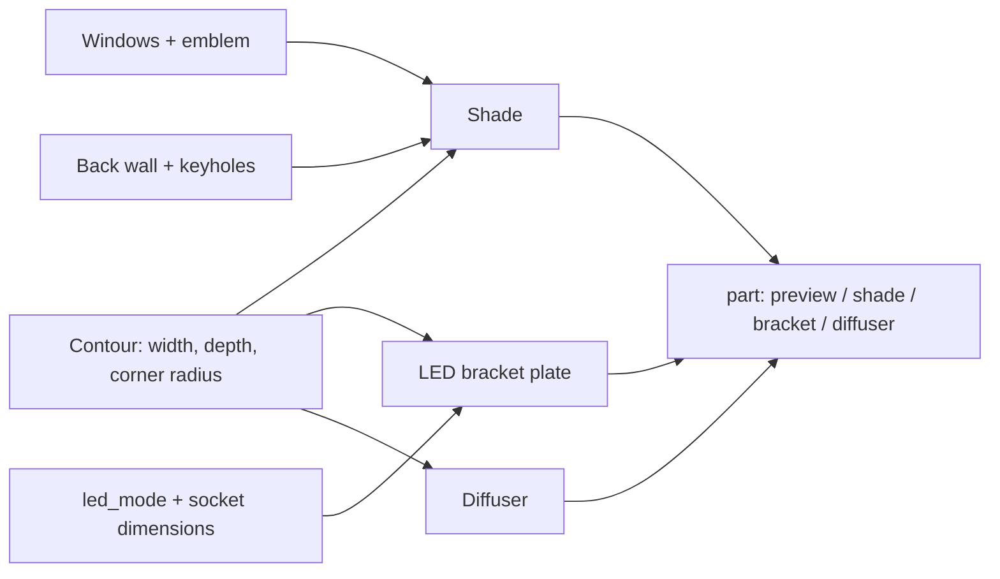

# Parametric Imperial Lamp – Wall Lamp with E14 Socket or LED Puck, Slotted Windows and Emblem

[← All models](../../README.md)

🌐 **English** | [Deutsch](README.de.md)

Parametric wall lamp for FDM printing in an "Imperial" sci-fi look: a tall,
square half-tower with vertical slotted windows and a gear emblem, whose open
back sits flat against the wall. A slide-in bracket holds either an E14 socket
or the Bambu LED kit puck; a loose diffuser determines the light colour. You set
everything in the MakerWorld Customizer.

> **The model with all print profiles is available exclusively on MakerWorld:**
> 👉 [MakerWorld link: https://makerworld.com/en/models/3416896-parametric-imperial-lamp](https://makerworld.com/en/models/3416896-parametric-imperial-lamp)
>
> 

> **230 V safety notice:** The E14 variants operate on mains voltage. The
> connection of a 230 V lamp socket may only be carried out by a qualified
> electrician in accordance with local regulations. If you cannot do this
> safely, use the low-voltage variant with the Bambu LED kit (USB, 5 V).

The **Parametric Imperial Lamp** is a fan design in the look of a sci-fi command
station and is not affiliated with the rights holders of any corresponding film
series. The shade is a D-shaped half-tower: front, two side walls and roof, open
to the wall and downwards. You set the height, width, depth, window style,
emblem and the light source. The shade prints with the roof on the bed and needs
no supports.

## Table of Contents

- [The Problem](#the-problem)
- [The Idea](#the-idea)
- [Highlights](#highlights)
- [Parametric Options](#parametric-options)
- [Design](#design)
- [Print Recommendations](#print-recommendations)
- [Use Cases](#use-cases)
- [Troubleshooting / FAQ](#troubleshooting--faq)
- [Development History](#development-history)
- [Downloads](#downloads)
- [License](#license)

## The Problem

Printing your own wall lamp rarely fails because of the looks, but because of the
details around it:

- Sockets are not standardised. A Bakelite E14 screw socket has a different body
  and ring than a small E14 converter; a holder built for one does not fit the
  other.
- A shade with many windows becomes thin-walled: bridges, overhangs and supports
  ruin exactly the surfaces the light later shines through.
- The suspension should be invisible but load-bearing – and it must not require
  supports when printing.
- The cable has to enter the lamp from the wall side, not from the side of the
  shade.
- Anyone who wants to add colour to the light does not change the whole shade,
  only the diffuser – this has to be provided for in the design.

## The Idea

The shade is a half-tower with an open back wall that sits flat against the
wall. The light source sits on a separate bracket plate that is slid from behind
onto a ledge at the bottom of the shade. The diffuser is a third, loose part.
All dimensions, windows, emblem and light source are Customizer parameters. The
lamp prints with the roof facing down, so the windows stand vertically and
nothing hangs freely in the air. All dimensions in millimetres.

## Highlights

- **Three light sources:** Bakelite E14 screw socket (`e14_style = screw`), small
  E14 converter (`e14_style = small`) or the Bambu LED kit puck
  (`led_mode = puck`); alternatively without a bracket (`led_mode = none`).
- **Four window styles:** `imperial` (capsules of different lengths), `slots`
  (even vertical slots), `grid` and `none`.
- **Emblem as a spoked wheel:** The gear emblem can be cut out at the front and
  optionally on both side faces (`side_emblem`: `none`, `top`, `bottom`);
  diameter, bar width and number of teeth are adjustable.
- **Concealed keyhole mounting:** A partial back wall at the roof carries two
  keyholes that cannot be seen from the front or the side.
- **Cable from behind:** A cable channel with strain relief guides the cable
  from the wall side to the socket.
- **Loose diffuser:** Thin U-shell, printable in any colour and replaceable.
- **Support-free:** Shade with the roof on the bed; the bearing edge of the
  bracket is a 45° chamfer.
- **Rounded front:** `corner_radius` rounds the front corners; the back stays
  square for contact with the wall.
- **Three ready-made variants** with Bambu Studio profiles for the P1S.

## Parametric Options

The names correspond to the model's Customizer parameters.

### Output and Light Source

| Parameter | Meaning | Default | Range / Unit |
|---|---|---|---|
| `part` | Output: `Preview assembled`, `Preview exploded`, `DRUCK Schirm`, `DRUCK LED-Halter`, `DRUCK Diffusor` | `Preview assembled` | Selection |
| `led_mode` | Light source | `e14` | `e14`, `puck`, `none` |

### Overall Dimensions

| Parameter | Meaning | Default | Range / Unit |
|---|---|---|---|
| `lamp_width` | Outer width (along the wall) | 90 | 50–200 mm |
| `lamp_height` | Outer height (upwards on the wall) | 240 | 100–320 mm |
| `lamp_depth` | Outer depth (away from the wall) | 80 | 40–140 mm |
| `wall_t` | Wall thickness of the shell | 1.6 | 1.0–3.0 mm, step 0.1 |
| `corner_radius` | Rounding of the front corners (0 = sharp) | 6 | 0–20 mm, step 0.5 |

### Windows

| Parameter | Meaning | Default | Range / Unit |
|---|---|---|---|
| `opening_style` | Window style | `imperial` | `imperial`, `slots`, `grid`, `none` |
| `windows_front` | Windows in the front | on | on / off |
| `windows_sides` | Windows in the side walls | on | on / off |
| `slot_width` | Width of one window (capsule) | 7 | 3–16 mm, step 0.5 |
| `slot_gap_x` | Spacing between window columns | 6 | 3–20 mm, step 0.5 |
| `slot_gap_z` | Spacing between window rows | 7 | 3–20 mm, step 0.5 |
| `margin_top` | Closed band below the roof (at the front it grows to make room for the emblem) | 26 | 8–80 mm |
| `margin_bottom` | Closed band above the floor (room for the bracket) | 24 | 8–80 mm |
| `margin_side` | Closed edge strip at the face edges | 7 | 3–30 mm |
| `side_full` | Side windows extend higher (without the front's emblem band) | on | on / off |

### Emblem

| Parameter | Meaning | Default | Range / Unit |
|---|---|---|---|
| `top_emblem` | Cut the emblem into the top of the front | on | on / off |
| `side_emblem` | Additional emblem on both side faces | `none` | `none`, `top`, `bottom` |
| `emblem_diameter` | Diameter of the emblem | 52 | 20–120 mm |
| `emblem_bar` | Width of the bars between the cutouts | 3.0 | 1.5–6 mm, step 0.25 |
| `emblem_teeth` | Number of teeth and spokes | 8 | 6–16 |

### LED Bracket and Sockets

| Parameter | Meaning | Default | Range / Unit |
|---|---|---|---|
| `bracket_t` | Thickness of the bracket plate | 3.0 | 2–6 mm, step 0.5 |
| `e14_style` | E14 type: Bakelite screw socket or small converter | `screw` | `screw`, `small` |
| `e14_body_d` | Body clearance of the screw socket | 28 | 20–40 mm, step 0.5 |
| `e14_ring_d` | Base ring of the screw socket, sits in the collar | 43 | 26–60 mm, step 0.5 |
| `e14_center_d` | Centre hole (M10×1 threaded tube or cable passage) | 10.5 | 6–16 mm, step 0.5 |
| `e14_collar_h` | Height of the collar that holds the base ring | 5 | 0–12 mm, step 0.5 |
| `e14_screw_span` | Distance between two fixing screws (0 = nut on the M10 tube only) | 0 | 0–50 mm, step 0.5 |
| `e14_screw_d` | Pilot hole of the fixing screws | 3.4 | 2–5 mm, step 0.1 |
| `e14_small_d` | Diameter of the small converter (= bore) | 16.5 | 12–24 mm, step 0.5 |
| `e14_small_wall` | Wall of the retaining dome around the converter | 2.0 | 1–4 mm, step 0.5 |
| `e14_small_boss` | Height of the retaining dome | 8 | 3–16 mm, step 0.5 |
| `puck_d` | Puck diameter | 60 | 40–80 mm, step 0.5 |
| `puck_h` | Puck height | 8 | 4–14 mm, step 0.5 |
| `puck_screw_span` | Distance between the two puck screws | 28 | 10–50 mm, step 0.5 |
| `puck_screw_d` | Pilot hole of the puck screws | 3.2 | 2–5 mm, step 0.1 |
| `puck_center_d` | Centre or cable hole | 7 | 3–16 mm, step 0.5 |
| `cable_d` | Outer diameter of the mains cable | 6.5 | 3–12 mm, step 0.5 |
| `cable_strain` | Strain relief at the bracket end | on | on / off |

### Wall Mounting

| Parameter | Meaning | Default | Range / Unit |
|---|---|---|---|
| `mount_keyholes` | Keyholes in the back wall | on | on / off |
| `back_panel` | Partial back wall at the roof above the mounting area | on | on / off |
| `back_panel_len` | How far the back wall extends down from the roof | 95 | 30–200 mm |
| `mount_screw_d` | Shank diameter of the wall screw (slot) | 4.2 | 3–8 mm, step 0.1 |
| `mount_head_d` | Head diameter of the wall screw (large end) | 8.5 | 5–16 mm, step 0.1 |

### Preview Colours and Quality

| Parameter | Meaning | Default | Range / Unit |
|---|---|---|---|
| `show_warning` | Red "NOT FOR PRINTING" banner in the previews | on | on / off |
| `color_shell` | Colour of the shade in the preview | `#2c2d33` | Colour value |
| `color_diffuser` | Colour of the diffuser in the preview | `#f3ead2` | Colour value |
| `color_led` | Colour of the light source in the preview | `#ffd77a` | Colour value |
| `$fn` | Smoothness of the round surfaces | 48 | 24–160, step 8 |

## Design

### OpenSCAD Approach

The model is pure OpenSCAD without external libraries and runs in the
MakerWorld Customizer. A `part` selector outputs the preview (assembled or
exploded), shade, bracket or diffuser. All parts are created from the same 2D
contour and therefore fit together: if you change the width, depth or corner
radius, the shade, bracket plate and diffuser are recalculated along with it.

### Parametric Logic

| Quantity | Formula / Rule |
|---|---|
| Contour | Rectangle with two rounded front corners (radius `corner_radius`, limited to width/2 − 1 and depth − 1); back square |
| Interior | Contour offset inwards by `wall_t`; roof stays closed, back wall and floor are open |
| Bearing edge of the bracket | Ledge 3 mm above the floor, 2 mm high, 3 mm wide; the top is a 45° chamfer made of 0.2 mm steps |
| Bracket plate | Contour offset inwards by `wall_t` + 0.3 mm clearance, thickness `bracket_t` |
| Diffuser | U-shell, wall 1.0 mm, distance to the ledge 0.4 mm, 2 mm below the roof |
| Emblem | Diameter = min(`emblem_diameter`, front width − 2 × `margin_side` − 2 × `wall_t`); upper band = max(`margin_top`, diameter + 16 mm + `wall_t`) |
| Window columns | Count = ⌊(usable width + `slot_gap_x`) / (`slot_width` + `slot_gap_x`)⌋; the columns are arranged centred |
| Keyhole | Head hole and shank hole plus 9 mm slot, at ±28 % of the interior width, 24 mm above the lower edge of the back wall |

With the default settings (90 × 240 × 80 mm, wall 1.6 mm) this gives: interior
width 86.8 mm, emblem diameter 52 mm, upper front band approx. 69.6 mm, six
window columns at the front and five on each side, diffuser height approx.
228 mm.

The values are derived from the formulas and the default values.

### Special Algorithms

- **Interior follows the contour:** The cavity is created from the inward-offset
  outer contour, not from a cuboid. A square cavity would protrude diagonally
  across the outer wall in the rounded corners, thin the wall there to almost
  zero and open a gap through which the light of the diffuser shines.
- **Bearing edge without supports:** The ledge for the bracket plate consists of
  stacked thin discs (0.2 mm high, each 0.2 mm narrower). This gives a 45°
  chamfer that prints without support with the roof facing down. The rear part of
  the ledge is missing so that the bracket plate can be slid in from behind.
- **Windows as capsules:** Each window is a capsule (hull of two circles). The
  `imperial` style fills each column with capsules of random length (10 to
  34 mm). The "random number" comes from a deterministic sine-hash function per
  column, so the same setting looks identical on every render.
- **Emblem without point contacts:** The emblem is a disc from which a solid
  spoked wheel is subtracted – ring gear, hub and spokes with overlap. The gaps
  glow. The design avoids places where teeth or stars touch only tangentially,
  because this produces non-manifold geometry.
- **Emblem band grows with it:** The closed zone at the top adapts to the emblem
  size so that the emblem touches neither the roof nor the windows. With side
  emblems, the model recalculates the window limits of the sides accordingly.
- **Partial back wall as suspension:** A back wall at the roof carries the two
  keyholes. When printing with the roof down, it is a vertical wall close to the
  bed – without supports and hidden from the side and front.
- **Cable path:** A channel in the bracket plate leads from the wall side to the
  socket; two pegs form the strain relief.
- **Diffuser as an offset:** The diffuser is the contour offset inwards by the
  wall, ledge width and clearance, with an open back. It is pushed up from below,
  the bracket is slid in from behind underneath, then it sinks onto the plate.

### Modularity

The code separates the contour, shell, bearing edge, back wall and keyhole,
window field (three styles), emblem, bracket plate (three light sources),
diffuser and preview. The socket dimensions are separate parameters so that the
bracket can be adapted to your own hardware.

### Print Optimisations

- **Shade with the roof on the bed:** Mouth up, windows vertical, no bridges.
- **45° chamfer on the bearing edge:** no overhangs, no supports.
- **No point contacts** in the emblem, no corner gap in the interior.
- **Bracket plate flat, diffuser upright:** both without supports.
- **Window width 7 mm:** below the usual bridging limit of approx. 10 mm.

## Print Recommendations

The profiles are built for the **Bambu Lab P1S** with PLA (0.20 mm layer height,
gyroid 15 %) and test-sliced in Bambu Studio. The shade is 240 mm tall and thus
fits on the 256 mm build plate of the P1S and P2S.

| Setting | Recommendation |
|---|---|
| Shade material | PLA, dark (anthracite) |
| Diffuser material | translucent or light (e.g. red PETG) |
| Layer height | 0.20 mm |
| Walls | 2–3 perimeters |
| Infill | 0 % or gyroid 15 % (thin, glowing walls) |
| Supports | none |
| Orientation | Shade with the roof on the bed (`DRUCK Schirm`), bracket flat, diffuser upright |

**Special notes**

- **Three objects per variant:** shade, LED bracket and diffuser. In the slicer,
  each object gets its own filament.
- **Diffuser:** thin U-shell with a 1 mm wall, approx. 228 mm tall. Print it
  upright, 2 perimeters, 0 % infill; a brim is optional.
- **Lighting effect:** The light passes through windows and emblem; a thin wall
  (1.2–1.6 mm) additionally glimmers through.
- **Light source:** LED bulbs are intended; the socket dimensions refer to a
  small E14 LED with Ø 15.4 mm × 52.7 mm. PLA softens from around 50–60 °C, so do
  not use incandescent or halogen lamps.
- **Measure your own hardware:** Socket dimensions differ by manufacturer; the
  `e14_*` and `puck_*` parameters adapt the bracket.

**Shopping list (not printed)**

| Light source | Required | Voltage |
|---|---|---|
| Bakelite E14 screw socket (`imperial-e14`) | Socket (body approx. 28 mm, ring approx. 43 mm, M10×1 centre) with M10 nut, small E14 LED (max. 16 mm diameter, approx. 53 mm long), mains cable with plug and strain relief | 230 V |
| Small E14 converter (`slots-e14-small`) | compact E14 adapter socket (cylinder approx. 16.5 mm) with cable, small E14 LED, mains cable with plug | 230 V |
| Bambu LED kit puck (`imperial-sides-puck`) | LED kit (puck 60 × 8 mm, two screws 28 mm apart), two BT3 thread-cutting screws, USB 5 V power supply | 5 V |
| Wall mounting (all) | two wall screws (shank approx. 4 mm, head up to approx. 8 mm) with suitable wall plugs | – |

**Assembly**

1. Print the shade (roof down), LED bracket (flat) and diffuser.
2. Insert the light source into the bracket: fix the screw socket in the collar
   with the M10 nut, press the small converter into the dome, or fasten the puck
   in the ring with two screws.
3. Route the cable from the wall side through the cable channel and press it
   into the strain relief.
4. Slide the diffuser into the shade from below and raise it by about 2 mm.
5. Slide the bracket in from behind along the ledge under the diffuser until it
   rests against the front; let the diffuser sink onto the bracket plate.
6. Put two screws into the wall and hang the shade on the keyholes, then pull it
   downwards.
7. Test the lamp before closing off the cable routes.

For a different light colour, pull out the bracket, take the diffuser out
downwards and insert another one.

## Use Cases

- **Hallway and stairwell:** A row of identical lamps at intervals, each with its
  own pattern.
- **Gaming and media room:** A sci-fi look with a red or violet glowing
  diffuser.
- **Workshop and hobby basement:** Low-voltage variant with LED puck without
  mains-voltage work.
- **Homelab and server room:** Discreet wall lighting in the size that suits the
  rack (height and width in the Customizer).
- **Multicolour set:** The same shades with different diffusers – changing colour
  only means swapping the diffuser.
- **Custom emblem layout:** Emblem at the front, on the sides or not at all.
- **Window pattern studies:** Test `imperial`, `slots` and `grid` in a row before
  printing a series.

## Troubleshooting / FAQ

| Symptom | Cause | Fix |
|---|---|---|
| Socket does not fit in the bracket | Socket dimensions differ from the defaults | Re-measure and adjust `e14_body_d`, `e14_ring_d`, `e14_center_d` |
| Small converter sits loose or too tight | Bore does not match the cylinder | Adjust `e14_small_d` |
| Puck does not fit in the ring | Puck dimensions or screw spacing differ | Check `puck_d`, `puck_h`, `puck_screw_span` |
| The cable does not fit through the channel | Cable thicker than set | Increase `cable_d` |
| Emblem looks too small | Front width limits the diameter | Increase `lamp_width` or decrease `margin_side` |
| Too few windows | Usable width or height too small | Decrease `slot_gap_x`/`slot_gap_z` or reduce the margins (`margin_*`) |
| Side walls have no windows | Side windows turned off | Turn on `windows_sides` |
| Bracket cannot be slid in | The plate has only 0.3 mm clearance, the print comes out slightly larger | Deburr the edges and elephant's foot of the plate |
| The shade does not fit on the plate | Height over 256 mm | Decrease `lamp_height` or use a larger printer |
| Preview shows "NOT FOR PRINTING" | Preview mode active | Set `part` to `DRUCK Schirm`, `DRUCK LED-Halter` or `DRUCK Diffusor` |

## Development History

The model's first files date from 2 October 2026: a reference image of a table
lamp in the same look (for size orientation only), measuring scripts and first
scenes. The model itself is a D-shaped half-tower for the wall. In the course of
the work, a partial back wall with keyholes replaced the originally free-floating
mounts, the cavity was given the outer contour instead of a cuboid (because of
the corner gap), and the emblem became a solid spoked wheel (because of
non-manifold point contacts). By 9 October 2026, the three reference variants
with three objects each (shade, bracket, diffuser), the profiles for the P1S and
the cover images were created.

The images in this repository are renderings of the model geometry or scene
images derived from it; no photos of prints are included.

## Downloads

Print files are intentionally available exclusively on MakerWorld.

👉 MakerWorld link: https://makerworld.com/en/models/3416896-parametric-imperial-lamp

Profile: <https://makerworld.com/en/@BetaHydri>

## License

Documentation and images in this repository: © BetaHydri. The model (including
source code) and all print files are distributed exclusively via MakerWorld
under the license stated there. This repository deliberately contains no model,
source code or print files.
