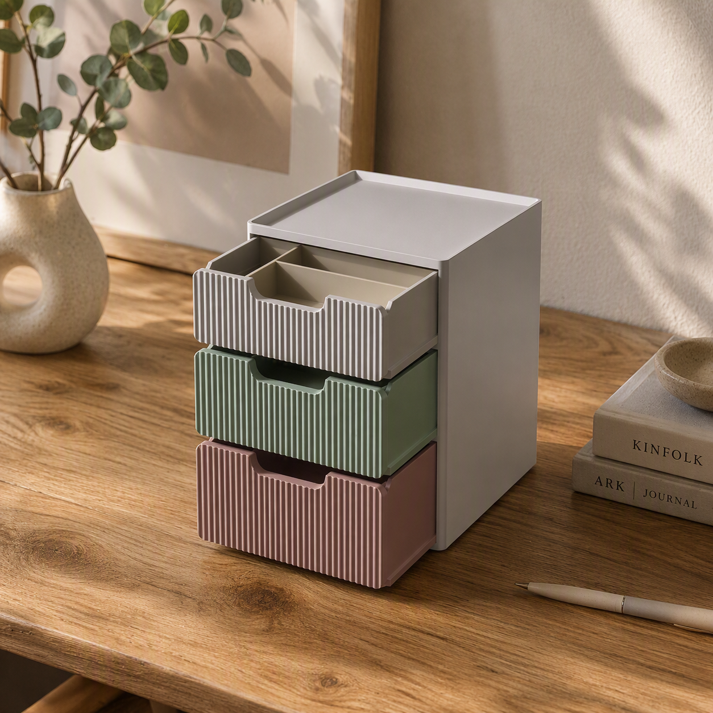
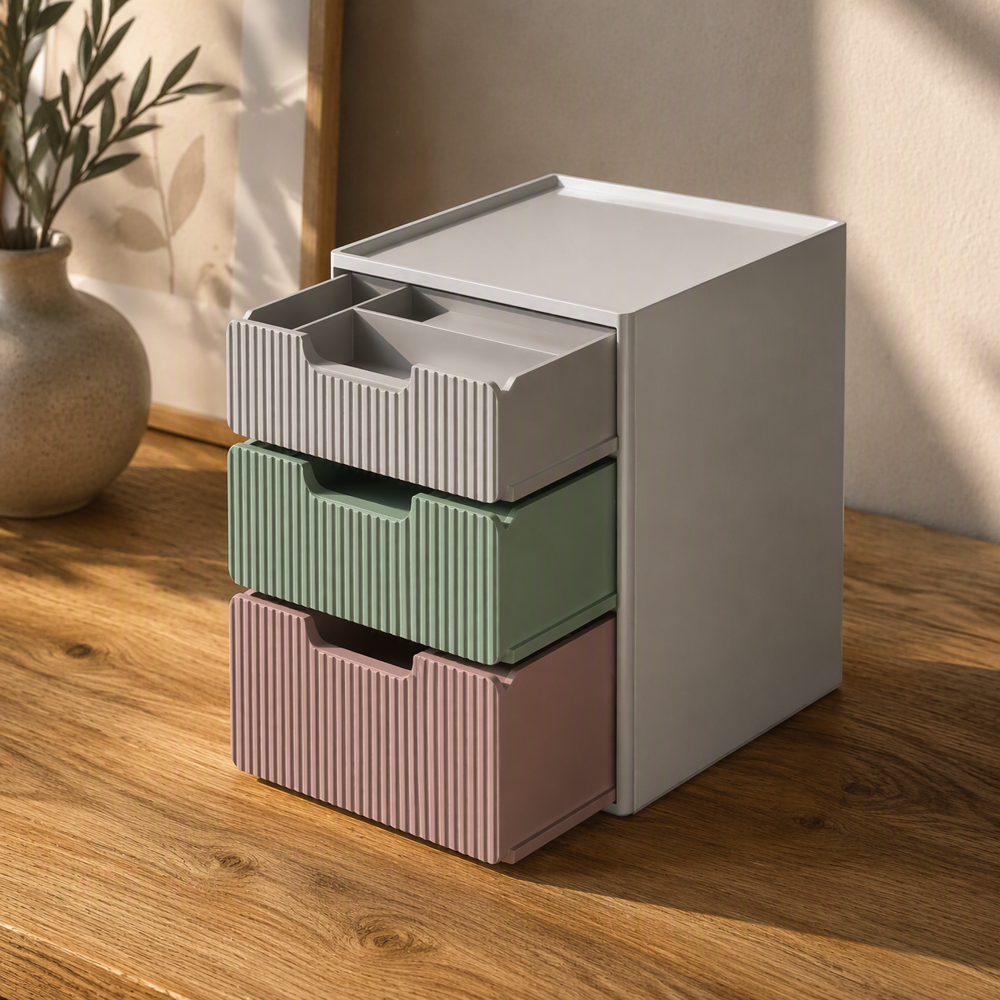
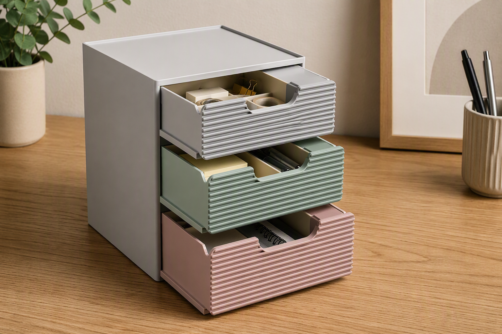
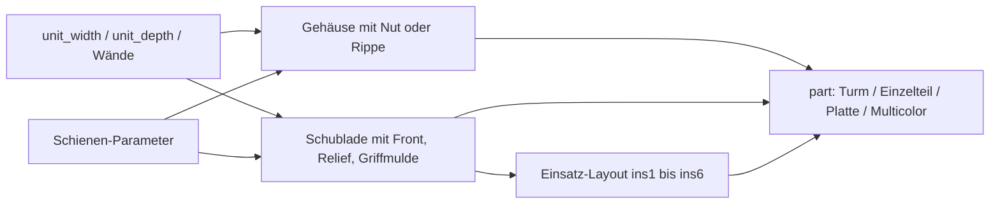
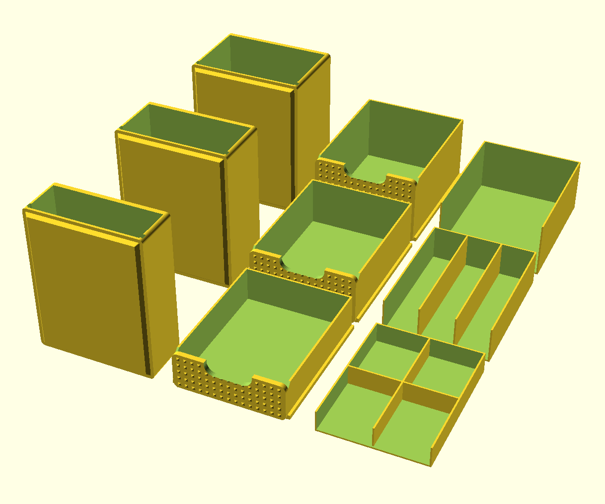

# Stackable Parametric Drawer System – Stapelbare Schubladen mit Schiene und Einsätzen

[← Alle Modelle im Überblick](../../README.de.md)

🌐 [English](README.md) | **Deutsch**

Parametrisches, stapelbares Schubladensystem für den FDM-Druck: rundum
geschlossene Gehäuse mit eingebauter Gleitschiene, höhenverstellbare
Schubladen mit Relief-Front und herausnehmbare Fächer-Einsätze – alles im
MakerWorld-Customizer.

> **Das Modell mit allen Druckprofilen gibt es ausschließlich auf MakerWorld:**
> 👉 [MakerWorld-Link: https://makerworld.com/en/models/3024548-parametric-stackable-drawer-system](https://makerworld.com/en/models/3024548-parametric-stackable-drawer-system)
>
> 

Das **Stackable Parametric Drawer System** besteht aus drei Teiletypen:
Gehäuse, Schublade und Einsatz. Ein Gehäuse ist rundum geschlossen und nur an
der Front offen; die Schublade gleitet auf einer Rippe-in-Nut-Schiene und
rastet an einer kleinen gerundeten Nase ein. Gehäuse nisten sich über einen
45°-Fuß ineinander, sodass ein Turm aus bis zu sechs Ebenen bündig und
ausgerichtet steht. Alle Teile drucken ohne Stützen.

## Inhaltsverzeichnis

- [Das Problem](#das-problem)
- [Die Idee](#die-idee)
- [Highlights](#highlights)
- [Parametrische Optionen](#parametrische-optionen)
- [Konstruktion](#konstruktion)
- [Druckempfehlungen](#druckempfehlungen)
- [Anwendungsbeispiele](#anwendungsbeispiele)
- [Fehlersuche / FAQ](#fehlersuche--faq)
- [Entwicklungsgeschichte](#entwicklungsgeschichte)
- [Downloads](#downloads)
- [Lizenz](#lizenz)

## Das Problem

Schubladenboxen für Schreibtisch, Werkstatt oder Elektronik gibt es viele – sie
passen aber selten zu dem, was du hineinlegen willst:

- Alle Schubladen sind gleich hoch, obwohl Büroklammern flach und Klebebandrollen
  hoch sind.
- Das Fach im Regal ist 120 mm breit, die Box aus dem Laden 135 mm.
- Schubladen klemmen oder wackeln, weil das Spiel nicht zum Drucker passt.
- Schubladen fallen beim Herausziehen aus dem Gehäuse.
- Wenn sich der Bedarf ändert, muss die ganze Box neu gedruckt werden.

## Die Idee

Ein Gehäuse samt Schublade ist eine „Ebene“. Du legst fest, wie viele Ebenen
(1–6) es gibt, wie tief und breit sie sind und wie hoch jede Schublade ist.
Schiene, Hohlraum, Front und Einsätze leiten sich aus diesen Maßen ab.
Fächeraufteilungen kommen als lose, herausnehmbare Einsätze: Ändert sich der
Bedarf, tauschst du den Einsatz statt der Schublade. Alle Maße sind
Millimeter, alle Werte Customizer-Parameter.

## Highlights

- **1–6 Ebenen:** `drawer_count` legt die Zahl der Gehäuse-Schubladen-Paare fest.
- **Höhen einzeln einstellbar:** `h1` bis `h6` für jede Schublade (oben nach
  unten) oder eine einheitliche Höhe mit `uniform_height` und
  `drawer_clear_h`. Flache und tiefe Schubladen lassen sich im selben Turm
  mischen.
- **Umkehrbare Schiene:** `rail_mode` wählt, ob die Nut im Gehäuse und die
  Rippe an der Schublade sitzt oder umgekehrt. Nut und Rippe sind halb so tief
  wie die Wand (`rail_wall_frac`), die Wand wird nie durchgeschnitten.
- **Weiche Rast gegen Herausfallen:** Eine gerundete Nase (`pull_stop`,
  `pull_stop_h`) hält die Schublade, ohne das Einschieben zu blockieren.
- **Stapelbar und selbstzentrierend:** Ein 45°-Fuß nistet in die Tasche der
  Ebene darunter (`stack_lip`, `lip_h`, `lip_wall`, `lip_clear`).
- **Relief-Front:** Diamonds, vertikale Rippen, horizontale Rippen, Dots oder
  Crosshatch (`relief_style`) plus Griffmulde.
- **Zehn Einsatz-Layouts** pro Schublade: offen, 2 oder 3 Fächer (links/rechts
  oder vorne/hinten), 2×2-Raster und vier asymmetrische Layouts mit einem
  großen und zwei geteilten Fächern.
- **Mehrfarbiger Export:** Gehäuse, jede Schublade und Einsätze als eigene
  Farbgruppen.
- **Stützenfrei:** Jedes Teil wird in seiner Druckausrichtung exportiert.

## Parametrische Optionen

Die Namen entsprechen den Customizer-Parametern des Modells.

### Ausgabe (`part`)

| Wert | Ausgabe |
|---|---|
| `0` Assembly preview | Der ganze Turm farbig, nur zur Ansicht (mit rotem „NOT FOR PRINTING“-Banner) |
| `6` Multicolor Export | Alle Teile flach, Gehäuse, jede Schublade und Einsätze in eigenen Farbgruppen |
| `4` Print plate | Ein Gehäuse und eine Schublade nebeneinander |
| `5` All parts flat | Alle Gehäuse, Schubladen und Einsätze auf einer Platte (in Bambu Studio „In Objekte teilen“) |
| `1` Housing | Ein Gehäuse in Druckausrichtung |
| `2` Drawer | Eine Schublade in Druckausrichtung |
| `3` Insert | Ein Einsatz, flach |

| Parameter | Bedeutung | Standard | Bereich / Einheit |
|---|---|---|---|
| `part` | Ausgabemodus, siehe oben | 0 | Auswahl |
| `sel` | Welche Schubladengröße beim Einzelexport (1 = oben) | 1 | 1–6 |
| `preview_open` | Nur Vorschau: wie weit die Schubladen herausgezogen sind | 55 | 0–160 mm |
| `preview_inserts` | Nur Vorschau: Einsätze anzeigen | 1 | 0 = Aus, 1 = An |
| `render_only` | Nur für Renderings: nur eine Materialgruppe ausgeben | 0 | 0 = Alle, 1 = Gehäuse, 2 = Schubladen, 3 = Einsätze |

### Außenmaße

| Parameter | Bedeutung | Standard | Bereich / Einheit |
|---|---|---|---|
| `unit_width` | Außenbreite jeder Ebene | 120 | 70–250 mm |
| `unit_depth` | Außentiefe jeder Ebene (= Auszugsweg) | 150 | 80–320 mm |
| `corner_r` | Rundung der senkrechten Außenkanten, 0 = scharf | 4 | 0–20 mm, Schritt 0,5 |

Breite und Tiefe gelten für alle Ebenen des Turms.

### Schubladen: Anzahl und Höhen

| Parameter | Bedeutung | Standard | Bereich / Einheit |
|---|---|---|---|
| `drawer_count` | Anzahl der Ebenen | 3 | 1–6 |
| `uniform_height` | Eine Höhe für alle statt der Einzelhöhen | 0 | 0 = Einzeln, 1 = Einheitlich |
| `drawer_clear_h` | Nutzhöhe bei einheitlicher Höhe | 50 | 18–160 mm |
| `h1` … `h6` | Nutzhöhe je Schublade (oben nach unten) | 35 / 50 / 70 / 50 / 50 / 50 | 18–160 mm |

### Gehäuse und Wände

| Parameter | Bedeutung | Standard | Bereich / Einheit |
|---|---|---|---|
| `shell_wall` | Seiten- und Rückwand des Gehäuses (mindestens 4, damit die halbe Wand für die Nut bleibt) | 4,0 | 3,2–8,0 mm, Schritt 0,1 |
| `shell_tb` | Gehäuse oben und unten | 2,4 | 1,6–5,0 mm, Schritt 0,1 |
| `drawer_wall` | Schubladenwand (dünn ist bei `rail_mode` 0 ausreichend) | 2,0 | 1,6–8,0 mm, Schritt 0,1 |
| `drawer_floor` | Schubladenboden | 2,0 | 1,6–5,0 mm, Schritt 0,1 |
| `front_t` | Dicke der Frontplatte | 3,0 | 2,0–6,0 mm, Schritt 0,1 |

### Schiene

| Parameter | Bedeutung | Standard | Bereich / Einheit |
|---|---|---|---|
| `rail_mode` | 0 = Nut im Gehäuse + Rippe an der Schublade, 1 = Rippe im Gehäuse + Nut in der Schublade | 0 | Auswahl |
| `rail_h` | Höhe der Schiene | 5,0 | 3,0–10 mm, Schritt 0,1 |
| `rail_wall_frac` | Nut-/Rippentiefe als Anteil der Wandstärke | 0,5 | 0,3–0,6, Schritt 0,05 |
| `rail_clear` | Gleitspiel zwischen Rippe und Nut je Seite | 0,35 | 0,15–0,80 mm, Schritt 0,05 |
| `rail_backstop` | Nut endet so weit vor der Rückwand (Einschubanschlag) | 3,0 | 0–12 mm, Schritt 0,5 |
| `floor_gap` | Abstand des Schubladenbodens über dem Gehäuseboden | 1,2 | 0,4–4,0 mm, Schritt 0,1 |
| `side_gap` | Seitenspiel Schublade zu Gehäusewand je Seite | 1,0 | 0,4–3,0 mm, Schritt 0,1 |
| `top_gap` | Spiel Schubladenoberkante zu Gehäusedecke | 1,2 | 0,4–4,0 mm, Schritt 0,1 |
| `pull_stop` | Rastnase gegen Herausfallen | 1 | 0 = Aus, 1 = An |
| `pull_stop_h` | Überstand der Nase über die Rippe; größer = fester | 0,4 | 0,2–0,8 mm, Schritt 0,05 |

### Stapeln

| Parameter | Bedeutung | Standard | Bereich / Einheit |
|---|---|---|---|
| `stack_lip` | Fuß unten und Tasche oben | 1 | 0 = Aus, 1 = An |
| `lip_h` | Höhe des Fußes bzw. Tiefe der Tasche | 3,0 | 1,5–6,0 mm, Schritt 0,1 |
| `lip_wall` | Einrückung des Rands von der Außenkante | 3,0 | 2,0–6,0 mm, Schritt 0,1 |
| `lip_clear` | Passungsspiel des Fußes je Seite | 0,3 | 0,15–0,60 mm, Schritt 0,05 |
| `stack_gap` | Zusätzlicher Spalt zwischen den Ebenen, 0 = bündig | 0 | 0–8 mm, Schritt 0,5 |

### Front und Griffmulde

| Parameter | Bedeutung | Standard | Bereich / Einheit |
|---|---|---|---|
| `front_gap` | Spalt der Front zur Gehäuseöffnung je Seite | 0,8 | 0,3–2,0 mm, Schritt 0,1 |
| `front_r` | Eckenrundung der Frontplatte | 6 | 0–24 mm, Schritt 0,5 |
| `handle_w_frac` | Breite der Griffmulde als Anteil der Frontbreite | 0,42 | 0,15–0,80, Schritt 0,01 |
| `handle_h` | Tiefe der Griffmulde von oben, 0 = keine | 12 | 0–30 mm, Schritt 0,5 |
| `front_inner_chamfer` | 45°-Fase an der oberen Innenkante der Front | 5 | 0–30 mm, Schritt 0,5 |

### Fronttextur

| Parameter | Bedeutung | Standard | Bereich / Einheit |
|---|---|---|---|
| `relief_style` | Muster der Front | 1 | 0 = Keine, 1 = Diamonds, 2 = Vertikale Rippen, 3 = Horizontale Rippen, 4 = Dots, 5 = Crosshatch |
| `relief_size` | Raster bzw. Abstand des Musters | 7 | 3–16 mm, Schritt 0,5 |
| `relief_depth` | Wie weit das Muster hervorsteht | 0,9 | 0,3–2,0 mm, Schritt 0,1 |

### Einsätze

| Parameter | Bedeutung | Standard | Bereich / Einheit |
|---|---|---|---|
| `ins1` … `ins6` | Einsatz-Layout je Schublade | 3, 2, 0, 0, 0, 0 | 0 bis 9, siehe unten |
| `insert_clear` | Spiel zwischen Einsatz und Schublade je Seite | 0,3 | 0,15–0,80 mm, Schritt 0,05 |
| `insert_wall` | Wandstärke der Einsätze | 1,6 | 1,0–3,0 mm, Schritt 0,1 |
| `insert_floor` | Bodenstärke der Einsätze | 1,6 | 1,0–3,0 mm, Schritt 0,1 |
| `insert_h_ratio` | Einsatzhöhe als Anteil der Schubladen-Nutzhöhe | 1,0 | 0,5–1,0, Schritt 0,01 |
| `insert_open_front` | Vorderwand des Einsatzes weglassen (die Schubladenfront schließt ihn) | 1 | 0 = Geschlossen, 1 = Offen |
| `insert_split_frac` | Größe des einzelnen Fachs bei den Layouts 6–9 als Anteil der Achse | 0,4 | 0,25–0,60, Schritt 0,05 |

Einsatz-Layouts: `0` offen, `1` 2 Fächer links/rechts, `2` 3 Fächer
links/rechts, `3` 2×2-Raster, `4` 2 Fächer vorne/hinten, `5` 3 Fächer
vorne/hinten, `6` ein Fach links + 2 rechts, `7` ein Fach rechts + 2 links,
`8` ein Fach hinten + 2 vorne, `9` ein Fach vorne + 2 hinten.

## Konstruktion

### OpenSCAD-Ansatz

Das Modell ist reines OpenSCAD ohne externe Bibliotheken und läuft im
MakerWorld-Customizer. Ein `part`-Selektor entscheidet, ob der Turm als
Vorschau, ein Einzelteil oder eine ganze Druckplatte ausgegeben wird. Die
Einzelteile sind bereits in ihre Druckausrichtung gedreht.

### Parametrische Logik

Aus Breite, Tiefe, Wänden und Spielen leiten sich alle Maße ab:

| Größe | Formel / Regel |
|---|---|
| Hohlraumbreite | `unit_width` − 2 × `shell_wall` |
| Hohlraumtiefe | `unit_depth` − `shell_wall` (vorne offen) |
| Schubladenkörper, Breite | Hohlraumbreite − 2 × `side_gap` |
| Schubladenkörper, Tiefe | Hohlraumtiefe − `rail_backstop` − `front_t` − 0,6 mm |
| Frontbreite | Hohlraumbreite − 2 × `front_gap` |
| Nut-/Rippentiefe | Wand × `rail_wall_frac` (bei `rail_mode` 0 die Gehäusewand, sonst die Schubladenwand) |
| Rippenüberstand | `side_gap` + Nuttiefe − `rail_clear` |
| Schubladenhöhe außen | Nutzhöhe + `drawer_floor` |
| Hohlraumhöhe | Schubladenhöhe außen + `top_gap` + `floor_gap` |
| Gehäusedecke | mit Stapelrand: max(`shell_tb`, `lip_h` + 1,6 mm); sonst `shell_tb` |
| Ebenenhöhe | Hohlraumhöhe + `shell_tb` + Gehäusedecke |
| Einsatz, Breite und Tiefe | Schubladenkörper − 2 × `drawer_wall` − 2 × `insert_clear` |

Mit den Voreinstellungen (120 × 150 mm, drei Schubladen mit 35 / 50 / 70 mm
Nutzhöhe) ergeben sich: Hohlraum 112 × 146 mm, Schubladenkörper 110 × 139,4 mm,
Nut- und Rippentiefe 2,0 mm, Ebenenhöhen 46,4 / 61,4 / 81,4 mm und eine
Turmhöhe von rund 189,2 mm. Der Einsatz misst 105,4 × 134,8 mm; seine Höhe wird
unter die Griffmulde begrenzt (21,4 / 36,4 / 56,4 mm für die drei
Schubladenhöhen).

Die Werte sind aus den Formeln und den Standardwerten abgeleitet.

### Besondere Algorithmen

- **Schiene mit halber Wandtiefe:** Nut und Rippe sind höchstens so tief wie
  die halbe Wand. Deshalb bleibt immer mindestens die halbe Wand stehen,
  auch wenn die Nut im Gehäuse sitzt.
- **Bündiges Schließen garantiert:** Die Schubladentiefe wird aus
  `rail_backstop` abgeleitet, mit einer festen Reserve von 0,6 mm. Zwei
  `assert`-Prüfungen melden, wenn extreme Einstellungen das Schließen verhindern
  würden (`rail_backstop` zu groß oder zu wenig Schubladentiefe).
- **Rastnase als Kugel:** Eine Kugel mit dem Radius `rail_clear` +
  Überstand (`pull_stop_h`, intern höchstens 0,6 mm) sitzt rund 8 mm hinter
  der Vorderkante an der Schiene; die Hälfte steckt in der Wand bzw. Rippe. Die
  Rippe biegt sich beim Einschieben leicht über die Nase und wird beim
  Herausziehen weich gehalten.
- **45°-Fuß und Tasche:** Der Fuß unten ist ein abgeschrägter Stumpf mit
  45°-Flanke (Hülle aus zwei abgerundeten Rechtecken), die Tasche oben ist die
  passende Negativform. Beides ist selbsttragend und
  zentriert die Ebenen beim Stapeln. Die Decke ist dicker als die Tasche, damit
  das Gehäuse oben geschlossen bleibt.
- **Front und Relief:** Die Frontplatte überlappt die Vorderwand der Schublade um
  die Wandstärke, damit beide immer zu einem Körper verschmelzen. Das Muster
  ist auf die abgerundete Kontur der Frontplatte zugeschnitten und läuft
  sauber bis zum oberen Rand.
- **Griffmulde durch alles:** Die Mulde schneidet durch Frontplatte, Relief und
  Vorderwand der Schublade, damit hinter dem Griff echter Platz für die Finger
  bleibt.
- **Einsatzhöhe unter der Mulde:** Die Höhe der Einsätze wird so begrenzt, dass
  ihre Oberkante etwa 2 mm unter der Griffmulde bleibt.
- **Asymmetrische Einsätze:** Eine durchgehende Trennwand grenzt das einzelne
  Fach ab (`insert_split_frac`), eine halbe Querwand teilt die übrige Spalte
  oder Reihe in zwei Fächer.

### Modularität

Der Code trennt Gehäuse, Schublade, Einsatz, Frontrelief und die Trennwand-
Bausteine der Einsätze. Die Druckausrichtung ist in eigenen Transformationen
gekapselt. Der Turm wird aus denselben Modulen zusammengesetzt wie die
Druckplatten; dadurch zeigt die Vorschau immer genau das, was gedruckt wird.
Eine Start-Kamera zeigt Turm bzw. Platte mittig.

### Druckoptimierungen

- **Gehäuse auf der Rückseite:** Die Öffnung zeigt nach oben, die Schiene läuft
  senkrecht, der 45°-Fuß ist selbsttragend – keine Stützen.
- **Schublade flach, Öffnung oben:** Eine offene Kiste, die Front steht als
  senkrechte Wand. Auf der Rückseite würde die Front über der offenen Wanne
  frei überhängen.
- **Einsätze flach:** Offene Wannen ohne Überhänge.
- **Innenfase an der Front** (`front_inner_chamfer`) gegen scharfe Kanten.
- **Mehrfarbdruck ohne AMS möglich:** Gehäuse und Schubladen getrennt in
  verschiedenen Farben drucken.

## Druckempfehlungen

Die Profile sind für den **Bambu Lab P1S** mit Bambu PLA Basic erstellt und im
Bambu Studio testgeslict (0,20 mm Layerhöhe, 3 Wände, Gyroid 15 %). Das Modell
ist für P1S, P2S und H2C ausgelegt und lässt sich auf jedem FDM-Drucker drucken.

| Teil | Layerhöhe | Wände | Infill | Supports |
|---|---|---|---|---|
| Gehäuse | 0,20 mm | 3–4 | 15–20 % | keine |
| Schublade | 0,20 mm | 3 | 15 % | keine |
| Einsatz | 0,20 mm | 2–3 | 10–15 % | keine |

**Besondere Hinweise**

- **Material:** PLA oder PETG; bei PETG `rail_clear` und `insert_clear` leicht
  erhöhen. Für feinste Rippenstruktur 0,16 mm Layerhöhe.
- **Bauhöhe prüfen:** Gehäuse und Schublade werden gestellt gedruckt. Die
  Bauhöhe entspricht etwa `unit_depth`; die Grundfläche etwa `unit_width` ×
  Höhe der Ebene.
- **Erst testen:** Drucke ein Gehäuse und eine Schublade und prüfe das
  Gleitspiel, bevor du den ganzen Turm druckst.
- **Mehrfarbiger Export (`part` = 6):** STL **direkt aus der
  OpenSCAD-Vorschau** exportieren, ohne F6/Render und ohne Kommandozeile,
  damit jede Farbgruppe ein eigenes Teil bleibt. Bei drei Schubladen sind das
  fünf Farbgruppen (Gehäuse, drei Schubladen, Einsätze); mehr als vier Farben
  brauchen einen AMS-Hub oder den H2C.
- **Alle Teile auf einer Platte (`part` = 5):** Im Bambu Studio „In Objekte
  teilen“ wählen.
- **Slicer-Kompensation:** Ist eine Passung etwas zu stramm, kann die
  X/Y-Lochkompensation des Slicers helfen, statt das Modell zu ändern.

## Anwendungsbeispiele

- **Schreibtisch-Organizer:** Büroklammern, Klebeband, Stifte und Notizzettel in
  Schubladen mit passenden Einsätzen.
- **Elektronik und Homelab:** Widerstände, Schrauben, Stecker und SSDs, sortiert
  in Fächern; flache Schubladen für Kleinteile, tiefe für Kabel.
- **Werkstatt und Bastelecke:** Bits, Dübel, Perlen oder Nähzubehör.
- **Regalfach nach Maß:** Breite und Tiefe an das Fach anpassen.
- **Farbcodierter Turm:** Jede Schublade in eigener Farbe in einem neutralen
  Gehäuse.
- **Wachsender Turm:** Mit `drawer_count` und weiteren gedruckten Ebenen wächst
  das System mit.
- **Schmale Variante:** 90 × 130 mm für engere Regale.

## Fehlersuche / FAQ

| Symptom | Ursache | Fix |
|---|---|---|
| Schublade klemmt oder geht schwer | Gleitspiel zu klein | `rail_clear` um 0,05 mm erhöhen, ggf. auch `side_gap` und `top_gap` |
| Schublade wackelt | Gleitspiel zu groß | `rail_clear` um 0,05 mm verringern |
| Schublade fällt heraus | Rastnase zu klein oder aus | `pull_stop` einschalten, `pull_stop_h` erhöhen (0,5–0,7) |
| Schublade lässt sich nicht einschieben | Rastnase zu groß | `pull_stop_h` verringern (z. B. 0,3) oder `pull_stop` ausschalten |
| Stapel wackelt | Fuß sitzt zu locker in der Tasche | `lip_clear` verringern (z. B. 0,2) |
| Ebenen passen nicht aufeinander | Fuß zu stramm | `lip_clear` erhöhen (z. B. 0,4) |
| Einsatz klemmt | Zu wenig Spiel | `insert_clear` erhöhen (z. B. 0,4) |
| Griffmulde zu knapp | Mulde zu flach oder schmal | `handle_h` auf 14–16, `handle_w_frac` auf 0,45 erhöhen |
| Nut schneidet die Wand durch | Wand zu dünn | `shell_wall` (bei `rail_mode` 1 `drawer_wall`) auf mindestens 4 mm, `rail_wall_frac` höchstens 0,5 |
| Meldung „rail_backstop too large“ | Schublade würde nicht bündig schließen | `rail_backstop` verringern |
| Meldung „Too little drawer depth“ | Zu wenig Schubladentiefe | `unit_depth` erhöhen oder `rail_backstop` verringern |
| Zweifarb-STL hat nur eine Farbe | Export über F6/Render oder Kommandozeile | STL direkt aus der Vorschau exportieren |
| Vorschau zeigt „NOT FOR PRINTING“ | `part` = 0 ist nur Ansicht | `part` auf 1–6 setzen |
| Einsatz ragt nicht bis zum Rand | Höhe wird unter die Griffmulde begrenzt | `handle_h` verringern |

## Entwicklungsgeschichte

Die ersten Renderings des Systems stammen vom 7. Juli 2026: der
zusammengebaute Turm in der Standardkonfiguration, die Rippenvariante und die
Druckausrichtung der Teile. Am 10. Juli folgten die asymmetrischen Einsätze mit
einem großen und zwei geteilten Fächern (`insert_split_frac`) sowie eine
ausführliche Parameteranleitung; am 11. Juli entstanden Renderings des
Dreier-Turms geschlossen und geöffnet. Anfang August 2026 entstanden die Studio-Renderings
sowie zwei Varianten mit P1S-Druckprofilen: „standard“ mit 120 × 150 mm und
„schmal“ mit 90 × 130 mm. Die letzte Änderung am Modell stammt vom 21. August
2026; der aktuelle Stand enthält den mehrfarbigen Export mit eigener Farbe je
Schublade.

Die Bilder in diesem Repository sind Renderings der Modellgeometrie
beziehungsweise daraus abgeleitete Szenenbilder; Druckfotos sind nicht dabei.
Gegenstände auf den Schreibtisch-Bildern sind illustrativ.

## Downloads

Print files are intentionally available exclusively on MakerWorld.

👉 MakerWorld-Link: https://makerworld.com/en/models/3024548-parametric-stackable-drawer-system

Profil: <https://makerworld.com/en/@BetaHydri>

## Lizenz

Dokumentation und Bilder in diesem Repository: © BetaHydri. Das Modell (inkl.
Quellcode) und alle Druckdateien werden ausschließlich über MakerWorld unter
der dort angegebenen Lizenz verteilt. Dieses Repository enthält bewusst keine
Modell-, Quellcode- oder Druckdateien.
