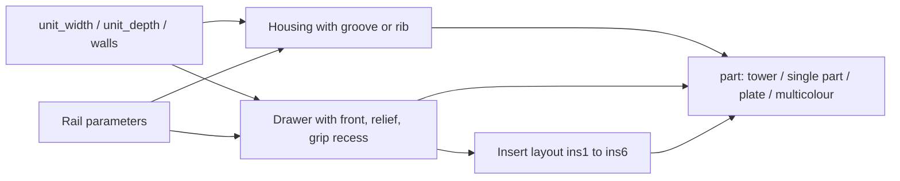

# Stackable Parametric Drawer System – Stackable Drawers with Rail and Inserts

[← All models](../../README.md)

🌐 **English** | [Deutsch](README.de.md)

Parametric, stackable drawer system for FDM printing: fully enclosed housings
with a built-in sliding rail, height-adjustable drawers with a relief front and
removable compartment inserts – all in the MakerWorld Customizer.

> **The model with all print profiles is available exclusively on MakerWorld:**
> 👉 [MakerWorld link: https://makerworld.com/en/models/3024548-parametric-stackable-drawer-system](https://makerworld.com/en/models/3024548-parametric-stackable-drawer-system)
>
> 

The **Stackable Parametric Drawer System** consists of three part types:
housing, drawer and insert. A housing is fully enclosed and open only at the
front; the drawer slides on a rib-in-groove rail and snaps into place at a small
rounded detent. Housings nest into each other via a 45° foot, so that a tower of
up to six levels stands flush and aligned. All parts print without supports.

## Table of Contents

- [The Problem](#the-problem)
- [The Idea](#the-idea)
- [Highlights](#highlights)
- [Parametric Options](#parametric-options)
- [Design](#design)
- [Print Recommendations](#print-recommendations)
- [Use Cases](#use-cases)
- [Troubleshooting / FAQ](#troubleshooting--faq)
- [Development History](#development-history)
- [Downloads](#downloads)
- [License](#license)

## The Problem

There are plenty of drawer boxes for the desk, workshop or electronics – but they
rarely suit what you want to put in them:

- All drawers are the same height, even though paper clips are flat and rolls of
  tape are tall.
- The shelf compartment is 120 mm wide, the box from the shop 135 mm.
- Drawers jam or wobble because the clearance does not suit the printer.
- Drawers fall out of the housing when pulled out.
- When your needs change, the whole box has to be printed again.

## The Idea

A housing together with a drawer is one "level". You decide how many levels
(1–6) there are, how deep and wide they are and how tall each drawer is. Rail,
cavity, front and inserts are derived from these dimensions. Compartment layouts
come as loose, removable inserts: when your needs change, you swap the insert
instead of the drawer. All dimensions are in millimetres, all values are
Customizer parameters.

## Highlights

- **1–6 levels:** `drawer_count` sets the number of housing-drawer pairs.
- **Individually adjustable heights:** `h1` to `h6` for each drawer (top to
  bottom) or a uniform height with `uniform_height` and `drawer_clear_h`. Flat
  and deep drawers can be mixed in the same tower.
- **Reversible rail:** `rail_mode` selects whether the groove sits in the
  housing and the rib on the drawer or vice versa. Groove and rib are half as
  deep as the wall (`rail_wall_frac`); the wall is never cut through.
- **Soft detent against falling out:** A rounded bump (`pull_stop`,
  `pull_stop_h`) holds the drawer without blocking insertion.
- **Stackable and self-centring:** A 45° foot nests into the pocket of the level
  below (`stack_lip`, `lip_h`, `lip_wall`, `lip_clear`).
- **Relief front:** Diamonds, vertical ribs, horizontal ribs, Dots or Crosshatch
  (`relief_style`) plus a grip recess.
- **Ten insert layouts** per drawer: open, 2 or 3 compartments (left/right or
  front/back), 2×2 grid and four asymmetric layouts with one large and two
  divided compartments.
- **Multicolour export:** Housing, each drawer and inserts as separate colour
  groups.
- **Support-free:** Every part is exported in its print orientation.

## Parametric Options

The names correspond to the model's Customizer parameters.

### Output (`part`)

| Value | Output |
|---|---|
| `0` Assembly preview | The whole tower in colour, for viewing only (with a red "NOT FOR PRINTING" banner) |
| `6` Multicolor Export | All parts flat, housing, each drawer and inserts in separate colour groups |
| `4` Print plate | One housing and one drawer side by side |
| `5` All parts flat | All housings, drawers and inserts on one plate (in Bambu Studio "Split to Objects") |
| `1` Housing | One housing in print orientation |
| `2` Drawer | One drawer in print orientation |
| `3` Insert | One insert, flat |

| Parameter | Meaning | Default | Range / Unit |
|---|---|---|---|
| `part` | Output mode, see above | 0 | Selection |
| `sel` | Which drawer size for single-part export (1 = top) | 1 | 1–6 |
| `preview_open` | Preview only: how far the drawers are pulled out | 55 | 0–160 mm |
| `preview_inserts` | Preview only: show inserts | 1 | 0 = Off, 1 = On |
| `render_only` | For renderings only: output just one material group | 0 | 0 = All, 1 = Housings, 2 = Drawers, 3 = Inserts |

### Outer Dimensions

| Parameter | Meaning | Default | Range / Unit |
|---|---|---|---|
| `unit_width` | Outer width of each level | 120 | 70–250 mm |
| `unit_depth` | Outer depth of each level (= extension travel) | 150 | 80–320 mm |
| `corner_r` | Rounding of the vertical outer edges, 0 = sharp | 4 | 0–20 mm, step 0.5 |

Width and depth apply to all levels of the tower.

### Drawers: Number and Heights

| Parameter | Meaning | Default | Range / Unit |
|---|---|---|---|
| `drawer_count` | Number of levels | 3 | 1–6 |
| `uniform_height` | One height for all instead of the individual heights | 0 | 0 = Individual, 1 = Uniform |
| `drawer_clear_h` | Usable height with uniform height | 50 | 18–160 mm |
| `h1` … `h6` | Usable height per drawer (top to bottom) | 35 / 50 / 70 / 50 / 50 / 50 | 18–160 mm |

### Housing and Walls

| Parameter | Meaning | Default | Range / Unit |
|---|---|---|---|
| `shell_wall` | Side and back wall of the housing (at least 4, so that half the wall remains for the groove) | 4.0 | 3.2–8.0 mm, step 0.1 |
| `shell_tb` | Housing top and bottom | 2.4 | 1.6–5.0 mm, step 0.1 |
| `drawer_wall` | Drawer wall (thin is sufficient with `rail_mode` 0) | 2.0 | 1.6–8.0 mm, step 0.1 |
| `drawer_floor` | Drawer floor | 2.0 | 1.6–5.0 mm, step 0.1 |
| `front_t` | Thickness of the front panel | 3.0 | 2.0–6.0 mm, step 0.1 |

### Rail

| Parameter | Meaning | Default | Range / Unit |
|---|---|---|---|
| `rail_mode` | 0 = groove in the housing + rib on the drawer, 1 = rib in the housing + groove in the drawer | 0 | Selection |
| `rail_h` | Height of the rail | 5.0 | 3.0–10 mm, step 0.1 |
| `rail_wall_frac` | Groove/rib depth as a fraction of the wall thickness | 0.5 | 0.3–0.6, step 0.05 |
| `rail_clear` | Sliding clearance between rib and groove per side | 0.35 | 0.15–0.80 mm, step 0.05 |
| `rail_backstop` | Groove ends this far before the back wall (insertion stop) | 3.0 | 0–12 mm, step 0.5 |
| `floor_gap` | Distance of the drawer floor above the housing floor | 1.2 | 0.4–4.0 mm, step 0.1 |
| `side_gap` | Side clearance drawer to housing wall per side | 1.0 | 0.4–3.0 mm, step 0.1 |
| `top_gap` | Clearance drawer top edge to housing ceiling | 1.2 | 0.4–4.0 mm, step 0.1 |
| `pull_stop` | Detent bump against falling out | 1 | 0 = Off, 1 = On |
| `pull_stop_h` | Protrusion of the bump beyond the rib; larger = firmer | 0.4 | 0.2–0.8 mm, step 0.05 |

### Stacking

| Parameter | Meaning | Default | Range / Unit |
|---|---|---|---|
| `stack_lip` | Foot at the bottom and pocket at the top | 1 | 0 = Off, 1 = On |
| `lip_h` | Height of the foot or depth of the pocket | 3.0 | 1.5–6.0 mm, step 0.1 |
| `lip_wall` | Inset of the rim from the outer edge | 3.0 | 2.0–6.0 mm, step 0.1 |
| `lip_clear` | Fit clearance of the foot per side | 0.3 | 0.15–0.60 mm, step 0.05 |
| `stack_gap` | Additional gap between the levels, 0 = flush | 0 | 0–8 mm, step 0.5 |

### Front and Grip Recess

| Parameter | Meaning | Default | Range / Unit |
|---|---|---|---|
| `front_gap` | Gap of the front to the housing opening per side | 0.8 | 0.3–2.0 mm, step 0.1 |
| `front_r` | Corner rounding of the front panel | 6 | 0–24 mm, step 0.5 |
| `handle_w_frac` | Width of the grip recess as a fraction of the front width | 0.42 | 0.15–0.80, step 0.01 |
| `handle_h` | Depth of the grip recess from the top, 0 = none | 12 | 0–30 mm, step 0.5 |
| `front_inner_chamfer` | 45° chamfer on the upper inner edge of the front | 5 | 0–30 mm, step 0.5 |

### Front Texture

| Parameter | Meaning | Default | Range / Unit |
|---|---|---|---|
| `relief_style` | Pattern of the front | 1 | 0 = None, 1 = Diamonds, 2 = Vertical ribs, 3 = Horizontal ribs, 4 = Dots, 5 = Crosshatch |
| `relief_size` | Grid or spacing of the pattern | 7 | 3–16 mm, step 0.5 |
| `relief_depth` | How far the pattern protrudes | 0.9 | 0.3–2.0 mm, step 0.1 |

### Inserts

| Parameter | Meaning | Default | Range / Unit |
|---|---|---|---|
| `ins1` … `ins6` | Insert layout per drawer | 3, 2, 0, 0, 0, 0 | 0 to 9, see below |
| `insert_clear` | Clearance between insert and drawer per side | 0.3 | 0.15–0.80 mm, step 0.05 |
| `insert_wall` | Wall thickness of the inserts | 1.6 | 1.0–3.0 mm, step 0.1 |
| `insert_floor` | Floor thickness of the inserts | 1.6 | 1.0–3.0 mm, step 0.1 |
| `insert_h_ratio` | Insert height as a fraction of the drawer's usable height | 1.0 | 0.5–1.0, step 0.01 |
| `insert_open_front` | Omit the front wall of the insert (the drawer front closes it) | 1 | 0 = Closed, 1 = Open |
| `insert_split_frac` | Size of the single compartment for layouts 6–9 as a fraction of the axis | 0.4 | 0.25–0.60, step 0.05 |

Insert layouts: `0` open, `1` 2 compartments left/right, `2` 3 compartments
left/right, `3` 2×2 grid, `4` 2 compartments front/back, `5` 3 compartments
front/back, `6` one compartment left + 2 right, `7` one compartment right + 2
left, `8` one compartment at the back + 2 at the front, `9` one compartment at
the front + 2 at the back.

## Design

### OpenSCAD Approach

The model is pure OpenSCAD without external libraries and runs in the
MakerWorld Customizer. A `part` selector decides whether the tower is output as
a preview, a single part or a whole print plate. The individual parts are
already rotated into their print orientation.

### Parametric Logic

All dimensions are derived from width, depth, walls and clearances:

| Quantity | Formula / Rule |
|---|---|
| Cavity width | `unit_width` − 2 × `shell_wall` |
| Cavity depth | `unit_depth` − `shell_wall` (open at the front) |
| Drawer body, width | cavity width − 2 × `side_gap` |
| Drawer body, depth | cavity depth − `rail_backstop` − `front_t` − 0.6 mm |
| Front width | cavity width − 2 × `front_gap` |
| Groove/rib depth | wall × `rail_wall_frac` (with `rail_mode` 0 the housing wall, otherwise the drawer wall) |
| Rib protrusion | `side_gap` + groove depth − `rail_clear` |
| Drawer height, outside | usable height + `drawer_floor` |
| Cavity height | drawer height outside + `top_gap` + `floor_gap` |
| Housing ceiling | with stacking rim: max(`shell_tb`, `lip_h` + 1.6 mm); otherwise `shell_tb` |
| Level height | cavity height + `shell_tb` + housing ceiling |
| Insert, width and depth | drawer body − 2 × `drawer_wall` − 2 × `insert_clear` |

With the default settings (120 × 150 mm, three drawers with 35 / 50 / 70 mm
usable height) this gives: cavity 112 × 146 mm, drawer body 110 × 139.4 mm,
groove and rib depth 2.0 mm, level heights 46.4 / 61.4 / 81.4 mm and a tower
height of around 189.2 mm. The insert measures 105.4 × 134.8 mm; its height is
limited to below the grip recess (21.4 / 36.4 / 56.4 mm for the three drawer
heights).

The values are derived from the formulas and the default values.

### Special Algorithms

- **Rail at half wall depth:** Groove and rib are at most as deep as half the
  wall. Therefore at least half the wall always remains, even when the groove
  sits in the housing.
- **Flush closing guaranteed:** The drawer depth is derived from
  `rail_backstop`, with a fixed reserve of 0.6 mm. Two `assert` checks report
  when extreme settings would prevent closing (`rail_backstop` too large or too
  little drawer depth).
- **Detent bump as a sphere:** A sphere with the radius `rail_clear` + protrusion
  (`pull_stop_h`, internally at most 0.6 mm) sits about 8 mm behind the front
  edge on the rail; half of it is embedded in the wall or rib. The rib flexes
  slightly over the bump during insertion and is held softly when pulled out.
- **45° foot and pocket:** The foot at the bottom is a chamfered frustum with a
  45° flank (hull of two rounded rectangles); the pocket at the top is the
  matching negative shape. Both are self-supporting and centre the levels when
  stacking. The ceiling is thicker than the pocket so that the housing stays
  closed at the top.
- **Front and relief:** The front panel overlaps the front wall of the drawer by
  the wall thickness so that both always fuse into one body. The pattern is
  trimmed to the rounded contour of the front panel and runs cleanly up to the
  top edge.
- **Grip recess through everything:** The recess cuts through the front panel,
  relief and the front wall of the drawer so that there is real room for the
  fingers behind the grip.
- **Insert height below the recess:** The height of the inserts is limited so
  that their top edge stays about 2 mm below the grip recess.
- **Asymmetric inserts:** A continuous partition separates the single
  compartment (`insert_split_frac`); a half cross wall divides the remaining
  column or row into two compartments.

### Modularity

The code separates housing, drawer, insert, front relief and the partition
building blocks of the inserts. The print orientation is encapsulated in its own
transformations. The tower is assembled from the same modules as the print
plates; as a result, the preview always shows exactly what is printed. A start
camera shows the tower or plate centred.

### Print Optimisations

- **Housing on its back:** The opening faces up, the rail runs vertically, the
  45° foot is self-supporting – no supports.
- **Drawer flat, opening up:** An open box, the front stands as a vertical wall.
  On its back, the front would overhang freely above the open tray.
- **Inserts flat:** Open trays without overhangs.
- **Inner chamfer on the front** (`front_inner_chamfer`) against sharp edges.
- **Multicolour printing possible without an AMS:** Print housing and drawers
  separately in different colours.

## Print Recommendations

The profiles are created for the **Bambu Lab P1S** with Bambu PLA Basic and
test-sliced in Bambu Studio (0.20 mm layer height, 3 walls, gyroid 15 %). The
model is designed for P1S, P2S and H2C and can be printed on any FDM printer.

| Part | Layer height | Walls | Infill | Supports |
|---|---|---|---|---|
| Housing | 0.20 mm | 3–4 | 15–20 % | none |
| Drawer | 0.20 mm | 3 | 15 % | none |
| Insert | 0.20 mm | 2–3 | 10–15 % | none |

**Special notes**

- **Material:** PLA or PETG; with PETG, increase `rail_clear` and `insert_clear`
  slightly. For the finest rib structure, use 0.16 mm layer height.
- **Check the build height:** Housing and drawer are printed standing. The build
  height corresponds to approximately `unit_depth`; the footprint to approximately
  `unit_width` × level height.
- **Test first:** Print one housing and one drawer and check the sliding
  clearance before printing the whole tower.
- **Multicolour export (`part` = 6):** Export the STL **directly from the
  OpenSCAD preview**, without F6/Render and without the command line, so that
  each colour group remains a separate part. With three drawers, that is five
  colour groups (housing, three drawers, inserts); more than four colours need an
  AMS hub or the H2C.
- **All parts on one plate (`part` = 5):** In Bambu Studio, choose "Split to
  Objects".
- **Slicer compensation:** If a fit is slightly too tight, the slicer's X/Y hole
  compensation can help instead of changing the model.

## Use Cases

- **Desk organiser:** Paper clips, tape, pens and notepads in drawers with
  matching inserts.
- **Electronics and homelab:** Resistors, screws, connectors and SSDs, sorted in
  compartments; flat drawers for small parts, deep ones for cables.
- **Workshop and craft corner:** Bits, wall plugs, beads or sewing supplies.
- **Custom-fit shelf compartment:** Adapt width and depth to the compartment.
- **Colour-coded tower:** Each drawer in its own colour in a neutral housing.
- **Growing tower:** With `drawer_count` and further printed levels, the system
  grows with you.
- **Narrow variant:** 90 × 130 mm for tighter shelves.

## Troubleshooting / FAQ

| Symptom | Cause | Fix |
|---|---|---|
| Drawer jams or is stiff | Sliding clearance too small | Increase `rail_clear` by 0.05 mm, possibly also `side_gap` and `top_gap` |
| Drawer wobbles | Sliding clearance too large | Decrease `rail_clear` by 0.05 mm |
| Drawer falls out | Detent bump too small or off | Turn on `pull_stop`, increase `pull_stop_h` (0.5–0.7) |
| Drawer cannot be inserted | Detent bump too large | Decrease `pull_stop_h` (e.g. 0.3) or turn off `pull_stop` |
| Stack wobbles | Foot sits too loosely in the pocket | Decrease `lip_clear` (e.g. 0.2) |
| Levels do not fit onto each other | Foot too tight | Increase `lip_clear` (e.g. 0.4) |
| Insert jams | Too little clearance | Increase `insert_clear` (e.g. 0.4) |
| Grip recess too tight | Recess too shallow or narrow | Increase `handle_h` to 14–16, `handle_w_frac` to 0.45 |
| Groove cuts through the wall | Wall too thin | `shell_wall` (with `rail_mode` 1 `drawer_wall`) to at least 4 mm, `rail_wall_frac` at most 0.5 |
| Message "rail_backstop too large" | Drawer would not close flush | Decrease `rail_backstop` |
| Message "Too little drawer depth" | Too little drawer depth | Increase `unit_depth` or decrease `rail_backstop` |
| Two-colour STL has only one colour | Export via F6/Render or command line | Export the STL directly from the preview |
| Preview shows "NOT FOR PRINTING" | `part` = 0 is for viewing only | Set `part` to 1–6 |
| Insert does not reach the edge | Height is limited to below the grip recess | Decrease `handle_h` |

## Development History

The first renderings of the system date from 7 July 2026: the assembled tower in
the default configuration, the ribbed variant and the print orientation of the
parts. On 10 July, the asymmetric inserts with one large and two divided
compartments (`insert_split_frac`) followed, as well as a detailed parameter
guide; on 11 July, renderings of the three-drawer tower closed and open were
created. In early August 2026, the studio renderings and two variants with P1S
print profiles were created: "standard" at 120 × 150 mm and "narrow" at
90 × 130 mm. The last change to the model dates from 21 August 2026; the current
version includes the multicolour export with its own colour per drawer.

The images in this repository are renderings of the model geometry or scene
images derived from it; no photos of prints are included. Objects in the desk
images are illustrative.

## Downloads

Print files are intentionally available exclusively on MakerWorld.

👉 MakerWorld link: https://makerworld.com/en/models/3024548-parametric-stackable-drawer-system

Profile: <https://makerworld.com/en/@BetaHydri>

## License

Documentation and images in this repository: © BetaHydri. The model (including
source code) and all print files are distributed exclusively via MakerWorld
under the license stated there. This repository deliberately contains no model,
source code or print files.
